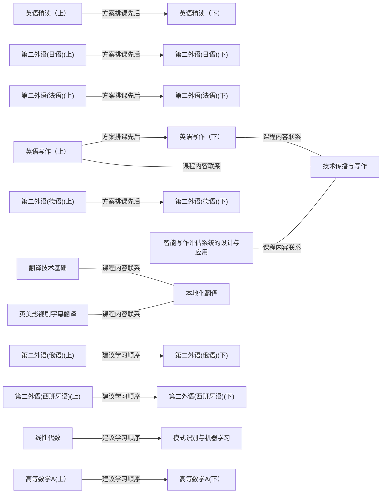

# 2025翻译-计算机科学与技术双学士学位项目培养方案

外国语言文学学院 · 翻译-计算机科学与技术(双学士学位项目) · 方案 96911 · 72 个不同课程或科研条目。

[官方 Word](https://github.com/pythonbug225/fudan-course-atlas/blob/research/schoolwide-cohorts-2023-2025/research/contributions/%E5%85%A8%E6%A0%A1%E5%9F%B9%E5%85%BB%E6%96%B9%E6%A1%882023-2025/%E5%B7%B2%E6%9C%89%E9%99%A2%E7%B3%BB%E8%A7%84%E8%8C%83%E6%95%B0%E6%8D%AE/%E5%A4%96%E5%9B%BD%E8%AF%AD%E8%A8%80%E6%96%87%E5%AD%A6%E5%AD%A6%E9%99%A2/2025/originals/plan-96911.docx) · [教务详情](https://fdjwgl.fudan.edu.cn/manager/bizType/2/major-program-search/info/96911?skipAuth=1) · [方案快照](https://github.com/pythonbug225/fudan-course-atlas/blob/research/schoolwide-cohorts-2023-2025/research/contributions/%E5%85%A8%E6%A0%A1%E5%9F%B9%E5%85%BB%E6%96%B9%E6%A1%882023-2025/%E5%B7%B2%E6%9C%89%E9%99%A2%E7%B3%BB%E8%A7%84%E8%8C%83%E6%95%B0%E6%8D%AE/%E5%A4%96%E5%9B%BD%E8%AF%AD%E8%A8%80%E6%96%87%E5%AD%A6%E5%AD%A6%E9%99%A2/2025/raw/plan-96911.json.gz) · [年级目录](https://github.com/pythonbug225/fudan-course-atlas/blob/research/schoolwide-cohorts-2023-2025/research/contributions/%E5%85%A8%E6%A0%A1%E5%9F%B9%E5%85%BB%E6%96%B9%E6%A1%882023-2025/%E5%B7%B2%E6%9C%89%E9%99%A2%E7%B3%BB%E8%A7%84%E8%8C%83%E6%95%B0%E6%8D%AE/%E5%A4%96%E5%9B%BD%E8%AF%AD%E8%A8%80%E6%96%87%E5%AD%A6%E5%AD%A6%E9%99%A2/2025/README.md)

## 修读导读

- **建议先学**　《英语精读（上）》（`FORE10013`） → 《英语精读（下）》（`FORE10016`）。题名列出连续册次或级别。按级别积累词汇和句式，后一阶段阅读新材料时可回查前一阶段的例句。方案分别列在第1、2学期。

- **可以对照着读**　《翻译技术基础》（`FORE30051`）与《本地化翻译》（`FORE50113`）。两门课的题名都涉及翻译。把同一句原文的两种译法并列，说明语境、语气或读者变化怎样影响取舍。

- **查模块选课**　《英美影视剧字幕翻译》（`FORE30055`）、《英语写作（上）》（`FORE10046`）列在“专业核心教育课程 / A组”中。原表见 `/courseModules/7`。

## 课程关系图

图中展示部分关系。下表保留全部已建立的课程对，来源位置使用本方案 JSON Pointer。

## 先修与内容联系

| 类型 | 起点 | 终点 | 依据 | 原表定位 |
| --- | --- | --- | --- | --- |
| 建议学习顺序 | 线性代数 (CS10003) | 模式识别与机器学习 (CS30037) | 向量表示和矩阵运算支持理解分类、回归等模型。  | `/courseModules/5/planCourses/5`、`/courseModules/8/planCourses/13` |
| 建议学习顺序 | 第二外语(西班牙语)(上) (FORE10003) | 第二外语(西班牙语)(下) (FORE20001) | 同方案的课程题名具有连续分册或序号。  | `/courseModules/14/planCourses/0`、`/courseModules/14/planCourses/1` |
| 建议学习顺序 | 第二外语(日语)(上) (FORE10007) | 第二外语(日语)(下) (FORE20012) | 同方案的课程题名具有连续分册或序号。  | `/courseModules/10/planCourses/0`、`/courseModules/10/planCourses/1` |
| 建议学习顺序 | 第二外语(法语)(上) (FORE10008) | 第二外语(法语)(下) (FORE20014) | 同方案的课程题名具有连续分册或序号。  | `/courseModules/11/planCourses/0`、`/courseModules/11/planCourses/1` |
| 建议学习顺序 | 第二外语(德语)(上) (FORE10009) | 第二外语(德语)(下) (FORE20016) | 同方案的课程题名具有连续分册或序号。  | `/courseModules/12/planCourses/0`、`/courseModules/12/planCourses/1` |
| 建议学习顺序 | 第二外语(俄语)(上) (FORE10010) | 第二外语(俄语)(下) (FORE20018) | 同方案的课程题名具有连续分册或序号。  | `/courseModules/13/planCourses/0`、`/courseModules/13/planCourses/1` |
| 建议学习顺序 | 英语精读（上） (FORE10013) | 英语精读（下） (FORE10016) | 同方案的课程题名具有连续分册或序号。  | `/courseModules/7/planCourses/0`、`/courseModules/7/planCourses/3` |
| 建议学习顺序 | 英语写作（上） (FORE10046) | 英语写作（下） (FORE10047) | 同方案的课程题名具有连续分册或序号。  | `/courseModules/7/planCourses/1`、`/courseModules/7/planCourses/4` |
| 建议学习顺序 | 高等数学A(上） (MATH10015) | 高等数学A(下） (MATH10016) | 同方案的课程题名具有连续分册或序号。  | `/courseModules/5/planCourses/2`、`/courseModules/5/planCourses/3` |
| 方案排课先后 | 线性代数 (CS10003) | 模式识别与机器学习 (CS30037) | 同方案该课程全部明确数字学期均早于后者。  | `/courseModules/5/planCourses/5`、`/courseModules/8/planCourses/13` |
| 方案排课先后 | 第二外语(西班牙语)(上) (FORE10003) | 第二外语(西班牙语)(下) (FORE20001) | 同方案该课程全部明确数字学期均早于后者。  | `/courseModules/14/planCourses/0`、`/courseModules/14/planCourses/1` |
| 方案排课先后 | 第二外语(日语)(上) (FORE10007) | 第二外语(日语)(下) (FORE20012) | 同方案该课程全部明确数字学期均早于后者。  | `/courseModules/10/planCourses/0`、`/courseModules/10/planCourses/1` |
| 方案排课先后 | 第二外语(法语)(上) (FORE10008) | 第二外语(法语)(下) (FORE20014) | 同方案该课程全部明确数字学期均早于后者。  | `/courseModules/11/planCourses/0`、`/courseModules/11/planCourses/1` |
| 方案排课先后 | 第二外语(德语)(上) (FORE10009) | 第二外语(德语)(下) (FORE20016) | 同方案该课程全部明确数字学期均早于后者。  | `/courseModules/12/planCourses/0`、`/courseModules/12/planCourses/1` |
| 方案排课先后 | 第二外语(俄语)(上) (FORE10010) | 第二外语(俄语)(下) (FORE20018) | 同方案该课程全部明确数字学期均早于后者。  | `/courseModules/13/planCourses/0`、`/courseModules/13/planCourses/1` |
| 方案排课先后 | 英语精读（上） (FORE10013) | 英语精读（下） (FORE10016) | 同方案该课程全部明确数字学期均早于后者。  | `/courseModules/7/planCourses/0`、`/courseModules/7/planCourses/3` |
| 方案排课先后 | 英语写作（上） (FORE10046) | 英语写作（下） (FORE10047) | 同方案该课程全部明确数字学期均早于后者。  | `/courseModules/7/planCourses/1`、`/courseModules/7/planCourses/4` |
| 方案排课先后 | 高等数学A(上） (MATH10015) | 高等数学A(下） (MATH10016) | 同方案该课程全部明确数字学期均早于后者。  | `/courseModules/5/planCourses/2`、`/courseModules/5/planCourses/3` |
| 课程内容联系 | 智能写作评估系统的设计与应用 (AIT531017) | 技术传播与写作 (FORE70069) | 本方案两门课程的题名均含“写作”，可据此对照这一主题。  | `/courseModules/17/planCourses/9`、`/courseModules/7/planCourses/15` |
| 课程内容联系 | 模式识别与机器学习 (CS30037) | 机器学习系统 (CS30058) | 本方案两门课程的题名均含“机器学习”，可据此对照这一主题。  | `/courseModules/8/planCourses/13`、`/courseModules/18/planCourses/9` |
| 课程内容联系 | 英语写作（上） (FORE10046) | 技术传播与写作 (FORE70069) | 本方案两门课程的题名均含“写作”，可据此对照这一主题。  | `/courseModules/7/planCourses/1`、`/courseModules/7/planCourses/15` |
| 课程内容联系 | 英语写作（下） (FORE10047) | 技术传播与写作 (FORE70069) | 本方案两门课程的题名均含“写作”，可据此对照这一主题。  | `/courseModules/7/planCourses/4`、`/courseModules/7/planCourses/15` |
| 课程内容联系 | 商务口译 (FORE30030) | 联合国会议口译专题 (FORE50044) | 本方案两门课程的题名均含“口译”，可据此对照这一主题。  | `/courseModules/17/planCourses/7`、`/courseModules/17/planCourses/5` |
| 课程内容联系 | 商务口译 (FORE30030) | 口译工作坊 (FORE50053) | 本方案两门课程的题名均含“口译”，可据此对照这一主题。  | `/courseModules/17/planCourses/7`、`/courseModules/17/planCourses/2` |
| 课程内容联系 | 商务口译 (FORE30030) | 口译职业与伦理 (FORE70002) | 本方案两门课程的题名均含“口译”，可据此对照这一主题。  | `/courseModules/17/planCourses/7`、`/courseModules/17/planCourses/6` |
| 课程内容联系 | 实用文体翻译 (FORE30041) | 本地化翻译 (FORE50113) | 本方案两门课程的题名均含“翻译”，可据此对照这一主题。  | `/courseModules/17/planCourses/3`、`/courseModules/7/planCourses/12` |
| 课程内容联系 | 翻译技术基础 (FORE30051) | 本地化翻译 (FORE50113) | 本方案两门课程的题名均含“翻译”，可据此对照这一主题。  | `/courseModules/7/planCourses/11`、`/courseModules/7/planCourses/12` |
| 课程内容联系 | 英美影视剧字幕翻译 (FORE30055) | 本地化翻译 (FORE50113) | 本方案两门课程的题名均含“翻译”，可据此对照这一主题。  | `/courseModules/7/planCourses/14`、`/courseModules/7/planCourses/12` |
| 课程内容联系 | 本地化翻译 (FORE50113) | 翻译理论与策略 (FORE60003) | 本方案两门课程的题名均含“翻译”，可据此对照这一主题。  | `/courseModules/7/planCourses/12`、`/courseModules/17/planCourses/4` |

本次未从可定位的明确表述中确认课程对课程预修。学期安排、系列分册与编辑建议均保留各自的依据。

## 按原方案模块阅读

同一模块展示原表中的课程归属。模块内课程之间的先后仍须逐项查阅。

- **日语组**　第二外语(日语)(上)、第二外语(日语)(下)（原表模块 10）
- **法语组**　第二外语(法语)(上)、第二外语(法语)(下)（原表模块 11）
- **德语组**　第二外语(德语)(上)、第二外语(德语)(下)（原表模块 12）
- **俄语组**　第二外语(俄语)(上)、第二外语(俄语)(下)（原表模块 13）
- **西班牙语组**　第二外语(西班牙语)(上)、第二外语(西班牙语)(下)（原表模块 14）

## 课程表

同一课程在不同模块分别出现时，按原表逐行列出。季节字段保留原值。

| 课程 | 代码 | 学分 | 学期 | 模块 |
| --- | --- | ---: | --- | --- |
| 中国文学经典 | CHIN10005 | 3.0 | 第2学期 | 培养方案 / 专业培养课程 / 学科基础课程 |
| 中国古代文明 | HIST10006 | 3.0 | 第3学期 | 培养方案 / 专业培养课程 / 学科基础课程 |
| 高等数学A(上） | MATH10015 | 5.0 | 第1学期 | 培养方案 / 专业培养课程 / 学科基础课程 |
| 高等数学A(下） | MATH10016 | 5.0 | 第2学期 | 培养方案 / 专业培养课程 / 学科基础课程 |
| 程序设计 | CS10004 | 4.0 | 第1学期 | 培养方案 / 专业培养课程 / 学科基础课程 |
| 线性代数 | CS10003 | 3.0 | 第1学期 | 培养方案 / 专业培养课程 / 学科基础课程 |
| 英语精读（上） | FORE10013 | 4.0 | 第1学期 | 培养方案 / 专业培养课程 / 专业核心教育课程 / A组 |
| 英语写作（上） | FORE10046 | 2.0 | 第1学期 | 培养方案 / 专业培养课程 / 专业核心教育课程 / A组 |
| 英语演讲 | FORE10012 | 2.0 | 第2学期 | 培养方案 / 专业培养课程 / 专业核心教育课程 / A组 |
| 英语精读（下） | FORE10016 | 4.0 | 第2学期 | 培养方案 / 专业培养课程 / 专业核心教育课程 / A组 |
| 英语写作（下） | FORE10047 | 2.0 | 第2学期 | 培养方案 / 专业培养课程 / 专业核心教育课程 / A组 |
| 英语文学导读 | FORE10048 | 2.0 | 第2学期 | 培养方案 / 专业培养课程 / 专业核心教育课程 / A组 |
| 英语听说与译述（上） | FORE20022 | 2.0 | 第3学期 | 培养方案 / 专业培养课程 / 专业核心教育课程 / A组 |
| 英语读译 | FORE20042 | 2.0 | 第4学期 | 培养方案 / 专业培养课程 / 专业核心教育课程 / A组 |
| 英汉互译技巧I | FORE20010 | 2.0 | 第4学期 | 培养方案 / 专业培养课程 / 专业核心教育课程 / A组 |
| 交替传译I | FORE30019 | 2.0 | 第5学期 | 培养方案 / 专业培养课程 / 专业核心教育课程 / A组 |
| 视译基础 | FORE40035 | 2.0 | 第6学期 | 培养方案 / 专业培养课程 / 专业核心教育课程 / A组 |
| 翻译技术基础 | FORE30051 | 2.0 | 第6学期 | 培养方案 / 专业培养课程 / 专业核心教育课程 / A组 |
| 本地化翻译 | FORE50113 | 2.0 | 第7学期 | 培养方案 / 专业培养课程 / 专业核心教育课程 / A组 |
| 同声传译基础 | FORE40037 | 2.0 | 第7学期 | 培养方案 / 专业培养课程 / 专业核心教育课程 / A组 |
| 英美影视剧字幕翻译 | FORE30055 | 2.0 | SPRING、AUTUMN | 培养方案 / 专业培养课程 / 专业核心教育课程 / A组 |
| 技术传播与写作 | FORE70069 | 2.0 | AUTUMN | 培养方案 / 专业培养课程 / 专业核心教育课程 / A组 |
| 数字逻辑与部件设计 | CS20008 | 3.0 | 第3学期 | 培养方案 / 专业培养课程 / 专业核心教育课程 / B组 |
| 数据结构 | CS20009 | 4.0 | 第3学期 | 培养方案 / 专业培养课程 / 专业核心教育课程 / B组 |
| 数据结构 | AIE310007 | 4.0 | 第3学期 | 培养方案 / 专业培养课程 / 专业核心教育课程 / B组 |
| 集合与图论 | CS30043 | 3.0 | 第3学期 | 培养方案 / 专业培养课程 / 专业核心教育课程 / B组 |
| 计算机系统基础 | CS10005 | 3.0 | 第3学期 | 培养方案 / 专业培养课程 / 专业核心教育课程 / B组 |
| 计算机系统基础 | AIE210006 | 3.0 | 第3学期 | 培养方案 / 专业培养课程 / 专业核心教育课程 / B组 |
| 数据库系统 | CS20001 | 3.0 | 第4学期 | 培养方案 / 专业培养课程 / 专业核心教育课程 / B组 |
| 计算机组成与体系结构 | CS30052 | 4.0 | 第4学期 | 培养方案 / 专业培养课程 / 专业核心教育课程 / B组 |
| 算法设计与分析 | CS30016 | 3.0 | 第4学期 | 培养方案 / 专业培养课程 / 专业核心教育课程 / B组 |
| 操作系统 | CS30031 | 3.0 | 第5学期 | 培养方案 / 专业培养课程 / 专业核心教育课程 / B组 |
| 计算机网络 | CS30036 | 3.0 | 第5学期 | 培养方案 / 专业培养课程 / 专业核心教育课程 / B组 |
| 软件工程 | CS30018 | 3.0 | 第6学期 | 培养方案 / 专业培养课程 / 专业核心教育课程 / B组 |
| 编译 | CS30017 | 3.0 | 第6学期 | 培养方案 / 专业培养课程 / 专业核心教育课程 / B组 |
| 模式识别与机器学习 | CS30037 | 3.0 | 第5学期 | 培养方案 / 专业培养课程 / 专业核心教育课程 / B组 |
| 第二外语(日语)(上) | FORE10007 | 4.0 | 第3学期 | 培养方案 / 专业培养课程 / 专业核心教育课程 / 第二外语课程 / 日语组 |
| 第二外语(日语)(下) | FORE20012 | 4.0 | 第4学期 | 培养方案 / 专业培养课程 / 专业核心教育课程 / 第二外语课程 / 日语组 |
| 第二外语(法语)(上) | FORE10008 | 4.0 | 第3学期 | 培养方案 / 专业培养课程 / 专业核心教育课程 / 第二外语课程 / 法语组 |
| 第二外语(法语)(下) | FORE20014 | 4.0 | 第4学期 | 培养方案 / 专业培养课程 / 专业核心教育课程 / 第二外语课程 / 法语组 |
| 第二外语(德语)(上) | FORE10009 | 4.0 | 第3学期 | 培养方案 / 专业培养课程 / 专业核心教育课程 / 第二外语课程 / 德语组 |
| 第二外语(德语)(下) | FORE20016 | 4.0 | 第4学期 | 培养方案 / 专业培养课程 / 专业核心教育课程 / 第二外语课程 / 德语组 |
| 第二外语(俄语)(上) | FORE10010 | 4.0 | 第3学期 | 培养方案 / 专业培养课程 / 专业核心教育课程 / 第二外语课程 / 俄语组 |
| 第二外语(俄语)(下) | FORE20018 | 4.0 | 第4学期 | 培养方案 / 专业培养课程 / 专业核心教育课程 / 第二外语课程 / 俄语组 |
| 第二外语(西班牙语)(上) | FORE10003 | 4.0 | 第3学期 | 培养方案 / 专业培养课程 / 专业核心教育课程 / 第二外语课程 / 西班牙语组 |
| 第二外语(西班牙语)(下) | FORE20001 | 4.0 | 第4学期 | 培养方案 / 专业培养课程 / 专业核心教育课程 / 第二外语课程 / 西班牙语组 |
| 听说沙龙 | FORE30033 | 2.0 | 第5学期 | 培养方案 / 专业进阶课程 / A组 |
| Python与语料库翻译 | FORE70004 | 2.0 | 第5学期 | 培养方案 / 专业进阶课程 / A组 |
| 口译工作坊 | FORE50053 | 2.0 | 第6学期 | 培养方案 / 专业进阶课程 / A组 |
| 实用文体翻译 | FORE30041 | 2.0 | 第6学期 | 培养方案 / 专业进阶课程 / A组 |
| 翻译理论与策略 | FORE60003 | 2.0 | 第7学期 | 培养方案 / 专业进阶课程 / A组 |
| 联合国会议口译专题 | FORE50044 | 2.0 | 第8学期 | 培养方案 / 专业进阶课程 / A组 |
| 口译职业与伦理 | FORE70002 | 2.0 | 第8学期 | 培养方案 / 专业进阶课程 / A组 |
| 商务口译 | FORE30030 | 2.0 | SPRING、AUTUMN | 培养方案 / 专业进阶课程 / A组 |
| AI赋能的语言分析和语言习得 | AIS531002 | 2.0 | SPRING、AUTUMN | 培养方案 / 专业进阶课程 / A组 |
| 智能写作评估系统的设计与应用 | AIT531017 | 2.0 | SPRING、AUTUMN | 培养方案 / 专业进阶课程 / A组 |
| AI 融合的翻译研究与实践 | TS60001 | 2.0 | SPRING、AUTUMN | 培养方案 / 专业进阶课程 / A组 |
| 概率论与数理统计 | STAT30001 | 3.0 | 第3学期 | 培养方案 / 专业进阶课程 / B组 |
| 代数结构与数理逻辑 | CS30015 | 3.0 | 第4学期 | 培养方案 / 专业进阶课程 / B组 |
| 计算理论基础 | CS30021 | 3.0 | 第5学期 | 培养方案 / 专业进阶课程 / B组 |
| 自然语言处理与大语言模型 | AIE410002 | 3.0 | 第5学期 | 培养方案 / 专业进阶课程 / B组 |
| 计算机视觉 | CS30034 | 3.0 | 第5学期 | 培养方案 / 专业进阶课程 / B组 |
| 云计算与虚拟化技术 | CS30055 | 3.0 | 第6学期 | 培养方案 / 专业进阶课程 / B组 |
| 分布式系统 | CS30033 | 3.0 | 第7学期 | 培养方案 / 专业进阶课程 / B组 |
| 计算机安全原理与实践 | CSEC50002 | 4.0 | 第7学期 | 培养方案 / 专业进阶课程 / B组 |
| 机器人学导论 | CS70012 | 3.0 | 第8学期 | 培养方案 / 专业进阶课程 / B组 |
| 机器学习系统 | CS30058 | 3.0 | 第7学期、第8学期 | 培养方案 / 专业进阶课程 / B组 |
| 强化学习 | CS70027 | 3.0 | 第7学期、第8学期 | 培养方案 / 专业进阶课程 / B组 |
| 无学分讨论班 | 101 | 0.0 |  | 融合创新能力 |
| 复芏计划(FDUROP) | 102 | 0.0 |  | 融合创新能力 |
| 实习调查 | FORE30001 | 2.0 | 第6学期 | 融合创新能力 |
| 毕业论文 | FORE40080 | 4.0 | 第8学期 | 融合创新能力 |
