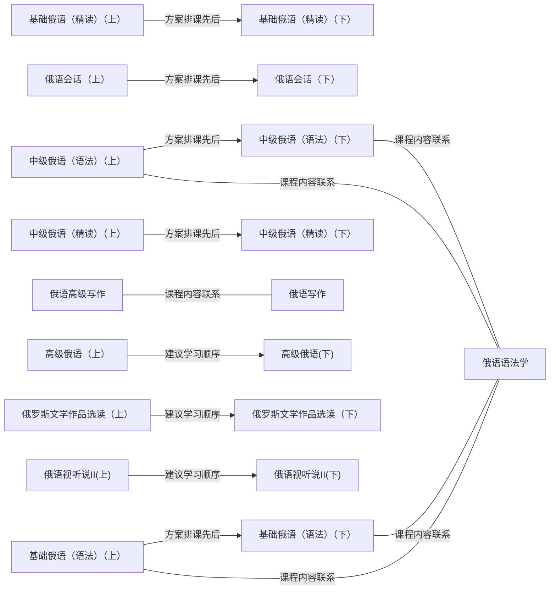

# 2025俄语专业本科培养方案

外国语言文学学院 · 俄语 · 方案 96924 · 44 个不同课程或科研条目。

[官方 Word](https://github.com/pythonbug225/fudan-course-atlas/blob/research/schoolwide-cohorts-2023-2025/research/contributions/%E5%85%A8%E6%A0%A1%E5%9F%B9%E5%85%BB%E6%96%B9%E6%A1%882023-2025/%E5%B7%B2%E6%9C%89%E9%99%A2%E7%B3%BB%E8%A7%84%E8%8C%83%E6%95%B0%E6%8D%AE/%E5%A4%96%E5%9B%BD%E8%AF%AD%E8%A8%80%E6%96%87%E5%AD%A6%E5%AD%A6%E9%99%A2/2025/originals/plan-96924.docx) · [教务详情](https://fdjwgl.fudan.edu.cn/manager/bizType/2/major-program-search/info/96924?skipAuth=1) · [方案快照](https://github.com/pythonbug225/fudan-course-atlas/blob/research/schoolwide-cohorts-2023-2025/research/contributions/%E5%85%A8%E6%A0%A1%E5%9F%B9%E5%85%BB%E6%96%B9%E6%A1%882023-2025/%E5%B7%B2%E6%9C%89%E9%99%A2%E7%B3%BB%E8%A7%84%E8%8C%83%E6%95%B0%E6%8D%AE/%E5%A4%96%E5%9B%BD%E8%AF%AD%E8%A8%80%E6%96%87%E5%AD%A6%E5%AD%A6%E9%99%A2/2025/raw/plan-96924.json.gz) · [年级目录](https://github.com/pythonbug225/fudan-course-atlas/blob/research/schoolwide-cohorts-2023-2025/research/contributions/%E5%85%A8%E6%A0%A1%E5%9F%B9%E5%85%BB%E6%96%B9%E6%A1%882023-2025/%E5%B7%B2%E6%9C%89%E9%99%A2%E7%B3%BB%E8%A7%84%E8%8C%83%E6%95%B0%E6%8D%AE/%E5%A4%96%E5%9B%BD%E8%AF%AD%E8%A8%80%E6%96%87%E5%AD%A6%E5%AD%A6%E9%99%A2/2025/README.md)

## 修读导读

- **建议先学**　《基础俄语（精读）（上）》（`FORE10032`） → 《基础俄语（精读）（下）》（`FORE10033`）。题名列出连续册次或级别。按级别积累词汇和句式，后一阶段阅读新材料时可回查前一阶段的例句。方案分别列在第1、2学期。

- **可以对照着读**　《中级俄语（语法）（上）》（`FORE20057`）与《俄语语法学》（`FORE50028`）。两门课的题名都涉及语法。选一个例句，分别标出两门课分析的语法单位，再比较分析能解释哪些用法。

- **查模块选课**　《基础俄语（语法）（下）》（`FORE10035`）、《俄语会话（上）》（`FORE10019`）列在“专业核心教育课程”中。模块说明写明“要求修读58学分（部分课程学分可用荣誉课程学分替换）”。原表见 `/courseModules/8`。

## 课程关系图

图中展示部分关系。下表保留全部已建立的课程对，来源位置使用本方案 JSON Pointer。

## 先修与内容联系

| 类型 | 起点 | 终点 | 依据 | 原表定位 |
| --- | --- | --- | --- | --- |
| 建议学习顺序 | 俄语会话（上） (FORE10019) | 俄语会话（下） (FORE10020) | 同方案的课程题名具有连续分册或序号。  | `/courseModules/8/planCourses/3`、`/courseModules/8/planCourses/4` |
| 建议学习顺序 | 基础俄语（精读）（上） (FORE10032) | 基础俄语（精读）（下） (FORE10033) | 同方案的课程题名具有连续分册或序号。  | `/courseModules/8/planCourses/0`、`/courseModules/8/planCourses/1` |
| 建议学习顺序 | 基础俄语（语法）（上） (FORE10034) | 基础俄语（语法）（下） (FORE10035) | 同方案的课程题名具有连续分册或序号。  | `/courseModules/8/planCourses/16`、`/courseModules/8/planCourses/2` |
| 建议学习顺序 | 中级俄语（精读）（上） (FORE20055) | 中级俄语（精读）（下） (FORE20056) | 同方案的课程题名具有连续分册或序号。  | `/courseModules/8/planCourses/5`、`/courseModules/8/planCourses/7` |
| 建议学习顺序 | 中级俄语（语法）（上） (FORE20057) | 中级俄语（语法）（下） (FORE20058) | 同方案的课程题名具有连续分册或序号。  | `/courseModules/8/planCourses/6`、`/courseModules/8/planCourses/8` |
| 建议学习顺序 | 俄罗斯文学作品选读（上） (FORE30038) | 俄罗斯文学作品选读（下） (FORE40025) | 同方案的课程题名具有连续分册或序号。  | `/courseModules/8/planCourses/13`、`/courseModules/8/planCourses/14` |
| 建议学习顺序 | 高级俄语（上） (FORE30053) | 高级俄语(下) (FORE30014) | 同方案的课程题名具有连续分册或序号。  | `/courseModules/8/planCourses/10`、`/courseModules/8/planCourses/11` |
| 建议学习顺序 | 俄语视听说II(上) (FORE50005) | 俄语视听说II(下) (FORE50080) | 同方案的课程题名具有连续分册或序号。  | `/courseModules/11/planCourses/2`、`/courseModules/11/planCourses/3` |
| 方案排课先后 | 俄语会话（上） (FORE10019) | 俄语会话（下） (FORE10020) | 同方案该课程全部明确数字学期均早于后者。  | `/courseModules/8/planCourses/3`、`/courseModules/8/planCourses/4` |
| 方案排课先后 | 基础俄语（精读）（上） (FORE10032) | 基础俄语（精读）（下） (FORE10033) | 同方案该课程全部明确数字学期均早于后者。  | `/courseModules/8/planCourses/0`、`/courseModules/8/planCourses/1` |
| 方案排课先后 | 基础俄语（语法）（上） (FORE10034) | 基础俄语（语法）（下） (FORE10035) | 同方案该课程全部明确数字学期均早于后者。  | `/courseModules/8/planCourses/16`、`/courseModules/8/planCourses/2` |
| 方案排课先后 | 中级俄语（精读）（上） (FORE20055) | 中级俄语（精读）（下） (FORE20056) | 同方案该课程全部明确数字学期均早于后者。  | `/courseModules/8/planCourses/5`、`/courseModules/8/planCourses/7` |
| 方案排课先后 | 中级俄语（语法）（上） (FORE20057) | 中级俄语（语法）（下） (FORE20058) | 同方案该课程全部明确数字学期均早于后者。  | `/courseModules/8/planCourses/6`、`/courseModules/8/planCourses/8` |
| 方案排课先后 | 俄罗斯文学作品选读（上） (FORE30038) | 俄罗斯文学作品选读（下） (FORE40025) | 同方案该课程全部明确数字学期均早于后者。  | `/courseModules/8/planCourses/13`、`/courseModules/8/planCourses/14` |
| 方案排课先后 | 高级俄语（上） (FORE30053) | 高级俄语(下) (FORE30014) | 同方案该课程全部明确数字学期均早于后者。  | `/courseModules/8/planCourses/10`、`/courseModules/8/planCourses/11` |
| 方案排课先后 | 俄语视听说II(上) (FORE50005) | 俄语视听说II(下) (FORE50080) | 同方案该课程全部明确数字学期均早于后者。  | `/courseModules/11/planCourses/2`、`/courseModules/11/planCourses/3` |
| 课程内容联系 | 基础俄语（语法）（上） (FORE10034) | 俄语语法学 (FORE50028) | 本方案两门课程的题名均含“语法”，可据此对照这一主题。  | `/courseModules/8/planCourses/16`、`/courseModules/11/planCourses/8` |
| 课程内容联系 | 基础俄语（语法）（下） (FORE10035) | 俄语语法学 (FORE50028) | 本方案两门课程的题名均含“语法”，可据此对照这一主题。  | `/courseModules/8/planCourses/2`、`/courseModules/11/planCourses/8` |
| 课程内容联系 | 中级俄语（语法）（上） (FORE20057) | 俄语语法学 (FORE50028) | 本方案两门课程的题名均含“语法”，可据此对照这一主题。  | `/courseModules/8/planCourses/6`、`/courseModules/11/planCourses/8` |
| 课程内容联系 | 中级俄语（语法）（下） (FORE20058) | 俄语语法学 (FORE50028) | 本方案两门课程的题名均含“语法”，可据此对照这一主题。  | `/courseModules/8/planCourses/8`、`/courseModules/11/planCourses/8` |
| 课程内容联系 | 俄语高级写作 (FORE40026) | 俄语写作 (FORE50116) | 本方案两门课程的题名均含“写作”，可据此对照这一主题。  | `/courseModules/8/planCourses/15`、`/courseModules/11/planCourses/4` |
| 课程内容联系 | 哲学导论 (PHIL10002) | 逻辑学 (PHIL10003) | 论证与概念分析是哲学讨论的共同方法。  | `/courseModules/7/planCourses/2`、`/courseModules/7/planCourses/3` |

本次未从可定位的明确表述中确认课程对课程预修。学期安排、系列分册与编辑建议均保留各自的依据。

## 课程表

同一课程在不同模块分别出现时，按原表逐行列出。季节字段保留原值。

| 课程 | 代码 | 学分 | 学期 | 模块 |
| --- | --- | ---: | --- | --- |
| 中国文学经典 | CHIN10005 | 3.0 | SPRING、AUTUMN | 培养方案 / 专业培养课程 / 学科基础课程 / 人文基础课程 / 必修课程 |
| 中国古代文明 | HIST10006 | 3.0 | SPRING、AUTUMN | 培养方案 / 专业培养课程 / 学科基础课程 / 人文基础课程 / 必修课程 |
| 哲学导论 | PHIL10002 | 3.0 | SPRING、AUTUMN | 培养方案 / 专业培养课程 / 学科基础课程 / 人文基础课程 / 必修课程 |
| 逻辑学 | PHIL10003 | 3.0 | SPRING、AUTUMN | 培养方案 / 专业培养课程 / 学科基础课程 / 人文基础课程 / 必修课程 |
| 基础俄语（精读）（上） | FORE10032 | 6.0 | 第1学期 | 培养方案 / 专业培养课程 / 专业核心教育课程 |
| 基础俄语（精读）（下） | FORE10033 | 6.0 | 第2学期 | 培养方案 / 专业培养课程 / 专业核心教育课程 |
| 基础俄语（语法）（下） | FORE10035 | 4.0 | 第2学期 | 培养方案 / 专业培养课程 / 专业核心教育课程 |
| 俄语会话（上） | FORE10019 | 2.0 | 第1学期 | 培养方案 / 专业培养课程 / 专业核心教育课程 |
| 俄语会话（下） | FORE10020 | 2.0 | 第2学期 | 培养方案 / 专业培养课程 / 专业核心教育课程 |
| 中级俄语（精读）（上） | FORE20055 | 4.0 | 第3学期 | 培养方案 / 专业培养课程 / 专业核心教育课程 |
| 中级俄语（语法）（上） | FORE20057 | 4.0 | 第3学期 | 培养方案 / 专业培养课程 / 专业核心教育课程 |
| 中级俄语（精读）（下） | FORE20056 | 4.0 | 第4学期 | 培养方案 / 专业培养课程 / 专业核心教育课程 |
| 中级俄语（语法）（下） | FORE20058 | 4.0 | 第4学期 | 培养方案 / 专业培养课程 / 专业核心教育课程 |
| 俄罗斯概况 | FORE20020 | 2.0 | 第3学期 | 培养方案 / 专业培养课程 / 专业核心教育课程 |
| 高级俄语（上） | FORE30053 | 4.0 | 第5学期 | 培养方案 / 专业培养课程 / 专业核心教育课程 |
| 高级俄语(下) | FORE30014 | 4.0 | 第6学期 | 培养方案 / 专业培养课程 / 专业核心教育课程 |
| 翻译理论与技巧(俄语) | FORE30015 | 2.0 | 第6学期 | 培养方案 / 专业培养课程 / 专业核心教育课程 |
| 俄罗斯文学作品选读（上） | FORE30038 | 2.0 | 第6学期 | 培养方案 / 专业培养课程 / 专业核心教育课程 |
| 俄罗斯文学作品选读（下） | FORE40025 | 2.0 | 第7学期 | 培养方案 / 专业培养课程 / 专业核心教育课程 |
| 俄语高级写作 | FORE40026 | 2.0 | 第7学期 | 培养方案 / 专业培养课程 / 专业核心教育课程 |
| 基础俄语（语法）（上） | FORE10034 | 4.0 | 第1学期 | 培养方案 / 专业培养课程 / 专业核心教育课程 |
| 俄语视听说Ⅰ | FORE50042 | 2.0 | 第2学期 | 培养方案 / 专业进阶课程（双进阶） |
| 俄罗斯文学史 | FORE50091 | 2.0 | 第2学期 | 培养方案 / 专业进阶课程（双进阶） |
| 俄语视听说II(上) | FORE50005 | 2.0 | 第3学期 | 培养方案 / 专业进阶课程（双进阶） |
| 俄语视听说II(下) | FORE50080 | 2.0 | 第4学期 | 培养方案 / 专业进阶课程（双进阶） |
| 俄语写作 | FORE50116 | 2.0 | SPRING、AUTUMN | 培养方案 / 专业进阶课程（双进阶） |
| 俄语言语礼节 | FORE50117 | 2.0 | SPRING、AUTUMN | 培养方案 / 专业进阶课程（双进阶） |
| 俄罗斯文化 | FORE50081 | 2.0 | 第4学期 | 培养方案 / 专业进阶课程（双进阶） |
| 当代俄罗斯 | FORE50118 | 2.0 | SPRING、AUTUMN | 培养方案 / 专业进阶课程（双进阶） |
| 俄语语法学 | FORE50028 | 2.0 | 第6学期 | 培养方案 / 专业进阶课程（双进阶） |
| 俄语报刊 | FORE50006 | 2.0 | 第5学期 | 培养方案 / 专业进阶课程（双进阶） |
| 外贸俄语 | FORE50029 | 2.0 | 第5学期 | 培养方案 / 专业进阶课程（双进阶） |
| 俄罗斯诗歌 | FORE50030 | 2.0 | SPRING、AUTUMN | 培养方案 / 专业进阶课程（双进阶） |
| 俄语影视 | FORE50032 | 2.0 | SPRING、AUTUMN | 培养方案 / 专业进阶课程（双进阶） |
| 俄语词汇学 | FORE50027 | 2.0 | SPRING、AUTUMN | 培养方案 / 专业进阶课程（双进阶） |
| 俄语修辞学 | FORE50031 | 2.0 | SPRING、AUTUMN | 培养方案 / 专业进阶课程（双进阶） |
| 俄国历史 | FORE50119 | 2.0 | SPRING、AUTUMN | 培养方案 / 专业进阶课程（双进阶） |
| 俄罗斯小说 | FORE50082 | 2.0 | SPRING、AUTUMN | 培养方案 / 专业进阶课程（双进阶） |
| 俄罗斯戏剧 | FORE50083 | 2.0 | SPRING、AUTUMN | 培养方案 / 专业进阶课程（双进阶） |
| 学术前沿专题 | FORE50043 | 2.0 | SPRING、AUTUMN | 培养方案 / 专业进阶课程（双进阶） |
| 俄语视听说Ⅰ | FORE50042 | 2.0 | 第2学期 | 培养方案 / 专业进阶课程（单进阶） |
| 俄罗斯文学史 | FORE50091 | 2.0 | 第2学期 | 培养方案 / 专业进阶课程（单进阶） |
| 俄语视听说II(上) | FORE50005 | 2.0 | 第3学期 | 培养方案 / 专业进阶课程（单进阶） |
| 俄语视听说II(下) | FORE50080 | 2.0 | 第4学期 | 培养方案 / 专业进阶课程（单进阶） |
| 俄语写作 | FORE50116 | 2.0 | SPRING、AUTUMN | 培养方案 / 专业进阶课程（单进阶） |
| 俄语言语礼节 | FORE50117 | 2.0 | SPRING、AUTUMN | 培养方案 / 专业进阶课程（单进阶） |
| 俄罗斯文化 | FORE50081 | 2.0 | 第4学期 | 培养方案 / 专业进阶课程（单进阶） |
| 当代俄罗斯 | FORE50118 | 2.0 | SPRING、AUTUMN | 培养方案 / 专业进阶课程（单进阶） |
| 俄语语法学 | FORE50028 | 2.0 | 第6学期 | 培养方案 / 专业进阶课程（单进阶） |
| 俄语报刊 | FORE50006 | 2.0 | 第5学期 | 培养方案 / 专业进阶课程（单进阶） |
| 外贸俄语 | FORE50029 | 2.0 | 第5学期 | 培养方案 / 专业进阶课程（单进阶） |
| 俄罗斯诗歌 | FORE50030 | 2.0 | SPRING、AUTUMN | 培养方案 / 专业进阶课程（单进阶） |
| 俄语影视 | FORE50032 | 2.0 | SPRING、AUTUMN | 培养方案 / 专业进阶课程（单进阶） |
| 俄语词汇学 | FORE50027 | 2.0 | SPRING、AUTUMN | 培养方案 / 专业进阶课程（单进阶） |
| 俄语修辞学 | FORE50031 | 2.0 | SPRING、AUTUMN | 培养方案 / 专业进阶课程（单进阶） |
| 俄国历史 | FORE50119 | 2.0 | SPRING、AUTUMN | 培养方案 / 专业进阶课程（单进阶） |
| 俄罗斯小说 | FORE50082 | 2.0 | SPRING、AUTUMN | 培养方案 / 专业进阶课程（单进阶） |
| 俄罗斯戏剧 | FORE50083 | 2.0 | SPRING、AUTUMN | 培养方案 / 专业进阶课程（单进阶） |
| 学术前沿专题 | FORE50043 | 2.0 | SPRING、AUTUMN | 培养方案 / 专业进阶课程（单进阶） |
| 无学分讨论班 | 101 | 0.0 |  | 融合创新能力 |
| 复芏计划(FDUROP) | 102 | 0.0 |  | 融合创新能力 |
| 实习调查 | FORE30001 | 2.0 | 第6学期 | 融合创新能力 |
| 毕业论文 | FORE40080 | 4.0 | 第8学期 | 融合创新能力 |
