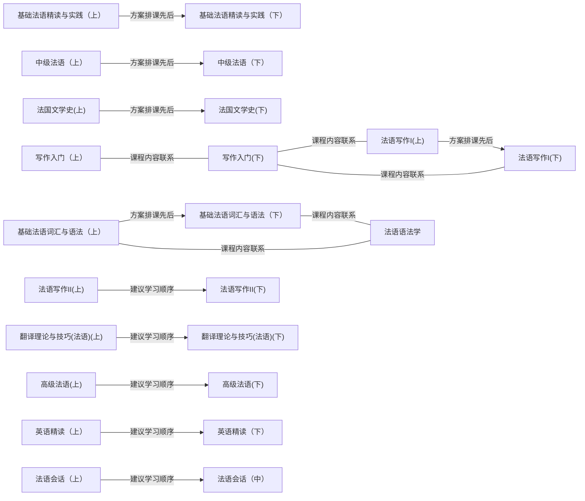

# 2025法语（法语-英语复语试验班）专业本科培养方案

外国语言文学学院 · 法语(法语-英语复语试验班) · 方案 96989 · 73 个不同课程或科研条目。

[官方 Word](https://github.com/pythonbug225/fudan-course-atlas/blob/research/schoolwide-cohorts-2023-2025/research/contributions/%E5%85%A8%E6%A0%A1%E5%9F%B9%E5%85%BB%E6%96%B9%E6%A1%882023-2025/%E5%B7%B2%E6%9C%89%E9%99%A2%E7%B3%BB%E8%A7%84%E8%8C%83%E6%95%B0%E6%8D%AE/%E5%A4%96%E5%9B%BD%E8%AF%AD%E8%A8%80%E6%96%87%E5%AD%A6%E5%AD%A6%E9%99%A2/2025/originals/plan-96989.docx) · [教务详情](https://fdjwgl.fudan.edu.cn/manager/bizType/2/major-program-search/info/96989?skipAuth=1) · [方案快照](https://github.com/pythonbug225/fudan-course-atlas/blob/research/schoolwide-cohorts-2023-2025/research/contributions/%E5%85%A8%E6%A0%A1%E5%9F%B9%E5%85%BB%E6%96%B9%E6%A1%882023-2025/%E5%B7%B2%E6%9C%89%E9%99%A2%E7%B3%BB%E8%A7%84%E8%8C%83%E6%95%B0%E6%8D%AE/%E5%A4%96%E5%9B%BD%E8%AF%AD%E8%A8%80%E6%96%87%E5%AD%A6%E5%AD%A6%E9%99%A2/2025/raw/plan-96989.json.gz) · [年级目录](https://github.com/pythonbug225/fudan-course-atlas/blob/research/schoolwide-cohorts-2023-2025/research/contributions/%E5%85%A8%E6%A0%A1%E5%9F%B9%E5%85%BB%E6%96%B9%E6%A1%882023-2025/%E5%B7%B2%E6%9C%89%E9%99%A2%E7%B3%BB%E8%A7%84%E8%8C%83%E6%95%B0%E6%8D%AE/%E5%A4%96%E5%9B%BD%E8%AF%AD%E8%A8%80%E6%96%87%E5%AD%A6%E5%AD%A6%E9%99%A2/2025/README.md)

## 修读导读

- **建议先学**　《基础法语词汇与语法（上）》（`FORE10042`） → 《基础法语词汇与语法（下）》（`FORE10043`）。题名列出连续册次或级别。按级别积累词汇和句式，后一阶段阅读新材料时可回查前一阶段的例句。方案分别列在第1、2学期。

- **可以对照着读**　《写作入门(下)》（`FORE10017`）与《法语写作I(上)》（`FORE20006`）。两门课的题名都涉及写作。选同一材料分别拟提纲，比较两种写作的读者、证据和段落安排。

- **查模块选课**　《基础法语精读与实践（上）》（`FORE10044`）、《法语会话（上）》（`FORE10023`）列在“专业核心教育课程”中。模块说明写明“要求修读76学分（部分课程学分可用荣誉课程学分替换）”。原表见 `/courseModules/8`。

## 课程关系图

图中展示部分关系。下表保留全部已建立的课程对，来源位置使用本方案 JSON Pointer。

## 先修与内容联系

| 类型 | 起点 | 终点 | 依据 | 原表定位 |
| --- | --- | --- | --- | --- |
| 建议学习顺序 | 英语精读（上） (FORE10013) | 英语精读（下） (FORE10016) | 同方案的课程题名具有连续分册或序号。  | `/courseModules/8/planCourses/19`、`/courseModules/8/planCourses/20` |
| 建议学习顺序 | 写作入门（上） (FORE10014) | 写作入门(下) (FORE10017) | 同方案的课程题名具有连续分册或序号。  | `/courseModules/8/planCourses/21`、`/courseModules/8/planCourses/22` |
| 建议学习顺序 | 英语文学导读（上） (FORE10015) | 英语文学导读(下) (FORE10018) | 同方案的课程题名具有连续分册或序号。  | `/courseModules/15/planCourses/9`、`/courseModules/15/planCourses/10` |
| 建议学习顺序 | 法语会话（上） (FORE10023) | 法语会话（中） (FORE20053) | 同方案的课程题名具有连续分册或序号。  | `/courseModules/8/planCourses/2`、`/courseModules/13/planCourses/0` |
| 建议学习顺序 | 基础法语词汇与语法（上） (FORE10042) | 基础法语词汇与语法（下） (FORE10043) | 同方案的课程题名具有连续分册或序号。  | `/courseModules/8/planCourses/0`、`/courseModules/8/planCourses/3` |
| 建议学习顺序 | 基础法语精读与实践（上） (FORE10044) | 基础法语精读与实践（下） (FORE10045) | 同方案的课程题名具有连续分册或序号。  | `/courseModules/8/planCourses/1`、`/courseModules/8/planCourses/4` |
| 建议学习顺序 | 英国文学史(上) (FORE20003) | 英国文学史(下) (FORE20004) | 同方案的课程题名具有连续分册或序号。  | `/courseModules/15/planCourses/6`、`/courseModules/15/planCourses/13` |
| 建议学习顺序 | 法语写作I(上) (FORE20006) | 法语写作I(下) (FORE20007) | 同方案的课程题名具有连续分册或序号。  | `/courseModules/8/planCourses/6`、`/courseModules/8/planCourses/11` |
| 建议学习顺序 | 中级法语（上） (FORE20037) | 中级法语（下） (FORE20052) | 同方案的课程题名具有连续分册或序号。  | `/courseModules/8/planCourses/7`、`/courseModules/8/planCourses/10` |
| 建议学习顺序 | 法语会话（中） (FORE20053) | 法语会话（下） (FORE20038) | 同方案的课程题名具有连续分册或序号。  | `/courseModules/13/planCourses/0`、`/courseModules/13/planCourses/1` |
| 建议学习顺序 | 法语写作II(上) (FORE30004) | 法语写作II(下) (FORE30005) | 同方案的课程题名具有连续分册或序号。  | `/courseModules/8/planCourses/12`、`/courseModules/8/planCourses/16` |
| 建议学习顺序 | 翻译理论与技巧(法语)(上) (FORE30006) | 翻译理论与技巧(法语)(下) (FORE30007) | 同方案的课程题名具有连续分册或序号。  | `/courseModules/8/planCourses/13`、`/courseModules/8/planCourses/17` |
| 建议学习顺序 | 法国文学史(上) (FORE30009) | 法国文学史(下) (FORE30010) | 同方案的课程题名具有连续分册或序号。  | `/courseModules/8/planCourses/8`、`/courseModules/8/planCourses/9` |
| 建议学习顺序 | 高级法语(上) (FORE30031) | 高级法语(下) (FORE30032) | 同方案的课程题名具有连续分册或序号。  | `/courseModules/8/planCourses/15`、`/courseModules/8/planCourses/18` |
| 方案排课先后 | 英语精读（上） (FORE10013) | 英语精读（下） (FORE10016) | 同方案该课程全部明确数字学期均早于后者。  | `/courseModules/8/planCourses/19`、`/courseModules/8/planCourses/20` |
| 方案排课先后 | 写作入门（上） (FORE10014) | 写作入门(下) (FORE10017) | 同方案该课程全部明确数字学期均早于后者。  | `/courseModules/8/planCourses/21`、`/courseModules/8/planCourses/22` |
| 方案排课先后 | 英语文学导读（上） (FORE10015) | 英语文学导读(下) (FORE10018) | 同方案该课程全部明确数字学期均早于后者。  | `/courseModules/15/planCourses/9`、`/courseModules/15/planCourses/10` |
| 方案排课先后 | 基础法语词汇与语法（上） (FORE10042) | 基础法语词汇与语法（下） (FORE10043) | 同方案该课程全部明确数字学期均早于后者。  | `/courseModules/8/planCourses/0`、`/courseModules/8/planCourses/3` |
| 方案排课先后 | 基础法语精读与实践（上） (FORE10044) | 基础法语精读与实践（下） (FORE10045) | 同方案该课程全部明确数字学期均早于后者。  | `/courseModules/8/planCourses/1`、`/courseModules/8/planCourses/4` |
| 方案排课先后 | 英国文学史(上) (FORE20003) | 英国文学史(下) (FORE20004) | 同方案该课程全部明确数字学期均早于后者。  | `/courseModules/15/planCourses/6`、`/courseModules/15/planCourses/13` |
| 方案排课先后 | 法语写作I(上) (FORE20006) | 法语写作I(下) (FORE20007) | 同方案该课程全部明确数字学期均早于后者。  | `/courseModules/8/planCourses/6`、`/courseModules/8/planCourses/11` |
| 方案排课先后 | 中级法语（上） (FORE20037) | 中级法语（下） (FORE20052) | 同方案该课程全部明确数字学期均早于后者。  | `/courseModules/8/planCourses/7`、`/courseModules/8/planCourses/10` |
| 方案排课先后 | 法语写作II(上) (FORE30004) | 法语写作II(下) (FORE30005) | 同方案该课程全部明确数字学期均早于后者。  | `/courseModules/8/planCourses/12`、`/courseModules/8/planCourses/16` |
| 方案排课先后 | 翻译理论与技巧(法语)(上) (FORE30006) | 翻译理论与技巧(法语)(下) (FORE30007) | 同方案该课程全部明确数字学期均早于后者。  | `/courseModules/8/planCourses/13`、`/courseModules/8/planCourses/17` |
| 方案排课先后 | 法国文学史(上) (FORE30009) | 法国文学史(下) (FORE30010) | 同方案该课程全部明确数字学期均早于后者。  | `/courseModules/8/planCourses/8`、`/courseModules/8/planCourses/9` |
| 方案排课先后 | 高级法语(上) (FORE30031) | 高级法语(下) (FORE30032) | 同方案该课程全部明确数字学期均早于后者。  | `/courseModules/8/planCourses/15`、`/courseModules/8/planCourses/18` |
| 课程内容联系 | 写作入门（上） (FORE10014) | 写作入门(下) (FORE10017) | 本方案两门课程的题名均含“写作”，可据此对照这一主题。  | `/courseModules/8/planCourses/21`、`/courseModules/8/planCourses/22` |
| 课程内容联系 | 英语文学导读（上） (FORE10015) | 英语文学导读(下) (FORE10018) | 本方案两门课程的题名均含“英语文学”，可据此对照这一主题。  | `/courseModules/15/planCourses/9`、`/courseModules/15/planCourses/10` |
| 课程内容联系 | 写作入门(下) (FORE10017) | 法语写作I(上) (FORE20006) | 本方案两门课程的题名均含“写作”，可据此对照这一主题。  | `/courseModules/8/planCourses/22`、`/courseModules/8/planCourses/6` |
| 课程内容联系 | 写作入门(下) (FORE10017) | 法语写作I(下) (FORE20007) | 本方案两门课程的题名均含“写作”，可据此对照这一主题。  | `/courseModules/8/planCourses/22`、`/courseModules/8/planCourses/11` |
| 课程内容联系 | 写作入门(下) (FORE10017) | 法语写作III (FORE40003) | 本方案两门课程的题名均含“写作”，可据此对照这一主题。  | `/courseModules/8/planCourses/22`、`/courseModules/14/planCourses/11` |
| 课程内容联系 | 基础法语词汇与语法（上） (FORE10042) | 法语语法学 (FORE20019) | 本方案两门课程的题名均含“语法”，可据此对照这一主题。  | `/courseModules/8/planCourses/0`、`/courseModules/14/planCourses/0` |
| 课程内容联系 | 基础法语词汇与语法（下） (FORE10043) | 法语语法学 (FORE20019) | 本方案两门课程的题名均含“语法”，可据此对照这一主题。  | `/courseModules/8/planCourses/3`、`/courseModules/14/planCourses/0` |
| 课程内容联系 | 英国文学史(上) (FORE20003) | 美国文学史 (FORE20005) | 本方案两门课程的题名均含“文学史”，可据此对照这一主题。  | `/courseModules/15/planCourses/6`、`/courseModules/15/planCourses/7` |
| 课程内容联系 | 英国文学史(下) (FORE20004) | 美国文学史 (FORE20005) | 本方案两门课程的题名均含“文学史”，可据此对照这一主题。  | `/courseModules/15/planCourses/13`、`/courseModules/15/planCourses/7` |
| 课程内容联系 | 美国文学史 (FORE20005) | 法国文学史(上) (FORE30009) | 本方案两门课程的题名均含“文学史”，可据此对照这一主题。  | `/courseModules/15/planCourses/7`、`/courseModules/8/planCourses/8` |
| 课程内容联系 | 美国文学史 (FORE20005) | 法国文学史(下) (FORE30010) | 本方案两门课程的题名均含“文学史”，可据此对照这一主题。  | `/courseModules/15/planCourses/7`、`/courseModules/8/planCourses/9` |
| 课程内容联系 | 翻译理论与技巧(法语)(上) (FORE30006) | 文学经典翻译 (FORE50067) | 本方案两门课程的题名均含“翻译”，可据此对照这一主题。  | `/courseModules/8/planCourses/13`、`/courseModules/15/planCourses/19` |
| 课程内容联系 | 翻译理论与技巧(法语)(下) (FORE30007) | 文学经典翻译 (FORE50067) | 本方案两门课程的题名均含“翻译”，可据此对照这一主题。  | `/courseModules/8/planCourses/17`、`/courseModules/15/planCourses/19` |
| 课程内容联系 | 商务口译 (FORE30030) | 法语口译工作坊 (FORE40001) | 本方案两门课程的题名均含“口译”，可据此对照这一主题。  | `/courseModules/15/planCourses/20`、`/courseModules/14/planCourses/15` |
| 课程内容联系 | 法国当代戏剧 (FORE40027) | 法国古典戏剧 (FORE50084) | 本方案两门课程的题名均含“戏剧”，可据此对照这一主题。  | `/courseModules/14/planCourses/9`、`/courseModules/14/planCourses/7` |
| 课程内容联系 | 法国现代短篇小说 (FORE50024) | 英美小说面面观 (FORE50049) | 本方案两门课程的题名均含“小说”，可据此对照这一主题。  | `/courseModules/14/planCourses/4`、`/courseModules/15/planCourses/8` |
| 课程内容联系 | 哲学导论 (PHIL10002) | 逻辑学 (PHIL10003) | 论证与概念分析是哲学讨论的共同方法。  | `/courseModules/7/planCourses/2`、`/courseModules/7/planCourses/3` |

本次未从可定位的明确表述中确认课程对课程预修。学期安排、系列分册与编辑建议均保留各自的依据。

## 按原方案模块阅读

同一模块展示原表中的课程归属。模块内课程之间的先后仍须逐项查阅。

- **必修**　法语会话（下）、法语会话（中）（原表模块 13）
- **选修**　法语语法学、法语影视、法国文化、法语口译工作坊、法语写作III、法语报刊、中法文化比较、法国当代戏剧、中法文学关系、法国文学精选•精评•精译、法国现代短篇小说、法语散文选读、学术前沿专题、法国古典戏剧、法国现当代文艺思潮、法国喜剧语言赏析（原表模块 14）
- **英语进阶课程**　英语文学导读（上）、英语文学导读(下)、语言学概论、英国文学史(上)、英国文学史(下)、美国文学史、应用语言学导论、英语辩论、文学研究方法论、商务口译、英语文体学、英美电影文学、莎士比亚选读、英语词汇学、英美小说面面观、文学经典翻译、媒体英语、流行文化的批判性阅读等21项（原表模块 15）
- **必修**　法语会话（下）、法语会话（中）（原表模块 18）
- **选修**　法语语法学、法语影视、法国文化、法语口译工作坊、法语写作III、法语报刊、中法文化比较、法国当代戏剧、中法文学关系、法国文学精选•精评•精译、法国现代短篇小说、法语散文选读、学术前沿专题、法国古典戏剧、法国现当代文艺思潮、法国喜剧语言赏析（原表模块 19）
- **英语进阶课程**　英语文学导读（上）、英语文学导读(下)、语言学概论、英国文学史(上)、英国文学史(下)、美国文学史、应用语言学导论、英语辩论、文学研究方法论、商务口译、英语文体学、英美电影文学、莎士比亚选读、英语词汇学、英美小说面面观、文学经典翻译、媒体英语、流行文化的批判性阅读等21项（原表模块 20）

## 课程表

同一课程在不同模块分别出现时，按原表逐行列出。季节字段保留原值。

| 课程 | 代码 | 学分 | 学期 | 模块 |
| --- | --- | ---: | --- | --- |
| 中国文学经典 | CHIN10005 | 3.0 | SPRING、AUTUMN | 培养方案 / 专业培养课程 / 学科基础课程 / 人文基础课程 / 必修课程 |
| 中国古代文明 | HIST10006 | 3.0 | SPRING、AUTUMN | 培养方案 / 专业培养课程 / 学科基础课程 / 人文基础课程 / 必修课程 |
| 哲学导论 | PHIL10002 | 3.0 | SPRING、AUTUMN | 培养方案 / 专业培养课程 / 学科基础课程 / 人文基础课程 / 必修课程 |
| 逻辑学 | PHIL10003 | 3.0 | SPRING、AUTUMN | 培养方案 / 专业培养课程 / 学科基础课程 / 人文基础课程 / 必修课程 |
| 基础法语词汇与语法（上） | FORE10042 | 4.0 | 第1学期 | 培养方案 / 专业培养课程 / 专业核心教育课程 |
| 基础法语精读与实践（上） | FORE10044 | 4.0 | 第1学期 | 培养方案 / 专业培养课程 / 专业核心教育课程 |
| 法语会话（上） | FORE10023 | 2.0 | 第1学期 | 培养方案 / 专业培养课程 / 专业核心教育课程 |
| 基础法语词汇与语法（下） | FORE10043 | 4.0 | 第2学期 | 培养方案 / 专业培养课程 / 专业核心教育课程 |
| 基础法语精读与实践（下） | FORE10045 | 4.0 | 第2学期 | 培养方案 / 专业培养课程 / 专业核心教育课程 |
| 法语初级视听 | FORE10024 | 2.0 | 第2学期 | 培养方案 / 专业培养课程 / 专业核心教育课程 |
| 法语写作I(上) | FORE20006 | 2.0 | 第3学期 | 培养方案 / 专业培养课程 / 专业核心教育课程 |
| 中级法语（上） | FORE20037 | 6.0 | 第3学期 | 培养方案 / 专业培养课程 / 专业核心教育课程 |
| 法国文学史(上) | FORE30009 | 2.0 | 第3学期 | 培养方案 / 专业培养课程 / 专业核心教育课程 |
| 法国文学史(下) | FORE30010 | 2.0 | 第4学期 | 培养方案 / 专业培养课程 / 专业核心教育课程 |
| 中级法语（下） | FORE20052 | 6.0 | 第4学期 | 培养方案 / 专业培养课程 / 专业核心教育课程 |
| 法语写作I(下) | FORE20007 | 2.0 | 第4学期 | 培养方案 / 专业培养课程 / 专业核心教育课程 |
| 法语写作II(上) | FORE30004 | 2.0 | 第5学期 | 培养方案 / 专业培养课程 / 专业核心教育课程 |
| 翻译理论与技巧(法语)(上) | FORE30006 | 2.0 | 第5学期 | 培养方案 / 专业培养课程 / 专业核心教育课程 |
| 法国概况 | FORE30008 | 2.0 | 第5学期 | 培养方案 / 专业培养课程 / 专业核心教育课程 |
| 高级法语(上) | FORE30031 | 4.0 | 第5学期 | 培养方案 / 专业培养课程 / 专业核心教育课程 |
| 法语写作II(下) | FORE30005 | 2.0 | 第6学期 | 培养方案 / 专业培养课程 / 专业核心教育课程 |
| 翻译理论与技巧(法语)(下) | FORE30007 | 2.0 | 第6学期 | 培养方案 / 专业培养课程 / 专业核心教育课程 |
| 高级法语(下) | FORE30032 | 4.0 | 第6学期 | 培养方案 / 专业培养课程 / 专业核心教育课程 |
| 英语精读（上） | FORE10013 | 4.0 | 第3学期 | 培养方案 / 专业培养课程 / 专业核心教育课程 |
| 英语精读（下） | FORE10016 | 4.0 | 第4学期 | 培养方案 / 专业培养课程 / 专业核心教育课程 |
| 写作入门（上） | FORE10014 | 2.0 | 第3学期 | 培养方案 / 专业培养课程 / 专业核心教育课程 |
| 写作入门(下) | FORE10017 | 2.0 | 第4学期 | 培养方案 / 专业培养课程 / 专业核心教育课程 |
| 英语语言史 | FORE20029 | 2.0 | 第4学期 | 培养方案 / 专业培养课程 / 专业核心教育课程 |
| 全球化与中国文化 | FORE50076 | 2.0 | SPRING、AUTUMN | 培养方案 / 专业培养课程 / 专业核心教育课程 |
| 英语演讲 | FORE10012 | 2.0 | 第5学期 | 培养方案 / 专业培养课程 / 专业核心教育课程 |
| 法语会话（中） | FORE20053 | 2.0 | SPRING、AUTUMN | 培养方案 / 复语进阶（双进阶） / 法语进阶课程 / 必修 |
| 法语会话（下） | FORE20038 | 2.0 | SPRING、AUTUMN | 培养方案 / 复语进阶（双进阶） / 法语进阶课程 / 必修 |
| 法语语法学 | FORE20019 | 2.0 | SPRING、AUTUMN | 培养方案 / 复语进阶（双进阶） / 法语进阶课程 / 选修 |
| 法国现当代文艺思潮 | FORE50085 | 2.0 | SPRING、AUTUMN | 培养方案 / 复语进阶（双进阶） / 法语进阶课程 / 选修 |
| 法国文化 | FORE30022 | 2.0 | SPRING、AUTUMN | 培养方案 / 复语进阶（双进阶） / 法语进阶课程 / 选修 |
| 中法文化比较 | FORE40014 | 2.0 | SPRING、AUTUMN | 培养方案 / 复语进阶（双进阶） / 法语进阶课程 / 选修 |
| 法国现代短篇小说 | FORE50024 | 2.0 | SPRING、AUTUMN | 培养方案 / 复语进阶（双进阶） / 法语进阶课程 / 选修 |
| 法语报刊 | FORE40004 | 2.0 | SPRING、AUTUMN | 培养方案 / 复语进阶（双进阶） / 法语进阶课程 / 选修 |
| 学术前沿专题 | FORE50043 | 2.0 | SPRING、AUTUMN | 培养方案 / 复语进阶（双进阶） / 法语进阶课程 / 选修 |
| 法国古典戏剧 | FORE50084 | 2.0 | SPRING、AUTUMN | 培养方案 / 复语进阶（双进阶） / 法语进阶课程 / 选修 |
| 法语散文选读 | FORE50025 | 2.0 | SPRING、AUTUMN | 培养方案 / 复语进阶（双进阶） / 法语进阶课程 / 选修 |
| 法国当代戏剧 | FORE40027 | 2.0 | SPRING、AUTUMN | 培养方案 / 复语进阶（双进阶） / 法语进阶课程 / 选修 |
| 法语影视 | FORE30021 | 2.0 | SPRING、AUTUMN | 培养方案 / 复语进阶（双进阶） / 法语进阶课程 / 选修 |
| 法语写作III | FORE40003 | 2.0 | 第7学期 | 培养方案 / 复语进阶（双进阶） / 法语进阶课程 / 选修 |
| 中法文学关系 | FORE40045 | 2.0 | SPRING、AUTUMN | 培养方案 / 复语进阶（双进阶） / 法语进阶课程 / 选修 |
| 法国喜剧语言赏析 | FORE50115 | 2.0 | SPRING、AUTUMN | 培养方案 / 复语进阶（双进阶） / 法语进阶课程 / 选修 |
| 法国文学精选•精评•精译 | FORE40048 | 2.0 | SPRING、AUTUMN | 培养方案 / 复语进阶（双进阶） / 法语进阶课程 / 选修 |
| 法语口译工作坊 | FORE40001 | 2.0 | SPRING、AUTUMN | 培养方案 / 复语进阶（双进阶） / 法语进阶课程 / 选修 |
| 英语词汇学 | FORE50018 | 2.0 | 第3学期 | 培养方案 / 复语进阶（双进阶） / 英语进阶课程 |
| 语言学概论 | FORE10029 | 2.0 | SPRING、AUTUMN | 培养方案 / 复语进阶（双进阶） / 英语进阶课程 |
| 应用语言学导论 | FORE20024 | 2.0 | 第5学期 | 培养方案 / 复语进阶（双进阶） / 英语进阶课程 |
| 英语文体学 | FORE50012 | 2.0 | 第5学期 | 培养方案 / 复语进阶（双进阶） / 英语进阶课程 |
| 英语辩论 | FORE20025 | 2.0 | SPRING、AUTUMN | 培养方案 / 复语进阶（双进阶） / 英语进阶课程 |
| 媒体英语 | FORE50068 | 2.0 | SPRING、AUTUMN | 培养方案 / 复语进阶（双进阶） / 英语进阶课程 |
| 英国文学史(上) | FORE20003 | 2.0 | 第3学期 | 培养方案 / 复语进阶（双进阶） / 英语进阶课程 |
| 美国文学史 | FORE20005 | 2.0 | 第4学期 | 培养方案 / 复语进阶（双进阶） / 英语进阶课程 |
| 英美小说面面观 | FORE50049 | 2.0 | 第3学期 | 培养方案 / 复语进阶（双进阶） / 英语进阶课程 |
| 英语文学导读（上） | FORE10015 | 2.0 | 第3学期 | 培养方案 / 复语进阶（双进阶） / 英语进阶课程 |
| 英语文学导读(下) | FORE10018 | 2.0 | 第4学期 | 培养方案 / 复语进阶（双进阶） / 英语进阶课程 |
| 文学研究方法论 | FORE30027 | 2.0 | 第5学期 | 培养方案 / 复语进阶（双进阶） / 英语进阶课程 |
| 莎士比亚选读 | FORE50015 | 2.0 | 第6学期 | 培养方案 / 复语进阶（双进阶） / 英语进阶课程 |
| 英国文学史(下) | FORE20004 | 2.0 | 第4学期 | 培养方案 / 复语进阶（双进阶） / 英语进阶课程 |
| 英美电影文学 | FORE50014 | 2.0 | 第7学期 | 培养方案 / 复语进阶（双进阶） / 英语进阶课程 |
| 英国中世纪文学导读 | FORE50093 | 2.0 | SPRING、AUTUMN | 培养方案 / 复语进阶（双进阶） / 英语进阶课程 |
| 18世纪美国文学 | FORE50109 | 2.0 | SPRING、AUTUMN | 培养方案 / 复语进阶（双进阶） / 英语进阶课程 |
| 英美电影与文化 | FORE50070 | 2.0 | 第4学期 | 培养方案 / 复语进阶（双进阶） / 英语进阶课程 |
| 流行文化的批判性阅读 | FORE50069 | 2.0 | 第5学期 | 培养方案 / 复语进阶（双进阶） / 英语进阶课程 |
| 文学经典翻译 | FORE50067 | 2.0 | SPRING、AUTUMN | 培养方案 / 复语进阶（双进阶） / 英语进阶课程 |
| 商务口译 | FORE30030 | 2.0 | SPRING、AUTUMN | 培养方案 / 复语进阶（双进阶） / 英语进阶课程 |
| 法语会话（中） | FORE20053 | 2.0 | SPRING、AUTUMN | 培养方案 / 复语进阶（单进阶） / 法语进阶课程 / 必修 |
| 法语会话（下） | FORE20038 | 2.0 | SPRING、AUTUMN | 培养方案 / 复语进阶（单进阶） / 法语进阶课程 / 必修 |
| 法语语法学 | FORE20019 | 2.0 | SPRING、AUTUMN | 培养方案 / 复语进阶（单进阶） / 法语进阶课程 / 选修 |
| 法国现当代文艺思潮 | FORE50085 | 2.0 | SPRING、AUTUMN | 培养方案 / 复语进阶（单进阶） / 法语进阶课程 / 选修 |
| 法国文化 | FORE30022 | 2.0 | SPRING、AUTUMN | 培养方案 / 复语进阶（单进阶） / 法语进阶课程 / 选修 |
| 中法文化比较 | FORE40014 | 2.0 | SPRING、AUTUMN | 培养方案 / 复语进阶（单进阶） / 法语进阶课程 / 选修 |
| 法国现代短篇小说 | FORE50024 | 2.0 | SPRING、AUTUMN | 培养方案 / 复语进阶（单进阶） / 法语进阶课程 / 选修 |
| 法语报刊 | FORE40004 | 2.0 | SPRING、AUTUMN | 培养方案 / 复语进阶（单进阶） / 法语进阶课程 / 选修 |
| 学术前沿专题 | FORE50043 | 2.0 | SPRING、AUTUMN | 培养方案 / 复语进阶（单进阶） / 法语进阶课程 / 选修 |
| 法国古典戏剧 | FORE50084 | 2.0 | SPRING、AUTUMN | 培养方案 / 复语进阶（单进阶） / 法语进阶课程 / 选修 |
| 法语散文选读 | FORE50025 | 2.0 | SPRING、AUTUMN | 培养方案 / 复语进阶（单进阶） / 法语进阶课程 / 选修 |
| 法国当代戏剧 | FORE40027 | 2.0 | SPRING、AUTUMN | 培养方案 / 复语进阶（单进阶） / 法语进阶课程 / 选修 |
| 法语影视 | FORE30021 | 2.0 | SPRING、AUTUMN | 培养方案 / 复语进阶（单进阶） / 法语进阶课程 / 选修 |
| 法语写作III | FORE40003 | 2.0 | 第7学期 | 培养方案 / 复语进阶（单进阶） / 法语进阶课程 / 选修 |
| 中法文学关系 | FORE40045 | 2.0 | SPRING、AUTUMN | 培养方案 / 复语进阶（单进阶） / 法语进阶课程 / 选修 |
| 法国喜剧语言赏析 | FORE50115 | 2.0 | SPRING、AUTUMN | 培养方案 / 复语进阶（单进阶） / 法语进阶课程 / 选修 |
| 法国文学精选•精评•精译 | FORE40048 | 2.0 | SPRING、AUTUMN | 培养方案 / 复语进阶（单进阶） / 法语进阶课程 / 选修 |
| 法语口译工作坊 | FORE40001 | 2.0 | SPRING、AUTUMN | 培养方案 / 复语进阶（单进阶） / 法语进阶课程 / 选修 |
| 英语词汇学 | FORE50018 | 2.0 | 第3学期 | 培养方案 / 复语进阶（单进阶） / 英语进阶课程 |
| 语言学概论 | FORE10029 | 2.0 | SPRING、AUTUMN | 培养方案 / 复语进阶（单进阶） / 英语进阶课程 |
| 应用语言学导论 | FORE20024 | 2.0 | 第5学期 | 培养方案 / 复语进阶（单进阶） / 英语进阶课程 |
| 英语文体学 | FORE50012 | 2.0 | 第5学期 | 培养方案 / 复语进阶（单进阶） / 英语进阶课程 |
| 英语辩论 | FORE20025 | 2.0 | SPRING、AUTUMN | 培养方案 / 复语进阶（单进阶） / 英语进阶课程 |
| 媒体英语 | FORE50068 | 2.0 | SPRING、AUTUMN | 培养方案 / 复语进阶（单进阶） / 英语进阶课程 |
| 英国文学史(上) | FORE20003 | 2.0 | 第3学期 | 培养方案 / 复语进阶（单进阶） / 英语进阶课程 |
| 美国文学史 | FORE20005 | 2.0 | 第4学期 | 培养方案 / 复语进阶（单进阶） / 英语进阶课程 |
| 英美小说面面观 | FORE50049 | 2.0 | 第3学期 | 培养方案 / 复语进阶（单进阶） / 英语进阶课程 |
| 英语文学导读（上） | FORE10015 | 2.0 | 第3学期 | 培养方案 / 复语进阶（单进阶） / 英语进阶课程 |
| 英语文学导读(下) | FORE10018 | 2.0 | 第4学期 | 培养方案 / 复语进阶（单进阶） / 英语进阶课程 |
| 文学研究方法论 | FORE30027 | 2.0 | 第5学期 | 培养方案 / 复语进阶（单进阶） / 英语进阶课程 |
| 莎士比亚选读 | FORE50015 | 2.0 | 第6学期 | 培养方案 / 复语进阶（单进阶） / 英语进阶课程 |
| 英国文学史(下) | FORE20004 | 2.0 | 第4学期 | 培养方案 / 复语进阶（单进阶） / 英语进阶课程 |
| 英美电影文学 | FORE50014 | 2.0 | 第7学期 | 培养方案 / 复语进阶（单进阶） / 英语进阶课程 |
| 英国中世纪文学导读 | FORE50093 | 2.0 | SPRING、AUTUMN | 培养方案 / 复语进阶（单进阶） / 英语进阶课程 |
| 18世纪美国文学 | FORE50109 | 2.0 | SPRING、AUTUMN | 培养方案 / 复语进阶（单进阶） / 英语进阶课程 |
| 英美电影与文化 | FORE50070 | 2.0 | 第4学期 | 培养方案 / 复语进阶（单进阶） / 英语进阶课程 |
| 流行文化的批判性阅读 | FORE50069 | 2.0 | 第5学期 | 培养方案 / 复语进阶（单进阶） / 英语进阶课程 |
| 文学经典翻译 | FORE50067 | 2.0 | SPRING、AUTUMN | 培养方案 / 复语进阶（单进阶） / 英语进阶课程 |
| 商务口译 | FORE30030 | 2.0 | SPRING、AUTUMN | 培养方案 / 复语进阶（单进阶） / 英语进阶课程 |
| 无学分讨论班 | 101 | 0.0 |  | 融合创新能力 |
| 复芏计划(FDUROP) | 102 | 0.0 |  | 融合创新能力 |
| 实习调查 | FORE30001 | 2.0 | 第6学期 | 融合创新能力 |
| 毕业论文 | FORE40080 | 4.0 | 第8学期 | 融合创新能力 |
