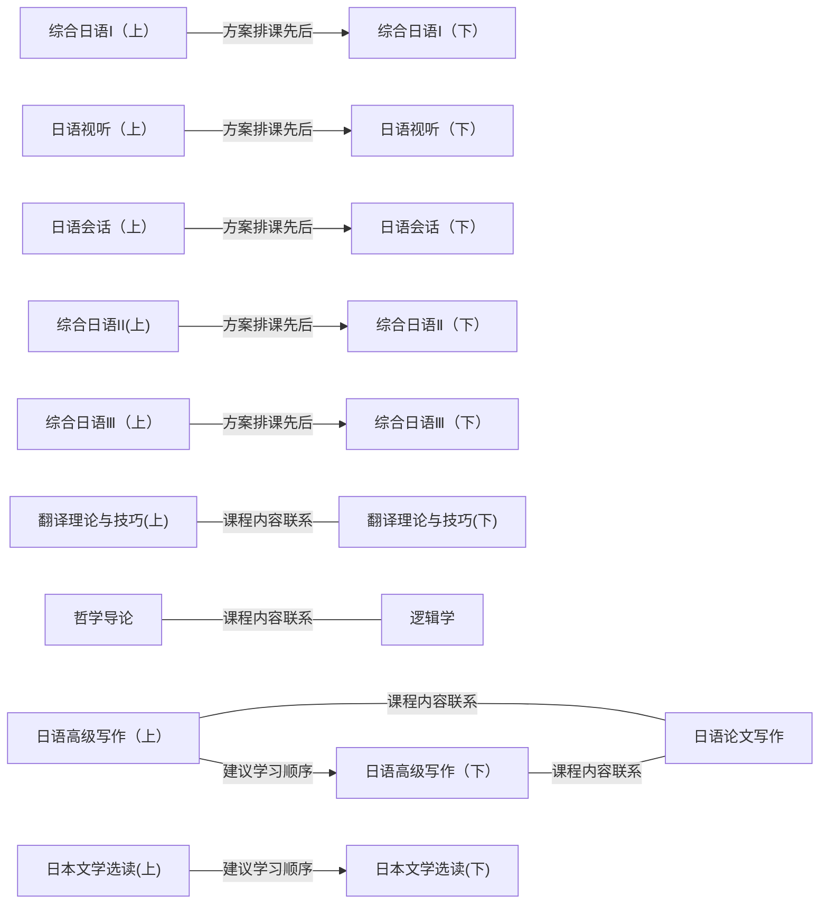

# 2025日语专业本科培养方案

外国语言文学学院 · 日语 · 方案 96996 · 38 个不同课程或科研条目。

[官方 Word](https://github.com/pythonbug225/fudan-course-atlas/blob/research/schoolwide-cohorts-2023-2025/research/contributions/%E5%85%A8%E6%A0%A1%E5%9F%B9%E5%85%BB%E6%96%B9%E6%A1%882023-2025/%E5%B7%B2%E6%9C%89%E9%99%A2%E7%B3%BB%E8%A7%84%E8%8C%83%E6%95%B0%E6%8D%AE/%E5%A4%96%E5%9B%BD%E8%AF%AD%E8%A8%80%E6%96%87%E5%AD%A6%E5%AD%A6%E9%99%A2/2025/originals/plan-96996.docx) · [教务详情](https://fdjwgl.fudan.edu.cn/manager/bizType/2/major-program-search/info/96996?skipAuth=1) · [方案快照](https://github.com/pythonbug225/fudan-course-atlas/blob/research/schoolwide-cohorts-2023-2025/research/contributions/%E5%85%A8%E6%A0%A1%E5%9F%B9%E5%85%BB%E6%96%B9%E6%A1%882023-2025/%E5%B7%B2%E6%9C%89%E9%99%A2%E7%B3%BB%E8%A7%84%E8%8C%83%E6%95%B0%E6%8D%AE/%E5%A4%96%E5%9B%BD%E8%AF%AD%E8%A8%80%E6%96%87%E5%AD%A6%E5%AD%A6%E9%99%A2/2025/raw/plan-96996.json.gz) · [年级目录](https://github.com/pythonbug225/fudan-course-atlas/blob/research/schoolwide-cohorts-2023-2025/research/contributions/%E5%85%A8%E6%A0%A1%E5%9F%B9%E5%85%BB%E6%96%B9%E6%A1%882023-2025/%E5%B7%B2%E6%9C%89%E9%99%A2%E7%B3%BB%E8%A7%84%E8%8C%83%E6%95%B0%E6%8D%AE/%E5%A4%96%E5%9B%BD%E8%AF%AD%E8%A8%80%E6%96%87%E5%AD%A6%E5%AD%A6%E9%99%A2/2025/README.md)

## 修读导读

- **建议先学**　《综合日语Ⅰ（上）》（`FORE10025`） → 《综合日语Ⅰ（下）》（`FORE10026`）。题名列出连续册次或级别。按级别积累词汇和句式，后一阶段阅读新材料时可回查前一阶段的例句。方案分别列在第1、2学期。

- **可以对照着读**　《日语高级写作（上）》（`FORE30039`）与《日语论文写作》（`FORE50103`）。两门课的题名都涉及写作。选同一材料分别拟提纲，比较两种写作的读者、证据和段落安排。

- **查模块选课**　《日语视听（上）》（`FORE10027`）、《日语会话（上）》（`FORE10011`）列在“专业核心教育课程”中。模块说明写明“要求修读58学分（部分课程学分可用荣誉课程学分替换）”。原表见 `/courseModules/8`。

## 课程关系图

图中展示部分关系。下表保留全部已建立的课程对，来源位置使用本方案 JSON Pointer。

## 先修与内容联系

| 类型 | 起点 | 终点 | 依据 | 原表定位 |
| --- | --- | --- | --- | --- |
| 建议学习顺序 | 日语会话（上） (FORE10011) | 日语会话（下） (FORE20023) | 同方案的课程题名具有连续分册或序号。  | `/courseModules/8/planCourses/3`、`/courseModules/8/planCourses/6` |
| 建议学习顺序 | 综合日语Ⅰ（上） (FORE10025) | 综合日语Ⅰ（下） (FORE10026) | 同方案的课程题名具有连续分册或序号。  | `/courseModules/8/planCourses/0`、`/courseModules/8/planCourses/1` |
| 建议学习顺序 | 日语视听（上） (FORE10027) | 日语视听（下） (FORE20040) | 同方案的课程题名具有连续分册或序号。  | `/courseModules/8/planCourses/2`、`/courseModules/8/planCourses/5` |
| 建议学习顺序 | 综合日语II(上) (FORE20039) | 综合日语Ⅱ（下） (FORE20041) | 同方案的课程题名具有连续分册或序号。  | `/courseModules/8/planCourses/4`、`/courseModules/8/planCourses/7` |
| 建议学习顺序 | 翻译理论与技巧(上) (FORE30011) | 翻译理论与技巧(下) (FORE40005) | 同方案的课程题名具有连续分册或序号。  | `/courseModules/8/planCourses/10`、`/courseModules/11/planCourses/0` |
| 建议学习顺序 | 日本文学选读(上) (FORE30013) | 日本文学选读(下) (FORE40006) | 同方案的课程题名具有连续分册或序号。  | `/courseModules/8/planCourses/12`、`/courseModules/11/planCourses/2` |
| 建议学习顺序 | 日语高级写作（上） (FORE30039) | 日语高级写作（下） (FORE40028) | 同方案的课程题名具有连续分册或序号。  | `/courseModules/8/planCourses/11`、`/courseModules/11/planCourses/13` |
| 建议学习顺序 | 综合日语Ⅲ（上） (FORE30056) | 综合日语Ⅲ（下） (FORE30057) | 同方案的课程题名具有连续分册或序号。  | `/courseModules/8/planCourses/8`、`/courseModules/8/planCourses/9` |
| 方案排课先后 | 日语会话（上） (FORE10011) | 日语会话（下） (FORE20023) | 同方案该课程全部明确数字学期均早于后者。  | `/courseModules/8/planCourses/3`、`/courseModules/8/planCourses/6` |
| 方案排课先后 | 综合日语Ⅰ（上） (FORE10025) | 综合日语Ⅰ（下） (FORE10026) | 同方案该课程全部明确数字学期均早于后者。  | `/courseModules/8/planCourses/0`、`/courseModules/8/planCourses/1` |
| 方案排课先后 | 日语视听（上） (FORE10027) | 日语视听（下） (FORE20040) | 同方案该课程全部明确数字学期均早于后者。  | `/courseModules/8/planCourses/2`、`/courseModules/8/planCourses/5` |
| 方案排课先后 | 综合日语II(上) (FORE20039) | 综合日语Ⅱ（下） (FORE20041) | 同方案该课程全部明确数字学期均早于后者。  | `/courseModules/8/planCourses/4`、`/courseModules/8/planCourses/7` |
| 方案排课先后 | 翻译理论与技巧(上) (FORE30011) | 翻译理论与技巧(下) (FORE40005) | 同方案该课程全部明确数字学期均早于后者。  | `/courseModules/8/planCourses/10`、`/courseModules/11/planCourses/0` |
| 方案排课先后 | 日本文学选读(上) (FORE30013) | 日本文学选读(下) (FORE40006) | 同方案该课程全部明确数字学期均早于后者。  | `/courseModules/8/planCourses/12`、`/courseModules/11/planCourses/2` |
| 方案排课先后 | 日语高级写作（上） (FORE30039) | 日语高级写作（下） (FORE40028) | 同方案该课程全部明确数字学期均早于后者。  | `/courseModules/8/planCourses/11`、`/courseModules/11/planCourses/13` |
| 方案排课先后 | 综合日语Ⅲ（上） (FORE30056) | 综合日语Ⅲ（下） (FORE30057) | 同方案该课程全部明确数字学期均早于后者。  | `/courseModules/8/planCourses/8`、`/courseModules/8/planCourses/9` |
| 课程内容联系 | 翻译理论与技巧(上) (FORE30011) | 翻译理论与技巧(下) (FORE40005) | 本方案两门课程的题名均含“翻译”，可据此对照这一主题。  | `/courseModules/8/planCourses/10`、`/courseModules/11/planCourses/0` |
| 课程内容联系 | 日语高级写作（上） (FORE30039) | 日语论文写作 (FORE50103) | 本方案两门课程的题名均含“写作”，可据此对照这一主题。  | `/courseModules/8/planCourses/11`、`/courseModules/11/planCourses/11` |
| 课程内容联系 | 日语高级写作（下） (FORE40028) | 日语论文写作 (FORE50103) | 本方案两门课程的题名均含“写作”，可据此对照这一主题。  | `/courseModules/11/planCourses/13`、`/courseModules/11/planCourses/11` |
| 课程内容联系 | 哲学导论 (PHIL10002) | 逻辑学 (PHIL10003) | 论证与概念分析是哲学讨论的共同方法。  | `/courseModules/7/planCourses/2`、`/courseModules/7/planCourses/3` |

本次未从可定位的明确表述中确认课程对课程预修。学期安排、系列分册与编辑建议均保留各自的依据。

## 课程表

同一课程在不同模块分别出现时，按原表逐行列出。季节字段保留原值。

| 课程 | 代码 | 学分 | 学期 | 模块 |
| --- | --- | ---: | --- | --- |
| 中国文学经典 | CHIN10005 | 3.0 | SPRING、AUTUMN | 培养方案 / 专业培养课程 / 学科基础课程 / 人文基础课程 / 必修课程 |
| 中国古代文明 | HIST10006 | 3.0 | SPRING、AUTUMN | 培养方案 / 专业培养课程 / 学科基础课程 / 人文基础课程 / 必修课程 |
| 哲学导论 | PHIL10002 | 3.0 | SPRING、AUTUMN | 培养方案 / 专业培养课程 / 学科基础课程 / 人文基础课程 / 必修课程 |
| 逻辑学 | PHIL10003 | 3.0 | SPRING、AUTUMN | 培养方案 / 专业培养课程 / 学科基础课程 / 人文基础课程 / 必修课程 |
| 综合日语Ⅰ（上） | FORE10025 | 10.0 | 第1学期 | 培养方案 / 专业培养课程 / 专业核心教育课程 |
| 综合日语Ⅰ（下） | FORE10026 | 10.0 | 第2学期 | 培养方案 / 专业培养课程 / 专业核心教育课程 |
| 日语视听（上） | FORE10027 | 2.0 | 第2学期 | 培养方案 / 专业培养课程 / 专业核心教育课程 |
| 日语会话（上） | FORE10011 | 2.0 | 第2学期 | 培养方案 / 专业培养课程 / 专业核心教育课程 |
| 综合日语II(上) | FORE20039 | 8.0 | 第3学期 | 培养方案 / 专业培养课程 / 专业核心教育课程 |
| 日语视听（下） | FORE20040 | 2.0 | 第3学期 | 培养方案 / 专业培养课程 / 专业核心教育课程 |
| 日语会话（下） | FORE20023 | 2.0 | 第3学期 | 培养方案 / 专业培养课程 / 专业核心教育课程 |
| 综合日语Ⅱ（下） | FORE20041 | 8.0 | 第4学期 | 培养方案 / 专业培养课程 / 专业核心教育课程 |
| 综合日语Ⅲ（上） | FORE30056 | 4.0 | 第5学期 | 培养方案 / 专业培养课程 / 专业核心教育课程 |
| 综合日语Ⅲ（下） | FORE30057 | 4.0 | 第6学期 | 培养方案 / 专业培养课程 / 专业核心教育课程 |
| 翻译理论与技巧(上) | FORE30011 | 2.0 | 第5学期 | 培养方案 / 专业培养课程 / 专业核心教育课程 |
| 日语高级写作（上） | FORE30039 | 2.0 | 第6学期 | 培养方案 / 专业培养课程 / 专业核心教育课程 |
| 日本文学选读(上) | FORE30013 | 2.0 | 第6学期 | 培养方案 / 专业培养课程 / 专业核心教育课程 |
| 翻译理论与技巧(下) | FORE40005 | 2.0 | 第6学期 | 培养方案 / 专业进阶课程（双进阶） |
| 日语词汇学 | FORE130228 | 2.0 | SPRING、AUTUMN | 培养方案 / 专业进阶课程（双进阶） |
| 日本文学选读(下) | FORE40006 | 2.0 | 第7学期 | 培养方案 / 专业进阶课程（双进阶） |
| 日本文学史 | FORE40030 | 2.0 | SPRING、AUTUMN | 培养方案 / 专业进阶课程（双进阶） |
| 日本文化史 | FORE30023 | 2.0 | SPRING、AUTUMN | 培养方案 / 专业进阶课程（双进阶） |
| 日本社会与文化 | FORE30026 | 2.0 | SPRING、AUTUMN | 培养方案 / 专业进阶课程（双进阶） |
| 日语语言文学十五讲 | FORE20054 | 2.0 | SPRING、AUTUMN | 培养方案 / 专业进阶课程（双进阶） |
| 日本概况 | FORE20008 | 2.0 | SPRING、AUTUMN | 培养方案 / 专业进阶课程（双进阶） |
| 日语语法学 | FORE40029 | 2.0 | SPRING、AUTUMN | 培养方案 / 专业进阶课程（双进阶） |
| 日本古典文学选读 | FORE40015 | 2.0 | SPRING、AUTUMN | 培养方案 / 专业进阶课程（双进阶） |
| 日本报刊选读 | FORE30012 | 2.0 | SPRING、AUTUMN | 培养方案 / 专业进阶课程（双进阶） |
| 日语论文写作 | FORE50103 | 2.0 | 第7学期 | 培养方案 / 专业进阶课程（双进阶） |
| 日语语音学 | FORE20021 | 2.0 | SPRING、AUTUMN | 培养方案 / 专业进阶课程（双进阶） |
| 日语高级写作（下） | FORE40028 | 2.0 | 第7学期 | 培养方案 / 专业进阶课程（双进阶） |
| 日语敬语 | FORE50086 | 2.0 | SPRING、AUTUMN | 培养方案 / 专业进阶课程（双进阶） |
| 学术前沿专题 | FORE50043 | 2.0 | SPRING、AUTUMN | 培养方案 / 专业进阶课程（双进阶） |
| AI赋能的语言分析和语言习得 | AIS531002 | 2.0 | SPRING、AUTUMN | 培养方案 / 专业进阶课程（双进阶） |
| 翻译理论与技巧(下) | FORE40005 | 2.0 | 第6学期 | 培养方案 / 专业进阶课程（单进阶） |
| 日语词汇学 | FORE130228 | 2.0 | SPRING、AUTUMN | 培养方案 / 专业进阶课程（单进阶） |
| 日本文学选读(下) | FORE40006 | 2.0 | 第7学期 | 培养方案 / 专业进阶课程（单进阶） |
| 日本文学史 | FORE40030 | 2.0 | SPRING、AUTUMN | 培养方案 / 专业进阶课程（单进阶） |
| 日本文化史 | FORE30023 | 2.0 | SPRING、AUTUMN | 培养方案 / 专业进阶课程（单进阶） |
| 日本社会与文化 | FORE30026 | 2.0 | SPRING、AUTUMN | 培养方案 / 专业进阶课程（单进阶） |
| 日语语言文学十五讲 | FORE20054 | 2.0 | SPRING、AUTUMN | 培养方案 / 专业进阶课程（单进阶） |
| 日本概况 | FORE20008 | 2.0 | SPRING、AUTUMN | 培养方案 / 专业进阶课程（单进阶） |
| 日语语法学 | FORE40029 | 2.0 | SPRING、AUTUMN | 培养方案 / 专业进阶课程（单进阶） |
| 日本古典文学选读 | FORE40015 | 2.0 | SPRING、AUTUMN | 培养方案 / 专业进阶课程（单进阶） |
| 日本报刊选读 | FORE30012 | 2.0 | SPRING、AUTUMN | 培养方案 / 专业进阶课程（单进阶） |
| 日语论文写作 | FORE50103 | 2.0 | 第7学期 | 培养方案 / 专业进阶课程（单进阶） |
| 日语语音学 | FORE20021 | 2.0 | SPRING、AUTUMN | 培养方案 / 专业进阶课程（单进阶） |
| 日语高级写作（下） | FORE40028 | 2.0 | 第7学期 | 培养方案 / 专业进阶课程（单进阶） |
| 日语敬语 | FORE50086 | 2.0 | SPRING、AUTUMN | 培养方案 / 专业进阶课程（单进阶） |
| 学术前沿专题 | FORE50043 | 2.0 | SPRING、AUTUMN | 培养方案 / 专业进阶课程（单进阶） |
| AI赋能的语言分析和语言习得 | AIS531002 | 2.0 | SPRING、AUTUMN | 培养方案 / 专业进阶课程（单进阶） |
| 无学分讨论班 | 101 | 0.0 |  | 融合创新能力 |
| 复芏计划(FDUROP) | 102 | 0.0 |  | 融合创新能力 |
| 实习调查 | FORE30001 | 2.0 | 第6学期 | 融合创新能力 |
| 毕业论文 | FORE40080 | 4.0 | 第8学期 | 融合创新能力 |
