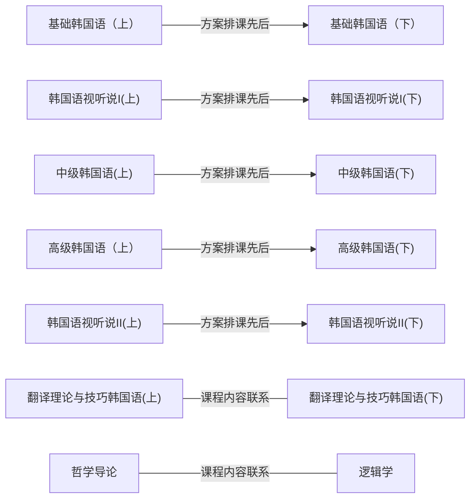

# 2025朝鲜语专业本科培养方案

外国语言文学学院 · 朝鲜语 · 方案 96997 · 35 个不同课程或科研条目。

[官方 Word](https://github.com/pythonbug225/fudan-course-atlas/blob/research/schoolwide-cohorts-2023-2025/research/contributions/%E5%85%A8%E6%A0%A1%E5%9F%B9%E5%85%BB%E6%96%B9%E6%A1%882023-2025/%E5%B7%B2%E6%9C%89%E9%99%A2%E7%B3%BB%E8%A7%84%E8%8C%83%E6%95%B0%E6%8D%AE/%E5%A4%96%E5%9B%BD%E8%AF%AD%E8%A8%80%E6%96%87%E5%AD%A6%E5%AD%A6%E9%99%A2/2025/originals/plan-96997.docx) · [教务详情](https://fdjwgl.fudan.edu.cn/manager/bizType/2/major-program-search/info/96997?skipAuth=1) · [方案快照](https://github.com/pythonbug225/fudan-course-atlas/blob/research/schoolwide-cohorts-2023-2025/research/contributions/%E5%85%A8%E6%A0%A1%E5%9F%B9%E5%85%BB%E6%96%B9%E6%A1%882023-2025/%E5%B7%B2%E6%9C%89%E9%99%A2%E7%B3%BB%E8%A7%84%E8%8C%83%E6%95%B0%E6%8D%AE/%E5%A4%96%E5%9B%BD%E8%AF%AD%E8%A8%80%E6%96%87%E5%AD%A6%E5%AD%A6%E9%99%A2/2025/raw/plan-96997.json.gz) · [年级目录](https://github.com/pythonbug225/fudan-course-atlas/blob/research/schoolwide-cohorts-2023-2025/research/contributions/%E5%85%A8%E6%A0%A1%E5%9F%B9%E5%85%BB%E6%96%B9%E6%A1%882023-2025/%E5%B7%B2%E6%9C%89%E9%99%A2%E7%B3%BB%E8%A7%84%E8%8C%83%E6%95%B0%E6%8D%AE/%E5%A4%96%E5%9B%BD%E8%AF%AD%E8%A8%80%E6%96%87%E5%AD%A6%E5%AD%A6%E9%99%A2/2025/README.md)

## 修读导读

- **建议先学**　《基础韩国语（上）》（`FORE10004`） → 《基础韩国语（下）》（`FORE20002`）。题名列出连续册次或级别。按级别积累词汇和句式，后一阶段阅读新材料时可回查前一阶段的例句。方案分别列在第1、2学期。

- **可以对照着读**　《哲学导论》（`PHIL10002`）与《逻辑学》（`PHIL10003`）。论证与概念分析是哲学讨论的共同方法。

- **查模块选课**　《韩国语视听说I(上)》（`FORE30016`）、《中级韩国语(上)》（`FORE40007`）列在“专业核心教育课程”中。模块说明写明“要求修读58学分（部分课程学分可用荣誉课程学分替换）”。原表见 `/courseModules/8`。

## 课程关系图

图中展示部分关系。下表保留全部已建立的课程对，来源位置使用本方案 JSON Pointer。

## 先修与内容联系

| 类型 | 起点 | 终点 | 依据 | 原表定位 |
| --- | --- | --- | --- | --- |
| 建议学习顺序 | 基础韩国语（上） (FORE10004) | 基础韩国语（下） (FORE20002) | 同方案的课程题名具有连续分册或序号。  | `/courseModules/8/planCourses/0`、`/courseModules/8/planCourses/1` |
| 建议学习顺序 | 韩国语视听说I(上) (FORE30016) | 韩国语视听说I(下) (FORE30017) | 同方案的课程题名具有连续分册或序号。  | `/courseModules/8/planCourses/2`、`/courseModules/8/planCourses/4` |
| 建议学习顺序 | 中级韩国语(上) (FORE40007) | 中级韩国语(下) (FORE40008) | 同方案的课程题名具有连续分册或序号。  | `/courseModules/8/planCourses/3`、`/courseModules/8/planCourses/5` |
| 建议学习顺序 | 韩国语视听说II(上) (FORE40009) | 韩国语视听说II(下) (FORE40010) | 同方案的课程题名具有连续分册或序号。  | `/courseModules/8/planCourses/6`、`/courseModules/11/planCourses/2` |
| 建议学习顺序 | 翻译理论与技巧韩国语(上) (FORE40011) | 翻译理论与技巧韩国语(下) (FORE50008) | 同方案的课程题名具有连续分册或序号。  | `/courseModules/8/planCourses/9`、`/courseModules/11/planCourses/4` |
| 建议学习顺序 | 高级韩国语（上） (FORE50088) | 高级韩国语(下) (FORE50007) | 同方案的课程题名具有连续分册或序号。  | `/courseModules/8/planCourses/7`、`/courseModules/8/planCourses/11` |
| 方案排课先后 | 基础韩国语（上） (FORE10004) | 基础韩国语（下） (FORE20002) | 同方案该课程全部明确数字学期均早于后者。  | `/courseModules/8/planCourses/0`、`/courseModules/8/planCourses/1` |
| 方案排课先后 | 韩国语视听说I(上) (FORE30016) | 韩国语视听说I(下) (FORE30017) | 同方案该课程全部明确数字学期均早于后者。  | `/courseModules/8/planCourses/2`、`/courseModules/8/planCourses/4` |
| 方案排课先后 | 中级韩国语(上) (FORE40007) | 中级韩国语(下) (FORE40008) | 同方案该课程全部明确数字学期均早于后者。  | `/courseModules/8/planCourses/3`、`/courseModules/8/planCourses/5` |
| 方案排课先后 | 韩国语视听说II(上) (FORE40009) | 韩国语视听说II(下) (FORE40010) | 同方案该课程全部明确数字学期均早于后者。  | `/courseModules/8/planCourses/6`、`/courseModules/11/planCourses/2` |
| 方案排课先后 | 翻译理论与技巧韩国语(上) (FORE40011) | 翻译理论与技巧韩国语(下) (FORE50008) | 同方案该课程全部明确数字学期均早于后者。  | `/courseModules/8/planCourses/9`、`/courseModules/11/planCourses/4` |
| 方案排课先后 | 高级韩国语（上） (FORE50088) | 高级韩国语(下) (FORE50007) | 同方案该课程全部明确数字学期均早于后者。  | `/courseModules/8/planCourses/7`、`/courseModules/8/planCourses/11` |
| 课程内容联系 | 翻译理论与技巧韩国语(上) (FORE40011) | 翻译理论与技巧韩国语(下) (FORE50008) | 本方案两门课程的题名均含“翻译”，可据此对照这一主题。  | `/courseModules/8/planCourses/9`、`/courseModules/11/planCourses/4` |
| 课程内容联系 | 哲学导论 (PHIL10002) | 逻辑学 (PHIL10003) | 论证与概念分析是哲学讨论的共同方法。  | `/courseModules/7/planCourses/2`、`/courseModules/7/planCourses/3` |

本次未从可定位的明确表述中确认课程对课程预修。学期安排、系列分册与编辑建议均保留各自的依据。

## 课程表

同一课程在不同模块分别出现时，按原表逐行列出。季节字段保留原值。

| 课程 | 代码 | 学分 | 学期 | 模块 |
| --- | --- | ---: | --- | --- |
| 中国文学经典 | CHIN10005 | 3.0 | SPRING、AUTUMN | 培养方案 / 专业培养课程 / 学科基础课程 / 人文基础课程 / 必修课程 |
| 中国古代文明 | HIST10006 | 3.0 | SPRING、AUTUMN | 培养方案 / 专业培养课程 / 学科基础课程 / 人文基础课程 / 必修课程 |
| 哲学导论 | PHIL10002 | 3.0 | SPRING、AUTUMN | 培养方案 / 专业培养课程 / 学科基础课程 / 人文基础课程 / 必修课程 |
| 逻辑学 | PHIL10003 | 3.0 | SPRING、AUTUMN | 培养方案 / 专业培养课程 / 学科基础课程 / 人文基础课程 / 必修课程 |
| 基础韩国语（上） | FORE10004 | 8.0 | 第1学期 | 培养方案 / 专业培养课程 / 专业核心教育课程 |
| 基础韩国语（下） | FORE20002 | 8.0 | 第2学期 | 培养方案 / 专业培养课程 / 专业核心教育课程 |
| 韩国语视听说I(上) | FORE30016 | 2.0 | 第2学期 | 培养方案 / 专业培养课程 / 专业核心教育课程 |
| 中级韩国语(上) | FORE40007 | 8.0 | 第3学期 | 培养方案 / 专业培养课程 / 专业核心教育课程 |
| 韩国语视听说I(下) | FORE30017 | 2.0 | 第3学期 | 培养方案 / 专业培养课程 / 专业核心教育课程 |
| 中级韩国语(下) | FORE40008 | 8.0 | 第4学期 | 培养方案 / 专业培养课程 / 专业核心教育课程 |
| 韩国语视听说II(上) | FORE40009 | 2.0 | 第4学期 | 培养方案 / 专业培养课程 / 专业核心教育课程 |
| 高级韩国语（上） | FORE50088 | 6.0 | 第5学期 | 培养方案 / 专业培养课程 / 专业核心教育课程 |
| 韩语语法学 | FORE40019 | 2.0 | 第5学期 | 培养方案 / 专业培养课程 / 专业核心教育课程 |
| 翻译理论与技巧韩国语(上) | FORE40011 | 2.0 | 第5学期 | 培养方案 / 专业培养课程 / 专业核心教育课程 |
| 韩国语写作 | FORE50087 | 2.0 | 第5学期 | 培养方案 / 专业培养课程 / 专业核心教育课程 |
| 高级韩国语(下) | FORE50007 | 6.0 | 第6学期 | 培养方案 / 专业培养课程 / 专业核心教育课程 |
| 韩国文学史 | FORE50033 | 2.0 | 第6学期 | 培养方案 / 专业培养课程 / 专业核心教育课程 |
| 韩国及朝鲜概况 | FORE40012 | 2.0 | 第3学期 | 培养方案 / 专业进阶模块（双进阶） |
| 韩语词汇学 | FORE40016 | 2.0 | 第4学期 | 培养方案 / 专业进阶模块（双进阶） |
| 韩国语视听说II(下) | FORE40010 | 2.0 | 第5学期 | 培养方案 / 专业进阶模块（双进阶） |
| 韩国文学选读 | FORE40031 | 2.0 | 第5学期 | 培养方案 / 专业进阶模块（双进阶） |
| 翻译理论与技巧韩国语(下) | FORE50008 | 2.0 | 第6学期 | 培养方案 / 专业进阶模块（双进阶） |
| 韩语报刊选读 | FORE50009 | 2.0 | 第7学期 | 培养方案 / 专业进阶模块（双进阶） |
| 口译 | FORE50035 | 2.0 | 第7学期 | 培养方案 / 专业进阶模块（双进阶） |
| 韩国社会与文化 | FORE50089 | 2.0 | SPRING、AUTUMN | 培养方案 / 专业进阶模块（双进阶） |
| 韩国语通论 | FORE50090 | 2.0 | SPRING、AUTUMN | 培养方案 / 专业进阶模块（双进阶） |
| 韩国文学名著赏析 | FORE40018 | 2.0 | SPRING、AUTUMN | 培养方案 / 专业进阶模块（双进阶） |
| 韩国影视 | FORE40032 | 2.0 | SPRING、AUTUMN | 培养方案 / 专业进阶模块（双进阶） |
| 科技韩国语 | FORE50034 | 2.0 | SPRING、AUTUMN | 培养方案 / 专业进阶模块（双进阶） |
| 经济贸易韩国语 | FORE40017 | 2.0 | SPRING、AUTUMN | 培养方案 / 专业进阶模块（双进阶） |
| AI赋能的语言分析和语言习得 | AIS531002 | 2.0 | SPRING、AUTUMN | 培养方案 / 专业进阶模块（双进阶） |
| 韩国及朝鲜概况 | FORE40012 | 2.0 | 第3学期 | 培养方案 / 专业进阶模块（单进阶） |
| 韩语词汇学 | FORE40016 | 2.0 | 第4学期 | 培养方案 / 专业进阶模块（单进阶） |
| 韩国语视听说II(下) | FORE40010 | 2.0 | 第5学期 | 培养方案 / 专业进阶模块（单进阶） |
| 韩国文学选读 | FORE40031 | 2.0 | 第5学期 | 培养方案 / 专业进阶模块（单进阶） |
| 翻译理论与技巧韩国语(下) | FORE50008 | 2.0 | 第6学期 | 培养方案 / 专业进阶模块（单进阶） |
| 韩语报刊选读 | FORE50009 | 2.0 | 第7学期 | 培养方案 / 专业进阶模块（单进阶） |
| 口译 | FORE50035 | 2.0 | 第7学期 | 培养方案 / 专业进阶模块（单进阶） |
| 韩国社会与文化 | FORE50089 | 2.0 | SPRING、AUTUMN | 培养方案 / 专业进阶模块（单进阶） |
| 韩国语通论 | FORE50090 | 2.0 | SPRING、AUTUMN | 培养方案 / 专业进阶模块（单进阶） |
| 韩国文学名著赏析 | FORE40018 | 2.0 | SPRING、AUTUMN | 培养方案 / 专业进阶模块（单进阶） |
| 韩国影视 | FORE40032 | 2.0 | SPRING、AUTUMN | 培养方案 / 专业进阶模块（单进阶） |
| 科技韩国语 | FORE50034 | 2.0 | SPRING、AUTUMN | 培养方案 / 专业进阶模块（单进阶） |
| 经济贸易韩国语 | FORE40017 | 2.0 | SPRING、AUTUMN | 培养方案 / 专业进阶模块（单进阶） |
| AI赋能的语言分析和语言习得 | AIS531002 | 2.0 | SPRING、AUTUMN | 培养方案 / 专业进阶模块（单进阶） |
| 无学分讨论班 | 101 | 0.0 |  | 融合创新能力 |
| 复芏计划(FDUROP) | 102 | 0.0 |  | 融合创新能力 |
| 实习调查 | FORE30001 | 2.0 | 第6学期 | 融合创新能力 |
| 毕业论文 | FORE40080 | 4.0 | 第8学期 | 融合创新能力 |
