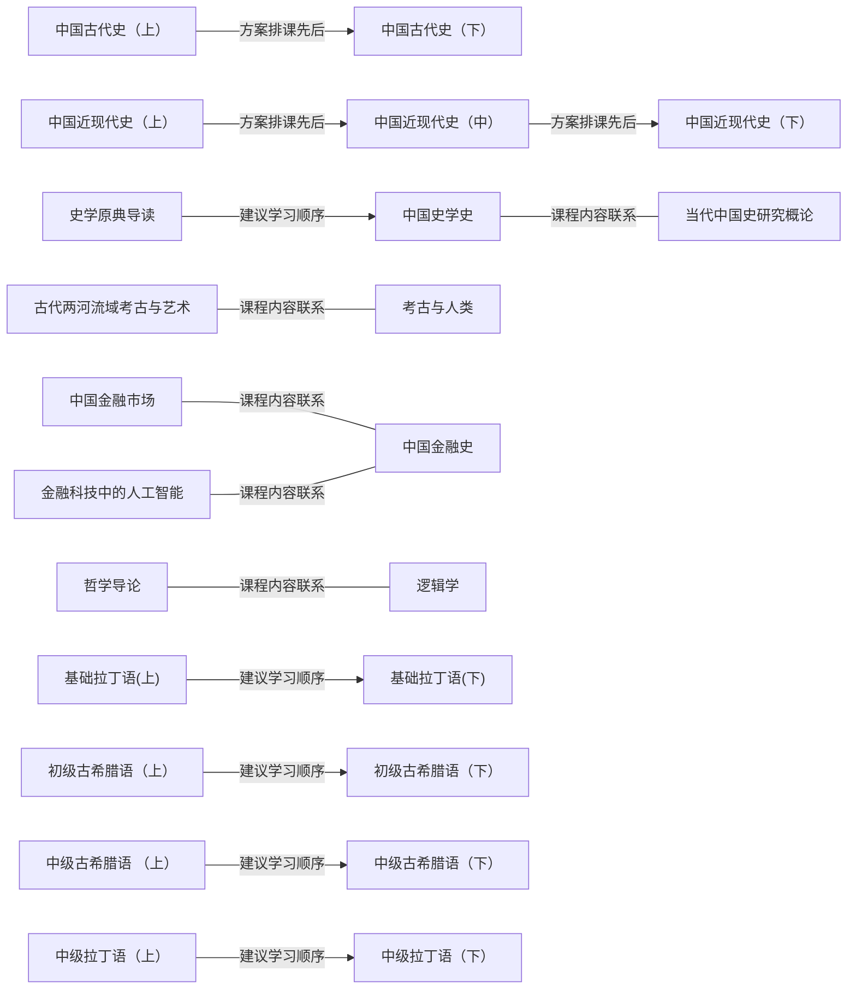

# 2024历史学专业“2+X”教学培养方案（留学生适用）

历史学系 · 历史学 · 方案 72916 · 572 个不同课程或科研条目。

[官方 Word](../originals/plan-72916.docx) · [教务详情](https://fdjwgl.fudan.edu.cn/manager/bizType/2/major-program-search/info/72916?skipAuth=1) · [方案快照](../raw/plan-72916.json.gz) · [年级目录](../README.md)

## 修读导读

- **建议先学**　《史学原典导读》（`HIST10003`） → 《中国史学史》（`HIST20003`）。研读史学原典有助于认识史学思想与史书体例。

- **可以对照着读**　《中国史学史》（`HIST20003`）与《当代中国史研究概论》（`HIST30056`）。两门课的题名都涉及中国史。选一个历史问题，分别记下两门课使用的史料、时间尺度和解释。

- **查模块选课**　《专业英语(历史学)》（`HIST30003`）、《中国古代史（上）》（`HIST10007`）列在“专业核心教育课程”中。原表见 `/courseModules/46`。

## 课程关系图

图中展示部分关系。下表保留全部已建立的课程对，来源位置使用本方案 JSON Pointer。

## 先修与内容联系

| 类型 | 起点 | 终点 | 依据 | 原表定位 |
| --- | --- | --- | --- | --- |
| 建议学习顺序 | 史学原典导读 (HIST10003) | 中国史学史 (HIST20003) | 研读史学原典有助于认识史学思想与史书体例。  | `/courseModules/44/planCourses/4`、`/courseModules/46/planCourses/6` |
| 建议学习顺序 | 中国古代史（上） (HIST10007) | 中国古代史（下） (HIST10008) | 同方案的课程题名具有连续分册或序号。  | `/courseModules/46/planCourses/0`、`/courseModules/46/planCourses/1` |
| 建议学习顺序 | 中国近现代史（上） (HIST20008) | 中国近现代史（中） (HIST20009) | 同方案的课程题名具有连续分册或序号。  | `/courseModules/46/planCourses/8`、`/courseModules/46/planCourses/9` |
| 建议学习顺序 | 中国近现代史（中） (HIST20009) | 中国近现代史（下） (HIST30084) | 同方案的课程题名具有连续分册或序号。  | `/courseModules/46/planCourses/9`、`/courseModules/46/planCourses/10` |
| 建议学习顺序 | 日本史(上) (HIST30036) | 日本史(下) (HIST30037) | 同方案的课程题名具有连续分册或序号。  | `/courseModules/58/planCourses/2`、`/courseModules/58/planCourses/3` |
| 建议学习顺序 | 基础拉丁语(上) (HIST30038) | 基础拉丁语(下) (HIST30039) | 同方案的课程题名具有连续分册或序号。  | `/courseModules/56/planCourses/0`、`/courseModules/56/planCourses/1` |
| 建议学习顺序 | 英国史（上） (HIST30087) | 英国史（下） (HIST30088) | 同方案的课程题名具有连续分册或序号。  | `/courseModules/57/planCourses/10`、`/courseModules/57/planCourses/11` |
| 建议学习顺序 | 初级古希腊语（上） (HIST30099) | 初级古希腊语（下） (HIST30100) | 同方案的课程题名具有连续分册或序号。  | `/courseModules/56/planCourses/8`、`/courseModules/56/planCourses/9` |
| 建议学习顺序 | 中级古希腊语 （上） (HIST30101) | 中级古希腊语（下） (HIST30102) | 同方案的课程题名具有连续分册或序号。  | `/courseModules/56/planCourses/10`、`/courseModules/56/planCourses/11` |
| 建议学习顺序 | 中级拉丁语（上） (HIST30103) | 中级拉丁语（下） (HIST30104) | 同方案的课程题名具有连续分册或序号。  | `/courseModules/56/planCourses/12`、`/courseModules/56/planCourses/13` |
| 建议学习顺序 | 初级古希伯来语（上） (HIST30113) | 初级古希伯来语（下） (HIST30114) | 同方案的课程题名具有连续分册或序号。  | `/courseModules/56/planCourses/16`、`/courseModules/56/planCourses/17` |
| 建议学习顺序 | 藏语Ⅰ (PHIL40009) | 藏语Ⅱ (PHIL40010) | 同方案的课程题名具有连续分册或序号。  | `/courseModules/56/planCourses/23`、`/courseModules/56/planCourses/24` |
| 方案排课先后 | 中国古代史（上） (HIST10007) | 中国古代史（下） (HIST10008) | 同方案该课程全部明确数字学期均早于后者。  | `/courseModules/46/planCourses/0`、`/courseModules/46/planCourses/1` |
| 方案排课先后 | 中国近现代史（上） (HIST20008) | 中国近现代史（中） (HIST20009) | 同方案该课程全部明确数字学期均早于后者。  | `/courseModules/46/planCourses/8`、`/courseModules/46/planCourses/9` |
| 方案排课先后 | 中国近现代史（中） (HIST20009) | 中国近现代史（下） (HIST30084) | 同方案该课程全部明确数字学期均早于后者。  | `/courseModules/46/planCourses/9`、`/courseModules/46/planCourses/10` |
| 课程内容联系 | 考古学导论 (ARCH10001) | 考古与人类 (GECC10101) | 本方案两门课程的题名均含“考古”，可据此对照这一主题。  | `/courseModules/45/planCourses/6`、`/courseModules/8/planCourses/15` |
| 课程内容联系 | 中国文学传统 (CHIN10001) | 中国文学经典 (CHIN10005) | 经典文本与文学传统可从作品接受与文学演变联系。  | `/courseModules/45/planCourses/0`、`/courseModules/44/planCourses/0` |
| 课程内容联系 | 中国当代小说选读 (GECC10009) | 英国经典小说与19世纪社会 (GECC10050) | 本方案两门课程的题名均含“小说”，可据此对照这一主题。  | `/courseModules/2/planCourses/5`、`/courseModules/4/planCourses/5` |
| 课程内容联系 | 戏剧经典与表达·西方戏剧 (GECC10040) | 戏剧导演 (GEEC10001) | 本方案两门课程的题名均含“戏剧”，可据此对照这一主题。  | `/courseModules/8/planCourses/5`、`/courseModules/8/planCourses/87` |
| 课程内容联系 | 古代两河流域考古与艺术 (GECC10075) | 考古与人类 (GECC10101) | 本方案两门课程的题名均含“考古”，可据此对照这一主题。  | `/courseModules/4/planCourses/24`、`/courseModules/8/planCourses/15` |
| 课程内容联系 | 传播与社会 (GECC10089) | 传播学概论 (JCM10003) | 本方案两门课程的题名均含“传播”，可据此对照这一主题。  | `/courseModules/5/planCourses/1`、`/courseModules/45/planCourses/17` |
| 课程内容联系 | 传播与社会 (GECC10089) | 城市建筑媒介与跨学科传播 (JWCH110031) | 本方案两门课程的题名均含“传播”，可据此对照这一主题。  | `/courseModules/5/planCourses/1`、`/courseModules/5/planCourses/12` |
| 课程内容联系 | 哲学视野中的人工智能 (GECC20040) | 金融科技中的人工智能 (GEIS10001) | 本方案两门课程的题名均含“人工智能”，可据此对照这一主题。  | `/courseModules/3/planCourses/21`、`/courseModules/6/planCourses/19` |
| 课程内容联系 | 哲学视野中的人工智能 (GECC20040) | 中国数字经济和人工智能的法律规制 (GEIS40002) | 本方案两门课程的题名均含“人工智能”，可据此对照这一主题。  | `/courseModules/3/planCourses/21`、`/courseModules/5/planCourses/26` |
| 课程内容联系 | 戏剧导演 (GEEC10001) | 戏剧表演 (GEEC10136) | 本方案两门课程的题名均含“戏剧”，可据此对照这一主题。  | `/courseModules/8/planCourses/87`、`/courseModules/8/planCourses/53` |
| 课程内容联系 | 金融科技中的人工智能 (GEIS10001) | 中国金融史 (HIST30026) | 本方案两门课程的题名均含“金融”，可据此对照这一主题。  | `/courseModules/6/planCourses/19`、`/courseModules/52/planCourses/6` |
| 课程内容联系 | 中国金融市场 (GEIS30020) | 中国金融史 (HIST30026) | 本方案两门课程的题名均含“金融”，可据此对照这一主题。  | `/courseModules/5/planCourses/19`、`/courseModules/52/planCourses/6` |
| 课程内容联系 | 中国史学史 (HIST20003) | 当代中国史研究概论 (HIST30056) | 本方案两门课程的题名均含“中国史”，可据此对照这一主题。  | `/courseModules/46/planCourses/6`、`/courseModules/52/planCourses/14` |
| 课程内容联系 | 马克思主义新闻思想 (JCM10001) | 新闻学概论 (JCM10002) | 本方案两门课程的题名均含“新闻”，可据此对照这一主题。  | `/courseModules/45/planCourses/15`、`/courseModules/45/planCourses/16` |
| 课程内容联系 | 哲学导论 (PHIL10002) | 逻辑学 (PHIL10003) | 论证与概念分析是哲学讨论的共同方法。  | `/courseModules/44/planCourses/2`、`/courseModules/44/planCourses/3` |

本次未从可定位的明确表述中确认课程对课程预修。学期安排、系列分册与编辑建议均保留各自的依据。

## 按原方案模块阅读

同一模块展示原表中的课程归属。模块内课程之间的先后仍须逐项查阅。

- **文史经典与文化传承**　古典诗词导读、庄子导读、《周易》与中华审美文化、唐诗经典与中国文化传统、唐宋八大家古文、中国当代小说选读、中国新诗导读、鲁迅与中国现代文化、《史记》导读、宋词导读、诗经与传统文化、《红楼梦》与人生、《三国志》导读、《文选》与中古社会、中国现代散文导读、《尔雅》与中国古典语文、《谈艺录》导读、中国现代文学名著选讲等34项（原表模块 2）
- **哲学智慧与批判性思维**　《艺术即经验》导读、托克维尔论美国的民主、笛卡尔《谈谈方法》导读、《共产党宣言》导读、康德《实践理性批判》精读、《论法的精神》导读、《法哲学原理》导读、《尼各马可伦理学》导读、《逻辑哲学论》导读、《查拉图斯特拉如是说》导读、《费尔巴哈论》研读、西方道德哲学原著选读、《第一哲学沉思集》导读、休谟《人性论》导读、《新教伦理与资本主义精神》导读、艺术哲学与审美问题、科学哲学与认知问题、批判性思维与论证问题等29项（原表模块 3）
- **文明对话与世界视野**　文学与跨文化阅读、莎士比亚作品撷英、从特洛伊到漫威世界：西方叙事传统的演变与发展、英国中世纪文学与文化、卡夫卡与全球现代性、英国经典小说与19世纪社会、文艺复兴史、古希腊文明研究、中西文化交流史、《荷马史诗》导读、中国现代学科的形成、基督教文明史、欧洲文明的现代历程、历史上的中国与世界、希腊悲剧、性别与历史、日本文明的历史变迁、印度宗教经典导读等40项（原表模块 4）
- **社会研究与当代中国**　用经济学智慧解读中国、经济与社会、传播与社会、人权与法、法治理念与实践、法律与科技文明、全球化时代的法律冲突与对话、政治与社会、社会科学经典导读、社会科学研究方法、文化与社会、城市化与发展、法律与社会、全球化与中国媒体和政治、社会媒体和社会网络、中国法律文化、心理学与生活、社会网络与中国社会等27项（原表模块 5）
- **科学探索与技术创新**　智能社会与“元宇宙”、化学与人类、化学与中国文明、从计算到智能、计算思维、信号、信息与社会、无处不在的大分子、材料与社会、数据的背后、随机现象与概率、航空与航天、从生物智能到机器智能、超级智能与人类文明、物理与文化、天体物理与宇宙论的演化、人文的物理学、量子科学与未来计算、金融科技中的人工智能等22项（原表模块 6）
- **生态环境与生命关怀**　神经、认知与类脑智能、神经、心智与类脑智能、宜居地球与人类未来、环境与人类、环境灾害与启示、生态文明：人与自然和谐共生、医学的社会文化史、认识地球、医药伦理、药物·生命·社会、环境与人群健康、社会发展与健康、公共卫生应急与现代社会、生命进化论、微生物与人类健康、人类进化、生态学：管理大自然的经济学、生物技术与人类社会等32项（原表模块 7）
- **艺术创作与审美体验**　游戏与文化、音乐理论与实践、中国戏曲·京剧、中国戏曲·昆曲、陶艺与雕塑、戏剧经典与表达·西方戏剧、达芬奇笔记与绘画实践、西方古典建筑、诗意的音画世界、走进电影世界、欧洲电影解析与实践、玺印赏析与篆刻实践、中国古代艺术史专题、文物赏析与体验、博物馆文化解读、考古与人类、中国古代物质文化·读懂青铜器、中国古代物质文化·玉与瓷的技艺之美等91项（原表模块 8）
- **人文类基础课程**　中国文学经典、史学原典导读、中国古代文明、哲学导论、逻辑学（原表模块 44）
- **中国古代史**　中国古代乡村社会、民间文献与田野调查、蒙古族史、秦汉史、明清史、中国古代城市史、中国古代经济史、内陆亚洲的历史与文化、中国古代礼制研究、方志学通论、魏晋南北朝史、中国古代社会生活史、晚清史、宋辽金史、蒙元史、明清中西绘画交流史、魏晋隋唐史名著选读、四部文献研读等35项（原表模块 51）
- **中国近现代史**　中国近代社会史、中国近代经济史、中国近代思想史、中国现代思想史、中日关系史、中国近现代城市史、中国金融史、20世纪中国社会思潮、民国对外关系史、口述历史、中华人民共和国经济史、留学生与近代中国、中国近代社会性别与妇女史、晚清对外关系、当代中国史研究概论、中国现代化史、中国现代经济思想史、北洋军阀史等31项（原表模块 52）
- **专门史**　中国经学史、佛教史、中国近现代史文献、中国古代博物学史、欧美汉学、科学的历史背景、中国近现代医学文化史、中国思想文化专题研究、中外医学文化交流史、海外汉学导读：以海外唐宋研究为中心、中国近现代思想史文献、西方政治思想史、中国医疗社会文化史、历史上的中国与世界(H)、巴利语Ⅰ（原表模块 53）
- **世界古代中世纪**　基础拉丁语(上)、基础拉丁语(下)、西方基督教史、古希腊史、西方古典文献导读、古代近东文明、西欧中世纪史、罗马史、初级古希腊语（上）、初级古希腊语（下）、中级古希腊语 （上）、中级古希腊语（下）、中级拉丁语（上）、中级拉丁语（下）、古希伯来经典导论、初级古希伯来语（上）、初级古希伯来语（下）、古代伊朗与中亚等25项（原表模块 56）
- **欧美和非洲近现代**　美国史、美国大众文化史、法国史、17－19世纪的美国、近代早期西欧社会、近代以来的民族主义思潮、欧洲近代思想史、俄罗斯史、欧洲文艺复兴和宗教改革史、美国政治史、英国史（上）、英国史（下）、16-19世纪的大西洋世界、撒哈拉以南非洲的近现代史、世界近现代社会转型、欧洲近代思想史（H）（原表模块 57）
- **东亚近现代**　近现代中韩关系史、韩国史、日本史(上)、日本史(下)、日本中世纪的国家与社会、韩国文化史、日本近代史、日本近现代政治经济史(H)、韩国近现代史(H)（原表模块 58）
- **中国古代史**　中国古代乡村社会、民间文献与田野调查、蒙古族史、秦汉史、明清史、中国古代城市史、中国古代经济史、内陆亚洲的历史与文化、中国古代礼制研究、方志学通论、魏晋南北朝史、中国古代社会生活史、晚清史、宋辽金史、蒙元史、明清中西绘画交流史、魏晋隋唐史名著选读、四部文献研读等35项（原表模块 61）
- **中国近现代史**　中国近代社会史、中国近代经济史、中国近代思想史、中国现代思想史、中日关系史、中国近现代城市史、中国金融史、20世纪中国社会思潮、民国对外关系史、口述历史、中华人民共和国经济史、留学生与近代中国、中国近代社会性别与妇女史、晚清对外关系、当代中国史研究概论、中国现代化史、中国现代经济思想史、北洋军阀史等31项（原表模块 62）
- **专门史**　中国经学史、佛教史、中国近现代史文献、中国古代博物学史、欧美汉学、科学的历史背景、中国近现代医学文化史、中国思想文化专题研究、中外医学文化交流史、海外汉学导读：以海外唐宋研究为中心、中国近现代思想史文献、西方政治思想史、中国医疗社会文化史、历史上的中国与世界(H)、巴利语Ⅰ（原表模块 63）
- **世界古代中世纪**　基础拉丁语(上)、基础拉丁语(下)、西方基督教史、古希腊史、西方古典文献导读、古代近东文明、西欧中世纪史、罗马史、初级古希腊语（上）、初级古希腊语（下）、中级古希腊语 （上）、中级古希腊语（下）、中级拉丁语（上）、中级拉丁语（下）、古希伯来经典导论、初级古希伯来语（上）、初级古希伯来语（下）、古代伊朗与中亚等25项（原表模块 66）
- **欧美和非洲近现代**　美国史、美国大众文化史、法国史、17－19世纪的美国、近代早期西欧社会、近代以来的民族主义思潮、欧洲近代思想史、俄罗斯史、欧洲文艺复兴和宗教改革史、美国政治史、英国史（上）、英国史（下）、16-19世纪的大西洋世界、撒哈拉以南非洲的近现代史、世界近现代社会转型、欧洲近代思想史（H）（原表模块 67）
- **东亚近现代**　近现代中韩关系史、韩国史、日本史(上)、日本史(下)、日本中世纪的国家与社会、韩国文化史、日本近代史、日本近现代政治经济史(H)、韩国近现代史(H)（原表模块 68）

## 课程表

同一课程在不同模块分别出现时，按原表逐行列出。季节字段保留原值。

| 课程 | 代码 | 学分 | 学期 | 模块 |
| --- | --- | ---: | --- | --- |
| 古典诗词导读 | GECC10004 | 2.0 | SPRING、AUTUMN | 培养方案 / 核心课程七大模块 / 文史经典与文化传承 |
| 庄子导读 | GECC10005 | 2.0 | SPRING、AUTUMN | 培养方案 / 核心课程七大模块 / 文史经典与文化传承 |
| 《周易》与中华审美文化 | GECC10006 | 2.0 | SPRING、AUTUMN | 培养方案 / 核心课程七大模块 / 文史经典与文化传承 |
| 唐诗经典与中国文化传统 | GECC10007 | 2.0 | SPRING、AUTUMN | 培养方案 / 核心课程七大模块 / 文史经典与文化传承 |
| 唐宋八大家古文 | GECC10008 | 2.0 | SPRING、AUTUMN | 培养方案 / 核心课程七大模块 / 文史经典与文化传承 |
| 中国当代小说选读 | GECC10009 | 2.0 | SPRING、AUTUMN | 培养方案 / 核心课程七大模块 / 文史经典与文化传承 |
| 中国新诗导读 | GECC10010 | 2.0 | SPRING、AUTUMN | 培养方案 / 核心课程七大模块 / 文史经典与文化传承 |
| 鲁迅与中国现代文化 | GECC10011 | 2.0 | SPRING、AUTUMN | 培养方案 / 核心课程七大模块 / 文史经典与文化传承 |
| 《史记》导读 | GECC10012 | 2.0 | SPRING、AUTUMN | 培养方案 / 核心课程七大模块 / 文史经典与文化传承 |
| 宋词导读 | GECC10013 | 2.0 | SPRING、AUTUMN | 培养方案 / 核心课程七大模块 / 文史经典与文化传承 |
| 诗经与传统文化 | GECC10014 | 2.0 | SPRING、AUTUMN | 培养方案 / 核心课程七大模块 / 文史经典与文化传承 |
| 《红楼梦》与人生 | GECC10015 | 2.0 | SPRING、AUTUMN | 培养方案 / 核心课程七大模块 / 文史经典与文化传承 |
| 《三国志》导读 | GECC10016 | 2.0 | SPRING、AUTUMN | 培养方案 / 核心课程七大模块 / 文史经典与文化传承 |
| 《文选》与中古社会 | GECC10017 | 2.0 | SPRING、AUTUMN | 培养方案 / 核心课程七大模块 / 文史经典与文化传承 |
| 中国现代散文导读 | GECC10018 | 2.0 | SPRING、AUTUMN | 培养方案 / 核心课程七大模块 / 文史经典与文化传承 |
| 《尔雅》与中国古典语文 | GECC10020 | 2.0 | SPRING、AUTUMN | 培养方案 / 核心课程七大模块 / 文史经典与文化传承 |
| 《谈艺录》导读 | GECC10021 | 2.0 | SPRING、AUTUMN | 培养方案 / 核心课程七大模块 / 文史经典与文化传承 |
| 中国现代文学名著选讲 | GECC10022 | 3.0 | SPRING、AUTUMN | 培养方案 / 核心课程七大模块 / 文史经典与文化传承 |
| 《西游记》导读 | GECC10023 | 2.0 | SPRING、AUTUMN | 培养方案 / 核心课程七大模块 / 文史经典与文化传承 |
| 陶渊明精读 | GECC10024 | 2.0 | SPRING、AUTUMN | 培养方案 / 核心课程七大模块 / 文史经典与文化传承 |
| 现代散文经典选读 | GECC10025 | 3.0 | SPRING、AUTUMN | 培养方案 / 核心课程七大模块 / 文史经典与文化传承 |
| 汉语方言与中国文化 | GECC10027 | 2.0 | SPRING、AUTUMN | 培养方案 / 核心课程七大模块 / 文史经典与文化传承 |
| 《说文解字》与汉字源流 | GECC10051 | 2.0 | SPRING、AUTUMN | 培养方案 / 核心课程七大模块 / 文史经典与文化传承 |
| 《十三经》导读 | GECC10058 | 2.0 | SPRING、AUTUMN | 培养方案 / 核心课程七大模块 / 文史经典与文化传承 |
| 《资治通鉴》导读 | GECC10069 | 3.0 | SPRING、AUTUMN | 培养方案 / 核心课程七大模块 / 文史经典与文化传承 |
| 《周易》的思维世界 | GECC10072 | 2.0 | SPRING、AUTUMN | 培养方案 / 核心课程七大模块 / 文史经典与文化传承 |
| 《三国志》与三国史 | GECC10083 | 3.0 | SPRING、AUTUMN | 培养方案 / 核心课程七大模块 / 文史经典与文化传承 |
| 中国历史上的民族与国家 | GECC10087 | 2.0 | SPRING、AUTUMN | 培养方案 / 核心课程七大模块 / 文史经典与文化传承 |
| 《论语》导读 | GECC20011 | 2.0 | SPRING、AUTUMN | 培养方案 / 核心课程七大模块 / 文史经典与文化传承 |
| 《荀子》导读 | GECC20012 | 2.0 | SPRING、AUTUMN | 培养方案 / 核心课程七大模块 / 文史经典与文化传承 |
| 《孟子》导读 | GECC20017 | 2.0 | SPRING、AUTUMN | 培养方案 / 核心课程七大模块 / 文史经典与文化传承 |
| 《老子》导读 | GECC20020 | 2.0 | SPRING、AUTUMN | 培养方案 / 核心课程七大模块 / 文史经典与文化传承 |
| 《春秋》三传选读 | GECC20036 | 3.0 | SPRING、AUTUMN | 培养方案 / 核心课程七大模块 / 文史经典与文化传承 |
| 中国古代思想 | GEIS10024 | 2.0 | SUMMER | 培养方案 / 核心课程七大模块 / 文史经典与文化传承 |
| 《艺术即经验》导读 | GECC10019 | 2.0 | SPRING、AUTUMN | 培养方案 / 核心课程七大模块 / 哲学智慧与批判性思维 |
| 笛卡尔《谈谈方法》导读 | GECC20009 | 2.0 | SPRING、AUTUMN | 培养方案 / 核心课程七大模块 / 哲学智慧与批判性思维 |
| 康德《实践理性批判》精读 | GECC20013 | 2.0 | SPRING、AUTUMN | 培养方案 / 核心课程七大模块 / 哲学智慧与批判性思维 |
| 《论法的精神》导读 | GECC20014 | 2.0 | SPRING、AUTUMN | 培养方案 / 核心课程七大模块 / 哲学智慧与批判性思维 |
| 《法哲学原理》导读 | GECC20015 | 2.0 | SPRING、AUTUMN | 培养方案 / 核心课程七大模块 / 哲学智慧与批判性思维 |
| 《尼各马可伦理学》导读 | GECC20016 | 2.0 | SPRING、AUTUMN | 培养方案 / 核心课程七大模块 / 哲学智慧与批判性思维 |
| 《逻辑哲学论》导读 | GECC20018 | 2.0 | SPRING、AUTUMN | 培养方案 / 核心课程七大模块 / 哲学智慧与批判性思维 |
| 《查拉图斯特拉如是说》导读 | GECC20021 | 2.0 | SPRING、AUTUMN | 培养方案 / 核心课程七大模块 / 哲学智慧与批判性思维 |
| 《费尔巴哈论》研读 | GECC20022 | 2.0 | SPRING、AUTUMN | 培养方案 / 核心课程七大模块 / 哲学智慧与批判性思维 |
| 西方道德哲学原著选读 | GECC20023 | 2.0 | SPRING、AUTUMN | 培养方案 / 核心课程七大模块 / 哲学智慧与批判性思维 |
| 《第一哲学沉思集》导读 | GECC20024 | 2.0 | SPRING、AUTUMN | 培养方案 / 核心课程七大模块 / 哲学智慧与批判性思维 |
| 休谟《人性论》导读 | GECC20025 | 2.0 | SPRING、AUTUMN | 培养方案 / 核心课程七大模块 / 哲学智慧与批判性思维 |
| 《新教伦理与资本主义精神》导读 | GECC20026 | 2.0 | SPRING、AUTUMN | 培养方案 / 核心课程七大模块 / 哲学智慧与批判性思维 |
| 艺术哲学与审美问题 | GECC20027 | 3.0 | SPRING、AUTUMN | 培养方案 / 核心课程七大模块 / 哲学智慧与批判性思维 |
| 科学哲学与认知问题 | GECC20028 | 2.0 | SPRING、AUTUMN | 培养方案 / 核心课程七大模块 / 哲学智慧与批判性思维 |
| 批判性思维与论证问题 | GECC20029 | 2.0 | SPRING、AUTUMN | 培养方案 / 核心课程七大模块 / 哲学智慧与批判性思维 |
| 形而上学与知识论问题 | GECC20030 | 2.0 | SPRING、AUTUMN | 培养方案 / 核心课程七大模块 / 哲学智慧与批判性思维 |
| 《理想国》导读 | GECC20034 | 3.0 | SPRING、AUTUMN | 培养方案 / 核心课程七大模块 / 哲学智慧与批判性思维 |
| 卢梭论人类不平等的起源与基础 | GECC20037 | 3.0 | SPRING、AUTUMN | 培养方案 / 核心课程七大模块 / 哲学智慧与批判性思维 |
| 《法华经》导读 | GECC20038 | 2.0 | SPRING、AUTUMN | 培养方案 / 核心课程七大模块 / 哲学智慧与批判性思维 |
| 康德的哲学世界 | GECC20039 | 3.0 | SPRING、AUTUMN | 培养方案 / 核心课程七大模块 / 哲学智慧与批判性思维 |
| 哲学视野中的人工智能 | GECC20040 | 2.0 | SPRING、AUTUMN | 培养方案 / 核心课程七大模块 / 哲学智慧与批判性思维 |
| 霍布斯论“利维坦” | GECC20041 | 3.0 | SPRING、AUTUMN | 培养方案 / 核心课程七大模块 / 哲学智慧与批判性思维 |
| 《共产党宣言》导读 | GECC20042 | 3.0 | SPRING、AUTUMN | 培养方案 / 核心课程七大模块 / 哲学智慧与批判性思维 |
| 卢梭著作选读 | POLI119002 | 2.0 | SPRING、AUTUMN | 培养方案 / 核心课程七大模块 / 哲学智慧与批判性思维 |
| 托克维尔论美国的民主 | GECC10112 | 3.0 | SPRING、AUTUMN | 培养方案 / 核心课程七大模块 / 哲学智慧与批判性思维 |
| 亚里士多德《政治学》导读 | GECC20051 | 2.0 | SPRING、AUTUMN | 培养方案 / 核心课程七大模块 / 哲学智慧与批判性思维 |
| 《功利主义》研读 | GECC20043 | 2.0 | SPRING、AUTUMN | 培养方案 / 核心课程七大模块 / 哲学智慧与批判性思维 |
| 《共产党宣言》导读 | GECC20010 | 2.0 | SPRING、AUTUMN | 培养方案 / 核心课程七大模块 / 哲学智慧与批判性思维 |
| 文学与跨文化阅读 | GECC10028 | 2.0 | SPRING、AUTUMN | 培养方案 / 核心课程七大模块 / 文明对话与世界视野 |
| 莎士比亚作品撷英 | GECC10045 | 3.0 | SPRING、AUTUMN | 培养方案 / 核心课程七大模块 / 文明对话与世界视野 |
| 从特洛伊到漫威世界：西方叙事传统的演变与发展 | GECC10046 | 2.0 | SPRING、AUTUMN | 培养方案 / 核心课程七大模块 / 文明对话与世界视野 |
| 英国中世纪文学与文化 | GECC10048 | 2.0 | SPRING、AUTUMN | 培养方案 / 核心课程七大模块 / 文明对话与世界视野 |
| 卡夫卡与全球现代性 | GECC10049 | 3.0 | SPRING、AUTUMN | 培养方案 / 核心课程七大模块 / 文明对话与世界视野 |
| 英国经典小说与19世纪社会 | GECC10050 | 2.0 | SPRING、AUTUMN | 培养方案 / 核心课程七大模块 / 文明对话与世界视野 |
| 文艺复兴史 | GECC10052 | 2.0 | SPRING、AUTUMN | 培养方案 / 核心课程七大模块 / 文明对话与世界视野 |
| 中西文化交流史 | GECC10054 | 2.0 | SPRING、AUTUMN | 培养方案 / 核心课程七大模块 / 文明对话与世界视野 |
| 《荷马史诗》导读 | GECC10055 | 2.0 | SPRING、AUTUMN | 培养方案 / 核心课程七大模块 / 文明对话与世界视野 |
| 中国现代学科的形成 | GECC10056 | 2.0 | SPRING、AUTUMN | 培养方案 / 核心课程七大模块 / 文明对话与世界视野 |
| 基督教文明史 | GECC10057 | 2.0 | SPRING、AUTUMN | 培养方案 / 核心课程七大模块 / 文明对话与世界视野 |
| 欧洲文明的现代历程 | GECC10059 | 2.0 | SPRING、AUTUMN | 培养方案 / 核心课程七大模块 / 文明对话与世界视野 |
| 历史上的中国与世界 | GECC10060 | 2.0 | SPRING、AUTUMN | 培养方案 / 核心课程七大模块 / 文明对话与世界视野 |
| 希腊悲剧 | GECC10061 | 2.0 | SPRING、AUTUMN | 培养方案 / 核心课程七大模块 / 文明对话与世界视野 |
| 性别与历史 | GECC10062 | 2.0 | SPRING、AUTUMN | 培养方案 / 核心课程七大模块 / 文明对话与世界视野 |
| 日本文明的历史变迁 | GECC10063 | 2.0 | SPRING、AUTUMN | 培养方案 / 核心课程七大模块 / 文明对话与世界视野 |
| 印度宗教经典导读 | GECC10064 | 2.0 | SPRING、AUTUMN | 培养方案 / 核心课程七大模块 / 文明对话与世界视野 |
| 东亚文明史 | GECC10065 | 3.0 | SPRING、AUTUMN | 培养方案 / 核心课程七大模块 / 文明对话与世界视野 |
| 古代近东的英雄与神祇 | GECC10066 | 2.0 | SPRING、AUTUMN | 培养方案 / 核心课程七大模块 / 文明对话与世界视野 |
| 16-20世纪的欧洲殖民帝国 | GECC10067 | 2.0 | SPRING、AUTUMN | 培养方案 / 核心课程七大模块 / 文明对话与世界视野 |
| 中世纪欧洲文明 | GECC10068 | 2.0 | SPRING、AUTUMN | 培养方案 / 核心课程七大模块 / 文明对话与世界视野 |
| 古埃及文明 | GECC10070 | 2.0 | SPRING、AUTUMN | 培养方案 / 核心课程七大模块 / 文明对话与世界视野 |
| 古希腊神话 | GECC10071 | 2.0 | SPRING、AUTUMN | 培养方案 / 核心课程七大模块 / 文明对话与世界视野 |
| 20世纪的中美关系与东亚世界 | GECC10073 | 2.0 | SPRING、AUTUMN | 培养方案 / 核心课程七大模块 / 文明对话与世界视野 |
| 古代两河流域考古与艺术 | GECC10075 | 3.0 | SPRING、AUTUMN | 培养方案 / 核心课程七大模块 / 文明对话与世界视野 |
| 现代欧洲思想观念 | GECC10077 | 2.0 | SPRING、AUTUMN | 培养方案 / 核心课程七大模块 / 文明对话与世界视野 |
| 艺术与文明-公元1400年之前 | GECC10078 | 3.0 | SPRING、AUTUMN | 培养方案 / 核心课程七大模块 / 文明对话与世界视野 |
| 古希腊文明 | GECC10080 | 3.0 | SPRING、AUTUMN | 培养方案 / 核心课程七大模块 / 文明对话与世界视野 |
| 近现代中西文化交流 | GECC10084 | 2.0 | SPRING、AUTUMN | 培养方案 / 核心课程七大模块 / 文明对话与世界视野 |
| 现代非洲与世界 | GECC10085 | 2.0 | SPRING、AUTUMN | 培养方案 / 核心课程七大模块 / 文明对话与世界视野 |
| 雅典-斯巴达战争年代的古希腊文学 | GECC10086 | 2.0 | SPRING、AUTUMN | 培养方案 / 核心课程七大模块 / 文明对话与世界视野 |
| 《古兰经》与伊斯兰文明 | GECC20019 | 2.0 | SPRING、AUTUMN | 培养方案 / 核心课程七大模块 / 文明对话与世界视野 |
| 希伯来圣经 | GECC20031 | 2.0 | SPRING、AUTUMN | 培养方案 / 核心课程七大模块 / 文明对话与世界视野 |
| 启蒙运动 | GECC20032 | 2.0 | SPRING、AUTUMN | 培养方案 / 核心课程七大模块 / 文明对话与世界视野 |
| 新约历史、文学与宗教 | GECC20033 | 2.0 | SPRING、AUTUMN | 培养方案 / 核心课程七大模块 / 文明对话与世界视野 |
| 修昔底德战争史 | GECC10113 | 3.0 | SPRING、AUTUMN | 培养方案 / 核心课程七大模块 / 文明对话与世界视野 |
| 欧洲公法发展与现代国家观念 | GECC20052 | 2.0 | SPRING、AUTUMN | 培养方案 / 核心课程七大模块 / 文明对话与世界视野 |
| 古希腊文明研究 | GECC10053 | 2.0 | SPRING、AUTUMN | 培养方案 / 核心课程七大模块 / 文明对话与世界视野 |
| 中国、第三世界与冷战 | GEIS10008 | 2.0 | SUMMER | 培养方案 / 核心课程七大模块 / 文明对话与世界视野 |
| 美国政治与对外政策 | GEIS10027 | 2.0 | SUMMER | 培养方案 / 核心课程七大模块 / 文明对话与世界视野 |
| 经济与社会 | GECC10032 | 3.0 | SPRING、AUTUMN | 培养方案 / 核心课程七大模块 / 社会研究与当代中国 |
| 传播与社会 | GECC10089 | 3.0 | SPRING、AUTUMN | 培养方案 / 核心课程七大模块 / 社会研究与当代中国 |
| 人权与法 | GECC10090 | 2.0 | SPRING、AUTUMN | 培养方案 / 核心课程七大模块 / 社会研究与当代中国 |
| 宪政文明史 | LAWS119003 | 2.0 | SPRING、AUTUMN | 培养方案 / 核心课程七大模块 / 社会研究与当代中国 |
| 法治理念与实践 | GECC10091 | 2.0 | SPRING、AUTUMN | 培养方案 / 核心课程七大模块 / 社会研究与当代中国 |
| 法律与科技文明 | GECC10092 | 2.0 | SPRING、AUTUMN | 培养方案 / 核心课程七大模块 / 社会研究与当代中国 |
| 全球化时代的法律冲突与对话 | GECC10093 | 2.0 | SPRING、AUTUMN | 培养方案 / 核心课程七大模块 / 社会研究与当代中国 |
| 法律与社会 | GECC20008 | 3.0 | SPRING、AUTUMN | 培养方案 / 核心课程七大模块 / 社会研究与当代中国 |
| 政治与社会 | GECC10111 | 2.0 | SPRING、AUTUMN | 培养方案 / 核心课程七大模块 / 社会研究与当代中国 |
| 社会科学经典导读 | GECC10114 | 2.0 | SPRING、AUTUMN | 培养方案 / 核心课程七大模块 / 社会研究与当代中国 |
| 社会科学研究方法 | GECC10115 | 3.0 | SPRING、AUTUMN | 培养方案 / 核心课程七大模块 / 社会研究与当代中国 |
| 文化与社会 | GECC10116 | 3.0 | SPRING、AUTUMN | 培养方案 / 核心课程七大模块 / 社会研究与当代中国 |
| 城市建筑媒介与跨学科传播 | JWCH110031 | 2.0 | SPRING、AUTUMN | 培养方案 / 核心课程七大模块 / 社会研究与当代中国 |
| 用经济学智慧解读中国 | GECC10031 | 2.0 | SPRING、AUTUMN | 培养方案 / 核心课程七大模块 / 社会研究与当代中国 |
| 城市化与发展 | GECC10117 | 2.0 | SPRING、AUTUMN | 培养方案 / 核心课程七大模块 / 社会研究与当代中国 |
| 当代中国经济 | GEIS30003 | 2.0 | SUMMER | 培养方案 / 核心课程七大模块 / 社会研究与当代中国 |
| 中国法律文化 | GEIS10017 | 2.0 | SUMMER | 培养方案 / 核心课程七大模块 / 社会研究与当代中国 |
| 发展经济学 | GEIS30005 | 2.0 | SUMMER | 培养方案 / 核心课程七大模块 / 社会研究与当代中国 |
| 经济史 | GEIS30019 | 2.0 | SUMMER | 培养方案 / 核心课程七大模块 / 社会研究与当代中国 |
| 中国金融市场 | GEIS30020 | 2.0 | SUMMER | 培养方案 / 核心课程七大模块 / 社会研究与当代中国 |
| 全球化与中国媒体和政治 | GEIS10013 | 2.0 | SUMMER | 培养方案 / 核心课程七大模块 / 社会研究与当代中国 |
| 心理学与生活 | GEIS10028 | 2.0 | SUMMER | 培养方案 / 核心课程七大模块 / 社会研究与当代中国 |
| 货币、银行与经济 | GEIS30002 | 2.0 | SUMMER | 培养方案 / 核心课程七大模块 / 社会研究与当代中国 |
| 社会媒体和社会网络 | GEIS10014 | 2.0 | SUMMER | 培养方案 / 核心课程七大模块 / 社会研究与当代中国 |
| 社会网络与中国社会 | GEIS10029 | 2.0 | SUMMER | 培养方案 / 核心课程七大模块 / 社会研究与当代中国 |
| 一带一路和中国在发展中国家的影响 | GEIS10030 | 2.0 | SUMMER | 培养方案 / 核心课程七大模块 / 社会研究与当代中国 |
| 中国数字经济和人工智能的法律规制 | GEIS40002 | 2.0 | SUMMER | 培养方案 / 核心课程七大模块 / 社会研究与当代中国 |
| 化学与人类 | GECC10002 | 2.0 | SPRING、AUTUMN | 培养方案 / 核心课程七大模块 / 科学探索与技术创新 |
| 化学与中国文明 | GECC10003 | 3.0 | SPRING、AUTUMN | 培养方案 / 核心课程七大模块 / 科学探索与技术创新 |
| 从计算到智能 | GECC10029 | 2.0 | SPRING、AUTUMN | 培养方案 / 核心课程七大模块 / 科学探索与技术创新 |
| 计算思维 | GECC10030 | 2.0 | SPRING、AUTUMN | 培养方案 / 核心课程七大模块 / 科学探索与技术创新 |
| 信号、信息与社会 | GECC10088 | 2.0 | SPRING、AUTUMN | 培养方案 / 核心课程七大模块 / 科学探索与技术创新 |
| 无处不在的大分子 | GECC10094 | 2.0 | SPRING、AUTUMN | 培养方案 / 核心课程七大模块 / 科学探索与技术创新 |
| 材料与社会 | GECC10095 | 2.0 | SPRING、AUTUMN | 培养方案 / 核心课程七大模块 / 科学探索与技术创新 |
| 数据的背后 | GECC10096 | 2.0 | SPRING、AUTUMN | 培养方案 / 核心课程七大模块 / 科学探索与技术创新 |
| 随机现象与概率 | GECC10097 | 2.0 | SPRING、AUTUMN | 培养方案 / 核心课程七大模块 / 科学探索与技术创新 |
| 航空与航天 | GECC10098 | 2.0 | SPRING、AUTUMN | 培养方案 / 核心课程七大模块 / 科学探索与技术创新 |
| 物理与文化 | GECC20046 | 2.0 | SPRING、AUTUMN | 培养方案 / 核心课程七大模块 / 科学探索与技术创新 |
| 天体物理与宇宙论的演化 | GECC20047 | 2.0 | SPRING、AUTUMN | 培养方案 / 核心课程七大模块 / 科学探索与技术创新 |
| 人文的物理学 | GECC20048 | 2.0 | SPRING、AUTUMN | 培养方案 / 核心课程七大模块 / 科学探索与技术创新 |
| 科学的演化 | PHYS119006 | 2.0 | SPRING、AUTUMN | 培养方案 / 核心课程七大模块 / 科学探索与技术创新 |
| 量子科学与未来计算 | GECC20049 | 2.0 | SPRING、AUTUMN | 培养方案 / 核心课程七大模块 / 科学探索与技术创新 |
| 智能社会与“元宇宙” | AIB119004 | 2.0 | SPRING、AUTUMN | 培养方案 / 核心课程七大模块 / 科学探索与技术创新 |
| 超级智能与人类文明 | GECC20044 | 2.0 | SPRING、AUTUMN | 培养方案 / 核心课程七大模块 / 科学探索与技术创新 |
| 从生物智能到机器智能 | GECC20001 | 2.0 | SPRING、AUTUMN | 培养方案 / 核心课程七大模块 / 科学探索与技术创新 |
| 计算理论导论 | GEIS20001 | 2.0 | SUMMER | 培养方案 / 核心课程七大模块 / 科学探索与技术创新 |
| 金融科技中的人工智能 | GEIS10001 | 2.0 | SUMMER | 培养方案 / 核心课程七大模块 / 科学探索与技术创新 |
| 数据科学基础 | GEIS30010 | 2.0 | SUMMER | 培养方案 / 核心课程七大模块 / 科学探索与技术创新 |
| 数理逻辑 | PHIL20013 | 2.0 | SUMMER | 培养方案 / 核心课程七大模块 / 科学探索与技术创新 |
| 宜居地球与人类未来 | GECC10001 | 2.0 | SPRING、AUTUMN | 培养方案 / 核心课程七大模块 / 生态环境与生命关怀 |
| 生命进化论 | GECC20002 | 2.0 | SPRING、AUTUMN | 培养方案 / 核心课程七大模块 / 生态环境与生命关怀 |
| 微生物与人类健康 | GECC20003 | 2.0 | SPRING、AUTUMN | 培养方案 / 核心课程七大模块 / 生态环境与生命关怀 |
| 人类进化 | GECC20004 | 3.0 | SPRING、AUTUMN | 培养方案 / 核心课程七大模块 / 生态环境与生命关怀 |
| 生态学：管理大自然的经济学 | GECC20005 | 3.0 | SPRING、AUTUMN | 培养方案 / 核心课程七大模块 / 生态环境与生命关怀 |
| 生物技术与人类社会 | GECC20006 | 3.0 | SPRING、AUTUMN | 培养方案 / 核心课程七大模块 / 生态环境与生命关怀 |
| 身边的基因科学 | GECC20007 | 3.0 | SPRING、AUTUMN | 培养方案 / 核心课程七大模块 / 生态环境与生命关怀 |
| 神经、心智与类脑智能 | BIOL119015 | 2.0 | SPRING、AUTUMN | 培养方案 / 核心课程七大模块 / 生态环境与生命关怀 |
| 环境与人类 | GECC10033 | 2.0 | SPRING、AUTUMN | 培养方案 / 核心课程七大模块 / 生态环境与生命关怀 |
| 环境灾害与启示 | GECC10034 | 2.0 | SPRING、AUTUMN | 培养方案 / 核心课程七大模块 / 生态环境与生命关怀 |
| 生态文明：人与自然和谐共生 | GECC10035 | 2.0 | SPRING、AUTUMN | 培养方案 / 核心课程七大模块 / 生态环境与生命关怀 |
| 医学的社会文化史 | GECC10076 | 3.0 | SPRING、AUTUMN | 培养方案 / 核心课程七大模块 / 生态环境与生命关怀 |
| 认识地球 | GECC10081 | 2.0 | SPRING、AUTUMN | 培养方案 / 核心课程七大模块 / 生态环境与生命关怀 |
| 走近医学：历史与传承 | MED119001 | 2.0 | SPRING、AUTUMN | 培养方案 / 核心课程七大模块 / 生态环境与生命关怀 |
| 病原生物与人类 | GECC20055 | 2.0 | SPRING、AUTUMN | 培养方案 / 核心课程七大模块 / 生态环境与生命关怀 |
| 元宇宙与未来医学 | GECC20053 | 2.0 | SPRING、AUTUMN | 培养方案 / 核心课程七大模块 / 生态环境与生命关怀 |
| 医药伦理 | GECC10105 | 2.0 | SPRING、AUTUMN | 培养方案 / 核心课程七大模块 / 生态环境与生命关怀 |
| 药物·生命·社会 | GECC10106 | 2.0 | SPRING、AUTUMN | 培养方案 / 核心课程七大模块 / 生态环境与生命关怀 |
| 环境与人群健康 | GECC10107 | 2.0 | SPRING、AUTUMN | 培养方案 / 核心课程七大模块 / 生态环境与生命关怀 |
| 社会发展与健康 | GECC10108 | 2.0 | SPRING、AUTUMN | 培养方案 / 核心课程七大模块 / 生态环境与生命关怀 |
| 改变世界的流行病 | GECC30001 | 2.0 | SPRING、AUTUMN | 培养方案 / 核心课程七大模块 / 生态环境与生命关怀 |
| 公共卫生应急与现代社会 | GECC10109 | 2.0 | SPRING、AUTUMN | 培养方案 / 核心课程七大模块 / 生态环境与生命关怀 |
| 生命科学中的伦理问题 | PTSS119001 | 2.0 | SPRING、AUTUMN | 培养方案 / 核心课程七大模块 / 生态环境与生命关怀 |
| 生命科学史 | GECC20050 | 2.0 | SPRING、AUTUMN | 培养方案 / 核心课程七大模块 / 生态环境与生命关怀 |
| 可持续智能城镇化 | JWCH110026 | 1.0 | SPRING、AUTUMN | 培养方案 / 核心课程七大模块 / 生态环境与生命关怀 |
| 神经、认知与类脑智能 | AIB219005 | 3.0 | SPRING、AUTUMN | 培养方案 / 核心课程七大模块 / 生态环境与生命关怀 |
| 癌症：科学、人文与社会 | GECC20054 | 2.0 | SPRING、AUTUMN | 培养方案 / 核心课程七大模块 / 生态环境与生命关怀 |
| 可再生能源：基本原理与实际应用 | GEIS10006 | 2.0 | SUMMER | 培养方案 / 核心课程七大模块 / 生态环境与生命关怀 |
| 文化探索之旅：神奇的中国传统医学 | GEIS30022 | 2.0 | SUMMER | 培养方案 / 核心课程七大模块 / 生态环境与生命关怀 |
| 上海医疗服务的多样性 | GEIS40001 | 1.0 | SUMMER | 培养方案 / 核心课程七大模块 / 生态环境与生命关怀 |
| 文化与健康 | SOCI30042 | 2.0 | SUMMER | 培养方案 / 核心课程七大模块 / 生态环境与生命关怀 |
| 常见疾病与健康促进 | GEXZ30001 | 3.0 | SPRING | 培养方案 / 核心课程七大模块 / 生态环境与生命关怀 |
| 游戏与文化 | GECC10026 | 2.0 | SPRING、AUTUMN | 培养方案 / 核心课程七大模块 / 艺术创作与审美体验 |
| 音乐理论与实践 | GECC10036 | 2.0 | SPRING、AUTUMN | 培养方案 / 核心课程七大模块 / 艺术创作与审美体验 |
| 中国戏曲·京剧 | GECC10037 | 2.0 | SPRING、AUTUMN | 培养方案 / 核心课程七大模块 / 艺术创作与审美体验 |
| 中国戏曲·昆曲 | GECC10038 | 2.0 | SPRING、AUTUMN | 培养方案 / 核心课程七大模块 / 艺术创作与审美体验 |
| 陶艺与雕塑 | GECC10039 | 2.0 | SPRING、AUTUMN | 培养方案 / 核心课程七大模块 / 艺术创作与审美体验 |
| 戏剧经典与表达·西方戏剧 | GECC10040 | 2.0 | SPRING、AUTUMN | 培养方案 / 核心课程七大模块 / 艺术创作与审美体验 |
| 达芬奇笔记与绘画实践 | GECC10041 | 3.0 | SPRING、AUTUMN | 培养方案 / 核心课程七大模块 / 艺术创作与审美体验 |
| 西方古典建筑 | GECC10042 | 3.0 | SPRING、AUTUMN | 培养方案 / 核心课程七大模块 / 艺术创作与审美体验 |
| 诗意的音画世界 | GECC10043 | 3.0 | SPRING、AUTUMN | 培养方案 / 核心课程七大模块 / 艺术创作与审美体验 |
| 走进电影世界 | GECC10044 | 3.0 | SPRING、AUTUMN | 培养方案 / 核心课程七大模块 / 艺术创作与审美体验 |
| 欧洲电影解析与实践 | GECC10047 | 3.0 | SPRING、AUTUMN | 培养方案 / 核心课程七大模块 / 艺术创作与审美体验 |
| 玺印赏析与篆刻实践 | GECC10079 | 2.0 | SPRING、AUTUMN | 培养方案 / 核心课程七大模块 / 艺术创作与审美体验 |
| 中国古代艺术史专题 | GECC10082 | 2.0 | SPRING、AUTUMN | 培养方案 / 核心课程七大模块 / 艺术创作与审美体验 |
| 文物赏析与体验 | GECC10099 | 2.0 | SPRING、AUTUMN | 培养方案 / 核心课程七大模块 / 艺术创作与审美体验 |
| 博物馆文化解读 | GECC10100 | 2.0 | SPRING、AUTUMN | 培养方案 / 核心课程七大模块 / 艺术创作与审美体验 |
| 考古与人类 | GECC10101 | 2.0 | SPRING、AUTUMN | 培养方案 / 核心课程七大模块 / 艺术创作与审美体验 |
| 中国古代物质文化·读懂青铜器 | GECC10102 | 3.0 | SPRING、AUTUMN | 培养方案 / 核心课程七大模块 / 艺术创作与审美体验 |
| 中国古代物质文化·玉与瓷的技艺之美 | GECC10103 | 3.0 | SPRING、AUTUMN | 培养方案 / 核心课程七大模块 / 艺术创作与审美体验 |
| 中国古代物质文化·生活美学 | GECC10104 | 3.0 | SPRING、AUTUMN | 培养方案 / 核心课程七大模块 / 艺术创作与审美体验 |
| 西方现代艺术：历史与理论 | GECC20035 | 2.0 | SPRING、AUTUMN | 培养方案 / 核心课程七大模块 / 艺术创作与审美体验 |
| 中国书法艺术 | GECC10110 | 2.0 | SPRING、AUTUMN | 培养方案 / 核心课程七大模块 / 艺术创作与审美体验 |
| 影视剧艺术 | GEEC10099 | 2.0 | SPRING、AUTUMN | 培养方案 / 核心课程七大模块 / 艺术创作与审美体验 |
| 当代电影美学 | GEEC10101 | 2.0 | SPRING、AUTUMN | 培养方案 / 核心课程七大模块 / 艺术创作与审美体验 |
| 中外音乐审美 | GEEC10102 | 2.0 | SPRING、AUTUMN | 培养方案 / 核心课程七大模块 / 艺术创作与审美体验 |
| 中西美术 | GEEC10103 | 2.0 | SPRING、AUTUMN | 培养方案 / 核心课程七大模块 / 艺术创作与审美体验 |
| 中国音乐史 | GEEC10108 | 2.0 | SPRING、AUTUMN | 培养方案 / 核心课程七大模块 / 艺术创作与审美体验 |
| 数码钢琴演奏（初级） | GEEC10109 | 2.0 | SPRING、AUTUMN | 培养方案 / 核心课程七大模块 / 艺术创作与审美体验 |
| 数码钢琴演奏（中级） | GEEC20004 | 2.0 | SPRING、AUTUMN | 培养方案 / 核心课程七大模块 / 艺术创作与审美体验 |
| 中外电影比较研究 | GEEC10110 | 2.0 | SPRING、AUTUMN | 培养方案 / 核心课程七大模块 / 艺术创作与审美体验 |
| 合唱作品赏析与实践（初级） | GEEC10111 | 2.0 | SPRING、AUTUMN | 培养方案 / 核心课程七大模块 / 艺术创作与审美体验 |
| 二胡演奏艺术及技法 | GEEC10112 | 2.0 | SPRING、AUTUMN | 培养方案 / 核心课程七大模块 / 艺术创作与审美体验 |
| 世界民族音乐文化 | GEEC10113 | 2.0 | SPRING、AUTUMN | 培养方案 / 核心课程七大模块 / 艺术创作与审美体验 |
| 美学与人生 | GEEC10114 | 2.0 | SPRING、AUTUMN | 培养方案 / 核心课程七大模块 / 艺术创作与审美体验 |
| 中外建筑与环境艺术 | GEEC10115 | 2.0 | SPRING、AUTUMN | 培养方案 / 核心课程七大模块 / 艺术创作与审美体验 |
| 现代设计思维 | GEEC10116 | 2.0 | SPRING、AUTUMN | 培养方案 / 核心课程七大模块 / 艺术创作与审美体验 |
| 构成艺术与设计思维 | GEEC10117 | 2.0 | SPRING、AUTUMN | 培养方案 / 核心课程七大模块 / 艺术创作与审美体验 |
| 数码艺术设计基础 | GEEC10118 | 2.0 | SPRING、AUTUMN | 培养方案 / 核心课程七大模块 / 艺术创作与审美体验 |
| 新媒体艺术 | GEEC10119 | 2.0 | SPRING、AUTUMN | 培养方案 / 核心课程七大模块 / 艺术创作与审美体验 |
| 数字动画艺术与设计 | GEEC10120 | 2.0 | SPRING、AUTUMN | 培养方案 / 核心课程七大模块 / 艺术创作与审美体验 |
| 外国代表性舞蹈表演与赏析 | GEEC10121 | 2.0 | SPRING、AUTUMN | 培养方案 / 核心课程七大模块 / 艺术创作与审美体验 |
| 建筑空间艺术之旅 | GEEC10122 | 2.0 | SPRING、AUTUMN | 培养方案 / 核心课程七大模块 / 艺术创作与审美体验 |
| 视觉艺术流派解析 | GEEC10123 | 2.0 | SPRING、AUTUMN | 培养方案 / 核心课程七大模块 / 艺术创作与审美体验 |
| 建筑艺术创意解读 | GEEC10124 | 2.0 | SPRING、AUTUMN | 培养方案 / 核心课程七大模块 / 艺术创作与审美体验 |
| 音乐美学与实践 | GEEC10125 | 2.0 | SPRING、AUTUMN | 培养方案 / 核心课程七大模块 / 艺术创作与审美体验 |
| 影片精读：方法与实践 | GEEC10126 | 2.0 | SPRING、AUTUMN | 培养方案 / 核心课程七大模块 / 艺术创作与审美体验 |
| 中国民族民间舞表演与赏析 | GEEC10127 | 2.0 | SPRING、AUTUMN | 培养方案 / 核心课程七大模块 / 艺术创作与审美体验 |
| 素描 | GEEC10129 | 2.0 | SPRING、AUTUMN | 培养方案 / 核心课程七大模块 / 艺术创作与审美体验 |
| 色彩 | GEEC10130 | 2.0 | SPRING、AUTUMN | 培养方案 / 核心课程七大模块 / 艺术创作与审美体验 |
| 写生 | GEEC10131 | 2.0 | SPRING、AUTUMN | 培养方案 / 核心课程七大模块 / 艺术创作与审美体验 |
| 微电影与微时代 | GEEC10132 | 2.0 | SPRING、AUTUMN | 培养方案 / 核心课程七大模块 / 艺术创作与审美体验 |
| 微影人的自我修养 | GEEC10133 | 2.0 | SPRING、AUTUMN | 培养方案 / 核心课程七大模块 / 艺术创作与审美体验 |
| 中国传统建筑文化 | GEEC10134 | 2.0 | SPRING、AUTUMN | 培养方案 / 核心课程七大模块 / 艺术创作与审美体验 |
| 合唱与指挥 | GEEC10135 | 2.0 | SPRING、AUTUMN | 培养方案 / 核心课程七大模块 / 艺术创作与审美体验 |
| 戏剧表演 | GEEC10136 | 2.0 | SPRING、AUTUMN | 培养方案 / 核心课程七大模块 / 艺术创作与审美体验 |
| 古琴艺术导赏与演奏入门 | GEEC10137 | 2.0 | SPRING、AUTUMN | 培养方案 / 核心课程七大模块 / 艺术创作与审美体验 |
| 虚拟空间设计与表现 | GEEC10138 | 2.0 | SPRING、AUTUMN | 培养方案 / 核心课程七大模块 / 艺术创作与审美体验 |
| 数字影像艺术 | GEEC10139 | 2.0 | SPRING、AUTUMN | 培养方案 / 核心课程七大模块 / 艺术创作与审美体验 |
| 中国民族器乐概论 | GEEC10140 | 2.0 | SPRING、AUTUMN | 培养方案 / 核心课程七大模块 / 艺术创作与审美体验 |
| 合唱作品赏析与实践（中级） | GEEC20005 | 2.0 | SPRING、AUTUMN | 培养方案 / 核心课程七大模块 / 艺术创作与审美体验 |
| 声乐（美声唱法） | GEEC10141 | 2.0 | SPRING、AUTUMN | 培养方案 / 核心课程七大模块 / 艺术创作与审美体验 |
| 后人类艺术观察 | GEEC10142 | 2.0 | SPRING、AUTUMN | 培养方案 / 核心课程七大模块 / 艺术创作与审美体验 |
| 声乐（民族唱法） | GEEC10143 | 2.0 | SPRING、AUTUMN | 培养方案 / 核心课程七大模块 / 艺术创作与审美体验 |
| 普拉提器械初级 | GEEC10144 | 2.0 | SPRING、AUTUMN | 培养方案 / 核心课程七大模块 / 艺术创作与审美体验 |
| 校园歌曲赏析和创作 | GEEC10100 | 2.0 | SPRING、AUTUMN | 培养方案 / 核心课程七大模块 / 艺术创作与审美体验 |
| 艺术与创造力（陶艺） | GEXZ10009 | 3.0 | SPRING、AUTUMN | 培养方案 / 核心课程七大模块 / 艺术创作与审美体验 |
| 古村落的保护与开发 | GEXZ10010 | 3.0 | SUMMER | 培养方案 / 核心课程七大模块 / 艺术创作与审美体验 |
| 原本性音乐教育与社区服务 | GEXZ10011 | 3.0 | SUMMER | 培养方案 / 核心课程七大模块 / 艺术创作与审美体验 |
| 油画风景写生 | GEXZ10012 | 3.0 | SUMMER | 培养方案 / 核心课程七大模块 / 艺术创作与审美体验 |
| 多声部声乐实践 | GEXZ10013 | 3.0 | SPRING、AUTUMN | 培养方案 / 核心课程七大模块 / 艺术创作与审美体验 |
| 植物标本的艺术创作 | GEXZ10014 | 3.0 | SUMMER | 培养方案 / 核心课程七大模块 / 艺术创作与审美体验 |
| 虚拟现实艺术与在地创新 | GEXZ10016 | 3.0 | SPRING、AUTUMN | 培养方案 / 核心课程七大模块 / 艺术创作与审美体验 |
| 丝绸之路与古陶瓷外销 | GEXZ10017 | 3.0 | SUMMER | 培养方案 / 核心课程七大模块 / 艺术创作与审美体验 |
| 视觉艺术现场研究 | GEXZ10015 | 3.0 | SPRING、AUTUMN | 培养方案 / 核心课程七大模块 / 艺术创作与审美体验 |
| 时尚与跨界设计 | JWCH110024 | 2.0 | SPRING、AUTUMN | 培养方案 / 核心课程七大模块 / 艺术创作与审美体验 |
| 星期音乐会 | JWCH110025 | 2.0 | SPRING、AUTUMN | 培养方案 / 核心课程七大模块 / 艺术创作与审美体验 |
| 中国传统绘画工笔技法 | JWCH110027 | 2.0 | SPRING、AUTUMN | 培养方案 / 核心课程七大模块 / 艺术创作与审美体验 |
| 传承与创造:砖木雕的“技”与“艺” | JWCH110028 | 3.0 | SPRING、AUTUMN | 培养方案 / 核心课程七大模块 / 艺术创作与审美体验 |
| 城市色彩 | JWCH110029 | 2.0 | SPRING、AUTUMN | 培养方案 / 核心课程七大模块 / 艺术创作与审美体验 |
| 阅读当代中国建筑 | JWCH110030 | 2.0 | SPRING、AUTUMN | 培养方案 / 核心课程七大模块 / 艺术创作与审美体验 |
| 中国玉石及玉文化鉴赏 | JWCH110032 | 2.0 | SPRING、AUTUMN | 培养方案 / 核心课程七大模块 / 艺术创作与审美体验 |
| 木刻版画 | JWCH110033 | 3.0 | SPRING、AUTUMN | 培养方案 / 核心课程七大模块 / 艺术创作与审美体验 |
| 当代艺术评论 | JWCH110034 | 2.0 | SPRING、AUTUMN | 培养方案 / 核心课程七大模块 / 艺术创作与审美体验 |
| 文化遗产概览 | JWCH110035 | 2.0 | SPRING、AUTUMN | 培养方案 / 核心课程七大模块 / 艺术创作与审美体验 |
| 设计、生活与创新 | JWCH110036 | 2.0 | SPRING、AUTUMN | 培养方案 / 核心课程七大模块 / 艺术创作与审美体验 |
| 工匠文化 | JWCH110037 | 2.0 | SPRING、AUTUMN | 培养方案 / 核心课程七大模块 / 艺术创作与审美体验 |
| 植物文化与古典园林空间 | JWCH110038 | 2.0 | SPRING、AUTUMN | 培养方案 / 核心课程七大模块 / 艺术创作与审美体验 |
| 未来叙事与创新表达 | GEEC20001 | 2.0 |  | 培养方案 / 核心课程七大模块 / 艺术创作与审美体验 |
| 戏剧导演 | GEEC10001 | 2.0 |  | 培养方案 / 核心课程七大模块 / 艺术创作与审美体验 |
| 声乐疗愈 | GEEC10002 | 2.0 |  | 培养方案 / 核心课程七大模块 / 艺术创作与审美体验 |
| 文明互鉴视域下的合作艺术 | GEEC10439 | 3.0 |  | 培养方案 / 核心课程七大模块 / 艺术创作与审美体验 |
| 中国古典音乐与人文精神 | GEEC10440 | 2.0 |  | 培养方案 / 核心课程七大模块 / 艺术创作与审美体验 |
| 复旦大学英语水平测试 | GEEF30032 | 0.0 | SPRING、AUTUMN | 培养方案 / 通识教育专项教育课程 / 大学外语 / 大学外语（A级） |
| 大学英语高阶课程 | GEEF30033 | 2.0 | SPRING、AUTUMN | 培养方案 / 通识教育专项教育课程 / 大学外语 / 大学外语（A级） / 大学英语高阶课程 |
| 英语创意写作 | GEEF30036 | 2.0 |  | 培养方案 / 通识教育专项教育课程 / 大学外语 / 大学外语（A级） / 大学英语高阶课程 |
| 学术英语（综合） | GEEF30023 | 2.0 | SPRING、AUTUMN | 培养方案 / 通识教育专项教育课程 / 大学外语 / 大学外语（A级） / 大学英语高阶课程 / 通用学术英语　（高阶） |
| 英语公众演说 | GEEF30012 | 2.0 | SPRING、AUTUMN | 培养方案 / 通识教育专项教育课程 / 大学外语 / 大学外语（A级） / 大学英语高阶课程 / 通用学术英语　（高阶） |
| 英语论辩与思辨 | GEEF30018 | 2.0 | SPRING、AUTUMN | 培养方案 / 通识教育专项教育课程 / 大学外语 / 大学外语（A级） / 大学英语高阶课程 / 通用学术英语　（高阶） |
| 国际学术交流 | GEEF30019 | 2.0 | SPRING、AUTUMN | 培养方案 / 通识教育专项教育课程 / 大学外语 / 大学外语（A级） / 大学英语高阶课程 / 通用学术英语　（高阶） |
| 研究论文写作 | GEEF30020 | 2.0 | SPRING、AUTUMN | 培养方案 / 通识教育专项教育课程 / 大学外语 / 大学外语（A级） / 大学英语高阶课程 / 通用学术英语　（高阶） |
| 学术英语视听说 | GEEF30026 | 2.0 | SPRING、AUTUMN | 培养方案 / 通识教育专项教育课程 / 大学外语 / 大学外语（A级） / 大学英语高阶课程 / 通用学术英语　（高阶） |
| AI赋能学术英语读写 | GEEF30030 | 2.0 | SPRING、AUTUMN | 培养方案 / 通识教育专项教育课程 / 大学外语 / 大学外语（A级） / 大学英语高阶课程 / 通用学术英语　（高阶） |
| 学术英语沟通与写作 | GEEF30002 | 2.0 |  | 培养方案 / 通识教育专项教育课程 / 大学外语 / 大学外语（A级） / 大学英语高阶课程 / 通用学术英语　（高阶） |
| 学术英语（科学技术） | GEEF30013 | 2.0 | SPRING、AUTUMN | 培养方案 / 通识教育专项教育课程 / 大学外语 / 大学外语（A级） / 大学英语高阶课程 / 专用学术英语　（高阶） |
| 学术英语（社会科学） | GEEF30014 | 2.0 | SPRING、AUTUMN | 培养方案 / 通识教育专项教育课程 / 大学外语 / 大学外语（A级） / 大学英语高阶课程 / 专用学术英语　（高阶） |
| 学术英语（文史哲） | GEEF30015 | 2.0 | SPRING、AUTUMN | 培养方案 / 通识教育专项教育课程 / 大学外语 / 大学外语（A级） / 大学英语高阶课程 / 专用学术英语　（高阶） |
| 学术英语（管理科学） | GEEF30016 | 2.0 | SPRING、AUTUMN | 培养方案 / 通识教育专项教育课程 / 大学外语 / 大学外语（A级） / 大学英语高阶课程 / 专用学术英语　（高阶） |
| 学术英语（医学） | GEEF30017 | 2.0 | SPRING、AUTUMN | 培养方案 / 通识教育专项教育课程 / 大学外语 / 大学外语（A级） / 大学英语高阶课程 / 专用学术英语　（高阶） |
| 医学英语论文写作 | GEEF30028 | 2.0 | SPRING、AUTUMN | 培养方案 / 通识教育专项教育课程 / 大学外语 / 大学外语（A级） / 大学英语高阶课程 / 专用学术英语　（高阶） |
| 医学英语视听说 | GEEF30025 | 2.0 | SPRING、AUTUMN | 培养方案 / 通识教育专项教育课程 / 大学外语 / 大学外语（A级） / 大学英语高阶课程 / 专用学术英语　（高阶） |
| 医学英语术语及应用 | GEEF30027 | 2.0 | SPRING、AUTUMN | 培养方案 / 通识教育专项教育课程 / 大学外语 / 大学外语（A级） / 大学英语高阶课程 / 专用学术英语　（高阶） |
| 商务英语沟通 | GEEF30022 | 2.0 | SPRING、AUTUMN | 培养方案 / 通识教育专项教育课程 / 大学外语 / 大学外语（A级） / 大学英语高阶课程 / 专用学术英语　（高阶） |
| 科技人才英语沟通 | GEEF30003 | 2.0 |  | 培养方案 / 通识教育专项教育课程 / 大学外语 / 大学外语（A级） / 大学英语高阶课程 / 专用学术英语　（高阶） |
| 学术英语阅读与思辨（科学技术） | GEEF30004 | 2.0 |  | 培养方案 / 通识教育专项教育课程 / 大学外语 / 大学外语（A级） / 大学英语高阶课程 / 专用学术英语　（高阶） |
| 科技与人文：英语语境下的深度思辨 | GEEF30006 | 2.0 |  | 培养方案 / 通识教育专项教育课程 / 大学外语 / 大学外语（A级） / 大学英语高阶课程 / 专用学术英语　（高阶） |
| 医学英语（医学人文） | GEEF30007 | 2.0 |  | 培养方案 / 通识教育专项教育课程 / 大学外语 / 大学外语（A级） / 大学英语高阶课程 / 专用学术英语　（高阶） |
| 医学英语（社会医学） | GEEF30008 | 2.0 |  | 培养方案 / 通识教育专项教育课程 / 大学外语 / 大学外语（A级） / 大学英语高阶课程 / 专用学术英语　（高阶） |
| 医学英语（基础医学） | GEEF30009 | 2.0 |  | 培养方案 / 通识教育专项教育课程 / 大学外语 / 大学外语（A级） / 大学英语高阶课程 / 专用学术英语　（高阶） |
| 医学英语（临床医学） | GEEF30010 | 2.0 |  | 培养方案 / 通识教育专项教育课程 / 大学外语 / 大学外语（A级） / 大学英语高阶课程 / 专用学术英语　（高阶） |
| 科技英语写作 | GEEF30011 | 2.0 |  | 培养方案 / 通识教育专项教育课程 / 大学外语 / 大学外语（A级） / 大学英语高阶课程 / 专用学术英语　（高阶） |
| 跨文化交际 | GEEF30029 | 2.0 | SPRING、AUTUMN | 培养方案 / 通识教育专项教育课程 / 大学外语 / 大学外语（A级） / 大学英语高阶课程 / 跨文化沟通（高阶） |
| 中外大学文化对比研究 | GEEF30024 | 2.0 | SPRING、AUTUMN | 培养方案 / 通识教育专项教育课程 / 大学外语 / 大学外语（A级） / 大学英语高阶课程 / 跨文化沟通（高阶） |
| 西方儒学研究名著导读 | GEEF30021 | 2.0 | SPRING、AUTUMN | 培养方案 / 通识教育专项教育课程 / 大学外语 / 大学外语（A级） / 大学英语高阶课程 / 跨文化沟通（高阶） |
| 中美文化对比研究 | GEEF30001 | 2.0 |  | 培养方案 / 通识教育专项教育课程 / 大学外语 / 大学外语（A级） / 大学英语高阶课程 / 跨文化沟通（高阶） |
| 数智时代的翻译与跨文化传播 | GEEF30005 | 2.0 |  | 培养方案 / 通识教育专项教育课程 / 大学外语 / 大学外语（A级） / 大学英语高阶课程 / 跨文化沟通（高阶） |
| 辩议全球热点话题 | GEEF30035 | 2.0 |  | 培养方案 / 通识教育专项教育课程 / 大学外语 / 大学外语（A级） / 大学英语高阶课程 / 跨文化沟通（高阶） |
| 基础俄语Ⅰ | GESF10005 | 2.0 | SPRING、AUTUMN | 培养方案 / 通识教育专项教育课程 / 大学外语 / 大学外语（A级） / 第二外语课程 |
| 基础俄语Ⅱ | GESF20001 | 2.0 | SPRING、AUTUMN | 培养方案 / 通识教育专项教育课程 / 大学外语 / 大学外语（A级） / 第二外语课程 |
| 基础法语Ⅰ | GESF10006 | 2.0 | SPRING、AUTUMN | 培养方案 / 通识教育专项教育课程 / 大学外语 / 大学外语（A级） / 第二外语课程 |
| 基础法语Ⅱ | GESF20002 | 2.0 | SPRING、AUTUMN | 培养方案 / 通识教育专项教育课程 / 大学外语 / 大学外语（A级） / 第二外语课程 |
| 基础日语Ⅰ | GESF10007 | 2.0 | SPRING、AUTUMN | 培养方案 / 通识教育专项教育课程 / 大学外语 / 大学外语（A级） / 第二外语课程 |
| 基础日语 II | GESF20003 | 2.0 | SPRING、AUTUMN | 培养方案 / 通识教育专项教育课程 / 大学外语 / 大学外语（A级） / 第二外语课程 |
| 基础韩语Ⅰ | GESF10008 | 2.0 | SPRING、AUTUMN | 培养方案 / 通识教育专项教育课程 / 大学外语 / 大学外语（A级） / 第二外语课程 |
| 基础韩语Ⅱ | GESF20004 | 2.0 | SPRING、AUTUMN | 培养方案 / 通识教育专项教育课程 / 大学外语 / 大学外语（A级） / 第二外语课程 |
| 基础德语Ⅰ | GESF10009 | 2.0 | SPRING、AUTUMN | 培养方案 / 通识教育专项教育课程 / 大学外语 / 大学外语（A级） / 第二外语课程 |
| 基础德语Ⅱ | GESF20005 | 2.0 | SPRING、AUTUMN | 培养方案 / 通识教育专项教育课程 / 大学外语 / 大学外语（A级） / 第二外语课程 |
| 基础西班牙语Ⅰ | GESF10010 | 4.0 | SPRING、AUTUMN | 培养方案 / 通识教育专项教育课程 / 大学外语 / 大学外语（A级） / 第二外语课程 |
| 基础西班牙语Ⅱ | GESF20006 | 4.0 | SPRING、AUTUMN | 培养方案 / 通识教育专项教育课程 / 大学外语 / 大学外语（A级） / 第二外语课程 |
| 基础瑞典语Ⅰ | GESF10011 | 4.0 | SPRING、AUTUMN | 培养方案 / 通识教育专项教育课程 / 大学外语 / 大学外语（A级） / 第二外语课程 |
| 梵语Ⅰ | GESF40004 | 2.0 | SPRING、AUTUMN | 培养方案 / 通识教育专项教育课程 / 大学外语 / 大学外语（A级） / 第二外语课程 |
| 梵语Ⅱ | GESF40005 | 2.0 | SPRING、AUTUMN | 培养方案 / 通识教育专项教育课程 / 大学外语 / 大学外语（A级） / 第二外语课程 |
| 梵语Ⅲ | GESF40006 | 2.0 | SPRING、AUTUMN | 培养方案 / 通识教育专项教育课程 / 大学外语 / 大学外语（A级） / 第二外语课程 |
| 梵语Ⅳ | GESF40007 | 2.0 | SPRING、AUTUMN | 培养方案 / 通识教育专项教育课程 / 大学外语 / 大学外语（A级） / 第二外语课程 |
| 丹麦语 I | GESF10012 | 4.0 | SPRING、AUTUMN | 培养方案 / 通识教育专项教育课程 / 大学外语 / 大学外语（A级） / 第二外语课程 |
| 丹麦语 II | GESF20007 | 4.0 | SPRING、AUTUMN | 培养方案 / 通识教育专项教育课程 / 大学外语 / 大学外语（A级） / 第二外语课程 |
| 现代希伯来语I | GESF10013 | 4.0 | SPRING、AUTUMN | 培养方案 / 通识教育专项教育课程 / 大学外语 / 大学外语（A级） / 第二外语课程 |
| 现代希伯来语II | GESF20008 | 4.0 | SPRING、AUTUMN | 培养方案 / 通识教育专项教育课程 / 大学外语 / 大学外语（A级） / 第二外语课程 |
| 阿拉伯语I | GESF10014 | 4.0 | SPRING、AUTUMN | 培养方案 / 通识教育专项教育课程 / 大学外语 / 大学外语（A级） / 第二外语课程 |
| 阿拉伯语II | GESF20009 | 4.0 | SPRING、AUTUMN | 培养方案 / 通识教育专项教育课程 / 大学外语 / 大学外语（A级） / 第二外语课程 |
| 阿拉伯语III | GESF30001 | 4.0 | SPRING、AUTUMN | 培养方案 / 通识教育专项教育课程 / 大学外语 / 大学外语（A级） / 第二外语课程 |
| 荷兰语I | GESF10015 | 4.0 | SPRING、AUTUMN | 培养方案 / 通识教育专项教育课程 / 大学外语 / 大学外语（A级） / 第二外语课程 |
| 荷兰语II | GESF20010 | 4.0 | SPRING、AUTUMN | 培养方案 / 通识教育专项教育课程 / 大学外语 / 大学外语（A级） / 第二外语课程 |
| 荷兰语III | GESF30002 | 4.0 | SPRING、AUTUMN | 培养方案 / 通识教育专项教育课程 / 大学外语 / 大学外语（A级） / 第二外语课程 |
| 波斯语I | GESF10016 | 4.0 | SPRING、AUTUMN | 培养方案 / 通识教育专项教育课程 / 大学外语 / 大学外语（A级） / 第二外语课程 |
| 波斯语II | GESF20011 | 4.0 | SPRING、AUTUMN | 培养方案 / 通识教育专项教育课程 / 大学外语 / 大学外语（A级） / 第二外语课程 |
| 波斯语III | GESF30003 | 4.0 | SPRING、AUTUMN | 培养方案 / 通识教育专项教育课程 / 大学外语 / 大学外语（A级） / 第二外语课程 |
| 土耳其语I | GESF10017 | 4.0 | SPRING、AUTUMN | 培养方案 / 通识教育专项教育课程 / 大学外语 / 大学外语（A级） / 第二外语课程 |
| 土耳其语II | GESF20012 | 4.0 | SPRING、AUTUMN | 培养方案 / 通识教育专项教育课程 / 大学外语 / 大学外语（A级） / 第二外语课程 |
| 土耳其语III | GESF30004 | 4.0 | SPRING、AUTUMN | 培养方案 / 通识教育专项教育课程 / 大学外语 / 大学外语（A级） / 第二外语课程 |
| 匈牙利语I | GESF10018 | 4.0 | SPRING、AUTUMN | 培养方案 / 通识教育专项教育课程 / 大学外语 / 大学外语（A级） / 第二外语课程 |
| 匈牙利语II | GESF20013 | 4.0 | SPRING、AUTUMN | 培养方案 / 通识教育专项教育课程 / 大学外语 / 大学外语（A级） / 第二外语课程 |
| 匈牙利语III | GESF30005 | 4.0 | SPRING、AUTUMN | 培养方案 / 通识教育专项教育课程 / 大学外语 / 大学外语（A级） / 第二外语课程 |
| 基础瑞典语Ⅰ | GESF10001 | 2.0 |  | 培养方案 / 通识教育专项教育课程 / 大学外语 / 大学外语（A级） / 第二外语课程 |
| 基础瑞典语Ⅱ | GESF10002 | 2.0 |  | 培养方案 / 通识教育专项教育课程 / 大学外语 / 大学外语（A级） / 第二外语课程 |
| 基础阿拉伯语Ⅰ | GESF10003 | 2.0 |  | 培养方案 / 通识教育专项教育课程 / 大学外语 / 大学外语（A级） / 第二外语课程 |
| 基础阿拉伯语Ⅱ | GESF10004 | 2.0 |  | 培养方案 / 通识教育专项教育课程 / 大学外语 / 大学外语（A级） / 第二外语课程 |
| 高级外国语（法语） | GESF40001 | 3.0 | SPRING、AUTUMN | 培养方案 / 通识教育专项教育课程 / 大学外语 / 大学外语（A级） / 第二外语课程 |
| 高级外国语（日语） | GESF40002 | 3.0 | SPRING、AUTUMN | 培养方案 / 通识教育专项教育课程 / 大学外语 / 大学外语（A级） / 第二外语课程 |
| 高级外国语（俄语） | GESF40003 | 3.0 | SPRING、AUTUMN | 培养方案 / 通识教育专项教育课程 / 大学外语 / 大学外语（A级） / 第二外语课程 |
| 高级外国语（德语) | GESF40008 | 3.0 | SPRING、AUTUMN | 培养方案 / 通识教育专项教育课程 / 大学外语 / 大学外语（A级） / 第二外语课程 |
| 泰语Ⅰ | GESF10019 | 4.0 | SPRING、AUTUMN | 培养方案 / 通识教育专项教育课程 / 大学外语 / 大学外语（A级） / 第二外语课程 |
| 泰语Ⅱ | GESF20014 | 4.0 | SPRING、AUTUMN | 培养方案 / 通识教育专项教育课程 / 大学外语 / 大学外语（A级） / 第二外语课程 |
| 泰语Ⅲ | GESF30006 | 4.0 | SPRING、AUTUMN | 培养方案 / 通识教育专项教育课程 / 大学外语 / 大学外语（A级） / 第二外语课程 |
| 复旦大学英语水平测试 | GEEF30032 | 0.0 | SPRING、AUTUMN | 培养方案 / 通识教育专项教育课程 / 大学外语 / 大学外语（B级） |
| 大学英语进阶课程 | GEEF20016 | 2.0 | SPRING、AUTUMN | 培养方案 / 通识教育专项教育课程 / 大学外语 / 大学外语（B级） / 大学英语进阶课程 |
| 英语视听 | GEEF20004 | 2.0 | SPRING、AUTUMN | 培养方案 / 通识教育专项教育课程 / 大学外语 / 大学外语（B级） / 大学英语进阶课程 / 通用学术英语（进阶） |
| 实用交际英语口语 | GEEF20006 | 2.0 | SPRING、AUTUMN | 培养方案 / 通识教育专项教育课程 / 大学外语 / 大学外语（B级） / 大学英语进阶课程 / 通用学术英语（进阶） |
| 英语口译 | GEEF20008 | 2.0 | SPRING、AUTUMN | 培养方案 / 通识教育专项教育课程 / 大学外语 / 大学外语（B级） / 大学英语进阶课程 / 通用学术英语（进阶） |
| 英语笔译 | GEEF20007 | 2.0 | SPRING、AUTUMN | 培养方案 / 通识教育专项教育课程 / 大学外语 / 大学外语（B级） / 大学英语进阶课程 / 通用学术英语（进阶） |
| 英语应用文写作 | ENGL110064 | 2.0 | SPRING、AUTUMN | 培养方案 / 通识教育专项教育课程 / 大学外语 / 大学外语（B级） / 大学英语进阶课程 / 通用学术英语（进阶） |
| 英语论说文写作 | GEEF20011 | 2.0 | SPRING、AUTUMN | 培养方案 / 通识教育专项教育课程 / 大学外语 / 大学外语（B级） / 大学英语进阶课程 / 通用学术英语（进阶） |
| 高级英语 | GEEF20012 | 2.0 | SPRING、AUTUMN | 培养方案 / 通识教育专项教育课程 / 大学外语 / 大学外语（B级） / 大学英语进阶课程 / 通用学术英语（进阶） |
| 数智化实用英文写作 | GEEF20002 | 2.0 |  | 培养方案 / 通识教育专项教育课程 / 大学外语 / 大学外语（B级） / 大学英语进阶课程 / 通用学术英语（进阶） |
| AI赋能英语写作与思辨 | GEEF20018 | 2.0 |  | 培养方案 / 通识教育专项教育课程 / 大学外语 / 大学外语（B级） / 大学英语进阶课程 / 通用学术英语（进阶） |
| 英美文化概论 | GEEF20003 | 2.0 | SPRING、AUTUMN | 培养方案 / 通识教育专项教育课程 / 大学外语 / 大学外语（B级） / 大学英语进阶课程 / 跨文化沟通（进阶） |
| 影视与英美文化讨论 | GEEF20005 | 2.0 | SPRING、AUTUMN | 培养方案 / 通识教育专项教育课程 / 大学外语 / 大学外语（B级） / 大学英语进阶课程 / 跨文化沟通（进阶） |
| 文学翻译鉴赏 | GEEF20013 | 2.0 | SPRING、AUTUMN | 培养方案 / 通识教育专项教育课程 / 大学外语 / 大学外语（B级） / 大学英语进阶课程 / 跨文化沟通（进阶） |
| 美国文学选读 | GEEF20014 | 2.0 | SPRING、AUTUMN | 培养方案 / 通识教育专项教育课程 / 大学外语 / 大学外语（B级） / 大学英语进阶课程 / 跨文化沟通（进阶） |
| 文化阅读 | GEEF20009 | 2.0 | SPRING、AUTUMN | 培养方案 / 通识教育专项教育课程 / 大学外语 / 大学外语（B级） / 大学英语进阶课程 / 跨文化沟通（进阶） |
| 英国文学欣赏指南 | GEEF20010 | 2.0 | SPRING、AUTUMN | 培养方案 / 通识教育专项教育课程 / 大学外语 / 大学外语（B级） / 大学英语进阶课程 / 跨文化沟通（进阶） |
| 英语诗歌选读 | GEEF20015 | 2.0 | SPRING、AUTUMN | 培养方案 / 通识教育专项教育课程 / 大学外语 / 大学外语（B级） / 大学英语进阶课程 / 跨文化沟通（进阶） |
| 中国文化理解与传播 | GEEF20001 | 2.0 |  | 培养方案 / 通识教育专项教育课程 / 大学外语 / 大学外语（B级） / 大学英语进阶课程 / 跨文化沟通（进阶） |
| 大学英语高阶课程 | GEEF30033 | 2.0 | SPRING、AUTUMN | 培养方案 / 通识教育专项教育课程 / 大学外语 / 大学外语（B级） / 大学英语高阶课程 |
| 学术英语（综合） | GEEF30023 | 2.0 | SPRING、AUTUMN | 培养方案 / 通识教育专项教育课程 / 大学外语 / 大学外语（B级） / 大学英语高阶课程 / 通用学术英语　（高阶） |
| 英语公众演说 | GEEF30012 | 2.0 | SPRING、AUTUMN | 培养方案 / 通识教育专项教育课程 / 大学外语 / 大学外语（B级） / 大学英语高阶课程 / 通用学术英语　（高阶） |
| 英语论辩与思辨 | GEEF30018 | 2.0 | SPRING、AUTUMN | 培养方案 / 通识教育专项教育课程 / 大学外语 / 大学外语（B级） / 大学英语高阶课程 / 通用学术英语　（高阶） |
| 国际学术交流 | GEEF30019 | 2.0 | SPRING、AUTUMN | 培养方案 / 通识教育专项教育课程 / 大学外语 / 大学外语（B级） / 大学英语高阶课程 / 通用学术英语　（高阶） |
| 研究论文写作 | GEEF30020 | 2.0 | SPRING、AUTUMN | 培养方案 / 通识教育专项教育课程 / 大学外语 / 大学外语（B级） / 大学英语高阶课程 / 通用学术英语　（高阶） |
| 学术英语视听说 | GEEF30026 | 2.0 | SPRING、AUTUMN | 培养方案 / 通识教育专项教育课程 / 大学外语 / 大学外语（B级） / 大学英语高阶课程 / 通用学术英语　（高阶） |
| AI赋能学术英语读写 | GEEF30030 | 2.0 | SPRING、AUTUMN | 培养方案 / 通识教育专项教育课程 / 大学外语 / 大学外语（B级） / 大学英语高阶课程 / 通用学术英语　（高阶） |
| 学术英语沟通与写作 | GEEF30002 | 2.0 |  | 培养方案 / 通识教育专项教育课程 / 大学外语 / 大学外语（B级） / 大学英语高阶课程 / 通用学术英语　（高阶） |
| 学术英语（科学技术） | GEEF30013 | 2.0 | SPRING、AUTUMN | 培养方案 / 通识教育专项教育课程 / 大学外语 / 大学外语（B级） / 大学英语高阶课程 / 专用学术英语　（高阶） |
| 学术英语（社会科学） | GEEF30014 | 2.0 | SPRING、AUTUMN | 培养方案 / 通识教育专项教育课程 / 大学外语 / 大学外语（B级） / 大学英语高阶课程 / 专用学术英语　（高阶） |
| 学术英语（文史哲） | GEEF30015 | 2.0 | SPRING、AUTUMN | 培养方案 / 通识教育专项教育课程 / 大学外语 / 大学外语（B级） / 大学英语高阶课程 / 专用学术英语　（高阶） |
| 学术英语（管理科学） | GEEF30016 | 2.0 | SPRING、AUTUMN | 培养方案 / 通识教育专项教育课程 / 大学外语 / 大学外语（B级） / 大学英语高阶课程 / 专用学术英语　（高阶） |
| 学术英语（医学） | GEEF30017 | 2.0 | SPRING、AUTUMN | 培养方案 / 通识教育专项教育课程 / 大学外语 / 大学外语（B级） / 大学英语高阶课程 / 专用学术英语　（高阶） |
| 医学英语论文写作 | GEEF30028 | 2.0 | SPRING、AUTUMN | 培养方案 / 通识教育专项教育课程 / 大学外语 / 大学外语（B级） / 大学英语高阶课程 / 专用学术英语　（高阶） |
| 医学英语视听说 | GEEF30025 | 2.0 | SPRING、AUTUMN | 培养方案 / 通识教育专项教育课程 / 大学外语 / 大学外语（B级） / 大学英语高阶课程 / 专用学术英语　（高阶） |
| 医学英语术语及应用 | GEEF30027 | 2.0 | SPRING、AUTUMN | 培养方案 / 通识教育专项教育课程 / 大学外语 / 大学外语（B级） / 大学英语高阶课程 / 专用学术英语　（高阶） |
| 商务英语沟通 | GEEF30022 | 2.0 | SPRING、AUTUMN | 培养方案 / 通识教育专项教育课程 / 大学外语 / 大学外语（B级） / 大学英语高阶课程 / 专用学术英语　（高阶） |
| 科技人才英语沟通 | GEEF30003 | 2.0 |  | 培养方案 / 通识教育专项教育课程 / 大学外语 / 大学外语（B级） / 大学英语高阶课程 / 专用学术英语　（高阶） |
| 学术英语阅读与思辨（科学技术） | GEEF30004 | 2.0 |  | 培养方案 / 通识教育专项教育课程 / 大学外语 / 大学外语（B级） / 大学英语高阶课程 / 专用学术英语　（高阶） |
| 科技与人文：英语语境下的深度思辨 | GEEF30006 | 2.0 |  | 培养方案 / 通识教育专项教育课程 / 大学外语 / 大学外语（B级） / 大学英语高阶课程 / 专用学术英语　（高阶） |
| 医学英语（社会医学） | GEEF30008 | 2.0 |  | 培养方案 / 通识教育专项教育课程 / 大学外语 / 大学外语（B级） / 大学英语高阶课程 / 专用学术英语　（高阶） |
| 医学英语（基础医学） | GEEF30009 | 2.0 |  | 培养方案 / 通识教育专项教育课程 / 大学外语 / 大学外语（B级） / 大学英语高阶课程 / 专用学术英语　（高阶） |
| 医学英语（临床医学） | GEEF30010 | 2.0 |  | 培养方案 / 通识教育专项教育课程 / 大学外语 / 大学外语（B级） / 大学英语高阶课程 / 专用学术英语　（高阶） |
| 科技英语写作 | GEEF30011 | 2.0 |  | 培养方案 / 通识教育专项教育课程 / 大学外语 / 大学外语（B级） / 大学英语高阶课程 / 专用学术英语　（高阶） |
| 跨文化交际 | GEEF30029 | 2.0 | SPRING、AUTUMN | 培养方案 / 通识教育专项教育课程 / 大学外语 / 大学外语（B级） / 大学英语高阶课程 / 跨文化沟通（高阶） |
| 中外大学文化对比研究 | GEEF30024 | 2.0 | SPRING、AUTUMN | 培养方案 / 通识教育专项教育课程 / 大学外语 / 大学外语（B级） / 大学英语高阶课程 / 跨文化沟通（高阶） |
| 西方儒学研究名著导读 | GEEF30021 | 2.0 | SPRING、AUTUMN | 培养方案 / 通识教育专项教育课程 / 大学外语 / 大学外语（B级） / 大学英语高阶课程 / 跨文化沟通（高阶） |
| 中美文化对比研究 | GEEF30001 | 2.0 |  | 培养方案 / 通识教育专项教育课程 / 大学外语 / 大学外语（B级） / 大学英语高阶课程 / 跨文化沟通（高阶） |
| 数智时代的翻译与跨文化传播 | GEEF30005 | 2.0 |  | 培养方案 / 通识教育专项教育课程 / 大学外语 / 大学外语（B级） / 大学英语高阶课程 / 跨文化沟通（高阶） |
| 复旦大学英语水平测试 | GEEF30032 | 0.0 | SPRING、AUTUMN | 培养方案 / 通识教育专项教育课程 / 大学外语 / 大学外语（Y级） |
| 综合英语 | GEEF10001 | 2.0 | AUTUMN | 培养方案 / 通识教育专项教育课程 / 大学外语 / 大学外语（Y级） / 大学英语基础课程 |
| 大学英语进阶课程 | GEEF20016 | 2.0 | SPRING、AUTUMN | 培养方案 / 通识教育专项教育课程 / 大学外语 / 大学外语（Y级） / 大学英语进阶课程 |
| 英语视听 | GEEF20004 | 2.0 | SPRING、AUTUMN | 培养方案 / 通识教育专项教育课程 / 大学外语 / 大学外语（Y级） / 大学英语进阶课程 / 通用学术英语（进阶） |
| 实用交际英语口语 | GEEF20006 | 2.0 | SPRING、AUTUMN | 培养方案 / 通识教育专项教育课程 / 大学外语 / 大学外语（Y级） / 大学英语进阶课程 / 通用学术英语（进阶） |
| 英语口译 | GEEF20008 | 2.0 | SPRING、AUTUMN | 培养方案 / 通识教育专项教育课程 / 大学外语 / 大学外语（Y级） / 大学英语进阶课程 / 通用学术英语（进阶） |
| 英语笔译 | GEEF20007 | 2.0 | SPRING、AUTUMN | 培养方案 / 通识教育专项教育课程 / 大学外语 / 大学外语（Y级） / 大学英语进阶课程 / 通用学术英语（进阶） |
| 英语应用文写作 | ENGL110064 | 2.0 | SPRING、AUTUMN | 培养方案 / 通识教育专项教育课程 / 大学外语 / 大学外语（Y级） / 大学英语进阶课程 / 通用学术英语（进阶） |
| 英语论说文写作 | GEEF20011 | 2.0 | SPRING、AUTUMN | 培养方案 / 通识教育专项教育课程 / 大学外语 / 大学外语（Y级） / 大学英语进阶课程 / 通用学术英语（进阶） |
| 高级英语 | GEEF20012 | 2.0 | SPRING、AUTUMN | 培养方案 / 通识教育专项教育课程 / 大学外语 / 大学外语（Y级） / 大学英语进阶课程 / 通用学术英语（进阶） |
| 数智化实用英文写作 | GEEF20002 | 2.0 |  | 培养方案 / 通识教育专项教育课程 / 大学外语 / 大学外语（Y级） / 大学英语进阶课程 / 通用学术英语（进阶） |
| 英美文化概论 | GEEF20003 | 2.0 | SPRING、AUTUMN | 培养方案 / 通识教育专项教育课程 / 大学外语 / 大学外语（Y级） / 大学英语进阶课程 / 跨文化沟通（进阶） |
| 影视与英美文化讨论 | GEEF20005 | 2.0 | SPRING、AUTUMN | 培养方案 / 通识教育专项教育课程 / 大学外语 / 大学外语（Y级） / 大学英语进阶课程 / 跨文化沟通（进阶） |
| 文学翻译鉴赏 | GEEF20013 | 2.0 | SPRING、AUTUMN | 培养方案 / 通识教育专项教育课程 / 大学外语 / 大学外语（Y级） / 大学英语进阶课程 / 跨文化沟通（进阶） |
| 美国文学选读 | GEEF20014 | 2.0 | SPRING、AUTUMN | 培养方案 / 通识教育专项教育课程 / 大学外语 / 大学外语（Y级） / 大学英语进阶课程 / 跨文化沟通（进阶） |
| 文化阅读 | GEEF20009 | 2.0 | SPRING、AUTUMN | 培养方案 / 通识教育专项教育课程 / 大学外语 / 大学外语（Y级） / 大学英语进阶课程 / 跨文化沟通（进阶） |
| 英国文学欣赏指南 | GEEF20010 | 2.0 | SPRING、AUTUMN | 培养方案 / 通识教育专项教育课程 / 大学外语 / 大学外语（Y级） / 大学英语进阶课程 / 跨文化沟通（进阶） |
| 英语诗歌选读 | GEEF20015 | 2.0 | SPRING、AUTUMN | 培养方案 / 通识教育专项教育课程 / 大学外语 / 大学外语（Y级） / 大学英语进阶课程 / 跨文化沟通（进阶） |
| 中国文化理解与传播 | GEEF20001 | 2.0 |  | 培养方案 / 通识教育专项教育课程 / 大学外语 / 大学外语（Y级） / 大学英语进阶课程 / 跨文化沟通（进阶） |
| 大学英语高阶课程 | GEEF30033 | 2.0 | SPRING、AUTUMN | 培养方案 / 通识教育专项教育课程 / 大学外语 / 大学外语（Y级） / 大学英语高阶课程 |
| 学术英语（综合） | GEEF30023 | 2.0 | SPRING、AUTUMN | 培养方案 / 通识教育专项教育课程 / 大学外语 / 大学外语（Y级） / 大学英语高阶课程 / 通用学术英语　（高阶） |
| 英语公众演说 | GEEF30012 | 2.0 | SPRING、AUTUMN | 培养方案 / 通识教育专项教育课程 / 大学外语 / 大学外语（Y级） / 大学英语高阶课程 / 通用学术英语　（高阶） |
| 英语论辩与思辨 | GEEF30018 | 2.0 | SPRING、AUTUMN | 培养方案 / 通识教育专项教育课程 / 大学外语 / 大学外语（Y级） / 大学英语高阶课程 / 通用学术英语　（高阶） |
| 国际学术交流 | GEEF30019 | 2.0 | SPRING、AUTUMN | 培养方案 / 通识教育专项教育课程 / 大学外语 / 大学外语（Y级） / 大学英语高阶课程 / 通用学术英语　（高阶） |
| 研究论文写作 | GEEF30020 | 2.0 | SPRING、AUTUMN | 培养方案 / 通识教育专项教育课程 / 大学外语 / 大学外语（Y级） / 大学英语高阶课程 / 通用学术英语　（高阶） |
| 学术英语视听说 | GEEF30026 | 2.0 | SPRING、AUTUMN | 培养方案 / 通识教育专项教育课程 / 大学外语 / 大学外语（Y级） / 大学英语高阶课程 / 通用学术英语　（高阶） |
| AI赋能学术英语读写 | GEEF30030 | 2.0 | SPRING、AUTUMN | 培养方案 / 通识教育专项教育课程 / 大学外语 / 大学外语（Y级） / 大学英语高阶课程 / 通用学术英语　（高阶） |
| 学术英语沟通与写作 | GEEF30002 | 2.0 | SPRING、AUTUMN | 培养方案 / 通识教育专项教育课程 / 大学外语 / 大学外语（Y级） / 大学英语高阶课程 / 通用学术英语　（高阶） |
| 学术英语（科学技术） | GEEF30013 | 2.0 | SPRING、AUTUMN | 培养方案 / 通识教育专项教育课程 / 大学外语 / 大学外语（Y级） / 大学英语高阶课程 / 专用学术英语　（高阶） |
| 学术英语（社会科学） | GEEF30014 | 2.0 | SPRING、AUTUMN | 培养方案 / 通识教育专项教育课程 / 大学外语 / 大学外语（Y级） / 大学英语高阶课程 / 专用学术英语　（高阶） |
| 学术英语（文史哲） | GEEF30015 | 2.0 | SPRING、AUTUMN | 培养方案 / 通识教育专项教育课程 / 大学外语 / 大学外语（Y级） / 大学英语高阶课程 / 专用学术英语　（高阶） |
| 学术英语（管理科学） | GEEF30016 | 2.0 | SPRING、AUTUMN | 培养方案 / 通识教育专项教育课程 / 大学外语 / 大学外语（Y级） / 大学英语高阶课程 / 专用学术英语　（高阶） |
| 学术英语（医学） | GEEF30017 | 2.0 | SPRING、AUTUMN | 培养方案 / 通识教育专项教育课程 / 大学外语 / 大学外语（Y级） / 大学英语高阶课程 / 专用学术英语　（高阶） |
| 医学英语论文写作 | GEEF30028 | 2.0 | SPRING、AUTUMN | 培养方案 / 通识教育专项教育课程 / 大学外语 / 大学外语（Y级） / 大学英语高阶课程 / 专用学术英语　（高阶） |
| 医学英语视听说 | GEEF30025 | 2.0 | SPRING、AUTUMN | 培养方案 / 通识教育专项教育课程 / 大学外语 / 大学外语（Y级） / 大学英语高阶课程 / 专用学术英语　（高阶） |
| 医学英语术语及应用 | GEEF30027 | 2.0 | SPRING、AUTUMN | 培养方案 / 通识教育专项教育课程 / 大学外语 / 大学外语（Y级） / 大学英语高阶课程 / 专用学术英语　（高阶） |
| 商务英语沟通 | GEEF30022 | 2.0 | SPRING、AUTUMN | 培养方案 / 通识教育专项教育课程 / 大学外语 / 大学外语（Y级） / 大学英语高阶课程 / 专用学术英语　（高阶） |
| 科技人才英语沟通 | GEEF30003 | 2.0 | SPRING、AUTUMN | 培养方案 / 通识教育专项教育课程 / 大学外语 / 大学外语（Y级） / 大学英语高阶课程 / 专用学术英语　（高阶） |
| 学术英语阅读与思辨（科学技术） | GEEF30004 | 2.0 | SPRING、AUTUMN | 培养方案 / 通识教育专项教育课程 / 大学外语 / 大学外语（Y级） / 大学英语高阶课程 / 专用学术英语　（高阶） |
| 科技与人文：英语语境下的深度思辨 | GEEF30006 | 2.0 | SPRING、AUTUMN | 培养方案 / 通识教育专项教育课程 / 大学外语 / 大学外语（Y级） / 大学英语高阶课程 / 专用学术英语　（高阶） |
| 医学英语（社会医学） | GEEF30008 | 2.0 | SPRING、AUTUMN | 培养方案 / 通识教育专项教育课程 / 大学外语 / 大学外语（Y级） / 大学英语高阶课程 / 专用学术英语　（高阶） |
| 医学英语（基础医学） | GEEF30009 | 2.0 | SPRING、AUTUMN | 培养方案 / 通识教育专项教育课程 / 大学外语 / 大学外语（Y级） / 大学英语高阶课程 / 专用学术英语　（高阶） |
| 医学英语（临床医学） | GEEF30010 | 2.0 | SPRING、AUTUMN | 培养方案 / 通识教育专项教育课程 / 大学外语 / 大学外语（Y级） / 大学英语高阶课程 / 专用学术英语　（高阶） |
| 科技英语写作 | GEEF30011 | 2.0 | SPRING、AUTUMN | 培养方案 / 通识教育专项教育课程 / 大学外语 / 大学外语（Y级） / 大学英语高阶课程 / 专用学术英语　（高阶） |
| 跨文化交际 | GEEF30029 | 2.0 | SPRING、AUTUMN | 培养方案 / 通识教育专项教育课程 / 大学外语 / 大学外语（Y级） / 大学英语高阶课程 / 跨文化沟通（高阶） |
| 中外大学文化对比研究 | GEEF30024 | 2.0 | SPRING、AUTUMN | 培养方案 / 通识教育专项教育课程 / 大学外语 / 大学外语（Y级） / 大学英语高阶课程 / 跨文化沟通（高阶） |
| 西方儒学研究名著导读 | GEEF30021 | 2.0 | SPRING、AUTUMN | 培养方案 / 通识教育专项教育课程 / 大学外语 / 大学外语（Y级） / 大学英语高阶课程 / 跨文化沟通（高阶） |
| 中美文化对比研究 | GEEF30001 | 2.0 | SPRING、AUTUMN | 培养方案 / 通识教育专项教育课程 / 大学外语 / 大学外语（Y级） / 大学英语高阶课程 / 跨文化沟通（高阶） |
| 数智时代的翻译与跨文化传播 | GEEF30005 | 2.0 | SPRING、AUTUMN | 培养方案 / 通识教育专项教育课程 / 大学外语 / 大学外语（Y级） / 大学英语高阶课程 / 跨文化沟通（高阶） |
| Python程序设计 | AIB110002 | 1.0 | 第1学期、第2学期 | 培养方案 / 通识教育专项教育课程 / 人工智能教学专项 / B0类课程 |
| C程序设计 | AIB110001 | 1.0 | 第1学期、第2学期 | 培养方案 / 通识教育专项教育课程 / 人工智能教学专项 / B0类课程 |
| 人工智能程序设计 | AIB210001 | 1.0 | 第1学期、第2学期 | 培养方案 / 通识教育专项教育课程 / 人工智能教学专项 / B0类课程 |
| 人工智能基础 | AIB210002 | 3.0 | SPRING、AUTUMN | 培养方案 / 通识教育专项教育课程 / 人工智能教学专项 / B1类课程 |
| 深度学习基础 | AIB310003 | 3.0 | SPRING、AUTUMN | 培养方案 / 通识教育专项教育课程 / 人工智能教学专项 / B1类课程 |
| 具身智能引论 | AIB310002 | 3.0 | SPRING、AUTUMN | 培养方案 / 通识教育专项教育课程 / 人工智能教学专项 / B1类课程 |
| 生成式软件开发 | AIB110005 | 3.0 |  | 培养方案 / 通识教育专项教育课程 / 人工智能教学专项 / B1类课程 |
| 计算与智能概论A | AIB210006 | 3.0 |  | 培养方案 / 通识教育专项教育课程 / 人工智能教学专项 / B1类课程 |
| 走近人工智能 | AIB110003 | 2.0 | SPRING、AUTUMN | 培养方案 / 通识教育专项教育课程 / 人工智能教学专项 / B2类课程 |
| 社会计算引论 | AIB210003 | 2.0 | SPRING、AUTUMN | 培养方案 / 通识教育专项教育课程 / 人工智能教学专项 / B2类课程 |
| 人工智能基础 | AIB210002 | 3.0 | SPRING、AUTUMN | 培养方案 / 通识教育专项教育课程 / 人工智能教学专项 / B2类课程 |
| 深度学习基础 | AIB310003 | 3.0 | SPRING、AUTUMN | 培养方案 / 通识教育专项教育课程 / 人工智能教学专项 / B2类课程 |
| 具身智能引论 | AIB310002 | 3.0 | SPRING、AUTUMN | 培养方案 / 通识教育专项教育课程 / 人工智能教学专项 / B2类课程 |
| 生成式软件开发 | AIB110005 | 3.0 |  | 培养方案 / 通识教育专项教育课程 / 人工智能教学专项 / B2类课程 |
| 计算与智能概论B | AIB110006 | 2.0 |  | 培养方案 / 通识教育专项教育课程 / 人工智能教学专项 / B2类课程 |
| 中国概况（上） | GESP10001 | 2.0 | AUTUMN | 培养方案 / 通识教育专项教育课程 / 留学生中国语言与文化素养课程 / 中国概况 |
| 中国概况（下） | GESP10002 | 2.0 | SPRING | 培养方案 / 通识教育专项教育课程 / 留学生中国语言与文化素养课程 / 中国概况 |
| 汉语I | GECS10007 | 4.0 | AUTUMN | 培养方案 / 通识教育专项教育课程 / 留学生中国语言与文化素养课程 / 留学生基础汉语 |
| 汉语II | GECS10008 | 4.0 | SPRING | 培养方案 / 通识教育专项教育课程 / 留学生中国语言与文化素养课程 / 留学生基础汉语 |
| 初级汉语 | GECS10005 | 4.0 | SPRING、AUTUMN | 培养方案 / 通识教育专项教育课程 / 留学生中国语言与文化素养课程 / 留学生基础汉语 |
| 中级汉语 | GECS10006 | 4.0 | SPRING、AUTUMN | 培养方案 / 通识教育专项教育课程 / 留学生中国语言与文化素养课程 / 留学生基础汉语 |
| 留学生高级汉语I | GECS10001 | 4.0 | SPRING、AUTUMN | 培养方案 / 通识教育专项教育课程 / 留学生中国语言与文化素养课程 / 留学生基础汉语 |
| 留学生高级汉语II | GECS10002 | 4.0 | SPRING、AUTUMN | 培养方案 / 通识教育专项教育课程 / 留学生中国语言与文化素养课程 / 留学生基础汉语 |
| 留学生基础汉语 | GECS10010 | 4.0 | 第1学期 | 培养方案 / 通识教育专项教育课程 / 留学生中国语言与文化素养课程 / 留学生基础汉语 |
| 留学生专业汉语I | GECS10003 | 4.0 | SPRING、AUTUMN | 培养方案 / 通识教育专项教育课程 / 留学生中国语言与文化素养课程 / 留学生专业汉语 |
| 留学生专业汉语II | GECS10004 | 4.0 | SPRING、AUTUMN | 培养方案 / 通识教育专项教育课程 / 留学生中国语言与文化素养课程 / 留学生专业汉语 |
| 留学生专业汉语 | GECS10009 | 4.0 | 第1学期 | 培养方案 / 通识教育专项教育课程 / 留学生中国语言与文化素养课程 / 留学生专业汉语 |
| 中国文学经典 | CHIN10005 | 3.0 | SPRING、AUTUMN | 培养方案 / 专业培养课程 / 大类基础课程 / 人文类基础课程 |
| 中国古代文明 | HIST10006 | 3.0 | SPRING、AUTUMN | 培养方案 / 专业培养课程 / 大类基础课程 / 人文类基础课程 |
| 哲学导论 | PHIL10002 | 3.0 | 第2学期 | 培养方案 / 专业培养课程 / 大类基础课程 / 人文类基础课程 |
| 逻辑学 | PHIL10003 | 3.0 | 第2学期 | 培养方案 / 专业培养课程 / 大类基础课程 / 人文类基础课程 |
| 史学原典导读 | HIST10003 | 2.0 | SPRING、AUTUMN | 培养方案 / 专业培养课程 / 大类基础课程 / 人文类基础课程 |
| 中国文学传统 | CHIN10001 | 2.0 | SPRING、AUTUMN | 培养方案 / 专业培养课程 / 大类基础课程 / 选修课程 |
| 美学 | CHIN10002 | 2.0 | SPRING、AUTUMN | 培养方案 / 专业培养课程 / 大类基础课程 / 选修课程 |
| 语言与文化 | CHIN10006 | 2.0 | SPRING、AUTUMN | 培养方案 / 专业培养课程 / 大类基础课程 / 选修课程 |
| 汉语概论 | CHIN10004 | 2.0 | SPRING、AUTUMN | 培养方案 / 专业培养课程 / 大类基础课程 / 选修课程 |
| 现代文艺赏析 | CHIN10003 | 2.0 | SPRING、AUTUMN | 培养方案 / 专业培养课程 / 大类基础课程 / 选修课程 |
| 近代中国社会研究 | HIST10005 | 2.0 | SPRING、AUTUMN | 培养方案 / 专业培养课程 / 大类基础课程 / 选修课程 |
| 考古学导论 | ARCH10001 | 2.0 | AUTUMN | 培养方案 / 专业培养课程 / 大类基础课程 / 选修课程 |
| 中国古代工艺美术 | CULT10001 | 2.0 | SPRING、AUTUMN | 培养方案 / 专业培养课程 / 大类基础课程 / 选修课程 |
| 中国文字源流 | CULT10002 | 2.0 | AUTUMN | 培养方案 / 专业培养课程 / 大类基础课程 / 选修课程 |
| 先秦哲学 | PHIL120014 | 2.0 | AUTUMN | 培养方案 / 专业培养课程 / 大类基础课程 / 选修课程 |
| 基督教哲学 | PHIL120005 | 2.0 | SPRING | 培养方案 / 专业培养课程 / 大类基础课程 / 选修课程 |
| 佛教哲学 | PHIL120006 | 2.0 | SPRING | 培养方案 / 专业培养课程 / 大类基础课程 / 选修课程 |
| 宗教学导论 | PHIL10004 | 2.0 | AUTUMN | 培养方案 / 专业培养课程 / 大类基础课程 / 选修课程 |
| 语言学导论 | FORE10005 | 2.0 | SPRING、AUTUMN | 培养方案 / 专业培养课程 / 大类基础课程 / 选修课程 |
| 世界文学导读 | FORE10006 | 2.0 | SPRING、AUTUMN | 培养方案 / 专业培养课程 / 大类基础课程 / 选修课程 |
| 马克思主义新闻思想 | JCM10001 | 2.0 | SPRING、AUTUMN | 培养方案 / 专业培养课程 / 大类基础课程 / 选修课程 |
| 新闻学概论 | JCM10002 | 2.0 | SPRING、AUTUMN | 培养方案 / 专业培养课程 / 大类基础课程 / 选修课程 |
| 传播学概论 | JCM10003 | 2.0 | SPRING、AUTUMN | 培养方案 / 专业培养课程 / 大类基础课程 / 选修课程 |
| 中国古代史（上） | HIST10007 | 4.0 | 第1学期 | 培养方案 / 专业培养课程 / 专业核心教育课程 |
| 中国古代史（下） | HIST10008 | 4.0 | 第2学期 | 培养方案 / 专业培养课程 / 专业核心教育课程 |
| 15世纪以前的世界 | HIST10009 | 4.0 | 第2学期 | 培养方案 / 专业培养课程 / 专业核心教育课程 |
| 史学导论 | HIST20002 | 3.0 | 第3学期 | 培养方案 / 专业培养课程 / 专业核心教育课程 |
| 中国历史文选 | HIST20006 | 3.0 | 第3学期 | 培养方案 / 专业培养课程 / 专业核心教育课程 |
| 世界近代史 | HIST20010 | 4.0 | 第3学期 | 培养方案 / 专业培养课程 / 专业核心教育课程 |
| 中国史学史 | HIST20003 | 3.0 | 第4学期 | 培养方案 / 专业培养课程 / 专业核心教育课程 |
| 西方史学史 | HIST20004 | 3.0 | 第4学期 | 培养方案 / 专业培养课程 / 专业核心教育课程 |
| 中国近现代史（上） | HIST20008 | 3.0 | 第3学期 | 培养方案 / 专业培养课程 / 专业核心教育课程 |
| 中国近现代史（中） | HIST20009 | 3.0 | 第4学期 | 培养方案 / 专业培养课程 / 专业核心教育课程 |
| 中国近现代史（下） | HIST30084 | 3.0 | 第5学期 | 培养方案 / 专业培养课程 / 专业核心教育课程 |
| 20世纪的世界 | HIST20007 | 4.0 | 第4学期 | 培养方案 / 专业培养课程 / 专业核心教育课程 |
| 中国历史地理概论 | HIST30009 | 2.0 | 第5学期 | 培养方案 / 专业培养课程 / 专业核心教育课程 |
| 专业英语(历史学) | HIST30003 | 2.0 | 第5学期 | 培养方案 / 专业培养课程 / 专业核心教育课程 |
| 史学论文写作 | HIST30071 | 2.0 | 第5学期 | 培养方案 / 专业培养课程 / 专业核心教育课程 |
| 社会实践 | HIST20005 | 2.0 | SUMMER | 培养方案 / 专业培养课程 / 专业核心教育课程 |
| 学年论文 | HIST30004 | 1.0 | 第6学期 | 培养方案 / 专业培养课程 / 专业核心教育课程 |
| 毕业论文 | HIST40007 | 4.0 | 第8学期 | 培养方案 / 专业培养课程 / 专业核心教育课程 |
| 考古学导论 | ARCH10001 | 2.0 | SPRING、AUTUMN | 培养方案 / 专业培养课程 / 限定必修课程 |
| 专业日语（历史学）Ⅰ | HIST30041 | 2.0 | SPRING、AUTUMN | 培养方案 / 专业培养课程 / 限定必修课程 |
| 中国古典语文基础 | HIST30144 | 2.0 | SPRING、AUTUMN | 培养方案 / 专业培养课程 / 限定必修课程 |
| 秦汉史 | HIST30006 | 2.0 | SPRING、AUTUMN | 培养方案 / 专业进阶路径 / 中国史 / 中国古代史 |
| 明清史 | HIST30007 | 2.0 | SPRING、AUTUMN | 培养方案 / 专业进阶路径 / 中国史 / 中国古代史 |
| 中国古代城市史 | HIST30020 | 2.0 | SPRING、AUTUMN | 培养方案 / 专业进阶路径 / 中国史 / 中国古代史 |
| 中国古代经济史 | HIST30021 | 2.0 | SPRING、AUTUMN | 培养方案 / 专业进阶路径 / 中国史 / 中国古代史 |
| 内陆亚洲的历史与文化 | HIST30022 | 2.0 | SPRING、AUTUMN | 培养方案 / 专业进阶路径 / 中国史 / 中国古代史 |
| 中国古代礼制研究 | HIST30023 | 2.0 | SPRING、AUTUMN | 培养方案 / 专业进阶路径 / 中国史 / 中国古代史 |
| 方志学通论 | HIST30033 | 2.0 | SPRING、AUTUMN | 培养方案 / 专业进阶路径 / 中国史 / 中国古代史 |
| 魏晋南北朝史 | HIST30034 | 2.0 | SPRING、AUTUMN | 培养方案 / 专业进阶路径 / 中国史 / 中国古代史 |
| 中国古代社会生活史 | HIST30047 | 2.0 | SPRING、AUTUMN | 培养方案 / 专业进阶路径 / 中国史 / 中国古代史 |
| 晚清史 | HIST30049 | 2.0 | SPRING、AUTUMN | 培养方案 / 专业进阶路径 / 中国史 / 中国古代史 |
| 宋辽金史 | HIST30053 | 2.0 | SPRING、AUTUMN | 培养方案 / 专业进阶路径 / 中国史 / 中国古代史 |
| 蒙元史 | HIST30057 | 2.0 | SPRING、AUTUMN | 培养方案 / 专业进阶路径 / 中国史 / 中国古代史 |
| 明清中西绘画交流史 | HIST30058 | 2.0 | SPRING、AUTUMN | 培养方案 / 专业进阶路径 / 中国史 / 中国古代史 |
| 魏晋隋唐史名著选读 | HIST30059 | 2.0 | SPRING、AUTUMN | 培养方案 / 专业进阶路径 / 中国史 / 中国古代史 |
| 四部文献研读 | HIST30060 | 2.0 | SPRING、AUTUMN | 培养方案 / 专业进阶路径 / 中国史 / 中国古代史 |
| 简帛文献学概论 | HIST30068 | 2.0 | SPRING、AUTUMN | 培养方案 / 专业进阶路径 / 中国史 / 中国古代史 |
| 石刻史料与中古中国 | HIST30069 | 2.0 | SPRING、AUTUMN | 培养方案 / 专业进阶路径 / 中国史 / 中国古代史 |
| 中国古史传说研究导论 | HIST30074 | 2.0 | SPRING、AUTUMN | 培养方案 / 专业进阶路径 / 中国史 / 中国古代史 |
| 明清文化史 | HIST30075 | 2.0 | SPRING、AUTUMN | 培养方案 / 专业进阶路径 / 中国史 / 中国古代史 |
| 《汉书·艺文志》研读 | HIST30078 | 2.0 | SPRING、AUTUMN | 培养方案 / 专业进阶路径 / 中国史 / 中国古代史 |
| 中古官制史料研读 | HIST30079 | 2.0 | SPRING、AUTUMN | 培养方案 / 专业进阶路径 / 中国史 / 中国古代史 |
| 秦汉史料选读 | HIST30091 | 2.0 | SPRING、AUTUMN | 培养方案 / 专业进阶路径 / 中国史 / 中国古代史 |
| 中国近世宗教史 | HIST30096 | 2.0 | SPRING、AUTUMN | 培养方案 / 专业进阶路径 / 中国史 / 中国古代史 |
| 历史人类学导论 | HIST30105 | 2.0 | SPRING、AUTUMN | 培养方案 / 专业进阶路径 / 中国史 / 中国古代史 |
| 隋唐史专题(H) | HIST40022h | 4.0 | SPRING、AUTUMN | 培养方案 / 专业进阶路径 / 中国史 / 中国古代史 |
| 中国古代乡村社会 | HIST130263 | 2.0 | SPRING、AUTUMN | 培养方案 / 专业进阶路径 / 中国史 / 中国古代史 |
| 民间文献与田野调查 | HIST130264 | 2.0 | SPRING、AUTUMN | 培养方案 / 专业进阶路径 / 中国史 / 中国古代史 |
| 出土文献选读(H) | HIST40023h | 4.0 | SPRING、AUTUMN | 培养方案 / 专业进阶路径 / 中国史 / 中国古代史 |
| 契丹女真史专题 | HIST30110 | 2.0 | SPRING、AUTUMN | 培养方案 / 专业进阶路径 / 中国史 / 中国古代史 |
| 丝绸之路沿线出土写本导读 | HIST30116 | 2.0 | SPRING、AUTUMN | 培养方案 / 专业进阶路径 / 中国史 / 中国古代史 |
| 蒙古族史 | HIST130291 | 2.0 | SPRING、AUTUMN | 培养方案 / 专业进阶路径 / 中国史 / 中国古代史 |
| 中国古代的权力和社会 | HIST30130 | 2.0 | SPRING、AUTUMN | 培养方案 / 专业进阶路径 / 中国史 / 中国古代史 |
| 身体文化史概论 | HIST30131 | 2.0 | SPRING、AUTUMN | 培养方案 / 专业进阶路径 / 中国史 / 中国古代史 |
| 秦汉简帛文献讲读 | HIST30136 | 2.0 | SPRING、AUTUMN | 培养方案 / 专业进阶路径 / 中国史 / 中国古代史 |
| 目录学 | HIST30138 | 2.0 | SPRING、AUTUMN | 培养方案 / 专业进阶路径 / 中国史 / 中国古代史 |
| 中国近代社会史 | HIST30010 | 2.0 | SPRING、AUTUMN | 培养方案 / 专业进阶路径 / 中国史 / 中国近现代史 |
| 中国近代经济史 | HIST30011 | 2.0 | SPRING、AUTUMN | 培养方案 / 专业进阶路径 / 中国史 / 中国近现代史 |
| 中国近代思想史 | HIST30012 | 2.0 | SPRING、AUTUMN | 培养方案 / 专业进阶路径 / 中国史 / 中国近现代史 |
| 中国现代思想史 | HIST30013 | 2.0 | SPRING、AUTUMN | 培养方案 / 专业进阶路径 / 中国史 / 中国近现代史 |
| 中日关系史 | HIST30014 | 2.0 | SPRING、AUTUMN | 培养方案 / 专业进阶路径 / 中国史 / 中国近现代史 |
| 中国近现代城市史 | HIST30024 | 2.0 | SPRING、AUTUMN | 培养方案 / 专业进阶路径 / 中国史 / 中国近现代史 |
| 中国金融史 | HIST30026 | 2.0 | SPRING、AUTUMN | 培养方案 / 专业进阶路径 / 中国史 / 中国近现代史 |
| 20世纪中国社会思潮 | HIST30027 | 2.0 | SPRING、AUTUMN | 培养方案 / 专业进阶路径 / 中国史 / 中国近现代史 |
| 民国对外关系史 | HIST30029 | 2.0 | SPRING、AUTUMN | 培养方案 / 专业进阶路径 / 中国史 / 中国近现代史 |
| 口述历史 | HIST30035 | 2.0 | SPRING、AUTUMN | 培养方案 / 专业进阶路径 / 中国史 / 中国近现代史 |
| 中华人民共和国经济史 | HIST30044 | 2.0 | SPRING、AUTUMN | 培养方案 / 专业进阶路径 / 中国史 / 中国近现代史 |
| 留学生与近代中国 | HIST30051 | 2.0 | SPRING、AUTUMN | 培养方案 / 专业进阶路径 / 中国史 / 中国近现代史 |
| 中国近代社会性别与妇女史 | HIST30052 | 2.0 | SPRING、AUTUMN | 培养方案 / 专业进阶路径 / 中国史 / 中国近现代史 |
| 晚清对外关系 | HIST30054 | 2.0 | SPRING、AUTUMN | 培养方案 / 专业进阶路径 / 中国史 / 中国近现代史 |
| 当代中国史研究概论 | HIST30056 | 2.0 | SPRING、AUTUMN | 培养方案 / 专业进阶路径 / 中国史 / 中国近现代史 |
| 中国现代化史 | HIST30061 | 2.0 | SPRING、AUTUMN | 培养方案 / 专业进阶路径 / 中国史 / 中国近现代史 |
| 中国现代经济思想史 | HIST30062 | 2.0 | SPRING、AUTUMN | 培养方案 / 专业进阶路径 / 中国史 / 中国近现代史 |
| 北洋军阀史 | HIST30064 | 2.0 | SPRING、AUTUMN | 培养方案 / 专业进阶路径 / 中国史 / 中国近现代史 |
| 历史社会学 | HIST30066 | 2.0 | SPRING、AUTUMN | 培养方案 / 专业进阶路径 / 中国史 / 中国近现代史 |
| 中国近代史文献与研究选读 | HIST30080 | 2.0 | SPRING、AUTUMN | 培养方案 / 专业进阶路径 / 中国史 / 中国近现代史 |
| 中国基督宗教史研读 | HIST30081 | 2.0 | SPRING、AUTUMN | 培养方案 / 专业进阶路径 / 中国史 / 中国近现代史 |
| 中国近代教育史 | HIST30085 | 2.0 | SPRING、AUTUMN | 培养方案 / 专业进阶路径 / 中国史 / 中国近现代史 |
| 来华外国人与近代中国 | HIST30098 | 2.0 | SPRING、AUTUMN | 培养方案 / 专业进阶路径 / 中国史 / 中国近现代史 |
| 影像资料中的当代中国历史（1949-2000） | HIST30106 | 2.0 | SPRING、AUTUMN | 培养方案 / 专业进阶路径 / 中国史 / 中国近现代史 |
| 中国近现代史研究理论方法与实践（H） | HIST40024h | 4.0 | SPRING、AUTUMN | 培养方案 / 专业进阶路径 / 中国史 / 中国近现代史 |
| 概念史理论与方法 | HIST30122 | 2.0 | SPRING、AUTUMN | 培养方案 / 专业进阶路径 / 中国史 / 中国近现代史 |
| 民国财政史 | HIST30125 | 2.0 | SPRING、AUTUMN | 培养方案 / 专业进阶路径 / 中国史 / 中国近现代史 |
| 中国近代文献研读 | HIST30126 | 2.0 | SPRING、AUTUMN | 培养方案 / 专业进阶路径 / 中国史 / 中国近现代史 |
| 当代中国经济与世界 | HIST30128 | 2.0 | SPRING、AUTUMN | 培养方案 / 专业进阶路径 / 中国史 / 中国近现代史 |
| 中国近代社会经济史 | HIST30129 | 2.0 | SPRING、AUTUMN | 培养方案 / 专业进阶路径 / 中国史 / 中国近现代史 |
| 清代的制度与社会 | HIST30134 | 2.0 | SPRING、AUTUMN | 培养方案 / 专业进阶路径 / 中国史 / 中国近现代史 |
| 中国经学史 | HIST30008 | 2.0 | SPRING、AUTUMN | 培养方案 / 专业进阶路径 / 中国史 / 专门史 |
| 佛教史 | HIST30019 | 2.0 | SPRING、AUTUMN | 培养方案 / 专业进阶路径 / 中国史 / 专门史 |
| 中国近现代史文献 | HIST30025 | 2.0 | SPRING、AUTUMN | 培养方案 / 专业进阶路径 / 中国史 / 专门史 |
| 中国古代博物学史 | HIST30042 | 2.0 | SPRING、AUTUMN | 培养方案 / 专业进阶路径 / 中国史 / 专门史 |
| 欧美汉学 | HIST30055 | 2.0 | SPRING、AUTUMN | 培养方案 / 专业进阶路径 / 中国史 / 专门史 |
| 科学的历史背景 | HIST30063 | 2.0 | SPRING、AUTUMN | 培养方案 / 专业进阶路径 / 中国史 / 专门史 |
| 中国近现代医学文化史 | HIST30089 | 2.0 | SPRING、AUTUMN | 培养方案 / 专业进阶路径 / 中国史 / 专门史 |
| 中国思想文化专题研究 | HIST30092 | 2.0 | SPRING、AUTUMN | 培养方案 / 专业进阶路径 / 中国史 / 专门史 |
| 中外医学文化交流史 | HIST30097 | 2.0 | SPRING、AUTUMN | 培养方案 / 专业进阶路径 / 中国史 / 专门史 |
| 历史上的中国与世界(H) | HIST40021h | 4.0 | SPRING、AUTUMN | 培养方案 / 专业进阶路径 / 中国史 / 专门史 |
| 海外汉学导读：以海外唐宋研究为中心 | HIST30127 | 2.0 | SPRING、AUTUMN | 培养方案 / 专业进阶路径 / 中国史 / 专门史 |
| 中国近现代思想史文献 | HIST30133 | 2.0 | SPRING、AUTUMN | 培养方案 / 专业进阶路径 / 中国史 / 专门史 |
| 西方政治思想史 | HIST30135 | 2.0 | SPRING、AUTUMN | 培养方案 / 专业进阶路径 / 中国史 / 专门史 |
| 中国医疗社会文化史 | HIST30137 | 2.0 | SPRING、AUTUMN | 培养方案 / 专业进阶路径 / 中国史 / 专门史 |
| 巴利语Ⅰ | PHIL40011 | 2.0 | SPRING、AUTUMN | 培养方案 / 专业进阶路径 / 中国史 / 专门史 |
| 基础拉丁语(上) | HIST30038 | 3.0 | SPRING、AUTUMN | 培养方案 / 专业进阶路径 / 世界史 / 世界古代中世纪 |
| 基础拉丁语(下) | HIST30039 | 3.0 | SPRING、AUTUMN | 培养方案 / 专业进阶路径 / 世界史 / 世界古代中世纪 |
| 西方基督教史 | HIST30040 | 2.0 | SPRING、AUTUMN | 培养方案 / 专业进阶路径 / 世界史 / 世界古代中世纪 |
| 古希腊史 | HIST30072 | 2.0 | SPRING、AUTUMN | 培养方案 / 专业进阶路径 / 世界史 / 世界古代中世纪 |
| 西方古典文献导读 | HIST30082 | 2.0 | SPRING、AUTUMN | 培养方案 / 专业进阶路径 / 世界史 / 世界古代中世纪 |
| 古代近东文明 | HIST30090 | 2.0 | SPRING、AUTUMN | 培养方案 / 专业进阶路径 / 世界史 / 世界古代中世纪 |
| 西欧中世纪史 | HIST30093 | 2.0 | SPRING、AUTUMN | 培养方案 / 专业进阶路径 / 世界史 / 世界古代中世纪 |
| 罗马史 | HIST30094 | 2.0 | SPRING、AUTUMN | 培养方案 / 专业进阶路径 / 世界史 / 世界古代中世纪 |
| 初级古希腊语（上） | HIST30099 | 3.0 | SPRING、AUTUMN | 培养方案 / 专业进阶路径 / 世界史 / 世界古代中世纪 |
| 初级古希腊语（下） | HIST30100 | 3.0 | SPRING、AUTUMN | 培养方案 / 专业进阶路径 / 世界史 / 世界古代中世纪 |
| 中级古希腊语 （上） | HIST30101 | 3.0 | SPRING、AUTUMN | 培养方案 / 专业进阶路径 / 世界史 / 世界古代中世纪 |
| 中级古希腊语（下） | HIST30102 | 3.0 | SPRING、AUTUMN | 培养方案 / 专业进阶路径 / 世界史 / 世界古代中世纪 |
| 中级拉丁语（上） | HIST30103 | 3.0 | SPRING、AUTUMN | 培养方案 / 专业进阶路径 / 世界史 / 世界古代中世纪 |
| 中级拉丁语（下） | HIST30104 | 3.0 | SPRING、AUTUMN | 培养方案 / 专业进阶路径 / 世界史 / 世界古代中世纪 |
| 世界古代宗教文化研究(H) | HIST40025h | 4.0 | SPRING、AUTUMN | 培养方案 / 专业进阶路径 / 世界史 / 世界古代中世纪 |
| 古希伯来经典导论 | HIST30112 | 2.0 | SPRING、AUTUMN | 培养方案 / 专业进阶路径 / 世界史 / 世界古代中世纪 |
| 初级古希伯来语（上） | HIST30113 | 3.0 | SPRING、AUTUMN | 培养方案 / 专业进阶路径 / 世界史 / 世界古代中世纪 |
| 初级古希伯来语（下） | HIST30114 | 3.0 | SPRING、AUTUMN | 培养方案 / 专业进阶路径 / 世界史 / 世界古代中世纪 |
| 古代伊朗与中亚 | HIST30118 | 2.0 | SPRING、AUTUMN | 培养方案 / 专业进阶路径 / 世界史 / 世界古代中世纪 |
| 罗马帝国的衰亡 | HIST30119 | 2.0 | SPRING、AUTUMN | 培养方案 / 专业进阶路径 / 世界史 / 世界古代中世纪 |
| 古希腊语文学研讨 | HIST30123 | 3.0 | SPRING、AUTUMN | 培养方案 / 专业进阶路径 / 世界史 / 世界古代中世纪 |
| 拜占庭史 | HIST30132 | 2.0 | SPRING、AUTUMN | 培养方案 / 专业进阶路径 / 世界史 / 世界古代中世纪 |
| 拜占庭社会文化史专题 | HIST30139 | 2.0 | SPRING、AUTUMN | 培养方案 / 专业进阶路径 / 世界史 / 世界古代中世纪 |
| 藏语Ⅰ | PHIL40009 | 2.0 | SPRING、AUTUMN | 培养方案 / 专业进阶路径 / 世界史 / 世界古代中世纪 |
| 藏语Ⅱ | PHIL40010 | 2.0 | SPRING、AUTUMN | 培养方案 / 专业进阶路径 / 世界史 / 世界古代中世纪 |
| 美国史 | HIST30018 | 2.0 | SPRING、AUTUMN | 培养方案 / 专业进阶路径 / 世界史 / 欧美和非洲近现代 |
| 美国大众文化史 | HIST30030 | 2.0 | SPRING、AUTUMN | 培养方案 / 专业进阶路径 / 世界史 / 欧美和非洲近现代 |
| 法国史 | HIST30032 | 2.0 | SPRING、AUTUMN | 培养方案 / 专业进阶路径 / 世界史 / 欧美和非洲近现代 |
| 17－19世纪的美国 | HIST30045 | 2.0 | SPRING、AUTUMN | 培养方案 / 专业进阶路径 / 世界史 / 欧美和非洲近现代 |
| 近代早期西欧社会 | HIST30050 | 2.0 | SPRING、AUTUMN | 培养方案 / 专业进阶路径 / 世界史 / 欧美和非洲近现代 |
| 近代以来的民族主义思潮 | HIST30065 | 2.0 | SPRING、AUTUMN | 培养方案 / 专业进阶路径 / 世界史 / 欧美和非洲近现代 |
| 欧洲近代思想史 | HIST30070 | 2.0 | SPRING、AUTUMN | 培养方案 / 专业进阶路径 / 世界史 / 欧美和非洲近现代 |
| 俄罗斯史 | HIST30073 | 2.0 | SPRING、AUTUMN | 培养方案 / 专业进阶路径 / 世界史 / 欧美和非洲近现代 |
| 欧洲文艺复兴和宗教改革史 | HIST30076 | 2.0 | SPRING、AUTUMN | 培养方案 / 专业进阶路径 / 世界史 / 欧美和非洲近现代 |
| 美国政治史 | HIST30086 | 2.0 | SPRING、AUTUMN | 培养方案 / 专业进阶路径 / 世界史 / 欧美和非洲近现代 |
| 英国史（上） | HIST30087 | 2.0 | SPRING、AUTUMN | 培养方案 / 专业进阶路径 / 世界史 / 欧美和非洲近现代 |
| 英国史（下） | HIST30088 | 2.0 | SPRING、AUTUMN | 培养方案 / 专业进阶路径 / 世界史 / 欧美和非洲近现代 |
| 欧洲近代思想史（H） | HIST40026h | 4.0 | SPRING、AUTUMN | 培养方案 / 专业进阶路径 / 世界史 / 欧美和非洲近现代 |
| 16-19世纪的大西洋世界 | HIST30111 | 2.0 | SPRING、AUTUMN | 培养方案 / 专业进阶路径 / 世界史 / 欧美和非洲近现代 |
| 撒哈拉以南非洲的近现代史 | HIST30117 | 2.0 | SPRING、AUTUMN | 培养方案 / 专业进阶路径 / 世界史 / 欧美和非洲近现代 |
| 世界近现代社会转型 | HIST30124 | 2.0 | SPRING、AUTUMN | 培养方案 / 专业进阶路径 / 世界史 / 欧美和非洲近现代 |
| 近现代中韩关系史 | HIST30016 | 2.0 | SPRING、AUTUMN | 培养方案 / 专业进阶路径 / 世界史 / 东亚近现代 |
| 韩国史 | HIST30028 | 2.0 | SPRING、AUTUMN | 培养方案 / 专业进阶路径 / 世界史 / 东亚近现代 |
| 日本史(上) | HIST30036 | 2.0 | SPRING、AUTUMN | 培养方案 / 专业进阶路径 / 世界史 / 东亚近现代 |
| 日本史(下) | HIST30037 | 2.0 | SPRING、AUTUMN | 培养方案 / 专业进阶路径 / 世界史 / 东亚近现代 |
| 日本中世纪的国家与社会 | HIST30077 | 2.0 | SPRING、AUTUMN | 培养方案 / 专业进阶路径 / 世界史 / 东亚近现代 |
| 日本近现代政治经济史(H) | HIST40020h | 4.0 | SPRING、AUTUMN | 培养方案 / 专业进阶路径 / 世界史 / 东亚近现代 |
| 韩国近现代史(H) | HIST40027h | 4.0 | SPRING、AUTUMN | 培养方案 / 专业进阶路径 / 世界史 / 东亚近现代 |
| 韩国文化史 | HIST30108 | 2.0 | SPRING、AUTUMN | 培养方案 / 专业进阶路径 / 世界史 / 东亚近现代 |
| 日本近代史 | HIST30115 | 2.0 | SPRING、AUTUMN | 培养方案 / 专业进阶路径 / 世界史 / 东亚近现代 |
| 秦汉史 | HIST30006 | 2.0 | SPRING、AUTUMN | 培养方案 / 多元发展 / 中国史 / 中国古代史 |
| 明清史 | HIST30007 | 2.0 | SPRING、AUTUMN | 培养方案 / 多元发展 / 中国史 / 中国古代史 |
| 中国古代城市史 | HIST30020 | 2.0 | SPRING、AUTUMN | 培养方案 / 多元发展 / 中国史 / 中国古代史 |
| 中国古代经济史 | HIST30021 | 2.0 | SPRING、AUTUMN | 培养方案 / 多元发展 / 中国史 / 中国古代史 |
| 内陆亚洲的历史与文化 | HIST30022 | 2.0 | SPRING、AUTUMN | 培养方案 / 多元发展 / 中国史 / 中国古代史 |
| 中国古代礼制研究 | HIST30023 | 2.0 | SPRING、AUTUMN | 培养方案 / 多元发展 / 中国史 / 中国古代史 |
| 方志学通论 | HIST30033 | 2.0 | SPRING、AUTUMN | 培养方案 / 多元发展 / 中国史 / 中国古代史 |
| 魏晋南北朝史 | HIST30034 | 2.0 | SPRING、AUTUMN | 培养方案 / 多元发展 / 中国史 / 中国古代史 |
| 中国古代社会生活史 | HIST30047 | 2.0 | SPRING、AUTUMN | 培养方案 / 多元发展 / 中国史 / 中国古代史 |
| 晚清史 | HIST30049 | 2.0 | SPRING、AUTUMN | 培养方案 / 多元发展 / 中国史 / 中国古代史 |
| 宋辽金史 | HIST30053 | 2.0 | SPRING、AUTUMN | 培养方案 / 多元发展 / 中国史 / 中国古代史 |
| 蒙元史 | HIST30057 | 2.0 | SPRING、AUTUMN | 培养方案 / 多元发展 / 中国史 / 中国古代史 |
| 明清中西绘画交流史 | HIST30058 | 2.0 | SPRING、AUTUMN | 培养方案 / 多元发展 / 中国史 / 中国古代史 |
| 魏晋隋唐史名著选读 | HIST30059 | 2.0 | SPRING、AUTUMN | 培养方案 / 多元发展 / 中国史 / 中国古代史 |
| 四部文献研读 | HIST30060 | 2.0 | SPRING、AUTUMN | 培养方案 / 多元发展 / 中国史 / 中国古代史 |
| 简帛文献学概论 | HIST30068 | 2.0 | SPRING、AUTUMN | 培养方案 / 多元发展 / 中国史 / 中国古代史 |
| 石刻史料与中古中国 | HIST30069 | 2.0 | SPRING、AUTUMN | 培养方案 / 多元发展 / 中国史 / 中国古代史 |
| 中国古史传说研究导论 | HIST30074 | 2.0 | SPRING、AUTUMN | 培养方案 / 多元发展 / 中国史 / 中国古代史 |
| 明清文化史 | HIST30075 | 2.0 | SPRING、AUTUMN | 培养方案 / 多元发展 / 中国史 / 中国古代史 |
| 《汉书·艺文志》研读 | HIST30078 | 2.0 | SPRING、AUTUMN | 培养方案 / 多元发展 / 中国史 / 中国古代史 |
| 中古官制史料研读 | HIST30079 | 2.0 | SPRING、AUTUMN | 培养方案 / 多元发展 / 中国史 / 中国古代史 |
| 秦汉史料选读 | HIST30091 | 2.0 | SPRING、AUTUMN | 培养方案 / 多元发展 / 中国史 / 中国古代史 |
| 中国近世宗教史 | HIST30096 | 2.0 | SPRING、AUTUMN | 培养方案 / 多元发展 / 中国史 / 中国古代史 |
| 历史人类学导论 | HIST30105 | 2.0 | SPRING、AUTUMN | 培养方案 / 多元发展 / 中国史 / 中国古代史 |
| 隋唐史专题(H) | HIST40022h | 4.0 | SPRING、AUTUMN | 培养方案 / 多元发展 / 中国史 / 中国古代史 |
| 中国古代乡村社会 | HIST130263 | 2.0 | SPRING、AUTUMN | 培养方案 / 多元发展 / 中国史 / 中国古代史 |
| 民间文献与田野调查 | HIST130264 | 2.0 | SPRING、AUTUMN | 培养方案 / 多元发展 / 中国史 / 中国古代史 |
| 出土文献选读(H) | HIST40023h | 4.0 | SPRING、AUTUMN | 培养方案 / 多元发展 / 中国史 / 中国古代史 |
| 契丹女真史专题 | HIST30110 | 2.0 | SPRING、AUTUMN | 培养方案 / 多元发展 / 中国史 / 中国古代史 |
| 丝绸之路沿线出土写本导读 | HIST30116 | 2.0 | SPRING、AUTUMN | 培养方案 / 多元发展 / 中国史 / 中国古代史 |
| 蒙古族史 | HIST130291 | 2.0 | SPRING、AUTUMN | 培养方案 / 多元发展 / 中国史 / 中国古代史 |
| 中国古代的权力和社会 | HIST30130 | 2.0 | SPRING、AUTUMN | 培养方案 / 多元发展 / 中国史 / 中国古代史 |
| 身体文化史概论 | HIST30131 | 2.0 | SPRING、AUTUMN | 培养方案 / 多元发展 / 中国史 / 中国古代史 |
| 秦汉简帛文献讲读 | HIST30136 | 2.0 | SPRING、AUTUMN | 培养方案 / 多元发展 / 中国史 / 中国古代史 |
| 目录学 | HIST30138 | 2.0 | SPRING、AUTUMN | 培养方案 / 多元发展 / 中国史 / 中国古代史 |
| 中国近代社会史 | HIST30010 | 2.0 | SPRING、AUTUMN | 培养方案 / 多元发展 / 中国史 / 中国近现代史 |
| 中国近代经济史 | HIST30011 | 2.0 | SPRING、AUTUMN | 培养方案 / 多元发展 / 中国史 / 中国近现代史 |
| 中国近代思想史 | HIST30012 | 2.0 | SPRING、AUTUMN | 培养方案 / 多元发展 / 中国史 / 中国近现代史 |
| 中国现代思想史 | HIST30013 | 2.0 | SPRING、AUTUMN | 培养方案 / 多元发展 / 中国史 / 中国近现代史 |
| 中日关系史 | HIST30014 | 2.0 | SPRING、AUTUMN | 培养方案 / 多元发展 / 中国史 / 中国近现代史 |
| 中国近现代城市史 | HIST30024 | 2.0 | SPRING、AUTUMN | 培养方案 / 多元发展 / 中国史 / 中国近现代史 |
| 中国金融史 | HIST30026 | 2.0 | SPRING、AUTUMN | 培养方案 / 多元发展 / 中国史 / 中国近现代史 |
| 20世纪中国社会思潮 | HIST30027 | 2.0 | SPRING、AUTUMN | 培养方案 / 多元发展 / 中国史 / 中国近现代史 |
| 民国对外关系史 | HIST30029 | 2.0 | SPRING、AUTUMN | 培养方案 / 多元发展 / 中国史 / 中国近现代史 |
| 口述历史 | HIST30035 | 2.0 | SPRING、AUTUMN | 培养方案 / 多元发展 / 中国史 / 中国近现代史 |
| 中华人民共和国经济史 | HIST30044 | 2.0 | SPRING、AUTUMN | 培养方案 / 多元发展 / 中国史 / 中国近现代史 |
| 留学生与近代中国 | HIST30051 | 2.0 | SPRING、AUTUMN | 培养方案 / 多元发展 / 中国史 / 中国近现代史 |
| 中国近代社会性别与妇女史 | HIST30052 | 2.0 | SPRING、AUTUMN | 培养方案 / 多元发展 / 中国史 / 中国近现代史 |
| 晚清对外关系 | HIST30054 | 2.0 | SPRING、AUTUMN | 培养方案 / 多元发展 / 中国史 / 中国近现代史 |
| 当代中国史研究概论 | HIST30056 | 2.0 | SPRING、AUTUMN | 培养方案 / 多元发展 / 中国史 / 中国近现代史 |
| 中国现代化史 | HIST30061 | 2.0 | SPRING、AUTUMN | 培养方案 / 多元发展 / 中国史 / 中国近现代史 |
| 中国现代经济思想史 | HIST30062 | 2.0 | SPRING、AUTUMN | 培养方案 / 多元发展 / 中国史 / 中国近现代史 |
| 北洋军阀史 | HIST30064 | 2.0 | SPRING、AUTUMN | 培养方案 / 多元发展 / 中国史 / 中国近现代史 |
| 历史社会学 | HIST30066 | 2.0 | SPRING、AUTUMN | 培养方案 / 多元发展 / 中国史 / 中国近现代史 |
| 中国近代史文献与研究选读 | HIST30080 | 2.0 | SPRING、AUTUMN | 培养方案 / 多元发展 / 中国史 / 中国近现代史 |
| 中国基督宗教史研读 | HIST30081 | 2.0 | SPRING、AUTUMN | 培养方案 / 多元发展 / 中国史 / 中国近现代史 |
| 中国近代教育史 | HIST30085 | 2.0 | SPRING、AUTUMN | 培养方案 / 多元发展 / 中国史 / 中国近现代史 |
| 来华外国人与近代中国 | HIST30098 | 2.0 | SPRING、AUTUMN | 培养方案 / 多元发展 / 中国史 / 中国近现代史 |
| 影像资料中的当代中国历史（1949-2000） | HIST30106 | 2.0 | SPRING、AUTUMN | 培养方案 / 多元发展 / 中国史 / 中国近现代史 |
| 中国近现代史研究理论方法与实践（H） | HIST40024h | 4.0 | SPRING、AUTUMN | 培养方案 / 多元发展 / 中国史 / 中国近现代史 |
| 概念史理论与方法 | HIST30122 | 2.0 | SPRING、AUTUMN | 培养方案 / 多元发展 / 中国史 / 中国近现代史 |
| 民国财政史 | HIST30125 | 2.0 | SPRING、AUTUMN | 培养方案 / 多元发展 / 中国史 / 中国近现代史 |
| 中国近代文献研读 | HIST30126 | 2.0 | SPRING、AUTUMN | 培养方案 / 多元发展 / 中国史 / 中国近现代史 |
| 当代中国经济与世界 | HIST30128 | 2.0 | SPRING、AUTUMN | 培养方案 / 多元发展 / 中国史 / 中国近现代史 |
| 中国近代社会经济史 | HIST30129 | 2.0 | SPRING、AUTUMN | 培养方案 / 多元发展 / 中国史 / 中国近现代史 |
| 清代的制度与社会 | HIST30134 | 2.0 | SPRING、AUTUMN | 培养方案 / 多元发展 / 中国史 / 中国近现代史 |
| 中国经学史 | HIST30008 | 2.0 | SPRING、AUTUMN | 培养方案 / 多元发展 / 中国史 / 专门史 |
| 佛教史 | HIST30019 | 2.0 | SPRING、AUTUMN | 培养方案 / 多元发展 / 中国史 / 专门史 |
| 中国近现代史文献 | HIST30025 | 2.0 | SPRING、AUTUMN | 培养方案 / 多元发展 / 中国史 / 专门史 |
| 中国古代博物学史 | HIST30042 | 2.0 | SPRING、AUTUMN | 培养方案 / 多元发展 / 中国史 / 专门史 |
| 欧美汉学 | HIST30055 | 2.0 | SPRING、AUTUMN | 培养方案 / 多元发展 / 中国史 / 专门史 |
| 科学的历史背景 | HIST30063 | 2.0 | SPRING、AUTUMN | 培养方案 / 多元发展 / 中国史 / 专门史 |
| 中国近现代医学文化史 | HIST30089 | 2.0 | SPRING、AUTUMN | 培养方案 / 多元发展 / 中国史 / 专门史 |
| 中国思想文化专题研究 | HIST30092 | 2.0 | SPRING、AUTUMN | 培养方案 / 多元发展 / 中国史 / 专门史 |
| 中外医学文化交流史 | HIST30097 | 2.0 | SPRING、AUTUMN | 培养方案 / 多元发展 / 中国史 / 专门史 |
| 历史上的中国与世界(H) | HIST40021h | 4.0 | SPRING、AUTUMN | 培养方案 / 多元发展 / 中国史 / 专门史 |
| 海外汉学导读：以海外唐宋研究为中心 | HIST30127 | 2.0 | SPRING、AUTUMN | 培养方案 / 多元发展 / 中国史 / 专门史 |
| 中国近现代思想史文献 | HIST30133 | 2.0 | SPRING、AUTUMN | 培养方案 / 多元发展 / 中国史 / 专门史 |
| 西方政治思想史 | HIST30135 | 2.0 | SPRING、AUTUMN | 培养方案 / 多元发展 / 中国史 / 专门史 |
| 中国医疗社会文化史 | HIST30137 | 2.0 | SPRING、AUTUMN | 培养方案 / 多元发展 / 中国史 / 专门史 |
| 巴利语Ⅰ | PHIL40011 | 2.0 | SPRING、AUTUMN | 培养方案 / 多元发展 / 中国史 / 专门史 |
| 基础拉丁语(上) | HIST30038 | 3.0 | SPRING、AUTUMN | 培养方案 / 多元发展 / 世界史 / 世界古代中世纪 |
| 基础拉丁语(下) | HIST30039 | 3.0 | SPRING、AUTUMN | 培养方案 / 多元发展 / 世界史 / 世界古代中世纪 |
| 西方基督教史 | HIST30040 | 2.0 | SPRING、AUTUMN | 培养方案 / 多元发展 / 世界史 / 世界古代中世纪 |
| 古希腊史 | HIST30072 | 2.0 | SPRING、AUTUMN | 培养方案 / 多元发展 / 世界史 / 世界古代中世纪 |
| 西方古典文献导读 | HIST30082 | 2.0 | SPRING、AUTUMN | 培养方案 / 多元发展 / 世界史 / 世界古代中世纪 |
| 古代近东文明 | HIST30090 | 2.0 | SPRING、AUTUMN | 培养方案 / 多元发展 / 世界史 / 世界古代中世纪 |
| 西欧中世纪史 | HIST30093 | 2.0 | SPRING、AUTUMN | 培养方案 / 多元发展 / 世界史 / 世界古代中世纪 |
| 罗马史 | HIST30094 | 2.0 | SPRING、AUTUMN | 培养方案 / 多元发展 / 世界史 / 世界古代中世纪 |
| 初级古希腊语（上） | HIST30099 | 3.0 | SPRING、AUTUMN | 培养方案 / 多元发展 / 世界史 / 世界古代中世纪 |
| 初级古希腊语（下） | HIST30100 | 3.0 | SPRING、AUTUMN | 培养方案 / 多元发展 / 世界史 / 世界古代中世纪 |
| 中级古希腊语 （上） | HIST30101 | 3.0 | SPRING、AUTUMN | 培养方案 / 多元发展 / 世界史 / 世界古代中世纪 |
| 中级古希腊语（下） | HIST30102 | 3.0 | SPRING、AUTUMN | 培养方案 / 多元发展 / 世界史 / 世界古代中世纪 |
| 中级拉丁语（上） | HIST30103 | 3.0 | SPRING、AUTUMN | 培养方案 / 多元发展 / 世界史 / 世界古代中世纪 |
| 中级拉丁语（下） | HIST30104 | 3.0 | SPRING、AUTUMN | 培养方案 / 多元发展 / 世界史 / 世界古代中世纪 |
| 世界古代宗教文化研究(H) | HIST40025h | 4.0 | SPRING、AUTUMN | 培养方案 / 多元发展 / 世界史 / 世界古代中世纪 |
| 古希伯来经典导论 | HIST30112 | 2.0 | SPRING、AUTUMN | 培养方案 / 多元发展 / 世界史 / 世界古代中世纪 |
| 初级古希伯来语（上） | HIST30113 | 3.0 | SPRING、AUTUMN | 培养方案 / 多元发展 / 世界史 / 世界古代中世纪 |
| 初级古希伯来语（下） | HIST30114 | 3.0 | SPRING、AUTUMN | 培养方案 / 多元发展 / 世界史 / 世界古代中世纪 |
| 古代伊朗与中亚 | HIST30118 | 2.0 | SPRING、AUTUMN | 培养方案 / 多元发展 / 世界史 / 世界古代中世纪 |
| 罗马帝国的衰亡 | HIST30119 | 2.0 | SPRING、AUTUMN | 培养方案 / 多元发展 / 世界史 / 世界古代中世纪 |
| 古希腊语文学研讨 | HIST30123 | 3.0 | SPRING、AUTUMN | 培养方案 / 多元发展 / 世界史 / 世界古代中世纪 |
| 拜占庭史 | HIST30132 | 2.0 | SPRING、AUTUMN | 培养方案 / 多元发展 / 世界史 / 世界古代中世纪 |
| 拜占庭社会文化史专题 | HIST30139 | 2.0 | SPRING、AUTUMN | 培养方案 / 多元发展 / 世界史 / 世界古代中世纪 |
| 藏语Ⅰ | PHIL40009 | 2.0 | SPRING、AUTUMN | 培养方案 / 多元发展 / 世界史 / 世界古代中世纪 |
| 藏语Ⅱ | PHIL40010 | 2.0 | SPRING、AUTUMN | 培养方案 / 多元发展 / 世界史 / 世界古代中世纪 |
| 美国史 | HIST30018 | 2.0 | SPRING、AUTUMN | 培养方案 / 多元发展 / 世界史 / 欧美和非洲近现代 |
| 美国大众文化史 | HIST30030 | 2.0 | SPRING、AUTUMN | 培养方案 / 多元发展 / 世界史 / 欧美和非洲近现代 |
| 法国史 | HIST30032 | 2.0 | SPRING、AUTUMN | 培养方案 / 多元发展 / 世界史 / 欧美和非洲近现代 |
| 17－19世纪的美国 | HIST30045 | 2.0 | SPRING、AUTUMN | 培养方案 / 多元发展 / 世界史 / 欧美和非洲近现代 |
| 近代早期西欧社会 | HIST30050 | 2.0 | SPRING、AUTUMN | 培养方案 / 多元发展 / 世界史 / 欧美和非洲近现代 |
| 近代以来的民族主义思潮 | HIST30065 | 2.0 | SPRING、AUTUMN | 培养方案 / 多元发展 / 世界史 / 欧美和非洲近现代 |
| 欧洲近代思想史 | HIST30070 | 2.0 | SPRING、AUTUMN | 培养方案 / 多元发展 / 世界史 / 欧美和非洲近现代 |
| 俄罗斯史 | HIST30073 | 2.0 | SPRING、AUTUMN | 培养方案 / 多元发展 / 世界史 / 欧美和非洲近现代 |
| 欧洲文艺复兴和宗教改革史 | HIST30076 | 2.0 | SPRING、AUTUMN | 培养方案 / 多元发展 / 世界史 / 欧美和非洲近现代 |
| 美国政治史 | HIST30086 | 2.0 | SPRING、AUTUMN | 培养方案 / 多元发展 / 世界史 / 欧美和非洲近现代 |
| 英国史（上） | HIST30087 | 2.0 | SPRING、AUTUMN | 培养方案 / 多元发展 / 世界史 / 欧美和非洲近现代 |
| 英国史（下） | HIST30088 | 2.0 | SPRING、AUTUMN | 培养方案 / 多元发展 / 世界史 / 欧美和非洲近现代 |
| 欧洲近代思想史（H） | HIST40026h | 4.0 | SPRING、AUTUMN | 培养方案 / 多元发展 / 世界史 / 欧美和非洲近现代 |
| 16-19世纪的大西洋世界 | HIST30111 | 2.0 | SPRING、AUTUMN | 培养方案 / 多元发展 / 世界史 / 欧美和非洲近现代 |
| 撒哈拉以南非洲的近现代史 | HIST30117 | 2.0 | SPRING、AUTUMN | 培养方案 / 多元发展 / 世界史 / 欧美和非洲近现代 |
| 世界近现代社会转型 | HIST30124 | 2.0 | SPRING、AUTUMN | 培养方案 / 多元发展 / 世界史 / 欧美和非洲近现代 |
| 近现代中韩关系史 | HIST30016 | 2.0 | SPRING、AUTUMN | 培养方案 / 多元发展 / 世界史 / 东亚近现代 |
| 韩国史 | HIST30028 | 2.0 | SPRING、AUTUMN | 培养方案 / 多元发展 / 世界史 / 东亚近现代 |
| 日本史(上) | HIST30036 | 2.0 | SPRING、AUTUMN | 培养方案 / 多元发展 / 世界史 / 东亚近现代 |
| 日本史(下) | HIST30037 | 2.0 | SPRING、AUTUMN | 培养方案 / 多元发展 / 世界史 / 东亚近现代 |
| 日本中世纪的国家与社会 | HIST30077 | 2.0 | SPRING、AUTUMN | 培养方案 / 多元发展 / 世界史 / 东亚近现代 |
| 日本近现代政治经济史(H) | HIST40020h | 4.0 | SPRING、AUTUMN | 培养方案 / 多元发展 / 世界史 / 东亚近现代 |
| 韩国近现代史(H) | HIST40027h | 4.0 | SPRING、AUTUMN | 培养方案 / 多元发展 / 世界史 / 东亚近现代 |
| 韩国文化史 | HIST30108 | 2.0 | SPRING、AUTUMN | 培养方案 / 多元发展 / 世界史 / 东亚近现代 |
| 日本近代史 | HIST30115 | 2.0 | SPRING、AUTUMN | 培养方案 / 多元发展 / 世界史 / 东亚近现代 |
