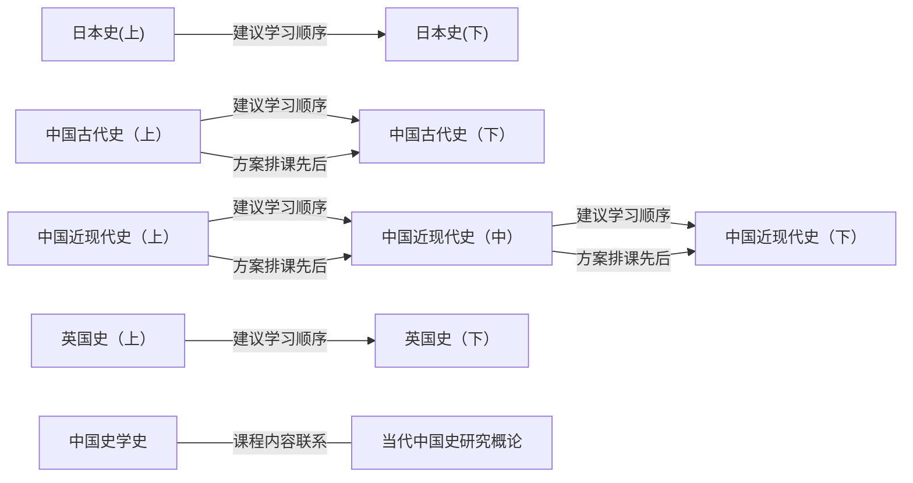

# 历史学专业培养方案（强基班学生适用）

2024 年汇编印刷页 105–111。原表记录 134 个可配对的课程代码。

[本节原页](plan-105.pdf#page=1) · [逐行数据](plan-105.json) · [院系目录](README.md)

## 课程导读

想了解历史与史料的课程安排，可以在原表中找到《中国历史文选（H）》（`HIST130179h`）、《中国史学史》（`HIST130002`）、《中国古代史（上）》（`HIST130180`）。 [原书 PDF 第 120 页](plan-105.pdf#page=2)

《中国古代史（上）》（`HIST130180`）和《中国古代史（下）》（`HIST130181`）是同一系列，图中的箭头按题名标出的分册顺序排列。原表分别排在第 1 学期和第 2 学期。 [原书 PDF 第 120 页](plan-105.pdf#page=2)

## 课程关系图

图中展示最多 20 条关系。下表列出本节全部关系。建议学习顺序供规划课程使用，正式选课资格以教务规定为准。

| 课程 | 关联课程 | 关系 | 依据 |
| --- | --- | --- | --- |
| 日本史(上)（HIST130103） | 日本史(下)（HIST130104） | 建议学习顺序 | 同节课程题名标明连续分册或序号。 |
| 中国古代史（上）（HIST130180） | 中国古代史（下）（HIST130181） | 建议学习顺序 | 同节课程题名标明连续分册或序号。 |
| 中国近现代史（上）（HIST130221） | 中国近现代史（中）（HIST130222） | 建议学习顺序 | 同节课程题名标明连续分册或序号。 |
| 中国近现代史（中）（HIST130222） | 中国近现代史（下）（HIST130223） | 建议学习顺序 | 同节课程题名标明连续分册或序号。 |
| 英国史（上）（HIST130226） | 英国史（下）（HIST130227） | 建议学习顺序 | 同节课程题名标明连续分册或序号。 |
| 中国史学史（HIST130002） | 当代中国史研究概论（HIST130147） | 课程内容联系 | 本方案两门课程的题名均含“中国史”，可据此对照这一主题。 |
| 中国古代史（上）（HIST130180） | 中国古代史（下）（HIST130181） | 方案排课先后 | 本节原表所列全部明确学期均早于后者。 |
| 中国近现代史（上）（HIST130221） | 中国近现代史（中）（HIST130222） | 方案排课先后 | 本节原表所列全部明确学期均早于后者。 |
| 中国近现代史（中）（HIST130222） | 中国近现代史（下）（HIST130223） | 方案排课先后 | 本节原表所列全部明确学期均早于后者。 |

## 课程

| 课程代码 | 名称 | 开课学期原文 | 来源（PDF 页） |
| --- | --- | --- | --- |
| HIST130001h | 史学导论（H） | 3 | 120 |
| HIST130002 | 中国史学史 | 4 | 120 |
| HIST130005 | 西方史学史 | 4 | 120 |
| HIST130005h | 西方史学史（H) |  | 121 |
| HIST130010 | 专业英语(历史学) | 5 | 120 |
| HIST130011 | 社会实践 | 4 | 120 |
| HIST130012 | 学年论文 | 6 | 120 |
| HIST130013 | 毕业论文 | 8 | 120 |
| HIST130015 | 先秦史 | 春，秋 | 121 |
| HIST130016 | 秦汉史 | 春，秋 | 121 |
| HIST130019 | 明清史 | 春，秋 | 121 |
| HIST130022 | 中国经学史 | 春，秋 | 123 |
| HIST130027 | 中国历史地理概论 | 5 | 120 |
| HIST130028 | 中国近代社会史 | 春，秋 | 122 |
| HIST130029 | 中国近代经济史 | 春，秋 | 122 |
| HIST130031 | 中国近代思想史 | 春，秋 | 122 |
| HIST130032 | 中国现代思想史 | 春，秋 | 122 |
| HIST130034 | 中日关系史 | 春，秋 | 122 |
| HIST130036 | 近现代中韩关系史 | 春，秋 | 125 |
| HIST130041 | 美国史 | 春，秋 | 125 |
| HIST130043 | 佛教史 | 春，秋 | 123 |
| HIST130047 | 中国古代城市史 | 春，秋 | 121 |
| HIST130048 | 中国古代经济史 | 春，秋 | 121 |
| HIST130049 | 内陆亚洲的历史与文化 | 春，秋 | 121 |
| HIST130050 | 中国古代礼制研究 | 春，秋 | 121 |
| HIST130052 | 中国近现代城市史 | 春，秋 | 122 |
| HIST130054 | 中国近现代史文献 | 春，秋 | 123 |
| HIST130055 | 中国金融史 | 春，秋 | 122 |
| HIST130056 | 20世纪中国社会思潮 | 春，秋 | 122 |
| HIST130058 | 韩国史 | 春，秋 | 125 |
| HIST130059 | 民国对外关系史 | 春，秋 | 122 |
| HIST130063 | 美国大众文化史 | 春，秋 | 125 |
| HIST130072 | 法国史 | 春，秋 | 125 |
| HIST130077 | 方志学通论 | 春，秋 | 121 |
| HIST130078 | 魏晋南北朝史 | 春，秋 | 121 |
| HIST130099 | 口述历史 | 春，秋 | 122 |
| HIST130103 | 日本史(上) | 春，秋 | 125 |
| HIST130104 | 日本史(下) | 春，秋 | 125 |
| HIST130114 | 专业日语（历史学）一 | 春，秋 | 120 |
| HIST130117 | 中国古代博物学史 | 春，秋 | 123 |
| HIST130122 | 中华人民共和国经济史 | 春，秋 | 123 |
| HIST130123 | 17—19世纪的美国 | 春，秋 | 125 |
| HIST130127 | 中国古代社会生活史 | 春，秋 | 121 |
| HIST130129 | 晚清史 | 春，秋 | 121 |
| HIST130130 | 近代早期西欧社会 | 春，秋 | 125 |
| HIST130131 | 留学生与近代中国 | 春，秋 | 123 |
| HIST130134 | 中国近代社会性别与妇女史 | 春，秋 | 123 |
| HIST130140 | 宋辽金史 | 春，秋 | 122 |
| HIST130145 | 晚清对外关系 | 春，秋 | 123 |
| HIST130146 | 欧美汉学 | 春，秋 | 123 |
| HIST130147 | 当代中国史研究概论 | 春，秋 | 123 |
| HIST130149 | 蒙元史 | 春，秋 | 122 |
| HIST130150 | 明清中西绘画交流史 | 春，秋 | 122 |
| HIST130153 | 魏晋隋唐史名著选读 | 春，秋 | 122 |
| HIST130154 | 四部文献研读 | 春，秋 | 122 |
| HIST130155 | 中国现代化史 | 春，秋 | 123 |
| HIST130156 | 中国现代经济思想史 | 春，秋 | 123 |
| HIST130163 | 科学的历史背景 | 春，秋 | 123 |
| HIST130164 | 北洋军阀史 | 春，秋 | 123 |
| HIST130170 | 近代以来的民族主义思潮 | 春，秋 | 125 |
| HIST130174 | 历史社会学 | 春，秋 | 123 |
| HIST130176 | 简帛文献学概论 | 春，秋 | 122 |
| HIST130177 | 石刻史料与中古中国 | 春，秋 | 122 |
| HIST130178 | 欧洲近代思想史 | 春，秋 | 125 |
| HIST130179h | 中国历史文选（H） | 3 | 120 |
| HIST130180 | 中国古代史（上） | 1 | 120 |
| HIST130181 | 中国古代史（下） | 2 | 120 |
| HIST130187 | 20世纪的世界 | 4 | 120 |
| HIST130188h | 史学论文写作（H) | 5 | 120 |
| HIST130190 | 俄罗斯史 | 春，秋 | 125 |
| HIST130191 | 中国古史传说研究导论 | 春，秋 | 122 |
| HIST130192 | 明清文化史 | 春，秋 | 122 |
| HIST130194 | 欧洲文艺复兴和宗教改革史 | 春，秋 | 125 |
| HIST130199 | 日本中世纪的国家与社会 | 春，秋 | 125 |
| HIST130200 | 《汉书·艺文志》研读 | 春，秋 | 122 |
| HIST130201 | 中古官制史料研读 | 春，秋 | 122 |
| HIST130204 | 中国近代史文献与研究选读 | 春，秋 | 123 |
| HIST130207 | 中国基督宗教史研读 | 春，秋 | 123 |
| HIST130216h | 中国社会史专题(H) |  | 121 |
| HIST130221 | 中国近现代史（上） | 3 | 120 |
| HIST130222 | 中国近现代史（中） | 4 | 120 |
| HIST130223 | 中国近现代史（下） | 5 | 120 |
| HIST130224 | 中国近代教育史 | 春，秋 | 123 |
| HIST130225 | 美国政治史 | 春，秋 | 125 |
| HIST130226 | 英国史（上） | 春，秋 | 125 |
| HIST130227 | 英国史（下） | 春，秋 | 125 |
| HIST130229 | 中国近现代医学文化史 | 春，秋 | 123 |
| HIST130232 | 秦汉史料选读 | 春，秋 | 122 |
| HIST130234 | 中国思想文化专题研究中国思想文化专题研究 | 春，秋 | 123 |
| HIST130235 | 15世纪以前的世界 | 2 | 120 |
| HIST130236 | 世界近代史 | 3 | 120 |
| HIST130239 | 中国近代史学史 | 春，秋 | 123 |
| HIST130242 | 中国近世宗教史 | 春，秋 | 122 |
| HIST130243 | 中外医学文化交流史 | 春，秋 | 123 |
| HIST130244 | 来华外国人与近代中国 | 春，秋 | 123 |
| HIST130254 | 历史人类学导论 | 春，秋 | 122 |
| HIST130256h | 日本近现代政治经济史(H) |  | 121 |
| HIST130258h | 历史上的中国与世界(H) |  | 120 |
| HIST130260h | 隋唐史专题(H) |  | 121 |
| HIST130261 | 影像资料中的当代中国历史（1949-2000） | 春，秋 | 123 |
| HIST130263 | 中国古代乡村社会 | 春，秋 | 122 |
| HIST130264 | 民间文献与田野调查 | 春，秋 | 122 |
| HIST130265 | 历史研究的方法与实践 | 春，秋 | 124 |
| HIST130267h | 出土文献选读(H) |  | 120 |
| HIST130269h | 中国近现代史研究理论方法与实践(H) |  | 121 |
| HIST130270h | 世界古代宗教文化研究(H) |  | 121 |
| HIST130271h | 欧洲近代思想史(H) |  | 121 |
| HIST130272h | 韩国近现代史(H) |  | 121 |
| HIST130274 | 韩国文化史 | 春，秋 | 125 |
| HIST130276 | 契丹女真史专题 | 春，秋 | 122 |
| HIST130277 | 16—19世纪的大西洋世界 | 春，秋 | 125 |
| HIST130281 | 日本近代史 | 春，秋 | 125 |
| HIST130282 | 丝绸之路沿线出土写本导读 | 春，秋 | 122 |
| HIST130283 | 撒哈拉以南非洲的近现代史 | 春，秋 | 125 |
| HIST130288 | 概念史理论与方法 | 春，秋 | 123 |
| HIST130290 | 世界近现代社会转型 | 春，秋 | 125 |
| HIST130291 | 蒙古族史 | 春，秋 | 122 |
| HIST130292 | 民国财政史 | 春，秋 | 123 |
| HIST130293 | 中国近代文献研读 | 春，秋 | 123 |
| HIST130294 | 海外汉学导读：以海外唐宋研究为中心 | 春，秋 | 123 |
| HIST130295 | 当代中国经济与世界 | 春，秋 | 123 |
| HIST130296 | 中国近代社会经济史 | 春，秋 | 123 |
| HIST130297 | 中国古代的权力和社会 | 春，秋 | 122 |
| HIST130298 | 身体文化史概论 | 春，秋 | 122 |
| HIST130300 | 中国近现代思想史文献 | 春，秋 | 124 |
| HIST130301 | 清代的制度与社会 | 春，秋 | 123 |
| HIST130302 | 西方政治思想史 | 春，秋 | 124 |
| HIST130303 | 秦汉简帛文献讲读 | 春，秋 | 122 |
| HIST130304 | 中国医疗社会文化史 | 春，秋 | 124 |
| HIST130305 | 目录学 | 春，秋 | 122 |
| HIST130311 | 中国古典语文基础 | 春，秋 | 120 |
| MUSE120001 | 考古学导论 | 春，秋 | 120 |
| PHIL130167 | I巴利语 | 春，秋 | 124 |
| PHIL130168 | II巴利语 | 春，秋 | 124 |
