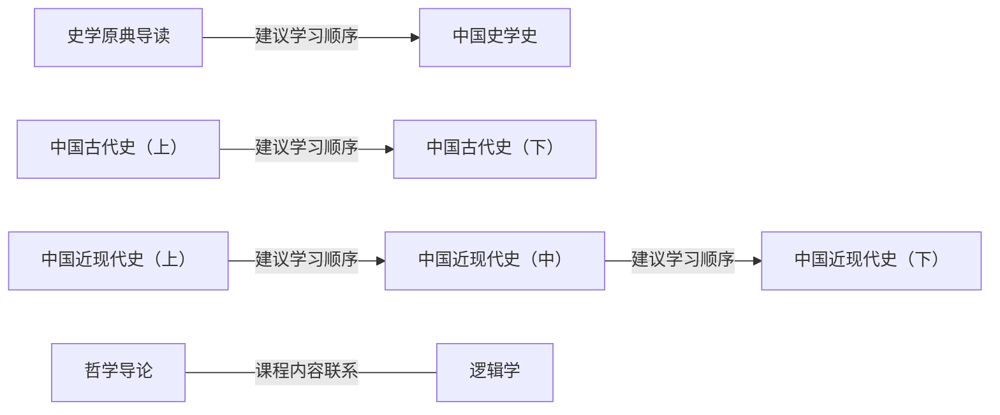

# 历史学专业“2+X”修读建议

2024 年汇编印刷页 112–113。原表记录 31 个可配对的课程代码。

[本节原页](plan-105.pdf#page=8) · [逐行数据](plan-105.json) · [院系目录](README.md)

## 课程关系图

图中展示最多 20 条关系。下表列出本节全部关系。建议学习顺序供规划课程使用，正式选课资格以教务规定为准。

| 课程 | 关联课程 | 关系 | 依据 |
| --- | --- | --- | --- |
| 史学原典导读（HIST120001） | 中国史学史（HIST130002） | 建议学习顺序 | 研读史学原典有助于认识史学思想与史书体例。 |
| 中国古代史（上）（HIST130180） | 中国古代史（下）（HIST130181） | 建议学习顺序 | 同节课程题名标明连续分册或序号。 |
| 中国近现代史（上）（HIST130221） | 中国近现代史（中）（HIST130222） | 建议学习顺序 | 同节课程题名标明连续分册或序号。 |
| 中国近现代史（中）（HIST130222） | 中国近现代史（下）（HIST130223） | 建议学习顺序 | 同节课程题名标明连续分册或序号。 |
| 哲学导论（PHIL120012） | 逻辑学（PHIL120013） | 课程内容联系 | 论证与概念分析是哲学讨论的共同方法。 |

## 课程

| 课程代码 | 名称 | 开课学期原文 | 来源（PDF 页） |
| --- | --- | --- | --- |
| CHIN120012 | 中国文学经典 |  | 126 |
| HIST120001 | 史学原典导读 |  | 126 |
| HIST120012 | 中国古代文明 |  | 126 |
| HIST130001 | 史学导论 |  | 127 |
| HIST130002 | 中国史学史 |  | 127 |
| HIST130005 | 西方史学史 |  | 127 |
| HIST130010 | 专业英语(历史学) |  | 127 |
| HIST130011 | 社会实践 |  | 127 |
| HIST130012 | 学年论文 |  | 127 |
| HIST130013 | 毕业论文 |  | 127 |
| HIST130027 | 中国历史地理概论 |  | 127 |
| HIST130114 | 专业日语（历史学）一 |  | 127 |
| HIST130179 | 中国历史文选 |  | 127 |
| HIST130180 | 中国古代史（上） |  | 127 |
| HIST130181 | 中国古代史（下） |  | 127 |
| HIST130187 | 20世纪的世界 |  | 127 |
| HIST130188 | 史学论文写作 |  | 127 |
| HIST130221 | 中国近现代史（上） |  | 127 |
| HIST130222 | 中国近现代史（中） |  | 127 |
| HIST130223 | 中国近现代史（下） |  | 127 |
| HIST130235 | 15世纪以前的世界 |  | 127 |
| HIST130236 | 世界近代史 |  | 127 |
| HIST130311 | 中国古典语文基础 |  | 127 |
| MUSE120001 | 考古学导论 |  | 127 |
| PHIL120012 | 哲学导论 |  | 126 |
| PHIL120013 | 逻辑学 |  | 126 |
| PTSS110082 | 毛泽东思想和中国特色社会主义理论体系概论 |  | 126 |
| PTSS110087 | 马克思主义基本原理 |  | 126 |
| PTSS110088 | 中国近现代史纲要 |  | 126 |
| PTSS110089 | 思想道德与法治 |  | 126 |
| PTSS110090 | 习近平新时代中国特色社会主义思想概论 |  | 126 |
