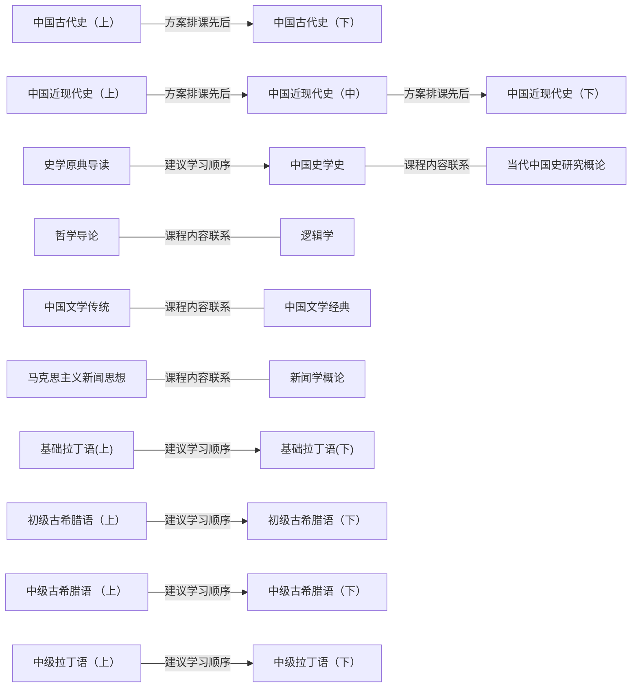

# 2025历史学专业本科培养方案（强基计划）

历史学系 · 历史学(强基计划) · 方案 97390 · 179 个不同课程或科研条目。

[官方 Word](../originals/plan-97390.docx) · [教务详情](https://fdjwgl.fudan.edu.cn/manager/bizType/2/major-program-search/info/97390?skipAuth=1) · [方案快照](../raw/plan-97390.json.gz) · [年级目录](../README.md)

## 课程关系图

图中展示部分关系。下表保留全部已建立的课程对，来源位置使用本方案 JSON Pointer。

## 先修与内容联系

| 类型 | 起点 | 终点 | 依据 | 原表定位 |
| --- | --- | --- | --- | --- |
| 建议学习顺序 | 史学原典导读 (HIST10003) | 中国史学史 (HIST20003) | 研读史学原典有助于认识史学思想与史书体例。  | `/courseModules/8/planCourses/1`、`/courseModules/10/planCourses/4` |
| 建议学习顺序 | 中国古代史（上） (HIST10007) | 中国古代史（下） (HIST10008) | 同方案的课程题名具有连续分册或序号。  | `/courseModules/10/planCourses/0`、`/courseModules/10/planCourses/1` |
| 建议学习顺序 | 中国近现代史（上） (HIST20008) | 中国近现代史（中） (HIST20009) | 同方案的课程题名具有连续分册或序号。  | `/courseModules/10/planCourses/6`、`/courseModules/10/planCourses/7` |
| 建议学习顺序 | 中国近现代史（中） (HIST20009) | 中国近现代史（下） (HIST30084) | 同方案的课程题名具有连续分册或序号。  | `/courseModules/10/planCourses/7`、`/courseModules/10/planCourses/8` |
| 建议学习顺序 | 日本史(上) (HIST30036) | 日本史(下) (HIST30037) | 同方案的课程题名具有连续分册或序号。  | `/courseModules/23/planCourses/2`、`/courseModules/23/planCourses/3` |
| 建议学习顺序 | 基础拉丁语(上) (HIST30038) | 基础拉丁语(下) (HIST30039) | 同方案的课程题名具有连续分册或序号。  | `/courseModules/21/planCourses/0`、`/courseModules/21/planCourses/1` |
| 建议学习顺序 | 英国史（上） (HIST30087) | 英国史（下） (HIST30088) | 同方案的课程题名具有连续分册或序号。  | `/courseModules/22/planCourses/10`、`/courseModules/22/planCourses/11` |
| 建议学习顺序 | 初级古希腊语（上） (HIST30099) | 初级古希腊语（下） (HIST30100) | 同方案的课程题名具有连续分册或序号。  | `/courseModules/21/planCourses/8`、`/courseModules/21/planCourses/9` |
| 建议学习顺序 | 中级古希腊语 （上） (HIST30101) | 中级古希腊语（下） (HIST30102) | 同方案的课程题名具有连续分册或序号。  | `/courseModules/21/planCourses/10`、`/courseModules/21/planCourses/11` |
| 建议学习顺序 | 中级拉丁语（上） (HIST30103) | 中级拉丁语（下） (HIST30104) | 同方案的课程题名具有连续分册或序号。  | `/courseModules/21/planCourses/12`、`/courseModules/21/planCourses/13` |
| 建议学习顺序 | 初级古希伯来语（上） (HIST30113) | 初级古希伯来语（下） (HIST30114) | 同方案的课程题名具有连续分册或序号。  | `/courseModules/21/planCourses/15`、`/courseModules/21/planCourses/16` |
| 建议学习顺序 | 藏语Ⅰ (PHIL40009) | 藏语Ⅱ (PHIL40010) | 同方案的课程题名具有连续分册或序号。  | `/courseModules/21/planCourses/22`、`/courseModules/21/planCourses/23` |
| 方案排课先后 | 中国古代史（上） (HIST10007) | 中国古代史（下） (HIST10008) | 同方案该课程全部明确数字学期均早于后者。  | `/courseModules/10/planCourses/0`、`/courseModules/10/planCourses/1` |
| 方案排课先后 | 中国近现代史（上） (HIST20008) | 中国近现代史（中） (HIST20009) | 同方案该课程全部明确数字学期均早于后者。  | `/courseModules/10/planCourses/6`、`/courseModules/10/planCourses/7` |
| 方案排课先后 | 中国近现代史（中） (HIST20009) | 中国近现代史（下） (HIST30084) | 同方案该课程全部明确数字学期均早于后者。  | `/courseModules/10/planCourses/7`、`/courseModules/10/planCourses/8` |
| 课程内容联系 | 中国文学传统 (CHIN10001) | 中国文学经典 (CHIN10005) | 经典文本与文学传统可从作品接受与文学演变联系。  | `/courseModules/8/planCourses/0`、`/courseModules/7/planCourses/0` |
| 课程内容联系 | 中国史学史 (HIST20003) | 当代中国史研究概论 (HIST30056) | 本方案两门课程的题名均含“中国史”，可据此对照这一主题。  | `/courseModules/10/planCourses/4`、`/courseModules/17/planCourses/14` |
| 课程内容联系 | 马克思主义新闻思想 (JCM10001) | 新闻学概论 (JCM10002) | 本方案两门课程的题名均含“新闻”，可据此对照这一主题。  | `/courseModules/8/planCourses/13`、`/courseModules/8/planCourses/11` |
| 课程内容联系 | 哲学导论 (PHIL10002) | 逻辑学 (PHIL10003) | 论证与概念分析是哲学讨论的共同方法。  | `/courseModules/7/planCourses/1`、`/courseModules/7/planCourses/2` |

本次未从可定位的明确表述中确认课程对课程预修。学期安排、系列分册与编辑建议均保留各自的依据。

## 按原方案模块阅读

同一模块展示原表中的课程归属。模块内课程之间的先后仍须逐项查阅。

- **中国古代史**　中国古代乡村社会、民间文献与田野调查、蒙古族史、先秦史、秦汉史、明清史、中国古代城市史、中国古代经济史、内陆亚洲的历史与文化、中国古代礼制研究、方志学通论、魏晋南北朝史、中国古代社会生活史、晚清史、宋辽金史、蒙元史、明清中西绘画交流史、魏晋隋唐史名著选读等34项（原表模块 16）
- **中国近现代史**　中国近代社会史、中国近代经济史、中国近代思想史、中国现代思想史、中日关系史、中国近现代城市史、中国金融史、20世纪中国社会思潮、民国对外关系史、口述历史、中华人民共和国经济史、留学生与近代中国、中国近代社会性别与妇女史、晚清对外关系、当代中国史研究概论、中国现代化史、中国现代经济思想史、北洋军阀史等31项（原表模块 17）
- **专门史**　中国经学史、佛教史、中国近现代史文献、中国古代博物学史、欧美汉学、科学的历史背景、中国近现代医学文化史、中国思想文化专题研究、中外医学文化交流史、海外汉学导读：以海外唐宋研究为中心、中国近现代思想史文献、西方政治思想史、中国医疗社会文化史、巴利语Ⅰ（原表模块 18）
- **世界古代中世纪**　基础拉丁语(上)、基础拉丁语(下)、西方基督教史、古希腊史、西方古典文献导读、古代近东文明、西欧中世纪史、罗马史、初级古希腊语（上）、初级古希腊语（下）、中级古希腊语 （上）、中级古希腊语（下）、中级拉丁语（上）、中级拉丁语（下）、古希伯来经典导论、初级古希伯来语（上）、初级古希伯来语（下）、古代伊朗与中亚等24项（原表模块 21）
- **欧美和非洲近现代**　美国史、美国大众文化史、法国史、17－19世纪的美国、近代早期西欧社会、近代以来的民族主义思潮、欧洲近代思想史、俄罗斯史、欧洲文艺复兴和宗教改革史、美国政治史、英国史（上）、英国史（下）、16-19世纪的大西洋世界、撒哈拉以南非洲的近现代史、世界近现代社会转型（原表模块 22）
- **东亚近现代**　近现代中韩关系史、韩国史、日本史(上)、日本史(下)、日本中世纪的国家与社会、韩国文化史、日本近代史（原表模块 23）
- **中国古代史**　中国古代乡村社会、民间文献与田野调查、蒙古族史、先秦史、秦汉史、明清史、中国古代城市史、中国古代经济史、内陆亚洲的历史与文化、中国古代礼制研究、方志学通论、魏晋南北朝史、中国古代社会生活史、晚清史、宋辽金史、蒙元史、明清中西绘画交流史、魏晋隋唐史名著选读等34项（原表模块 29）
- **中国近现代史**　中国近代社会史、中国近代经济史、中国近代思想史、中国现代思想史、中日关系史、中国近现代城市史、中国金融史、20世纪中国社会思潮、民国对外关系史、口述历史、中华人民共和国经济史、留学生与近代中国、中国近代社会性别与妇女史、晚清对外关系、当代中国史研究概论、中国现代化史、中国现代经济思想史、北洋军阀史等31项（原表模块 30）
- **专门史**　中国经学史、佛教史、中国近现代史文献、中国古代博物学史、欧美汉学、科学的历史背景、中国近现代医学文化史、中国思想文化专题研究、中外医学文化交流史、海外汉学导读：以海外唐宋研究为中心、中国近现代思想史文献、西方政治思想史、中国医疗社会文化史、巴利语Ⅰ（原表模块 31）
- **世界古代中世纪**　基础拉丁语(上)、基础拉丁语(下)、西方基督教史、古希腊史、西方古典文献导读、古代近东文明、西欧中世纪史、罗马史、初级古希腊语（上）、初级古希腊语（下）、中级古希腊语 （上）、中级古希腊语（下）、中级拉丁语（上）、中级拉丁语（下）、古希伯来经典导论、初级古希伯来语（上）、初级古希伯来语（下）、古代伊朗与中亚等24项（原表模块 34）
- **欧美和非洲近现代**　美国史、美国大众文化史、法国史、17－19世纪的美国、近代早期西欧社会、近代以来的民族主义思潮、欧洲近代思想史、俄罗斯史、欧洲文艺复兴和宗教改革史、美国政治史、英国史（上）、英国史（下）、16-19世纪的大西洋世界、撒哈拉以南非洲的近现代史、世界近现代社会转型（原表模块 35）
- **东亚近现代**　近现代中韩关系史、韩国史、日本史(上)、日本史(下)、日本中世纪的国家与社会、韩国文化史、日本近代史（原表模块 36）

## 课程表

同一课程在不同模块分别出现时，按原表逐行列出。季节字段保留原值。

| 课程 | 代码 | 学分 | 学期 | 模块 |
| --- | --- | ---: | --- | --- |
| 中国文学经典 | CHIN10005 | 3.0 | SPRING、AUTUMN | 培养方案 / 专业培养课程 / 学科基础课程 / 人文基础课程 / 必修课程 |
| 哲学导论 | PHIL10002 | 3.0 | SPRING、AUTUMN | 培养方案 / 专业培养课程 / 学科基础课程 / 人文基础课程 / 必修课程 |
| 逻辑学 | PHIL10003 | 3.0 | SPRING、AUTUMN | 培养方案 / 专业培养课程 / 学科基础课程 / 人文基础课程 / 必修课程 |
| 中国文学传统 | CHIN10001 | 2.0 | SPRING、AUTUMN | 培养方案 / 专业培养课程 / 学科基础课程 / 人文基础课程 / 选修课程 |
| 史学原典导读 | HIST10003 | 2.0 | SPRING、AUTUMN | 培养方案 / 专业培养课程 / 学科基础课程 / 人文基础课程 / 选修课程 |
| 美学 | CHIN10002 | 2.0 | SPRING、AUTUMN | 培养方案 / 专业培养课程 / 学科基础课程 / 人文基础课程 / 选修课程 |
| 语言与文化 | CHIN10006 | 2.0 | SPRING、AUTUMN | 培养方案 / 专业培养课程 / 学科基础课程 / 人文基础课程 / 选修课程 |
| 汉语概论 | CHIN10004 | 2.0 | SPRING、AUTUMN | 培养方案 / 专业培养课程 / 学科基础课程 / 人文基础课程 / 选修课程 |
| 现代文艺赏析 | CHIN10003 | 2.0 | SPRING、AUTUMN | 培养方案 / 专业培养课程 / 学科基础课程 / 人文基础课程 / 选修课程 |
| 近代中国社会研究 | HIST10005 | 2.0 | SPRING、AUTUMN | 培养方案 / 专业培养课程 / 学科基础课程 / 人文基础课程 / 选修课程 |
| 考古学导论 | ARCH10001 | 2.0 | AUTUMN | 培养方案 / 专业培养课程 / 学科基础课程 / 人文基础课程 / 选修课程 |
| 中国古代工艺美术 | CULT10001 | 2.0 | SPRING、AUTUMN | 培养方案 / 专业培养课程 / 学科基础课程 / 人文基础课程 / 选修课程 |
| 中国文字源流 | CULT10002 | 2.0 | AUTUMN | 培养方案 / 专业培养课程 / 学科基础课程 / 人文基础课程 / 选修课程 |
| 宗教学导论 | PHIL10004 | 2.0 | AUTUMN | 培养方案 / 专业培养课程 / 学科基础课程 / 人文基础课程 / 选修课程 |
| 新闻学概论 | JCM10002 | 2.0 | SPRING、AUTUMN | 培养方案 / 专业培养课程 / 学科基础课程 / 人文基础课程 / 选修课程 |
| 传播学概论 | JCM10003 | 2.0 | SPRING、AUTUMN | 培养方案 / 专业培养课程 / 学科基础课程 / 人文基础课程 / 选修课程 |
| 马克思主义新闻思想 | JCM10001 | 2.0 | SPRING、AUTUMN | 培养方案 / 专业培养课程 / 学科基础课程 / 人文基础课程 / 选修课程 |
| 语言学导论 | FORE10005 | 2.0 | SPRING、AUTUMN | 培养方案 / 专业培养课程 / 学科基础课程 / 人文基础课程 / 选修课程 |
| 世界文学导读 | FORE10006 | 2.0 | SPRING、AUTUMN | 培养方案 / 专业培养课程 / 学科基础课程 / 人文基础课程 / 选修课程 |
| 中国古代史（上） | HIST10007 | 4.0 | 第1学期 | 培养方案 / 专业培养课程 / 专业核心教育课程 / 必修课程 |
| 中国古代史（下） | HIST10008 | 4.0 | 第2学期 | 培养方案 / 专业培养课程 / 专业核心教育课程 / 必修课程 |
| 15世纪以前的世界 | HIST10009 | 4.0 | 第2学期 | 培养方案 / 专业培养课程 / 专业核心教育课程 / 必修课程 |
| 世界近代史 | HIST20010 | 4.0 | 第3学期 | 培养方案 / 专业培养课程 / 专业核心教育课程 / 必修课程 |
| 中国史学史 | HIST20003 | 3.0 | 第4学期 | 培养方案 / 专业培养课程 / 专业核心教育课程 / 必修课程 |
| 西方史学史 | HIST20004 | 3.0 | 第4学期 | 培养方案 / 专业培养课程 / 专业核心教育课程 / 必修课程 |
| 中国近现代史（上） | HIST20008 | 3.0 | 第3学期 | 培养方案 / 专业培养课程 / 专业核心教育课程 / 必修课程 |
| 中国近现代史（中） | HIST20009 | 3.0 | 第4学期 | 培养方案 / 专业培养课程 / 专业核心教育课程 / 必修课程 |
| 中国近现代史（下） | HIST30084 | 3.0 | 第5学期 | 培养方案 / 专业培养课程 / 专业核心教育课程 / 必修课程 |
| 20世纪的世界 | HIST20007 | 4.0 | 第4学期 | 培养方案 / 专业培养课程 / 专业核心教育课程 / 必修课程 |
| 中国历史地理概论 | HIST30009 | 2.0 | 第5学期 | 培养方案 / 专业培养课程 / 专业核心教育课程 / 必修课程 |
| 专业英语(历史学) | HIST30003 | 2.0 | 第5学期 | 培养方案 / 专业培养课程 / 专业核心教育课程 / 必修课程 |
| 新生史学入门 | HIST10002 | 2.0 | 第1学期 | 培养方案 / 专业培养课程 / 专业核心教育课程 / 必修课程 |
| 中国历史文选(H) | HIST20006h | 4.0 | 第3学期 | 培养方案 / 专业培养课程 / 专业核心教育课程 / 必修课程 |
| 史学导论(H) | HIST20002h | 4.0 | 第3学期 | 培养方案 / 专业培养课程 / 专业核心教育课程 / 必修课程 |
| 史学论文写作（H） | HIST30071h | 4.0 | 第5学期 | 培养方案 / 专业培养课程 / 专业核心教育课程 / 必修课程 |
| 考古学导论 | ARCH10001 | 2.0 | SPRING、AUTUMN | 培养方案 / 专业培养课程 / 专业核心教育课程 / 限定必修课程 |
| 专业日语（历史学）Ⅰ | HIST30041 | 2.0 | SPRING、AUTUMN | 培养方案 / 专业培养课程 / 专业核心教育课程 / 限定必修课程 |
| 中国古典语文基础 | HIST30144 | 2.0 | SPRING、AUTUMN | 培养方案 / 专业培养课程 / 专业核心教育课程 / 限定必修课程 |
| 文化遗产理论与方法 | HIST10001 | 2.0 | SPRING、AUTUMN | 培养方案 / 专业培养课程 / 专业核心教育课程 / 限定必修课程 |
| 秦汉史 | HIST30006 | 2.0 | SPRING、AUTUMN | 培养方案 / 专业进阶路径 / 中国史 / 中国古代史 |
| 明清史 | HIST30007 | 2.0 | SPRING、AUTUMN | 培养方案 / 专业进阶路径 / 中国史 / 中国古代史 |
| 中国古代城市史 | HIST30020 | 2.0 | SPRING、AUTUMN | 培养方案 / 专业进阶路径 / 中国史 / 中国古代史 |
| 中国古代经济史 | HIST30021 | 2.0 | SPRING、AUTUMN | 培养方案 / 专业进阶路径 / 中国史 / 中国古代史 |
| 内陆亚洲的历史与文化 | HIST30022 | 2.0 | SPRING、AUTUMN | 培养方案 / 专业进阶路径 / 中国史 / 中国古代史 |
| 中国古代礼制研究 | HIST30023 | 2.0 | SPRING、AUTUMN | 培养方案 / 专业进阶路径 / 中国史 / 中国古代史 |
| 方志学通论 | HIST30033 | 2.0 | SPRING、AUTUMN | 培养方案 / 专业进阶路径 / 中国史 / 中国古代史 |
| 魏晋南北朝史 | HIST30034 | 2.0 | SPRING、AUTUMN | 培养方案 / 专业进阶路径 / 中国史 / 中国古代史 |
| 中国古代社会生活史 | HIST30047 | 2.0 | SPRING、AUTUMN | 培养方案 / 专业进阶路径 / 中国史 / 中国古代史 |
| 晚清史 | HIST30049 | 2.0 | SPRING、AUTUMN | 培养方案 / 专业进阶路径 / 中国史 / 中国古代史 |
| 宋辽金史 | HIST30053 | 2.0 | SPRING、AUTUMN | 培养方案 / 专业进阶路径 / 中国史 / 中国古代史 |
| 蒙元史 | HIST30057 | 2.0 | SPRING、AUTUMN | 培养方案 / 专业进阶路径 / 中国史 / 中国古代史 |
| 明清中西绘画交流史 | HIST30058 | 2.0 | SPRING、AUTUMN | 培养方案 / 专业进阶路径 / 中国史 / 中国古代史 |
| 魏晋隋唐史名著选读 | HIST30059 | 2.0 | SPRING、AUTUMN | 培养方案 / 专业进阶路径 / 中国史 / 中国古代史 |
| 四部文献研读 | HIST30060 | 2.0 | SPRING、AUTUMN | 培养方案 / 专业进阶路径 / 中国史 / 中国古代史 |
| 简帛文献学概论 | HIST30068 | 2.0 | SPRING、AUTUMN | 培养方案 / 专业进阶路径 / 中国史 / 中国古代史 |
| 石刻史料与中古中国 | HIST30069 | 2.0 | SPRING、AUTUMN | 培养方案 / 专业进阶路径 / 中国史 / 中国古代史 |
| 中国古史传说研究导论 | HIST30074 | 2.0 | SPRING、AUTUMN | 培养方案 / 专业进阶路径 / 中国史 / 中国古代史 |
| 明清文化史 | HIST30075 | 2.0 | SPRING、AUTUMN | 培养方案 / 专业进阶路径 / 中国史 / 中国古代史 |
| 《汉书·艺文志》研读 | HIST30078 | 2.0 | SPRING、AUTUMN | 培养方案 / 专业进阶路径 / 中国史 / 中国古代史 |
| 中古官制史料研读 | HIST30079 | 2.0 | SPRING、AUTUMN | 培养方案 / 专业进阶路径 / 中国史 / 中国古代史 |
| 秦汉史料选读 | HIST30091 | 2.0 | SPRING、AUTUMN | 培养方案 / 专业进阶路径 / 中国史 / 中国古代史 |
| 中国近世宗教史 | HIST30096 | 2.0 | SPRING、AUTUMN | 培养方案 / 专业进阶路径 / 中国史 / 中国古代史 |
| 历史人类学导论 | HIST30105 | 2.0 | SPRING、AUTUMN | 培养方案 / 专业进阶路径 / 中国史 / 中国古代史 |
| 中国古代乡村社会 | HIST130263 | 2.0 | SPRING、AUTUMN | 培养方案 / 专业进阶路径 / 中国史 / 中国古代史 |
| 民间文献与田野调查 | HIST130264 | 2.0 | SPRING、AUTUMN | 培养方案 / 专业进阶路径 / 中国史 / 中国古代史 |
| 契丹女真史专题 | HIST30110 | 2.0 | SPRING、AUTUMN | 培养方案 / 专业进阶路径 / 中国史 / 中国古代史 |
| 丝绸之路沿线出土写本导读 | HIST30116 | 2.0 | SPRING、AUTUMN | 培养方案 / 专业进阶路径 / 中国史 / 中国古代史 |
| 蒙古族史 | HIST130291 | 2.0 | SPRING、AUTUMN | 培养方案 / 专业进阶路径 / 中国史 / 中国古代史 |
| 中国古代的权力和社会 | HIST30130 | 2.0 | SPRING、AUTUMN | 培养方案 / 专业进阶路径 / 中国史 / 中国古代史 |
| 身体文化史概论 | HIST30131 | 2.0 | SPRING、AUTUMN | 培养方案 / 专业进阶路径 / 中国史 / 中国古代史 |
| 秦汉简帛文献讲读 | HIST30136 | 2.0 | SPRING、AUTUMN | 培养方案 / 专业进阶路径 / 中国史 / 中国古代史 |
| 目录学 | HIST30138 | 2.0 | SPRING、AUTUMN | 培养方案 / 专业进阶路径 / 中国史 / 中国古代史 |
| 先秦史 | HIST30005 | 2.0 | SPRING、AUTUMN | 培养方案 / 专业进阶路径 / 中国史 / 中国古代史 |
| 中国近代社会史 | HIST30010 | 2.0 | SPRING、AUTUMN | 培养方案 / 专业进阶路径 / 中国史 / 中国近现代史 |
| 中国近代经济史 | HIST30011 | 2.0 | SPRING、AUTUMN | 培养方案 / 专业进阶路径 / 中国史 / 中国近现代史 |
| 中国近代思想史 | HIST30012 | 2.0 | SPRING、AUTUMN | 培养方案 / 专业进阶路径 / 中国史 / 中国近现代史 |
| 中国现代思想史 | HIST30013 | 2.0 | SPRING、AUTUMN | 培养方案 / 专业进阶路径 / 中国史 / 中国近现代史 |
| 中日关系史 | HIST30014 | 2.0 | SPRING、AUTUMN | 培养方案 / 专业进阶路径 / 中国史 / 中国近现代史 |
| 中国近现代城市史 | HIST30024 | 2.0 | SPRING、AUTUMN | 培养方案 / 专业进阶路径 / 中国史 / 中国近现代史 |
| 中国金融史 | HIST30026 | 2.0 | SPRING、AUTUMN | 培养方案 / 专业进阶路径 / 中国史 / 中国近现代史 |
| 20世纪中国社会思潮 | HIST30027 | 2.0 | SPRING、AUTUMN | 培养方案 / 专业进阶路径 / 中国史 / 中国近现代史 |
| 民国对外关系史 | HIST30029 | 2.0 | SPRING、AUTUMN | 培养方案 / 专业进阶路径 / 中国史 / 中国近现代史 |
| 口述历史 | HIST30035 | 2.0 | SPRING、AUTUMN | 培养方案 / 专业进阶路径 / 中国史 / 中国近现代史 |
| 中华人民共和国经济史 | HIST30044 | 2.0 | SPRING、AUTUMN | 培养方案 / 专业进阶路径 / 中国史 / 中国近现代史 |
| 留学生与近代中国 | HIST30051 | 2.0 | SPRING、AUTUMN | 培养方案 / 专业进阶路径 / 中国史 / 中国近现代史 |
| 中国近代社会性别与妇女史 | HIST30052 | 2.0 | SPRING、AUTUMN | 培养方案 / 专业进阶路径 / 中国史 / 中国近现代史 |
| 晚清对外关系 | HIST30054 | 2.0 | SPRING、AUTUMN | 培养方案 / 专业进阶路径 / 中国史 / 中国近现代史 |
| 当代中国史研究概论 | HIST30056 | 2.0 | SPRING、AUTUMN | 培养方案 / 专业进阶路径 / 中国史 / 中国近现代史 |
| 中国现代化史 | HIST30061 | 2.0 | SPRING、AUTUMN | 培养方案 / 专业进阶路径 / 中国史 / 中国近现代史 |
| 中国现代经济思想史 | HIST30062 | 2.0 | SPRING、AUTUMN | 培养方案 / 专业进阶路径 / 中国史 / 中国近现代史 |
| 北洋军阀史 | HIST30064 | 2.0 | SPRING、AUTUMN | 培养方案 / 专业进阶路径 / 中国史 / 中国近现代史 |
| 历史社会学 | HIST30066 | 2.0 | SPRING、AUTUMN | 培养方案 / 专业进阶路径 / 中国史 / 中国近现代史 |
| 中国近代史文献与研究选读 | HIST30080 | 2.0 | SPRING、AUTUMN | 培养方案 / 专业进阶路径 / 中国史 / 中国近现代史 |
| 中国基督宗教史研读 | HIST30081 | 2.0 | SPRING、AUTUMN | 培养方案 / 专业进阶路径 / 中国史 / 中国近现代史 |
| 中国近代教育史 | HIST30085 | 2.0 | SPRING、AUTUMN | 培养方案 / 专业进阶路径 / 中国史 / 中国近现代史 |
| 来华外国人与近代中国 | HIST30098 | 2.0 | SPRING、AUTUMN | 培养方案 / 专业进阶路径 / 中国史 / 中国近现代史 |
| 影像资料中的当代中国历史（1949-2000） | HIST30106 | 2.0 | SPRING、AUTUMN | 培养方案 / 专业进阶路径 / 中国史 / 中国近现代史 |
| 概念史理论与方法 | HIST30122 | 2.0 | SPRING、AUTUMN | 培养方案 / 专业进阶路径 / 中国史 / 中国近现代史 |
| 民国财政史 | HIST30125 | 2.0 | SPRING、AUTUMN | 培养方案 / 专业进阶路径 / 中国史 / 中国近现代史 |
| 中国近代文献研读 | HIST30126 | 2.0 | SPRING、AUTUMN | 培养方案 / 专业进阶路径 / 中国史 / 中国近现代史 |
| 当代中国经济与世界 | HIST30128 | 2.0 | SPRING、AUTUMN | 培养方案 / 专业进阶路径 / 中国史 / 中国近现代史 |
| 中国近代社会经济史 | HIST30129 | 2.0 | SPRING、AUTUMN | 培养方案 / 专业进阶路径 / 中国史 / 中国近现代史 |
| 清代的制度与社会 | HIST30134 | 2.0 | SPRING、AUTUMN | 培养方案 / 专业进阶路径 / 中国史 / 中国近现代史 |
| 中国近代史学史 | HIST30095 | 2.0 | SPRING、AUTUMN | 培养方案 / 专业进阶路径 / 中国史 / 中国近现代史 |
| 中国经学史 | HIST30008 | 2.0 | SPRING、AUTUMN | 培养方案 / 专业进阶路径 / 中国史 / 专门史 |
| 佛教史 | HIST30019 | 2.0 | SPRING、AUTUMN | 培养方案 / 专业进阶路径 / 中国史 / 专门史 |
| 中国近现代史文献 | HIST30025 | 2.0 | SPRING、AUTUMN | 培养方案 / 专业进阶路径 / 中国史 / 专门史 |
| 中国古代博物学史 | HIST30042 | 2.0 | SPRING、AUTUMN | 培养方案 / 专业进阶路径 / 中国史 / 专门史 |
| 欧美汉学 | HIST30055 | 2.0 | SPRING、AUTUMN | 培养方案 / 专业进阶路径 / 中国史 / 专门史 |
| 科学的历史背景 | HIST30063 | 2.0 | SPRING、AUTUMN | 培养方案 / 专业进阶路径 / 中国史 / 专门史 |
| 中国近现代医学文化史 | HIST30089 | 2.0 | SPRING、AUTUMN | 培养方案 / 专业进阶路径 / 中国史 / 专门史 |
| 中国思想文化专题研究 | HIST30092 | 2.0 | SPRING、AUTUMN | 培养方案 / 专业进阶路径 / 中国史 / 专门史 |
| 中外医学文化交流史 | HIST30097 | 2.0 | SPRING、AUTUMN | 培养方案 / 专业进阶路径 / 中国史 / 专门史 |
| 海外汉学导读：以海外唐宋研究为中心 | HIST30127 | 2.0 | SPRING、AUTUMN | 培养方案 / 专业进阶路径 / 中国史 / 专门史 |
| 中国近现代思想史文献 | HIST30133 | 2.0 | SPRING、AUTUMN | 培养方案 / 专业进阶路径 / 中国史 / 专门史 |
| 西方政治思想史 | HIST30135 | 2.0 | SPRING、AUTUMN | 培养方案 / 专业进阶路径 / 中国史 / 专门史 |
| 中国医疗社会文化史 | HIST30137 | 2.0 | SPRING、AUTUMN | 培养方案 / 专业进阶路径 / 中国史 / 专门史 |
| 巴利语Ⅰ | PHIL40011 | 2.0 | SPRING、AUTUMN | 培养方案 / 专业进阶路径 / 中国史 / 专门史 |
| 历史研究的方法与实践 | HIST30107 | 3.0 | SPRING、AUTUMN | 培养方案 / 专业进阶路径 / 世界史 / 史学史和史学理论 |
| 基础拉丁语(上) | HIST30038 | 3.0 | SPRING、AUTUMN | 培养方案 / 专业进阶路径 / 世界史 / 世界古代中世纪 |
| 基础拉丁语(下) | HIST30039 | 3.0 | SPRING、AUTUMN | 培养方案 / 专业进阶路径 / 世界史 / 世界古代中世纪 |
| 西方基督教史 | HIST30040 | 2.0 | SPRING、AUTUMN | 培养方案 / 专业进阶路径 / 世界史 / 世界古代中世纪 |
| 古希腊史 | HIST30072 | 2.0 | SPRING、AUTUMN | 培养方案 / 专业进阶路径 / 世界史 / 世界古代中世纪 |
| 西方古典文献导读 | HIST30082 | 2.0 | SPRING、AUTUMN | 培养方案 / 专业进阶路径 / 世界史 / 世界古代中世纪 |
| 古代近东文明 | HIST30090 | 2.0 | SPRING、AUTUMN | 培养方案 / 专业进阶路径 / 世界史 / 世界古代中世纪 |
| 西欧中世纪史 | HIST30093 | 2.0 | SPRING、AUTUMN | 培养方案 / 专业进阶路径 / 世界史 / 世界古代中世纪 |
| 罗马史 | HIST30094 | 2.0 | SPRING、AUTUMN | 培养方案 / 专业进阶路径 / 世界史 / 世界古代中世纪 |
| 初级古希腊语（上） | HIST30099 | 3.0 | SPRING、AUTUMN | 培养方案 / 专业进阶路径 / 世界史 / 世界古代中世纪 |
| 初级古希腊语（下） | HIST30100 | 3.0 | SPRING、AUTUMN | 培养方案 / 专业进阶路径 / 世界史 / 世界古代中世纪 |
| 中级古希腊语 （上） | HIST30101 | 3.0 | SPRING、AUTUMN | 培养方案 / 专业进阶路径 / 世界史 / 世界古代中世纪 |
| 中级古希腊语（下） | HIST30102 | 3.0 | SPRING、AUTUMN | 培养方案 / 专业进阶路径 / 世界史 / 世界古代中世纪 |
| 中级拉丁语（上） | HIST30103 | 3.0 | SPRING、AUTUMN | 培养方案 / 专业进阶路径 / 世界史 / 世界古代中世纪 |
| 中级拉丁语（下） | HIST30104 | 3.0 | SPRING、AUTUMN | 培养方案 / 专业进阶路径 / 世界史 / 世界古代中世纪 |
| 古希伯来经典导论 | HIST30112 | 2.0 | SPRING、AUTUMN | 培养方案 / 专业进阶路径 / 世界史 / 世界古代中世纪 |
| 初级古希伯来语（上） | HIST30113 | 3.0 | SPRING、AUTUMN | 培养方案 / 专业进阶路径 / 世界史 / 世界古代中世纪 |
| 初级古希伯来语（下） | HIST30114 | 3.0 | SPRING、AUTUMN | 培养方案 / 专业进阶路径 / 世界史 / 世界古代中世纪 |
| 古代伊朗与中亚 | HIST30118 | 2.0 | SPRING、AUTUMN | 培养方案 / 专业进阶路径 / 世界史 / 世界古代中世纪 |
| 罗马帝国的衰亡 | HIST30119 | 2.0 | SPRING、AUTUMN | 培养方案 / 专业进阶路径 / 世界史 / 世界古代中世纪 |
| 古希腊语文学研讨 | HIST30123 | 3.0 | SPRING、AUTUMN | 培养方案 / 专业进阶路径 / 世界史 / 世界古代中世纪 |
| 拜占庭史 | HIST30132 | 2.0 | SPRING、AUTUMN | 培养方案 / 专业进阶路径 / 世界史 / 世界古代中世纪 |
| 拜占庭社会文化史专题 | HIST30139 | 2.0 | SPRING、AUTUMN | 培养方案 / 专业进阶路径 / 世界史 / 世界古代中世纪 |
| 藏语Ⅰ | PHIL40009 | 2.0 | SPRING、AUTUMN | 培养方案 / 专业进阶路径 / 世界史 / 世界古代中世纪 |
| 藏语Ⅱ | PHIL40010 | 2.0 | SPRING、AUTUMN | 培养方案 / 专业进阶路径 / 世界史 / 世界古代中世纪 |
| 美国史 | HIST30018 | 2.0 | SPRING、AUTUMN | 培养方案 / 专业进阶路径 / 世界史 / 欧美和非洲近现代 |
| 美国大众文化史 | HIST30030 | 2.0 | SPRING、AUTUMN | 培养方案 / 专业进阶路径 / 世界史 / 欧美和非洲近现代 |
| 法国史 | HIST30032 | 2.0 | SPRING、AUTUMN | 培养方案 / 专业进阶路径 / 世界史 / 欧美和非洲近现代 |
| 17－19世纪的美国 | HIST30045 | 2.0 | SPRING、AUTUMN | 培养方案 / 专业进阶路径 / 世界史 / 欧美和非洲近现代 |
| 近代早期西欧社会 | HIST30050 | 2.0 | SPRING、AUTUMN | 培养方案 / 专业进阶路径 / 世界史 / 欧美和非洲近现代 |
| 近代以来的民族主义思潮 | HIST30065 | 2.0 | SPRING、AUTUMN | 培养方案 / 专业进阶路径 / 世界史 / 欧美和非洲近现代 |
| 欧洲近代思想史 | HIST30070 | 2.0 | SPRING、AUTUMN | 培养方案 / 专业进阶路径 / 世界史 / 欧美和非洲近现代 |
| 俄罗斯史 | HIST30073 | 2.0 | SPRING、AUTUMN | 培养方案 / 专业进阶路径 / 世界史 / 欧美和非洲近现代 |
| 欧洲文艺复兴和宗教改革史 | HIST30076 | 2.0 | SPRING、AUTUMN | 培养方案 / 专业进阶路径 / 世界史 / 欧美和非洲近现代 |
| 美国政治史 | HIST30086 | 2.0 | SPRING、AUTUMN | 培养方案 / 专业进阶路径 / 世界史 / 欧美和非洲近现代 |
| 英国史（上） | HIST30087 | 2.0 | SPRING、AUTUMN | 培养方案 / 专业进阶路径 / 世界史 / 欧美和非洲近现代 |
| 英国史（下） | HIST30088 | 2.0 | SPRING、AUTUMN | 培养方案 / 专业进阶路径 / 世界史 / 欧美和非洲近现代 |
| 16-19世纪的大西洋世界 | HIST30111 | 2.0 | SPRING、AUTUMN | 培养方案 / 专业进阶路径 / 世界史 / 欧美和非洲近现代 |
| 撒哈拉以南非洲的近现代史 | HIST30117 | 2.0 | SPRING、AUTUMN | 培养方案 / 专业进阶路径 / 世界史 / 欧美和非洲近现代 |
| 世界近现代社会转型 | HIST30124 | 2.0 | SPRING、AUTUMN | 培养方案 / 专业进阶路径 / 世界史 / 欧美和非洲近现代 |
| 近现代中韩关系史 | HIST30016 | 2.0 | SPRING、AUTUMN | 培养方案 / 专业进阶路径 / 世界史 / 东亚近现代 |
| 韩国史 | HIST30028 | 2.0 | SPRING、AUTUMN | 培养方案 / 专业进阶路径 / 世界史 / 东亚近现代 |
| 日本史(上) | HIST30036 | 2.0 | SPRING、AUTUMN | 培养方案 / 专业进阶路径 / 世界史 / 东亚近现代 |
| 日本史(下) | HIST30037 | 2.0 | SPRING、AUTUMN | 培养方案 / 专业进阶路径 / 世界史 / 东亚近现代 |
| 日本中世纪的国家与社会 | HIST30077 | 2.0 | SPRING、AUTUMN | 培养方案 / 专业进阶路径 / 世界史 / 东亚近现代 |
| 韩国文化史 | HIST30108 | 2.0 | SPRING、AUTUMN | 培养方案 / 专业进阶路径 / 世界史 / 东亚近现代 |
| 日本近代史 | HIST30115 | 2.0 | SPRING、AUTUMN | 培养方案 / 专业进阶路径 / 世界史 / 东亚近现代 |
| 初级古希腊语（下） | HIST30100 | 3.0 | SPRING | 培养方案 / 西方古典学（初级） / 必修课 |
| 初级古希腊语（上） | HIST30099 | 3.0 | AUTUMN | 培养方案 / 西方古典学（初级） / 必修课 |
| 基础拉丁语(上) | HIST30038 | 3.0 | AUTUMN | 培养方案 / 西方古典学（初级） / 必修课 |
| 基础拉丁语(下) | HIST30039 | 3.0 | SPRING | 培养方案 / 西方古典学（初级） / 必修课 |
| 古希腊史 | HIST30072 | 2.0 | SPRING | 培养方案 / 西方古典学（初级） / 选修课 |
| 罗马史 | HIST30094 | 2.0 | SPRING | 培养方案 / 西方古典学（初级） / 选修课 |
| 古希腊神话 | GECC10071 | 2.0 | AUTUMN | 培养方案 / 西方古典学（初级） / 选修课 |
| 秦汉史 | HIST30006 | 2.0 | SPRING、AUTUMN | 培养方案 / 跨学科路径 / 中国史 / 中国古代史 |
| 明清史 | HIST30007 | 2.0 | SPRING、AUTUMN | 培养方案 / 跨学科路径 / 中国史 / 中国古代史 |
| 中国古代城市史 | HIST30020 | 2.0 | SPRING、AUTUMN | 培养方案 / 跨学科路径 / 中国史 / 中国古代史 |
| 中国古代经济史 | HIST30021 | 2.0 | SPRING、AUTUMN | 培养方案 / 跨学科路径 / 中国史 / 中国古代史 |
| 内陆亚洲的历史与文化 | HIST30022 | 2.0 | SPRING、AUTUMN | 培养方案 / 跨学科路径 / 中国史 / 中国古代史 |
| 中国古代礼制研究 | HIST30023 | 2.0 | SPRING、AUTUMN | 培养方案 / 跨学科路径 / 中国史 / 中国古代史 |
| 方志学通论 | HIST30033 | 2.0 | SPRING、AUTUMN | 培养方案 / 跨学科路径 / 中国史 / 中国古代史 |
| 魏晋南北朝史 | HIST30034 | 2.0 | SPRING、AUTUMN | 培养方案 / 跨学科路径 / 中国史 / 中国古代史 |
| 中国古代社会生活史 | HIST30047 | 2.0 | SPRING、AUTUMN | 培养方案 / 跨学科路径 / 中国史 / 中国古代史 |
| 晚清史 | HIST30049 | 2.0 | SPRING、AUTUMN | 培养方案 / 跨学科路径 / 中国史 / 中国古代史 |
| 宋辽金史 | HIST30053 | 2.0 | SPRING、AUTUMN | 培养方案 / 跨学科路径 / 中国史 / 中国古代史 |
| 蒙元史 | HIST30057 | 2.0 | SPRING、AUTUMN | 培养方案 / 跨学科路径 / 中国史 / 中国古代史 |
| 明清中西绘画交流史 | HIST30058 | 2.0 | SPRING、AUTUMN | 培养方案 / 跨学科路径 / 中国史 / 中国古代史 |
| 魏晋隋唐史名著选读 | HIST30059 | 2.0 | SPRING、AUTUMN | 培养方案 / 跨学科路径 / 中国史 / 中国古代史 |
| 四部文献研读 | HIST30060 | 2.0 | SPRING、AUTUMN | 培养方案 / 跨学科路径 / 中国史 / 中国古代史 |
| 简帛文献学概论 | HIST30068 | 2.0 | SPRING、AUTUMN | 培养方案 / 跨学科路径 / 中国史 / 中国古代史 |
| 石刻史料与中古中国 | HIST30069 | 2.0 | SPRING、AUTUMN | 培养方案 / 跨学科路径 / 中国史 / 中国古代史 |
| 中国古史传说研究导论 | HIST30074 | 2.0 | SPRING、AUTUMN | 培养方案 / 跨学科路径 / 中国史 / 中国古代史 |
| 明清文化史 | HIST30075 | 2.0 | SPRING、AUTUMN | 培养方案 / 跨学科路径 / 中国史 / 中国古代史 |
| 《汉书·艺文志》研读 | HIST30078 | 2.0 | SPRING、AUTUMN | 培养方案 / 跨学科路径 / 中国史 / 中国古代史 |
| 中古官制史料研读 | HIST30079 | 2.0 | SPRING、AUTUMN | 培养方案 / 跨学科路径 / 中国史 / 中国古代史 |
| 秦汉史料选读 | HIST30091 | 2.0 | SPRING、AUTUMN | 培养方案 / 跨学科路径 / 中国史 / 中国古代史 |
| 中国近世宗教史 | HIST30096 | 2.0 | SPRING、AUTUMN | 培养方案 / 跨学科路径 / 中国史 / 中国古代史 |
| 历史人类学导论 | HIST30105 | 2.0 | SPRING、AUTUMN | 培养方案 / 跨学科路径 / 中国史 / 中国古代史 |
| 中国古代乡村社会 | HIST130263 | 2.0 | SPRING、AUTUMN | 培养方案 / 跨学科路径 / 中国史 / 中国古代史 |
| 民间文献与田野调查 | HIST130264 | 2.0 | SPRING、AUTUMN | 培养方案 / 跨学科路径 / 中国史 / 中国古代史 |
| 契丹女真史专题 | HIST30110 | 2.0 | SPRING、AUTUMN | 培养方案 / 跨学科路径 / 中国史 / 中国古代史 |
| 丝绸之路沿线出土写本导读 | HIST30116 | 2.0 | SPRING、AUTUMN | 培养方案 / 跨学科路径 / 中国史 / 中国古代史 |
| 蒙古族史 | HIST130291 | 2.0 | SPRING、AUTUMN | 培养方案 / 跨学科路径 / 中国史 / 中国古代史 |
| 中国古代的权力和社会 | HIST30130 | 2.0 | SPRING、AUTUMN | 培养方案 / 跨学科路径 / 中国史 / 中国古代史 |
| 身体文化史概论 | HIST30131 | 2.0 | SPRING、AUTUMN | 培养方案 / 跨学科路径 / 中国史 / 中国古代史 |
| 秦汉简帛文献讲读 | HIST30136 | 2.0 | SPRING、AUTUMN | 培养方案 / 跨学科路径 / 中国史 / 中国古代史 |
| 目录学 | HIST30138 | 2.0 | SPRING、AUTUMN | 培养方案 / 跨学科路径 / 中国史 / 中国古代史 |
| 先秦史 | HIST30005 | 2.0 | SPRING、AUTUMN | 培养方案 / 跨学科路径 / 中国史 / 中国古代史 |
| 中国近代社会史 | HIST30010 | 2.0 | SPRING、AUTUMN | 培养方案 / 跨学科路径 / 中国史 / 中国近现代史 |
| 中国近代经济史 | HIST30011 | 2.0 | SPRING、AUTUMN | 培养方案 / 跨学科路径 / 中国史 / 中国近现代史 |
| 中国近代思想史 | HIST30012 | 2.0 | SPRING、AUTUMN | 培养方案 / 跨学科路径 / 中国史 / 中国近现代史 |
| 中国现代思想史 | HIST30013 | 2.0 | SPRING、AUTUMN | 培养方案 / 跨学科路径 / 中国史 / 中国近现代史 |
| 中日关系史 | HIST30014 | 2.0 | SPRING、AUTUMN | 培养方案 / 跨学科路径 / 中国史 / 中国近现代史 |
| 中国近现代城市史 | HIST30024 | 2.0 | SPRING、AUTUMN | 培养方案 / 跨学科路径 / 中国史 / 中国近现代史 |
| 中国金融史 | HIST30026 | 2.0 | SPRING、AUTUMN | 培养方案 / 跨学科路径 / 中国史 / 中国近现代史 |
| 20世纪中国社会思潮 | HIST30027 | 2.0 | SPRING、AUTUMN | 培养方案 / 跨学科路径 / 中国史 / 中国近现代史 |
| 民国对外关系史 | HIST30029 | 2.0 | SPRING、AUTUMN | 培养方案 / 跨学科路径 / 中国史 / 中国近现代史 |
| 口述历史 | HIST30035 | 2.0 | SPRING、AUTUMN | 培养方案 / 跨学科路径 / 中国史 / 中国近现代史 |
| 中华人民共和国经济史 | HIST30044 | 2.0 | SPRING、AUTUMN | 培养方案 / 跨学科路径 / 中国史 / 中国近现代史 |
| 留学生与近代中国 | HIST30051 | 2.0 | SPRING、AUTUMN | 培养方案 / 跨学科路径 / 中国史 / 中国近现代史 |
| 中国近代社会性别与妇女史 | HIST30052 | 2.0 | SPRING、AUTUMN | 培养方案 / 跨学科路径 / 中国史 / 中国近现代史 |
| 晚清对外关系 | HIST30054 | 2.0 | SPRING、AUTUMN | 培养方案 / 跨学科路径 / 中国史 / 中国近现代史 |
| 当代中国史研究概论 | HIST30056 | 2.0 | SPRING、AUTUMN | 培养方案 / 跨学科路径 / 中国史 / 中国近现代史 |
| 中国现代化史 | HIST30061 | 2.0 | SPRING、AUTUMN | 培养方案 / 跨学科路径 / 中国史 / 中国近现代史 |
| 中国现代经济思想史 | HIST30062 | 2.0 | SPRING、AUTUMN | 培养方案 / 跨学科路径 / 中国史 / 中国近现代史 |
| 北洋军阀史 | HIST30064 | 2.0 | SPRING、AUTUMN | 培养方案 / 跨学科路径 / 中国史 / 中国近现代史 |
| 历史社会学 | HIST30066 | 2.0 | SPRING、AUTUMN | 培养方案 / 跨学科路径 / 中国史 / 中国近现代史 |
| 中国近代史文献与研究选读 | HIST30080 | 2.0 | SPRING、AUTUMN | 培养方案 / 跨学科路径 / 中国史 / 中国近现代史 |
| 中国基督宗教史研读 | HIST30081 | 2.0 | SPRING、AUTUMN | 培养方案 / 跨学科路径 / 中国史 / 中国近现代史 |
| 中国近代教育史 | HIST30085 | 2.0 | SPRING、AUTUMN | 培养方案 / 跨学科路径 / 中国史 / 中国近现代史 |
| 来华外国人与近代中国 | HIST30098 | 2.0 | SPRING、AUTUMN | 培养方案 / 跨学科路径 / 中国史 / 中国近现代史 |
| 影像资料中的当代中国历史（1949-2000） | HIST30106 | 2.0 | SPRING、AUTUMN | 培养方案 / 跨学科路径 / 中国史 / 中国近现代史 |
| 概念史理论与方法 | HIST30122 | 2.0 | SPRING、AUTUMN | 培养方案 / 跨学科路径 / 中国史 / 中国近现代史 |
| 民国财政史 | HIST30125 | 2.0 | SPRING、AUTUMN | 培养方案 / 跨学科路径 / 中国史 / 中国近现代史 |
| 中国近代文献研读 | HIST30126 | 2.0 | SPRING、AUTUMN | 培养方案 / 跨学科路径 / 中国史 / 中国近现代史 |
| 当代中国经济与世界 | HIST30128 | 2.0 | SPRING、AUTUMN | 培养方案 / 跨学科路径 / 中国史 / 中国近现代史 |
| 中国近代社会经济史 | HIST30129 | 2.0 | SPRING、AUTUMN | 培养方案 / 跨学科路径 / 中国史 / 中国近现代史 |
| 清代的制度与社会 | HIST30134 | 2.0 | SPRING、AUTUMN | 培养方案 / 跨学科路径 / 中国史 / 中国近现代史 |
| 中国近代史学史 | HIST30095 | 2.0 | SPRING、AUTUMN | 培养方案 / 跨学科路径 / 中国史 / 中国近现代史 |
| 中国经学史 | HIST30008 | 2.0 | SPRING、AUTUMN | 培养方案 / 跨学科路径 / 中国史 / 专门史 |
| 佛教史 | HIST30019 | 2.0 | SPRING、AUTUMN | 培养方案 / 跨学科路径 / 中国史 / 专门史 |
| 中国近现代史文献 | HIST30025 | 2.0 | SPRING、AUTUMN | 培养方案 / 跨学科路径 / 中国史 / 专门史 |
| 中国古代博物学史 | HIST30042 | 2.0 | SPRING、AUTUMN | 培养方案 / 跨学科路径 / 中国史 / 专门史 |
| 欧美汉学 | HIST30055 | 2.0 | SPRING、AUTUMN | 培养方案 / 跨学科路径 / 中国史 / 专门史 |
| 科学的历史背景 | HIST30063 | 2.0 | SPRING、AUTUMN | 培养方案 / 跨学科路径 / 中国史 / 专门史 |
| 中国近现代医学文化史 | HIST30089 | 2.0 | SPRING、AUTUMN | 培养方案 / 跨学科路径 / 中国史 / 专门史 |
| 中国思想文化专题研究 | HIST30092 | 2.0 | SPRING、AUTUMN | 培养方案 / 跨学科路径 / 中国史 / 专门史 |
| 中外医学文化交流史 | HIST30097 | 2.0 | SPRING、AUTUMN | 培养方案 / 跨学科路径 / 中国史 / 专门史 |
| 海外汉学导读：以海外唐宋研究为中心 | HIST30127 | 2.0 | SPRING、AUTUMN | 培养方案 / 跨学科路径 / 中国史 / 专门史 |
| 中国近现代思想史文献 | HIST30133 | 2.0 | SPRING、AUTUMN | 培养方案 / 跨学科路径 / 中国史 / 专门史 |
| 西方政治思想史 | HIST30135 | 2.0 | SPRING、AUTUMN | 培养方案 / 跨学科路径 / 中国史 / 专门史 |
| 中国医疗社会文化史 | HIST30137 | 2.0 | SPRING、AUTUMN | 培养方案 / 跨学科路径 / 中国史 / 专门史 |
| 巴利语Ⅰ | PHIL40011 | 2.0 | SPRING、AUTUMN | 培养方案 / 跨学科路径 / 中国史 / 专门史 |
| 历史研究的方法与实践 | HIST30107 | 3.0 | SPRING、AUTUMN | 培养方案 / 跨学科路径 / 世界史 / 史学史和史学理论 |
| 基础拉丁语(上) | HIST30038 | 3.0 | SPRING、AUTUMN | 培养方案 / 跨学科路径 / 世界史 / 世界古代中世纪 |
| 基础拉丁语(下) | HIST30039 | 3.0 | SPRING、AUTUMN | 培养方案 / 跨学科路径 / 世界史 / 世界古代中世纪 |
| 西方基督教史 | HIST30040 | 2.0 | SPRING、AUTUMN | 培养方案 / 跨学科路径 / 世界史 / 世界古代中世纪 |
| 古希腊史 | HIST30072 | 2.0 | SPRING、AUTUMN | 培养方案 / 跨学科路径 / 世界史 / 世界古代中世纪 |
| 西方古典文献导读 | HIST30082 | 2.0 | SPRING、AUTUMN | 培养方案 / 跨学科路径 / 世界史 / 世界古代中世纪 |
| 古代近东文明 | HIST30090 | 2.0 | SPRING、AUTUMN | 培养方案 / 跨学科路径 / 世界史 / 世界古代中世纪 |
| 西欧中世纪史 | HIST30093 | 2.0 | SPRING、AUTUMN | 培养方案 / 跨学科路径 / 世界史 / 世界古代中世纪 |
| 罗马史 | HIST30094 | 2.0 | SPRING、AUTUMN | 培养方案 / 跨学科路径 / 世界史 / 世界古代中世纪 |
| 初级古希腊语（上） | HIST30099 | 3.0 | SPRING、AUTUMN | 培养方案 / 跨学科路径 / 世界史 / 世界古代中世纪 |
| 初级古希腊语（下） | HIST30100 | 3.0 | SPRING、AUTUMN | 培养方案 / 跨学科路径 / 世界史 / 世界古代中世纪 |
| 中级古希腊语 （上） | HIST30101 | 3.0 | SPRING、AUTUMN | 培养方案 / 跨学科路径 / 世界史 / 世界古代中世纪 |
| 中级古希腊语（下） | HIST30102 | 3.0 | SPRING、AUTUMN | 培养方案 / 跨学科路径 / 世界史 / 世界古代中世纪 |
| 中级拉丁语（上） | HIST30103 | 3.0 | SPRING、AUTUMN | 培养方案 / 跨学科路径 / 世界史 / 世界古代中世纪 |
| 中级拉丁语（下） | HIST30104 | 3.0 | SPRING、AUTUMN | 培养方案 / 跨学科路径 / 世界史 / 世界古代中世纪 |
| 古希伯来经典导论 | HIST30112 | 2.0 | SPRING、AUTUMN | 培养方案 / 跨学科路径 / 世界史 / 世界古代中世纪 |
| 初级古希伯来语（上） | HIST30113 | 3.0 | SPRING、AUTUMN | 培养方案 / 跨学科路径 / 世界史 / 世界古代中世纪 |
| 初级古希伯来语（下） | HIST30114 | 3.0 | SPRING、AUTUMN | 培养方案 / 跨学科路径 / 世界史 / 世界古代中世纪 |
| 古代伊朗与中亚 | HIST30118 | 2.0 | SPRING、AUTUMN | 培养方案 / 跨学科路径 / 世界史 / 世界古代中世纪 |
| 罗马帝国的衰亡 | HIST30119 | 2.0 | SPRING、AUTUMN | 培养方案 / 跨学科路径 / 世界史 / 世界古代中世纪 |
| 古希腊语文学研讨 | HIST30123 | 3.0 | SPRING、AUTUMN | 培养方案 / 跨学科路径 / 世界史 / 世界古代中世纪 |
| 拜占庭史 | HIST30132 | 2.0 | SPRING、AUTUMN | 培养方案 / 跨学科路径 / 世界史 / 世界古代中世纪 |
| 拜占庭社会文化史专题 | HIST30139 | 2.0 | SPRING、AUTUMN | 培养方案 / 跨学科路径 / 世界史 / 世界古代中世纪 |
| 藏语Ⅰ | PHIL40009 | 2.0 | SPRING、AUTUMN | 培养方案 / 跨学科路径 / 世界史 / 世界古代中世纪 |
| 藏语Ⅱ | PHIL40010 | 2.0 | SPRING、AUTUMN | 培养方案 / 跨学科路径 / 世界史 / 世界古代中世纪 |
| 美国史 | HIST30018 | 2.0 | SPRING、AUTUMN | 培养方案 / 跨学科路径 / 世界史 / 欧美和非洲近现代 |
| 美国大众文化史 | HIST30030 | 2.0 | SPRING、AUTUMN | 培养方案 / 跨学科路径 / 世界史 / 欧美和非洲近现代 |
| 法国史 | HIST30032 | 2.0 | SPRING、AUTUMN | 培养方案 / 跨学科路径 / 世界史 / 欧美和非洲近现代 |
| 17－19世纪的美国 | HIST30045 | 2.0 | SPRING、AUTUMN | 培养方案 / 跨学科路径 / 世界史 / 欧美和非洲近现代 |
| 近代早期西欧社会 | HIST30050 | 2.0 | SPRING、AUTUMN | 培养方案 / 跨学科路径 / 世界史 / 欧美和非洲近现代 |
| 近代以来的民族主义思潮 | HIST30065 | 2.0 | SPRING、AUTUMN | 培养方案 / 跨学科路径 / 世界史 / 欧美和非洲近现代 |
| 欧洲近代思想史 | HIST30070 | 2.0 | SPRING、AUTUMN | 培养方案 / 跨学科路径 / 世界史 / 欧美和非洲近现代 |
| 俄罗斯史 | HIST30073 | 2.0 | SPRING、AUTUMN | 培养方案 / 跨学科路径 / 世界史 / 欧美和非洲近现代 |
| 欧洲文艺复兴和宗教改革史 | HIST30076 | 2.0 | SPRING、AUTUMN | 培养方案 / 跨学科路径 / 世界史 / 欧美和非洲近现代 |
| 美国政治史 | HIST30086 | 2.0 | SPRING、AUTUMN | 培养方案 / 跨学科路径 / 世界史 / 欧美和非洲近现代 |
| 英国史（上） | HIST30087 | 2.0 | SPRING、AUTUMN | 培养方案 / 跨学科路径 / 世界史 / 欧美和非洲近现代 |
| 英国史（下） | HIST30088 | 2.0 | SPRING、AUTUMN | 培养方案 / 跨学科路径 / 世界史 / 欧美和非洲近现代 |
| 16-19世纪的大西洋世界 | HIST30111 | 2.0 | SPRING、AUTUMN | 培养方案 / 跨学科路径 / 世界史 / 欧美和非洲近现代 |
| 撒哈拉以南非洲的近现代史 | HIST30117 | 2.0 | SPRING、AUTUMN | 培养方案 / 跨学科路径 / 世界史 / 欧美和非洲近现代 |
| 世界近现代社会转型 | HIST30124 | 2.0 | SPRING、AUTUMN | 培养方案 / 跨学科路径 / 世界史 / 欧美和非洲近现代 |
| 近现代中韩关系史 | HIST30016 | 2.0 | SPRING、AUTUMN | 培养方案 / 跨学科路径 / 世界史 / 东亚近现代 |
| 韩国史 | HIST30028 | 2.0 | SPRING、AUTUMN | 培养方案 / 跨学科路径 / 世界史 / 东亚近现代 |
| 日本史(上) | HIST30036 | 2.0 | SPRING、AUTUMN | 培养方案 / 跨学科路径 / 世界史 / 东亚近现代 |
| 日本史(下) | HIST30037 | 2.0 | SPRING、AUTUMN | 培养方案 / 跨学科路径 / 世界史 / 东亚近现代 |
| 日本中世纪的国家与社会 | HIST30077 | 2.0 | SPRING、AUTUMN | 培养方案 / 跨学科路径 / 世界史 / 东亚近现代 |
| 韩国文化史 | HIST30108 | 2.0 | SPRING、AUTUMN | 培养方案 / 跨学科路径 / 世界史 / 东亚近现代 |
| 日本近代史 | HIST30115 | 2.0 | SPRING、AUTUMN | 培养方案 / 跨学科路径 / 世界史 / 东亚近现代 |
| 中国社会史专题研究(H) | HIST40019h | 4.0 | SPRING、AUTUMN | 培养方案 / 荣誉课程 |
| 全球视野下的近代中国国际地位变迁(H) | HIST130255h | 4.0 | SPRING、AUTUMN | 培养方案 / 荣誉课程 |
| 日本近现代政治经济史(H) | HIST40020h | 4.0 | SPRING、AUTUMN | 培养方案 / 荣誉课程 |
| 历史上的中国与世界(H) | HIST40021h | 4.0 | SPRING、AUTUMN | 培养方案 / 荣誉课程 |
| 隋唐史专题(H) | HIST40022h | 4.0 | SPRING、AUTUMN | 培养方案 / 荣誉课程 |
| 出土文献选读(H) | HIST40023h | 4.0 | SPRING、AUTUMN | 培养方案 / 荣誉课程 |
| 中国近现代史研究理论方法与实践（H） | HIST40024h | 4.0 | SPRING、AUTUMN | 培养方案 / 荣誉课程 |
| 世界古代宗教文化研究(H) | HIST40025h | 4.0 | SPRING、AUTUMN | 培养方案 / 荣誉课程 |
| 欧洲近代思想史（H） | HIST40026h | 4.0 | SPRING、AUTUMN | 培养方案 / 荣誉课程 |
| 韩国近现代史(H) | HIST40027h | 4.0 | SPRING、AUTUMN | 培养方案 / 荣誉课程 |
| 社会实践 | HIST20001 | 1.0 | SUMMER | 融合创新能力 |
| 复芏计划(FDUROP) | 102 | 0.0 |  | 融合创新能力 |
| 学年论文 | HIST30004 | 1.0 | 第6学期 | 融合创新能力 |
| 毕业论文 | HIST40007 | 4.0 | 第8学期 | 融合创新能力 |
