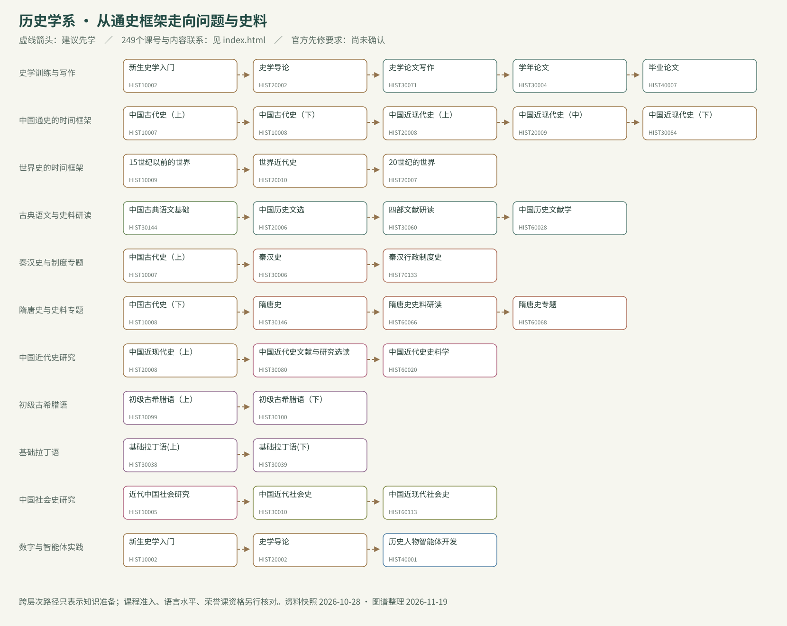

# 历史学系课程关系图谱

覆盖2025秋、2026春官方开课的 **249个课号、247个名称**，整理 **48条建议先学关系、251条内容联系和11条学习路径**。245门课程已有连线；4门暂保留为待核节点。图谱整理于2026-11-19，使用此前2026-10-28取得的资料快照，未重新核查最新开课和教学要求。

## 使用方法

下载 [index.html](index.html) 后用浏览器打开，即可离线检索、筛选和浏览。数据和脚本已嵌入，无需服务器、账号或第三方网络库。GitHub的HTML文件页显示源码，以上SVG可直接在GitHub查看。

- 按课程全名、课号或教师查找；按知识主题及本科／研究生层次筛选。
- 点击课程查看相邻课程，点击连线查看方向、理由、编辑规则位置和方案顺序佐证。
- “追溯建议先修”仅沿建议先学关系回溯，内容联系不用于推导先修。
- 可选择史学写作、中国通史、世界通史、史料研读、秦汉、隋唐、近代研究、古希腊语、拉丁语、社会史、数字史学等11条路径。
- 支持缩放和导出当前SVG；下载整个分支可继续打开相对链接中的官方资料及研究报告。

## 关系的依据和边界

| 关系 | 图中表示 | 核查状态 |
| --- | --- | --- |
| 建议先学 | 虚线箭头，方向为建议的准备课程→后续课程 | 48条均为编辑判断；其中7条另有同一培养方案的学期先后佐证，仍不是强制先修。 |
| 内容联系 | 无向实线，表示题名所示主题、方法或材料的参照关系 | 251条，逐条说明理由；尚未以完整大纲核实实际内容重合。跨主题比较、语言工具、同名参照均在理由中标注。 |
| 官方先修 | 必须由明确先修字段、大纲或制度支持 | 本批未确认，当前0条；空字段或未提供字段不能解释为“无需先修”。 |

逐份检查4个2026级本科方案JSON的先修相关字段及可见文本，并提取4份Word正文XML检索先修表述，未发现非空的明确先修记录。已出现的`defaultPreCourses`／`defaultPreCourseList`仅属于FDUROP占位课程且为空，不能外推到HIST课程。核查位置、正文字符数、原始文件哈希见 [source-audit.json](source-audit.json)。未对内嵌图片OCR，亦未取得每课完整大纲及研究生培养方案。

例如《中国古代史（上）》→《中国古代史（下）》及初级古希腊语上→下，体现时段或技能训练的建议顺序；不据此断言教务系统禁止跳修。《中国近代社会史》与《口述历史》等内容联系，也不等于两课实际使用同一方法或材料。

课号是节点主键。普通／H班、本科／研究生分别保留，不自动继承先修关系。《明清史》《专业外语》各有两个课号；同名不表示等价或学分互认。跨层次的学习路径只供知识准备参考，不表示研究生修读或升学资格。主题标签是编辑分类，不是官方专业方向。

4个待核节点为《认识地球》及3门“强国之路”课程。它们可检索、可筛选；暂未建立课程连线，不表示不存在内容联系。范围仅为两学期实际开课，2026培养方案列出但未在这两学期开设的课程没有补造为开课节点。

## 可复用数据

| 文件 | 内容 |
| --- | --- |
| [graph.json](graph.json) | 全量节点、类型化关系、学习路径、来源和统计。 |
| [nodes.csv](nodes.csv) / [relations.csv](relations.csv) | 可导入检索或图数据库的节点与关系表。 |
| [rules.json](rules.json) | 人工编辑的建议顺序、内容联系及主题族，供后续逐条修订。 |
| [source-audit.json](source-audit.json) | 官方字段、Word正文核查、输入SHA-256与原始JSON指针。 |
| [overview.svg](overview.svg) / [overview.mmd](overview.mmd) | 静态学习路径概览与Mermaid源文件。 |
| [build.py](build.py) / [viewer.html](viewer.html) / [graph-core.js](graph-core.js) | 离线构建脚本、页面模板和筛选逻辑。 |
| [SHA256SUMS.json](SHA256SUMS.json) | 本目录发布文件的完整性清单。 |

机器读取使用`type`与`directed`区分关系；当前所有边`is_enrollment_requirement=false`、`review_status=needs_syllabus_or_teacher_review`。`plan_order_support`仅记录同一方案内相符的学期先后，不作官方先修证明。`rule_pointer`回指编辑规则，`source_refs`回指课程身份及可用的官方顺序证据。不得把无向内容边用于先修路径推导。

## 更新与验证

在本目录运行 `python build.py`、`python test_graph.py`、`node test_graph.cjs`。均离线运行，只用标准库。构建时若发现新的非空先修字段或先修文字，会停止，要求先人工解释证据。更新后应重建本目录SHA-256清单。

已验证课程身份与层次、249个课号覆盖、来源哈希和JSON指针、建议顺序无环、CSV及HTML内嵌数据一致性、搜索与层次／关系筛选、定向回溯。交互页面另在隔离的Edge无头浏览器中检查搜索、课程与连线点击、路径、筛选、SVG导出及移动视口。图谱不改写既有原始数据及2026-10-30报告快照。
