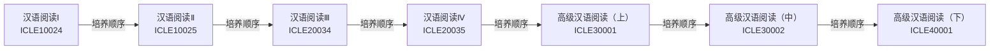
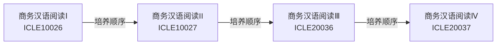
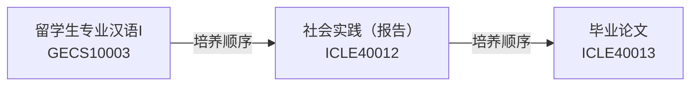

# 国际文化交流学院课程关系图谱

覆盖原2025秋／2026春167个课程代码，以及2026级两份培养方案补出的10个课程代码，共177个节点。按课程代码保留本科、研究生和同名课差异。

- [离线交互图谱](课程关系图谱.html)：下载本目录后打开；可搜索课程、查看邻接关系与证据。
- [语言文化方向主线图](语言文化方向.svg) · [商务汉语方向主线图](商务汉语方向.svg)。
- [关系数据 graph.json](graph.json) · [课程节点 CSV](nodes.csv) · [关系边 CSV](edges.csv) · [校验结果](validation.json)。

## 关系怎样理解

| 关系 | 方向 | 依据及边界 |
| --- | --- | --- |
| 官方培养顺序 | 有向 | 原件课程体系图或科研训练文字的递进主线；不作为硬性先修。 |
| 建议知识准备 | 有向 | 题名、序号及一般学科关联，未核阅逐班大纲；属于待确认建议。 |
| 内容联系 | 无向 | 共享主题、方法或材料，不表示先后、同课、替代或学分互认。 |

当前未取得可核验的逐课硬性先修条款，因此图中没有“已确认必须先修”关系。不能把课号大小、开课时间先后或箭头直接当作选课资格条件。研究生课程主要为内容关联，未用本科方案推断研究生培养顺序。

## 两方向主线总览

## 官方主线

下面的实线箭头只表示培养顺序；不是系统先修限制。完整逐条依据保存在graph.json的evidence中。

### 语言文化·阅读

### 商务汉语·阅读与专业文献

### 科研训练

## 内容与学习准备

- 语言学与教学：现代汉语、汉字和语法等本体知识，可与语法／词汇／汉字教学以及教材教法联系。教学原理、课堂案例、观察实践、调查与评估形成理论到实践的方法链；这些跨课边属于学习建议。
- 商务经济：经济学基础与金融、国际贸易、投资等主题关联；商务阅读、写作及经济文献阅读形成专业语言内容的联系。
- 历史文化与传播：古代汉语与古代文学、诗词与诗乐、民俗与民间故事、交流史与上海专题等保留为内容联系。历史课程的学习顺序按官方图，不按历史年代自行调整。
- 公共治理：公共政策、分析方法、治理报告、国际组织、廉政、数字政府与科技治理形成主题联系。
- 同名课：例如本科ICLE20030与研究生CHIN70096“教育心理学”分别建节点，内容联系不代表学分互认。

## 来源及适用范围

本次直接读取Word内的课程体系配图，补上了纯文本提取无法覆盖的图片证据：

- [语言文化方向原件配图](source-figures/2026-plan-152712-curriculum.png)
- [商务汉语方向原件配图](source-figures/2026-plan-152713-curriculum.png)
- [此前官方课程与教学班汇总](../逐课程汇总.json)
- [2026方案列课与原件校验信息](../官方资料/plan-manifest.json)

10个新增节点只说明出现在方案中，不声称它们已在2025秋／2026春开课。非学历留学生课程100.900.2是汇总条目，缺少班级细目，保持关系待补。社会实践在原图中跨多个学期开展，此处汇总到社会实践（报告）课程节点，不把每次活动虚构为独立课程。

## 维护与复现

运行 `python build_graph.py`、`python build_views.py`、`python validate_graph.py`。`build_graph.py`包含逐条关系理由和出处；新增官方先修条款时应添加独立的强制关系类型及直接证据，不把现有推断边升级为强制条件。

当前边数：141；分类：{"curriculum_sequence": 30, "recommended_preparation": 52, "content_link": 59}。
