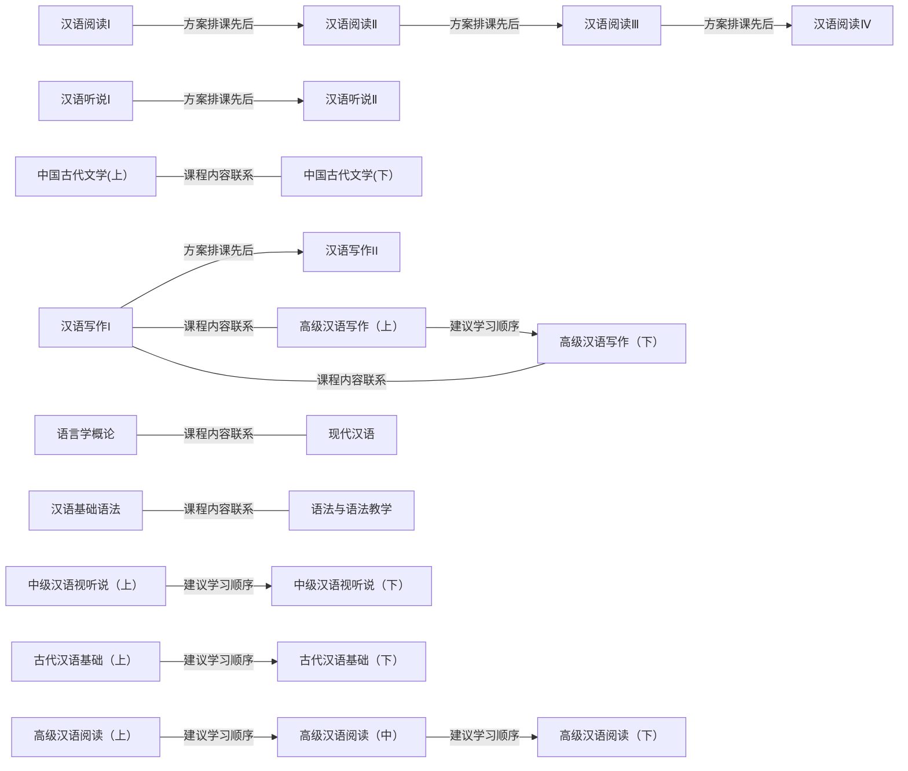

# 2024 汉语言（对外语言文化方向）专业“2+X”教学培养方案@留学生

国际文化交流学院 · 汉语言(对外语言文化方向) · 方案 72720 · 82 个不同课程或科研条目。

[官方 Word](../originals/plan-72720.docx) · [教务详情](https://fdjwgl.fudan.edu.cn/manager/bizType/2/major-program-search/info/72720?skipAuth=1) · [方案快照](../raw/plan-72720.json.gz) · [年级目录](../README.md)

## 修读导读

- **建议先学**　《汉语阅读Ⅰ》（`ICLE10024`） → 《汉语阅读Ⅱ》（`ICLE10025`） → 《汉语阅读Ⅲ》（`ICLE20034`）。题名列出连续册次或级别。按级别积累词汇和句式，后一阶段阅读新材料时可回查前一阶段的例句。方案分别列在第1、2、3学期。

- **可以对照着读**　《语言学概论》（`ICLE20028`）与《现代汉语》（`ICLE20029`）。共同主题为语言结构和语法分析。

- **查模块选课**　《汉语听说Ⅰ》（`ICLE10028`）、《汉语写作I》（`ICLE10020`）列在“专业核心教育课程”中。原表见 `/courseModules/8`。

## 课程关系图

图中展示部分关系。下表保留全部已建立的课程对，来源位置使用本方案 JSON Pointer。

## 先修与内容联系

| 类型 | 起点 | 终点 | 依据 | 原表定位 |
| --- | --- | --- | --- | --- |
| 建议学习顺序 | 汉语写作I (ICLE10020) | 汉语写作II (ICLE10021) | 同方案的课程题名具有连续分册或序号。  | `/courseModules/8/planCourses/4`、`/courseModules/8/planCourses/5` |
| 建议学习顺序 | 汉语阅读Ⅰ (ICLE10024) | 汉语阅读Ⅱ (ICLE10025) | 同方案的课程题名具有连续分册或序号。  | `/courseModules/8/planCourses/0`、`/courseModules/8/planCourses/1` |
| 建议学习顺序 | 汉语阅读Ⅱ (ICLE10025) | 汉语阅读Ⅲ (ICLE20034) | 同方案的课程题名具有连续分册或序号。  | `/courseModules/8/planCourses/1`、`/courseModules/8/planCourses/6` |
| 建议学习顺序 | 汉语听说Ⅰ (ICLE10028) | 汉语听说Ⅱ (ICLE10029) | 同方案的课程题名具有连续分册或序号。  | `/courseModules/8/planCourses/2`、`/courseModules/8/planCourses/3` |
| 建议学习顺序 | 高级汉语写作（上） (ICLE20001) | 高级汉语写作（下） (ICLE20002) | 同方案的课程题名具有连续分册或序号。  | `/courseModules/8/planCourses/9`、`/courseModules/8/planCourses/15` |
| 建议学习顺序 | 中级汉语视听说（上） (ICLE20012) | 中级汉语视听说（下） (ICLE20013) | 同方案的课程题名具有连续分册或序号。  | `/courseModules/8/planCourses/10`、`/courseModules/8/planCourses/11` |
| 建议学习顺序 | 汉语阅读Ⅲ (ICLE20034) | 汉语阅读Ⅳ (ICLE20035) | 同方案的课程题名具有连续分册或序号。  | `/courseModules/8/planCourses/6`、`/courseModules/8/planCourses/12` |
| 建议学习顺序 | 高级汉语阅读（上） (ICLE30001) | 高级汉语阅读（中） (ICLE30002) | 同方案的课程题名具有连续分册或序号。  | `/courseModules/8/planCourses/16`、`/courseModules/8/planCourses/21` |
| 建议学习顺序 | 高级汉语阅读（中） (ICLE30002) | 高级汉语阅读（下） (ICLE40001) | 同方案的课程题名具有连续分册或序号。  | `/courseModules/8/planCourses/21`、`/courseModules/8/planCourses/25` |
| 建议学习顺序 | 古代汉语基础（上） (ICLE30004) | 古代汉语基础（下） (ICLE30005) | 同方案的课程题名具有连续分册或序号。  | `/courseModules/8/planCourses/18`、`/courseModules/8/planCourses/22` |
| 建议学习顺序 | 中国现当代文学（上） (ICLE30010) | 中国现当代文学（下） (ICLE30011) | 同方案的课程题名具有连续分册或序号。  | `/courseModules/8/planCourses/20`、`/courseModules/8/planCourses/24` |
| 建议学习顺序 | 中国古代文学(上） (ICLE40002) | 中国古代文学(下） (ICLE40003) | 同方案的课程题名具有连续分册或序号。  | `/courseModules/8/planCourses/26`、`/courseModules/8/planCourses/29` |
| 方案排课先后 | 汉语写作I (ICLE10020) | 汉语写作II (ICLE10021) | 同方案该课程全部明确数字学期均早于后者。  | `/courseModules/8/planCourses/4`、`/courseModules/8/planCourses/5` |
| 方案排课先后 | 汉语阅读Ⅰ (ICLE10024) | 汉语阅读Ⅱ (ICLE10025) | 同方案该课程全部明确数字学期均早于后者。  | `/courseModules/8/planCourses/0`、`/courseModules/8/planCourses/1` |
| 方案排课先后 | 汉语阅读Ⅱ (ICLE10025) | 汉语阅读Ⅲ (ICLE20034) | 同方案该课程全部明确数字学期均早于后者。  | `/courseModules/8/planCourses/1`、`/courseModules/8/planCourses/6` |
| 方案排课先后 | 汉语听说Ⅰ (ICLE10028) | 汉语听说Ⅱ (ICLE10029) | 同方案该课程全部明确数字学期均早于后者。  | `/courseModules/8/planCourses/2`、`/courseModules/8/planCourses/3` |
| 方案排课先后 | 高级汉语写作（上） (ICLE20001) | 高级汉语写作（下） (ICLE20002) | 同方案该课程全部明确数字学期均早于后者。  | `/courseModules/8/planCourses/9`、`/courseModules/8/planCourses/15` |
| 方案排课先后 | 中级汉语视听说（上） (ICLE20012) | 中级汉语视听说（下） (ICLE20013) | 同方案该课程全部明确数字学期均早于后者。  | `/courseModules/8/planCourses/10`、`/courseModules/8/planCourses/11` |
| 方案排课先后 | 汉语阅读Ⅲ (ICLE20034) | 汉语阅读Ⅳ (ICLE20035) | 同方案该课程全部明确数字学期均早于后者。  | `/courseModules/8/planCourses/6`、`/courseModules/8/planCourses/12` |
| 方案排课先后 | 高级汉语阅读（上） (ICLE30001) | 高级汉语阅读（中） (ICLE30002) | 同方案该课程全部明确数字学期均早于后者。  | `/courseModules/8/planCourses/16`、`/courseModules/8/planCourses/21` |
| 方案排课先后 | 高级汉语阅读（中） (ICLE30002) | 高级汉语阅读（下） (ICLE40001) | 同方案该课程全部明确数字学期均早于后者。  | `/courseModules/8/planCourses/21`、`/courseModules/8/planCourses/25` |
| 方案排课先后 | 古代汉语基础（上） (ICLE30004) | 古代汉语基础（下） (ICLE30005) | 同方案该课程全部明确数字学期均早于后者。  | `/courseModules/8/planCourses/18`、`/courseModules/8/planCourses/22` |
| 方案排课先后 | 中国现当代文学（上） (ICLE30010) | 中国现当代文学（下） (ICLE30011) | 同方案该课程全部明确数字学期均早于后者。  | `/courseModules/8/planCourses/20`、`/courseModules/8/planCourses/24` |
| 方案排课先后 | 中国古代文学(上） (ICLE40002) | 中国古代文学(下） (ICLE40003) | 同方案该课程全部明确数字学期均早于后者。  | `/courseModules/8/planCourses/26`、`/courseModules/8/planCourses/29` |
| 课程内容联系 | 汉语基础语法 (ICLE10019) | 语法与语法教学 (ICLE20031) | 本方案两门课程的题名均含“语法”，可据此对照这一主题。  | `/courseModules/11/planCourses/3`、`/courseModules/12/planCourses/22` |
| 课程内容联系 | 汉语写作I (ICLE10020) | 汉语写作II (ICLE10021) | 本方案两门课程的题名均含“写作”，可据此对照这一主题。  | `/courseModules/8/planCourses/4`、`/courseModules/8/planCourses/5` |
| 课程内容联系 | 汉语写作I (ICLE10020) | 高级汉语写作（上） (ICLE20001) | 本方案两门课程的题名均含“写作”，可据此对照这一主题。  | `/courseModules/8/planCourses/4`、`/courseModules/8/planCourses/9` |
| 课程内容联系 | 汉语写作I (ICLE10020) | 高级汉语写作（下） (ICLE20002) | 本方案两门课程的题名均含“写作”，可据此对照这一主题。  | `/courseModules/8/planCourses/4`、`/courseModules/8/planCourses/15` |
| 课程内容联系 | 语言学概论 (ICLE20028) | 现代汉语 (ICLE20029) | 共同主题为语言结构和语法分析。  | `/courseModules/11/planCourses/19`、`/courseModules/11/planCourses/20` |
| 课程内容联系 | 中国古代文学(上） (ICLE40002) | 中国古代文学(下） (ICLE40003) | 本方案两门课程的题名均含“古代文学”，可据此对照这一主题。  | `/courseModules/8/planCourses/26`、`/courseModules/8/planCourses/29` |

本次未从可定位的明确表述中确认课程对课程预修。学期安排、系列分册与编辑建议均保留各自的依据。

## 按原方案模块阅读

同一模块展示原表中的课程归属。模块内课程之间的先后仍须逐项查阅。

- **留学生选修课程**　中国哲学、中国绘画、中国书法、文物鉴赏、中国印、中国神话传说、中国传统医学文化、当代国际关系、中国旅游文化、中国传统戏曲赏析、中国传统建筑文化、经贸汉语、中国历史名人、中国文化地理、汉语与中国文化、跨文化交流理论与实践、文学美典与人生境界（原表模块 7）

## 课程表

同一课程在不同模块分别出现时，按原表逐行列出。季节字段保留原值。

| 课程 | 代码 | 学分 | 学期 | 模块 |
| --- | --- | ---: | --- | --- |
| HSK水平测试 | GEEC30007 | 1.0 | SPRING | 培养方案 / 通识教育课程 / 复旦大学水平测试 |
| 中国哲学 | ICLE10001 | 2.0 | AUTUMN | 培养方案 / 专业培养课程 / 大类基础课程 / 人文类基础课程 / 留学生选修课程 |
| 中国绘画 | ICLE10002 | 2.0 | AUTUMN | 培养方案 / 专业培养课程 / 大类基础课程 / 人文类基础课程 / 留学生选修课程 |
| 中国书法 | ICLE10003 | 2.0 | SPRING | 培养方案 / 专业培养课程 / 大类基础课程 / 人文类基础课程 / 留学生选修课程 |
| 文物鉴赏 | ICLE10004 | 2.0 | AUTUMN | 培养方案 / 专业培养课程 / 大类基础课程 / 人文类基础课程 / 留学生选修课程 |
| 中国印 | ICLE10005 | 2.0 | AUTUMN | 培养方案 / 专业培养课程 / 大类基础课程 / 人文类基础课程 / 留学生选修课程 |
| 中国神话传说 | ICLE10006 | 2.0 | AUTUMN | 培养方案 / 专业培养课程 / 大类基础课程 / 人文类基础课程 / 留学生选修课程 |
| 中国传统医学文化 | ICLE10007 | 2.0 | AUTUMN | 培养方案 / 专业培养课程 / 大类基础课程 / 人文类基础课程 / 留学生选修课程 |
| 当代国际关系 | ICLE10008 | 2.0 | AUTUMN | 培养方案 / 专业培养课程 / 大类基础课程 / 人文类基础课程 / 留学生选修课程 |
| 中国旅游文化 | ICLE10009 | 2.0 | SPRING | 培养方案 / 专业培养课程 / 大类基础课程 / 人文类基础课程 / 留学生选修课程 |
| 中国传统戏曲赏析 | ICLE10010 | 2.0 | SPRING | 培养方案 / 专业培养课程 / 大类基础课程 / 人文类基础课程 / 留学生选修课程 |
| 中国传统建筑文化 | ICLE10011 | 2.0 | AUTUMN | 培养方案 / 专业培养课程 / 大类基础课程 / 人文类基础课程 / 留学生选修课程 |
| 经贸汉语 | ICLE10012 | 2.0 | SPRING | 培养方案 / 专业培养课程 / 大类基础课程 / 人文类基础课程 / 留学生选修课程 |
| 中国历史名人 | ICLE10013 | 2.0 | AUTUMN | 培养方案 / 专业培养课程 / 大类基础课程 / 人文类基础课程 / 留学生选修课程 |
| 中国文化地理 | ICLE10014 | 2.0 | SPRING | 培养方案 / 专业培养课程 / 大类基础课程 / 人文类基础课程 / 留学生选修课程 |
| 汉语与中国文化 | ICLE10015 | 2.0 | AUTUMN | 培养方案 / 专业培养课程 / 大类基础课程 / 人文类基础课程 / 留学生选修课程 |
| 跨文化交流理论与实践 | ICLE10016 | 2.0 | SPRING | 培养方案 / 专业培养课程 / 大类基础课程 / 人文类基础课程 / 留学生选修课程 |
| 文学美典与人生境界 | ICLE10017 | 2.0 | AUTUMN | 培养方案 / 专业培养课程 / 大类基础课程 / 人文类基础课程 / 留学生选修课程 |
| 汉语阅读Ⅰ | ICLE10024 | 6.0 | 第1学期 | 培养方案 / 专业培养课程 / 专业核心教育课程 |
| 汉语阅读Ⅱ | ICLE10025 | 6.0 | 第2学期 | 培养方案 / 专业培养课程 / 专业核心教育课程 |
| 汉语听说Ⅰ | ICLE10028 | 6.0 | 第1学期 | 培养方案 / 专业培养课程 / 专业核心教育课程 |
| 汉语听说Ⅱ | ICLE10029 | 6.0 | 第2学期 | 培养方案 / 专业培养课程 / 专业核心教育课程 |
| 汉语写作I | ICLE10020 | 2.0 | 第1学期 | 培养方案 / 专业培养课程 / 专业核心教育课程 |
| 汉语写作II | ICLE10021 | 2.0 | 第2学期 | 培养方案 / 专业培养课程 / 专业核心教育课程 |
| 汉语阅读Ⅲ | ICLE20034 | 6.0 | 第3学期 | 培养方案 / 专业培养课程 / 专业核心教育课程 |
| 中国人文地理知识文选 | ICLE20010 | 2.0 | 第3学期 | 培养方案 / 专业培养课程 / 专业核心教育课程 |
| 历史知识文选 | ICLE20011 | 2.0 | 第3学期 | 培养方案 / 专业培养课程 / 专业核心教育课程 |
| 高级汉语写作（上） | ICLE20001 | 2.0 | 第3学期 | 培养方案 / 专业培养课程 / 专业核心教育课程 |
| 中级汉语视听说（上） | ICLE20012 | 2.0 | 第3学期 | 培养方案 / 专业培养课程 / 专业核心教育课程 |
| 中级汉语视听说（下） | ICLE20013 | 2.0 | 第4学期 | 培养方案 / 专业培养课程 / 专业核心教育课程 |
| 汉语阅读Ⅳ | ICLE20035 | 4.0 | 第4学期 | 培养方案 / 专业培养课程 / 专业核心教育课程 |
| 汉语知识文选 | ICLE20014 | 2.0 | 第4学期 | 培养方案 / 专业培养课程 / 专业核心教育课程 |
| 文学艺术知识文选 | ICLE20016 | 2.0 | 第4学期 | 培养方案 / 专业培养课程 / 专业核心教育课程 |
| 高级汉语写作（下） | ICLE20002 | 2.0 | 第4学期 | 培养方案 / 专业培养课程 / 专业核心教育课程 |
| 高级汉语阅读（上） | ICLE30001 | 4.0 | 第5学期 | 培养方案 / 专业培养课程 / 专业核心教育课程 |
| 现代汉语通论 | ICLE30003 | 2.0 | 第5学期 | 培养方案 / 专业培养课程 / 专业核心教育课程 |
| 古代汉语基础（上） | ICLE30004 | 2.0 | 第5学期 | 培养方案 / 专业培养课程 / 专业核心教育课程 |
| 中国近现代历史 | ICLE30008 | 2.0 | 第5学期 | 培养方案 / 专业培养课程 / 专业核心教育课程 |
| 中国现当代文学（上） | ICLE30010 | 2.0 | 第5学期 | 培养方案 / 专业培养课程 / 专业核心教育课程 |
| 高级汉语阅读（中） | ICLE30002 | 4.0 | 第6学期 | 培养方案 / 专业培养课程 / 专业核心教育课程 |
| 古代汉语基础（下） | ICLE30005 | 2.0 | 第6学期 | 培养方案 / 专业培养课程 / 专业核心教育课程 |
| 中国文化概说 | ICLE30006 | 2.0 | 第6学期 | 培养方案 / 专业培养课程 / 专业核心教育课程 |
| 中国现当代文学（下） | ICLE30011 | 2.0 | 第6学期 | 培养方案 / 专业培养课程 / 专业核心教育课程 |
| 高级汉语阅读（下） | ICLE40001 | 4.0 | 第7学期 | 培养方案 / 专业培养课程 / 专业核心教育课程 |
| 中国古代文学(上） | ICLE40002 | 2.0 | 第7学期 | 培养方案 / 专业培养课程 / 专业核心教育课程 |
| 中国古代历史 | ICLE40004 | 2.0 | 第7学期 | 培养方案 / 专业培养课程 / 专业核心教育课程 |
| 社会实践（报告） | ICLE40012 | 2.0 | 第7学期 | 培养方案 / 专业培养课程 / 专业核心教育课程 |
| 中国古代文学(下） | ICLE40003 | 2.0 | 第8学期 | 培养方案 / 专业培养课程 / 专业核心教育课程 |
| 毕业论文 | ICLE40013 | 4.0 | 第8学期 | 培养方案 / 专业培养课程 / 专业核心教育课程 |
| 留学生专业汉语I | GECS10003 | 4.0 | SPRING | 培养方案 / 专业进阶课程 |
| 新闻听力 | ICLE20015 | 2.0 | SPRING | 培养方案 / 专业进阶课程 |
| 汉语虚词十五讲 | ICLE20026 | 2.0 | SPRING | 培养方案 / 专业进阶课程 |
| 汉语基础语法 | ICLE10019 | 2.0 | AUTUMN | 培养方案 / 专业进阶课程 |
| 汉语修辞 | ICLE20007 | 2.0 | AUTUMN | 培养方案 / 专业进阶课程 |
| 新词语 | ICLE30012 | 2.0 | AUTUMN | 培养方案 / 专业进阶课程 |
| 英汉翻译 | ICLE20004 | 2.0 | SPRING | 培养方案 / 专业进阶课程 |
| 汉字研究 | ICLE40007 | 2.0 | SPRING | 培养方案 / 专业进阶课程 |
| 中国现当代名作选 | ICLE30007 | 2.0 | AUTUMN | 培养方案 / 专业进阶课程 |
| 中华人民共和国史 | ICLE30009 | 2.0 | SPRING | 培养方案 / 专业进阶课程 |
| 中国古代名作选 | ICLE40005 | 2.0 | SPRING | 培养方案 / 专业进阶课程 |
| 《论语》导读 | ICLE20003 | 2.0 | AUTUMN | 培养方案 / 专业进阶课程 |
| 成语与中国文化 | ICLE10018 | 2.0 | AUTUMN | 培养方案 / 专业进阶课程 |
| 中国民俗文化 | ICLE20008 | 2.0 | SPRING | 培养方案 / 专业进阶课程 |
| 中国电影与文化 | ICLE40006 | 2.0 | SPRING | 培养方案 / 专业进阶课程 |
| 中国民间故事与民俗文化 | ICLE30032 | 2.0 | SPRING | 培养方案 / 专业进阶课程 |
| 留学生中文电影赏析 | ICLE20027 | 2.0 | AUTUMN | 培养方案 / 专业进阶课程 |
| 中外文学比较 | ICLE30019 | 2.0 | AUTUMN | 培养方案 / 专业进阶课程 |
| 中文计算机基础 | GEEC10197 | 2.0 | AUTUMN | 培养方案 / 专业进阶课程 |
| 语言学概论 | ICLE20028 | 2.0 | AUTUMN | 培养方案 / 专业进阶课程 |
| 现代汉语 | ICLE20029 | 2.0 | AUTUMN | 培养方案 / 专业进阶课程 |
| 教育心理学 | ICLE20030 | 2.0 | AUTUMN | 培养方案 / 专业进阶课程 |
| 语音与语音教学 | ICES130152 | 2.0 | AUTUMN | 培养方案 / 专业进阶课程 |
| 中国文化通论 | ICLE20032 | 2.0 | SPRING | 培养方案 / 专业进阶课程 |
| 对外汉语教学原理 | ICLE30029 | 2.0 | SPRING | 培养方案 / 专业进阶课程 |
| 词汇与词汇教学 | ICLE30030 | 2.0 | SPRING | 培养方案 / 专业进阶课程 |
| 教材与教法 | ICLE30031 | 2.0 | SPRING | 培养方案 / 专业进阶课程 |
| 国际中文教育教学实践 | ICLE40016 | 2.0 | SPRING | 培养方案 / 专业进阶课程 |
| 汉字与汉字教学 | ICLE40017 | 2.0 | AUTUMN | 培养方案 / 专业进阶课程 |
| 全球数字政府建设 | MANA20006 | 2.0 | SPRING | 培养方案 / 专业进阶课程 |
| 国际发展与中国 | MANA20005 | 2.0 | SUMMER | 培养方案 / 专业进阶课程 |
| 全球视野下的中国媒体：融合与冲突 | MANA20007 | 2.0 | SUMMER | 培养方案 / 专业进阶课程 |
| 留学生专业汉语I | GECS10003 | 4.0 | SPRING | 培养方案 / 专业进阶课程（多元路径） |
| 新闻听力 | ICLE20015 | 2.0 | SPRING | 培养方案 / 专业进阶课程（多元路径） |
| 汉语虚词十五讲 | ICLE20026 | 2.0 | SPRING | 培养方案 / 专业进阶课程（多元路径） |
| 汉语基础语法 | ICLE10019 | 2.0 | AUTUMN | 培养方案 / 专业进阶课程（多元路径） |
| 汉语修辞 | ICLE20007 | 2.0 | AUTUMN | 培养方案 / 专业进阶课程（多元路径） |
| 新词语 | ICLE30012 | 2.0 | AUTUMN | 培养方案 / 专业进阶课程（多元路径） |
| 英汉翻译 | ICLE20004 | 2.0 | SPRING | 培养方案 / 专业进阶课程（多元路径） |
| 汉字研究 | ICLE40007 | 2.0 | SPRING | 培养方案 / 专业进阶课程（多元路径） |
| 中国现当代名作选 | ICLE30007 | 2.0 | AUTUMN | 培养方案 / 专业进阶课程（多元路径） |
| 中华人民共和国史 | ICLE30009 | 2.0 | SPRING | 培养方案 / 专业进阶课程（多元路径） |
| 中国古代名作选 | ICLE40005 | 2.0 | SPRING | 培养方案 / 专业进阶课程（多元路径） |
| 《论语》导读 | ICLE20003 | 2.0 | AUTUMN | 培养方案 / 专业进阶课程（多元路径） |
| 成语与中国文化 | ICLE10018 | 2.0 | AUTUMN | 培养方案 / 专业进阶课程（多元路径） |
| 中国民俗文化 | ICLE20008 | 2.0 | SPRING | 培养方案 / 专业进阶课程（多元路径） |
| 中国电影与文化 | ICLE40006 | 2.0 | SPRING | 培养方案 / 专业进阶课程（多元路径） |
| 中国民间故事与民俗文化 | ICLE30032 | 2.0 | SPRING | 培养方案 / 专业进阶课程（多元路径） |
| 留学生中文电影赏析 | ICLE20027 | 2.0 | AUTUMN | 培养方案 / 专业进阶课程（多元路径） |
| 中外文学比较 | ICLE30019 | 2.0 | AUTUMN | 培养方案 / 专业进阶课程（多元路径） |
| 中文计算机基础 | GEEC10197 | 2.0 | AUTUMN | 培养方案 / 专业进阶课程（多元路径） |
| 语言学概论 | ICLE20028 | 2.0 | AUTUMN | 培养方案 / 专业进阶课程（多元路径） |
| 现代汉语 | ICLE20029 | 2.0 | AUTUMN | 培养方案 / 专业进阶课程（多元路径） |
| 教育心理学 | ICLE20030 | 2.0 | AUTUMN | 培养方案 / 专业进阶课程（多元路径） |
| 语法与语法教学 | ICLE20031 | 2.0 | AUTUMN | 培养方案 / 专业进阶课程（多元路径） |
| 中国文化通论 | ICLE20032 | 2.0 | SPRING | 培养方案 / 专业进阶课程（多元路径） |
| 对外汉语教学原理 | ICLE30029 | 2.0 | SPRING | 培养方案 / 专业进阶课程（多元路径） |
| 词汇与词汇教学 | ICLE30030 | 2.0 | SPRING | 培养方案 / 专业进阶课程（多元路径） |
| 教材与教法 | ICLE30031 | 2.0 | SPRING | 培养方案 / 专业进阶课程（多元路径） |
| 国际中文教育教学实践 | ICLE40016 | 2.0 | SPRING | 培养方案 / 专业进阶课程（多元路径） |
| 汉字与汉字教学 | ICLE40017 | 2.0 | AUTUMN | 培养方案 / 专业进阶课程（多元路径） |
| 全球数字政府建设 | MANA20006 | 2.0 | SPRING | 培养方案 / 专业进阶课程（多元路径） |
| 国际发展与中国 | MANA20005 | 2.0 | SUMMER | 培养方案 / 专业进阶课程（多元路径） |
| 全球视野下的中国媒体：融合与冲突 | MANA20007 | 2.0 | SUMMER | 培养方案 / 专业进阶课程（多元路径） |
