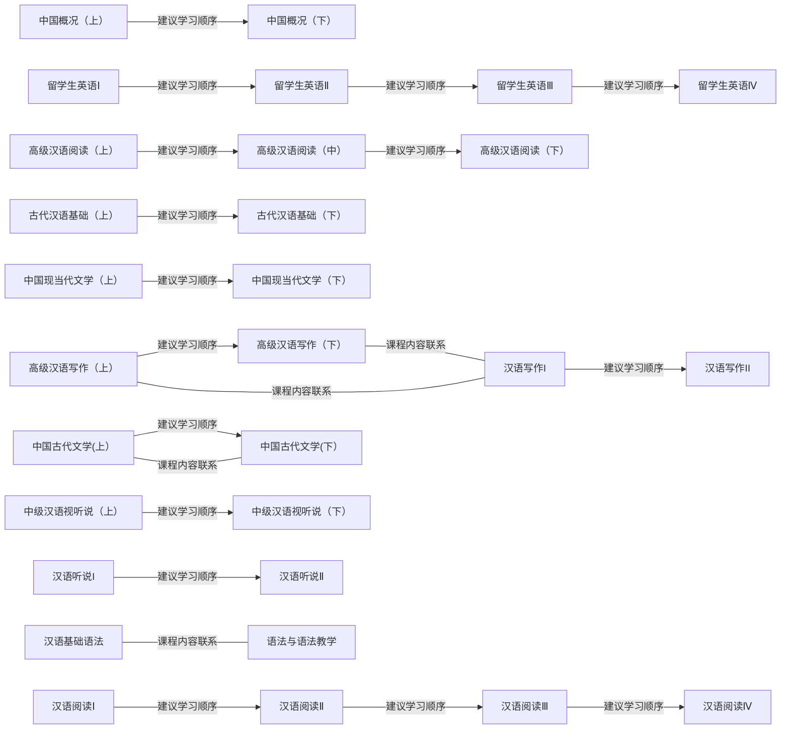

# 汉语言（对外语言文化方向）专业“2+X”教学培养方案

2024 年汇编印刷页 86–89。原表记录 89 个可配对的课程代码。

[本节原页](plan-86.pdf#page=1) · [逐行数据](plan-86.json) · [院系目录](README.md)

## 课程关系图

图中展示最多 20 条关系。下表列出本节全部关系。建议学习顺序供规划课程使用，正式选课资格以教务规定为准。

| 课程 | 关联课程 | 关系 | 依据 |
| --- | --- | --- | --- |
| 中国概况（上）（ICES110012） | 中国概况（下）（ICES110013） | 建议学习顺序 | 同节课程题名标明连续分册或序号。 |
| 留学生英语Ⅰ（ICES110018） | 留学生英语Ⅱ（ICES110019） | 建议学习顺序 | 同节课程题名标明连续分册或序号。 |
| 留学生英语Ⅱ（ICES110019） | 留学生英语Ⅲ（ICES110020） | 建议学习顺序 | 同节课程题名标明连续分册或序号。 |
| 留学生英语Ⅲ（ICES110020） | 留学生英语Ⅳ（ICES110021） | 建议学习顺序 | 同节课程题名标明连续分册或序号。 |
| 高级汉语阅读（上）（ICES130019） | 高级汉语阅读（中）（ICES130020） | 建议学习顺序 | 同节课程题名标明连续分册或序号。 |
| 高级汉语阅读（中）（ICES130020） | 高级汉语阅读（下）（ICES130021） | 建议学习顺序 | 同节课程题名标明连续分册或序号。 |
| 高级汉语写作（上）（ICES130025） | 高级汉语写作（下）（ICES130026） | 建议学习顺序 | 同节课程题名标明连续分册或序号。 |
| 古代汉语基础（上）（ICES130028） | 古代汉语基础（下）（ICES130029） | 建议学习顺序 | 同节课程题名标明连续分册或序号。 |
| 中国现当代文学（上）（ICES130035） | 中国现当代文学（下）（ICES130036） | 建议学习顺序 | 同节课程题名标明连续分册或序号。 |
| 中国古代文学(上）（ICES130037） | 中国古代文学(下）（ICES130038） | 建议学习顺序 | 同节课程题名标明连续分册或序号。 |
| 中级汉语视听说（上）（ICES130085） | 中级汉语视听说（下）（ICES130086） | 建议学习顺序 | 同节课程题名标明连续分册或序号。 |
| 汉语写作I（ICES130115） | 汉语写作II（ICES130122） | 建议学习顺序 | 同节课程题名标明连续分册或序号。 |
| 汉语阅读Ⅲ（ICES130138） | 汉语阅读Ⅳ（ICES130139） | 建议学习顺序 | 同节课程题名标明连续分册或序号。 |
| 汉语阅读Ⅰ（ICES130163） | 汉语阅读Ⅱ（ICES130164） | 建议学习顺序 | 同节课程题名标明连续分册或序号。 |
| 汉语阅读Ⅱ（ICES130164） | 汉语阅读Ⅲ（ICES130138） | 建议学习顺序 | 同节课程题名标明连续分册或序号。 |
| 汉语听说I（ICES130167） | 汉语听说Ⅱ（ICES130168） | 建议学习顺序 | 同节课程题名标明连续分册或序号。 |
| 高级汉语写作（上）（ICES130025） | 汉语写作I（ICES130115） | 课程内容联系 | 本方案两门课程的题名均含“写作”，可据此对照这一主题。 |
| 高级汉语写作（下）（ICES130026） | 汉语写作I（ICES130115） | 课程内容联系 | 本方案两门课程的题名均含“写作”，可据此对照这一主题。 |
| 中国古代文学(上）（ICES130037） | 中国古代文学(下）（ICES130038） | 课程内容联系 | 本方案两门课程的题名均含“古代文学”，可据此对照这一主题。 |
| 汉语基础语法（ICES130091） | 语法与语法教学（ICES130153） | 课程内容联系 | 本方案两门课程的题名均含“语法”，可据此对照这一主题。 |
| 汉语写作I（ICES130115） | 汉语写作II（ICES130122） | 课程内容联系 | 本方案两门课程的题名均含“写作”，可据此对照这一主题。 |
| 语言学概论（ICES130149） | 现代汉语（ICES130150） | 课程内容联系 | 语言结构和语法分析 |
| 中国概况（上）（ICES110012） | 中国概况（下）（ICES110013） | 方案排课先后 | 本节原表所列全部明确学期均早于后者。 |
| 留学生英语Ⅰ（ICES110018） | 留学生英语Ⅱ（ICES110019） | 方案排课先后 | 本节原表所列全部明确学期均早于后者。 |
| 留学生英语Ⅱ（ICES110019） | 留学生英语Ⅲ（ICES110020） | 方案排课先后 | 本节原表所列全部明确学期均早于后者。 |
| 留学生英语Ⅲ（ICES110020） | 留学生英语Ⅳ（ICES110021） | 方案排课先后 | 本节原表所列全部明确学期均早于后者。 |
| 高级汉语阅读（上）（ICES130019） | 高级汉语阅读（中）（ICES130020） | 方案排课先后 | 本节原表所列全部明确学期均早于后者。 |
| 高级汉语阅读（中）（ICES130020） | 高级汉语阅读（下）（ICES130021） | 方案排课先后 | 本节原表所列全部明确学期均早于后者。 |
| 高级汉语写作（上）（ICES130025） | 高级汉语写作（下）（ICES130026） | 方案排课先后 | 本节原表所列全部明确学期均早于后者。 |
| 古代汉语基础（上）（ICES130028） | 古代汉语基础（下）（ICES130029） | 方案排课先后 | 本节原表所列全部明确学期均早于后者。 |
| 中国现当代文学（上）（ICES130035） | 中国现当代文学（下）（ICES130036） | 方案排课先后 | 本节原表所列全部明确学期均早于后者。 |
| 中国古代文学(上）（ICES130037） | 中国古代文学(下）（ICES130038） | 方案排课先后 | 本节原表所列全部明确学期均早于后者。 |
| 中级汉语视听说（上）（ICES130085） | 中级汉语视听说（下）（ICES130086） | 方案排课先后 | 本节原表所列全部明确学期均早于后者。 |
| 汉语写作I（ICES130115） | 汉语写作II（ICES130122） | 方案排课先后 | 本节原表所列全部明确学期均早于后者。 |
| 汉语阅读Ⅲ（ICES130138） | 汉语阅读Ⅳ（ICES130139） | 方案排课先后 | 本节原表所列全部明确学期均早于后者。 |
| 汉语阅读Ⅰ（ICES130163） | 汉语阅读Ⅱ（ICES130164） | 方案排课先后 | 本节原表所列全部明确学期均早于后者。 |
| 汉语阅读Ⅱ（ICES130164） | 汉语阅读Ⅲ（ICES130138） | 方案排课先后 | 本节原表所列全部明确学期均早于后者。 |
| 汉语听说I（ICES130167） | 汉语听说Ⅱ（ICES130168） | 方案排课先后 | 本节原表所列全部明确学期均早于后者。 |

## 课程

| 课程代码 | 名称 | 开课学期原文 | 来源（PDF 页） |
| --- | --- | --- | --- |
| ICES110003 | 留学生专业汉语Ⅰ | 春 | 102 |
| ICES110012 | 中国概况（上） | 1 | 100 |
| ICES110013 | 中国概况（下） | 2 | 100 |
| ICES110018 | 留学生英语Ⅰ | 1 | 100 |
| ICES110019 | 留学生英语Ⅱ | 2 | 100 |
| ICES110020 | 留学生英语Ⅲ | 3 | 100 |
| ICES110021 | 留学生英语Ⅳ | 4 | 100 |
| ICES110022 | 中文计算机基础 | 秋 | 103 |
| ICES110901 | HSK水平测试 |  | 100 |
| ICES115001 | 留学生创新与创业 | 秋 | 100 |
| ICES120001 | 中国哲学 | 秋 | 100 |
| ICES120002 | 中国绘画 | 秋 | 100 |
| ICES120003 | 中国书法 | 春 | 100 |
| ICES120004 | 文物鉴赏 | 秋 | 101 |
| ICES120005 | 中国印 | 秋 | 101 |
| ICES120006 | 中国神话传说 | 秋 | 101 |
| ICES120007 | 中国传统医学文化 | 秋 | 101 |
| ICES120008 | 当代国际关系 | 秋 | 101 |
| ICES120009 | 中国旅游文化 | 春 | 101 |
| ICES120010 | 中国传统戏曲赏析 | 春 | 101 |
| ICES120011 | 中国传统建筑文化 | 秋 | 101 |
| ICES120012 | 经贸汉语 | 春 | 101 |
| ICES120013 | 中国历史名人 | 秋 | 101 |
| ICES120014 | 中国文化地理 | 春 | 101 |
| ICES120015 | 汉语与中国文化 | 秋 | 101 |
| ICES120016 | 跨文化交流理论与实践 | 春 | 101 |
| ICES120017 | 文学美典与人生境界 | 秋 | 101 |
| ICES130019 | 高级汉语阅读（上） | 5 | 102 |
| ICES130020 | 高级汉语阅读（中） | 6 | 102 |
| ICES130021 | 高级汉语阅读（下） | 7 | 102 |
| ICES130025 | 高级汉语写作（上） | 3 | 101 |
| ICES130026 | 高级汉语写作（下） | 4 | 101 |
| ICES130027 | 现代汉语通论 | 5 | 102 |
| ICES130028 | 古代汉语基础（上） | 5 | 102 |
| ICES130029 | 古代汉语基础（下） | 6 | 102 |
| ICES130030 | 中国文化概说 | 6 | 102 |
| ICES130032 | 中国现当代名作选 | 秋 | 102 |
| ICES130033 | 中国近现代历史 | 5 | 102 |
| ICES130034 | 中华人民共和国史 | 春 | 102 |
| ICES130035 | 中国现当代文学（上） | 5 | 102 |
| ICES130036 | 中国现当代文学（下） | 6 | 102 |
| ICES130037 | 中国古代文学(上） | 7 | 102 |
| ICES130038 | 中国古代文学(下） | 8 | 102 |
| ICES130039 | 中国古代历史 | 7 | 102 |
| ICES130040 | 中国古代名作选 | 春 | 102 |
| ICES130041 | 中国电影与文化 | 春 | 103 |
| ICES130042 | 新词语 | 秋 | 102 |
| ICES130043 | 《论语》导读 | 秋 | 102 |
| ICES130046 | 汉字研究 | 春 | 102 |
| ICES130047 | 成语与中国文化 | 秋 | 103 |
| ICES130048 | 英汉翻译 | 春 | 102 |
| ICES130067 | 社会实践（报告） | 7 | 102 |
| ICES130068 | 毕业论文 | 8 | 102 |
| ICES130072 | 汉语修辞 | 秋 | 102 |
| ICES130073 | 中国民俗文化 | 春 | 103 |
| ICES130074 | 中外文学比较 | 秋 | 103 |
| ICES130083 | 中国人文地理知识文选 | 3 | 101 |
| ICES130084 | 历史知识文选 | 3 | 101 |
| ICES130085 | 中级汉语视听说（上） | 3 | 101 |
| ICES130086 | 中级汉语视听说（下） | 4 | 101 |
| ICES130088 | 汉语知识文选 | 4 | 101 |
| ICES130089 | 新闻听力 | 春 | 102 |
| ICES130090 | 文学艺术知识文选 | 4 | 101 |
| ICES130091 | 汉语基础语法 | 秋 | 102 |
| ICES130115 | 汉语写作I | 1 | 101 |
| ICES130122 | 汉语写作II | 2 | 101 |
| ICES130138 | 汉语阅读Ⅲ | 3 | 101 |
| ICES130139 | 汉语阅读Ⅳ | 4 | 101 |
| ICES130146 | 汉语虚词十五讲 | 春 | 102 |
| ICES130148 | 留学生中文电影赏析 | 秋 | 103 |
| ICES130149 | 语言学概论 | 秋 | 103 |
| ICES130150 | 现代汉语 | 秋 | 103 |
| ICES130151 | 教育心理学 | 秋 | 103 |
| ICES130152 | 语音与语音教学 | 秋 | 103 |
| ICES130153 | 语法与语法教学 | 秋 | 103 |
| ICES130154 | 中国文化通论 | 春 | 103 |
| ICES130155 | 对外汉语教学原理 | 春 | 103 |
| ICES130156 | 词汇与词汇教学 | 春 | 103 |
| ICES130157 | 教材与教法 | 春 | 103 |
| ICES130158 | 国际中文教育教学实践 | 春 | 103 |
| ICES130159 | 国际发展与中国 | 暑期 | 103 |
| ICES130160 | 全球数字政府建设 | 春 | 103 |
| ICES130161 | 全球视野下的中国媒体：融合与冲突 | 暑期 | 103 |
| ICES130162 | 汉字与汉字教学 | 秋 | 103 |
| ICES130163 | 汉语阅读Ⅰ | 1 | 101 |
| ICES130164 | 汉语阅读Ⅱ | 2 | 101 |
| ICES130167 | 汉语听说I | 1 | 101 |
| ICES130168 | 汉语听说Ⅱ | 2 | 101 |
| ICES130172 | 中国民间故事与民俗文化 | 春 | 103 |
