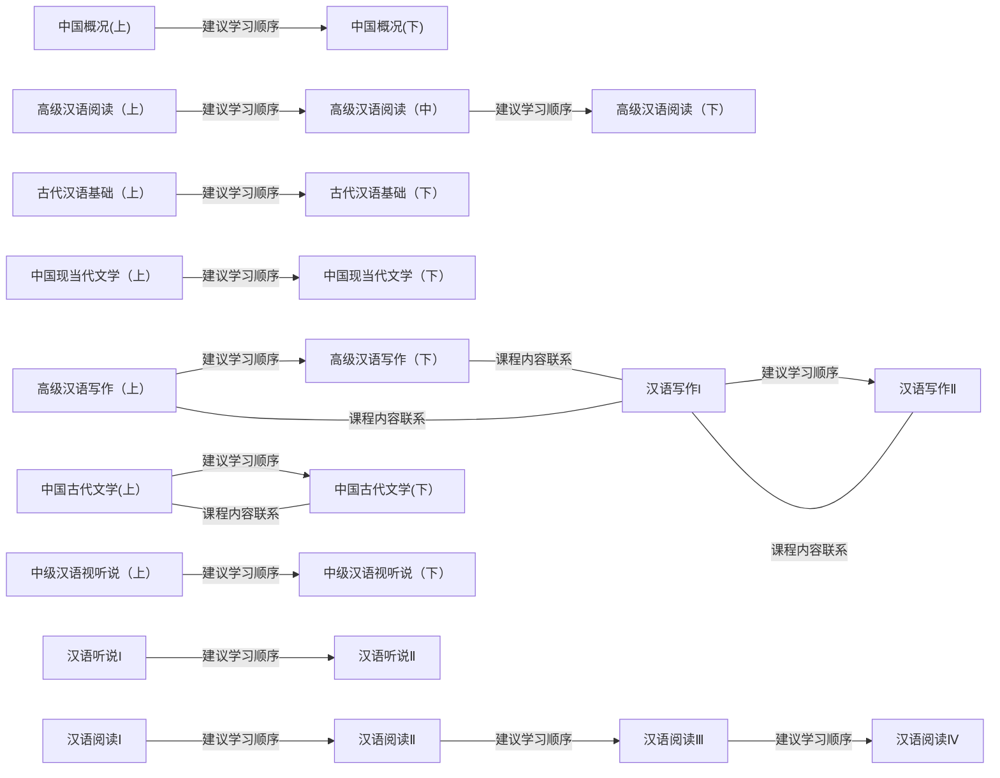

# 汉语言（对外语言文化方向）专业“2+X”修读建议

2024 年汇编印刷页 90–91。原表记录 36 个可配对的课程代码。

[本节原页](plan-86.pdf#page=5) · [逐行数据](plan-86.json) · [院系目录](README.md)

## 课程关系图

图中展示最多 20 条关系。下表列出本节全部关系。建议学习顺序供规划课程使用，正式选课资格以教务规定为准。

| 课程 | 关联课程 | 关系 | 依据 |
| --- | --- | --- | --- |
| 中国概况(上)（ICES110012） | 中国概况(下)（ICES110013） | 建议学习顺序 | 同节课程题名标明连续分册或序号。 |
| 高级汉语阅读（上）（ICES130019） | 高级汉语阅读（中）（ICES130020） | 建议学习顺序 | 同节课程题名标明连续分册或序号。 |
| 高级汉语阅读（中）（ICES130020） | 高级汉语阅读（下）（ICES130021） | 建议学习顺序 | 同节课程题名标明连续分册或序号。 |
| 高级汉语写作（上）（ICES130025） | 高级汉语写作（下）（ICES130026） | 建议学习顺序 | 同节课程题名标明连续分册或序号。 |
| 古代汉语基础（上）（ICES130028） | 古代汉语基础（下）（ICES130029） | 建议学习顺序 | 同节课程题名标明连续分册或序号。 |
| 中国现当代文学（上）（ICES130035） | 中国现当代文学（下）（ICES130036） | 建议学习顺序 | 同节课程题名标明连续分册或序号。 |
| 中国古代文学(上）（ICES130037） | 中国古代文学(下）（ICES130038） | 建议学习顺序 | 同节课程题名标明连续分册或序号。 |
| 中级汉语视听说（上）（ICES130085） | 中级汉语视听说（下）（ICES130086） | 建议学习顺序 | 同节课程题名标明连续分册或序号。 |
| 汉语写作I（ICES130115） | 汉语写作Ⅱ（ICES130122） | 建议学习顺序 | 同节课程题名标明连续分册或序号。 |
| 汉语阅读Ⅲ（ICES130138） | 汉语阅读Ⅳ（ICES130139） | 建议学习顺序 | 同节课程题名标明连续分册或序号。 |
| 汉语阅读Ⅰ（ICES130163） | 汉语阅读Ⅱ（ICES130164） | 建议学习顺序 | 同节课程题名标明连续分册或序号。 |
| 汉语阅读Ⅱ（ICES130164） | 汉语阅读Ⅲ（ICES130138） | 建议学习顺序 | 同节课程题名标明连续分册或序号。 |
| 汉语听说I（ICES130167） | 汉语听说Ⅱ（ICES130168） | 建议学习顺序 | 同节课程题名标明连续分册或序号。 |
| 高级汉语写作（上）（ICES130025） | 汉语写作I（ICES130115） | 课程内容联系 | 本方案两门课程的题名均含“写作”，可据此对照这一主题。 |
| 高级汉语写作（下）（ICES130026） | 汉语写作I（ICES130115） | 课程内容联系 | 本方案两门课程的题名均含“写作”，可据此对照这一主题。 |
| 中国古代文学(上）（ICES130037） | 中国古代文学(下）（ICES130038） | 课程内容联系 | 本方案两门课程的题名均含“古代文学”，可据此对照这一主题。 |
| 汉语写作I（ICES130115） | 汉语写作Ⅱ（ICES130122） | 课程内容联系 | 本方案两门课程的题名均含“写作”，可据此对照这一主题。 |

## 课程

| 课程代码 | 名称 | 开课学期原文 | 来源（PDF 页） |
| --- | --- | --- | --- |
| ICES110012 | 中国概况(上) |  | 104 |
| ICES110013 | 中国概况(下) |  | 104 |
| ICES110020 | 留学生英语课程 |  | 104 |
| ICES110901 | HSK水平测试 |  | 104 |
| ICES115001 | 创新创意创业课程 |  | 104 |
| ICES130019 | 高级汉语阅读（上） |  | 104 |
| ICES130020 | 高级汉语阅读（中） |  | 104 |
| ICES130021 | 高级汉语阅读（下） |  | 104 |
| ICES130025 | 高级汉语写作（上） |  | 104 |
| ICES130026 | 高级汉语写作（下） |  | 104 |
| ICES130027 | 现代汉语通论 |  | 104 |
| ICES130028 | 古代汉语基础（上） |  | 104 |
| ICES130029 | 古代汉语基础（下） |  | 104 |
| ICES130030 | 中国文化概说 |  | 104 |
| ICES130033 | 中国近现代历史 |  | 104 |
| ICES130035 | 中国现当代文学（上） |  | 104 |
| ICES130036 | 中国现当代文学（下） |  | 104 |
| ICES130037 | 中国古代文学(上） |  | 104 |
| ICES130038 | 中国古代文学(下） |  | 104 |
| ICES130039 | 中国古代历史 |  | 104 |
| ICES130067 | 社会实践 |  | 104 |
| ICES130068 | 毕业论文 |  | 104 |
| ICES130083 | 中国人文地理知识文选 |  | 104 |
| ICES130084 | 历史知识文选 |  | 104 |
| ICES130085 | 中级汉语视听说（上） |  | 104 |
| ICES130086 | 中级汉语视听说（下） |  | 104 |
| ICES130088 | 汉语知识文选 |  | 104 |
| ICES130090 | 文学艺术知识文选 |  | 104 |
| ICES130115 | 汉语写作I |  | 104 |
| ICES130122 | 汉语写作Ⅱ |  | 104 |
| ICES130138 | 汉语阅读Ⅲ |  | 104 |
| ICES130139 | 汉语阅读Ⅳ |  | 104 |
| ICES130163 | 汉语阅读Ⅰ |  | 104 |
| ICES130164 | 汉语阅读Ⅱ |  | 104 |
| ICES130167 | 汉语听说I |  | 104 |
| ICES130168 | 汉语听说Ⅱ |  | 104 |
