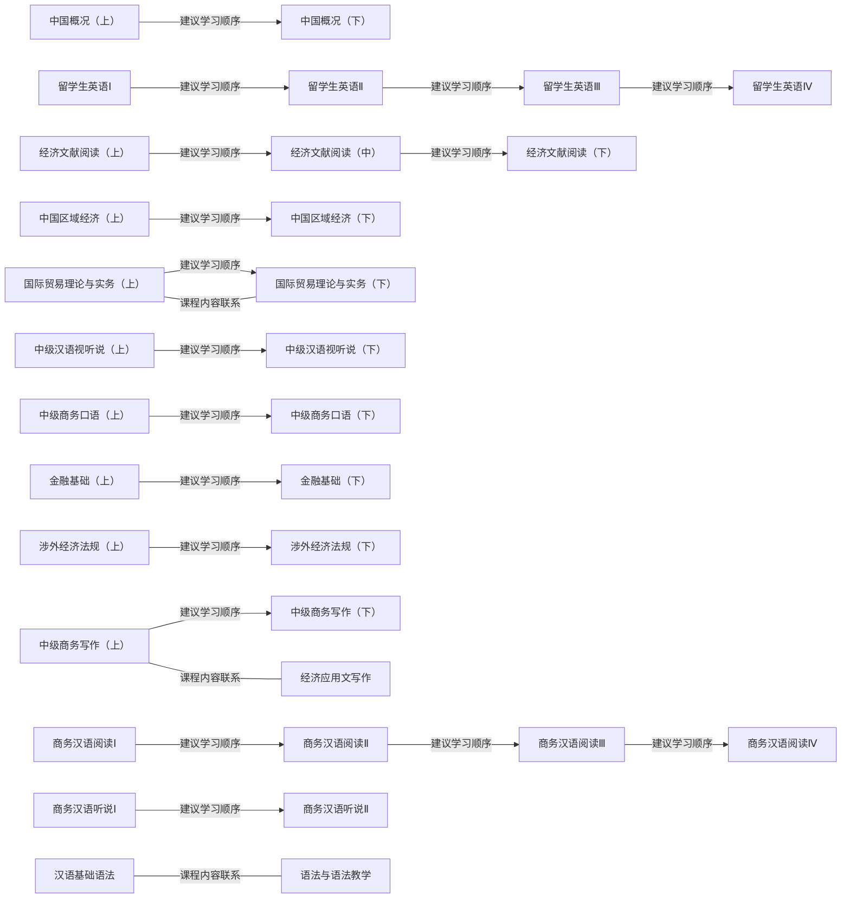

# 汉语言（对外商务汉语方向）专业“2+X”教学培养方案

2024 年汇编印刷页 92–95。原表记录 94 个可配对的课程代码。

[本节原页](plan-92.pdf#page=1) · [逐行数据](plan-92.json) · [院系目录](README.md)

## 课程导读

想了解商务汉语的课程安排，可以在原表中找到《商务汉语阅读Ⅰ》（`ICES130165`）、《经贸汉语》（`ICES120012`）、《商务汉语阅读Ⅱ》（`ICES130166`）。 [原书 PDF 第 107 页](plan-92.pdf#page=2)

《中级汉语视听说（上）》（`ICES130085`）和《中级汉语视听说（下）》（`ICES130086`）是同一系列，图中的箭头按题名标出的分册顺序排列。原表分别排在第 3 学期和第 4 学期。 [原书 PDF 第 107 页](plan-92.pdf#page=2)

## 课程关系图

图中展示最多 20 条关系。下表列出本节全部关系。建议学习顺序供规划课程使用，正式选课资格以教务规定为准。

| 课程 | 关联课程 | 关系 | 依据 |
| --- | --- | --- | --- |
| 中国概况（上）（ICES110012） | 中国概况（下）（ICES110013） | 建议学习顺序 | 同节课程题名标明连续分册或序号。 |
| 留学生英语Ⅰ（ICES110018） | 留学生英语Ⅱ（ICES110019） | 建议学习顺序 | 同节课程题名标明连续分册或序号。 |
| 留学生英语Ⅱ（ICES110019） | 留学生英语Ⅲ（ICES110020） | 建议学习顺序 | 同节课程题名标明连续分册或序号。 |
| 留学生英语Ⅲ（ICES110020） | 留学生英语Ⅳ（ICES110021） | 建议学习顺序 | 同节课程题名标明连续分册或序号。 |
| 经济文献阅读（上）（ICES130049） | 经济文献阅读（中）（ICES130050） | 建议学习顺序 | 同节课程题名标明连续分册或序号。 |
| 经济文献阅读（中）（ICES130050） | 经济文献阅读（下）（ICES130051） | 建议学习顺序 | 同节课程题名标明连续分册或序号。 |
| 中国区域经济（上）（ICES130061） | 中国区域经济（下）（ICES130062） | 建议学习顺序 | 同节课程题名标明连续分册或序号。 |
| 国际贸易理论与实务（上）（ICES130065） | 国际贸易理论与实务（下）（ICES130066） | 建议学习顺序 | 同节课程题名标明连续分册或序号。 |
| 中级汉语视听说（上）（ICES130085） | 中级汉语视听说（下）（ICES130086） | 建议学习顺序 | 同节课程题名标明连续分册或序号。 |
| 中级商务口语（上）（ICES130099） | 中级商务口语（下）（ICES130171） | 建议学习顺序 | 同节课程题名标明连续分册或序号。 |
| 中级商务写作（上）（ICES130101） | 中级商务写作（下）（ICES130102） | 建议学习顺序 | 同节课程题名标明连续分册或序号。 |
| 金融基础（上）（ICES130108） | 金融基础（下）（ICES130109） | 建议学习顺序 | 同节课程题名标明连续分册或序号。 |
| 涉外经济法规（上）（ICES130110） | 涉外经济法规（下）（ICES130111） | 建议学习顺序 | 同节课程题名标明连续分册或序号。 |
| 商务汉语阅读Ⅲ（ICES130142） | 商务汉语阅读Ⅳ（ICES130143） | 建议学习顺序 | 同节课程题名标明连续分册或序号。 |
| 商务汉语阅读Ⅰ（ICES130165） | 商务汉语阅读Ⅱ（ICES130166） | 建议学习顺序 | 同节课程题名标明连续分册或序号。 |
| 商务汉语阅读Ⅱ（ICES130166） | 商务汉语阅读Ⅲ（ICES130142） | 建议学习顺序 | 同节课程题名标明连续分册或序号。 |
| 商务汉语听说Ⅰ（ICES130169） | 商务汉语听说Ⅱ（ICES130170） | 建议学习顺序 | 同节课程题名标明连续分册或序号。 |
| 国际贸易理论与实务（上）（ICES130065） | 国际贸易理论与实务（下）（ICES130066） | 课程内容联系 | 本方案两门课程的题名均含“国际贸易”，可据此对照这一主题。 |
| 汉语基础语法（ICES130091） | 语法与语法教学（ICES130153） | 课程内容联系 | 本方案两门课程的题名均含“语法”，可据此对照这一主题。 |
| 中级商务写作（上）（ICES130101） | 经济应用文写作（ICES130112） | 课程内容联系 | 本方案两门课程的题名均含“写作”，可据此对照这一主题。 |
| 中级商务写作（下）（ICES130102） | 经济应用文写作（ICES130112） | 课程内容联系 | 本方案两门课程的题名均含“写作”，可据此对照这一主题。 |
| 金融基础（上）（ICES130108） | 金融基础（下）（ICES130109） | 课程内容联系 | 本方案两门课程的题名均含“金融”，可据此对照这一主题。 |
| 语言学概论（ICES130149） | 现代汉语（ICES130150） | 课程内容联系 | 语言结构和语法分析 |
| 中国概况（上）（ICES110012） | 中国概况（下）（ICES110013） | 方案排课先后 | 本节原表所列全部明确学期均早于后者。 |
| 留学生英语Ⅰ（ICES110018） | 留学生英语Ⅱ（ICES110019） | 方案排课先后 | 本节原表所列全部明确学期均早于后者。 |
| 留学生英语Ⅱ（ICES110019） | 留学生英语Ⅲ（ICES110020） | 方案排课先后 | 本节原表所列全部明确学期均早于后者。 |
| 留学生英语Ⅲ（ICES110020） | 留学生英语Ⅳ（ICES110021） | 方案排课先后 | 本节原表所列全部明确学期均早于后者。 |
| 经济文献阅读（上）（ICES130049） | 经济文献阅读（中）（ICES130050） | 方案排课先后 | 本节原表所列全部明确学期均早于后者。 |
| 经济文献阅读（中）（ICES130050） | 经济文献阅读（下）（ICES130051） | 方案排课先后 | 本节原表所列全部明确学期均早于后者。 |
| 国际贸易理论与实务（上）（ICES130065） | 国际贸易理论与实务（下）（ICES130066） | 方案排课先后 | 本节原表所列全部明确学期均早于后者。 |
| 中级汉语视听说（上）（ICES130085） | 中级汉语视听说（下）（ICES130086） | 方案排课先后 | 本节原表所列全部明确学期均早于后者。 |
| 中级商务口语（上）（ICES130099） | 中级商务口语（下）（ICES130171） | 方案排课先后 | 本节原表所列全部明确学期均早于后者。 |
| 中级商务写作（上）（ICES130101） | 中级商务写作（下）（ICES130102） | 方案排课先后 | 本节原表所列全部明确学期均早于后者。 |
| 金融基础（上）（ICES130108） | 金融基础（下）（ICES130109） | 方案排课先后 | 本节原表所列全部明确学期均早于后者。 |
| 涉外经济法规（上）（ICES130110） | 涉外经济法规（下）（ICES130111） | 方案排课先后 | 本节原表所列全部明确学期均早于后者。 |
| 商务汉语阅读Ⅲ（ICES130142） | 商务汉语阅读Ⅳ（ICES130143） | 方案排课先后 | 本节原表所列全部明确学期均早于后者。 |
| 商务汉语阅读Ⅰ（ICES130165） | 商务汉语阅读Ⅱ（ICES130166） | 方案排课先后 | 本节原表所列全部明确学期均早于后者。 |
| 商务汉语阅读Ⅱ（ICES130166） | 商务汉语阅读Ⅲ（ICES130142） | 方案排课先后 | 本节原表所列全部明确学期均早于后者。 |
| 商务汉语听说Ⅰ（ICES130169） | 商务汉语听说Ⅱ（ICES130170） | 方案排课先后 | 本节原表所列全部明确学期均早于后者。 |

## 课程

| 课程代码 | 名称 | 开课学期原文 | 来源（PDF 页） |
| --- | --- | --- | --- |
| ICES110003 | 留学生专业汉语Ⅰ | 春 | 108 |
| ICES110012 | 中国概况（上） | 1 | 106 |
| ICES110013 | 中国概况（下） | 2 | 106 |
| ICES110018 | 留学生英语Ⅰ | 1 | 106 |
| ICES110019 | 留学生英语Ⅱ | 2 | 106 |
| ICES110020 | 留学生英语Ⅲ | 3 | 106 |
| ICES110021 | 留学生英语Ⅳ | 4 | 106 |
| ICES110022 | 中文计算机基础 | 秋 | 109 |
| ICES110901 | HSK水平测试 |  | 106 |
| ICES115001 | 留学生创新与创业 | 秋 | 106 |
| ICES120001 | 中国哲学 | 秋 | 106 |
| ICES120002 | 中国绘画 | 秋 | 106 |
| ICES120003 | 中国书法 | 春 | 106 |
| ICES120004 | 文物鉴赏 | 秋 | 106 |
| ICES120005 | 中国印 | 秋 | 107 |
| ICES120006 | 中国神话传说 | 秋 | 107 |
| ICES120007 | 中国传统医学文化 | 秋 | 107 |
| ICES120008 | 当代国际关系 | 秋 | 107 |
| ICES120009 | 中国旅游文化 | 春 | 107 |
| ICES120010 | 中国传统戏曲赏析 | 春 | 107 |
| ICES120011 | 中国传统建筑文化 | 秋 | 107 |
| ICES120012 | 经贸汉语 | 春 | 107 |
| ICES120013 | 中国历史名人 | 秋 | 107 |
| ICES120014 | 中国文化地理 | 春 | 107 |
| ICES120015 | 汉语与中国文化 | 秋 | 107 |
| ICES120016 | 跨文化交流理论与实践 | 春 | 107 |
| ICES120017 | 文学美典与人生境界 | 秋 | 107 |
| ICES130030 | 中国文化概说 | 6 | 108 |
| ICES130041 | 中国电影与文化 | 春 | 108 |
| ICES130042 | 新词语 | 秋 | 108 |
| ICES130043 | 《论语》导读 | 秋 | 108 |
| ICES130046 | 汉字研究 | 春 | 108 |
| ICES130047 | 成语与中国文化 | 秋 | 108 |
| ICES130048 | 英汉翻译 | 春 | 108 |
| ICES130049 | 经济文献阅读（上） | 5 | 107 |
| ICES130050 | 经济文献阅读（中） | 6 | 108 |
| ICES130051 | 经济文献阅读（下） | 7 | 108 |
| ICES130058 | 孙子兵法与商贸战略 | 秋 | 109 |
| ICES130061 | 中国区域经济（上） | 秋 | 109 |
| ICES130062 | 中国区域经济（下） | 春 | 109 |
| ICES130063 | 中国对外经济关系 | 6 | 108 |
| ICES130064 | 商务文化 | 6 | 108 |
| ICES130065 | 国际贸易理论与实务（上） | 7 | 108 |
| ICES130066 | 国际贸易理论与实务（下） | 8 | 108 |
| ICES130067 | 社会实践（报告） | 7 | 108 |
| ICES130068 | 毕业论文 | 8 | 108 |
| ICES130069 | 商务案例分析 | 7 | 108 |
| ICES130070 | 中国市场与投资 | 春 | 109 |
| ICES130071 | 跨国公司与中国市场 | 秋 | 109 |
| ICES130072 | 汉语修辞 | 秋 | 108 |
| ICES130073 | 中国民俗文化 | 秋 | 108 |
| ICES130074 | 中外文学比较 | 秋 | 108 |
| ICES130076 | 跨文化管理 | 秋 | 109 |
| ICES130085 | 中级汉语视听说（上） | 3 | 107 |
| ICES130086 | 中级汉语视听说（下） | 4 | 107 |
| ICES130089 | 新闻听力 | 春 | 108 |
| ICES130091 | 汉语基础语法 | 秋 | 108 |
| ICES130096 | 中级商务听力 | 3 | 107 |
| ICES130099 | 中级商务口语（上） | 3 | 107 |
| ICES130101 | 中级商务写作（上） | 3 | 107 |
| ICES130102 | 中级商务写作（下） | 4 | 107 |
| ICES130103 | 商务文选 | 春 | 109 |
| ICES130108 | 金融基础（上） | 6 | 108 |
| ICES130109 | 金融基础（下） | 7 | 108 |
| ICES130110 | 涉外经济法规（上） | 5 | 108 |
| ICES130111 | 涉外经济法规（下） | 6 | 108 |
| ICES130112 | 经济应用文写作 | 5 | 107 |
| ICES130132 | 当代中国经济 | 3 | 107 |
| ICES130133 | 经济学原理 | 4 | 107 |
| ICES130134 | 世界经济概况 | 4 | 107 |
| ICES130142 | 商务汉语阅读Ⅲ | 3 | 107 |
| ICES130143 | 商务汉语阅读Ⅳ | 4 | 107 |
| ICES130145 | 商务英语 | 秋 | 108 |
| ICES130146 | 汉语虚词十五讲 | 春 | 108 |
| ICES130148 | 留学生中文电影赏析 | 秋 | 109 |
| ICES130149 | 语言学概论 | 秋 | 109 |
| ICES130150 | 现代汉语 | 秋 | 109 |
| ICES130151 | 教育心理学 | 秋 | 109 |
| ICES130152 | 语音与语音教学 | 秋 | 109 |
| ICES130153 | 语法与语法教学 | 春 | 109 |
| ICES130154 | 中国文化通论 | 春 | 109 |
| ICES130155 | 对外汉语教学原理 | 春 | 109 |
| ICES130156 | 词汇与词汇教学 | 春 | 109 |
| ICES130157 | 教材与教法 | 春 | 109 |
| ICES130158 | 国际中文教育教学实践 | 春 | 109 |
| ICES130159 | 国际发展与中国 | 暑期 | 109 |
| ICES130160 | 全球数字政府建设 | 春 | 109 |
| ICES130161 | 全球视野下的中国媒体：融合与冲突 | 暑期 | 109 |
| ICES130162 | 汉字与汉字教学 | 秋 | 109 |
| ICES130165 | 商务汉语阅读Ⅰ | 1 | 107 |
| ICES130166 | 商务汉语阅读Ⅱ | 2 | 107 |
| ICES130169 | 商务汉语听说Ⅰ | 1 | 107 |
| ICES130170 | 商务汉语听说Ⅱ | 2 | 107 |
| ICES130171 | 中级商务口语（下） | 4 | 107 |
