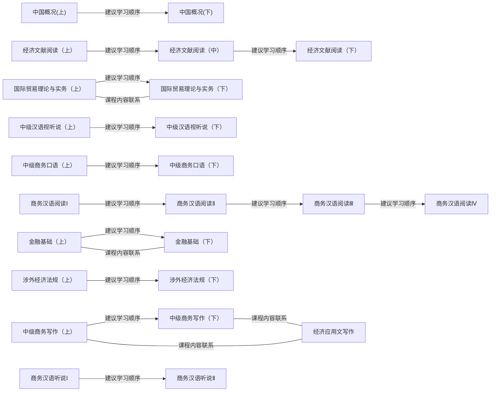

# 汉语言（对外商务汉语方向）专业“2+X”修读建议

2024 年汇编印刷页 96–97。原表记录 37 个可配对的课程代码。

[本节原页](plan-92.pdf#page=5) · [逐行数据](plan-92.json) · [院系目录](README.md)

## 课程关系图

图中展示最多 20 条关系。下表列出本节全部关系。建议学习顺序供规划课程使用，正式选课资格以教务规定为准。

| 课程 | 关联课程 | 关系 | 依据 |
| --- | --- | --- | --- |
| 中国概况(上)（ICES110012） | 中国概况(下)（ICES110013） | 建议学习顺序 | 同节课程题名标明连续分册或序号。 |
| 经济文献阅读（上）（ICES130049） | 经济文献阅读（中）（ICES130050） | 建议学习顺序 | 同节课程题名标明连续分册或序号。 |
| 经济文献阅读（中）（ICES130050） | 经济文献阅读（下）（ICES130051） | 建议学习顺序 | 同节课程题名标明连续分册或序号。 |
| 国际贸易理论与实务（上）（ICES130065） | 国际贸易理论与实务（下）（ICES130066） | 建议学习顺序 | 同节课程题名标明连续分册或序号。 |
| 中级汉语视听说（上）（ICES130085） | 中级汉语视听说（下）（ICES130086） | 建议学习顺序 | 同节课程题名标明连续分册或序号。 |
| 中级商务口语（上）（ICES130099） | 中级商务口语（下）（ICES130171） | 建议学习顺序 | 同节课程题名标明连续分册或序号。 |
| 中级商务写作（上）（ICES130101） | 中级商务写作（下）（ICES130102） | 建议学习顺序 | 同节课程题名标明连续分册或序号。 |
| 金融基础（上）（ICES130108） | 金融基础（下）（ICES130109） | 建议学习顺序 | 同节课程题名标明连续分册或序号。 |
| 涉外经济法规（上）（ICES130110） | 涉外经济法规（下）（ICES130111） | 建议学习顺序 | 同节课程题名标明连续分册或序号。 |
| 商务汉语阅读Ⅲ（ICES130142） | 商务汉语阅读Ⅳ（ICES130143） | 建议学习顺序 | 同节课程题名标明连续分册或序号。 |
| 商务汉语阅读Ⅰ（ICES130165） | 商务汉语阅读Ⅱ（ICES130166） | 建议学习顺序 | 同节课程题名标明连续分册或序号。 |
| 商务汉语阅读Ⅱ（ICES130166） | 商务汉语阅读Ⅲ（ICES130142） | 建议学习顺序 | 同节课程题名标明连续分册或序号。 |
| 商务汉语听说Ⅰ（ICES130169） | 商务汉语听说Ⅱ（ICES130170） | 建议学习顺序 | 同节课程题名标明连续分册或序号。 |
| 国际贸易理论与实务（上）（ICES130065） | 国际贸易理论与实务（下）（ICES130066） | 课程内容联系 | 本方案两门课程的题名均含“国际贸易”，可据此对照这一主题。 |
| 中级商务写作（上）（ICES130101） | 经济应用文写作（ICES130112） | 课程内容联系 | 本方案两门课程的题名均含“写作”，可据此对照这一主题。 |
| 中级商务写作（下）（ICES130102） | 经济应用文写作（ICES130112） | 课程内容联系 | 本方案两门课程的题名均含“写作”，可据此对照这一主题。 |
| 金融基础（上）（ICES130108） | 金融基础（下）（ICES130109） | 课程内容联系 | 本方案两门课程的题名均含“金融”，可据此对照这一主题。 |

## 课程

| 课程代码 | 名称 | 开课学期原文 | 来源（PDF 页） |
| --- | --- | --- | --- |
| ICES110012 | 中国概况(上) |  | 110 |
| ICES110013 | 中国概况(下) |  | 110 |
| ICES110020 | 留学生英语课程 |  | 110 |
| ICES110901 | HSK水平测试 |  | 110 |
| ICES115001 | 创新创意创业课程 |  | 110 |
| ICES130030 | 中国文化概说 |  | 110 |
| ICES130049 | 经济文献阅读（上） |  | 110 |
| ICES130050 | 经济文献阅读（中） |  | 110 |
| ICES130051 | 经济文献阅读（下） |  | 110 |
| ICES130063 | 中国对外经济关系 |  | 110 |
| ICES130064 | 商务文化 |  | 110 |
| ICES130065 | 国际贸易理论与实务（上） |  | 110 |
| ICES130066 | 国际贸易理论与实务（下） |  | 110 |
| ICES130067 | 社会实践 |  | 110 |
| ICES130068 | 毕业论文 |  | 110 |
| ICES130069 | 商务案例分析 |  | 110 |
| ICES130085 | 中级汉语视听说（上） |  | 110 |
| ICES130086 | 中级汉语视听说（下） |  | 110 |
| ICES130096 | 中级商务听力 |  | 110 |
| ICES130099 | 中级商务口语（上） |  | 110 |
| ICES130101 | 中级商务写作（上） |  | 110 |
| ICES130102 | 中级商务写作（下） |  | 110 |
| ICES130108 | 金融基础（上） |  | 110 |
| ICES130109 | 金融基础（下） |  | 110 |
| ICES130110 | 涉外经济法规（上） |  | 110 |
| ICES130111 | 涉外经济法规（下） |  | 110 |
| ICES130112 | 经济应用文写作 |  | 110 |
| ICES130132 | 当代中国经济 |  | 110 |
| ICES130133 | 经济学原理 |  | 110 |
| ICES130134 | 世界经济概况 |  | 110 |
| ICES130142 | 商务汉语阅读Ⅲ |  | 110 |
| ICES130143 | 商务汉语阅读Ⅳ |  | 110 |
| ICES130165 | 商务汉语阅读Ⅰ |  | 110 |
| ICES130166 | 商务汉语阅读Ⅱ |  | 110 |
| ICES130169 | 商务汉语听说Ⅰ |  | 110 |
| ICES130170 | 商务汉语听说Ⅱ |  | 110 |
| ICES130171 | 中级商务口语（下） |  | 110 |
