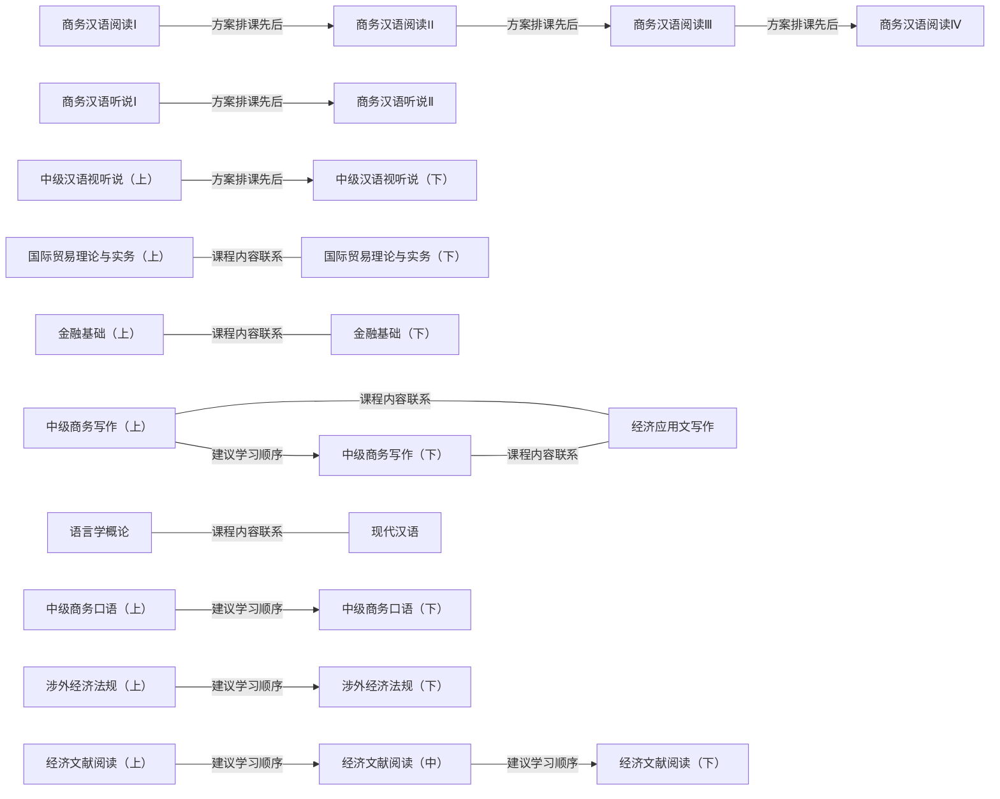

# 2025 汉语言（对外商务汉语方向）专业本科培养方案（留学生适用）

国际文化交流学院 · 汉语言(对外商务汉语方向) · 方案 96709 · 90 个不同课程或科研条目。

[官方 Word](../originals/plan-96709.docx) · [教务详情](https://fdjwgl.fudan.edu.cn/manager/bizType/2/major-program-search/info/96709?skipAuth=1) · [方案快照](../raw/plan-96709.json.gz) · [年级目录](../README.md)

## 修读导读

- **建议先学**　《商务汉语阅读Ⅰ》（`ICLE10026`） → 《商务汉语阅读II》（`ICLE10027`） → 《商务汉语阅读Ⅲ》（`ICLE20036`）。题名列出连续册次或级别。按级别积累词汇和句式，后一阶段阅读新材料时可回查前一阶段的例句。方案分别列在第1、2、3学期。

- **可以对照着读**　《语言学概论》（`ICLE20028`）与《现代汉语》（`ICLE20029`）。共同主题为语言结构和语法分析。

- **查模块选课**　《商务汉语听说Ⅱ》（`ICLE10031`）、《中级汉语视听说（上）》（`ICLE20012`）列在“专业核心教育课程”中。原表见 `/courseModules/8`。

## 课程关系图

图中展示部分关系。下表保留全部已建立的课程对，来源位置使用本方案 JSON Pointer。

## 先修与内容联系

| 类型 | 起点 | 终点 | 依据 | 原表定位 |
| --- | --- | --- | --- | --- |
| 建议学习顺序 | 留学生专业汉语I (GECS10003) | 留学生专业汉语II (GECS10004) | 同方案的课程题名具有连续分册或序号。  | `/courseModules/18/planCourses/0`、`/courseModules/18/planCourses/1` |
| 建议学习顺序 | 商务汉语阅读Ⅰ (ICLE10026) | 商务汉语阅读II (ICLE10027) | 同方案的课程题名具有连续分册或序号。  | `/courseModules/8/planCourses/0`、`/courseModules/8/planCourses/1` |
| 建议学习顺序 | 商务汉语阅读II (ICLE10027) | 商务汉语阅读Ⅲ (ICLE20036) | 同方案的课程题名具有连续分册或序号。  | `/courseModules/8/planCourses/1`、`/courseModules/8/planCourses/4` |
| 建议学习顺序 | 商务汉语听说Ⅰ (ICLE10030) | 商务汉语听说Ⅱ (ICLE10031) | 同方案的课程题名具有连续分册或序号。  | `/courseModules/8/planCourses/2`、`/courseModules/8/planCourses/3` |
| 建议学习顺序 | 中级汉语视听说（上） (ICLE20012) | 中级汉语视听说（下） (ICLE20013) | 同方案的课程题名具有连续分册或序号。  | `/courseModules/8/planCourses/5`、`/courseModules/8/planCourses/6` |
| 建议学习顺序 | 中级商务口语（上） (ICLE20018) | 中级商务口语（下） (ICLE20033) | 同方案的课程题名具有连续分册或序号。  | `/courseModules/8/planCourses/8`、`/courseModules/8/planCourses/9` |
| 建议学习顺序 | 中级商务写作（上） (ICLE20020) | 中级商务写作（下） (ICLE20021) | 同方案的课程题名具有连续分册或序号。  | `/courseModules/8/planCourses/10`、`/courseModules/8/planCourses/11` |
| 建议学习顺序 | 商务汉语阅读Ⅲ (ICLE20036) | 商务汉语阅读Ⅳ (ICLE20037) | 同方案的课程题名具有连续分册或序号。  | `/courseModules/8/planCourses/4`、`/courseModules/8/planCourses/15` |
| 建议学习顺序 | 经济文献阅读（上） (ICLE30013) | 经济文献阅读（中） (ICLE30014) | 同方案的课程题名具有连续分册或序号。  | `/courseModules/8/planCourses/16`、`/courseModules/8/planCourses/20` |
| 建议学习顺序 | 经济文献阅读（中） (ICLE30014) | 经济文献阅读（下） (ICLE40008) | 同方案的课程题名具有连续分册或序号。  | `/courseModules/8/planCourses/20`、`/courseModules/8/planCourses/25` |
| 建议学习顺序 | 中国区域经济（上） (ICLE30016) | 中国区域经济（下） (ICLE30017) | 同方案的课程题名具有连续分册或序号。  | `/courseModules/12/planCourses/17`、`/courseModules/12/planCourses/18` |
| 建议学习顺序 | 金融基础（上） (ICLE30020) | 金融基础（下） (ICLE40015) | 同方案的课程题名具有连续分册或序号。  | `/courseModules/8/planCourses/22`、`/courseModules/8/planCourses/26` |
| 建议学习顺序 | 涉外经济法规（上） (ICLE30021) | 涉外经济法规（下） (ICLE30022) | 同方案的课程题名具有连续分册或序号。  | `/courseModules/8/planCourses/18`、`/courseModules/8/planCourses/21` |
| 建议学习顺序 | 国际贸易理论与实务（上） (ICLE40010) | 国际贸易理论与实务（下） (ICLE40011) | 同方案的课程题名具有连续分册或序号。  | `/courseModules/8/planCourses/27`、`/courseModules/8/planCourses/29` |
| 方案排课先后 | 商务汉语阅读Ⅰ (ICLE10026) | 商务汉语阅读II (ICLE10027) | 同方案该课程全部明确数字学期均早于后者。  | `/courseModules/8/planCourses/0`、`/courseModules/8/planCourses/1` |
| 方案排课先后 | 商务汉语阅读II (ICLE10027) | 商务汉语阅读Ⅲ (ICLE20036) | 同方案该课程全部明确数字学期均早于后者。  | `/courseModules/8/planCourses/1`、`/courseModules/8/planCourses/4` |
| 方案排课先后 | 商务汉语听说Ⅰ (ICLE10030) | 商务汉语听说Ⅱ (ICLE10031) | 同方案该课程全部明确数字学期均早于后者。  | `/courseModules/8/planCourses/2`、`/courseModules/8/planCourses/3` |
| 方案排课先后 | 中级汉语视听说（上） (ICLE20012) | 中级汉语视听说（下） (ICLE20013) | 同方案该课程全部明确数字学期均早于后者。  | `/courseModules/8/planCourses/5`、`/courseModules/8/planCourses/6` |
| 方案排课先后 | 中级商务口语（上） (ICLE20018) | 中级商务口语（下） (ICLE20033) | 同方案该课程全部明确数字学期均早于后者。  | `/courseModules/8/planCourses/8`、`/courseModules/8/planCourses/9` |
| 方案排课先后 | 中级商务写作（上） (ICLE20020) | 中级商务写作（下） (ICLE20021) | 同方案该课程全部明确数字学期均早于后者。  | `/courseModules/8/planCourses/10`、`/courseModules/8/planCourses/11` |
| 方案排课先后 | 商务汉语阅读Ⅲ (ICLE20036) | 商务汉语阅读Ⅳ (ICLE20037) | 同方案该课程全部明确数字学期均早于后者。  | `/courseModules/8/planCourses/4`、`/courseModules/8/planCourses/15` |
| 方案排课先后 | 经济文献阅读（上） (ICLE30013) | 经济文献阅读（中） (ICLE30014) | 同方案该课程全部明确数字学期均早于后者。  | `/courseModules/8/planCourses/16`、`/courseModules/8/planCourses/20` |
| 方案排课先后 | 经济文献阅读（中） (ICLE30014) | 经济文献阅读（下） (ICLE40008) | 同方案该课程全部明确数字学期均早于后者。  | `/courseModules/8/planCourses/20`、`/courseModules/8/planCourses/25` |
| 方案排课先后 | 金融基础（上） (ICLE30020) | 金融基础（下） (ICLE40015) | 同方案该课程全部明确数字学期均早于后者。  | `/courseModules/8/planCourses/22`、`/courseModules/8/planCourses/26` |
| 方案排课先后 | 涉外经济法规（上） (ICLE30021) | 涉外经济法规（下） (ICLE30022) | 同方案该课程全部明确数字学期均早于后者。  | `/courseModules/8/planCourses/18`、`/courseModules/8/planCourses/21` |
| 方案排课先后 | 国际贸易理论与实务（上） (ICLE40010) | 国际贸易理论与实务（下） (ICLE40011) | 同方案该课程全部明确数字学期均早于后者。  | `/courseModules/8/planCourses/27`、`/courseModules/8/planCourses/29` |
| 课程内容联系 | 汉语基础语法 (ICLE10019) | 语法与语法教学 (ICLE20031) | 本方案两门课程的题名均含“语法”，可据此对照这一主题。  | `/courseModules/12/planCourses/4`、`/courseModules/12/planCourses/25` |
| 课程内容联系 | 中级商务写作（上） (ICLE20020) | 经济应用文写作 (ICLE30023) | 本方案两门课程的题名均含“写作”，可据此对照这一主题。  | `/courseModules/8/planCourses/10`、`/courseModules/8/planCourses/17` |
| 课程内容联系 | 中级商务写作（下） (ICLE20021) | 经济应用文写作 (ICLE30023) | 本方案两门课程的题名均含“写作”，可据此对照这一主题。  | `/courseModules/8/planCourses/11`、`/courseModules/8/planCourses/17` |
| 课程内容联系 | 语言学概论 (ICLE20028) | 现代汉语 (ICLE20029) | 共同主题为语言结构和语法分析。  | `/courseModules/12/planCourses/22`、`/courseModules/12/planCourses/23` |
| 课程内容联系 | 金融基础（上） (ICLE30020) | 金融基础（下） (ICLE40015) | 本方案两门课程的题名均含“金融”，可据此对照这一主题。  | `/courseModules/8/planCourses/22`、`/courseModules/8/planCourses/26` |
| 课程内容联系 | 国际贸易理论与实务（上） (ICLE40010) | 国际贸易理论与实务（下） (ICLE40011) | 本方案两门课程的题名均含“国际贸易”，可据此对照这一主题。  | `/courseModules/8/planCourses/27`、`/courseModules/8/planCourses/29` |

本次未从可定位的明确表述中确认课程对课程预修。学期安排、系列分册与编辑建议均保留各自的依据。

## 按原方案模块阅读

同一模块展示原表中的课程归属。模块内课程之间的先后仍须逐项查阅。

- **留学生选修课程**　中国哲学、中国绘画、中国书法、文物鉴赏、中国印、中国神话传说、中国传统医学文化、当代国际关系、中国旅游文化、中国传统戏曲赏析、中国传统建筑文化、经贸汉语、中国历史名人、中国文化地理、汉语与中国文化、跨文化交流理论与实践、文学美典与人生境界（原表模块 7）

## 课程表

同一课程在不同模块分别出现时，按原表逐行列出。季节字段保留原值。

| 课程 | 代码 | 学分 | 学期 | 模块 |
| --- | --- | ---: | --- | --- |
| 留学生英语Ⅰ | GEEC10195 | 2.0 | 第1学期 | 培养方案 / 通识教育课程 / 通识教育专项教育课程 |
| 留学生英语Ⅱ | GEEC10196 | 2.0 | 第2学期 | 培养方案 / 通识教育课程 / 通识教育专项教育课程 |
| HSK水平测试 | GEEC30007 | 1.0 | SPRING | 培养方案 / 通识教育课程 / 复旦大学水平测试 |
| 中国哲学 | ICLE10001 | 2.0 | AUTUMN | 培养方案 / 专业培养课程 / 学科基础课程 / 人文基础课程 / 留学生选修课程 |
| 中国绘画 | ICLE10002 | 2.0 | AUTUMN | 培养方案 / 专业培养课程 / 学科基础课程 / 人文基础课程 / 留学生选修课程 |
| 中国书法 | ICLE10003 | 2.0 | SPRING | 培养方案 / 专业培养课程 / 学科基础课程 / 人文基础课程 / 留学生选修课程 |
| 文物鉴赏 | ICLE10004 | 2.0 | AUTUMN | 培养方案 / 专业培养课程 / 学科基础课程 / 人文基础课程 / 留学生选修课程 |
| 中国印 | ICLE10005 | 2.0 | AUTUMN | 培养方案 / 专业培养课程 / 学科基础课程 / 人文基础课程 / 留学生选修课程 |
| 中国神话传说 | ICLE10006 | 2.0 | AUTUMN | 培养方案 / 专业培养课程 / 学科基础课程 / 人文基础课程 / 留学生选修课程 |
| 中国传统医学文化 | ICLE10007 | 2.0 | AUTUMN | 培养方案 / 专业培养课程 / 学科基础课程 / 人文基础课程 / 留学生选修课程 |
| 当代国际关系 | ICLE10008 | 2.0 | AUTUMN | 培养方案 / 专业培养课程 / 学科基础课程 / 人文基础课程 / 留学生选修课程 |
| 中国旅游文化 | ICLE10009 | 2.0 | SPRING | 培养方案 / 专业培养课程 / 学科基础课程 / 人文基础课程 / 留学生选修课程 |
| 中国传统戏曲赏析 | ICLE10010 | 2.0 | SPRING | 培养方案 / 专业培养课程 / 学科基础课程 / 人文基础课程 / 留学生选修课程 |
| 中国传统建筑文化 | ICLE10011 | 2.0 | AUTUMN | 培养方案 / 专业培养课程 / 学科基础课程 / 人文基础课程 / 留学生选修课程 |
| 经贸汉语 | ICLE10012 | 2.0 | SPRING | 培养方案 / 专业培养课程 / 学科基础课程 / 人文基础课程 / 留学生选修课程 |
| 中国历史名人 | ICLE10013 | 2.0 | AUTUMN | 培养方案 / 专业培养课程 / 学科基础课程 / 人文基础课程 / 留学生选修课程 |
| 中国文化地理 | ICLE10014 | 2.0 | SPRING | 培养方案 / 专业培养课程 / 学科基础课程 / 人文基础课程 / 留学生选修课程 |
| 汉语与中国文化 | ICLE10015 | 2.0 | AUTUMN | 培养方案 / 专业培养课程 / 学科基础课程 / 人文基础课程 / 留学生选修课程 |
| 跨文化交流理论与实践 | ICLE10016 | 2.0 | SPRING | 培养方案 / 专业培养课程 / 学科基础课程 / 人文基础课程 / 留学生选修课程 |
| 文学美典与人生境界 | ICLE10017 | 2.0 | AUTUMN | 培养方案 / 专业培养课程 / 学科基础课程 / 人文基础课程 / 留学生选修课程 |
| 商务汉语阅读Ⅰ | ICLE10026 | 6.0 | 第1学期 | 培养方案 / 专业培养课程 / 专业核心教育课程 |
| 商务汉语阅读II | ICLE10027 | 6.0 | 第2学期 | 培养方案 / 专业培养课程 / 专业核心教育课程 |
| 商务汉语听说Ⅰ | ICLE10030 | 4.0 | 第1学期 | 培养方案 / 专业培养课程 / 专业核心教育课程 |
| 商务汉语听说Ⅱ | ICLE10031 | 4.0 | 第2学期 | 培养方案 / 专业培养课程 / 专业核心教育课程 |
| 商务汉语阅读Ⅲ | ICLE20036 | 6.0 | 第3学期 | 培养方案 / 专业培养课程 / 专业核心教育课程 |
| 中级汉语视听说（上） | ICLE20012 | 2.0 | 第3学期 | 培养方案 / 专业培养课程 / 专业核心教育课程 |
| 中级汉语视听说（下） | ICLE20013 | 2.0 | 第4学期 | 培养方案 / 专业培养课程 / 专业核心教育课程 |
| 中级商务听力 | ICLE20017 | 2.0 | 第3学期 | 培养方案 / 专业培养课程 / 专业核心教育课程 |
| 中级商务口语（上） | ICLE20018 | 3.0 | 第3学期 | 培养方案 / 专业培养课程 / 专业核心教育课程 |
| 中级商务口语（下） | ICLE20033 | 3.0 | 第4学期 | 培养方案 / 专业培养课程 / 专业核心教育课程 |
| 中级商务写作（上） | ICLE20020 | 2.0 | 第3学期 | 培养方案 / 专业培养课程 / 专业核心教育课程 |
| 中级商务写作（下） | ICLE20021 | 2.0 | 第4学期 | 培养方案 / 专业培养课程 / 专业核心教育课程 |
| 当代中国经济 | ICLE20023 | 2.0 | 第3学期 | 培养方案 / 专业培养课程 / 专业核心教育课程 |
| 经济学原理 | ICLE20024 | 2.0 | 第4学期 | 培养方案 / 专业培养课程 / 专业核心教育课程 |
| 世界经济概况 | ICLE20025 | 2.0 | 第4学期 | 培养方案 / 专业培养课程 / 专业核心教育课程 |
| 商务汉语阅读Ⅳ | ICLE20037 | 4.0 | 第4学期 | 培养方案 / 专业培养课程 / 专业核心教育课程 |
| 经济文献阅读（上） | ICLE30013 | 4.0 | 第5学期 | 培养方案 / 专业培养课程 / 专业核心教育课程 |
| 经济应用文写作 | ICLE30023 | 2.0 | 第5学期 | 培养方案 / 专业培养课程 / 专业核心教育课程 |
| 涉外经济法规（上） | ICLE30021 | 2.0 | 第5学期 | 培养方案 / 专业培养课程 / 专业核心教育课程 |
| 中国文化概说 | ICLE30006 | 2.0 | 第6学期 | 培养方案 / 专业培养课程 / 专业核心教育课程 |
| 经济文献阅读（中） | ICLE30014 | 4.0 | 第6学期 | 培养方案 / 专业培养课程 / 专业核心教育课程 |
| 涉外经济法规（下） | ICLE30022 | 2.0 | 第6学期 | 培养方案 / 专业培养课程 / 专业核心教育课程 |
| 金融基础（上） | ICLE30020 | 2.0 | 第6学期 | 培养方案 / 专业培养课程 / 专业核心教育课程 |
| 中国对外经济关系 | ICLE30018 | 2.0 | 第6学期 | 培养方案 / 专业培养课程 / 专业核心教育课程 |
| 商务文化 | ICLE40009 | 2.0 | 第6学期 | 培养方案 / 专业培养课程 / 专业核心教育课程 |
| 经济文献阅读（下） | ICLE40008 | 4.0 | 第7学期 | 培养方案 / 专业培养课程 / 专业核心教育课程 |
| 金融基础（下） | ICLE40015 | 2.0 | 第7学期 | 培养方案 / 专业培养课程 / 专业核心教育课程 |
| 国际贸易理论与实务（上） | ICLE40010 | 2.0 | 第7学期 | 培养方案 / 专业培养课程 / 专业核心教育课程 |
| 商务案例分析 | ICLE20005 | 2.0 | 第7学期 | 培养方案 / 专业培养课程 / 专业核心教育课程 |
| 国际贸易理论与实务（下） | ICLE40011 | 2.0 | 第8学期 | 培养方案 / 专业培养课程 / 专业核心教育课程 |
| 新闻听力 | ICLE20015 | 2.0 | SPRING | 培养方案 / 专业进阶课程 |
| 英汉翻译 | ICLE20004 | 2.0 | SPRING | 培养方案 / 专业进阶课程 |
| 商务英语 | ICLE30028 | 2.0 | AUTUMN | 培养方案 / 专业进阶课程 |
| 新词语 | ICLE30012 | 2.0 | AUTUMN | 培养方案 / 专业进阶课程 |
| 汉语基础语法 | ICLE10019 | 2.0 | AUTUMN | 培养方案 / 专业进阶课程 |
| 汉语修辞 | ICLE20007 | 2.0 | AUTUMN | 培养方案 / 专业进阶课程 |
| 汉字研究 | ICLE40007 | 2.0 | SPRING | 培养方案 / 专业进阶课程 |
| 汉语虚词十五讲 | ICLE20026 | 2.0 | SPRING | 培养方案 / 专业进阶课程 |
| 中国电影与文化 | ICLE40006 | 2.0 | SPRING | 培养方案 / 专业进阶课程 |
| 《论语》导读 | ICLE20003 | 2.0 | AUTUMN | 培养方案 / 专业进阶课程 |
| 成语与中国文化 | ICLE10018 | 2.0 | AUTUMN | 培养方案 / 专业进阶课程 |
| 中国民俗文化 | ICLE20008 | 2.0 | AUTUMN | 培养方案 / 专业进阶课程 |
| 中外文学比较 | ICLE30019 | 2.0 | AUTUMN | 培养方案 / 专业进阶课程 |
| 留学生中文电影赏析 | ICLE20027 | 2.0 | AUTUMN | 培养方案 / 专业进阶课程 |
| 商务文选 | ICLE20022 | 2.0 | SPRING | 培养方案 / 专业进阶课程 |
| 跨文化管理 | ICLE20009 | 3.0 | AUTUMN | 培养方案 / 专业进阶课程 |
| 孙子兵法与商贸战略 | ICLE30015 | 2.0 | AUTUMN | 培养方案 / 专业进阶课程 |
| 中国区域经济（上） | ICLE30016 | 2.0 | AUTUMN | 培养方案 / 专业进阶课程 |
| 中国区域经济（下） | ICLE30017 | 2.0 | SPRING | 培养方案 / 专业进阶课程 |
| 中国市场与投资 | ICLE40014 | 2.0 | SPRING | 培养方案 / 专业进阶课程 |
| 跨国公司与中国市场 | ICLE20006 | 2.0 | AUTUMN | 培养方案 / 专业进阶课程 |
| 中文计算机基础 | GEEC10197 | 2.0 | AUTUMN | 培养方案 / 专业进阶课程 |
| 语言学概论 | ICLE20028 | 2.0 | AUTUMN | 培养方案 / 专业进阶课程 |
| 现代汉语 | ICLE20029 | 2.0 | AUTUMN | 培养方案 / 专业进阶课程 |
| 教育心理学 | ICLE20030 | 2.0 | AUTUMN | 培养方案 / 专业进阶课程 |
| 语法与语法教学 | ICLE20031 | 2.0 | SPRING | 培养方案 / 专业进阶课程 |
| 中国文化通论 | ICLE20032 | 2.0 | SPRING | 培养方案 / 专业进阶课程 |
| 对外汉语教学原理 | ICLE30029 | 2.0 | SPRING | 培养方案 / 专业进阶课程 |
| 词汇与词汇教学 | ICLE30030 | 2.0 | SPRING | 培养方案 / 专业进阶课程 |
| 教材与教法 | ICLE30031 | 2.0 | SPRING | 培养方案 / 专业进阶课程 |
| 国际中文教育教学实践 | ICLE40016 | 2.0 | SPRING | 培养方案 / 专业进阶课程 |
| 汉字与汉字教学 | ICLE40017 | 2.0 | AUTUMN | 培养方案 / 专业进阶课程 |
| 全球数字政府建设 | MANA20006 | 2.0 | SPRING | 培养方案 / 专业进阶课程 |
| 国际发展与中国 | MANA20005 | 2.0 | SUMMER | 培养方案 / 专业进阶课程 |
| 全球视野下的中国媒体：融合与冲突 | MANA20007 | 2.0 | SUMMER | 培养方案 / 专业进阶课程 |
| 留学生专业汉语I | GECS10003 | 4.0 | SPRING、AUTUMN | 融合创新能力 |
| 留学生专业汉语II | GECS10004 | 4.0 | SPRING、AUTUMN | 融合创新能力 |
| 留学生创新与创业 | GEIN30001 | 1.0 | SPRING、AUTUMN | 融合创新能力 |
| 毕业论文 | ICLE40013 | 4.0 | 第8学期 | 融合创新能力 |
| 社会实践（报告） | ICLE40012 | 2.0 | 第7学期 | 融合创新能力 |
