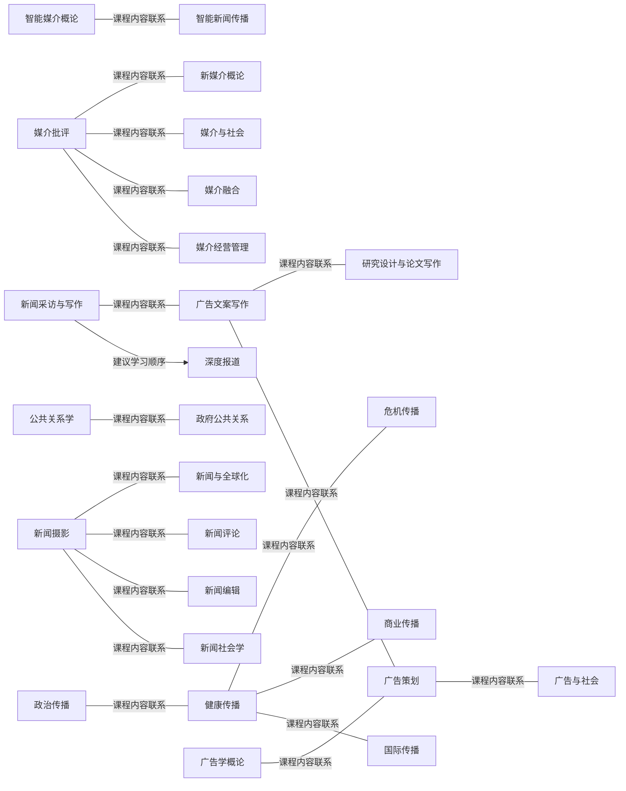

# 新闻传播学类专业“2+X”教学培养方案

2024 年汇编印刷页 315–319。原表记录 110 个可配对的课程代码。

[本节原页](plan-315.pdf#page=1) · [逐行数据](plan-315.json) · [院系目录](README.md)

## 课程导读

想了解新闻采编与传播的课程安排，可以在原表中找到《中国新闻传播史》（`JOUR130194`）、《新闻采访与写作》（`JOUR130019`）、《新闻传播法规与伦理》（`JOUR130252`）。 [原书 PDF 第 329 页](plan-315.pdf#page=1)

图中连接《新闻摄影》（`JOUR130186`）和《新闻编辑》（`JOUR130284`），两门课都从课程题名标出的“新闻”切入，可沿这一主题对照阅读。 [原书 PDF 第 330 页](plan-315.pdf#page=2)

## 课程关系图

图中展示最多 20 条关系。下表列出本节全部关系。建议学习顺序供规划课程使用，正式选课资格以教务规定为准。

| 课程 | 关联课程 | 关系 | 依据 |
| --- | --- | --- | --- |
| 新闻采访与写作（JOUR130019） | 深度报道（JOUR130166） | 建议学习顺序 | 采访与材料组织训练可用于展开和核查深度报道。 |
| 智能媒介概论（AIS210008） | 智能新闻传播（AIS310010） | 课程内容联系 | 智能媒介技术和新闻生产传播具有应用场景交集。 |
| 媒介批评（JOUR130006） | 媒介经营管理（JOUR130010） | 课程内容联系 | 本方案两门课程的题名均含“媒介”，可据此对照这一主题。 |
| 媒介批评（JOUR130006） | 媒介融合（JOUR130195） | 课程内容联系 | 本方案两门课程的题名均含“媒介”，可据此对照这一主题。 |
| 媒介批评（JOUR130006） | 媒介与社会（JOUR130271） | 课程内容联系 | 本方案两门课程的题名均含“媒介”，可据此对照这一主题。 |
| 媒介批评（JOUR130006） | 新媒介概论（JOUR130281） | 课程内容联系 | 本方案两门课程的题名均含“媒介”，可据此对照这一主题。 |
| 新闻采访与写作（JOUR130019） | 广告文案写作（JOUR130052） | 课程内容联系 | 本方案两门课程的题名均含“写作”，可据此对照这一主题。 |
| 公共关系学（JOUR130041） | 政府公共关系（JOUR130169） | 课程内容联系 | 本方案两门课程的题名均含“公共关系”，可据此对照这一主题。 |
| 广告文案写作（JOUR130052） | 广告策划（JOUR130272） | 课程内容联系 | 本方案两门课程的题名均含“广告”，可据此对照这一主题。 |
| 广告文案写作（JOUR130052） | 研究设计与论文写作（JOUR130316） | 课程内容联系 | 本方案两门课程的题名均含“写作”，可据此对照这一主题。 |
| 政治传播（JOUR130118） | 健康传播（JOUR130168） | 课程内容联系 | 本方案两门课程的题名均含“传播”，可据此对照这一主题。 |
| 健康传播（JOUR130168） | 国际传播（JOUR130176） | 课程内容联系 | 本方案两门课程的题名均含“传播”，可据此对照这一主题。 |
| 健康传播（JOUR130168） | 商业传播（JOUR130283） | 课程内容联系 | 本方案两门课程的题名均含“传播”，可据此对照这一主题。 |
| 健康传播（JOUR130168） | 危机传播（JOUR130301） | 课程内容联系 | 本方案两门课程的题名均含“传播”，可据此对照这一主题。 |
| 新闻摄影（JOUR130186） | 新闻社会学（JOUR130273） | 课程内容联系 | 本方案两门课程的题名均含“新闻”，可据此对照这一主题。 |
| 新闻摄影（JOUR130186） | 新闻编辑（JOUR130284） | 课程内容联系 | 本方案两门课程的题名均含“新闻”，可据此对照这一主题。 |
| 新闻摄影（JOUR130186） | 新闻评论（JOUR130285） | 课程内容联系 | 本方案两门课程的题名均含“新闻”，可据此对照这一主题。 |
| 新闻摄影（JOUR130186） | 新闻与全球化（JOUR130323） | 课程内容联系 | 本方案两门课程的题名均含“新闻”，可据此对照这一主题。 |
| 广告学概论（JOUR130207） | 广告策划（JOUR130272） | 课程内容联系 | 本方案两门课程的题名均含“广告”，可据此对照这一主题。 |
| 广告策划（JOUR130272） | 广告与社会（JOUR130311） | 课程内容联系 | 本方案两门课程的题名均含“广告”，可据此对照这一主题。 |
| 广告策划（JOUR130272） | 数字音频广告（JOUR130320） | 课程内容联系 | 本方案两门课程的题名均含“广告”，可据此对照这一主题。 |
| 新闻编辑（JOUR130284） | 新闻评论（JOUR130285） | 课程内容联系 | 两课可围绕新闻判断、受众与公共表达比较。 |

## 课程

| 课程代码 | 名称 | 开课学期原文 | 来源（PDF 页） |
| --- | --- | --- | --- |
| AIS210008 | 智能媒介概论 | 3、4 | 329 |
| AIS310010 | 智能新闻传播 | 3、4 | 329 |
| AIS410003 | 智能市场研究 | 3 | 330 |
| JOUR130006 | 媒介批评 | 5 | 330 |
| JOUR130008 | 外国新闻传播史 | 4 | 330 |
| JOUR130010 | 媒介经营管理 | 5、6 | 329 |
| JOUR130016 | 教学小实习 | 4 | 330 |
| JOUR130017 | 教学大实习 | 7 | 330 |
| JOUR130018 | 毕业论文 | 8 | 330 |
| JOUR130019 | 新闻采访与写作 | 2、3 | 329 |
| JOUR130029 | 影视艺术 | 春，秋 | 331 |
| JOUR130036 | 跨文化传播 | 6 | 330 |
| JOUR130040 | 传播学研究方法 | 3 | 330 |
| JOUR130041 | 公共关系学 | 6 | 331 |
| JOUR130042 | 人际传播学 | 5 | 330 |
| JOUR130043 | 组织传播学 | 5 | 330 |
| JOUR130047 | 舆论学 | 4 | 330 |
| JOUR130049 | 整合营销传播 | 春，秋 | 333 |
| JOUR130052 | 广告文案写作 | 4 | 331 |
| JOUR130057 | 消费心理与消费行为 | 5 | 330 |
| JOUR130058 | 市场营销学 | 春，秋 | 333 |
| JOUR130063 | 大众传媒与文化 | 春，秋 | 331 |
| JOUR130073 | 英文报刊选读 | 春，秋 | 331 |
| JOUR130075 | 传播政治经济学 | 4 | 330 |
| JOUR130091 | 广电制度与政策法规 | 春，秋 | 332 |
| JOUR130118 | 政治传播 |  | 332 |
| JOUR130166 | 深度报道 | 6 | 330 |
| JOUR130168 | 健康传播 |  | 332 |
| JOUR130169 | 政府公共关系 | 3 | 330 |
| JOUR130170 | 动画赏析 | 春，秋 | 332 |
| JOUR130176 | 国际传播 | 6 | 330 |
| JOUR130177 | 环境传播 |  | 332 |
| JOUR130178 | 说服与传播运动设计 |  | 332 |
| JOUR130186 | 新闻摄影 | 3 | 330 |
| JOUR130194 | 中国新闻传播史 | 2、3 | 329 |
| JOUR130195 | 媒介融合 | 5、6 | 330 |
| JOUR130199 | 新闻传播理论经典导读 | 春，秋 | 331 |
| JOUR130200 | 受众分析 | 6 | 330 |
| JOUR130202 | 专业报道 | 5 | 330 |
| JOUR130205 | 视听技术与应用 | 3 | 330 |
| JOUR130207 | 广告学概论 | 3 | 330 |
| JOUR130224 | 娱乐报道和娱乐节目 | 春，秋 | 332 |
| JOUR130228 | 视听节目策划 | 春，秋 | 332 |
| JOUR130238 | 中外传播思想 |  | 332 |
| JOUR130241 | 促销、宣传与表现 | 春，秋 | 333 |
| JOUR130245 | 数据与财经新闻 | 春，秋 | 331 |
| JOUR130246 | 计算机仿生传播 | 春，秋 | 331 |
| JOUR130252 | 新闻传播法规与伦理 | 6 | 329 |
| JOUR130253 | 数据分析与信息可视化 | 5、6 | 330 |
| JOUR130255 | 纪录片理论与实践 | 5 | 330 |
| JOUR130258 | 影视工作室 | 春，秋 | 331 |
| JOUR130263 | 纪录片创作 | 春，秋 | 332 |
| JOUR130264 | 社交媒体传播分析 |  | 332 |
| JOUR130268 | 新读写 | 春，秋 | 331 |
| JOUR130269 | 企业战略传播 | 5 | 331 |
| JOUR130270 | 都市、田野调查与纪录 | 春，秋 | 332 |
| JOUR130271 | 媒介与社会 | 春，秋 | 331 |
| JOUR130272 | 广告策划 | 4 | 330 |
| JOUR130273 | 新闻社会学 | 春，秋 | 331 |
| JOUR130274 | 移动媒介产品设计 | 春，秋 | 331 |
| JOUR130275 | 新媒体与社会性别 | 春，秋 | 331 |
| JOUR130276 | 数字城市传播 | 春，秋 | 331 |
| JOUR130277 | 新闻传播民族志 | 春，秋 | 331 |
| JOUR130278 | 新闻叙事分析 | 春，秋 | 331 |
| JOUR130279 | 视觉与审美通论 | 春，秋 | 331 |
| JOUR130280 | 网络视听文化 | 春，秋 | 331 |
| JOUR130281 | 新媒介概论 | 春，秋 | 331 |
| JOUR130282 | 口语表达 | 3、4 | 329 |
| JOUR130283 | 商业传播 | 3、4 | 329 |
| JOUR130284 | 新闻编辑 | 3 | 330 |
| JOUR130285 | 新闻评论 | 4 | 330 |
| JOUR130286 | 视听史论 | 4 | 330 |
| JOUR130287 | 影像编辑 | 4 | 330 |
| JOUR130288 | 视听新闻生产 | 3 | 330 |
| JOUR130290 | 视听传播 | 2、3 | 329 |
| JOUR130291 | 视听节目构成 | 6 | 330 |
| JOUR130293 | 计算与智能传播 |  | 332 |
| JOUR130294 | 视听大数据计算传播 | 春，秋 | 332 |
| JOUR130295 | 出镜报道与新闻主持 | 春，秋 | 332 |
| JOUR130296 | 融合直播实务 | 春，秋 | 332 |
| JOUR130298 | 视听实务工作坊 | 春，秋 | 332 |
| JOUR130299 | 品牌形象塑造 | 春，秋 | 333 |
| JOUR130300 | 商业摄影 | 春，秋 | 333 |
| JOUR130301 | 危机传播 | 春，秋 | 333 |
| JOUR130302 | 新媒体艺术与智能生成传播 | 春，秋 | 332 |
| JOUR130303 | 纪实摄影工作室 | 春，秋 | 332 |
| JOUR130304 | 视听广告创作 | 春，秋 | 333 |
| JOUR130305 | 美术与插画工作室 | 春，秋 | 333 |
| JOUR130306 | 品牌策略传播 | 春，秋 | 333 |
| JOUR130307 | 剧本创作与视听实务评论 | 春，秋 | 332 |
| JOUR130308 | 传播研究前沿文献选读 |  | 332 |
| JOUR130309 | 传播理论与历史 |  | 332 |
| JOUR130310 | 近现代广告史 | 春，秋 | 333 |
| JOUR130311 | 广告与社会 | 春，秋 | 333 |
| JOUR130313 | 新媒体技术与传播 |  | 332 |
| JOUR130314 | 数字媒介产品营销传播 |  | 332 |
| JOUR130315 | 信息互动设计 | 春，秋 | 333 |
| JOUR130316 | 研究设计与论文写作 | 春，秋 | 331 |
| JOUR130317 | 认知传播 |  | 332 |
| JOUR130318 | 视听实务工作坊 | 春，秋 | 332 |
| JOUR130319 | 新闻作品评析 | 春，秋 | 331 |
| JOUR130320 | 数字音频广告 | 春，秋 | 333 |
| JOUR130321 | 记录中国——新闻学院学生暑期 | 暑假 | 332 |
| JOUR130322 | 数字出版 | 春，秋 | 331 |
| JOUR130323 | 新闻与全球化 | 春，秋 | 331 |
| JOUR130324 | 重大历史事件报道解析 | 春，秋 | 332 |
| JOUR130327 | 大数据与国际舆论分析 |  | 332 |
| JOUR130330 | 智能商业洞察与创新 | 春，秋 | 333 |
| JOUR130332 | 智能广告创意与表现 | 4 | 331 |
| JOUR130334 | 智能视频制作实务 | 春，秋 | 332 |
