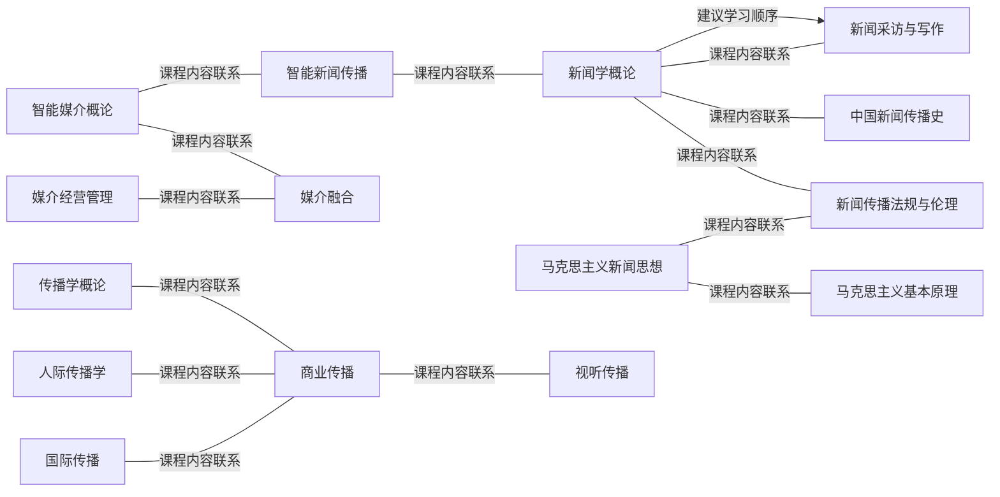

# 传播学专业“2+X”修读建议

2024 年汇编印刷页 328–329。原表记录 31 个可配对的课程代码。

[本节原页](plan-315.pdf#page=14) · [逐行数据](plan-315.json) · [院系目录](README.md)

## 课程关系图

图中展示最多 20 条关系。下表列出本节全部关系。建议学习顺序供规划课程使用，正式选课资格以教务规定为准。

| 课程 | 关联课程 | 关系 | 依据 |
| --- | --- | --- | --- |
| 新闻学概论（JOUR120008） | 新闻采访与写作（JOUR130019） | 建议学习顺序 | 新闻价值、事实核验与体裁概念可用于采访和写作。 |
| 智能媒介概论（AIS210008） | 智能新闻传播（AIS310010） | 课程内容联系 | 智能媒介技术和新闻生产传播具有应用场景交集。 |
| 智能媒介概论（AIS210008） | 媒介融合（JOUR130195） | 课程内容联系 | 本方案两门课程的题名均含“媒介”，可据此对照这一主题。 |
| 智能新闻传播（AIS310010） | 新闻学概论（JOUR120008） | 课程内容联系 | 本方案两门课程的题名均含“新闻”，可据此对照这一主题。 |
| 马克思主义新闻思想（JOUR120001） | 新闻传播法规与伦理（JOUR130252） | 课程内容联系 | 两课均涉及新闻责任和公共传播价值。 |
| 马克思主义新闻思想（JOUR120001） | 马克思主义基本原理（PTSS110087） | 课程内容联系 | 本方案两门课程的题名均含“马克思主义”，可据此对照这一主题。 |
| 新闻学概论（JOUR120008） | 新闻采访与写作（JOUR130019） | 课程内容联系 | 本方案两门课程的题名均含“新闻”，可据此对照这一主题。 |
| 新闻学概论（JOUR120008） | 中国新闻传播史（JOUR130194） | 课程内容联系 | 本方案两门课程的题名均含“新闻”，可据此对照这一主题。 |
| 新闻学概论（JOUR120008） | 新闻传播法规与伦理（JOUR130252） | 课程内容联系 | 本方案两门课程的题名均含“新闻”，可据此对照这一主题。 |
| 传播学概论（JOUR120009） | 商业传播（JOUR130283） | 课程内容联系 | 本方案两门课程的题名均含“传播”，可据此对照这一主题。 |
| 媒介经营管理（JOUR130010） | 媒介融合（JOUR130195） | 课程内容联系 | 本方案两门课程的题名均含“媒介”，可据此对照这一主题。 |
| 人际传播学（JOUR130042） | 商业传播（JOUR130283） | 课程内容联系 | 本方案两门课程的题名均含“传播”，可据此对照这一主题。 |
| 国际传播（JOUR130176） | 商业传播（JOUR130283） | 课程内容联系 | 本方案两门课程的题名均含“传播”，可据此对照这一主题。 |
| 商业传播（JOUR130283） | 视听传播（JOUR130290） | 课程内容联系 | 本方案两门课程的题名均含“传播”，可据此对照这一主题。 |

## 课程

| 课程代码 | 名称 | 开课学期原文 | 来源（PDF 页） |
| --- | --- | --- | --- |
| AIS210008 | 智能媒介概论 |  | 342 |
| AIS310010 | 智能新闻传播 |  | 343 |
| JOUR120001 | 马克思主义新闻思想 |  | 342 |
| JOUR120008 | 新闻学概论 |  | 342 |
| JOUR120009 | 传播学概论 |  | 342 |
| JOUR130010 | 媒介经营管理 |  | 342 |
| JOUR130016 | 教学小实习 |  | 343 |
| JOUR130017 | 教学大实习 |  | 343 |
| JOUR130018 | 毕业论文 |  | 343 |
| JOUR130019 | 新闻采访与写作 |  | 342 |
| JOUR130036 | 跨文化传播 |  | 343 |
| JOUR130040 | 传播学研究方法 |  | 343 |
| JOUR130042 | 人际传播学 |  | 343 |
| JOUR130043 | 组织传播学 |  | 343 |
| JOUR130047 | 舆论学 |  | 343 |
| JOUR130075 | 传播政治经济学 |  | 343 |
| JOUR130169 | 政府公共关系 |  | 343 |
| JOUR130176 | 国际传播 |  | 343 |
| JOUR130194 | 中国新闻传播史 |  | 342 |
| JOUR130195 | 媒介融合 |  | 342 |
| JOUR130200 | 受众分析 |  | 343 |
| JOUR130252 | 新闻传播法规与伦理 |  | 342 |
| JOUR130253 | 数据分析与信息可视化 |  | 343 |
| JOUR130282 | 口语表达 |  | 342 |
| JOUR130283 | 商业传播 |  | 342 |
| JOUR130290 | 视听传播 |  | 342 |
| PTSS110082 | 毛泽东思想和中国特色社会主义理论体系概论 |  | 342 |
| PTSS110087 | 马克思主义基本原理 |  | 342 |
| PTSS110088 | 中国近现代史纲要 |  | 342 |
| PTSS110089 | 思想道德与法治 |  | 342 |
| PTSS110090 | 习近平新时代中国特色社会主义思想概论 |  | 342 |
