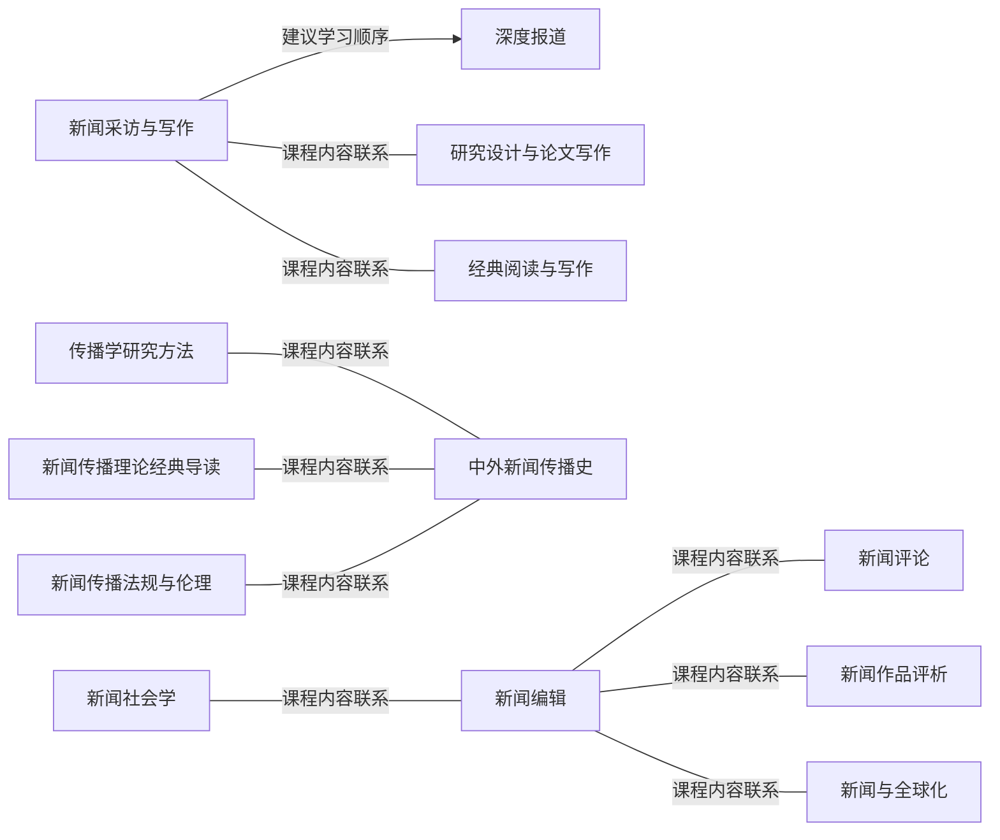

# 新闻学（望道新闻卓越班）专业“2+X”教学培养方案

2024 年汇编印刷页 336–337。原表记录 26 个可配对的课程代码。

[本节原页](plan-336.pdf#page=1) · [逐行数据](plan-336.json) · [院系目录](README.md)

## 课程关系图

图中展示最多 20 条关系。下表列出本节全部关系。建议学习顺序供规划课程使用，正式选课资格以教务规定为准。

| 课程 | 关联课程 | 关系 | 依据 |
| --- | --- | --- | --- |
| 新闻采访与写作（JOUR130019） | 深度报道（JOUR130166） | 建议学习顺序 | 采访与材料组织训练可用于展开和核查深度报道。 |
| 新闻采访与写作（JOUR130019） | 研究设计与论文写作（JOUR130316） | 课程内容联系 | 本方案两门课程的题名均含“写作”，可据此对照这一主题。 |
| 新闻采访与写作（JOUR130019） | 经典阅读与写作（JOUR130329） | 课程内容联系 | 本方案两门课程的题名均含“写作”，可据此对照这一主题。 |
| 传播学研究方法（JOUR130040） | 中外新闻传播史（JOUR130325） | 课程内容联系 | 本方案两门课程的题名均含“传播”，可据此对照这一主题。 |
| 新闻传播理论经典导读（JOUR130199） | 中外新闻传播史（JOUR130325） | 课程内容联系 | 本方案两门课程的题名均含“传播”，可据此对照这一主题。 |
| 新闻传播法规与伦理（JOUR130252） | 中外新闻传播史（JOUR130325） | 课程内容联系 | 本方案两门课程的题名均含“传播”，可据此对照这一主题。 |
| 新闻社会学（JOUR130273） | 新闻编辑（JOUR130284） | 课程内容联系 | 本方案两门课程的题名均含“新闻”，可据此对照这一主题。 |
| 新闻编辑（JOUR130284） | 新闻评论（JOUR130285） | 课程内容联系 | 两课可围绕新闻判断、受众与公共表达比较。 |
| 新闻编辑（JOUR130284） | 新闻作品评析（JOUR130319） | 课程内容联系 | 本方案两门课程的题名均含“新闻”，可据此对照这一主题。 |
| 新闻编辑（JOUR130284） | 新闻与全球化（JOUR130323） | 课程内容联系 | 本方案两门课程的题名均含“新闻”，可据此对照这一主题。 |

## 课程

| 课程代码 | 名称 | 开课学期原文 | 来源（PDF 页） |
| --- | --- | --- | --- |
| JOUR130016 | 教学小实习 | 4 | 351 |
| JOUR130017 | 教学大实习 | 7 | 351 |
| JOUR130018 | 毕业论文 | 8 | 351 |
| JOUR130019 | 新闻采访与写作 |  | 350 |
| JOUR130040 | 传播学研究方法 |  | 350 |
| JOUR130166 | 深度报道 |  | 350 |
| JOUR130199 | 新闻传播理论经典导读 | 春秋 | 351 |
| JOUR130202 | 专业报道 | 春秋 | 351 |
| JOUR130252 | 新闻传播法规与伦理 |  | 350 |
| JOUR130253 | 数据分析与信息可视化 |  | 350 |
| JOUR130270 | 都市、田野调查与纪录 | 春秋 | 351 |
| JOUR130273 | 新闻社会学 | 春秋 | 351 |
| JOUR130274 | 移动媒介产品设计 | 春秋 | 351 |
| JOUR130282 | 口语表达 |  | 350 |
| JOUR130284 | 新闻编辑 |  | 350 |
| JOUR130285 | 新闻评论 |  | 350 |
| JOUR130312 | 事实与事实核查 | 春秋 | 351 |
| JOUR130316 | 研究设计与论文写作 | 春秋 | 351 |
| JOUR130319 | 新闻作品评析 | 春秋 | 351 |
| JOUR130321 | 记录中国——新闻学院学生暑期 |  | 350 |
| JOUR130323 | 新闻与全球化 | 春秋 | 351 |
| JOUR130324 | 重大历史事件报道解析 | 春秋 | 351 |
| JOUR130325 | 中外新闻传播史 |  | 350 |
| JOUR130326 | 中国新闻口述史 | 春秋 | 351 |
| JOUR130328 | 观察中国：热点新闻解析 |  | 350 |
| JOUR130329 | 经典阅读与写作 |  | 350 |
