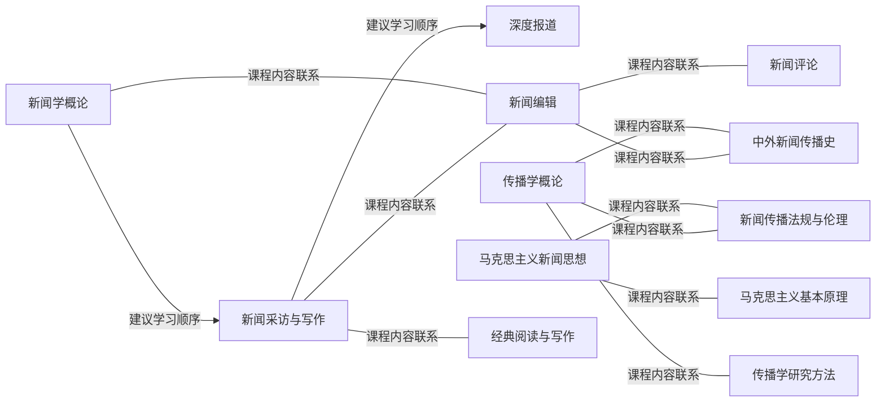

# 新闻学（望道新闻卓越班）专业“2+X”修读建议

2024 年汇编印刷页 338–339。原表记录 23 个可配对的课程代码。

[本节原页](plan-336.pdf#page=3) · [逐行数据](plan-336.json) · [院系目录](README.md)

## 课程关系图

图中展示最多 20 条关系。下表列出本节全部关系。建议学习顺序供规划课程使用，正式选课资格以教务规定为准。

| 课程 | 关联课程 | 关系 | 依据 |
| --- | --- | --- | --- |
| 新闻学概论（JOUR120008） | 新闻采访与写作（JOUR130019） | 建议学习顺序 | 新闻价值、事实核验与体裁概念可用于采访和写作。 |
| 新闻采访与写作（JOUR130019） | 深度报道（JOUR130166） | 建议学习顺序 | 采访与材料组织训练可用于展开和核查深度报道。 |
| 马克思主义新闻思想（JOUR120001） | 新闻传播法规与伦理（JOUR130252） | 课程内容联系 | 两课均涉及新闻责任和公共传播价值。 |
| 马克思主义新闻思想（JOUR120001） | 马克思主义基本原理（PTSS110087） | 课程内容联系 | 本方案两门课程的题名均含“马克思主义”，可据此对照这一主题。 |
| 新闻学概论（JOUR120008） | 新闻编辑（JOUR130284） | 课程内容联系 | 本方案两门课程的题名均含“新闻”，可据此对照这一主题。 |
| 传播学概论（JOUR120009） | 传播学研究方法（JOUR130040） | 课程内容联系 | 本方案两门课程的题名均含“传播”，可据此对照这一主题。 |
| 传播学概论（JOUR120009） | 新闻传播法规与伦理（JOUR130252） | 课程内容联系 | 本方案两门课程的题名均含“传播”，可据此对照这一主题。 |
| 传播学概论（JOUR120009） | 中外新闻传播史（JOUR130325） | 课程内容联系 | 本方案两门课程的题名均含“传播”，可据此对照这一主题。 |
| 新闻采访与写作（JOUR130019） | 新闻编辑（JOUR130284） | 课程内容联系 | 本方案两门课程的题名均含“新闻”，可据此对照这一主题。 |
| 新闻采访与写作（JOUR130019） | 经典阅读与写作（JOUR130329） | 课程内容联系 | 本方案两门课程的题名均含“写作”，可据此对照这一主题。 |
| 新闻编辑（JOUR130284） | 新闻评论（JOUR130285） | 课程内容联系 | 两课可围绕新闻判断、受众与公共表达比较。 |
| 新闻编辑（JOUR130284） | 中外新闻传播史（JOUR130325） | 课程内容联系 | 本方案两门课程的题名均含“新闻”，可据此对照这一主题。 |

## 课程

| 课程代码 | 名称 | 开课学期原文 | 来源（PDF 页） |
| --- | --- | --- | --- |
| JOUR120001 | 马克思主义新闻思想 |  | 352 |
| JOUR120008 | 新闻学概论 |  | 352 |
| JOUR120009 | 传播学概论 |  | 352 |
| JOUR130016 | 教学小实习 |  | 353 |
| JOUR130017 | 教学大实习 |  | 353 |
| JOUR130018 | 毕业论文 |  | 353 |
| JOUR130019 | 新闻采访与写作 |  | 352 |
| JOUR130040 | 传播学研究方法 |  | 353 |
| JOUR130166 | 深度报道 |  | 353 |
| JOUR130252 | 新闻传播法规与伦理 |  | 352 |
| JOUR130253 | 数据分析与信息可视化 |  | 352 |
| JOUR130282 | 口语表达 |  | 352 |
| JOUR130284 | 新闻编辑 |  | 352 |
| JOUR130285 | 新闻评论 |  | 353 |
| JOUR130321 | 记录中国——新闻学院学生暑期 |  | 353 |
| JOUR130325 | 中外新闻传播史 |  | 352 |
| JOUR130328 | 观察中国：热点新闻解析 |  | 353 |
| JOUR130329 | 经典阅读与写作 |  | 352 |
| PTSS110082 | 毛泽东思想和中国特色社会主义理论体系概论 |  | 352 |
| PTSS110087 | 马克思主义基本原理 |  | 352 |
| PTSS110088 | 中国近现代史纲要 |  | 352 |
| PTSS110089 | 思想道德与法治 |  | 352 |
| PTSS110090 | 习近平新时代中国特色社会主义思想概论 |  | 352 |
