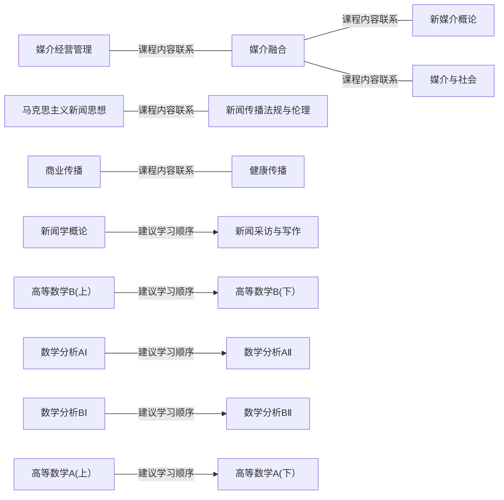

# 2023 广播电视学“2+X"教学培养方案（港澳台）

新闻学院 · 广播电视学 · 方案 73597 · 723 个不同课程或科研条目。

[官方 Word](https://github.com/pythonbug225/fudan-course-atlas/blob/research/schoolwide-cohorts-2023-2025/research/contributions/%E5%85%A8%E6%A0%A1%E5%9F%B9%E5%85%BB%E6%96%B9%E6%A1%882023-2025/%E5%B7%B2%E6%9C%89%E9%99%A2%E7%B3%BB%E8%A7%84%E8%8C%83%E6%95%B0%E6%8D%AE/%E6%96%B0%E9%97%BB%E5%AD%A6%E9%99%A2/2023/originals/plan-73597.docx) · [教务详情](https://fdjwgl.fudan.edu.cn/manager/bizType/2/major-program-search/info/73597?skipAuth=1) · [方案快照](https://github.com/pythonbug225/fudan-course-atlas/blob/research/schoolwide-cohorts-2023-2025/research/contributions/%E5%85%A8%E6%A0%A1%E5%9F%B9%E5%85%BB%E6%96%B9%E6%A1%882023-2025/%E5%B7%B2%E6%9C%89%E9%99%A2%E7%B3%BB%E8%A7%84%E8%8C%83%E6%95%B0%E6%8D%AE/%E6%96%B0%E9%97%BB%E5%AD%A6%E9%99%A2/2023/raw/plan-73597.json.gz) · [年级目录](https://github.com/pythonbug225/fudan-course-atlas/blob/research/schoolwide-cohorts-2023-2025/research/contributions/%E5%85%A8%E6%A0%A1%E5%9F%B9%E5%85%BB%E6%96%B9%E6%A1%882023-2025/%E5%B7%B2%E6%9C%89%E9%99%A2%E7%B3%BB%E8%A7%84%E8%8C%83%E6%95%B0%E6%8D%AE/%E6%96%B0%E9%97%BB%E5%AD%A6%E9%99%A2/2023/README.md)

## 修读导读

- **建议先学**　《新闻学概论》（`JCM10002`） → 《新闻采访与写作》（`JCM20012`）。新闻价值、事实核验与体裁概念可用于采访和写作。

- **可以对照着读**　《马克思主义新闻思想》（`JCM10001`）与《新闻传播法规与伦理》（`JCM30023`）。两课均涉及新闻责任和公共传播价值。

- **查模块选课**　《媒介经营管理》（`JCM30009`）、《教学小实习》（`JCM20011`）列在“专业基础课程”中。原表见 `/courseModules/11`。

## 课程关系图

图中展示部分关系。下表保留全部已建立的课程对，来源位置使用本方案 JSON Pointer。

## 先修与内容联系

| 类型 | 起点 | 终点 | 依据 | 原表定位 |
| --- | --- | --- | --- | --- |
| 建议学习顺序 | 艺术训练（一） (GEEC10104) | 艺术训练（二） (GEEC10105) | 同方案的课程题名具有连续分册或序号。  | `/courseModules/18/planCourses/26`、`/courseModules/18/planCourses/27` |
| 建议学习顺序 | 艺术训练（二） (GEEC10105) | 艺术训练（三） (GEEC10106) | 同方案的课程题名具有连续分册或序号。  | `/courseModules/18/planCourses/27`、`/courseModules/18/planCourses/28` |
| 建议学习顺序 | 艺术训练（三） (GEEC10106) | 艺术训练（四） (GEEC10107) | 同方案的课程题名具有连续分册或序号。  | `/courseModules/18/planCourses/28`、`/courseModules/18/planCourses/29` |
| 建议学习顺序 | 中国经济与社会讲座Ⅰ (GEIS30006) | 中国经济与社会讲座Ⅱ (GEIS30007) | 同方案的课程题名具有连续分册或序号。  | `/courseModules/24/planCourses/10`、`/courseModules/24/planCourses/11` |
| 建议学习顺序 | 新闻学概论 (JCM10002) | 新闻采访与写作 (JCM20012) | 新闻价值、事实核验与体裁概念可用于采访和写作。  | `/courseModules/7/planCourses/1`、`/courseModules/11/planCourses/4` |
| 建议学习顺序 | 高等数学B(上） (MATH10004) | 高等数学B(下） (MATH10005) | 同方案的课程题名具有连续分册或序号。  | `/courseModules/9/planCourses/0`、`/courseModules/9/planCourses/1` |
| 建议学习顺序 | 数学分析AⅠ (MATH10010) | 数学分析AⅡ (MATH10011) | 同方案的课程题名具有连续分册或序号。  | `/courseModules/9/planCourses/3`、`/courseModules/9/planCourses/4` |
| 建议学习顺序 | 数学分析BⅠ (MATH10012) | 数学分析BⅡ (MATH10013) | 同方案的课程题名具有连续分册或序号。  | `/courseModules/9/planCourses/5`、`/courseModules/9/planCourses/6` |
| 建议学习顺序 | 高等数学A(上） (MATH10015) | 高等数学A(下） (MATH10016) | 同方案的课程题名具有连续分册或序号。  | `/courseModules/9/planCourses/7`、`/courseModules/9/planCourses/8` |
| 课程内容联系 | 考古学导论 (ARCH10001) | 海洋考古学 (GEEC10279) | 本方案两门课程的题名均含“考古”，可据此对照这一主题。  | `/courseModules/8/planCourses/15`、`/courseModules/18/planCourses/109` |
| 课程内容联系 | 汉语写作 (CHIN00002) | 政策调研与写作 (GEXZ10024) | 本方案两门课程的题名均含“写作”，可据此对照这一主题。  | `/courseModules/18/planCourses/9`、`/courseModules/19/planCourses/70` |
| 课程内容联系 | 汉语写作 (CHIN00002) | 新闻采访与写作 (JCM20012) | 本方案两门课程的题名均含“写作”，可据此对照这一主题。  | `/courseModules/18/planCourses/9`、`/courseModules/11/planCourses/4` |
| 课程内容联系 | 汉语写作 (CHIN00002) | 研究设计与论文写作 (JCM50096) | 本方案两门课程的题名均含“写作”，可据此对照这一主题。  | `/courseModules/18/planCourses/9`、`/courseModules/14/planCourses/34` |
| 课程内容联系 | 汉语写作 (CHIN00002) | 科学写作 (PHYS40005) | 本方案两门课程的题名均含“写作”，可据此对照这一主题。  | `/courseModules/18/planCourses/9`、`/courseModules/20/planCourses/82` |
| 课程内容联系 | 中国文学传统 (CHIN10001) | 中国文学经典 (CHIN10005) | 经典文本与文学传统可从作品接受与文学演变联系。  | `/courseModules/8/planCourses/1`、`/courseModules/8/planCourses/6` |
| 课程内容联系 | 艺术人类学专题讲座 (CHIN110016) | 文化人类学 (PHIL110002) | 本方案两门课程的题名均含“人类学”，可据此对照这一主题。  | `/courseModules/18/planCourses/12`、`/courseModules/18/planCourses/112` |
| 课程内容联系 | 中国现代小说 (CHIN170001) | 欧美经典短篇小说赏析 (GEEC10151) | 本方案两门课程的题名均含“小说”，可据此对照这一主题。  | `/courseModules/24/planCourses/0`、`/courseModules/18/planCourses/42` |
| 课程内容联系 | 中国现代小说 (CHIN170001) | 英语短篇小说导读 (GEEC10156) | 本方案两门课程的题名均含“小说”，可据此对照这一主题。  | `/courseModules/24/planCourses/0`、`/courseModules/18/planCourses/50` |
| 课程内容联系 | 中国现代小说 (CHIN170001) | 英美悬疑短篇小说 (GEEC10160) | 本方案两门课程的题名均含“小说”，可据此对照这一主题。  | `/courseModules/24/planCourses/0`、`/courseModules/18/planCourses/60` |
| 课程内容联系 | 中国金融发展导论 (ECON110023) | 公司金融 (GEIS10019) | 本方案两门课程的题名均含“金融”，可据此对照这一主题。  | `/courseModules/19/planCourses/3`、`/courseModules/24/planCourses/51` |
| 课程内容联系 | 现代欧美戏剧名篇赏析 (FORE120009) | 莎士比亚戏剧与英国历史 (GEEC10182) | 本方案两门课程的题名均含“戏剧”，可据此对照这一主题。  | `/courseModules/8/planCourses/2`、`/courseModules/18/planCourses/86` |
| 课程内容联系 | 人类医学遗传学 (GEEC10034) | 遗传学经典与前沿 (XDSY118008) | 本方案两门课程的题名均含“遗传学”，可据此对照这一主题。  | `/courseModules/20/planCourses/16`、`/courseModules/22/planCourses/17` |
| 课程内容联系 | 中国古代文学名著赏析 (GEEC10041) | 古代文学选讲 (GEEC10048) | 本方案两门课程的题名均含“古代文学”，可据此对照这一主题。  | `/courseModules/18/planCourses/0`、`/courseModules/18/planCourses/8` |
| 课程内容联系 | 非物质文化遗产保护导论 (GEEC10058) | 文化遗产与我们 (GEFS10005) | 本方案两门课程的题名均含“文化遗产”，可据此对照这一主题。  | `/courseModules/18/planCourses/22`、`/courseModules/22/planCourses/6` |
| 课程内容联系 | 证券投资与技术分析 (GEEC10082) | 证券投资理论与实证分析 (GEEC10086) | 本方案两门课程的题名均含“证券”，可据此对照这一主题。  | `/courseModules/19/planCourses/2`、`/courseModules/19/planCourses/8` |
| 课程内容联系 | 国际金融与贸易 (GEEC10084) | 公司金融 (GEIS10019) | 本方案两门课程的题名均含“金融”，可据此对照这一主题。  | `/courseModules/19/planCourses/6`、`/courseModules/24/planCourses/51` |
| 课程内容联系 | 货币与金融市场 (GEEC10085) | 公司金融 (GEIS10019) | 本方案两门课程的题名均含“金融”，可据此对照这一主题。  | `/courseModules/19/planCourses/7`、`/courseModules/24/planCourses/51` |
| 课程内容联系 | 国际经济学 (GEEC10087) | 国际经济合同 (LAWS110009) | 本方案两门课程的题名均含“国际经济”，可据此对照这一主题。  | `/courseModules/19/planCourses/9`、`/courseModules/19/planCourses/13` |
| 课程内容联系 | 国际贸易与政治 (GEEC10088) | 国际贸易学 (GEIS30004) | 本方案两门课程的题名均含“国际贸易”，可据此对照这一主题。  | `/courseModules/19/planCourses/10`、`/courseModules/24/planCourses/8` |
| 课程内容联系 | 气候变化与能源 (GEEC10095) | 空气污染、气候变化与人体健康 (GEEC20051) | 本方案两门课程的题名均含“气候”，可据此对照这一主题。  | `/courseModules/20/planCourses/33`、`/courseModules/21/planCourses/78` |
| 课程内容联系 | 俄罗斯文学史与经典赏析 (GEEC10147) | 美国文学史选读 (GEEC10153) | 本方案两门课程的题名均含“文学史”，可据此对照这一主题。  | `/courseModules/18/planCourses/35`、`/courseModules/18/planCourses/45` |
| 课程内容联系 | 诺贝尔奖与光学 (GEEC10208) | 光学与现代生活 (INFO110051) | 本方案两门课程的题名均含“光学”，可据此对照这一主题。  | `/courseModules/20/planCourses/43`、`/courseModules/20/planCourses/42` |
| 课程内容联系 | 知识产权法 (GEEC10211) | 知识经济与知识产权管理 (GEEC10214) | 本方案两门课程的题名均含“知识产权”，可据此对照这一主题。  | `/courseModules/19/planCourses/12`、`/courseModules/19/planCourses/16` |
| 课程内容联系 | 知识产权法 (GEEC10211) | 中国知识产权法 (GEIS10018) | 本方案两门课程的题名均含“知识产权”，可据此对照这一主题。  | `/courseModules/19/planCourses/12`、`/courseModules/24/planCourses/47` |
| 课程内容联系 | 金融工程导论 (GEEC10222) | 公司金融 (GEIS10019) | 本方案两门课程的题名均含“金融”，可据此对照这一主题。  | `/courseModules/19/planCourses/24`、`/courseModules/24/planCourses/51` |
| 课程内容联系 | 市场营销导论 (GEEC10228) | 市场营销学 (JCM50035) | 本方案两门课程的题名均含“市场营销”，可据此对照这一主题。  | `/courseModules/19/planCourses/28`、`/courseModules/15/planCourses/19` |
| 课程内容联系 | 现代投资学 (GEEC10229) | 国际投资法 (GEIS10015) | 本方案两门课程的题名均含“投资”，可据此对照这一主题。  | `/courseModules/19/planCourses/29`、`/courseModules/24/planCourses/43` |
| 课程内容联系 | 外国商务投资 (GEEC10236) | 国际投资法 (GEIS10015) | 本方案两门课程的题名均含“投资”，可据此对照这一主题。  | `/courseModules/19/planCourses/36`、`/courseModules/24/planCourses/43` |
| 课程内容联系 | 人身伤害的法医学鉴定 (GEEC10261) | 简明法医学 (GEEC10263) | 本方案两门课程的题名均含“法医学”，可据此对照这一主题。  | `/courseModules/21/planCourses/3`、`/courseModules/21/planCourses/6` |
| 课程内容联系 | 大学生健康教育 (GEEC10264) | 性健康教育 (PHPM110031) | 本方案两门课程的题名均含“健康教育”，可据此对照这一主题。  | `/courseModules/21/planCourses/7`、`/courseModules/21/planCourses/69` |
| 课程内容联系 | 考古发现与探索 (GEEC10274) | 海洋考古学 (GEEC10279) | 本方案两门课程的题名均含“考古”，可据此对照这一主题。  | `/courseModules/18/planCourses/102`、`/courseModules/18/planCourses/109` |
| 课程内容联系 | 中国考古与文化 (GEEC10277) | 海洋考古学 (GEEC10279) | 本方案两门课程的题名均含“考古”，可据此对照这一主题。  | `/courseModules/18/planCourses/107`、`/courseModules/18/planCourses/109` |
| 课程内容联系 | 海洋考古学 (GEEC10279) | 中国的边界与海洋事务 (GEEC10376) | 本方案两门课程的题名均含“海洋”，可据此对照这一主题。  | `/courseModules/18/planCourses/109`、`/courseModules/19/planCourses/65` |
| 课程内容联系 | 大学生健康教育与健康管理 (GEEC10365) | 性健康教育 (PHPM110031) | 本方案两门课程的题名均含“健康教育”，可据此对照这一主题。  | `/courseModules/21/planCourses/97`、`/courseModules/21/planCourses/69` |
| 课程内容联系 | 高分子材料概论 (GEEC20020) | 功能高分子材料与器件漫谈 (MACR110012) | 本方案两门课程的题名均含“高分子”，可据此对照这一主题。  | `/courseModules/20/planCourses/44`、`/courseModules/20/planCourses/50` |
| 课程内容联系 | 症状护理学 (GEEC20039) | 实用老年护理学 (GEEC20040) | 本方案两门课程的题名均含“护理”，可据此对照这一主题。  | `/courseModules/21/planCourses/29`、`/courseModules/21/planCourses/30` |
| 课程内容联系 | 症状护理学 (GEEC20039) | 实用康复护理 (GEEC30009) | 本方案两门课程的题名均含“护理”，可据此对照这一主题。  | `/courseModules/21/planCourses/29`、`/courseModules/21/planCourses/31` |
| 课程内容联系 | 症状护理学 (GEEC20039) | 实用疼痛护理 (NURS110014) | 本方案两门课程的题名均含“护理”，可据此对照这一主题。  | `/courseModules/21/planCourses/29`、`/courseModules/21/planCourses/32` |
| 课程内容联系 | 药品经济与市场营销 (GEEC20046) | 市场营销学 (JCM50035) | 本方案两门课程的题名均含“市场营销”，可据此对照这一主题。  | `/courseModules/21/planCourses/63`、`/courseModules/15/planCourses/19` |
| 课程内容联系 | 生命伦理学 (GEEC20066) | 全球伦理学 (PHIL110018) | 本方案两门课程的题名均含“伦理学”，可据此对照这一主题。  | `/courseModules/18/planCourses/155`、`/courseModules/18/planCourses/126` |
| 课程内容联系 | 免疫学和社会学的对话 (GEFS10001) | 新闻社会学 (JCM50064) | 本方案两门课程的题名均含“社会学”，可据此对照这一主题。  | `/courseModules/22/planCourses/0`、`/courseModules/14/planCourses/19` |
| 课程内容联系 | 现代人类学 (GEFS10013) | 文化人类学 (PHIL110002) | 本方案两门课程的题名均含“人类学”，可据此对照这一主题。  | `/courseModules/22/planCourses/16`、`/courseModules/18/planCourses/112` |
| 课程内容联系 | 国际投资法 (GEIS10015) | 投资组合管理 (GEIS30011) | 本方案两门课程的题名均含“投资”，可据此对照这一主题。  | `/courseModules/24/planCourses/43`、`/courseModules/24/planCourses/20` |
| 课程内容联系 | 国际投资法 (GEIS10015) | 投资决策导论 (MANA170010) | 本方案两门课程的题名均含“投资”，可据此对照这一主题。  | `/courseModules/24/planCourses/43`、`/courseModules/24/planCourses/52` |
| 课程内容联系 | 市场营销基础 (GEIS20002) | 市场营销学 (JCM50035) | 本方案两门课程的题名均含“市场营销”，可据此对照这一主题。  | `/courseModules/24/planCourses/23`、`/courseModules/15/planCourses/19` |
| 课程内容联系 | 从公共卫生视角看心理健康 (GEMH20001) | 公共卫生应急与公众教育 (PHPM110055) | 本方案两门课程的题名均含“公共卫生”，可据此对照这一主题。  | `/courseModules/21/planCourses/96`、`/courseModules/21/planCourses/83` |
| 课程内容联系 | 马克思主义新闻思想 (JCM10001) | 新闻传播法规与伦理 (JCM30023) | 两课均涉及新闻责任和公共传播价值。  | `/courseModules/7/planCourses/0`、`/courseModules/11/planCourses/7` |
| 课程内容联系 | 新闻学概论 (JCM10002) | 新闻社会学 (JCM50064) | 本方案两门课程的题名均含“新闻”，可据此对照这一主题。  | `/courseModules/7/planCourses/1`、`/courseModules/14/planCourses/19` |
| 课程内容联系 | 新闻学概论 (JCM10002) | 新闻叙事分析 (JCM50069) | 本方案两门课程的题名均含“新闻”，可据此对照这一主题。  | `/courseModules/7/planCourses/1`、`/courseModules/14/planCourses/24` |
| 课程内容联系 | 新闻学概论 (JCM10002) | 新闻作品评析 (JCM50099) | 本方案两门课程的题名均含“新闻”，可据此对照这一主题。  | `/courseModules/7/planCourses/1`、`/courseModules/14/planCourses/35` |
| 课程内容联系 | 新闻学概论 (JCM10002) | 新闻与全球化 (JCM50103) | 本方案两门课程的题名均含“新闻”，可据此对照这一主题。  | `/courseModules/7/planCourses/1`、`/courseModules/14/planCourses/38` |
| 课程内容联系 | 商业传播 (JCM20026) | 健康传播 (JCM50041) | 本方案两门课程的题名均含“传播”，可据此对照这一主题。  | `/courseModules/11/planCourses/11`、`/courseModules/15/planCourses/0` |
| 课程内容联系 | 媒介经营管理 (JCM30009) | 媒介融合 (JCM30020) | 本方案两门课程的题名均含“媒介”，可据此对照这一主题。  | `/courseModules/11/planCourses/0`、`/courseModules/11/planCourses/6` |
| 课程内容联系 | 媒介融合 (JCM30020) | 媒介与社会 (JCM50063) | 本方案两门课程的题名均含“媒介”，可据此对照这一主题。  | `/courseModules/11/planCourses/6`、`/courseModules/14/planCourses/18` |
| 课程内容联系 | 媒介融合 (JCM30020) | 移动媒介产品设计 (JCM50065) | 本方案两门课程的题名均含“媒介”，可据此对照这一主题。  | `/courseModules/11/planCourses/6`、`/courseModules/14/planCourses/20` |
| 课程内容联系 | 媒介融合 (JCM30020) | 新媒介概论 (JCM50072) | 本方案两门课程的题名均含“媒介”，可据此对照这一主题。  | `/courseModules/11/planCourses/6`、`/courseModules/11/planCourses/9` |
| 课程内容联系 | 政治传播 (JCM50039) | 健康传播 (JCM50041) | 本方案两门课程的题名均含“传播”，可据此对照这一主题。  | `/courseModules/15/planCourses/2`、`/courseModules/15/planCourses/0` |
| 课程内容联系 | 健康传播 (JCM50041) | 环境传播 (JCM50043) | 本方案两门课程的题名均含“传播”，可据此对照这一主题。  | `/courseModules/15/planCourses/0`、`/courseModules/15/planCourses/1` |
| 课程内容联系 | 健康传播 (JCM50041) | 危机传播 (JCM50081) | 本方案两门课程的题名均含“传播”，可据此对照这一主题。  | `/courseModules/15/planCourses/0`、`/courseModules/15/planCourses/20` |
| 课程内容联系 | 新闻社会学 (JCM50064) | 社会学导论 (SOCI20001) | 本方案两门课程的题名均含“社会学”，可据此对照这一主题。  | `/courseModules/14/planCourses/19`、`/courseModules/9/planCourses/11` |
| 课程内容联系 | 视听广告创作 (JCM50084) | 广告与社会 (JCM50091) | 本方案两门课程的题名均含“广告”，可据此对照这一主题。  | `/courseModules/15/planCourses/17`、`/courseModules/15/planCourses/13` |
| 课程内容联系 | 近现代广告史 (JCM50090) | 广告与社会 (JCM50091) | 本方案两门课程的题名均含“广告”，可据此对照这一主题。  | `/courseModules/15/planCourses/12`、`/courseModules/15/planCourses/13` |
| 课程内容联系 | 广告与社会 (JCM50091) | 数字音频广告 (JCM50100) | 本方案两门课程的题名均含“广告”，可据此对照这一主题。  | `/courseModules/15/planCourses/13`、`/courseModules/15/planCourses/21` |
| 课程内容联系 | 广告与社会 (JCM50091) | 电子商务广告 (MANA116003) | 本方案两门课程的题名均含“广告”，可据此对照这一主题。  | `/courseModules/15/planCourses/13`、`/courseModules/19/planCourses/33` |
| 课程内容联系 | 法理学导论 (LAW10004) | 宪法 (LAW10005) | 两课均涉及权利与公共权力的规范依据。  | `/courseModules/9/planCourses/12`、`/courseModules/9/planCourses/24` |
| 课程内容联系 | 法医人类学 (MED110003) | 文化人类学 (PHIL110002) | 本方案两门课程的题名均含“人类学”，可据此对照这一主题。  | `/courseModules/21/planCourses/0`、`/courseModules/18/planCourses/112` |
| 课程内容联系 | 光影传奇-医学影像史话 (MED110064) | 光影传奇—医学影像史话 (MED110072) | 本方案两门课程的题名均含“医学影像”，可据此对照这一主题。  | `/courseModules/21/planCourses/20`、`/courseModules/21/planCourses/24` |
| 课程内容联系 | 哲学导论 (PHIL10002) | 逻辑学 (PHIL10003) | 论证与概念分析是哲学讨论的共同方法。  | `/courseModules/8/planCourses/20`、`/courseModules/8/planCourses/21` |
| 课程内容联系 | 中国传统政治哲学——先秦 (PHIL110036) | 中国政治哲学 (PHIL170005) | 本方案两门课程的题名均含“政治哲学”，可据此对照这一主题。  | `/courseModules/18/planCourses/138`、`/courseModules/24/planCourses/64` |
| 课程内容联系 | 中国传统政治哲学-先秦 (PHIL170003) | 中国政治哲学 (PHIL170005) | 本方案两门课程的题名均含“政治哲学”，可据此对照这一主题。  | `/courseModules/24/planCourses/62`、`/courseModules/24/planCourses/64` |

本次未从可定位的明确表述中确认课程对课程预修。学期安排、系列分册与编辑建议均保留各自的依据。

## 按原方案模块阅读

同一模块展示原表中的课程归属。模块内课程之间的先后仍须逐项查阅。

- **人文类基础课程（必修）**　马克思主义新闻思想、新闻学概论、传播学概论（原表模块 7）
- **人文类基础课程（选修）**　考古学导论、中国文学传统、美学、现代文艺赏析、汉语概论、中国文学经典、语言与文化、中国古代工艺美术、中国文字源流、语言学导论、世界文学导读、美国历史与文化、现代欧美戏剧名篇赏析、史学原典导读、世界文明史通论、近代中国社会研究、中国古代文明、近代的世界等24项（原表模块 8）
- **社会科学类基础课程**　会计学、管理学导论、微观经济学、宏观经济学、经济学原理、政治经济学、微观经济学原理、宏观经济学原理、法理学导论、宪法、经济法、公共行政学、高等数学B(上）、高等数学B(下）、高等数学D、数学分析AⅠ、数学分析AⅡ、数学分析BⅠ等31项（原表模块 9）
- **专业基础课程**　中国新闻传播史、教学小实习、新闻采访与写作、口语表达、商业传播、视听传播、媒介经营管理、媒介融合、新闻传播法规与伦理、数据分析与信息可视化、教学大实习、毕业论文、新媒介概论（原表模块 11）
- **人文科学与艺术**　大学语文、汉语写作、跨媒体艺术、艺术人类学专题讲座、文学与人生、语音科学与现代生活、修辞的认知鉴赏、世界文学导读、英语文学选读、童话解读、德国当代社会掠影及思考、英美诗歌导读、英美现代主义文学、希腊文化，神话和哲学、全球化与英语传播、德奥世纪末文化研究、西班牙黄金世纪文学、丹麦社会政治概况等157项（原表模块 18）
- **社会科学与行为科学**　中国金融发展导论、公共经济与社会保障、人口、资源、环境与经济发展、外国经济思潮、证券投资与技术分析、国际金融、国际金融与贸易、货币与金融市场、证券投资理论与实证分析、国际经济学、国际贸易与政治、婚姻家庭法、知识产权法、外国行政法、合同法的理论与实践、知识经济与知识产权管理、交易法律制度、法治社会的公民权利等111项（原表模块 19）
- **自然科学**　普通生物学实验、CAD工程设计、大气科学漫谈、脑信息处理、生命的科学、现代药物与疾病治疗、应用系统生物学前沿、遗传与疾病、生理与健康、免疫与人类健康、脑科学概论、改变生活的生物技术、生命的基石：细胞概论、寄生虫与寄生虫病、医学史与转化医学、生命世界、生活中的微生物、人类医学遗传学等90项（原表模块 20）
- **医学与药学**　昆虫与健康、人身伤害的法医学鉴定、毒物分析、简明法医学、大学生健康教育、创伤与急救、信息素养与科学发现、睡眠与健康、女性健康与保健、旅行中的医学、显微镜下的生命奥秘、人文与医学、药学概论、医药微生物学、药学服务与健康、药物剂型与疾病治疗、脑健康科学、纳米医学与健康等99项（原表模块 21）
- **新生研讨课**　免疫学和社会学的对话、大学生健康素养及促进、语言科学、分配正义论、文化遗产与我们、生活中的材料启示、音乐科技导论、集成电路设计透视、人体信息建模与计算机仿真、生命、医学与材料、半导体的昨天、今天和明天、经典与前沿：细胞生物学、现代人类学、探索大脑、DNA数据的浅析与应用、跨入科学研究之门——计算机应用、疾病中的生命科学、人类与社会多元文化探讨等23项（原表模块 22）
- **服务学习课程**　生态文明的理论与实践、艺术与创造力（陶艺）、古村落的保护与开发、原本性音乐教育与社区服务、油画风景写生、多声部声乐实践、植物标本的艺术创作、视觉艺术现场研究、虚拟现实艺术与在地创新、智能芯片与社会、科技与伦理的追问、政策调研与写作、当代中国教育与社会发展、社会创新与设计思维、艺术与心灵、科技服务创新与智慧养老、计算思维与信息素养、医疗救治与人文关怀等20项（原表模块 23）
- **暑期国际课程**　中国现代小说、中国文学简介、中国艺术精神、动态的中国经济、中国外贸改革与发展、能源与环境经济学—理论与中国实践、中国商务、信息系统、中国和全球化、经济研究和政策分析的实证方法、组织行为学、财务制表、金融服务伦理及治理、数量风险管理、能源与环境、英国文学名篇选讲、儒学英文名著选读、中国的政治与外交等80项（原表模块 24）

## 课程表

同一课程在不同模块分别出现时，按原表逐行列出。季节字段保留原值。

| 课程 | 代码 | 学分 | 学期 | 模块 |
| --- | --- | ---: | --- | --- |
| 马克思主义新闻思想 | JCM10001 | 2.0 | SPRING、AUTUMN | 培养方案 / 专业培养课程 / 大类基础课程 / 人文类基础课程 / 人文类基础课程（必修） |
| 新闻学概论 | JCM10002 | 2.0 | SPRING、AUTUMN | 培养方案 / 专业培养课程 / 大类基础课程 / 人文类基础课程 / 人文类基础课程（必修） |
| 传播学概论 | JCM10003 | 2.0 | SPRING、AUTUMN | 培养方案 / 专业培养课程 / 大类基础课程 / 人文类基础课程 / 人文类基础课程（必修） |
| 美国历史与文化 | FORE120007 | 2.0 | SPRING、AUTUMN | 培养方案 / 专业培养课程 / 大类基础课程 / 人文类基础课程 / 人文类基础课程（选修） |
| 中国文学传统 | CHIN10001 | 2.0 | SPRING、AUTUMN | 培养方案 / 专业培养课程 / 大类基础课程 / 人文类基础课程 / 人文类基础课程（选修） |
| 现代欧美戏剧名篇赏析 | FORE120009 | 2.0 | SPRING、AUTUMN | 培养方案 / 专业培养课程 / 大类基础课程 / 人文类基础课程 / 人文类基础课程（选修） |
| 美学 | CHIN10002 | 2.0 | SPRING、AUTUMN | 培养方案 / 专业培养课程 / 大类基础课程 / 人文类基础课程 / 人文类基础课程（选修） |
| 现代文艺赏析 | CHIN10003 | 2.0 | SPRING、AUTUMN | 培养方案 / 专业培养课程 / 大类基础课程 / 人文类基础课程 / 人文类基础课程（选修） |
| 汉语概论 | CHIN10004 | 2.0 | SPRING、AUTUMN | 培养方案 / 专业培养课程 / 大类基础课程 / 人文类基础课程 / 人文类基础课程（选修） |
| 中国文学经典 | CHIN10005 | 3.0 | SPRING、AUTUMN | 培养方案 / 专业培养课程 / 大类基础课程 / 人文类基础课程 / 人文类基础课程（选修） |
| 语言与文化 | CHIN10006 | 2.0 | SPRING、AUTUMN | 培养方案 / 专业培养课程 / 大类基础课程 / 人文类基础课程 / 人文类基础课程（选修） |
| 语言学导论 | FORE10005 | 2.0 | SPRING、AUTUMN | 培养方案 / 专业培养课程 / 大类基础课程 / 人文类基础课程 / 人文类基础课程（选修） |
| 世界文学导读 | FORE10006 | 2.0 | SPRING、AUTUMN | 培养方案 / 专业培养课程 / 大类基础课程 / 人文类基础课程 / 人文类基础课程（选修） |
| 史学原典导读 | HIST10003 | 2.0 | SPRING、AUTUMN | 培养方案 / 专业培养课程 / 大类基础课程 / 人文类基础课程 / 人文类基础课程（选修） |
| 世界文明史通论 | HIST10004 | 2.0 | SPRING、AUTUMN | 培养方案 / 专业培养课程 / 大类基础课程 / 人文类基础课程 / 人文类基础课程（选修） |
| 近代中国社会研究 | HIST10005 | 2.0 | SPRING、AUTUMN | 培养方案 / 专业培养课程 / 大类基础课程 / 人文类基础课程 / 人文类基础课程（选修） |
| 近代的世界 | HIST120010 | 2.0 | SPRING、AUTUMN | 培养方案 / 专业培养课程 / 大类基础课程 / 人文类基础课程 / 人文类基础课程（选修） |
| 中国古代文明 | HIST10006 | 3.0 | SPRING、AUTUMN | 培养方案 / 专业培养课程 / 大类基础课程 / 人文类基础课程 / 人文类基础课程（选修） |
| 考古学导论 | ARCH10001 | 2.0 | AUTUMN | 培养方案 / 专业培养课程 / 大类基础课程 / 人文类基础课程 / 人文类基础课程（选修） |
| 中国古代工艺美术 | CULT10001 | 2.0 | SPRING、AUTUMN | 培养方案 / 专业培养课程 / 大类基础课程 / 人文类基础课程 / 人文类基础课程（选修） |
| 中国文字源流 | CULT10002 | 2.0 | SPRING、AUTUMN | 培养方案 / 专业培养课程 / 大类基础课程 / 人文类基础课程 / 人文类基础课程（选修） |
| 基督教哲学 | PHIL120005 | 2.0 | SPRING、AUTUMN | 培养方案 / 专业培养课程 / 大类基础课程 / 人文类基础课程 / 人文类基础课程（选修） |
| 佛教哲学 | PHIL120006 | 2.0 | SPRING、AUTUMN | 培养方案 / 专业培养课程 / 大类基础课程 / 人文类基础课程 / 人文类基础课程（选修） |
| 哲学导论 | PHIL10002 | 3.0 | SPRING、AUTUMN | 培养方案 / 专业培养课程 / 大类基础课程 / 人文类基础课程 / 人文类基础课程（选修） |
| 逻辑学 | PHIL10003 | 3.0 | SPRING、AUTUMN | 培养方案 / 专业培养课程 / 大类基础课程 / 人文类基础课程 / 人文类基础课程（选修） |
| 先秦哲学 | PHIL120014 | 2.0 | SPRING、AUTUMN | 培养方案 / 专业培养课程 / 大类基础课程 / 人文类基础课程 / 人文类基础课程（选修） |
| 宗教学导论 | PHIL10004 | 2.0 | SPRING、AUTUMN | 培养方案 / 专业培养课程 / 大类基础课程 / 人文类基础课程 / 人文类基础课程（选修） |
| 高等数学B(上） | MATH10004 | 5.0 | SPRING、AUTUMN | 培养方案 / 专业培养课程 / 大类基础课程 / 社会科学类基础课程 |
| 高等数学B(下） | MATH10005 | 5.0 | SPRING、AUTUMN | 培养方案 / 专业培养课程 / 大类基础课程 / 社会科学类基础课程 |
| 高等数学D | MATH10008 | 4.0 | AUTUMN | 培养方案 / 专业培养课程 / 大类基础课程 / 社会科学类基础课程 |
| 数学分析AⅠ | MATH10010 | 5.0 | SPRING、AUTUMN | 培养方案 / 专业培养课程 / 大类基础课程 / 社会科学类基础课程 |
| 数学分析AⅡ | MATH10011 | 5.0 | SPRING、AUTUMN | 培养方案 / 专业培养课程 / 大类基础课程 / 社会科学类基础课程 |
| 数学分析BⅠ | MATH10012 | 5.0 | SPRING、AUTUMN | 培养方案 / 专业培养课程 / 大类基础课程 / 社会科学类基础课程 |
| 数学分析BⅡ | MATH10013 | 5.0 | SPRING、AUTUMN | 培养方案 / 专业培养课程 / 大类基础课程 / 社会科学类基础课程 |
| 高等数学A(上） | MATH10015 | 5.0 | SPRING、AUTUMN | 培养方案 / 专业培养课程 / 大类基础课程 / 社会科学类基础课程 |
| 高等数学A(下） | MATH10016 | 5.0 | SPRING、AUTUMN | 培养方案 / 专业培养课程 / 大类基础课程 / 社会科学类基础课程 |
| 线性代数 | MATH10017 | 3.0 | SPRING、AUTUMN | 培养方案 / 专业培养课程 / 大类基础课程 / 社会科学类基础课程 |
| 政治学原理 | POLI10007 | 3.0 | SPRING、AUTUMN | 培养方案 / 专业培养课程 / 大类基础课程 / 社会科学类基础课程 |
| 社会学导论 | SOCI20001 | 3.0 | SPRING、AUTUMN | 培养方案 / 专业培养课程 / 大类基础课程 / 社会科学类基础课程 |
| 法理学导论 | LAW10004 | 3.0 | SPRING、AUTUMN | 培养方案 / 专业培养课程 / 大类基础课程 / 社会科学类基础课程 |
| 微观经济学 | ECON20003 | 3.0 | 第2学期 | 培养方案 / 专业培养课程 / 大类基础课程 / 社会科学类基础课程 |
| 宏观经济学 | ECON20004 | 3.0 | 第3学期 | 培养方案 / 专业培养课程 / 大类基础课程 / 社会科学类基础课程 |
| 会计学 | BA10003 | 3.0 | SPRING、AUTUMN | 培养方案 / 专业培养课程 / 大类基础课程 / 社会科学类基础课程 |
| 经济学原理 | ECON20005 | 3.0 | SPRING、AUTUMN | 培养方案 / 专业培养课程 / 大类基础课程 / 社会科学类基础课程 |
| 政治经济学 | ECON20006 | 3.0 | SPRING、AUTUMN | 培养方案 / 专业培养课程 / 大类基础课程 / 社会科学类基础课程 |
| 社会研究方法A | SOCI20002 | 3.0 | SPRING、AUTUMN | 培养方案 / 专业培养课程 / 大类基础课程 / 社会科学类基础课程 |
| 社会研究方法B | MSE30029 | 3.0 | SPRING、AUTUMN | 培养方案 / 专业培养课程 / 大类基础课程 / 社会科学类基础课程 |
| 国际关系导论 | POLI10008 | 3.0 | SPRING、AUTUMN | 培养方案 / 专业培养课程 / 大类基础课程 / 社会科学类基础课程 |
| 社会工作导论 | SWK20002 | 3.0 | SPRING、AUTUMN | 培养方案 / 专业培养课程 / 大类基础课程 / 社会科学类基础课程 |
| 心理学导论 | PSYC20001 | 3.0 | SPRING、AUTUMN | 培养方案 / 专业培养课程 / 大类基础课程 / 社会科学类基础课程 |
| 管理学导论 | BA10004 | 3.0 | SPRING、AUTUMN | 培养方案 / 专业培养课程 / 大类基础课程 / 社会科学类基础课程 |
| 宪法 | LAW10005 | 3.0 | SPRING、AUTUMN | 培养方案 / 专业培养课程 / 大类基础课程 / 社会科学类基础课程 |
| 经济法 | LAW20011 | 3.0 | SPRING、AUTUMN | 培养方案 / 专业培养课程 / 大类基础课程 / 社会科学类基础课程 |
| 统计学 | SOCI20003 | 3.0 | SPRING、AUTUMN | 培养方案 / 专业培养课程 / 大类基础课程 / 社会科学类基础课程 |
| 公共行政学 | MANA10002 | 3.0 | SPRING、AUTUMN | 培养方案 / 专业培养课程 / 大类基础课程 / 社会科学类基础课程 |
| 当代中国政治制度 | POLI10009 | 3.0 | SPRING、AUTUMN | 培养方案 / 专业培养课程 / 大类基础课程 / 社会科学类基础课程 |
| 微观经济学原理 | ECON20007 | 5.0 | 第1学期 | 培养方案 / 专业培养课程 / 大类基础课程 / 社会科学类基础课程 |
| 宏观经济学原理 | ECON20008 | 5.0 | 第2学期 | 培养方案 / 专业培养课程 / 大类基础课程 / 社会科学类基础课程 |
| 媒介经营管理 | JCM30009 | 2.0 | 第5学期、第6学期 | 培养方案 / 专业培养课程 / 专业核心教育课程 / 专业基础课程 |
| 教学小实习 | JCM20011 | 2.0 | 第4学期 | 培养方案 / 专业培养课程 / 专业核心教育课程 / 专业基础课程 |
| 教学大实习 | JCM40002 | 4.0 | 第7学期 | 培养方案 / 专业培养课程 / 专业核心教育课程 / 专业基础课程 |
| 毕业论文 | JCM40003 | 4.0 | 第8学期 | 培养方案 / 专业培养课程 / 专业核心教育课程 / 专业基础课程 |
| 新闻采访与写作 | JCM20012 | 3.0 | 第2学期、第3学期 | 培养方案 / 专业培养课程 / 专业核心教育课程 / 专业基础课程 |
| 中国新闻传播史 | JCM10004 | 3.0 | 第2学期、第3学期 | 培养方案 / 专业培养课程 / 专业核心教育课程 / 专业基础课程 |
| 媒介融合 | JCM30020 | 3.0 | 第5学期、第6学期 | 培养方案 / 专业培养课程 / 专业核心教育课程 / 专业基础课程 |
| 新闻传播法规与伦理 | JCM30023 | 3.0 | 第5学期、第6学期 | 培养方案 / 专业培养课程 / 专业核心教育课程 / 专业基础课程 |
| 数据分析与信息可视化 | JCM30024 | 3.0 | 第5学期、第6学期 | 培养方案 / 专业培养课程 / 专业核心教育课程 / 专业基础课程 |
| 新媒介概论 | JCM50072 | 2.0 | 第3学期、第4学期 | 培养方案 / 专业培养课程 / 专业核心教育课程 / 专业基础课程 |
| 口语表达 | JCM20025 | 3.0 | 第3学期、第4学期 | 培养方案 / 专业培养课程 / 专业核心教育课程 / 专业基础课程 |
| 商业传播 | JCM20026 | 3.0 | 第3学期、第4学期 | 培养方案 / 专业培养课程 / 专业核心教育课程 / 专业基础课程 |
| 视听传播 | JCM20032 | 3.0 | 第2学期、第3学期 | 培养方案 / 专业培养课程 / 专业核心教育课程 / 专业基础课程 |
| 视听技术与应用 | JCM20020 | 4.0 | 第3学期 | 培养方案 / 专业培养课程 / 专业核心教育课程 / 专业必修课程 |
| 纪录片理论与实践 | JCM30025 | 3.0 | 第6学期 | 培养方案 / 专业培养课程 / 专业核心教育课程 / 专业必修课程 |
| 视听史论 | JCM20029 | 2.0 | 第4学期 | 培养方案 / 专业培养课程 / 专业核心教育课程 / 专业必修课程 |
| 影像编辑 | JCM20030 | 3.0 | 第4学期 | 培养方案 / 专业培养课程 / 专业核心教育课程 / 专业必修课程 |
| 视听新闻生产 | JCM20031 | 3.0 | 第3学期 | 培养方案 / 专业培养课程 / 专业核心教育课程 / 专业必修课程 |
| 视听节目构成 | JCM30027 | 3.0 | 第5学期 | 培养方案 / 专业培养课程 / 专业核心教育课程 / 专业必修课程 |
| 对外报道 | JCM50031 | 2.0 | SPRING、AUTUMN | 培养方案 / 专业进阶模块I |
| 视听实务工作坊 | JCM50078 | 1.0 | SPRING、AUTUMN | 培养方案 / 专业进阶模块I |
| 视听实务工作坊 | JCM50098 | 2.0 | SPRING、AUTUMN | 培养方案 / 专业进阶模块I |
| 影视艺术 | JCM50033 | 2.0 | SPRING、AUTUMN | 培养方案 / 专业进阶模块I |
| 大众传媒与文化 | JCM50036 | 2.0 | SPRING、AUTUMN | 培养方案 / 专业进阶模块I |
| 英文报刊选读 | JCM50037 | 2.0 | SPRING、AUTUMN | 培养方案 / 专业进阶模块I |
| 广电制度与政策法规 | JCM50038 | 2.0 | SPRING、AUTUMN | 培养方案 / 专业进阶模块I |
| 动画赏析 | JCM50042 | 2.0 | SPRING、AUTUMN | 培养方案 / 专业进阶模块I |
| 新闻传播理论经典导读 | JCM50045 | 2.0 | SPRING、AUTUMN | 培养方案 / 专业进阶模块I |
| 娱乐报道和娱乐节目 | JCM50050 | 2.0 | SPRING、AUTUMN | 培养方案 / 专业进阶模块I |
| 视听节目策划 | JCM50051 | 3.0 | SPRING、AUTUMN | 培养方案 / 专业进阶模块I |
| 数据与财经新闻 | JCM50054 | 3.0 | SPRING、AUTUMN | 培养方案 / 专业进阶模块I |
| 计算机仿生传播 | JCM50055 | 2.0 | SPRING、AUTUMN | 培养方案 / 专业进阶模块I |
| 新媒体专题研究 | JCM50057 | 2.0 | SPRING、AUTUMN | 培养方案 / 专业进阶模块I |
| 影视工作室 | JCM50058 | 3.0 | SPRING、AUTUMN | 培养方案 / 专业进阶模块I |
| 纪录片创作 | JCM50059 | 3.0 | SPRING、AUTUMN | 培养方案 / 专业进阶模块I |
| 新读写 | JCM50061 | 3.0 | SPRING、AUTUMN | 培养方案 / 专业进阶模块I |
| 都市、田野调查与纪录 | JCM50062 | 4.0 | SPRING、AUTUMN | 培养方案 / 专业进阶模块I |
| 媒介与社会 | JCM50063 | 2.0 | SPRING、AUTUMN | 培养方案 / 专业进阶模块I |
| 新闻社会学 | JCM50064 | 2.0 | SPRING、AUTUMN | 培养方案 / 专业进阶模块I |
| 移动媒介产品设计 | JCM50065 | 2.0 | SPRING、AUTUMN | 培养方案 / 专业进阶模块I |
| 新媒体与社会性别 | JCM50066 | 2.0 | SPRING、AUTUMN | 培养方案 / 专业进阶模块I |
| 数字城市传播 | JCM50067 | 2.0 | SPRING、AUTUMN | 培养方案 / 专业进阶模块I |
| 新闻传播民族志 | JCM50068 | 2.0 | SPRING、AUTUMN | 培养方案 / 专业进阶模块I |
| 新闻叙事分析 | JCM50069 | 2.0 | SPRING、AUTUMN | 培养方案 / 专业进阶模块I |
| 视觉与审美通论 | JCM50070 | 3.0 | SPRING、AUTUMN | 培养方案 / 专业进阶模块I |
| 网络视听文化 | JCM50071 | 2.0 | SPRING、AUTUMN | 培养方案 / 专业进阶模块I |
| 视听大数据计算传播 | JCM50075 | 2.0 | SPRING、AUTUMN | 培养方案 / 专业进阶模块I |
| 出镜报道与新闻主持 | JCM50076 | 3.0 | SPRING、AUTUMN | 培养方案 / 专业进阶模块I |
| 融合直播实务 | JCM50077 | 3.0 | SPRING、AUTUMN | 培养方案 / 专业进阶模块I |
| 新媒体艺术与智能生成传播 | JCM50082 | 2.0 | SPRING、AUTUMN | 培养方案 / 专业进阶模块I |
| 纪实摄影工作室 | JCM50083 | 3.0 | SPRING、AUTUMN | 培养方案 / 专业进阶模块I |
| 剧本创作与视听实务评论 | JCM50087 | 3.0 | SPRING、AUTUMN | 培养方案 / 专业进阶模块I |
| 事实与事实核查 | JCM50092 | 3.0 | SPRING、AUTUMN | 培养方案 / 专业进阶模块I |
| 研究设计与论文写作 | JCM50096 | 3.0 | SPRING、AUTUMN | 培养方案 / 专业进阶模块I |
| 新闻作品评析 | JCM50099 | 2.0 | SPRING、AUTUMN | 培养方案 / 专业进阶模块I |
| 记录中国——新闻学院学生暑期专业实践 | JCM50101 | 2.0 | SPRING、AUTUMN | 培养方案 / 专业进阶模块I |
| 数字出版 | JCM50102 | 3.0 | SPRING、AUTUMN | 培养方案 / 专业进阶模块I |
| 新闻与全球化 | JCM50103 | 2.0 | SPRING、AUTUMN | 培养方案 / 专业进阶模块I |
| 重大历史事件报道解析 | JCM50104 | 2.0 | SPRING、AUTUMN | 培养方案 / 专业进阶模块I |
| 新时代中国共产党新闻工作理论 | JCM50109 | 2.0 | SPRING、AUTUMN | 培养方案 / 专业进阶模块I |
| 智能视频制作实务 | JCM50110 | 1.0 | SPRING、AUTUMN | 培养方案 / 专业进阶模块I |
| 习近平文化思想概论 | JCM40005 | 2.0 | SPRING、AUTUMN | 培养方案 / 专业进阶模块I |
| 数字出版 | JCM50048 | 2.0 | SPRING、AUTUMN | 培养方案 / 专业进阶模块I |
| 健康传播 | JCM50041 | 2.0 | SPRING、AUTUMN | 培养方案 / 专业进阶模块II |
| 环境传播 | JCM50043 | 2.0 | SPRING、AUTUMN | 培养方案 / 专业进阶模块II |
| 政治传播 | JCM50039 | 2.0 | SPRING、AUTUMN | 培养方案 / 专业进阶模块II |
| 中外传播思想 | JCM50052 | 2.0 | SPRING、AUTUMN | 培养方案 / 专业进阶模块II |
| 说服与传播运动设计 | JCM50044 | 2.0 | SPRING、AUTUMN | 培养方案 / 专业进阶模块II |
| 传播研究前沿文献选读 | JCM50088 | 2.0 | SPRING、AUTUMN | 培养方案 / 专业进阶模块II |
| 社交媒体传播分析 | JCM50060 | 2.0 | SPRING、AUTUMN | 培养方案 / 专业进阶模块II |
| 认知传播 | JCM50097 | 2.0 | SPRING、AUTUMN | 培养方案 / 专业进阶模块II |
| 计算与智能传播 | JCM50074 | 2.0 | SPRING、AUTUMN | 培养方案 / 专业进阶模块II |
| 新媒体技术与传播 | JCM50093 | 2.0 | SPRING、AUTUMN | 培养方案 / 专业进阶模块II |
| 数字媒介产品营销传播 | JCM50094 | 2.0 | SPRING、AUTUMN | 培养方案 / 专业进阶模块II |
| 传播理论与历史 | JCM50089 | 2.0 | SPRING、AUTUMN | 培养方案 / 专业进阶模块II |
| 近现代广告史 | JCM50090 | 2.0 | SPRING、AUTUMN | 培养方案 / 专业进阶模块II |
| 广告与社会 | JCM50091 | 2.0 | SPRING、AUTUMN | 培养方案 / 专业进阶模块II |
| 促销、宣传与表现 | JCM50053 | 2.0 | SPRING、AUTUMN | 培养方案 / 专业进阶模块II |
| 品牌形象塑造 | JCM50079 | 2.0 | SPRING、AUTUMN | 培养方案 / 专业进阶模块II |
| 商业摄影 | JCM50080 | 2.0 | SPRING、AUTUMN | 培养方案 / 专业进阶模块II |
| 视听广告创作 | JCM50084 | 2.0 | SPRING、AUTUMN | 培养方案 / 专业进阶模块II |
| 美术与插画工作室 | JCM50085 | 2.0 | SPRING、AUTUMN | 培养方案 / 专业进阶模块II |
| 市场营销学 | JCM50035 | 2.0 | SPRING、AUTUMN | 培养方案 / 专业进阶模块II |
| 危机传播 | JCM50081 | 2.0 | SPRING、AUTUMN | 培养方案 / 专业进阶模块II |
| 数字音频广告 | JCM50100 | 2.0 | SPRING、AUTUMN | 培养方案 / 专业进阶模块II |
| 信息互动设计 | JCM50095 | 2.0 | SPRING、AUTUMN | 培养方案 / 专业进阶模块II |
| 整合营销传播 | JCM50034 | 2.0 | SPRING、AUTUMN | 培养方案 / 专业进阶模块II |
| 品牌策略传播 | JCM50086 | 2.0 | SPRING、AUTUMN | 培养方案 / 专业进阶模块II |
| 大数据与国际舆论分析 | JCM50106 | 2.0 | SPRING、AUTUMN | 培养方案 / 专业进阶模块II |
| 智能商业洞察与创新 | JCM50108 | 2.0 | SPRING、AUTUMN | 培养方案 / 专业进阶模块II |
| 中国古代文学名著赏析 | GEEC10041 | 2.0 | SPRING、AUTUMN | 培养方案 / 任意选修 / 通识教育选修课程 / 人文科学与艺术 |
| 中国古典诗词鉴赏 | GEEC10042 | 2.0 | SPRING、AUTUMN | 培养方案 / 任意选修 / 通识教育选修课程 / 人文科学与艺术 |
| 古代散文鉴赏 | GEEC10043 | 2.0 | SPRING、AUTUMN | 培养方案 / 任意选修 / 通识教育选修课程 / 人文科学与艺术 |
| 古代名剧鉴赏 | GEEC10044 | 2.0 | SPRING、AUTUMN | 培养方案 / 任意选修 / 通识教育选修课程 / 人文科学与艺术 |
| 大学语文 | CHIN00001 | 2.0 | SPRING、AUTUMN | 培养方案 / 任意选修 / 通识教育选修课程 / 人文科学与艺术 |
| 当代世界文学 | GEEC10045 | 2.0 | SPRING、AUTUMN | 培养方案 / 任意选修 / 通识教育选修课程 / 人文科学与艺术 |
| 当代文学鉴赏 | GEEC10046 | 2.0 | SPRING、AUTUMN | 培养方案 / 任意选修 / 通识教育选修课程 / 人文科学与艺术 |
| 东西方美学思潮 | GEEC10047 | 2.0 | SPRING、AUTUMN | 培养方案 / 任意选修 / 通识教育选修课程 / 人文科学与艺术 |
| 古代文学选讲 | GEEC10048 | 2.0 | SPRING、AUTUMN | 培养方案 / 任意选修 / 通识教育选修课程 / 人文科学与艺术 |
| 汉语写作 | CHIN00002 | 2.0 | SPRING、AUTUMN | 培养方案 / 任意选修 / 通识教育选修课程 / 人文科学与艺术 |
| 跨媒体艺术 | CHIN110014 | 2.0 | SPRING、AUTUMN | 培养方案 / 任意选修 / 通识教育选修课程 / 人文科学与艺术 |
| 现代文学思潮 | GEEC10049 | 2.0 | SPRING、AUTUMN | 培养方案 / 任意选修 / 通识教育选修课程 / 人文科学与艺术 |
| 艺术人类学专题讲座 | CHIN110016 | 2.0 | SPRING、AUTUMN | 培养方案 / 任意选修 / 通识教育选修课程 / 人文科学与艺术 |
| 影视艺术审美 | GEEC10050 | 2.0 | SPRING、AUTUMN | 培养方案 / 任意选修 / 通识教育选修课程 / 人文科学与艺术 |
| 中国民俗文化 | GEEC10051 | 2.0 | SPRING、AUTUMN | 培养方案 / 任意选修 / 通识教育选修课程 / 人文科学与艺术 |
| 风俗与文学 | GEEC10052 | 2.0 | SPRING、AUTUMN | 培养方案 / 任意选修 / 通识教育选修课程 / 人文科学与艺术 |
| 先秦诸子美学思想与文化 | GEEC10053 | 2.0 | SPRING、AUTUMN | 培养方案 / 任意选修 / 通识教育选修课程 / 人文科学与艺术 |
| 文学与人生 | CHIN110028 | 2.0 | SPRING、AUTUMN | 培养方案 / 任意选修 / 通识教育选修课程 / 人文科学与艺术 |
| 华语电影评析 | GEEC10054 | 2.0 | SPRING、AUTUMN | 培养方案 / 任意选修 / 通识教育选修课程 / 人文科学与艺术 |
| 《旧约》与中国现代作家 | GEEC10055 | 2.0 | SPRING、AUTUMN | 培养方案 / 任意选修 / 通识教育选修课程 / 人文科学与艺术 |
| 语音科学与现代生活 | CHIN110032 | 2.0 | SPRING、AUTUMN | 培养方案 / 任意选修 / 通识教育选修课程 / 人文科学与艺术 |
| 言语交际与人际沟通 | GEEC10057 | 2.0 | SPRING、AUTUMN | 培养方案 / 任意选修 / 通识教育选修课程 / 人文科学与艺术 |
| 非物质文化遗产保护导论 | GEEC10058 | 2.0 | SPRING、AUTUMN | 培养方案 / 任意选修 / 通识教育选修课程 / 人文科学与艺术 |
| 修辞的认知鉴赏 | CHIN110047 | 2.0 | SPRING、AUTUMN | 培养方案 / 任意选修 / 通识教育选修课程 / 人文科学与艺术 |
| 世界文学导读 | CHIN110048 | 2.0 | SPRING、AUTUMN | 培养方案 / 任意选修 / 通识教育选修课程 / 人文科学与艺术 |
| 世界科幻电影导论 | GEEC10059 | 2.0 | SPRING、AUTUMN | 培养方案 / 任意选修 / 通识教育选修课程 / 人文科学与艺术 |
| 艺术训练（一） | GEEC10104 | 1.0 | SPRING、AUTUMN | 培养方案 / 任意选修 / 通识教育选修课程 / 人文科学与艺术 |
| 艺术训练（二） | GEEC10105 | 1.0 | SPRING、AUTUMN | 培养方案 / 任意选修 / 通识教育选修课程 / 人文科学与艺术 |
| 艺术训练（三） | GEEC10106 | 1.0 | SPRING、AUTUMN | 培养方案 / 任意选修 / 通识教育选修课程 / 人文科学与艺术 |
| 艺术训练（四） | GEEC10107 | 1.0 | SPRING、AUTUMN | 培养方案 / 任意选修 / 通识教育选修课程 / 人文科学与艺术 |
| 艺术表演 | GEEC10128 | 2.0 | SPRING、AUTUMN | 培养方案 / 任意选修 / 通识教育选修课程 / 人文科学与艺术 |
| 英语文学选读 | FORE110006 | 2.0 | AUTUMN | 培养方案 / 任意选修 / 通识教育选修课程 / 人文科学与艺术 |
| 日本文学文化 | GEEC20006 | 2.0 | AUTUMN | 培养方案 / 任意选修 / 通识教育选修课程 / 人文科学与艺术 |
| 北欧文学 | GEEC10145 | 2.0 | SPRING、AUTUMN | 培养方案 / 任意选修 / 通识教育选修课程 / 人文科学与艺术 |
| 北欧电影 | GEEC10146 | 2.0 | SPRING、AUTUMN | 培养方案 / 任意选修 / 通识教育选修课程 / 人文科学与艺术 |
| 俄罗斯文学史与经典赏析 | GEEC10147 | 2.0 | SPRING、AUTUMN | 培养方案 / 任意选修 / 通识教育选修课程 / 人文科学与艺术 |
| 莎士比亚悲剧 | GEEC10148 | 2.0 | SPRING、AUTUMN | 培养方案 / 任意选修 / 通识教育选修课程 / 人文科学与艺术 |
| 语言与文化 | GEEC10150 | 2.0 | SPRING、AUTUMN | 培养方案 / 任意选修 / 通识教育选修课程 / 人文科学与艺术 |
| 童话解读 | FORE110037 | 2.0 | SPRING、AUTUMN | 培养方案 / 任意选修 / 通识教育选修课程 / 人文科学与艺术 |
| 拉丁美洲的经济和政治 | GEEC30002 | 2.0 | SPRING、AUTUMN | 培养方案 / 任意选修 / 通识教育选修课程 / 人文科学与艺术 |
| 拉丁美洲的历史和文化 | GEEC30003 | 2.0 | SPRING、AUTUMN | 培养方案 / 任意选修 / 通识教育选修课程 / 人文科学与艺术 |
| 德国当代社会掠影及思考 | FORE110061 | 2.0 | SPRING、AUTUMN | 培养方案 / 任意选修 / 通识教育选修课程 / 人文科学与艺术 |
| 欧美经典短篇小说赏析 | GEEC10151 | 2.0 | SPRING、AUTUMN | 培养方案 / 任意选修 / 通识教育选修课程 / 人文科学与艺术 |
| 英美诗歌导读 | FORE110063 | 2.0 | SPRING、AUTUMN | 培养方案 / 任意选修 / 通识教育选修课程 / 人文科学与艺术 |
| 天籁与诗：漫谈德奥古典音乐与文学 | GEEC10152 | 2.0 | SPRING、AUTUMN | 培养方案 / 任意选修 / 通识教育选修课程 / 人文科学与艺术 |
| 美国文学史选读 | GEEC10153 | 2.0 | AUTUMN | 培养方案 / 任意选修 / 通识教育选修课程 / 人文科学与艺术 |
| 英美报刊 | GEEC10154 | 2.0 | SPRING、AUTUMN | 培养方案 / 任意选修 / 通识教育选修课程 / 人文科学与艺术 |
| 英美现代主义文学 | FORE110073 | 2.0 | SPRING、AUTUMN | 培养方案 / 任意选修 / 通识教育选修课程 / 人文科学与艺术 |
| 希腊文化，神话和哲学 | FORE110074 | 2.0 | SPRING、AUTUMN | 培养方案 / 任意选修 / 通识教育选修课程 / 人文科学与艺术 |
| 非虚构文学赏析 | GEEC10155 | 2.0 | SPRING、AUTUMN | 培养方案 / 任意选修 / 通识教育选修课程 / 人文科学与艺术 |
| 英语短篇小说导读 | GEEC10156 | 2.0 | SPRING、AUTUMN | 培养方案 / 任意选修 / 通识教育选修课程 / 人文科学与艺术 |
| 全球化与英语传播 | FORE110077 | 2.0 | SPRING、AUTUMN | 培养方案 / 任意选修 / 通识教育选修课程 / 人文科学与艺术 |
| 德奥世纪末文化研究 | FORE110081 | 2.0 | SPRING、AUTUMN | 培养方案 / 任意选修 / 通识教育选修课程 / 人文科学与艺术 |
| 西班牙黄金世纪文学 | FORE110082 | 2.0 | SPRING、AUTUMN | 培养方案 / 任意选修 / 通识教育选修课程 / 人文科学与艺术 |
| 丹麦社会与文化 | GEEC10157 | 2.0 | SPRING、AUTUMN | 培养方案 / 任意选修 / 通识教育选修课程 / 人文科学与艺术 |
| 丹麦社会政治概况 | FORE110094 | 2.0 | SPRING、AUTUMN | 培养方案 / 任意选修 / 通识教育选修课程 / 人文科学与艺术 |
| 德法音乐剧赏析 | FORE110095 | 2.0 | SPRING、AUTUMN | 培养方案 / 任意选修 / 通识教育选修课程 / 人文科学与艺术 |
| 光影镜像中的德国社会多元文化变迁 | GEEC10158 | 2.0 | SPRING、AUTUMN | 培养方案 / 任意选修 / 通识教育选修课程 / 人文科学与艺术 |
| 阿拉伯伊斯兰文化 | GEEC10159 | 2.0 | SPRING、AUTUMN | 培养方案 / 任意选修 / 通识教育选修课程 / 人文科学与艺术 |
| 葡萄牙文化与社会 | FORE110098 | 2.0 | SPRING、AUTUMN | 培养方案 / 任意选修 / 通识教育选修课程 / 人文科学与艺术 |
| 英美悬疑短篇小说 | GEEC10160 | 2.0 | SPRING、AUTUMN | 培养方案 / 任意选修 / 通识教育选修课程 / 人文科学与艺术 |
| 印度尼西亚研究导论 | FORE110100 | 2.0 | SPRING、AUTUMN | 培养方案 / 任意选修 / 通识教育选修课程 / 人文科学与艺术 |
| 以色列文化与社会 | GEEC10161 | 2.0 | SPRING、AUTUMN | 培养方案 / 任意选修 / 通识教育选修课程 / 人文科学与艺术 |
| 葡萄牙文学与艺术 | GEEC10162 | 2.0 | SPRING、AUTUMN | 培养方案 / 任意选修 / 通识教育选修课程 / 人文科学与艺术 |
| 阿拉伯语语法 | GEEC10163 | 2.0 | SPRING、AUTUMN | 培养方案 / 任意选修 / 通识教育选修课程 / 人文科学与艺术 |
| 阿拉伯语进阶讲练 | GEEC30004 | 2.0 | SPRING、AUTUMN | 培养方案 / 任意选修 / 通识教育选修课程 / 人文科学与艺术 |
| 阿拉伯语高阶讲练 | GEEC40001 | 2.0 | SPRING、AUTUMN | 培养方案 / 任意选修 / 通识教育选修课程 / 人文科学与艺术 |
| 德国文学与圣经文学批评 | GEEC10164 | 2.0 | SPRING、AUTUMN | 培养方案 / 任意选修 / 通识教育选修课程 / 人文科学与艺术 |
| 歌德时代的德国文艺和思想 | GEEC10165 | 2.0 | SPRING、AUTUMN | 培养方案 / 任意选修 / 通识教育选修课程 / 人文科学与艺术 |
| 德国古典主义视野下的希腊学研究概览 | FORE110108 | 2.0 | SPRING、AUTUMN | 培养方案 / 任意选修 / 通识教育选修课程 / 人文科学与艺术 |
| 荷兰社会与文化 | GEEC10166 | 2.0 | SPRING、AUTUMN | 培养方案 / 任意选修 / 通识教育选修课程 / 人文科学与艺术 |
| 20世纪的世界 | HIST110001 | 2.0 | SPRING、AUTUMN | 培养方案 / 任意选修 / 通识教育选修课程 / 人文科学与艺术 |
| 20世纪的中国 | GEEC10171 | 2.0 | SPRING、AUTUMN | 培养方案 / 任意选修 / 通识教育选修课程 / 人文科学与艺术 |
| 中国革命的起源与目标 | GEEC10172 | 2.0 | SPRING、AUTUMN | 培养方案 / 任意选修 / 通识教育选修课程 / 人文科学与艺术 |
| 西方人在中国:1600-1900 | GEEC10173 | 2.0 | SPRING、AUTUMN | 培养方案 / 任意选修 / 通识教育选修课程 / 人文科学与艺术 |
| 中国现代史 | GEEC10174 | 2.0 | SPRING、AUTUMN | 培养方案 / 任意选修 / 通识教育选修课程 / 人文科学与艺术 |
| 中国文明史 | GEEC10175 | 2.0 | SPRING、AUTUMN | 培养方案 / 任意选修 / 通识教育选修课程 / 人文科学与艺术 |
| 日本人文社会科学原典选读 | HIST110022 | 2.0 | SPRING、AUTUMN | 培养方案 / 任意选修 / 通识教育选修课程 / 人文科学与艺术 |
| 中世纪欧洲文明史 | HIST110028 | 2.0 | SPRING、AUTUMN | 培养方案 / 任意选修 / 通识教育选修课程 / 人文科学与艺术 |
| 影像中的中国近代史 | GEEC10177 | 2.0 | SPRING、AUTUMN | 培养方案 / 任意选修 / 通识教育选修课程 / 人文科学与艺术 |
| 国史概要 | GEEC10178 | 2.0 | SPRING、AUTUMN | 培养方案 / 任意选修 / 通识教育选修课程 / 人文科学与艺术 |
| 中国货币史 | GEEC10179 | 2.0 | SPRING、AUTUMN | 培养方案 / 任意选修 / 通识教育选修课程 / 人文科学与艺术 |
| 地理信息系统与数字人文 | HIST110034 | 2.0 | SPRING、AUTUMN | 培养方案 / 任意选修 / 通识教育选修课程 / 人文科学与艺术 |
| 古希腊神话 | GEEC10180 | 2.0 | SPRING、AUTUMN | 培养方案 / 任意选修 / 通识教育选修课程 / 人文科学与艺术 |
| 古代埃及文明 | HIST110036 | 2.0 | SPRING、AUTUMN | 培养方案 / 任意选修 / 通识教育选修课程 / 人文科学与艺术 |
| 近代中国的史家与史学 | GEEC10181 | 2.0 | SPRING、AUTUMN | 培养方案 / 任意选修 / 通识教育选修课程 / 人文科学与艺术 |
| 莎士比亚戏剧与英国历史 | GEEC10182 | 2.0 | SPRING、AUTUMN | 培养方案 / 任意选修 / 通识教育选修课程 / 人文科学与艺术 |
| 古埃及接受史 | GEEC10183 | 2.0 | SPRING、AUTUMN | 培养方案 / 任意选修 / 通识教育选修课程 / 人文科学与艺术 |
| 近代中国的思想与人物 | GEEC10184 | 2.0 | SPRING、AUTUMN | 培养方案 / 任意选修 / 通识教育选修课程 / 人文科学与艺术 |
| 中国艺术品在德国（1860-1949） | GEEC10186 | 2.0 | SPRING、AUTUMN | 培养方案 / 任意选修 / 通识教育选修课程 / 人文科学与艺术 |
| 地理信息系统导论 | GEEC10188 | 2.0 | SPRING、AUTUMN | 培养方案 / 任意选修 / 通识教育选修课程 / 人文科学与艺术 |
| 中国历史城市地理 | GEEC10189 | 2.0 | SPRING、AUTUMN | 培养方案 / 任意选修 / 通识教育选修课程 / 人文科学与艺术 |
| 全球变化与中华文明 | GEEC10190 | 2.0 | SPRING、AUTUMN | 培养方案 / 任意选修 / 通识教育选修课程 / 人文科学与艺术 |
| 上海话 | GEEC10198 | 2.0 | SPRING、AUTUMN | 培养方案 / 任意选修 / 通识教育选修课程 / 人文科学与艺术 |
| 中国古诗词鉴赏诵读 | GEEC10199 | 2.0 | SPRING、AUTUMN | 培养方案 / 任意选修 / 通识教育选修课程 / 人文科学与艺术 |
| 改革开放掠影 | ICES110025 | 2.0 | SPRING、AUTUMN | 培养方案 / 任意选修 / 通识教育选修课程 / 人文科学与艺术 |
| 本科留学生学术汉语视听说 | GEEC10200 | 2.0 | SPRING、AUTUMN | 培养方案 / 任意选修 / 通识教育选修课程 / 人文科学与艺术 |
| 本科留学生学术汉语读写课程 | GEEC10201 | 2.0 | SPRING、AUTUMN | 培养方案 / 任意选修 / 通识教育选修课程 / 人文科学与艺术 |
| 中华文化经典选读 | GEEC10202 | 2.0 | SPRING、AUTUMN | 培养方案 / 任意选修 / 通识教育选修课程 / 人文科学与艺术 |
| 中国古典诗乐艺术 | GEEC10203 | 2.0 | SPRING、AUTUMN | 培养方案 / 任意选修 / 通识教育选修课程 / 人文科学与艺术 |
| 韩国的大众传媒和流行文化 | JOUR110012 | 2.0 | SPRING、AUTUMN | 培养方案 / 任意选修 / 通识教育选修课程 / 人文科学与艺术 |
| 东西方美术巡礼 | GEEC10273 | 2.0 | SPRING、AUTUMN | 培养方案 / 任意选修 / 通识教育选修课程 / 人文科学与艺术 |
| 考古发现与探索 | GEEC10274 | 2.0 | SPRING、AUTUMN | 培养方案 / 任意选修 / 通识教育选修课程 / 人文科学与艺术 |
| 古代中国文明 | MUSE110007 | 2.0 | SPRING、AUTUMN | 培养方案 / 任意选修 / 通识教育选修课程 / 人文科学与艺术 |
| 中国艺术史 | MUSE110008 | 2.0 | SPRING | 培养方案 / 任意选修 / 通识教育选修课程 / 人文科学与艺术 |
| 文物与科技 | GEEC10275 | 2.0 | SPRING、AUTUMN | 培养方案 / 任意选修 / 通识教育选修课程 / 人文科学与艺术 |
| 中国近代城市与建筑 | GEEC10276 | 2.0 | SPRING、AUTUMN | 培养方案 / 任意选修 / 通识教育选修课程 / 人文科学与艺术 |
| 中国考古与文化 | GEEC10277 | 2.0 | SPRING、AUTUMN | 培养方案 / 任意选修 / 通识教育选修课程 / 人文科学与艺术 |
| 中国古代建筑与园林 | GEEC10278 | 2.0 | SPRING、AUTUMN | 培养方案 / 任意选修 / 通识教育选修课程 / 人文科学与艺术 |
| 海洋考古学 | GEEC10279 | 2.0 | SPRING、AUTUMN | 培养方案 / 任意选修 / 通识教育选修课程 / 人文科学与艺术 |
| 轻武器与射击 | NDEC110006 | 2.0 | SPRING、AUTUMN | 培养方案 / 任意选修 / 通识教育选修课程 / 人文科学与艺术 |
| 周易选读 | GEEC10342 | 2.0 | SPRING | 培养方案 / 任意选修 / 通识教育选修课程 / 人文科学与艺术 |
| 文化人类学 | PHIL110002 | 2.0 | AUTUMN | 培养方案 / 任意选修 / 通识教育选修课程 / 人文科学与艺术 |
| 应用心理学 | PHIL110003 | 2.0 | SPRING、AUTUMN | 培养方案 / 任意选修 / 通识教育选修课程 / 人文科学与艺术 |
| 艺术哲学 | PHIL110004 | 2.0 | SPRING | 培养方案 / 任意选修 / 通识教育选修课程 / 人文科学与艺术 |
| 《圣经》与基督教 | PHIL110005 | 2.0 | AUTUMN | 培养方案 / 任意选修 / 通识教育选修课程 / 人文科学与艺术 |
| 当代西方哲学思潮 | GEEC10343 | 2.0 | AUTUMN | 培养方案 / 任意选修 / 通识教育选修课程 / 人文科学与艺术 |
| 后现代思潮 | PHIL110007 | 2.0 | SPRING | 培养方案 / 任意选修 / 通识教育选修课程 / 人文科学与艺术 |
| 当代伦理智慧 | PHIL110009 | 2.0 | SPRING | 培养方案 / 任意选修 / 通识教育选修课程 / 人文科学与艺术 |
| 欧洲思想史 | PHIL110010 | 2.0 | SPRING | 培养方案 / 任意选修 / 通识教育选修课程 / 人文科学与艺术 |
| 法国哲学与文化 | PHIL110011 | 2.0 | AUTUMN | 培养方案 / 任意选修 / 通识教育选修课程 / 人文科学与艺术 |
| 论证有效性分析 | PHIL110013 | 2.0 | SPRING | 培养方案 / 任意选修 / 通识教育选修课程 / 人文科学与艺术 |
| 哲学与社会 | PHIL110014 | 2.0 | AUTUMN | 培养方案 / 任意选修 / 通识教育选修课程 / 人文科学与艺术 |
| 人生哲学 | GEEC10344 | 2.0 | AUTUMN | 培养方案 / 任意选修 / 通识教育选修课程 / 人文科学与艺术 |
| 技术与人文 | GEEC10345 | 2.0 | SPRING | 培养方案 / 任意选修 / 通识教育选修课程 / 人文科学与艺术 |
| 儒家思想 | PHIL110017 | 2.0 | AUTUMN | 培养方案 / 任意选修 / 通识教育选修课程 / 人文科学与艺术 |
| 全球伦理学 | PHIL110018 | 2.0 | SPRING | 培养方案 / 任意选修 / 通识教育选修课程 / 人文科学与艺术 |
| 东西方宗教与文化交流 | PHIL110019 | 2.0 | AUTUMN | 培养方案 / 任意选修 / 通识教育选修课程 / 人文科学与艺术 |
| 当代艺术思想与艺术创作 | PHIL110020 | 2.0 | AUTUMN | 培养方案 / 任意选修 / 通识教育选修课程 / 人文科学与艺术 |
| 佛教概述 | PHIL110025 | 2.0 | SPRING、AUTUMN | 培养方案 / 任意选修 / 通识教育选修课程 / 人文科学与艺术 |
| 中国古代思想史 | PHIL110026 | 2.0 | SPRING、AUTUMN | 培养方案 / 任意选修 / 通识教育选修课程 / 人文科学与艺术 |
| 西方教育哲学名著选读 | PHIL110028 | 2.0 | SPRING、AUTUMN | 培养方案 / 任意选修 / 通识教育选修课程 / 人文科学与艺术 |
| 佛教思想入门 | GEEC10346 | 3.0 | SPRING、AUTUMN | 培养方案 / 任意选修 / 通识教育选修课程 / 人文科学与艺术 |
| 先秦道家与墨家 | GEEC10347 | 3.0 | SPRING、AUTUMN | 培养方案 / 任意选修 / 通识教育选修课程 / 人文科学与艺术 |
| 中国心灵传统学 | GEEC10348 | 3.0 | SPRING、AUTUMN | 培养方案 / 任意选修 / 通识教育选修课程 / 人文科学与艺术 |
| 经学史研究 | PHIL110033 | 3.0 | SPRING、AUTUMN | 培养方案 / 任意选修 / 通识教育选修课程 / 人文科学与艺术 |
| 宋明理学 | GEEC10349 | 3.0 | SPRING、AUTUMN | 培养方案 / 任意选修 / 通识教育选修课程 / 人文科学与艺术 |
| 理论与实践中的中国宗教 | PHIL110035 | 3.0 | SPRING、AUTUMN | 培养方案 / 任意选修 / 通识教育选修课程 / 人文科学与艺术 |
| 中国传统政治哲学——先秦 | PHIL110036 | 2.0 | AUTUMN | 培养方案 / 任意选修 / 通识教育选修课程 / 人文科学与艺术 |
| 中国近代政治思想 | PHIL110038 | 2.0 | SPRING、AUTUMN | 培养方案 / 任意选修 / 通识教育选修课程 / 人文科学与艺术 |
| 模态逻辑 | PHIL110040 | 2.0 | SPRING、AUTUMN | 培养方案 / 任意选修 / 通识教育选修课程 / 人文科学与艺术 |
| 魏晋玄学 | PHIL110041 | 3.0 | SPRING、AUTUMN | 培养方案 / 任意选修 / 通识教育选修课程 / 人文科学与艺术 |
| 宋明理学原著选读 | PHIL110042 | 2.0 | SPRING、AUTUMN | 培养方案 / 任意选修 / 通识教育选修课程 / 人文科学与艺术 |
| 现代西方美学思潮 | PHIL110043 | 2.0 | SPRING、AUTUMN | 培养方案 / 任意选修 / 通识教育选修课程 / 人文科学与艺术 |
| 现代西方历史哲学思潮 | PHIL110044 | 2.0 | SPRING、AUTUMN | 培养方案 / 任意选修 / 通识教育选修课程 / 人文科学与艺术 |
| 中国传统文化的艺术韵味 | GEEC10350 | 2.0 | SPRING、AUTUMN | 培养方案 / 任意选修 / 通识教育选修课程 / 人文科学与艺术 |
| 电影中的哲学思辨 | GEEC10351 | 2.0 | SPRING、AUTUMN | 培养方案 / 任意选修 / 通识教育选修课程 / 人文科学与艺术 |
| 古代中国哲学的结构性修辞 | PHIL110047 | 3.0 | SPRING、AUTUMN | 培养方案 / 任意选修 / 通识教育选修课程 / 人文科学与艺术 |
| 先秦儒家与法家 | GEEC10352 | 3.0 | SPRING、AUTUMN | 培养方案 / 任意选修 / 通识教育选修课程 / 人文科学与艺术 |
| 中国传统文化与古代书院 | PHIL110050 | 1.0 | SPRING、AUTUMN | 培养方案 / 任意选修 / 通识教育选修课程 / 人文科学与艺术 |
| 通识游学 | GEEC10353 | 1.0 | SPRING、AUTUMN | 培养方案 / 任意选修 / 通识教育选修课程 / 人文科学与艺术 |
| 集合论 | PHIL116001 | 2.0 | SPRING、AUTUMN | 培养方案 / 任意选修 / 通识教育选修课程 / 人文科学与艺术 |
| 力迫法 | PHIL116002 | 2.0 | SPRING、AUTUMN | 培养方案 / 任意选修 / 通识教育选修课程 / 人文科学与艺术 |
| 模型论导论 | PHIL116003 | 2.0 | SPRING、AUTUMN | 培养方案 / 任意选修 / 通识教育选修课程 / 人文科学与艺术 |
| 可计算性理论 | PHIL116004 | 2.0 | SPRING、AUTUMN | 培养方案 / 任意选修 / 通识教育选修课程 / 人文科学与艺术 |
| 生命伦理学 | GEEC20066 | 2.0 | SPRING、AUTUMN | 培养方案 / 任意选修 / 通识教育选修课程 / 人文科学与艺术 |
| 中国特色社会主义妇女理论与实践 | PTSS110075 | 2.0 | SPRING、AUTUMN | 培养方案 / 任意选修 / 通识教育选修课程 / 人文科学与艺术 |
| 人口、资源、环境与经济发展 | GEEC10080 | 2.0 | SPRING、AUTUMN | 培养方案 / 任意选修 / 通识教育选修课程 / 社会科学与行为科学 |
| 外国经济思潮 | GEEC10081 | 2.0 | SPRING、AUTUMN | 培养方案 / 任意选修 / 通识教育选修课程 / 社会科学与行为科学 |
| 证券投资与技术分析 | GEEC10082 | 2.0 | SPRING、AUTUMN | 培养方案 / 任意选修 / 通识教育选修课程 / 社会科学与行为科学 |
| 中国金融发展导论 | ECON110023 | 3.0 | SPRING、AUTUMN | 培养方案 / 任意选修 / 通识教育选修课程 / 社会科学与行为科学 |
| 国际金融 | GEEC10083 | 3.0 | SPRING、AUTUMN | 培养方案 / 任意选修 / 通识教育选修课程 / 社会科学与行为科学 |
| 公共经济与社会保障 | ECON110033 | 2.0 | SPRING、AUTUMN | 培养方案 / 任意选修 / 通识教育选修课程 / 社会科学与行为科学 |
| 国际金融与贸易 | GEEC10084 | 2.0 | SPRING、AUTUMN | 培养方案 / 任意选修 / 通识教育选修课程 / 社会科学与行为科学 |
| 货币与金融市场 | GEEC10085 | 2.0 | SPRING、AUTUMN | 培养方案 / 任意选修 / 通识教育选修课程 / 社会科学与行为科学 |
| 证券投资理论与实证分析 | GEEC10086 | 2.0 | SPRING、AUTUMN | 培养方案 / 任意选修 / 通识教育选修课程 / 社会科学与行为科学 |
| 国际经济学 | GEEC10087 | 2.0 | SPRING、AUTUMN | 培养方案 / 任意选修 / 通识教育选修课程 / 社会科学与行为科学 |
| 国际贸易与政治 | GEEC10088 | 2.0 | SPRING、AUTUMN | 培养方案 / 任意选修 / 通识教育选修课程 / 社会科学与行为科学 |
| 婚姻家庭法 | GEEC10210 | 2.0 | SPRING、AUTUMN | 培养方案 / 任意选修 / 通识教育选修课程 / 社会科学与行为科学 |
| 知识产权法 | GEEC10211 | 2.0 | SPRING、AUTUMN | 培养方案 / 任意选修 / 通识教育选修课程 / 社会科学与行为科学 |
| 国际经济合同 | LAWS110009 | 2.0 | SPRING、AUTUMN | 培养方案 / 任意选修 / 通识教育选修课程 / 社会科学与行为科学 |
| 外国行政法 | GEEC10212 | 2.0 | SPRING、AUTUMN | 培养方案 / 任意选修 / 通识教育选修课程 / 社会科学与行为科学 |
| 合同法的理论与实践 | GEEC10213 | 2.0 | SPRING、AUTUMN | 培养方案 / 任意选修 / 通识教育选修课程 / 社会科学与行为科学 |
| 知识经济与知识产权管理 | GEEC10214 | 2.0 | SPRING、AUTUMN | 培养方案 / 任意选修 / 通识教育选修课程 / 社会科学与行为科学 |
| 交易法律制度 | GEEC10215 | 2.0 | SPRING、AUTUMN | 培养方案 / 任意选修 / 通识教育选修课程 / 社会科学与行为科学 |
| 法治社会的公民权利 | GEEC10216 | 2.0 | SPRING、AUTUMN | 培养方案 / 任意选修 / 通识教育选修课程 / 社会科学与行为科学 |
| 环境与资源保护法律政策 | GEEC10218 | 2.0 | SPRING、AUTUMN | 培养方案 / 任意选修 / 通识教育选修课程 / 社会科学与行为科学 |
| 日本战后法律事件的解读 | GEEC10219 | 2.0 | SPRING、AUTUMN | 培养方案 / 任意选修 / 通识教育选修课程 / 社会科学与行为科学 |
| 电子商务 | GEEC10220 | 2.0 | SPRING、AUTUMN | 培养方案 / 任意选修 / 通识教育选修课程 / 社会科学与行为科学 |
| 管理科学导论 | MANA110008 | 2.0 | AUTUMN | 培养方案 / 任意选修 / 通识教育选修课程 / 社会科学与行为科学 |
| 宏观经济学 | GEEC10221 | 2.0 | AUTUMN | 培养方案 / 任意选修 / 通识教育选修课程 / 社会科学与行为科学 |
| 金融工程导论 | GEEC10222 | 2.0 | SPRING、AUTUMN | 培养方案 / 任意选修 / 通识教育选修课程 / 社会科学与行为科学 |
| 现代物流管理 | GEEC10224 | 2.0 | SPRING、AUTUMN | 培养方案 / 任意选修 / 通识教育选修课程 / 社会科学与行为科学 |
| 产业经济学概论 | GEEC10226 | 2.0 | SPRING、AUTUMN | 培养方案 / 任意选修 / 通识教育选修课程 / 社会科学与行为科学 |
| 创业企业战略与机会选择 | MANA110054 | 2.0 | SPRING、AUTUMN | 培养方案 / 任意选修 / 通识教育选修课程 / 社会科学与行为科学 |
| 市场营销导论 | GEEC10228 | 2.0 | SPRING、AUTUMN | 培养方案 / 任意选修 / 通识教育选修课程 / 社会科学与行为科学 |
| 现代投资学 | GEEC10229 | 2.0 | SPRING | 培养方案 / 任意选修 / 通识教育选修课程 / 社会科学与行为科学 |
| 信息技术管理 | GEEC10230 | 2.0 | SPRING、AUTUMN | 培养方案 / 任意选修 / 通识教育选修课程 / 社会科学与行为科学 |
| 质量管理 | GEEC10232 | 2.0 | SPRING | 培养方案 / 任意选修 / 通识教育选修课程 / 社会科学与行为科学 |
| 国际财务 | GEEC10233 | 2.0 | AUTUMN | 培养方案 / 任意选修 / 通识教育选修课程 / 社会科学与行为科学 |
| 电子商务广告 | MANA116003 | 3.0 | SPRING、AUTUMN | 培养方案 / 任意选修 / 通识教育选修课程 / 社会科学与行为科学 |
| 商业物流 | MANA116004 | 3.0 | SPRING、AUTUMN | 培养方案 / 任意选修 / 通识教育选修课程 / 社会科学与行为科学 |
| 项目评估 | MANA116005 | 3.0 | SPRING、AUTUMN | 培养方案 / 任意选修 / 通识教育选修课程 / 社会科学与行为科学 |
| 外国商务投资 | GEEC10236 | 3.0 | SPRING、AUTUMN | 培养方案 / 任意选修 / 通识教育选修课程 / 社会科学与行为科学 |
| 企业发展 | GEEC10237 | 3.0 | SPRING、AUTUMN | 培养方案 / 任意选修 / 通识教育选修课程 / 社会科学与行为科学 |
| 国际市场研究 | GEEC10238 | 3.0 | SPRING、AUTUMN | 培养方案 / 任意选修 / 通识教育选修课程 / 社会科学与行为科学 |
| 商务研究方法 | MANA116021 | 3.0 | SPRING、AUTUMN | 培养方案 / 任意选修 / 通识教育选修课程 / 社会科学与行为科学 |
| 公司物流 | MANA116022 | 3.0 | SPRING、AUTUMN | 培养方案 / 任意选修 / 通识教育选修课程 / 社会科学与行为科学 |
| 个人与商业财务 | MANA116027 | 3.0 | SPRING、AUTUMN | 培养方案 / 任意选修 / 通识教育选修课程 / 社会科学与行为科学 |
| 管理沟通 | GEEC10239 | 2.0 | SPRING、AUTUMN | 培养方案 / 任意选修 / 通识教育选修课程 / 社会科学与行为科学 |
| 东亚文化概论 | POLI110004 | 2.0 | SPRING | 培养方案 / 任意选修 / 通识教育选修课程 / 社会科学与行为科学 |
| 韩国学概论 | POLI110006 | 2.0 | SPRING | 培养方案 / 任意选修 / 通识教育选修课程 / 社会科学与行为科学 |
| 日本经济概论 | POLI110008 | 2.0 | AUTUMN | 培养方案 / 任意选修 / 通识教育选修课程 / 社会科学与行为科学 |
| 当代美国 | GEEC10369 | 2.0 | AUTUMN | 培养方案 / 任意选修 / 通识教育选修课程 / 社会科学与行为科学 |
| 公务员制度 | GEEC30012 | 2.0 | SPRING | 培养方案 / 任意选修 / 通识教育选修课程 / 社会科学与行为科学 |
| 现代城市管理学 | POLI110014 | 2.0 | SPRING、AUTUMN | 培养方案 / 任意选修 / 通识教育选修课程 / 社会科学与行为科学 |
| 教育与社会 | POLI110015 | 2.0 | AUTUMN | 培养方案 / 任意选修 / 通识教育选修课程 / 社会科学与行为科学 |
| 美国宗教与社会 | GEEC10370 | 2.0 | AUTUMN | 培养方案 / 任意选修 / 通识教育选修课程 / 社会科学与行为科学 |
| 全球问题与治理 | GEEC10371 | 2.0 | AUTUMN | 培养方案 / 任意选修 / 通识教育选修课程 / 社会科学与行为科学 |
| 生存方式研究 | POLI110022 | 2.0 | SPRING | 培养方案 / 任意选修 / 通识教育选修课程 / 社会科学与行为科学 |
| 东亚文明史 | POLI110028 | 2.0 | AUTUMN | 培养方案 / 任意选修 / 通识教育选修课程 / 社会科学与行为科学 |
| 中国当代外交史 | GEEC10372 | 2.0 | SPRING、AUTUMN | 培养方案 / 任意选修 / 通识教育选修课程 / 社会科学与行为科学 |
| 亚太地区研究 | POLI110034 | 2.0 | SPRING、AUTUMN | 培养方案 / 任意选修 / 通识教育选修课程 / 社会科学与行为科学 |
| 国际政治经济 | POLI110035 | 2.0 | SPRING、AUTUMN | 培养方案 / 任意选修 / 通识教育选修课程 / 社会科学与行为科学 |
| 冲突解决与国际谈判 | POLI110039 | 3.0 | SPRING、AUTUMN | 培养方案 / 任意选修 / 通识教育选修课程 / 社会科学与行为科学 |
| 东亚经济概论 | POLI110040 | 2.0 | SPRING、AUTUMN | 培养方案 / 任意选修 / 通识教育选修课程 / 社会科学与行为科学 |
| 国际热点问题讲座 | GEEC10373 | 2.0 | SPRING、AUTUMN | 培养方案 / 任意选修 / 通识教育选修课程 / 社会科学与行为科学 |
| 国际关系导论 | POLI110046 | 3.0 | SPRING、AUTUMN | 培养方案 / 任意选修 / 通识教育选修课程 / 社会科学与行为科学 |
| 东亚政治 | POLI110047 | 2.0 | SPRING、AUTUMN | 培养方案 / 任意选修 / 通识教育选修课程 / 社会科学与行为科学 |
| 东亚国际关系 | GEEC10374 | 2.0 | SPRING、AUTUMN | 培养方案 / 任意选修 / 通识教育选修课程 / 社会科学与行为科学 |
| 北欧国家国情简介 | GEEC10375 | 2.0 | SPRING、AUTUMN | 培养方案 / 任意选修 / 通识教育选修课程 / 社会科学与行为科学 |
| 政府和市民社会 | POLI110053 | 2.0 | SPRING、AUTUMN | 培养方案 / 任意选修 / 通识教育选修课程 / 社会科学与行为科学 |
| 中国的边界与海洋事务 | GEEC10376 | 2.0 | SPRING、AUTUMN | 培养方案 / 任意选修 / 通识教育选修课程 / 社会科学与行为科学 |
| 近代日本与中国 | GEEC10377 | 2.0 | SPRING、AUTUMN | 培养方案 / 任意选修 / 通识教育选修课程 / 社会科学与行为科学 |
| 计算社会科学 | GEEC10378 | 2.0 | SPRING、AUTUMN | 培养方案 / 任意选修 / 通识教育选修课程 / 社会科学与行为科学 |
| 当代中东热点问题 | GEEC10379 | 2.0 | SPRING、AUTUMN | 培养方案 / 任意选修 / 通识教育选修课程 / 社会科学与行为科学 |
| 治理全球城市 | GEEC40006 | 3.0 | SPRING、AUTUMN | 培养方案 / 任意选修 / 通识教育选修课程 / 社会科学与行为科学 |
| 政策调研与写作 | GEXZ10024 | 2.0 | SPRING、AUTUMN | 培养方案 / 任意选修 / 通识教育选修课程 / 社会科学与行为科学 |
| 当代中国教育与社会发展 | GEXZ10025 | 2.0 | SPRING、AUTUMN | 培养方案 / 任意选修 / 通识教育选修课程 / 社会科学与行为科学 |
| 中国的政治与外交 | GEEC10381 | 2.0 | SUMMER | 培养方案 / 任意选修 / 通识教育选修课程 / 社会科学与行为科学 |
| 全球治理与金砖合作 | GEEC10382 | 2.0 | SUMMER | 培养方案 / 任意选修 / 通识教育选修课程 / 社会科学与行为科学 |
| 港台政治与行政 | GEEC30013 | 2.0 | SPRING、AUTUMN | 培养方案 / 任意选修 / 通识教育选修课程 / 社会科学与行为科学 |
| 中国社会概论 | PTSS110015 | 2.0 | SPRING、AUTUMN | 培养方案 / 任意选修 / 通识教育选修课程 / 社会科学与行为科学 |
| 科技简史 | PTSS110041 | 2.0 | SPRING、AUTUMN | 培养方案 / 任意选修 / 通识教育选修课程 / 社会科学与行为科学 |
| 社会调查研究方法 | GEEC10383 | 2.0 | SPRING | 培养方案 / 任意选修 / 通识教育选修课程 / 社会科学与行为科学 |
| 市场调研与预测 | SOCI110004 | 2.0 | AUTUMN | 培养方案 / 任意选修 / 通识教育选修课程 / 社会科学与行为科学 |
| 成功心理素质训练 | GEMH10007 | 2.0 | SPRING、AUTUMN | 培养方案 / 任意选修 / 通识教育选修课程 / 社会科学与行为科学 |
| 视觉文化与社会性别 | GEEC10385 | 2.0 | SPRING、AUTUMN | 培养方案 / 任意选修 / 通识教育选修课程 / 社会科学与行为科学 |
| 公共政策过程分析 | GEEC10386 | 2.0 | SPRING、AUTUMN | 培养方案 / 任意选修 / 通识教育选修课程 / 社会科学与行为科学 |
| 幸福心理学 | GEMH10008 | 2.0 | SPRING、AUTUMN | 培养方案 / 任意选修 / 通识教育选修课程 / 社会科学与行为科学 |
| 两性心理学 | GEMH10009 | 2.0 | SPRING、AUTUMN | 培养方案 / 任意选修 / 通识教育选修课程 / 社会科学与行为科学 |
| 博弈论在社会科学中的应用 | GEEC10387 | 2.0 | SPRING、AUTUMN | 培养方案 / 任意选修 / 通识教育选修课程 / 社会科学与行为科学 |
| 大学生生涯规划与发展 | GEEC10388 | 2.0 | SPRING、AUTUMN | 培养方案 / 任意选修 / 通识教育选修课程 / 社会科学与行为科学 |
| 大学生就业指导 | GEEC10389 | 2.0 | SPRING、AUTUMN | 培养方案 / 任意选修 / 通识教育选修课程 / 社会科学与行为科学 |
| 大学生心理健康导论 | GEMH10010 | 2.0 | SPRING、AUTUMN | 培养方案 / 任意选修 / 通识教育选修课程 / 社会科学与行为科学 |
| 大学生创业导论 | GEEC10391 | 2.0 | SPRING、AUTUMN | 培养方案 / 任意选修 / 通识教育选修课程 / 社会科学与行为科学 |
| 中国人口与发展 | GEEC10392 | 2.0 | SPRING、AUTUMN | 培养方案 / 任意选修 / 通识教育选修课程 / 社会科学与行为科学 |
| 社会心理与社会政策 | GEEC10393 | 2.0 | SPRING、AUTUMN | 培养方案 / 任意选修 / 通识教育选修课程 / 社会科学与行为科学 |
| 解读韩国社会与文化 | GEEC10394 | 2.0 | SPRING、AUTUMN | 培养方案 / 任意选修 / 通识教育选修课程 / 社会科学与行为科学 |
| 政策科学引论 | GEEC10395 | 2.0 | SPRING、AUTUMN | 培养方案 / 任意选修 / 通识教育选修课程 / 社会科学与行为科学 |
| 21世纪的人口老龄化：挑战与机遇 | GEEC10398 | 2.0 | SPRING、AUTUMN | 培养方案 / 任意选修 / 通识教育选修课程 / 社会科学与行为科学 |
| 心理、决策与公共管理 | SOCI110045 | 2.0 | SPRING、AUTUMN | 培养方案 / 任意选修 / 通识教育选修课程 / 社会科学与行为科学 |
| 城市化与发展 | GEEC10401 | 2.0 | SPRING、AUTUMN | 培养方案 / 任意选修 / 通识教育选修课程 / 社会科学与行为科学 |
| 亲密关系 | GEEC10402 | 2.0 | SPRING、AUTUMN | 培养方案 / 任意选修 / 通识教育选修课程 / 社会科学与行为科学 |
| 政策模拟方法与应用 | GEEC10403 | 2.0 | SPRING、AUTUMN | 培养方案 / 任意选修 / 通识教育选修课程 / 社会科学与行为科学 |
| 进化与人类情感 | SOCI110059 | 2.0 | SPRING、AUTUMN | 培养方案 / 任意选修 / 通识教育选修课程 / 社会科学与行为科学 |
| 新教育实验与中国教育创新 | SOCI110060 | 2.0 | SPRING、AUTUMN | 培养方案 / 任意选修 / 通识教育选修课程 / 社会科学与行为科学 |
| 19世纪以来人类死亡率简史 | GEEC10407 | 2.0 | SPRING、AUTUMN | 培养方案 / 任意选修 / 通识教育选修课程 / 社会科学与行为科学 |
| 领导力与自我管理 | GEMH10011 | 1.0 | SPRING、AUTUMN | 培养方案 / 任意选修 / 通识教育选修课程 / 社会科学与行为科学 |
| 中国的人口迁移 | GEEC10409 | 2.0 | SPRING、AUTUMN | 培养方案 / 任意选修 / 通识教育选修课程 / 社会科学与行为科学 |
| 大数据与城市图谱 | SOCI110069 | 2.0 | SPRING、AUTUMN | 培养方案 / 任意选修 / 通识教育选修课程 / 社会科学与行为科学 |
| 人口与经济 | GEEC10410 | 2.0 | SPRING、AUTUMN | 培养方案 / 任意选修 / 通识教育选修课程 / 社会科学与行为科学 |
| 政策模拟的系统动力学 | SOCI110077 | 2.0 | SPRING、AUTUMN | 培养方案 / 任意选修 / 通识教育选修课程 / 社会科学与行为科学 |
| 解读自闭症：障碍机制、诊断和干预 | SOCI116001 | 3.0 | SPRING、AUTUMN | 培养方案 / 任意选修 / 通识教育选修课程 / 社会科学与行为科学 |
| 旅游与经济管理 | GEEC10420 | 2.0 | SPRING、AUTUMN | 培养方案 / 任意选修 / 通识教育选修课程 / 社会科学与行为科学 |
| 旅游与文化 | GEEC10421 | 2.0 | SPRING、AUTUMN | 培养方案 / 任意选修 / 通识教育选修课程 / 社会科学与行为科学 |
| 中国旅游名胜 | GEEC10422 | 2.0 | SPRING、AUTUMN | 培养方案 / 任意选修 / 通识教育选修课程 / 社会科学与行为科学 |
| 互联网时代的企业信息管理 | GEEC10423 | 2.0 | SPRING、AUTUMN | 培养方案 / 任意选修 / 通识教育选修课程 / 社会科学与行为科学 |
| 大气科学漫谈 | GEEC10015 | 2.0 | SPRING、AUTUMN | 培养方案 / 任意选修 / 通识教育选修课程 / 自然科学 |
| 脑信息处理 | GEEC10019 | 2.0 | SPRING、AUTUMN | 培养方案 / 任意选修 / 通识教育选修课程 / 自然科学 |
| 普通生物学实验 | BIOL110007 | 3.0 | SPRING、AUTUMN | 培养方案 / 任意选修 / 通识教育选修课程 / 自然科学 |
| 生命的科学 | GEEC10020 | 2.0 | SPRING、AUTUMN | 培养方案 / 任意选修 / 通识教育选修课程 / 自然科学 |
| 现代药物与疾病治疗 | GEEC10021 | 2.0 | SPRING、AUTUMN | 培养方案 / 任意选修 / 通识教育选修课程 / 自然科学 |
| 应用系统生物学前沿 | GEEC10022 | 2.0 | SPRING、AUTUMN | 培养方案 / 任意选修 / 通识教育选修课程 / 自然科学 |
| 遗传与疾病 | GEEC10023 | 2.0 | SPRING、AUTUMN | 培养方案 / 任意选修 / 通识教育选修课程 / 自然科学 |
| 生理与健康 | GEEC10024 | 2.0 | SPRING、AUTUMN | 培养方案 / 任意选修 / 通识教育选修课程 / 自然科学 |
| 免疫与人类健康 | GEEC10025 | 2.0 | SPRING、AUTUMN | 培养方案 / 任意选修 / 通识教育选修课程 / 自然科学 |
| 脑科学概论 | GEEC10026 | 2.0 | SPRING、AUTUMN | 培养方案 / 任意选修 / 通识教育选修课程 / 自然科学 |
| 改变生活的生物技术 | GEEC10027 | 2.0 | SPRING、AUTUMN | 培养方案 / 任意选修 / 通识教育选修课程 / 自然科学 |
| 生命的基石：细胞概论 | GEEC10029 | 2.0 | SPRING、AUTUMN | 培养方案 / 任意选修 / 通识教育选修课程 / 自然科学 |
| 寄生虫与寄生虫病 | GEEC10030 | 2.0 | SPRING、AUTUMN | 培养方案 / 任意选修 / 通识教育选修课程 / 自然科学 |
| 医学史与转化医学 | GEEC10031 | 2.0 | SPRING、AUTUMN | 培养方案 / 任意选修 / 通识教育选修课程 / 自然科学 |
| 生命世界 | GEEC10032 | 2.0 | SPRING、AUTUMN | 培养方案 / 任意选修 / 通识教育选修课程 / 自然科学 |
| 生活中的微生物 | GEEC10033 | 2.0 | SPRING、AUTUMN | 培养方案 / 任意选修 / 通识教育选修课程 / 自然科学 |
| 人类医学遗传学 | GEEC10034 | 2.0 | SPRING、AUTUMN | 培养方案 / 任意选修 / 通识教育选修课程 / 自然科学 |
| 营养与健康 | GEEC10035 | 2.0 | SPRING、AUTUMN | 培养方案 / 任意选修 / 通识教育选修课程 / 自然科学 |
| 元素发现史 | GEEC10038 | 2.0 | SPRING、AUTUMN | 培养方案 / 任意选修 / 通识教育选修课程 / 自然科学 |
| 食品安全 | GEEC10040 | 2.0 | SPRING、AUTUMN | 培养方案 / 任意选修 / 通识教育选修课程 / 自然科学 |
| CAD工程设计 | COMP110007 | 2.0 | SPRING、AUTUMN | 培养方案 / 任意选修 / 通识教育选修课程 / 自然科学 |
| LINUX操作系统 | GEEC10063 | 2.0 | SPRING、AUTUMN | 培养方案 / 任意选修 / 通识教育选修课程 / 自然科学 |
| Web页制作技术 | GEEC10064 | 2.0 | SPRING、AUTUMN | 培养方案 / 任意选修 / 通识教育选修课程 / 自然科学 |
| MATLAB程序设计 | GEEC10066 | 2.0 | SPRING、AUTUMN | 培养方案 / 任意选修 / 通识教育选修课程 / 自然科学 |
| Excel与数据处理 | GEEC10069 | 2.0 | SPRING、AUTUMN | 培养方案 / 任意选修 / 通识教育选修课程 / 自然科学 |
| 音乐与计算机的交融 | GEEC10070 | 2.0 | SPRING、AUTUMN | 培养方案 / 任意选修 / 通识教育选修课程 / 自然科学 |
| 数据分析 | GEEC10071 | 3.0 | SPRING、AUTUMN | 培养方案 / 任意选修 / 通识教育选修课程 / 自然科学 |
| 城市绿地规划与设计 | GEEC10089 | 2.0 | SPRING、AUTUMN | 培养方案 / 任意选修 / 通识教育选修课程 / 自然科学 |
| 地理信息系统及其应用 | GEEC10090 | 2.0 | SPRING、AUTUMN | 培养方案 / 任意选修 / 通识教育选修课程 / 自然科学 |
| 环境法学 | GEEC10091 | 2.0 | SPRING、AUTUMN | 培养方案 / 任意选修 / 通识教育选修课程 / 自然科学 |
| 能源与环境 | GEEC10092 | 2.0 | SPRING、AUTUMN | 培养方案 / 任意选修 / 通识教育选修课程 / 自然科学 |
| 环境与健康 | GEEC10093 | 2.0 | SPRING、AUTUMN | 培养方案 / 任意选修 / 通识教育选修课程 / 自然科学 |
| 植物改变生活 | GEEC10094 | 2.0 | SPRING、AUTUMN | 培养方案 / 任意选修 / 通识教育选修课程 / 自然科学 |
| 气候变化与能源 | GEEC10095 | 2.0 | SPRING、AUTUMN | 培养方案 / 任意选修 / 通识教育选修课程 / 自然科学 |
| 全球化时代的环境问题 | GEEC10096 | 2.0 | SPRING、AUTUMN | 培养方案 / 任意选修 / 通识教育选修课程 / 自然科学 |
| 可再生能源—原理、应用与新兴生物质能 | GEEC10097 | 3.0 | SPRING、AUTUMN | 培养方案 / 任意选修 / 通识教育选修课程 / 自然科学 |
| 燃烧与文明 | GEEC10098 | 2.0 | SPRING、AUTUMN | 培养方案 / 任意选修 / 通识教育选修课程 / 自然科学 |
| 生态文明的理论与实践 | GEXZ10007 | 3.0 | SPRING、AUTUMN | 培养方案 / 任意选修 / 通识教育选修课程 / 自然科学 |
| 电工实验 | GEEC10205 | 2.0 | SPRING、AUTUMN | 培养方案 / 任意选修 / 通识教育选修课程 / 自然科学 |
| 光与色彩 | GEEC10206 | 2.0 | SPRING、AUTUMN | 培养方案 / 任意选修 / 通识教育选修课程 / 自然科学 |
| 光与花卉 | INFO110047 | 2.0 | SPRING、AUTUMN | 培养方案 / 任意选修 / 通识教育选修课程 / 自然科学 |
| 无孔不入的纳米科技 | GEEC10207 | 2.0 | SPRING、AUTUMN | 培养方案 / 任意选修 / 通识教育选修课程 / 自然科学 |
| 光学与现代生活 | INFO110051 | 2.0 | SPRING、AUTUMN | 培养方案 / 任意选修 / 通识教育选修课程 / 自然科学 |
| 诺贝尔奖与光学 | GEEC10208 | 2.0 | SPRING、AUTUMN | 培养方案 / 任意选修 / 通识教育选修课程 / 自然科学 |
| 高分子材料概论 | GEEC20020 | 2.0 | SPRING、AUTUMN | 培养方案 / 任意选修 / 通识教育选修课程 / 自然科学 |
| 纳米材料与纳米技术导论 | GEEC20021 | 2.0 | SPRING、AUTUMN | 培养方案 / 任意选修 / 通识教育选修课程 / 自然科学 |
| 超分子化学 | GEEC20022 | 2.0 | SPRING、AUTUMN | 培养方案 / 任意选修 / 通识教育选修课程 / 自然科学 |
| 甜蜜化学 | GEEC20023 | 2.0 | SPRING、AUTUMN | 培养方案 / 任意选修 / 通识教育选修课程 / 自然科学 |
| 分子的舞蹈：生物物理漫谈 | MACR110009 | 2.0 | SPRING、AUTUMN | 培养方案 / 任意选修 / 通识教育选修课程 / 自然科学 |
| 自然与材料创新 | GEEC20024 | 2.0 | SPRING、AUTUMN | 培养方案 / 任意选修 / 通识教育选修课程 / 自然科学 |
| 功能高分子材料与器件漫谈 | MACR110012 | 2.0 | SPRING、AUTUMN | 培养方案 / 任意选修 / 通识教育选修课程 / 自然科学 |
| 奇异的纳米“建筑” | GEEC20025 | 2.0 | SPRING、AUTUMN | 培养方案 / 任意选修 / 通识教育选修课程 / 自然科学 |
| 现代精细化学品 | GEEC20026 | 2.0 | SPRING、AUTUMN | 培养方案 / 任意选修 / 通识教育选修课程 / 自然科学 |
| 生物医用材料 | GEEC10240 | 2.0 | SPRING、AUTUMN | 培养方案 / 任意选修 / 通识教育选修课程 / 自然科学 |
| 现代复合材料 | GEEC10241 | 2.0 | SPRING、AUTUMN | 培养方案 / 任意选修 / 通识教育选修课程 / 自然科学 |
| 有机信息材料导论 | GEEC10242 | 2.0 | SPRING、AUTUMN | 培养方案 / 任意选修 / 通识教育选修课程 / 自然科学 |
| 能源的今天和明天 | GEEC10243 | 2.0 | SPRING、AUTUMN | 培养方案 / 任意选修 / 通识教育选修课程 / 自然科学 |
| 光纤传感技术 | GEEC10244 | 2.0 | SPRING、AUTUMN | 培养方案 / 任意选修 / 通识教育选修课程 / 自然科学 |
| 虚拟仪器技术 | GEEC10245 | 2.0 | SPRING、AUTUMN | 培养方案 / 任意选修 / 通识教育选修课程 / 自然科学 |
| 光电子器件 | GEEC10246 | 2.0 | SPRING、AUTUMN | 培养方案 / 任意选修 / 通识教育选修课程 / 自然科学 |
| 生活中的材料学 | GEEC10247 | 2.0 | SPRING、AUTUMN | 培养方案 / 任意选修 / 通识教育选修课程 / 自然科学 |
| 新型纳米碳材料 | MATE110014 | 2.0 | SPRING、AUTUMN | 培养方案 / 任意选修 / 通识教育选修课程 / 自然科学 |
| 推进世界的材料科学 | GEEC10248 | 2.0 | SPRING、AUTUMN | 培养方案 / 任意选修 / 通识教育选修课程 / 自然科学 |
| 扫描探针显微镜：从宏观到微观 | GEEC10249 | 2.0 | SPRING、AUTUMN | 培养方案 / 任意选修 / 通识教育选修课程 / 自然科学 |
| 奇妙的纳米世界 | GEEC10250 | 2.0 | SPRING、AUTUMN | 培养方案 / 任意选修 / 通识教育选修课程 / 自然科学 |
| 神奇的薄膜材料 | MATE110018 | 2.0 | SPRING、AUTUMN | 培养方案 / 任意选修 / 通识教育选修课程 / 自然科学 |
| 薄膜设备与工艺概览 | MATE110019 | 2.0 | SPRING、AUTUMN | 培养方案 / 任意选修 / 通识教育选修课程 / 自然科学 |
| 有机分子和聚合物材料导论 | GEEC10252 | 2.0 | SPRING、AUTUMN | 培养方案 / 任意选修 / 通识教育选修课程 / 自然科学 |
| 有机发光材料与器件 | GEEC10253 | 2.0 | SPRING、AUTUMN | 培养方案 / 任意选修 / 通识教育选修课程 / 自然科学 |
| 界面与分子科学引论 | GEEC10254 | 2.0 | SPRING、AUTUMN | 培养方案 / 任意选修 / 通识教育选修课程 / 自然科学 |
| 智能材料与器件漫谈 | GEEC10255 | 2.0 | SPRING、AUTUMN | 培养方案 / 任意选修 / 通识教育选修课程 / 自然科学 |
| 神奇的太阳能 | MATE110027 | 2.0 | SPRING、AUTUMN | 培养方案 / 任意选修 / 通识教育选修课程 / 自然科学 |
| 纳米科技与生活 | GEEC10256 | 2.0 | SPRING、AUTUMN | 培养方案 / 任意选修 / 通识教育选修课程 / 自然科学 |
| 数学概论 | GEEC10258 | 2.0 | AUTUMN | 培养方案 / 任意选修 / 通识教育选修课程 / 自然科学 |
| 数学模型概论 | GEEC20029 | 2.0 | SPRING | 培养方案 / 任意选修 / 通识教育选修课程 / 自然科学 |
| 高等代数I（在线课程） | MATH110018 | 0.0 | SPRING、AUTUMN | 培养方案 / 任意选修 / 通识教育选修课程 / 自然科学 |
| 高等代数II（在线课程） | MATH110019 | 0.0 | SPRING、AUTUMN | 培养方案 / 任意选修 / 通识教育选修课程 / 自然科学 |
| 似是而非 | MATH110020 | 2.0 | SPRING、AUTUMN | 培养方案 / 任意选修 / 通识教育选修课程 / 自然科学 |
| 自学物理实验 | PHYS110006 | 2.0 | SPRING、AUTUMN | 培养方案 / 任意选修 / 通识教育选修课程 / 自然科学 |
| 医学物理学 | GEEC20063 | 2.0 | SPRING、AUTUMN | 培养方案 / 任意选修 / 通识教育选修课程 / 自然科学 |
| 实用医学物理实验 | PHYS110016 | 2.0 | SPRING、AUTUMN | 培养方案 / 任意选修 / 通识教育选修课程 / 自然科学 |
| 文科物理实验 | GEEC10366 | 2.0 | SPRING、AUTUMN | 培养方案 / 任意选修 / 通识教育选修课程 / 自然科学 |
| 科学写作 | PHYS40005 | 2.0 | SPRING、AUTUMN | 培养方案 / 任意选修 / 通识教育选修课程 / 自然科学 |
| 奇妙的物理学 | PHYS110019 | 2.0 | SPRING、AUTUMN | 培养方案 / 任意选修 / 通识教育选修课程 / 自然科学 |
| 科学精神 | PHYS110020 | 1.0 | SPRING、AUTUMN | 培养方案 / 任意选修 / 通识教育选修课程 / 自然科学 |
| 物理实验技能（I） | GEEC10367 | 1.0 | SPRING、AUTUMN | 培养方案 / 任意选修 / 通识教育选修课程 / 自然科学 |
| 网络隐私与安全 | SOFT110011 | 2.0 | SPRING、AUTUMN | 培养方案 / 任意选修 / 通识教育选修课程 / 自然科学 |
| 严肃游戏应用与设计 | GEEC10417 | 2.0 | SPRING、AUTUMN | 培养方案 / 任意选修 / 通识教育选修课程 / 自然科学 |
| 虚拟世界：科技与人文 | GEEC10418 | 2.0 | SPRING、AUTUMN | 培养方案 / 任意选修 / 通识教育选修课程 / 自然科学 |
| 天使还是恶魔——人类驯核记 | GEEC10419 | 2.0 | SPRING、AUTUMN | 培养方案 / 任意选修 / 通识教育选修课程 / 自然科学 |
| 法医人类学 | MED110003 | 1.0 | SPRING、AUTUMN | 培养方案 / 任意选修 / 通识教育选修课程 / 医学与药学 |
| 法医血清学 | MED110004 | 2.0 | SPRING、AUTUMN | 培养方案 / 任意选修 / 通识教育选修课程 / 医学与药学 |
| 昆虫与健康 | GEEC10259 | 2.0 | SPRING、AUTUMN | 培养方案 / 任意选修 / 通识教育选修课程 / 医学与药学 |
| 人身伤害的法医学鉴定 | GEEC10261 | 2.0 | SPRING、AUTUMN | 培养方案 / 任意选修 / 通识教育选修课程 / 医学与药学 |
| 室内环境与过敏 | MED110018 | 2.0 | SPRING、AUTUMN | 培养方案 / 任意选修 / 通识教育选修课程 / 医学与药学 |
| 毒物分析 | GEEC10262 | 2.0 | SPRING、AUTUMN | 培养方案 / 任意选修 / 通识教育选修课程 / 医学与药学 |
| 简明法医学 | GEEC10263 | 2.0 | SPRING、AUTUMN | 培养方案 / 任意选修 / 通识教育选修课程 / 医学与药学 |
| 大学生健康教育 | GEEC10264 | 2.0 | SPRING、AUTUMN | 培养方案 / 任意选修 / 通识教育选修课程 / 医学与药学 |
| 疾病探究I | MED110047 | 2.0 | SPRING | 培养方案 / 任意选修 / 通识教育选修课程 / 医学与药学 |
| 直面灾难，自救与互救 | GEEC20030 | 2.0 | SPRING、AUTUMN | 培养方案 / 任意选修 / 通识教育选修课程 / 医学与药学 |
| 口腔健康与美学 | MED110052 | 2.0 | SPRING、AUTUMN | 培养方案 / 任意选修 / 通识教育选修课程 / 医学与药学 |
| 创伤与急救 | GEEC10265 | 2.0 | SPRING、AUTUMN | 培养方案 / 任意选修 / 通识教育选修课程 / 医学与药学 |
| 中西医学大师与人文素养 | MED110054 | 2.0 | SPRING、AUTUMN | 培养方案 / 任意选修 / 通识教育选修课程 / 医学与药学 |
| 疼痛-隐藏的慢性杀手 | GEEC20031 | 2.0 | SPRING、AUTUMN | 培养方案 / 任意选修 / 通识教育选修课程 / 医学与药学 |
| 艺术与现实中的医学—医学影视作品赏析 | GEEC20032 | 2.0 | SPRING、AUTUMN | 培养方案 / 任意选修 / 通识教育选修课程 / 医学与药学 |
| 近代医学人文历史巡礼 | GEEC20072 | 2.0 | SUMMER | 培养方案 / 任意选修 / 通识教育选修课程 / 医学与药学 |
| 药物滥用与健康 | MED110059 | 2.0 | SPRING、AUTUMN | 培养方案 / 任意选修 / 通识教育选修课程 / 医学与药学 |
| 中西医急救知识及技能培训 | GEEC20033 | 2.0 | SPRING | 培养方案 / 任意选修 / 通识教育选修课程 / 医学与药学 |
| 直面生命—医学纪录片《人间世》赏析 | GEEC20034 | 2.0 | SPRING、AUTUMN | 培养方案 / 任意选修 / 通识教育选修课程 / 医学与药学 |
| 旅行中的医学 | MED110063 | 1.0 | SPRING、AUTUMN | 培养方案 / 任意选修 / 通识教育选修课程 / 医学与药学 |
| 光影传奇-医学影像史话 | MED110064 | 1.5 | SPRING、AUTUMN | 培养方案 / 任意选修 / 通识教育选修课程 / 医学与药学 |
| 信息素养与科学发现 | GEEC10266 | 2.0 | SPRING、AUTUMN | 培养方案 / 任意选修 / 通识教育选修课程 / 医学与药学 |
| 睡眠与健康 | GEEC10267 | 2.0 | SPRING、AUTUMN | 培养方案 / 任意选修 / 通识教育选修课程 / 医学与药学 |
| 女性健康与保健 | GEEC10268 | 2.0 | SPRING、AUTUMN | 培养方案 / 任意选修 / 通识教育选修课程 / 医学与药学 |
| 光影传奇—医学影像史话 | MED110072 | 2.0 | SPRING、AUTUMN | 培养方案 / 任意选修 / 通识教育选修课程 / 医学与药学 |
| 旅行中的医学 | GEEC10269 | 2.0 | SPRING、AUTUMN | 培养方案 / 任意选修 / 通识教育选修课程 / 医学与药学 |
| 显微镜下的生命奥秘 | GEEC10270 | 1.0 | SPRING、AUTUMN | 培养方案 / 任意选修 / 通识教育选修课程 / 医学与药学 |
| 医学人文导论 | MED110076 | 3.0 | SPRING、AUTUMN | 培养方案 / 任意选修 / 通识教育选修课程 / 医学与药学 |
| 人文与医学 | GEEC10272 | 2.0 | SPRING、AUTUMN | 培养方案 / 任意选修 / 通识教育选修课程 / 医学与药学 |
| 症状护理学 | GEEC20039 | 2.0 | SPRING、AUTUMN | 培养方案 / 任意选修 / 通识教育选修课程 / 医学与药学 |
| 实用老年护理学 | GEEC20040 | 2.0 | SPRING、AUTUMN | 培养方案 / 任意选修 / 通识教育选修课程 / 医学与药学 |
| 实用康复护理 | GEEC30009 | 1.0 | SPRING、AUTUMN | 培养方案 / 任意选修 / 通识教育选修课程 / 医学与药学 |
| 实用疼痛护理 | NURS110014 | 2.0 | SPRING、AUTUMN | 培养方案 / 任意选修 / 通识教育选修课程 / 医学与药学 |
| 现场急救 | NURS110015 | 2.0 | SPRING、AUTUMN | 培养方案 / 任意选修 / 通识教育选修课程 / 医学与药学 |
| 实用肿瘤预防与康复 | GEEC20041 | 2.0 | SPRING、AUTUMN | 培养方案 / 任意选修 / 通识教育选修课程 / 医学与药学 |
| 环境放射卫生学 | PHAR110002 | 1.0 | SPRING、AUTUMN | 培养方案 / 任意选修 / 通识教育选修课程 / 医学与药学 |
| 药学概论 | GEEC10320 | 1.0 | SPRING、AUTUMN | 培养方案 / 任意选修 / 通识教育选修课程 / 医学与药学 |
| 有机光谱分析 | PHAR110007 | 3.0 | SPRING、AUTUMN | 培养方案 / 任意选修 / 通识教育选修课程 / 医学与药学 |
| 医药微生物学 | GEEC10322 | 1.0 | SPRING、AUTUMN | 培养方案 / 任意选修 / 通识教育选修课程 / 医学与药学 |
| 药学服务与健康 | GEEC10324 | 2.0 | SPRING、AUTUMN | 培养方案 / 任意选修 / 通识教育选修课程 / 医学与药学 |
| 药物剂型与疾病治疗 | GEEC10325 | 2.0 | SPRING、AUTUMN | 培养方案 / 任意选修 / 通识教育选修课程 / 医学与药学 |
| 脑健康科学 | GEEC10326 | 2.0 | SPRING、AUTUMN | 培养方案 / 任意选修 / 通识教育选修课程 / 医学与药学 |
| 纳米医学与健康 | GEEC10327 | 2.0 | SPRING、AUTUMN | 培养方案 / 任意选修 / 通识教育选修课程 / 医学与药学 |
| 病毒与人类的斗争 | GEEC10328 | 2.0 | SPRING、AUTUMN | 培养方案 / 任意选修 / 通识教育选修课程 / 医学与药学 |
| 抗菌药与超级细菌 | PHAR110023 | 2.0 | SPRING、AUTUMN | 培养方案 / 任意选修 / 通识教育选修课程 / 医学与药学 |
| 新药研发中的科学和人文 | GEEC10329 | 2.0 | SPRING、AUTUMN | 培养方案 / 任意选修 / 通识教育选修课程 / 医学与药学 |
| 现代生活方式病与药物 | GEEC10330 | 2.0 | SPRING、AUTUMN | 培养方案 / 任意选修 / 通识教育选修课程 / 医学与药学 |
| 中草药概论 | GEEC10331 | 2.0 | SPRING、AUTUMN | 培养方案 / 任意选修 / 通识教育选修课程 / 医学与药学 |
| 认识抑郁症 | PHAR110028 | 1.0 | SPRING、AUTUMN | 培养方案 / 任意选修 / 通识教育选修课程 / 医学与药学 |
| 食品营养成分 | GEEC10332 | 2.0 | SPRING、AUTUMN | 培养方案 / 任意选修 / 通识教育选修课程 / 医学与药学 |
| 常见疾病的药物治疗 | GEEC10333 | 2.0 | SPRING、AUTUMN | 培养方案 / 任意选修 / 通识教育选修课程 / 医学与药学 |
| 药膳与中国饮食文化 | GEEC10334 | 2.0 | SPRING、AUTUMN | 培养方案 / 任意选修 / 通识教育选修课程 / 医学与药学 |
| 诺贝尔奖与药物 | GEEC10335 | 2.0 | SPRING、AUTUMN | 培养方案 / 任意选修 / 通识教育选修课程 / 医学与药学 |
| 走近中药：传承与发展 | GEEC10336 | 2.0 | SPRING、AUTUMN | 培养方案 / 任意选修 / 通识教育选修课程 / 医学与药学 |
| 生物技术药物 | GEEC10339 | 2.0 | SPRING、AUTUMN | 培养方案 / 任意选修 / 通识教育选修课程 / 医学与药学 |
| 食物营养与健康 | GEEC10354 | 1.0 | SPRING、AUTUMN | 培养方案 / 任意选修 / 通识教育选修课程 / 医学与药学 |
| 毒物中毒 | GEEC10355 | 2.0 | SPRING、AUTUMN | 培养方案 / 任意选修 / 通识教育选修课程 / 医学与药学 |
| 法医毒理 | GEEC20042 | 1.0 | SPRING、AUTUMN | 培养方案 / 任意选修 / 通识教育选修课程 / 医学与药学 |
| 环境与健康 | GEEC20043 | 2.0 | SPRING、AUTUMN | 培养方案 / 任意选修 / 通识教育选修课程 / 医学与药学 |
| 疾病风险与健康保险 | PHPM110008 | 1.0 | SPRING | 培养方案 / 任意选修 / 通识教育选修课程 / 医学与药学 |
| 食品安全与健康 | GEEC20044 | 2.0 | SPRING | 培养方案 / 任意选修 / 通识教育选修课程 / 医学与药学 |
| 卫生法导论 | GEEC10356 | 1.0 | SPRING | 培养方案 / 任意选修 / 通识教育选修课程 / 医学与药学 |
| 性病、艾滋病预防和控制 | GEEC20045 | 1.0 | SPRING | 培养方案 / 任意选修 / 通识教育选修课程 / 医学与药学 |
| 药品经济与市场营销 | GEEC20046 | 2.0 | SPRING、AUTUMN | 培养方案 / 任意选修 / 通识教育选修课程 / 医学与药学 |
| 医学技术与健康 | GEEC10357 | 1.0 | SPRING | 培养方案 / 任意选修 / 通识教育选修课程 / 医学与药学 |
| 营养与疾病 | GEEC20047 | 2.0 | SPRING、AUTUMN | 培养方案 / 任意选修 / 通识教育选修课程 / 医学与药学 |
| 职业与健康 | GEEC10358 | 2.0 | SPRING、AUTUMN | 培养方案 / 任意选修 / 通识教育选修课程 / 医学与药学 |
| 健康行为心理 | GEMH10005 | 1.0 | SPRING、AUTUMN | 培养方案 / 任意选修 / 通识教育选修课程 / 医学与药学 |
| 美国管理保健 | GEEC20048 | 1.0 | AUTUMN | 培养方案 / 任意选修 / 通识教育选修课程 / 医学与药学 |
| 性健康教育 | PHPM110031 | 1.0 | SPRING、AUTUMN | 培养方案 / 任意选修 / 通识教育选修课程 / 医学与药学 |
| 我国医药政策的分析 | GEEC10359 | 1.0 | SPRING、AUTUMN | 培养方案 / 任意选修 / 通识教育选修课程 / 医学与药学 |
| 营养状况自我评价 | PHPM110037 | 1.0 | SPRING、AUTUMN | 培养方案 / 任意选修 / 通识教育选修课程 / 医学与药学 |
| 健康与公平 | PHPM110040 | 1.0 | SPRING、AUTUMN | 培养方案 / 任意选修 / 通识教育选修课程 / 医学与药学 |
| 青少年健康 | GEEC10360 | 2.0 | SPRING、AUTUMN | 培养方案 / 任意选修 / 通识教育选修课程 / 医学与药学 |
| 医院管理理论与案例 | GEEC20049 | 2.0 | SPRING、AUTUMN | 培养方案 / 任意选修 / 通识教育选修课程 / 医学与药学 |
| 环境与生殖 | GEEC30010 | 2.0 | SPRING | 培养方案 / 任意选修 / 通识教育选修课程 / 医学与药学 |
| 医院经营管理 | PHPM110047 | 2.0 | SPRING、AUTUMN | 培养方案 / 任意选修 / 通识教育选修课程 / 医学与药学 |
| 多学科视角的全球卫生 | GEEC20050 | 2.0 | SPRING、AUTUMN | 培养方案 / 任意选修 / 通识教育选修课程 / 医学与药学 |
| 空气污染、气候变化与人体健康 | GEEC20051 | 2.0 | AUTUMN | 培养方案 / 任意选修 / 通识教育选修课程 / 医学与药学 |
| 新现环境污染物与健康 | GEEC20052 | 2.0 | AUTUMN | 培养方案 / 任意选修 / 通识教育选修课程 / 医学与药学 |
| 儿童发展和社会适应 | GEMH10006 | 2.0 | AUTUMN | 培养方案 / 任意选修 / 通识教育选修课程 / 医学与药学 |
| 中美卫生系统比较 | GEEC20053 | 2.0 | AUTUMN | 培养方案 / 任意选修 / 通识教育选修课程 / 医学与药学 |
| 健康社会科学 | GEEC10361 | 2.0 | SPRING | 培养方案 / 任意选修 / 通识教育选修课程 / 医学与药学 |
| 公共卫生应急与公众教育 | PHPM110055 | 2.0 | SPRING、AUTUMN | 培养方案 / 任意选修 / 通识教育选修课程 / 医学与药学 |
| 大气PM2.5与疾病 | GEEC30011 | 2.0 | SPRING、AUTUMN | 培养方案 / 任意选修 / 通识教育选修课程 / 医学与药学 |
| 系统思维 | GEEC10362 | 2.0 | SPRING、AUTUMN | 培养方案 / 任意选修 / 通识教育选修课程 / 医学与药学 |
| 健康传播理论与实践 | GEEC10363 | 2.0 | SPRING、AUTUMN | 培养方案 / 任意选修 / 通识教育选修课程 / 医学与药学 |
| 流行病学常识与解读 | GEEC20054 | 2.0 | SPRING、AUTUMN | 培养方案 / 任意选修 / 通识教育选修课程 / 医学与药学 |
| 地理环境与疾病 | PHPM110061 | 2.0 | SPRING、AUTUMN | 培养方案 / 任意选修 / 通识教育选修课程 / 医学与药学 |
| 卫生经济计量方法介绍 | GEEC20055 | 2.0 | SPRING、AUTUMN | 培养方案 / 任意选修 / 通识教育选修课程 / 医学与药学 |
| 健康促进与个体化干预 | GEEC10364 | 3.0 | SPRING、AUTUMN | 培养方案 / 任意选修 / 通识教育选修课程 / 医学与药学 |
| 正确理解统计值 | PHPM110064 | 2.0 | SPRING、AUTUMN | 培养方案 / 任意选修 / 通识教育选修课程 / 医学与药学 |
| 营养膳食与健康 | GEEC20056 | 2.0 | SPRING、AUTUMN | 培养方案 / 任意选修 / 通识教育选修课程 / 医学与药学 |
| 人类的伟大发明-疫苗 | GEEC20057 | 2.0 | SPRING、AUTUMN | 培养方案 / 任意选修 / 通识教育选修课程 / 医学与药学 |
| 人类的梦魇-生物恐怖 | GEEC20058 | 1.0 | SPRING、AUTUMN | 培养方案 / 任意选修 / 通识教育选修课程 / 医学与药学 |
| 全球卫生治理与实践 | GEEC20059 | 2.0 | SPRING、AUTUMN | 培养方案 / 任意选修 / 通识教育选修课程 / 医学与药学 |
| 从公共卫生视角看心理健康 | GEMH20001 | 2.0 | SPRING、AUTUMN | 培养方案 / 任意选修 / 通识教育选修课程 / 医学与药学 |
| 大学生健康教育与健康管理 | GEEC10365 | 2.0 | SPRING、AUTUMN | 培养方案 / 任意选修 / 通识教育选修课程 / 医学与药学 |
| 卫生体系与健康中国 | GEEC20060 | 1.0 | SPRING、AUTUMN | 培养方案 / 任意选修 / 通识教育选修课程 / 医学与药学 |
| 免疫学和社会学的对话 | GEFS10001 | 1.0 | SPRING、AUTUMN | 培养方案 / 任意选修 / 新生研讨课 |
| 大学生健康素养及促进 | GEFS10002 | 1.0 | SPRING、AUTUMN | 培养方案 / 任意选修 / 新生研讨课 |
| 人类与社会多元文化探讨 | KQSY118007 | 2.0 | SPRING、AUTUMN | 培养方案 / 任意选修 / 新生研讨课 |
| 语言科学 | GEFS10003 | 2.0 | SPRING、AUTUMN | 培养方案 / 任意选修 / 新生研讨课 |
| 分配正义论 | GEFS10004 | 2.0 | SPRING、AUTUMN | 培养方案 / 任意选修 / 新生研讨课 |
| 艺术美学研究 | RZSY118004 | 2.0 | SPRING、AUTUMN | 培养方案 / 任意选修 / 新生研讨课 |
| 文化遗产与我们 | GEFS10005 | 2.0 | SPRING、AUTUMN | 培养方案 / 任意选修 / 新生研讨课 |
| 生活中的材料启示 | GEFS10006 | 2.0 | SPRING、AUTUMN | 培养方案 / 任意选修 / 新生研讨课 |
| 音乐科技导论 | GEFS10007 | 1.0 | SPRING、AUTUMN | 培养方案 / 任意选修 / 新生研讨课 |
| 集成电路设计透视 | GEFS10008 | 2.0 | SPRING、AUTUMN | 培养方案 / 任意选修 / 新生研讨课 |
| 网络科学漫谈 | TFSY118005 | 2.0 | SPRING、AUTUMN | 培养方案 / 任意选修 / 新生研讨课 |
| 人体信息建模与计算机仿真 | GEFS10009 | 2.0 | SPRING、AUTUMN | 培养方案 / 任意选修 / 新生研讨课 |
| 生命、医学与材料 | GEFS10010 | 2.0 | SPRING、AUTUMN | 培养方案 / 任意选修 / 新生研讨课 |
| 半导体的昨天、今天和明天 | GEFS10011 | 1.0 | SPRING、AUTUMN | 培养方案 / 任意选修 / 新生研讨课 |
| 科学研究如何起步及进行 | XDSY118003 | 2.0 | SPRING、AUTUMN | 培养方案 / 任意选修 / 新生研讨课 |
| 经典与前沿：细胞生物学 | GEFS10012 | 2.0 | SPRING、AUTUMN | 培养方案 / 任意选修 / 新生研讨课 |
| 现代人类学 | GEFS10013 | 2.0 | SPRING、AUTUMN | 培养方案 / 任意选修 / 新生研讨课 |
| 遗传学经典与前沿 | XDSY118008 | 2.0 | SPRING、AUTUMN | 培养方案 / 任意选修 / 新生研讨课 |
| 探索大脑 | GEFS10014 | 2.0 | SPRING、AUTUMN | 培养方案 / 任意选修 / 新生研讨课 |
| DNA数据的浅析与应用 | GEFS10015 | 2.0 | SPRING、AUTUMN | 培养方案 / 任意选修 / 新生研讨课 |
| 跨入科学研究之门——计算机应用 | GEFS10017 | 2.0 | SPRING、AUTUMN | 培养方案 / 任意选修 / 新生研讨课 |
| 疾病中的生命科学 | GEFS10018 | 2.0 | SPRING、AUTUMN | 培养方案 / 任意选修 / 新生研讨课 |
| 书信里的中国人 | ZDSY118002 | 2.0 | SPRING、AUTUMN | 培养方案 / 任意选修 / 新生研讨课 |
| 生态文明的理论与实践 | GEXZ10007 | 3.0 | SPRING、AUTUMN | 培养方案 / 任意选修 / 服务学习课程 |
| 科技与伦理的追问 | GEXZ10020 | 2.0 | SPRING、AUTUMN | 培养方案 / 任意选修 / 服务学习课程 |
| 艺术与创造力（陶艺） | GEXZ10009 | 3.0 | SPRING、AUTUMN | 培养方案 / 任意选修 / 服务学习课程 |
| 政策调研与写作 | GEXZ10024 | 2.0 | SPRING、AUTUMN | 培养方案 / 任意选修 / 服务学习课程 |
| 古村落的保护与开发 | GEXZ10010 | 3.0 | SUMMER | 培养方案 / 任意选修 / 服务学习课程 |
| 当代中国教育与社会发展 | GEXZ10025 | 2.0 | SPRING、AUTUMN | 培养方案 / 任意选修 / 服务学习课程 |
| 原本性音乐教育与社区服务 | GEXZ10011 | 3.0 | SUMMER | 培养方案 / 任意选修 / 服务学习课程 |
| 油画风景写生 | GEXZ10012 | 3.0 | SUMMER | 培养方案 / 任意选修 / 服务学习课程 |
| 多声部声乐实践 | GEXZ10013 | 3.0 | SPRING、AUTUMN | 培养方案 / 任意选修 / 服务学习课程 |
| 植物标本的艺术创作 | GEXZ10014 | 3.0 | SUMMER | 培养方案 / 任意选修 / 服务学习课程 |
| 视觉艺术现场研究 | GEXZ10015 | 3.0 | SUMMER | 培养方案 / 任意选修 / 服务学习课程 |
| 虚拟现实艺术与在地创新 | GEXZ10016 | 3.0 | SPRING、AUTUMN | 培养方案 / 任意选修 / 服务学习课程 |
| 医疗救治与人文关怀 | GEXZ20002 | 3.0 | SPRING、AUTUMN | 培养方案 / 任意选修 / 服务学习课程 |
| 智能芯片与社会 | GEXZ10019 | 3.0 | SPRING、AUTUMN | 培养方案 / 任意选修 / 服务学习课程 |
| 有效沟通和团队协作 | PHAR110034 | 3.0 | SPRING、AUTUMN | 培养方案 / 任意选修 / 服务学习课程 |
| 社会创新与设计思维 | GEXZ10027 | 3.0 | SPRING、AUTUMN | 培养方案 / 任意选修 / 服务学习课程 |
| 艺术与心灵 | GEXZ10028 | 3.0 | SPRING、AUTUMN | 培养方案 / 任意选修 / 服务学习课程 |
| 科技服务创新与智慧养老 | GEXZ10029 | 3.0 | SPRING、AUTUMN | 培养方案 / 任意选修 / 服务学习课程 |
| 志愿精神与社会服务 | SOCI110071 | 3.0 | SPRING、AUTUMN | 培养方案 / 任意选修 / 服务学习课程 |
| 计算思维与信息素养 | GEXZ10032 | 3.0 | SPRING、AUTUMN | 培养方案 / 任意选修 / 服务学习课程 |
| 中国现代小说 | CHIN170001 | 2.0 | SUMMER | 培养方案 / 任意选修 / 暑期国际课程 |
| 中国文学简介 | CHIN170002 | 2.0 | SUMMER | 培养方案 / 任意选修 / 暑期国际课程 |
| 中国艺术精神 | CHIN170003 | 2.0 | SUMMER | 培养方案 / 任意选修 / 暑期国际课程 |
| 动态的中国经济 | ECON170001 | 2.0 | SUMMER | 培养方案 / 任意选修 / 暑期国际课程 |
| 中国外贸改革与发展 | ECON170002 | 2.0 | SUMMER | 培养方案 / 任意选修 / 暑期国际课程 |
| 能源与环境经济学—理论与中国实践 | ECON170003 | 2.0 | SUMMER | 培养方案 / 任意选修 / 暑期国际课程 |
| 中国商务 | ECON170004 | 2.0 | SUMMER | 培养方案 / 任意选修 / 暑期国际课程 |
| 当代中国经济 | GEIS30003 | 2.0 | SUMMER | 培养方案 / 任意选修 / 暑期国际课程 |
| 国际贸易学 | GEIS30004 | 2.0 | SUMMER | 培养方案 / 任意选修 / 暑期国际课程 |
| 发展经济学 | GEIS30005 | 2.0 | SUMMER | 培养方案 / 任意选修 / 暑期国际课程 |
| 中国经济与社会讲座Ⅰ | GEIS30006 | 1.0 | SUMMER | 培养方案 / 任意选修 / 暑期国际课程 |
| 中国经济与社会讲座Ⅱ | GEIS30007 | 2.0 | SUMMER | 培养方案 / 任意选修 / 暑期国际课程 |
| 国际金融 | GEIS30008 | 2.0 | SUMMER | 培养方案 / 任意选修 / 暑期国际课程 |
| 产业组织 | GEIS30009 | 2.0 | SUMMER | 培养方案 / 任意选修 / 暑期国际课程 |
| 信息系统 | ECON170016 | 2.0 | SUMMER | 培养方案 / 任意选修 / 暑期国际课程 |
| 数据科学基础 | GEIS30010 | 2.0 | SUMMER | 培养方案 / 任意选修 / 暑期国际课程 |
| 中国和全球化 | ECON170018 | 3.0 | SUMMER | 培养方案 / 任意选修 / 暑期国际课程 |
| 经济研究和政策分析的实证方法 | ECON170019 | 3.0 | SUMMER | 培养方案 / 任意选修 / 暑期国际课程 |
| 组织行为学 | ECON170020 | 3.0 | SUMMER | 培养方案 / 任意选修 / 暑期国际课程 |
| 财务制表 | ECON170021 | 3.0 | SUMMER | 培养方案 / 任意选修 / 暑期国际课程 |
| 投资组合管理 | GEIS30011 | 3.0 | SUMMER | 培养方案 / 任意选修 / 暑期国际课程 |
| 组合管理 | GEIS30012 | 3.0 | SUMMER | 培养方案 / 任意选修 / 暑期国际课程 |
| 金融服务伦理及治理 | ECON170024 | 3.0 | SUMMER | 培养方案 / 任意选修 / 暑期国际课程 |
| 市场营销基础 | GEIS20002 | 2.0 | SUMMER | 培养方案 / 任意选修 / 暑期国际课程 |
| 人工智能介绍-概率推理与决策 | GEIS20003 | 2.0 | SUMMER | 培养方案 / 任意选修 / 暑期国际课程 |
| 数量风险管理 | ECON170027 | 3.0 | SUMMER | 培养方案 / 任意选修 / 暑期国际课程 |
| 电影基础 | GEIS20004 | 2.0 | SUMMER | 培养方案 / 任意选修 / 暑期国际课程 |
| 用机器学习进行音乐创作 | GEIS30013 | 2.0 | SUMMER | 培养方案 / 任意选修 / 暑期国际课程 |
| 能源与环境 | ENVI170001 | 2.0 | SUMMER | 培养方案 / 任意选修 / 暑期国际课程 |
| 英国文学名篇选讲 | FORE170001 | 2.0 | SUMMER | 培养方案 / 任意选修 / 暑期国际课程 |
| 儒学英文名著选读 | FORE170002 | 2.0 | SUMMER | 培养方案 / 任意选修 / 暑期国际课程 |
| 中国佛教 | HIST170001 | 2.0 | SUMMER | 培养方案 / 任意选修 / 暑期国际课程 |
| 古代中国历史与文化 | HIST170002 | 2.0 | SUMMER | 培养方案 / 任意选修 / 暑期国际课程 |
| 中国历史：从改良到革命 | HIST170003 | 2.0 | SUMMER | 培养方案 / 任意选修 / 暑期国际课程 |
| 中国近现代史导论 | HIST170004 | 2.0 | SUMMER | 培养方案 / 任意选修 / 暑期国际课程 |
| 中国城市文化与休闲资源研究 | GEIS10007 | 2.0 | SUMMER | 培养方案 / 任意选修 / 暑期国际课程 |
| 上海近代史 | HIST170006 | 2.0 | SUMMER | 培养方案 / 任意选修 / 暑期国际课程 |
| 中国、第三世界与冷战 | GEIS10008 | 2.0 | SUMMER | 培养方案 / 任意选修 / 暑期国际课程 |
| 犹太人在中国 | GEIS10009 | 2.0 | SUMMER | 培养方案 / 任意选修 / 暑期国际课程 |
| 全球化与中国媒体和政治 | GEIS10013 | 2.0 | SUMMER | 培养方案 / 任意选修 / 暑期国际课程 |
| 跨文化交际 | JOUR170003 | 2.0 | SUMMER | 培养方案 / 任意选修 / 暑期国际课程 |
| 社交媒体和移动媒体时代的新闻学 | JOUR170004 | 2.0 | SUMMER | 培养方案 / 任意选修 / 暑期国际课程 |
| 社会媒体和社会网络 | GEIS10014 | 2.0 | SUMMER | 培养方案 / 任意选修 / 暑期国际课程 |
| 国际投资法 | GEIS10015 | 2.0 | SUMMER | 培养方案 / 任意选修 / 暑期国际课程 |
| 国际法 | GEIS10016 | 2.0 | SUMMER | 培养方案 / 任意选修 / 暑期国际课程 |
| 在中国创业经营的法律问题 | LAWS170004 | 3.0 | SUMMER | 培养方案 / 任意选修 / 暑期国际课程 |
| 中国法律文化 | GEIS10017 | 2.0 | SUMMER | 培养方案 / 任意选修 / 暑期国际课程 |
| 中国知识产权法 | GEIS10018 | 2.0 | SUMMER | 培养方案 / 任意选修 / 暑期国际课程 |
| 战略博弈论 | MANA170001 | 2.0 | SUMMER | 培养方案 / 任意选修 / 暑期国际课程 |
| 国际商务 | MANA170005 | 2.0 | SUMMER | 培养方案 / 任意选修 / 暑期国际课程 |
| 中国电子商务 | MANA170008 | 2.0 | SUMMER | 培养方案 / 任意选修 / 暑期国际课程 |
| 公司金融 | GEIS10019 | 2.0 | SUMMER | 培养方案 / 任意选修 / 暑期国际课程 |
| 投资决策导论 | MANA170010 | 2.0 | SUMMER | 培养方案 / 任意选修 / 暑期国际课程 |
| 技术进步与专利制度发展 | GEIS10020 | 2.0 | SUMMER | 培养方案 / 任意选修 / 暑期国际课程 |
| 生活中的材料学 | MATE170001 | 2.0 | SUMMER | 培养方案 / 任意选修 / 暑期国际课程 |
| 材料科学前沿讲座 | GEIS10021 | 2.0 | SUMMER | 培养方案 / 任意选修 / 暑期国际课程 |
| 认识数学 | MATH170001 | 2.0 | SUMMER | 培养方案 / 任意选修 / 暑期国际课程 |
| 文化探索之旅：神奇的中国传统医学 | MED170001 | 1.0 | SUMMER | 培养方案 / 任意选修 / 暑期国际课程 |
| 上海医疗服务的多样性 | GEIS40001 | 1.0 | SUMMER | 培养方案 / 任意选修 / 暑期国际课程 |
| 文化探索之旅：神奇的中国传统医学 | GEIS30022 | 2.0 | SUMMER | 培养方案 / 任意选修 / 暑期国际课程 |
| 中国古代思想 | GEIS10024 | 2.0 | SUMMER | 培养方案 / 任意选修 / 暑期国际课程 |
| 中西哲学比较 | GEIS10025 | 2.0 | SUMMER | 培养方案 / 任意选修 / 暑期国际课程 |
| 中国传统政治哲学-先秦 | PHIL170003 | 2.0 | SUMMER | 培养方案 / 任意选修 / 暑期国际课程 |
| 儒教经典研究 | PHIL170004 | 2.0 | SUMMER | 培养方案 / 任意选修 / 暑期国际课程 |
| 中国政治哲学 | PHIL170005 | 2.0 | SUMMER | 培养方案 / 任意选修 / 暑期国际课程 |
| 中国的政治与外交 | GEEC10381 | 2.0 | SUMMER | 培养方案 / 任意选修 / 暑期国际课程 |
| 全球治理与金砖合作 | GEEC10382 | 2.0 | SUMMER | 培养方案 / 任意选修 / 暑期国际课程 |
| 中美关系与亚洲的崛起 | POLI170002 | 2.0 | SUMMER | 培养方案 / 任意选修 / 暑期国际课程 |
| 全球化与发展中国家 | POLI170004 | 2.0 | SUMMER | 培养方案 / 任意选修 / 暑期国际课程 |
| 全球化、国际政治经济及发展 | POLI170005 | 2.0 | SUMMER | 培养方案 / 任意选修 / 暑期国际课程 |
| 当代中国的政治文化与公共舆论 | POLI170006 | 2.0 | SUMMER | 培养方案 / 任意选修 / 暑期国际课程 |
| 美国政治与对外政策 | GEIS10027 | 2.0 | SUMMER | 培养方案 / 任意选修 / 暑期国际课程 |
| 中国古代史 | PTSS170001 | 2.0 | SUMMER | 培养方案 / 任意选修 / 暑期国际课程 |
| 上海：城市研究 | SOCI170001 | 2.0 | SUMMER | 培养方案 / 任意选修 / 暑期国际课程 |
| 中国商业文化实践 | SOCI170002 | 2.0 | SUMMER | 培养方案 / 任意选修 / 暑期国际课程 |
| 中国的社会变迁 | SOCI170003 | 2.0 | SUMMER | 培养方案 / 任意选修 / 暑期国际课程 |
| 全球化时代的中国文化与社会 | SOCI170005 | 2.0 | SUMMER | 培养方案 / 任意选修 / 暑期国际课程 |
| 心理学与生活 | GEIS10028 | 2.0 | SUMMER | 培养方案 / 任意选修 / 暑期国际课程 |
| 社会网络与中国社会 | GEIS10029 | 2.0 | SUMMER | 培养方案 / 任意选修 / 暑期国际课程 |
| 一带一路和中国在发展中国家的影响 | GEIS10030 | 2.0 | SUMMER | 培养方案 / 任意选修 / 暑期国际课程 |
