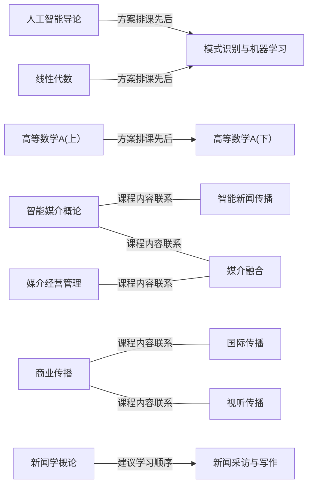

# 传播学-人工智能双学士学位项目“2+X”教学培养方案

新闻学院 · 传播学-人工智能(双学士学位项目) · 方案 72979 · 62 个不同课程或科研条目。

[官方 Word](https://github.com/pythonbug225/fudan-course-atlas/blob/research/schoolwide-cohorts-2023-2025/research/contributions/%E5%85%A8%E6%A0%A1%E5%9F%B9%E5%85%BB%E6%96%B9%E6%A1%882023-2025/%E5%B7%B2%E6%9C%89%E9%99%A2%E7%B3%BB%E8%A7%84%E8%8C%83%E6%95%B0%E6%8D%AE/%E6%96%B0%E9%97%BB%E5%AD%A6%E9%99%A2/2024/originals/plan-72979.docx) · [教务详情](https://fdjwgl.fudan.edu.cn/manager/bizType/2/major-program-search/info/72979?skipAuth=1) · [方案快照](https://github.com/pythonbug225/fudan-course-atlas/blob/research/schoolwide-cohorts-2023-2025/research/contributions/%E5%85%A8%E6%A0%A1%E5%9F%B9%E5%85%BB%E6%96%B9%E6%A1%882023-2025/%E5%B7%B2%E6%9C%89%E9%99%A2%E7%B3%BB%E8%A7%84%E8%8C%83%E6%95%B0%E6%8D%AE/%E6%96%B0%E9%97%BB%E5%AD%A6%E9%99%A2/2024/raw/plan-72979.json.gz) · [年级目录](https://github.com/pythonbug225/fudan-course-atlas/blob/research/schoolwide-cohorts-2023-2025/research/contributions/%E5%85%A8%E6%A0%A1%E5%9F%B9%E5%85%BB%E6%96%B9%E6%A1%882023-2025/%E5%B7%B2%E6%9C%89%E9%99%A2%E7%B3%BB%E8%A7%84%E8%8C%83%E6%95%B0%E6%8D%AE/%E6%96%B0%E9%97%BB%E5%AD%A6%E9%99%A2/2024/README.md)

## 修读导读

- **建议先学**　《新闻学概论》（`JCM10002`） → 《新闻采访与写作》（`JCM20012`）。新闻价值、事实核验与体裁概念可用于采访和写作。

- **可以对照着读**　《智能媒介概论》（`AIS210008`）与《智能新闻传播》（`AIS310010`）。智能媒介技术和新闻生产传播具有应用场景交集。

- **查模块选课**　《人际传播学》（`JCM30013`）、《组织传播学》（`JCM30014`）列在“专业核心教育课程”中。原表见 `/courseModules/6`。

## 课程关系图

图中展示部分关系。下表保留全部已建立的课程对，来源位置使用本方案 JSON Pointer。

## 先修与内容联系

| 类型 | 起点 | 终点 | 依据 | 原表定位 |
| --- | --- | --- | --- | --- |
| 建议学习顺序 | 人工智能导论 (AIE310005) | 模式识别与机器学习 (AIE410001) | 人工智能问题与模型类别可为学习模式识别作准备。  | `/courseModules/6/planCourses/27`、`/courseModules/6/planCourses/29` |
| 建议学习顺序 | 线性代数 (CS10003) | 模式识别与机器学习 (AIE410001) | 向量表示和矩阵运算支持理解分类、回归等模型。  | `/courseModules/5/planCourses/5`、`/courseModules/6/planCourses/29` |
| 建议学习顺序 | 新闻学概论 (JCM10002) | 新闻采访与写作 (JCM20012) | 新闻价值、事实核验与体裁概念可用于采访和写作。  | `/courseModules/5/planCourses/1`、`/courseModules/6/planCourses/2` |
| 建议学习顺序 | 高等数学A(上） (MATH10015) | 高等数学A(下） (MATH10016) | 同方案的课程题名具有连续分册或序号。  | `/courseModules/5/planCourses/3`、`/courseModules/5/planCourses/4` |
| 方案排课先后 | 人工智能导论 (AIE310005) | 模式识别与机器学习 (AIE410001) | 同方案该课程全部明确数字学期均早于后者。  | `/courseModules/6/planCourses/27`、`/courseModules/6/planCourses/29` |
| 方案排课先后 | 线性代数 (CS10003) | 模式识别与机器学习 (AIE410001) | 同方案该课程全部明确数字学期均早于后者。  | `/courseModules/5/planCourses/5`、`/courseModules/6/planCourses/29` |
| 方案排课先后 | 高等数学A(上） (MATH10015) | 高等数学A(下） (MATH10016) | 同方案该课程全部明确数字学期均早于后者。  | `/courseModules/5/planCourses/3`、`/courseModules/5/planCourses/4` |
| 课程内容联系 | 计算机系统基础 (AIE210006) | 计算机组成与体系结构 (CS30052) | 处理器、存储与系统执行模型具有共同内容。  | `/courseModules/6/planCourses/26`、`/courseModules/9/planCourses/1` |
| 课程内容联系 | 人工智能导论 (AIE310005) | 人工智能安全 (AIE831001) | 本方案两门课程的题名均含“人工智能”，可据此对照这一主题。  | `/courseModules/6/planCourses/27`、`/courseModules/6/planCourses/30` |
| 课程内容联系 | 人工智能的编程基础 (AIE310006) | 人工智能安全 (AIE831001) | 本方案两门课程的题名均含“人工智能”，可据此对照这一主题。  | `/courseModules/6/planCourses/23`、`/courseModules/6/planCourses/30` |
| 课程内容联系 | 人工智能的软件基础 (AIE310008) | 人工智能安全 (AIE831001) | 本方案两门课程的题名均含“人工智能”，可据此对照这一主题。  | `/courseModules/6/planCourses/28`、`/courseModules/6/planCourses/30` |
| 课程内容联系 | 人工智能的数学基础 (AIE310009) | 模式识别与机器学习 (AIE410001) | 数学表达与学习模型的统计、优化工具可对照。  | `/courseModules/6/planCourses/25`、`/courseModules/6/planCourses/29` |
| 课程内容联系 | 人工智能的数学基础 (AIE310009) | 人工智能安全 (AIE831001) | 本方案两门课程的题名均含“人工智能”，可据此对照这一主题。  | `/courseModules/6/planCourses/25`、`/courseModules/6/planCourses/30` |
| 课程内容联系 | 模式识别与机器学习 (AIE410001) | 机器学习系统 (CS30058) | 本方案两门课程的题名均含“机器学习”，可据此对照这一主题。  | `/courseModules/6/planCourses/29`、`/courseModules/9/planCourses/5` |
| 课程内容联系 | 智能媒介概论 (AIS210008) | 智能新闻传播 (AIS310010) | 智能媒介技术和新闻生产传播具有应用场景交集。  | `/courseModules/6/planCourses/12`、`/courseModules/6/planCourses/13` |
| 课程内容联系 | 智能媒介概论 (AIS210008) | 媒介融合 (JCM30020) | 本方案两门课程的题名均含“媒介”，可据此对照这一主题。  | `/courseModules/6/planCourses/12`、`/courseModules/6/planCourses/4` |
| 课程内容联系 | 智能新闻传播 (AIS310010) | 新闻学概论 (JCM10002) | 本方案两门课程的题名均含“新闻”，可据此对照这一主题。  | `/courseModules/6/planCourses/13`、`/courseModules/5/planCourses/1` |
| 课程内容联系 | 马克思主义新闻思想 (JCM10001) | 新闻传播法规与伦理 (JCM30023) | 两课均涉及新闻责任和公共传播价值。  | `/courseModules/5/planCourses/0`、`/courseModules/6/planCourses/5` |
| 课程内容联系 | 新闻学概论 (JCM10002) | 中国新闻传播史 (JCM10004) | 本方案两门课程的题名均含“新闻”，可据此对照这一主题。  | `/courseModules/5/planCourses/1`、`/courseModules/6/planCourses/3` |
| 课程内容联系 | 新闻学概论 (JCM10002) | 新闻采访与写作 (JCM20012) | 本方案两门课程的题名均含“新闻”，可据此对照这一主题。  | `/courseModules/5/planCourses/1`、`/courseModules/6/planCourses/2` |
| 课程内容联系 | 新闻学概论 (JCM10002) | 新闻传播法规与伦理 (JCM30023) | 本方案两门课程的题名均含“新闻”，可据此对照这一主题。  | `/courseModules/5/planCourses/1`、`/courseModules/6/planCourses/5` |
| 课程内容联系 | 商业传播 (JCM20026) | 视听传播 (JCM20032) | 本方案两门课程的题名均含“传播”，可据此对照这一主题。  | `/courseModules/6/planCourses/8`、`/courseModules/6/planCourses/9` |
| 课程内容联系 | 商业传播 (JCM20026) | 国际传播 (JCM30019) | 本方案两门课程的题名均含“传播”，可据此对照这一主题。  | `/courseModules/6/planCourses/8`、`/courseModules/6/planCourses/16` |
| 课程内容联系 | 商业传播 (JCM20026) | 政治传播 (JCM50039) | 本方案两门课程的题名均含“传播”，可据此对照这一主题。  | `/courseModules/6/planCourses/8`、`/courseModules/8/planCourses/1` |
| 课程内容联系 | 商业传播 (JCM20026) | 环境传播 (JCM50043) | 本方案两门课程的题名均含“传播”，可据此对照这一主题。  | `/courseModules/6/planCourses/8`、`/courseModules/8/planCourses/0` |
| 课程内容联系 | 媒介经营管理 (JCM30009) | 媒介融合 (JCM30020) | 本方案两门课程的题名均含“媒介”，可据此对照这一主题。  | `/courseModules/6/planCourses/0`、`/courseModules/6/planCourses/4` |
| 课程内容联系 | 媒介融合 (JCM30020) | 数字媒介产品营销传播 (JCM50094) | 本方案两门课程的题名均含“媒介”，可据此对照这一主题。  | `/courseModules/6/planCourses/4`、`/courseModules/8/planCourses/8` |

本次未从可定位的明确表述中确认课程对课程预修。学期安排、系列分册与编辑建议均保留各自的依据。

## 课程表

同一课程在不同模块分别出现时，按原表逐行列出。季节字段保留原值。

| 课程 | 代码 | 学分 | 学期 | 模块 |
| --- | --- | ---: | --- | --- |
| 马克思主义新闻思想 | JCM10001 | 2.0 | SPRING、AUTUMN | 培养方案 / 专业培养课程 / 大类基础课程 |
| 新闻学概论 | JCM10002 | 2.0 | SPRING、AUTUMN | 培养方案 / 专业培养课程 / 大类基础课程 |
| 传播学概论 | JCM10003 | 2.0 | SPRING、AUTUMN | 培养方案 / 专业培养课程 / 大类基础课程 |
| 高等数学A(上） | MATH10015 | 5.0 | 第1学期 | 培养方案 / 专业培养课程 / 大类基础课程 |
| 高等数学A(下） | MATH10016 | 5.0 | 第2学期 | 培养方案 / 专业培养课程 / 大类基础课程 |
| 线性代数 | CS10003 | 3.0 | 第1学期 | 培养方案 / 专业培养课程 / 大类基础课程 |
| 程序设计 | CS10004 | 4.0 | 第1学期 | 培养方案 / 专业培养课程 / 大类基础课程 |
| 媒介经营管理 | JCM30009 | 2.0 | 第5学期、第6学期 | 培养方案 / 专业培养课程 / 专业核心教育课程 |
| 教学大实习 | JCM40002 | 4.0 | 第7学期 | 培养方案 / 专业培养课程 / 专业核心教育课程 |
| 新闻采访与写作 | JCM20012 | 3.0 | 第2学期、第3学期 | 培养方案 / 专业培养课程 / 专业核心教育课程 |
| 中国新闻传播史 | JCM10004 | 3.0 | 第2学期、第3学期 | 培养方案 / 专业培养课程 / 专业核心教育课程 |
| 媒介融合 | JCM30020 | 3.0 | 第5学期、第6学期 | 培养方案 / 专业培养课程 / 专业核心教育课程 |
| 新闻传播法规与伦理 | JCM30023 | 3.0 | 第5学期、第6学期 | 培养方案 / 专业培养课程 / 专业核心教育课程 |
| 数据分析与信息可视化 | JCM30024 | 3.0 | 第5学期、第6学期 | 培养方案 / 专业培养课程 / 专业核心教育课程 |
| 口语表达 | JCM20025 | 3.0 | 第3学期、第4学期 | 培养方案 / 专业培养课程 / 专业核心教育课程 |
| 商业传播 | JCM20026 | 3.0 | 第3学期、第4学期 | 培养方案 / 专业培养课程 / 专业核心教育课程 |
| 视听传播 | JCM20032 | 3.0 | 第2学期、第3学期 | 培养方案 / 专业培养课程 / 专业核心教育课程 |
| 毕业论文 | JCM40003 | 4.0 | 第8学期 | 培养方案 / 专业培养课程 / 专业核心教育课程 |
| 教学小实习 | JCM20011 | 2.0 | 第4学期 | 培养方案 / 专业培养课程 / 专业核心教育课程 |
| 智能媒介概论 | AIS210008 | 2.0 | 第3学期、第4学期 | 培养方案 / 专业培养课程 / 专业核心教育课程 |
| 智能新闻传播 | AIS310010 | 2.0 | 第3学期、第4学期 | 培养方案 / 专业培养课程 / 专业核心教育课程 |
| 人际传播学 | JCM30013 | 2.0 | 第5学期 | 培养方案 / 专业培养课程 / 专业核心教育课程 |
| 组织传播学 | JCM30014 | 2.0 | 第5学期 | 培养方案 / 专业培养课程 / 专业核心教育课程 |
| 国际传播 | JCM30019 | 2.0 | 第5学期 | 培养方案 / 专业培养课程 / 专业核心教育课程 |
| 跨文化传播 | JCM30011 | 2.0 | 第6学期 | 培养方案 / 专业培养课程 / 专业核心教育课程 |
| 舆论学 | JCM20014 | 2.0 | 第4学期 | 培养方案 / 专业培养课程 / 专业核心教育课程 |
| 政府公共关系 | JCM20016 | 2.0 | 第3学期 | 培养方案 / 专业培养课程 / 专业核心教育课程 |
| 传播学研究方法 | JCM20013 | 2.0 | 第3学期 | 培养方案 / 专业培养课程 / 专业核心教育课程 |
| 传播政治经济学 | JCM30017 | 2.0 | 第4学期 | 培养方案 / 专业培养课程 / 专业核心教育课程 |
| 受众分析 | JCM30021 | 2.0 | 第6学期 | 培养方案 / 专业培养课程 / 专业核心教育课程 |
| 人工智能的编程基础 | AIE310006 | 2.0 | 第2学期 | 培养方案 / 专业培养课程 / 专业核心教育课程 |
| 数据结构 | AIE310007 | 4.0 | 第3学期 | 培养方案 / 专业培养课程 / 专业核心教育课程 |
| 人工智能的数学基础 | AIE310009 | 3.0 | 第3学期 | 培养方案 / 专业培养课程 / 专业核心教育课程 |
| 计算机系统基础 | AIE210006 | 3.0 | 第3学期 | 培养方案 / 专业培养课程 / 专业核心教育课程 |
| 人工智能导论 | AIE310005 | 3.0 | 第4学期 | 培养方案 / 专业培养课程 / 专业核心教育课程 |
| 人工智能的软件基础 | AIE310008 | 3.0 | 第4学期 | 培养方案 / 专业培养课程 / 专业核心教育课程 |
| 模式识别与机器学习 | AIE410001 | 3.0 | 第5学期 | 培养方案 / 专业培养课程 / 专业核心教育课程 |
| 人工智能安全 | AIE831001 | 3.0 | 第5学期 | 培养方案 / 专业培养课程 / 专业核心教育课程 |
| 人工智能的伦理与治理 | PHIL50006 | 2.0 | 第4学期、第6学期 | 培养方案 / 专业培养课程 / 专业核心教育课程 |
| 自然语言处理与大语言模型 | AIE410002 | 3.0 | 第6学期 | 培养方案 / 专业培养课程 / 专业核心教育课程 |
| 计算机视觉 | AIE310004 | 3.0 | 第7学期 | 培养方案 / 专业培养课程 / 专业核心教育课程 |
| 人工智能前沿探索实践 | AIE531001 | 3.0 | 第7学期 | 培养方案 / 专业培养课程 / 专业核心教育课程 |
| 环境传播 | JCM50043 | 2.0 | SPRING、AUTUMN | 培养方案 / 专业进阶模块I |
| 政治传播 | JCM50039 | 2.0 | SPRING、AUTUMN | 培养方案 / 专业进阶模块I |
| 中外传播思想 | JCM50052 | 2.0 | SPRING、AUTUMN | 培养方案 / 专业进阶模块I |
| 说服与传播运动设计 | JCM50044 | 2.0 | SPRING、AUTUMN | 培养方案 / 专业进阶模块I |
| 传播研究前沿文献选读 | JCM50088 | 2.0 | SPRING、AUTUMN | 培养方案 / 专业进阶模块I |
| 社交媒体传播分析 | JCM50060 | 2.0 | SPRING、AUTUMN | 培养方案 / 专业进阶模块I |
| 认知传播 | JCM50097 | 2.0 | SPRING、AUTUMN | 培养方案 / 专业进阶模块I |
| 新媒体技术与传播 | JCM50093 | 2.0 | SPRING、AUTUMN | 培养方案 / 专业进阶模块I |
| 数字媒介产品营销传播 | JCM50094 | 2.0 | SPRING、AUTUMN | 培养方案 / 专业进阶模块I |
| 传播理论与历史 | JCM50089 | 2.0 | SPRING、AUTUMN | 培养方案 / 专业进阶模块I |
| 大数据与国际舆论分析 | JCM50106 | 2.0 | SPRING、AUTUMN | 培养方案 / 专业进阶模块I |
| 记录中国——新闻学院学生暑期专业实践 | JCM50101 | 2.0 | SUMMER | 培养方案 / 专业进阶模块I |
| 集合与图论 | CS30043 | 3.0 | 第3学期 | 培养方案 / 专业进阶模块II |
| 计算机组成与体系结构 | CS30052 | 4.0 | 第4学期 | 培养方案 / 专业进阶模块II |
| 数据库引论 | CS20010 | 3.0 | 第4学期 | 培养方案 / 专业进阶模块II |
| 计算机网络 | CS30036 | 3.0 | 第5学期 | 培养方案 / 专业进阶模块II |
| 软件工程 | CS30018 | 3.0 | 第6学期 | 培养方案 / 专业进阶模块II |
| 机器学习系统 | CS30058 | 3.0 | 第6学期 | 培养方案 / 专业进阶模块II |
| 计算机图形学A | CS30019 | 3.0 | 第6学期 | 培养方案 / 专业进阶模块II |
| 智能市场研究 | AIS410003 | 3.0 | 第5学期 | 培养方案 / 专业进阶模块II |
