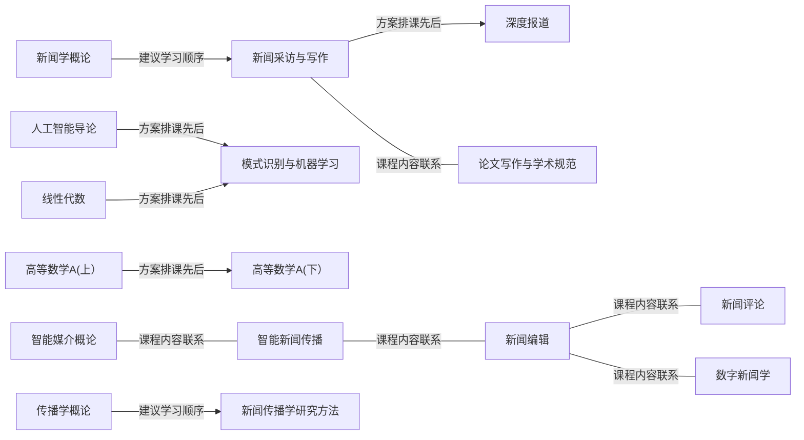

# 2025新闻学（望道新闻卓越班）-人工智能双学士学位项目本硕融通方案

新闻学院 · 新闻学(望道新闻卓越班)-人工智能(双学士学位项目) · 方案 147551 · 58 个不同课程或科研条目。

[官方 Word](https://github.com/pythonbug225/fudan-course-atlas/blob/research/schoolwide-cohorts-2023-2025/research/contributions/%E5%85%A8%E6%A0%A1%E5%9F%B9%E5%85%BB%E6%96%B9%E6%A1%882023-2025/%E5%B7%B2%E6%9C%89%E9%99%A2%E7%B3%BB%E8%A7%84%E8%8C%83%E6%95%B0%E6%8D%AE/%E6%96%B0%E9%97%BB%E5%AD%A6%E9%99%A2/2025/originals/plan-147551.docx) · [教务详情](https://fdjwgl.fudan.edu.cn/manager/bizType/2/major-program-search/info/147551?skipAuth=1) · [方案快照](https://github.com/pythonbug225/fudan-course-atlas/blob/research/schoolwide-cohorts-2023-2025/research/contributions/%E5%85%A8%E6%A0%A1%E5%9F%B9%E5%85%BB%E6%96%B9%E6%A1%882023-2025/%E5%B7%B2%E6%9C%89%E9%99%A2%E7%B3%BB%E8%A7%84%E8%8C%83%E6%95%B0%E6%8D%AE/%E6%96%B0%E9%97%BB%E5%AD%A6%E9%99%A2/2025/raw/plan-147551.json.gz) · [年级目录](https://github.com/pythonbug225/fudan-course-atlas/blob/research/schoolwide-cohorts-2023-2025/research/contributions/%E5%85%A8%E6%A0%A1%E5%9F%B9%E5%85%BB%E6%96%B9%E6%A1%882023-2025/%E5%B7%B2%E6%9C%89%E9%99%A2%E7%B3%BB%E8%A7%84%E8%8C%83%E6%95%B0%E6%8D%AE/%E6%96%B0%E9%97%BB%E5%AD%A6%E9%99%A2/2025/README.md)

## 修读导读

- **建议先学**　《新闻学概论》（`JCM10002`） → 《新闻采访与写作》（`JCM20012`） → 《深度报道》（`JCM30018`）。新闻价值、事实核验与体裁概念可用于采访和写作。采访与材料组织训练可用于展开和核查深度报道。

- **可以对照着读**　《新闻编辑》（`JCM20018`）与《新闻评论》（`JCM20019`）。两课可围绕新闻判断、受众与公共表达比较。

- **查模块选课**　《数字新闻学》（`JCM70003`）、《中国新闻传播史》（`JCM20006`）列在“专业核心教育课程”中。原表见 `/courseModules/8`。

## 课程关系图

图中展示部分关系。下表保留全部已建立的课程对，来源位置使用本方案 JSON Pointer。

## 先修与内容联系

| 类型 | 起点 | 终点 | 依据 | 原表定位 |
| --- | --- | --- | --- | --- |
| 建议学习顺序 | 人工智能导论 (AIE310005) | 模式识别与机器学习 (AIE410001) | 人工智能问题与模型类别可为学习模式识别作准备。  | `/courseModules/8/planCourses/17`、`/courseModules/8/planCourses/19` |
| 建议学习顺序 | 线性代数 (CS10003) | 模式识别与机器学习 (AIE410001) | 向量表示和矩阵运算支持理解分类、回归等模型。  | `/courseModules/7/planCourses/2`、`/courseModules/8/planCourses/19` |
| 建议学习顺序 | 新闻学概论 (JCM10002) | 新闻采访与写作 (JCM20012) | 新闻价值、事实核验与体裁概念可用于采访和写作。  | `/courseModules/6/planCourses/1`、`/courseModules/8/planCourses/6` |
| 建议学习顺序 | 传播学概论 (JCM10003) | 新闻传播学研究方法 (JCM20001) | 传播概念和模型可帮助提出具体研究问题。  | `/courseModules/6/planCourses/2`、`/courseModules/8/planCourses/2` |
| 建议学习顺序 | 新闻采访与写作 (JCM20012) | 深度报道 (JCM30018) | 采访与材料组织训练可用于展开和核查深度报道。  | `/courseModules/8/planCourses/6`、`/courseModules/8/planCourses/12` |
| 建议学习顺序 | 高等数学A(上） (MATH10015) | 高等数学A(下） (MATH10016) | 同方案的课程题名具有连续分册或序号。  | `/courseModules/7/planCourses/0`、`/courseModules/7/planCourses/1` |
| 方案排课先后 | 人工智能导论 (AIE310005) | 模式识别与机器学习 (AIE410001) | 同方案该课程全部明确数字学期均早于后者。  | `/courseModules/8/planCourses/17`、`/courseModules/8/planCourses/19` |
| 方案排课先后 | 线性代数 (CS10003) | 模式识别与机器学习 (AIE410001) | 同方案该课程全部明确数字学期均早于后者。  | `/courseModules/7/planCourses/2`、`/courseModules/8/planCourses/19` |
| 方案排课先后 | 新闻采访与写作 (JCM20012) | 深度报道 (JCM30018) | 同方案该课程全部明确数字学期均早于后者。  | `/courseModules/8/planCourses/6`、`/courseModules/8/planCourses/12` |
| 方案排课先后 | 高等数学A(上） (MATH10015) | 高等数学A(下） (MATH10016) | 同方案该课程全部明确数字学期均早于后者。  | `/courseModules/7/planCourses/0`、`/courseModules/7/planCourses/1` |
| 课程内容联系 | 计算机系统基础 (AIE210006) | 计算机组成与体系结构 (CS30052) | 处理器、存储与系统执行模型具有共同内容。  | `/courseModules/8/planCourses/16`、`/courseModules/12/planCourses/1` |
| 课程内容联系 | 人工智能导论 (AIE310005) | 人工智能安全 (AIE831001) | 本方案两门课程的题名均含“人工智能”，可据此对照这一主题。  | `/courseModules/8/planCourses/17`、`/courseModules/8/planCourses/20` |
| 课程内容联系 | 人工智能的编程基础 (AIE310006) | 人工智能安全 (AIE831001) | 本方案两门课程的题名均含“人工智能”，可据此对照这一主题。  | `/courseModules/8/planCourses/13`、`/courseModules/8/planCourses/20` |
| 课程内容联系 | 人工智能的软件基础 (AIE310008) | 人工智能安全 (AIE831001) | 本方案两门课程的题名均含“人工智能”，可据此对照这一主题。  | `/courseModules/8/planCourses/18`、`/courseModules/8/planCourses/20` |
| 课程内容联系 | 人工智能的数学基础 (AIE310009) | 模式识别与机器学习 (AIE410001) | 数学表达与学习模型的统计、优化工具可对照。  | `/courseModules/8/planCourses/15`、`/courseModules/8/planCourses/19` |
| 课程内容联系 | 人工智能的数学基础 (AIE310009) | 人工智能安全 (AIE831001) | 本方案两门课程的题名均含“人工智能”，可据此对照这一主题。  | `/courseModules/8/planCourses/15`、`/courseModules/8/planCourses/20` |
| 课程内容联系 | 模式识别与机器学习 (AIE410001) | 机器学习系统 (CS30058) | 本方案两门课程的题名均含“机器学习”，可据此对照这一主题。  | `/courseModules/8/planCourses/19`、`/courseModules/12/planCourses/5` |
| 课程内容联系 | 智能媒介概论 (AIS210008) | 智能新闻传播 (AIS310010) | 智能媒介技术和新闻生产传播具有应用场景交集。  | `/courseModules/8/planCourses/1`、`/courseModules/8/planCourses/11` |
| 课程内容联系 | 智能媒介概论 (AIS210008) | 媒介经营管理 (JCM30009) | 本方案两门课程的题名均含“媒介”，可据此对照这一主题。  | `/courseModules/8/planCourses/1`、`/courseModules/8/planCourses/10` |
| 课程内容联系 | 智能新闻传播 (AIS310010) | 传播学概论 (JCM10003) | 本方案两门课程的题名均含“传播”，可据此对照这一主题。  | `/courseModules/8/planCourses/11`、`/courseModules/6/planCourses/2` |
| 课程内容联系 | 智能新闻传播 (AIS310010) | 新闻编辑 (JCM20018) | 本方案两门课程的题名均含“新闻”，可据此对照这一主题。  | `/courseModules/8/planCourses/11`、`/courseModules/8/planCourses/8` |
| 课程内容联系 | 新闻学概论 (JCM10002) | 新闻编辑 (JCM20018) | 本方案两门课程的题名均含“新闻”，可据此对照这一主题。  | `/courseModules/6/planCourses/1`、`/courseModules/8/planCourses/8` |
| 课程内容联系 | 传播学概论 (JCM10003) | 新闻传播学研究方法 (JCM20001) | 本方案两门课程的题名均含“传播”，可据此对照这一主题。  | `/courseModules/6/planCourses/2`、`/courseModules/8/planCourses/2` |
| 课程内容联系 | 传播学概论 (JCM10003) | 中国新闻传播史 (JCM20006) | 本方案两门课程的题名均含“传播”，可据此对照这一主题。  | `/courseModules/6/planCourses/2`、`/courseModules/8/planCourses/0` |
| 课程内容联系 | 传播学概论 (JCM10003) | 传播学研究 (JCM60028) | 本方案两门课程的题名均含“传播”，可据此对照这一主题。  | `/courseModules/6/planCourses/2`、`/courseModules/8/planCourses/25` |
| 课程内容联系 | 新闻采访与写作 (JCM20012) | 论文写作与学术规范 (JCM60016) | 本方案两门课程的题名均含“写作”，可据此对照这一主题。  | `/courseModules/8/planCourses/6`、`/courseModules/8/planCourses/28` |
| 课程内容联系 | 新闻编辑 (JCM20018) | 新闻评论 (JCM20019) | 两课可围绕新闻判断、受众与公共表达比较。  | `/courseModules/8/planCourses/8`、`/courseModules/8/planCourses/9` |
| 课程内容联系 | 新闻编辑 (JCM20018) | 数字新闻学 (JCM70003) | 本方案两门课程的题名均含“新闻”，可据此对照这一主题。  | `/courseModules/8/planCourses/8`、`/courseModules/8/planCourses/27` |
| 课程内容联系 | 新闻传播法规与伦理 (JCM30016) | 马克思主义新闻思想 (JCM40004) | 两课均涉及新闻责任和公共传播价值。  | `/courseModules/8/planCourses/4`、`/courseModules/6/planCourses/0` |

本次未从可定位的明确表述中确认课程对课程预修。学期安排、系列分册与编辑建议均保留各自的依据。

## 按原方案模块阅读

同一模块展示原表中的课程归属。模块内课程之间的先后仍须逐项查阅。

- **人文基础课程**　新闻学概论、传播学概论、马克思主义新闻思想（原表模块 6）
- **技术科学类基础课程（交叉科学类适用）**　线性代数、程序设计、高等数学A(上）、高等数学A(下）（原表模块 7）

## 课程表

同一课程在不同模块分别出现时，按原表逐行列出。季节字段保留原值。

| 课程 | 代码 | 学分 | 学期 | 模块 |
| --- | --- | ---: | --- | --- |
| 马克思主义新闻思想 | JCM40004 | 2.0 | SPRING、AUTUMN | 培养方案 / 专业培养课程 / 学科基础课程 / 人文基础课程 |
| 新闻学概论 | JCM10002 | 2.0 | SPRING、AUTUMN | 培养方案 / 专业培养课程 / 学科基础课程 / 人文基础课程 |
| 传播学概论 | JCM10003 | 2.0 | SPRING、AUTUMN | 培养方案 / 专业培养课程 / 学科基础课程 / 人文基础课程 |
| 高等数学A(上） | MATH10015 | 5.0 | 第1学期 | 培养方案 / 专业培养课程 / 学科基础课程 / 技术科学类基础课程（交叉科学类适用） |
| 高等数学A(下） | MATH10016 | 5.0 | 第2学期 | 培养方案 / 专业培养课程 / 学科基础课程 / 技术科学类基础课程（交叉科学类适用） |
| 线性代数 | CS10003 | 3.0 | 第1学期 | 培养方案 / 专业培养课程 / 学科基础课程 / 技术科学类基础课程（交叉科学类适用） |
| 程序设计 | CS10004 | 4.0 | 第1学期 | 培养方案 / 专业培养课程 / 学科基础课程 / 技术科学类基础课程（交叉科学类适用） |
| 中国新闻传播史 | JCM20006 | 2.0 | 第2学期、第3学期 | 培养方案 / 专业培养课程 / 专业核心教育课程 |
| 智能媒介概论 | AIS210008 | 2.0 | 第3学期、第4学期 | 培养方案 / 专业培养课程 / 专业核心教育课程 |
| 新闻传播学研究方法 | JCM20001 | 2.0 | 第3学期、第4学期 | 培养方案 / 专业培养课程 / 专业核心教育课程 |
| 数据分析与信息可视化 | JCM30002 | 4.0 | 第5学期、第6学期 | 培养方案 / 专业培养课程 / 专业核心教育课程 |
| 新闻传播法规与伦理 | JCM30016 | 2.0 | 第6学期 | 培养方案 / 专业培养课程 / 专业核心教育课程 |
| 观察中国：热点新闻解析 | JCM20004 | 3.0 | 第2学期 | 培养方案 / 专业培养课程 / 专业核心教育课程 |
| 新闻采访与写作 | JCM20012 | 3.0 | 第2学期、第3学期 | 培养方案 / 专业培养课程 / 专业核心教育课程 |
| 影像编辑 | JCM20030 | 3.0 | 第3学期 | 培养方案 / 专业培养课程 / 专业核心教育课程 |
| 新闻编辑 | JCM20018 | 2.0 | 第3学期 | 培养方案 / 专业培养课程 / 专业核心教育课程 |
| 新闻评论 | JCM20019 | 2.0 | 第4学期 | 培养方案 / 专业培养课程 / 专业核心教育课程 |
| 媒介经营管理 | JCM30009 | 2.0 | 第5学期 | 培养方案 / 专业培养课程 / 专业核心教育课程 |
| 智能新闻传播 | AIS310010 | 2.0 | 第6学期 | 培养方案 / 专业培养课程 / 专业核心教育课程 |
| 深度报道 | JCM30018 | 3.0 | 第6学期 | 培养方案 / 专业培养课程 / 专业核心教育课程 |
| 人工智能的编程基础 | AIE310006 | 2.0 | 第2学期 | 培养方案 / 专业培养课程 / 专业核心教育课程 |
| 数据结构 | AIE310007 | 4.0 | 第3学期 | 培养方案 / 专业培养课程 / 专业核心教育课程 |
| 人工智能的数学基础 | AIE310009 | 3.0 | 第3学期 | 培养方案 / 专业培养课程 / 专业核心教育课程 |
| 计算机系统基础 | AIE210006 | 3.0 | 第3学期 | 培养方案 / 专业培养课程 / 专业核心教育课程 |
| 人工智能导论 | AIE310005 | 3.0 | 第4学期 | 培养方案 / 专业培养课程 / 专业核心教育课程 |
| 人工智能的软件基础 | AIE310008 | 3.0 | 第4学期 | 培养方案 / 专业培养课程 / 专业核心教育课程 |
| 模式识别与机器学习 | AIE410001 | 3.0 | 第5学期 | 培养方案 / 专业培养课程 / 专业核心教育课程 |
| 人工智能安全 | AIE831001 | 3.0 | 第5学期 | 培养方案 / 专业培养课程 / 专业核心教育课程 |
| 人工智能的伦理与治理 | PHIL50006 | 2.0 | 第4学期、第6学期 | 培养方案 / 专业培养课程 / 专业核心教育课程 |
| 自然语言处理与大语言模型 | AIE410002 | 3.0 | 第6学期 | 培养方案 / 专业培养课程 / 专业核心教育课程 |
| 计算机视觉 | AIE310004 | 3.0 | 第7学期 | 培养方案 / 专业培养课程 / 专业核心教育课程 |
| 人工智能前沿探索实践 | AIE531001 | 3.0 | 第7学期 | 培养方案 / 专业培养课程 / 专业核心教育课程 |
| 传播学研究 | JCM60028 | 2.0 | 第9学期 | 培养方案 / 专业培养课程 / 专业核心教育课程 |
| 新媒体研究 | JCM60008 | 2.0 | 第9学期 | 培养方案 / 专业培养课程 / 专业核心教育课程 |
| 数字新闻学 | JCM70003 | 2.0 | 第9学期 | 培养方案 / 专业培养课程 / 专业核心教育课程 |
| 论文写作与学术规范 | JCM60016 | 2.0 | 第10学期 | 培养方案 / 专业培养课程 / 专业核心教育课程 |
| 集合与图论 | CS30043 | 3.0 | 第3学期 | 培养方案 / 专业进阶模块II |
| 计算机组成与体系结构 | CS30052 | 4.0 | 第4学期 | 培养方案 / 专业进阶模块II |
| 数据库引论 | CS20010 | 3.0 | 第4学期 | 培养方案 / 专业进阶模块II |
| 计算机网络 | CS30036 | 3.0 | 第5学期 | 培养方案 / 专业进阶模块II |
| 软件工程 | CS30018 | 3.0 | 第6学期 | 培养方案 / 专业进阶模块II |
| 机器学习系统 | CS30058 | 3.0 | 第6学期 | 培养方案 / 专业进阶模块II |
| 计算机图形学A | CS30019 | 3.0 | 第6学期 | 培养方案 / 专业进阶模块II |
| 复芏计划(FDUROP) | 102 | 1.0 |  | 融合创新能力 |
| 专业竞赛(本科阶段) | 106 | 1.0 |  | 融合创新能力 |
| 校园媒体实践(本科阶段) | 1071 | 1.0 |  | 融合创新能力 |
| 专业竞赛(硕士阶段) | 1068 | 1.0 |  | 融合创新能力 |
| 校园媒体实践(硕士阶段) | 1072 | 1.0 |  | 融合创新能力 |
| 国际交流 | 7 | 2.0 |  | 融合创新能力 |
| 研究生实践活动 | 5 | 2.0 |  | 融合创新能力 |
| 硕士学位论文开题 | 11 | 0.0 |  | 融合创新能力 |
| 硕士学位论文预审 | 61 | 0.0 |  | 融合创新能力 |
| 研究生学术活动 | 4 | 1.0 |  | 融合创新能力 |
| 教学实习 | JCM40001 | 4.0 | 第7学期 | 融合创新能力 |
| 毕业论文 | JCM40003 | 4.0 | 第8学期 | 融合创新能力 |
| 记录中国（专业实践） | JCM50029 | 2.0 | SUMMER | 融合创新能力 |
| 大江东—复旦融媒体创新工作室 | JCM50004 | 2.0 | SPRING、AUTUMN | 融合创新能力 |
| 新闻实务工作坊 | JCM50003 | 2.0 | SPRING、AUTUMN | 融合创新能力 |
