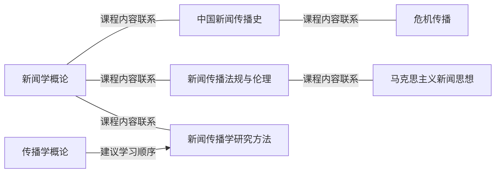

# 2025广播电视学--新闻传播学本硕融通培养方案（数字视听菁英班）

新闻学院 · 广播电视学 · 方案 97000 · 69 个不同课程或科研条目。

[官方 Word](https://github.com/pythonbug225/fudan-course-atlas/blob/research/schoolwide-cohorts-2023-2025/research/contributions/%E5%85%A8%E6%A0%A1%E5%9F%B9%E5%85%BB%E6%96%B9%E6%A1%882023-2025/%E5%B7%B2%E6%9C%89%E9%99%A2%E7%B3%BB%E8%A7%84%E8%8C%83%E6%95%B0%E6%8D%AE/%E6%96%B0%E9%97%BB%E5%AD%A6%E9%99%A2/2025/originals/plan-97000.docx) · [教务详情](https://fdjwgl.fudan.edu.cn/manager/bizType/2/major-program-search/info/97000?skipAuth=1) · [方案快照](https://github.com/pythonbug225/fudan-course-atlas/blob/research/schoolwide-cohorts-2023-2025/research/contributions/%E5%85%A8%E6%A0%A1%E5%9F%B9%E5%85%BB%E6%96%B9%E6%A1%882023-2025/%E5%B7%B2%E6%9C%89%E9%99%A2%E7%B3%BB%E8%A7%84%E8%8C%83%E6%95%B0%E6%8D%AE/%E6%96%B0%E9%97%BB%E5%AD%A6%E9%99%A2/2025/raw/plan-97000.json.gz) · [年级目录](https://github.com/pythonbug225/fudan-course-atlas/blob/research/schoolwide-cohorts-2023-2025/research/contributions/%E5%85%A8%E6%A0%A1%E5%9F%B9%E5%85%BB%E6%96%B9%E6%A1%882023-2025/%E5%B7%B2%E6%9C%89%E9%99%A2%E7%B3%BB%E8%A7%84%E8%8C%83%E6%95%B0%E6%8D%AE/%E6%96%B0%E9%97%BB%E5%AD%A6%E9%99%A2/2025/README.md)

## 修读导读

- **建议先学**　《传播学概论》（`JCM10003`） → 《新闻传播学研究方法》（`JCM20001`）。传播概念和模型可帮助提出具体研究问题。

- **可以对照着读**　《新闻传播法规与伦理》（`JCM30016`）与《马克思主义新闻思想》（`JCM40004`）。两课均涉及新闻责任和公共传播价值。

- **查模块选课**　《中国新闻传播史》（`JCM20006`）、《智能媒介概论》（`AIS210008`）列在“专业核心教育课程”中。原表见 `/courseModules/10`。

## 课程关系图

图中展示部分关系。下表保留全部已建立的课程对，来源位置使用本方案 JSON Pointer。

## 先修与内容联系

| 类型 | 起点 | 终点 | 依据 | 原表定位 |
| --- | --- | --- | --- | --- |
| 建议学习顺序 | 传播学概论 (JCM10003) | 新闻传播学研究方法 (JCM20001) | 传播概念和模型可帮助提出具体研究问题。  | `/courseModules/7/planCourses/2`、`/courseModules/10/planCourses/2` |
| 课程内容联系 | 智能媒介概论 (AIS210008) | 数字媒介产品营销传播 (JCM50094) | 本方案两门课程的题名均含“媒介”，可据此对照这一主题。  | `/courseModules/10/planCourses/1`、`/courseModules/16/planCourses/1` |
| 课程内容联系 | 智能媒介概论 (AIS210008) | 视听媒介产业与节目研究 (JCM70007) | 本方案两门课程的题名均含“媒介”，可据此对照这一主题。  | `/courseModules/10/planCourses/1`、`/courseModules/16/planCourses/5` |
| 课程内容联系 | 新闻学概论 (JCM10002) | 新闻传播学研究方法 (JCM20001) | 本方案两门课程的题名均含“新闻”，可据此对照这一主题。  | `/courseModules/7/planCourses/1`、`/courseModules/10/planCourses/2` |
| 课程内容联系 | 新闻学概论 (JCM10002) | 中国新闻传播史 (JCM20006) | 本方案两门课程的题名均含“新闻”，可据此对照这一主题。  | `/courseModules/7/planCourses/1`、`/courseModules/10/planCourses/0` |
| 课程内容联系 | 新闻学概论 (JCM10002) | 新闻传播法规与伦理 (JCM30016) | 本方案两门课程的题名均含“新闻”，可据此对照这一主题。  | `/courseModules/7/planCourses/1`、`/courseModules/10/planCourses/4` |
| 课程内容联系 | 新闻学概论 (JCM10002) | 马克思主义新闻思想 (JCM40004) | 本方案两门课程的题名均含“新闻”，可据此对照这一主题。  | `/courseModules/7/planCourses/1`、`/courseModules/7/planCourses/0` |
| 课程内容联系 | 传播学概论 (JCM10003) | 危机传播 (JCM50081) | 本方案两门课程的题名均含“传播”，可据此对照这一主题。  | `/courseModules/7/planCourses/2`、`/courseModules/15/planCourses/3` |
| 课程内容联系 | 中国新闻传播史 (JCM20006) | 危机传播 (JCM50081) | 本方案两门课程的题名均含“传播”，可据此对照这一主题。  | `/courseModules/10/planCourses/0`、`/courseModules/15/planCourses/3` |
| 课程内容联系 | 新闻传播法规与伦理 (JCM30016) | 马克思主义新闻思想 (JCM40004) | 两课均涉及新闻责任和公共传播价值。  | `/courseModules/10/planCourses/4`、`/courseModules/7/planCourses/0` |
| 课程内容联系 | 危机传播 (JCM50081) | 品牌策略传播 (JCM50086) | 本方案两门课程的题名均含“传播”，可据此对照这一主题。  | `/courseModules/15/planCourses/3`、`/courseModules/16/planCourses/0` |
| 课程内容联系 | 危机传播 (JCM50081) | 智能传播 (JCM70042) | 本方案两门课程的题名均含“传播”，可据此对照这一主题。  | `/courseModules/15/planCourses/3`、`/courseModules/15/planCourses/8` |
| 课程内容联系 | 哲学导论 (PHIL10002) | 逻辑学 (PHIL10003) | 论证与概念分析是哲学讨论的共同方法。  | `/courseModules/8/planCourses/2`、`/courseModules/8/planCourses/3` |

本次未从可定位的明确表述中确认课程对课程预修。学期安排、系列分册与编辑建议均保留各自的依据。

## 按原方案模块阅读

同一模块展示原表中的课程归属。模块内课程之间的先后仍须逐项查阅。

- **社会科学基础课程**　管理学导论、经济学原理、法理学导论、政治学原理、心理学导论、社会学导论、统计学（原表模块 9）
- **视听传播模块**　用户体验设计、计算机仿生传播、社交媒体传播分析、视听大数据计算传播、危机传播、新媒体艺术与智能生成传播、智能传播、新媒体用户行为分析、网络数据挖掘（原表模块 15）
- **视听运营模块**　动漫艺术与产业、数字音频市场与在线播客、娱乐节目与娱乐产业、品牌策略传播、数字媒介产品营销传播、视听媒介产业与节目研究、视听新媒体管理、数字营销（原表模块 16）

## 课程表

同一课程在不同模块分别出现时，按原表逐行列出。季节字段保留原值。

| 课程 | 代码 | 学分 | 学期 | 模块 |
| --- | --- | ---: | --- | --- |
| 马克思主义新闻思想 | JCM40004 | 2.0 | SPRING、AUTUMN | 培养方案 / 专业培养课程 / 学科基础课程 / 人文基础课程 / 必修课程 |
| 新闻学概论 | JCM10002 | 2.0 | SPRING、AUTUMN | 培养方案 / 专业培养课程 / 学科基础课程 / 人文基础课程 / 必修课程 |
| 传播学概论 | JCM10003 | 2.0 | SPRING、AUTUMN | 培养方案 / 专业培养课程 / 学科基础课程 / 人文基础课程 / 必修课程 |
| 中国文学经典 | CHIN10005 | 3.0 | SPRING、AUTUMN | 培养方案 / 专业培养课程 / 学科基础课程 / 人文基础课程 / 选修课程 |
| 中国古代文明 | HIST10006 | 3.0 | SPRING、AUTUMN | 培养方案 / 专业培养课程 / 学科基础课程 / 人文基础课程 / 选修课程 |
| 哲学导论 | PHIL10002 | 3.0 | SPRING、AUTUMN | 培养方案 / 专业培养课程 / 学科基础课程 / 人文基础课程 / 选修课程 |
| 逻辑学 | PHIL10003 | 3.0 | SPRING、AUTUMN | 培养方案 / 专业培养课程 / 学科基础课程 / 人文基础课程 / 选修课程 |
| 美学 | CHIN10002 | 2.0 | SPRING、AUTUMN | 培养方案 / 专业培养课程 / 学科基础课程 / 人文基础课程 / 选修课程 |
| 世界文明史通论 | HIST10004 | 2.0 | SPRING、AUTUMN | 培养方案 / 专业培养课程 / 学科基础课程 / 人文基础课程 / 选修课程 |
| 近代中国社会研究 | HIST10005 | 2.0 | SPRING、AUTUMN | 培养方案 / 专业培养课程 / 学科基础课程 / 人文基础课程 / 选修课程 |
| 世界文学导读 | FORE10006 | 2.0 | SPRING、AUTUMN | 培养方案 / 专业培养课程 / 学科基础课程 / 人文基础课程 / 选修课程 |
| 现代文艺赏析 | CHIN10003 | 2.0 | SPRING、AUTUMN | 培养方案 / 专业培养课程 / 学科基础课程 / 人文基础课程 / 选修课程 |
| 宗教学导论 | PHIL10004 | 2.0 | SPRING、AUTUMN | 培养方案 / 专业培养课程 / 学科基础课程 / 人文基础课程 / 选修课程 |
| 中国古代工艺美术 | CULT10001 | 2.0 | SPRING、AUTUMN | 培养方案 / 专业培养课程 / 学科基础课程 / 人文基础课程 / 选修课程 |
| 社会学导论 | SOCI20001 | 3.0 | SPRING、AUTUMN | 培养方案 / 专业培养课程 / 学科基础课程 / 社会科学基础课程 |
| 法理学导论 | LAW10004 | 3.0 | SPRING、AUTUMN | 培养方案 / 专业培养课程 / 学科基础课程 / 社会科学基础课程 |
| 经济学原理 | ECON20005 | 3.0 | SPRING、AUTUMN | 培养方案 / 专业培养课程 / 学科基础课程 / 社会科学基础课程 |
| 管理学导论 | BA10004 | 3.0 | SPRING、AUTUMN | 培养方案 / 专业培养课程 / 学科基础课程 / 社会科学基础课程 |
| 心理学导论 | PSYC20001 | 3.0 | SPRING、AUTUMN | 培养方案 / 专业培养课程 / 学科基础课程 / 社会科学基础课程 |
| 统计学 | SOCI20003 | 3.0 | SPRING、AUTUMN | 培养方案 / 专业培养课程 / 学科基础课程 / 社会科学基础课程 |
| 政治学原理 | POLI10004 | 4.0 | SPRING、AUTUMN | 培养方案 / 专业培养课程 / 学科基础课程 / 社会科学基础课程 |
| 中国新闻传播史 | JCM20006 | 2.0 | 第2学期、第3学期 | 培养方案 / 专业培养课程 / 专业核心教育课程 |
| 智能媒介概论 | AIS210008 | 2.0 | 第3学期、第4学期 | 培养方案 / 专业培养课程 / 专业核心教育课程 |
| 新闻传播学研究方法 | JCM20001 | 2.0 | 第3学期、第4学期 | 培养方案 / 专业培养课程 / 专业核心教育课程 |
| 数据分析与信息可视化 | JCM30002 | 4.0 | 第5学期、第6学期 | 培养方案 / 专业培养课程 / 专业核心教育课程 |
| 新闻传播法规与伦理 | JCM30016 | 2.0 | 第6学期 | 培养方案 / 专业培养课程 / 专业核心教育课程 |
| 视听史论 | JCM20029 | 2.0 | 第3学期 | 培养方案 / 专业培养课程 / 专业核心教育课程 |
| 视听语言和审美 | JCM20007 | 3.0 | 第3学期 | 培养方案 / 专业培养课程 / 专业核心教育课程 |
| 视听技术与应用 | JCM20008 | 3.0 | 第3学期 | 培养方案 / 专业培养课程 / 专业核心教育课程 |
| 影像编辑 | JCM20030 | 3.0 | 第4学期 | 培养方案 / 专业培养课程 / 专业核心教育课程 |
| 视听节目构成 | JCM30027 | 3.0 | 第5学期 | 培养方案 / 专业培养课程 / 专业核心教育课程 |
| 数字媒体艺术与技术应用 | JCM30006 | 3.0 | 第5学期 | 培养方案 / 专业培养课程 / 专业核心教育课程 |
| 数字互动叙事 | JCM30005 | 3.0 | 第6学期 | 培养方案 / 专业培养课程 / 专业核心教育课程 |
| 数字文娱市场与产品运营 | JCM30001 | 2.0 | 第6学期 | 培养方案 / 专业培养课程 / 专业核心教育课程 |
| 视听文化导论 | MJC60004 | 2.0 | 第9学期 | 培养方案 / 专业培养课程 / 专业核心教育课程 |
| 非虚构影像创作 | MJC60008 | 3.0 | 第9学期 | 培养方案 / 专业培养课程 / 专业核心教育课程 |
| 数字视听生产实践 | MJC60003 | 3.0 | 第10学期 | 培养方案 / 专业培养课程 / 专业核心教育课程 |
| 数字视听产业前沿 | MJC60005 | 2.0 | 第10学期 | 培养方案 / 专业培养课程 / 专业核心教育课程 |
| 视听大数据计算传播 | JCM50075 | 2.0 | SPRING、AUTUMN | 培养方案 / 专业进阶模块II / 视听传播模块 |
| 新媒体艺术与智能生成传播 | JCM50082 | 2.0 | SPRING、AUTUMN | 培养方案 / 专业进阶模块II / 视听传播模块 |
| 计算机仿生传播 | JCM50055 | 2.0 | SPRING、AUTUMN | 培养方案 / 专业进阶模块II / 视听传播模块 |
| 危机传播 | JCM50081 | 2.0 | SPRING、AUTUMN | 培养方案 / 专业进阶模块II / 视听传播模块 |
| 社交媒体传播分析 | JCM50060 | 2.0 | SPRING、AUTUMN | 培养方案 / 专业进阶模块II / 视听传播模块 |
| 用户体验设计 | JCM50025 | 2.0 | SPRING、AUTUMN | 培养方案 / 专业进阶模块II / 视听传播模块 |
| 网络数据挖掘 | MJC70029 | 2.0 | SPRING、AUTUMN | 培养方案 / 专业进阶模块II / 视听传播模块 |
| 新媒体用户行为分析 | MJC70028 | 2.0 | SPRING、AUTUMN | 培养方案 / 专业进阶模块II / 视听传播模块 |
| 智能传播 | JCM70042 | 2.0 | SPRING、AUTUMN | 培养方案 / 专业进阶模块II / 视听传播模块 |
| 品牌策略传播 | JCM50086 | 2.0 | SPRING、AUTUMN | 培养方案 / 专业进阶模块II / 视听运营模块 |
| 数字媒介产品营销传播 | JCM50094 | 2.0 | SPRING、AUTUMN | 培养方案 / 专业进阶模块II / 视听运营模块 |
| 数字音频市场与在线播客 | JCM50017 | 2.0 | SPRING、AUTUMN | 培养方案 / 专业进阶模块II / 视听运营模块 |
| 娱乐节目与娱乐产业 | JCM50027 | 3.0 | SPRING、AUTUMN | 培养方案 / 专业进阶模块II / 视听运营模块 |
| 动漫艺术与产业 | JCM50013 | 2.0 | SPRING、AUTUMN | 培养方案 / 专业进阶模块II / 视听运营模块 |
| 视听媒介产业与节目研究 | JCM70007 | 2.0 | 第6学期、SPRING、AUTUMN | 培养方案 / 专业进阶模块II / 视听运营模块 |
| 视听新媒体管理 | MJC60006 | 2.0 | SPRING、AUTUMN | 培养方案 / 专业进阶模块II / 视听运营模块 |
| 数字营销 | MJC70025 | 2.0 | SPRING、AUTUMN | 培养方案 / 专业进阶模块II / 视听运营模块 |
| 教学实习 | JCM40001 | 4.0 | 第7学期 | 融合创新能力 |
| 专业竞赛(本科阶段) | 106 | 1.0 |  | 融合创新能力 |
| 专业竞赛(硕士阶段) | 1068 | 1.0 |  | 融合创新能力 |
| 国际交流 | 7 | 2.0 |  | 融合创新能力 |
| 复芏计划(FDUROP) | 102 | 1.0 |  | 融合创新能力 |
| 校园媒体实践(本科阶段) | 1071 | 1.0 |  | 融合创新能力 |
| 校园媒体实践(硕士阶段) | 1072 | 1.0 |  | 融合创新能力 |
| 研究生实践活动 | 5 | 4.0 |  | 融合创新能力 |
| 硕士学位论文开题 | 11 | 0.0 |  | 融合创新能力 |
| 硕士学位论文预审 | 61 | 0.0 |  | 融合创新能力 |
| 毕业论文 | JCM40003 | 4.0 | 第8学期 | 融合创新能力 |
| 记录中国（专业实践） | JCM50029 | 2.0 | SUMMER | 融合创新能力 |
| 视听实务工作坊 | JCM50078 | 1.0 | SPRING、AUTUMN | 融合创新能力 |
| 视听实务工作坊 | JCM50098 | 2.0 | SPRING、AUTUMN | 融合创新能力 |
