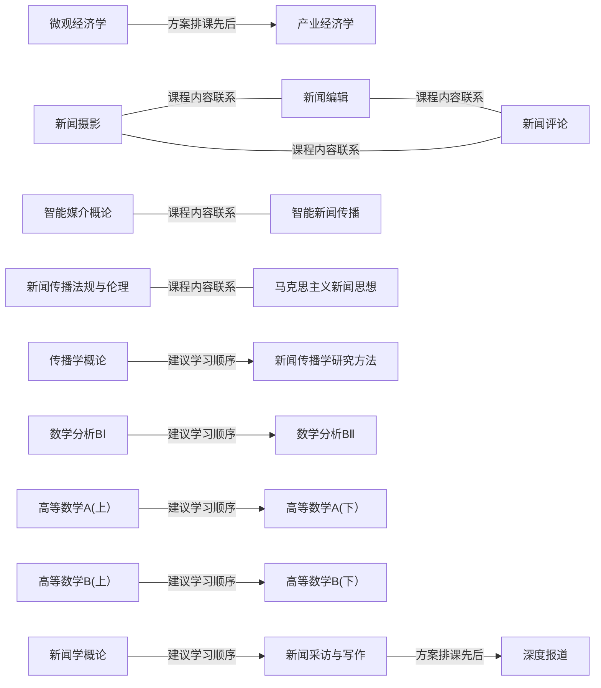

# 2025新闻学-经济学双学士学位项目本科培养方案

新闻学院 · 新闻学-经济学(双学士学位项目) · 方案 97177 · 82 个不同课程或科研条目。

[官方 Word](https://github.com/pythonbug225/fudan-course-atlas/blob/research/schoolwide-cohorts-2023-2025/research/contributions/%E5%85%A8%E6%A0%A1%E5%9F%B9%E5%85%BB%E6%96%B9%E6%A1%882023-2025/%E5%B7%B2%E6%9C%89%E9%99%A2%E7%B3%BB%E8%A7%84%E8%8C%83%E6%95%B0%E6%8D%AE/%E6%96%B0%E9%97%BB%E5%AD%A6%E9%99%A2/2025/originals/plan-97177.docx) · [教务详情](https://fdjwgl.fudan.edu.cn/manager/bizType/2/major-program-search/info/97177?skipAuth=1) · [方案快照](https://github.com/pythonbug225/fudan-course-atlas/blob/research/schoolwide-cohorts-2023-2025/research/contributions/%E5%85%A8%E6%A0%A1%E5%9F%B9%E5%85%BB%E6%96%B9%E6%A1%882023-2025/%E5%B7%B2%E6%9C%89%E9%99%A2%E7%B3%BB%E8%A7%84%E8%8C%83%E6%95%B0%E6%8D%AE/%E6%96%B0%E9%97%BB%E5%AD%A6%E9%99%A2/2025/raw/plan-97177.json.gz) · [年级目录](https://github.com/pythonbug225/fudan-course-atlas/blob/research/schoolwide-cohorts-2023-2025/research/contributions/%E5%85%A8%E6%A0%A1%E5%9F%B9%E5%85%BB%E6%96%B9%E6%A1%882023-2025/%E5%B7%B2%E6%9C%89%E9%99%A2%E7%B3%BB%E8%A7%84%E8%8C%83%E6%95%B0%E6%8D%AE/%E6%96%B0%E9%97%BB%E5%AD%A6%E9%99%A2/2025/README.md)

## 修读导读

- **建议先学**　《新闻学概论》（`JCM10002`） → 《新闻采访与写作》（`JCM20012`） → 《深度报道》（`JCM30018`）。新闻价值、事实核验与体裁概念可用于采访和写作。采访与材料组织训练可用于展开和核查深度报道。

- **可以对照着读**　《新闻编辑》（`JCM20018`）与《新闻评论》（`JCM20019`）。两课可围绕新闻判断、受众与公共表达比较。

- **查模块选课**　《中国新闻传播史》（`JCM20006`）、《智能媒介概论》（`AIS210008`）列在“专业核心教育课程”中。原表见 `/courseModules/13`。

## 课程关系图

图中展示部分关系。下表保留全部已建立的课程对，来源位置使用本方案 JSON Pointer。

## 先修与内容联系

| 类型 | 起点 | 终点 | 依据 | 原表定位 |
| --- | --- | --- | --- | --- |
| 建议学习顺序 | 微观经济学 (ECON20003) | 产业经济学 (ECON30025) | 企业和市场结构是产业经济分析的基础。  | `/courseModules/12/planCourses/0`、`/courseModules/13/planCourses/21` |
| 建议学习顺序 | 新闻学概论 (JCM10002) | 新闻采访与写作 (JCM20012) | 新闻价值、事实核验与体裁概念可用于采访和写作。  | `/courseModules/6/planCourses/1`、`/courseModules/13/planCourses/5` |
| 建议学习顺序 | 传播学概论 (JCM10003) | 新闻传播学研究方法 (JCM20001) | 传播概念和模型可帮助提出具体研究问题。  | `/courseModules/6/planCourses/2`、`/courseModules/13/planCourses/2` |
| 建议学习顺序 | 新闻采访与写作 (JCM20012) | 深度报道 (JCM30018) | 采访与材料组织训练可用于展开和核查深度报道。  | `/courseModules/13/planCourses/5`、`/courseModules/13/planCourses/13` |
| 建议学习顺序 | 高等数学B(上） (MATH10004) | 高等数学B(下） (MATH10005) | 同方案的课程题名具有连续分册或序号。  | `/courseModules/11/planCourses/1`、`/courseModules/11/planCourses/0` |
| 建议学习顺序 | 数学分析BⅠ (MATH10012) | 数学分析BⅡ (MATH10013) | 同方案的课程题名具有连续分册或序号。  | `/courseModules/9/planCourses/0`、`/courseModules/9/planCourses/1` |
| 建议学习顺序 | 高等数学A(上） (MATH10015) | 高等数学A(下） (MATH10016) | 同方案的课程题名具有连续分册或序号。  | `/courseModules/10/planCourses/1`、`/courseModules/10/planCourses/0` |
| 方案排课先后 | 微观经济学 (ECON20003) | 产业经济学 (ECON30025) | 同方案该课程全部明确数字学期均早于后者。  | `/courseModules/12/planCourses/0`、`/courseModules/13/planCourses/21` |
| 方案排课先后 | 新闻采访与写作 (JCM20012) | 深度报道 (JCM30018) | 同方案该课程全部明确数字学期均早于后者。  | `/courseModules/13/planCourses/5`、`/courseModules/13/planCourses/13` |
| 课程内容联系 | 智能媒介概论 (AIS210008) | 智能新闻传播 (AIS310010) | 智能媒介技术和新闻生产传播具有应用场景交集。  | `/courseModules/13/planCourses/1`、`/courseModules/13/planCourses/12` |
| 课程内容联系 | 智能媒介概论 (AIS210008) | 媒介批评 (JCM30008) | 本方案两门课程的题名均含“媒介”，可据此对照这一主题。  | `/courseModules/13/planCourses/1`、`/courseModules/16/planCourses/0` |
| 课程内容联系 | 智能新闻传播 (AIS310010) | 传播学概论 (JCM10003) | 本方案两门课程的题名均含“传播”，可据此对照这一主题。  | `/courseModules/13/planCourses/12`、`/courseModules/6/planCourses/2` |
| 课程内容联系 | 宏观经济学 (ECON20004) | 货币银行学 (ECON30021) | 共同主题为货币政策与宏观经济运行。  | `/courseModules/12/planCourses/1`、`/courseModules/17/planCourses/4` |
| 课程内容联系 | 国际金融 (ECON30017) | 公司金融 (ECON30122) | 本方案两门课程的题名均含“金融”，可据此对照这一主题。  | `/courseModules/17/planCourses/2`、`/courseModules/13/planCourses/18` |
| 课程内容联系 | 新闻学概论 (JCM10002) | 新闻摄影 (JCM20017) | 本方案两门课程的题名均含“新闻”，可据此对照这一主题。  | `/courseModules/6/planCourses/1`、`/courseModules/13/planCourses/6` |
| 课程内容联系 | 传播学概论 (JCM10003) | 中国新闻传播史 (JCM20006) | 本方案两门课程的题名均含“传播”，可据此对照这一主题。  | `/courseModules/6/planCourses/2`、`/courseModules/13/planCourses/0` |
| 课程内容联系 | 传播学概论 (JCM10003) | 外国新闻传播史 (JCM20010) | 本方案两门课程的题名均含“传播”，可据此对照这一主题。  | `/courseModules/6/planCourses/2`、`/courseModules/13/planCourses/9` |
| 课程内容联系 | 传播学概论 (JCM10003) | 新闻传播学文献选读 (JCM50002) | 本方案两门课程的题名均含“传播”，可据此对照这一主题。  | `/courseModules/6/planCourses/2`、`/courseModules/13/planCourses/10` |
| 课程内容联系 | 新闻采访与写作 (JCM20012) | 研究设计与论文写作 (JCM50096) | 本方案两门课程的题名均含“写作”，可据此对照这一主题。  | `/courseModules/13/planCourses/5`、`/courseModules/16/planCourses/6` |
| 课程内容联系 | 新闻摄影 (JCM20017) | 新闻编辑 (JCM20018) | 本方案两门课程的题名均含“新闻”，可据此对照这一主题。  | `/courseModules/13/planCourses/6`、`/courseModules/13/planCourses/7` |
| 课程内容联系 | 新闻摄影 (JCM20017) | 新闻评论 (JCM20019) | 本方案两门课程的题名均含“新闻”，可据此对照这一主题。  | `/courseModules/13/planCourses/6`、`/courseModules/13/planCourses/8` |
| 课程内容联系 | 新闻摄影 (JCM20017) | 新闻社会学 (JCM50064) | 本方案两门课程的题名均含“新闻”，可据此对照这一主题。  | `/courseModules/13/planCourses/6`、`/courseModules/16/planCourses/2` |
| 课程内容联系 | 新闻编辑 (JCM20018) | 新闻评论 (JCM20019) | 两课可围绕新闻判断、受众与公共表达比较。  | `/courseModules/13/planCourses/7`、`/courseModules/13/planCourses/8` |
| 课程内容联系 | 媒介批评 (JCM30008) | 媒介经营管理 (JCM30009) | 本方案两门课程的题名均含“媒介”，可据此对照这一主题。  | `/courseModules/16/planCourses/0`、`/courseModules/13/planCourses/11` |
| 课程内容联系 | 媒介批评 (JCM30008) | 媒介与社会 (JCM50063) | 本方案两门课程的题名均含“媒介”，可据此对照这一主题。  | `/courseModules/16/planCourses/0`、`/courseModules/16/planCourses/1` |
| 课程内容联系 | 媒介批评 (JCM30008) | 新媒介概论 (JCM50072) | 本方案两门课程的题名均含“媒介”，可据此对照这一主题。  | `/courseModules/16/planCourses/0`、`/courseModules/16/planCourses/3` |
| 课程内容联系 | 新闻传播法规与伦理 (JCM30016) | 马克思主义新闻思想 (JCM40004) | 两课均涉及新闻责任和公共传播价值。  | `/courseModules/13/planCourses/4`、`/courseModules/6/planCourses/0` |

本次未从可定位的明确表述中确认课程对课程预修。学期安排、系列分册与编辑建议均保留各自的依据。

## 按原方案模块阅读

同一模块展示原表中的课程归属。模块内课程之间的先后仍须逐项查阅。

- **人文基础课程**　新闻学概论、传播学概论、马克思主义新闻思想（原表模块 6）

## 课程表

同一课程在不同模块分别出现时，按原表逐行列出。季节字段保留原值。

| 课程 | 代码 | 学分 | 学期 | 模块 |
| --- | --- | ---: | --- | --- |
| 马克思主义新闻思想 | JCM40004 | 2.0 | SPRING、AUTUMN | 培养方案 / 专业培养课程 / 学科基础课程 / 人文基础课程 |
| 新闻学概论 | JCM10002 | 2.0 | SPRING、AUTUMN | 培养方案 / 专业培养课程 / 学科基础课程 / 人文基础课程 |
| 传播学概论 | JCM10003 | 2.0 | SPRING、AUTUMN | 培养方案 / 专业培养课程 / 学科基础课程 / 人文基础课程 |
| 数学分析BⅠ | MATH10012 | 5.0 | SPRING、AUTUMN | 培养方案 / 专业培养课程 / 学科基础课程 / 社会科学基础课程 / 数学组 / A组 |
| 数学分析BⅡ | MATH10013 | 5.0 | SPRING、AUTUMN | 培养方案 / 专业培养课程 / 学科基础课程 / 社会科学基础课程 / 数学组 / A组 |
| 高等数学A(下） | MATH10016 | 5.0 | SPRING、AUTUMN | 培养方案 / 专业培养课程 / 学科基础课程 / 社会科学基础课程 / 数学组 / B组 |
| 高等数学A(上） | MATH10015 | 5.0 | SPRING、AUTUMN | 培养方案 / 专业培养课程 / 学科基础课程 / 社会科学基础课程 / 数学组 / B组 |
| 高等数学B(下） | MATH10005 | 5.0 | SPRING、AUTUMN | 培养方案 / 专业培养课程 / 学科基础课程 / 社会科学基础课程 / 数学组 / C组 |
| 高等数学B(上） | MATH10004 | 5.0 | SPRING、AUTUMN | 培养方案 / 专业培养课程 / 学科基础课程 / 社会科学基础课程 / 数学组 / C组 |
| 微观经济学 | ECON20003 | 3.0 | 第1学期 | 培养方案 / 专业培养课程 / 学科基础课程 / 社会科学基础课程 / 学科基础课程 |
| 宏观经济学 | ECON20004 | 3.0 | 第2学期 | 培养方案 / 专业培养课程 / 学科基础课程 / 社会科学基础课程 / 学科基础课程 |
| 会计学 | BA10003 | 3.0 | 第2学期 | 培养方案 / 专业培养课程 / 学科基础课程 / 社会科学基础课程 / 学科基础课程 |
| 线性代数 | MATH10017 | 3.0 | 第2学期 | 培养方案 / 专业培养课程 / 学科基础课程 / 社会科学基础课程 / 学科基础课程 |
| 中国新闻传播史 | JCM20006 | 2.0 | 第2学期、第3学期 | 培养方案 / 专业培养课程 / 专业核心教育课程 |
| 智能媒介概论 | AIS210008 | 2.0 | 第3学期、第4学期 | 培养方案 / 专业培养课程 / 专业核心教育课程 |
| 新闻传播学研究方法 | JCM20001 | 2.0 | 第3学期、第4学期 | 培养方案 / 专业培养课程 / 专业核心教育课程 |
| 数据分析与信息可视化 | JCM30002 | 4.0 | 第5学期、第6学期 | 培养方案 / 专业培养课程 / 专业核心教育课程 |
| 新闻传播法规与伦理 | JCM30016 | 2.0 | 第6学期 | 培养方案 / 专业培养课程 / 专业核心教育课程 |
| 新闻采访与写作 | JCM20012 | 3.0 | 第2学期、第3学期 | 培养方案 / 专业培养课程 / 专业核心教育课程 |
| 新闻摄影 | JCM20017 | 2.0 | 第3学期 | 培养方案 / 专业培养课程 / 专业核心教育课程 |
| 新闻编辑 | JCM20018 | 2.0 | 第3学期 | 培养方案 / 专业培养课程 / 专业核心教育课程 |
| 新闻评论 | JCM20019 | 2.0 | 第4学期 | 培养方案 / 专业培养课程 / 专业核心教育课程 |
| 外国新闻传播史 | JCM20010 | 2.0 | 第4学期 | 培养方案 / 专业培养课程 / 专业核心教育课程 |
| 新闻传播学文献选读 | JCM50002 | 2.0 | 第5学期 | 培养方案 / 专业培养课程 / 专业核心教育课程 |
| 媒介经营管理 | JCM30009 | 2.0 | 第5学期 | 培养方案 / 专业培养课程 / 专业核心教育课程 |
| 智能新闻传播 | AIS310010 | 2.0 | 第6学期 | 培养方案 / 专业培养课程 / 专业核心教育课程 |
| 深度报道 | JCM30018 | 3.0 | 第6学期 | 培养方案 / 专业培养课程 / 专业核心教育课程 |
| 概率论与数理统计 | ECON30016 | 3.0 | 第3学期 | 培养方案 / 专业培养课程 / 专业核心教育课程 |
| 经济史 | ECON30120 | 3.0 | 第3学期 | 培养方案 / 专业培养课程 / 专业核心教育课程 |
| 计量经济学 | ECON30121 | 4.0 | 第4学期 | 培养方案 / 专业培养课程 / 专业核心教育课程 |
| 当代中国经济 | ECON30024 | 3.0 | 第5学期 | 培养方案 / 专业培养课程 / 专业核心教育课程 |
| 公司金融 | ECON30122 | 3.0 | 第3学期 | 培养方案 / 专业培养课程 / 专业核心教育课程 |
| 国际经济学 | ECON30029 | 3.0 | 第4学期 | 培养方案 / 专业培养课程 / 专业核心教育课程 |
| 财政学 | ECON30019 | 3.0 | 第4学期 | 培养方案 / 专业培养课程 / 专业核心教育课程 |
| 产业经济学 | ECON30025 | 3.0 | 第6学期 | 培养方案 / 专业培养课程 / 专业核心教育课程 |
| 制度经济学 | ECON30074 | 3.0 | 第3学期 | 培养方案 / 专业培养课程 / 专业核心教育课程 |
| 外国经济思想史 | ECON30075 | 3.0 | 第3学期 | 培养方案 / 专业培养课程 / 专业核心教育课程 |
| 博弈论 | ECON30054 | 3.0 | 第4学期 | 培养方案 / 专业培养课程 / 专业核心教育课程 |
| 媒介批评 | JCM30008 | 2.0 | SPRING、AUTUMN | 培养方案 / 专业进阶模块I |
| 媒介与社会 | JCM50063 | 2.0 | SPRING、AUTUMN | 培养方案 / 专业进阶模块I |
| 新闻社会学 | JCM50064 | 2.0 | SPRING、AUTUMN | 培养方案 / 专业进阶模块I |
| 新媒介概论 | JCM50072 | 2.0 | SPRING、AUTUMN | 培养方案 / 专业进阶模块I |
| 新闻与全球化 | JCM50103 | 2.0 | SPRING、AUTUMN | 培养方案 / 专业进阶模块I |
| 新时代中国共产党新闻工作理论 | JCM50109 | 2.0 | SPRING、AUTUMN | 培养方案 / 专业进阶模块I |
| 研究设计与论文写作 | JCM50096 | 3.0 | SPRING、AUTUMN | 培养方案 / 专业进阶模块I |
| 中国新闻口述史 | JCM50105 | 3.0 | SPRING、AUTUMN | 培养方案 / 专业进阶模块I |
| 都市、田野调查与纪录 | JCM50062 | 4.0 | SPRING、AUTUMN | 培养方案 / 专业进阶模块I |
| 重大历史事件报道解析 | JCM50104 | 2.0 | SPRING、AUTUMN | 培养方案 / 专业进阶模块I |
| 事实与事实核查 | JCM50092 | 3.0 | SPRING、AUTUMN | 培养方案 / 专业进阶模块I |
| 数据与财经新闻 | JCM50054 | 3.0 | SPRING、AUTUMN | 培养方案 / 专业进阶模块I |
| 对外报道 | JCM50031 | 2.0 | SPRING、AUTUMN | 培养方案 / 专业进阶模块I |
| 移动媒介产品设计 | JCM50065 | 2.0 | SPRING、AUTUMN | 培养方案 / 专业进阶模块I |
| 新闻叙事分析 | JCM50069 | 2.0 | SPRING、AUTUMN | 培养方案 / 专业进阶模块I |
| 数字媒体运营 | JCM50001 | 2.0 | SPRING、AUTUMN | 培养方案 / 专业进阶模块I |
| 习近平文化思想概论 | JCM40005 | 2.0 | SPRING、AUTUMN | 培养方案 / 专业进阶模块I |
| 资源环境经济学 | ECON30136 | 3.0 | 第6学期 | 培养方案 / 专业进阶模块II |
| 投资学 | ECON30126 | 3.0 | 第6学期 | 培养方案 / 专业进阶模块II |
| 国际金融 | ECON30017 | 3.0 | 第5学期 | 培养方案 / 专业进阶模块II |
| 农村和农业经济学 | ECON30048 | 2.0 | 第5学期 | 培养方案 / 专业进阶模块II |
| 货币银行学 | ECON30021 | 3.0 | 第5学期 | 培养方案 / 专业进阶模块II |
| 劳动经济学 | ECON30113 | 3.0 | 第6学期 | 培养方案 / 专业进阶模块II |
| 区域经济学 | ECON30047 | 2.0 | 第7学期 | 培养方案 / 专业进阶模块II |
| 城市经济学 | ECON30049 | 3.0 | 第7学期 | 培养方案 / 专业进阶模块II |
| 信息经济学 | ECON30081 | 2.0 | 第5学期 | 培养方案 / 专业进阶模块II |
| 发展经济学 | ECON30026 | 3.0 | 第7学期 | 培养方案 / 专业进阶模块II |
| 十六世纪后的世界政治、经济与思想 | ECON30001 | 3.0 | 第6学期 | 培养方案 / 专业进阶模块II |
| 创新经济学 | ECON30013 | 3.0 | 第6学期 | 培养方案 / 专业进阶模块II |
| 时间序列分析的方法 | ECON40004 | 3.0 | 第5学期 | 培养方案 / 专业进阶模块II |
| 截面与面板数据分析 | ECON40012 | 3.0 | 第6学期 | 培养方案 / 专业进阶模块II |
| 数量分析软件应用 | ECON40013 | 3.0 | 第7学期 | 培养方案 / 专业进阶模块II |
| 人工智能与应用经济学 | AIS410005 | 3.0 | 第7学期 | 培养方案 / 专业进阶模块II |
| 数字时代的经济法律实践 | ECON30009 | 3.0 | 第6学期 | 培养方案 / 专业进阶模块II |
| 公共财政政策分析 | ECON30130 | 3.0 | 第6学期 | 培养方案 / 专业进阶模块II |
| 公司财务分析 | ECON30055 | 2.0 | 第6学期 | 培养方案 / 专业进阶模块II |
| 复芏计划(FDUROP) | 102 | 1.0 |  | 融合创新能力 |
| 校园媒体实践(本科阶段) | 1071 | 1.0 |  | 融合创新能力 |
| 专业竞赛(本科阶段) | 106 | 1.0 |  | 融合创新能力 |
| 教学实习 | JCM40001 | 4.0 | 第7学期 | 融合创新能力 |
| 毕业论文 | JCM40003 | 4.0 | 第8学期 | 融合创新能力 |
| 记录中国（专业实践） | JCM50029 | 2.0 | SUMMER | 融合创新能力 |
| 大江东—复旦融媒体创新工作室 | JCM50004 | 2.0 | SPRING、AUTUMN | 融合创新能力 |
| 新闻实务工作坊 | JCM50003 | 2.0 | SPRING、AUTUMN | 融合创新能力 |
