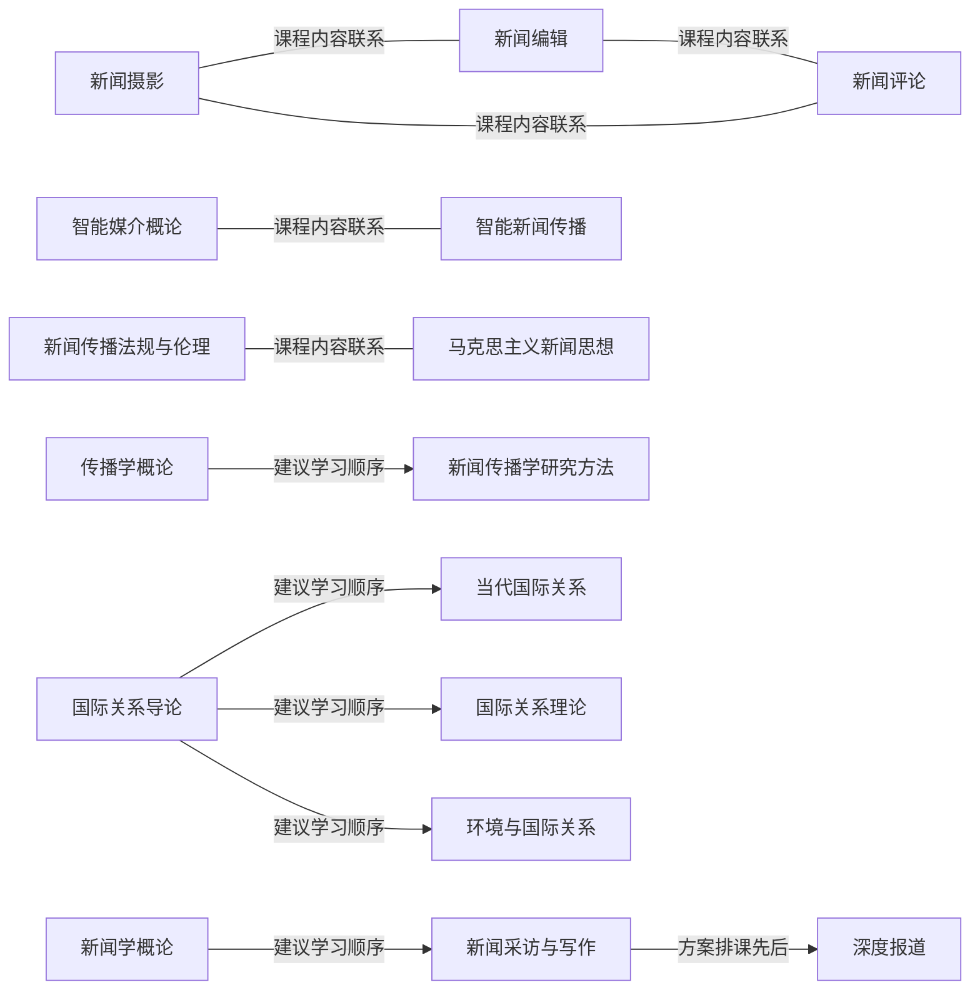

# 2025新闻学-国际政治（全球领导力方向）双学士学位项目本科培养方案

新闻学院 · 新闻学-国际政治(全球领导力)(双学士学位项目) · 方案 97179 · 68 个不同课程或科研条目。

[官方 Word](https://github.com/pythonbug225/fudan-course-atlas/blob/research/schoolwide-cohorts-2023-2025/research/contributions/%E5%85%A8%E6%A0%A1%E5%9F%B9%E5%85%BB%E6%96%B9%E6%A1%882023-2025/%E5%B7%B2%E6%9C%89%E9%99%A2%E7%B3%BB%E8%A7%84%E8%8C%83%E6%95%B0%E6%8D%AE/%E6%96%B0%E9%97%BB%E5%AD%A6%E9%99%A2/2025/originals/plan-97179.docx) · [教务详情](https://fdjwgl.fudan.edu.cn/manager/bizType/2/major-program-search/info/97179?skipAuth=1) · [方案快照](https://github.com/pythonbug225/fudan-course-atlas/blob/research/schoolwide-cohorts-2023-2025/research/contributions/%E5%85%A8%E6%A0%A1%E5%9F%B9%E5%85%BB%E6%96%B9%E6%A1%882023-2025/%E5%B7%B2%E6%9C%89%E9%99%A2%E7%B3%BB%E8%A7%84%E8%8C%83%E6%95%B0%E6%8D%AE/%E6%96%B0%E9%97%BB%E5%AD%A6%E9%99%A2/2025/raw/plan-97179.json.gz) · [年级目录](https://github.com/pythonbug225/fudan-course-atlas/blob/research/schoolwide-cohorts-2023-2025/research/contributions/%E5%85%A8%E6%A0%A1%E5%9F%B9%E5%85%BB%E6%96%B9%E6%A1%882023-2025/%E5%B7%B2%E6%9C%89%E9%99%A2%E7%B3%BB%E8%A7%84%E8%8C%83%E6%95%B0%E6%8D%AE/%E6%96%B0%E9%97%BB%E5%AD%A6%E9%99%A2/2025/README.md)

## 修读导读

- **建议先学**　《新闻学概论》（`JCM10002`） → 《新闻采访与写作》（`JCM20012`） → 《深度报道》（`JCM30018`）。新闻价值、事实核验与体裁概念可用于采访和写作。采访与材料组织训练可用于展开和核查深度报道。

- **可以对照着读**　《新闻编辑》（`JCM20018`）与《新闻评论》（`JCM20019`）。两课可围绕新闻判断、受众与公共表达比较。

- **查模块选课**　《中国新闻传播史》（`JCM20006`）、《智能媒介概论》（`AIS210008`）列在“专业核心教育课程”中。原表见 `/courseModules/8`。

## 课程关系图

图中展示部分关系。下表保留全部已建立的课程对，来源位置使用本方案 JSON Pointer。

## 先修与内容联系

| 类型 | 起点 | 终点 | 依据 | 原表定位 |
| --- | --- | --- | --- | --- |
| 建议学习顺序 | 新闻学概论 (JCM10002) | 新闻采访与写作 (JCM20012) | 新闻价值、事实核验与体裁概念可用于采访和写作。  | `/courseModules/6/planCourses/1`、`/courseModules/8/planCourses/5` |
| 建议学习顺序 | 传播学概论 (JCM10003) | 新闻传播学研究方法 (JCM20001) | 传播概念和模型可帮助提出具体研究问题。  | `/courseModules/6/planCourses/2`、`/courseModules/8/planCourses/2` |
| 建议学习顺序 | 新闻采访与写作 (JCM20012) | 深度报道 (JCM30018) | 采访与材料组织训练可用于展开和核查深度报道。  | `/courseModules/8/planCourses/5`、`/courseModules/8/planCourses/12` |
| 建议学习顺序 | 国际关系导论 (POLI10003) | 当代国际关系 (POLI20012) | 国际体系和行为体概念可用于时事与历史案例分析。  | `/courseModules/7/planCourses/1`、`/courseModules/8/planCourses/16` |
| 建议学习顺序 | 国际关系导论 (POLI10003) | 国际关系理论 (POLI20018) | “国际关系导论”题名标明基础层次，前置阅读可帮助了解“国际关系理论”中的国际关系主题。  | `/courseModules/7/planCourses/1`、`/courseModules/8/planCourses/18` |
| 建议学习顺序 | 国际关系导论 (POLI10003) | 环境与国际关系 (POLI30040) | “国际关系导论”题名标明基础层次，前置阅读可帮助了解“环境与国际关系”中的国际关系主题。  | `/courseModules/7/planCourses/1`、`/courseModules/12/planCourses/3` |
| 建议学习顺序 | 国际关系导论 (POLI10003) | 能源与国际关系 (POLI30048) | “国际关系导论”题名标明基础层次，前置阅读可帮助了解“能源与国际关系”中的国际关系主题。  | `/courseModules/7/planCourses/1`、`/courseModules/12/planCourses/2` |
| 方案排课先后 | 新闻采访与写作 (JCM20012) | 深度报道 (JCM30018) | 同方案该课程全部明确数字学期均早于后者。  | `/courseModules/8/planCourses/5`、`/courseModules/8/planCourses/12` |
| 课程内容联系 | 智能媒介概论 (AIS210008) | 智能新闻传播 (AIS310010) | 智能媒介技术和新闻生产传播具有应用场景交集。  | `/courseModules/8/planCourses/1`、`/courseModules/8/planCourses/13` |
| 课程内容联系 | 智能媒介概论 (AIS210008) | 媒介批评 (JCM30008) | 本方案两门课程的题名均含“媒介”，可据此对照这一主题。  | `/courseModules/8/planCourses/1`、`/courseModules/11/planCourses/0` |
| 课程内容联系 | 智能新闻传播 (AIS310010) | 传播学概论 (JCM10003) | 本方案两门课程的题名均含“传播”，可据此对照这一主题。  | `/courseModules/8/planCourses/13`、`/courseModules/6/planCourses/2` |
| 课程内容联系 | 新闻学概论 (JCM10002) | 新闻摄影 (JCM20017) | 本方案两门课程的题名均含“新闻”，可据此对照这一主题。  | `/courseModules/6/planCourses/1`、`/courseModules/8/planCourses/6` |
| 课程内容联系 | 传播学概论 (JCM10003) | 中国新闻传播史 (JCM20006) | 本方案两门课程的题名均含“传播”，可据此对照这一主题。  | `/courseModules/6/planCourses/2`、`/courseModules/8/planCourses/0` |
| 课程内容联系 | 传播学概论 (JCM10003) | 外国新闻传播史 (JCM20010) | 本方案两门课程的题名均含“传播”，可据此对照这一主题。  | `/courseModules/6/planCourses/2`、`/courseModules/8/planCourses/9` |
| 课程内容联系 | 传播学概论 (JCM10003) | 新闻传播学文献选读 (JCM50002) | 本方案两门课程的题名均含“传播”，可据此对照这一主题。  | `/courseModules/6/planCourses/2`、`/courseModules/8/planCourses/10` |
| 课程内容联系 | 新闻采访与写作 (JCM20012) | 研究设计与论文写作 (JCM50096) | 本方案两门课程的题名均含“写作”，可据此对照这一主题。  | `/courseModules/8/planCourses/5`、`/courseModules/11/planCourses/6` |
| 课程内容联系 | 新闻摄影 (JCM20017) | 新闻编辑 (JCM20018) | 本方案两门课程的题名均含“新闻”，可据此对照这一主题。  | `/courseModules/8/planCourses/6`、`/courseModules/8/planCourses/7` |
| 课程内容联系 | 新闻摄影 (JCM20017) | 新闻评论 (JCM20019) | 本方案两门课程的题名均含“新闻”，可据此对照这一主题。  | `/courseModules/8/planCourses/6`、`/courseModules/8/planCourses/8` |
| 课程内容联系 | 新闻摄影 (JCM20017) | 新闻社会学 (JCM50064) | 本方案两门课程的题名均含“新闻”，可据此对照这一主题。  | `/courseModules/8/planCourses/6`、`/courseModules/11/planCourses/2` |
| 课程内容联系 | 新闻编辑 (JCM20018) | 新闻评论 (JCM20019) | 两课可围绕新闻判断、受众与公共表达比较。  | `/courseModules/8/planCourses/7`、`/courseModules/8/planCourses/8` |
| 课程内容联系 | 媒介批评 (JCM30008) | 媒介经营管理 (JCM30009) | 本方案两门课程的题名均含“媒介”，可据此对照这一主题。  | `/courseModules/11/planCourses/0`、`/courseModules/8/planCourses/11` |
| 课程内容联系 | 媒介批评 (JCM30008) | 媒介与社会 (JCM50063) | 本方案两门课程的题名均含“媒介”，可据此对照这一主题。  | `/courseModules/11/planCourses/0`、`/courseModules/11/planCourses/1` |
| 课程内容联系 | 媒介批评 (JCM30008) | 新媒介概论 (JCM50072) | 本方案两门课程的题名均含“媒介”，可据此对照这一主题。  | `/courseModules/11/planCourses/0`、`/courseModules/11/planCourses/3` |
| 课程内容联系 | 新闻传播法规与伦理 (JCM30016) | 马克思主义新闻思想 (JCM40004) | 两课均涉及新闻责任和公共传播价值。  | `/courseModules/8/planCourses/4`、`/courseModules/6/planCourses/0` |
| 课程内容联系 | 国际关系导论 (POLI10003) | 当代国际关系 (POLI20012) | 本方案两门课程的题名均含“国际关系”，可据此对照这一主题。  | `/courseModules/7/planCourses/1`、`/courseModules/8/planCourses/16` |
| 课程内容联系 | 国际关系导论 (POLI10003) | 国际关系理论 (POLI20018) | 本方案两门课程的题名均含“国际关系”，可据此对照这一主题。  | `/courseModules/7/planCourses/1`、`/courseModules/8/planCourses/18` |
| 课程内容联系 | 国际关系导论 (POLI10003) | 环境与国际关系 (POLI30040) | 本方案两门课程的题名均含“国际关系”，可据此对照这一主题。  | `/courseModules/7/planCourses/1`、`/courseModules/12/planCourses/3` |
| 课程内容联系 | 国际关系导论 (POLI10003) | 能源与国际关系 (POLI30048) | 本方案两门课程的题名均含“国际关系”，可据此对照这一主题。  | `/courseModules/7/planCourses/1`、`/courseModules/12/planCourses/2` |
| 课程内容联系 | 当代中国政治制度 (POLI10009) | 比较政治制度 (POLI20022) | 均涉及政治制度，可对照制度安排与研究对象。  | `/courseModules/7/planCourses/2`、`/courseModules/8/planCourses/15` |

本次未从可定位的明确表述中确认课程对课程预修。学期安排、系列分册与编辑建议均保留各自的依据。

## 按原方案模块阅读

同一模块展示原表中的课程归属。模块内课程之间的先后仍须逐项查阅。

- **人文基础课程**　新闻学概论、传播学概论、马克思主义新闻思想（原表模块 6）
- **社会科学基础课程**　高等数学D、国际关系导论、政治学原理、当代中国政治制度（原表模块 7）

## 课程表

同一课程在不同模块分别出现时，按原表逐行列出。季节字段保留原值。

| 课程 | 代码 | 学分 | 学期 | 模块 |
| --- | --- | ---: | --- | --- |
| 马克思主义新闻思想 | JCM40004 | 2.0 | SPRING、AUTUMN | 培养方案 / 专业培养课程 / 学科基础课程 / 人文基础课程 |
| 新闻学概论 | JCM10002 | 2.0 | SPRING、AUTUMN | 培养方案 / 专业培养课程 / 学科基础课程 / 人文基础课程 |
| 传播学概论 | JCM10003 | 2.0 | SPRING、AUTUMN | 培养方案 / 专业培养课程 / 学科基础课程 / 人文基础课程 |
| 政治学原理 | POLI10004 | 4.0 | SPRING、AUTUMN | 培养方案 / 专业培养课程 / 学科基础课程 / 社会科学基础课程 |
| 国际关系导论 | POLI10003 | 4.0 | SPRING、AUTUMN | 培养方案 / 专业培养课程 / 学科基础课程 / 社会科学基础课程 |
| 当代中国政治制度 | POLI10009 | 3.0 | SPRING、AUTUMN | 培养方案 / 专业培养课程 / 学科基础课程 / 社会科学基础课程 |
| 高等数学D | MATH10008 | 4.0 | 第2学期 | 培养方案 / 专业培养课程 / 学科基础课程 / 社会科学基础课程 |
| 中国新闻传播史 | JCM20006 | 2.0 | 第2学期、第3学期 | 培养方案 / 专业培养课程 / 专业核心教育课程 |
| 智能媒介概论 | AIS210008 | 2.0 | 第3学期、第4学期 | 培养方案 / 专业培养课程 / 专业核心教育课程 |
| 新闻传播学研究方法 | JCM20001 | 2.0 | 第3学期、第4学期 | 培养方案 / 专业培养课程 / 专业核心教育课程 |
| 数据分析与信息可视化 | JCM30002 | 4.0 | 第5学期、第6学期 | 培养方案 / 专业培养课程 / 专业核心教育课程 |
| 新闻传播法规与伦理 | JCM30016 | 2.0 | 第6学期 | 培养方案 / 专业培养课程 / 专业核心教育课程 |
| 新闻采访与写作 | JCM20012 | 3.0 | 第2学期、第3学期 | 培养方案 / 专业培养课程 / 专业核心教育课程 |
| 新闻摄影 | JCM20017 | 2.0 | 第3学期 | 培养方案 / 专业培养课程 / 专业核心教育课程 |
| 新闻编辑 | JCM20018 | 2.0 | 第3学期 | 培养方案 / 专业培养课程 / 专业核心教育课程 |
| 新闻评论 | JCM20019 | 2.0 | 第4学期 | 培养方案 / 专业培养课程 / 专业核心教育课程 |
| 外国新闻传播史 | JCM20010 | 2.0 | 第4学期 | 培养方案 / 专业培养课程 / 专业核心教育课程 |
| 新闻传播学文献选读 | JCM50002 | 2.0 | 第5学期 | 培养方案 / 专业培养课程 / 专业核心教育课程 |
| 媒介经营管理 | JCM30009 | 2.0 | 第5学期 | 培养方案 / 专业培养课程 / 专业核心教育课程 |
| 深度报道 | JCM30018 | 3.0 | 第6学期 | 培养方案 / 专业培养课程 / 专业核心教育课程 |
| 智能新闻传播 | AIS310010 | 2.0 | 第6学期 | 培养方案 / 专业培养课程 / 专业核心教育课程 |
| 计算社会科学 | POLI10002 | 3.0 | SPRING、AUTUMN | 培养方案 / 专业培养课程 / 专业核心教育课程 |
| 比较政治制度 | POLI20022 | 3.0 | SPRING、AUTUMN | 培养方案 / 专业培养课程 / 专业核心教育课程 |
| 当代国际关系 | POLI20012 | 3.0 | SPRING、AUTUMN | 培养方案 / 专业培养课程 / 专业核心教育课程 |
| 当代中国对外关系 | POLI20009 | 3.0 | SPRING、AUTUMN | 培养方案 / 专业培养课程 / 专业核心教育课程 |
| 国际关系理论 | POLI20018 | 3.0 | SPRING、AUTUMN | 培养方案 / 专业培养课程 / 专业核心教育课程 |
| 外交学 | POLI30027 | 2.0 | SPRING、AUTUMN | 培养方案 / 专业培养课程 / 专业核心教育课程 |
| 跨文化与国际交流 | POLI30051 | 2.0 | SPRING、AUTUMN | 培养方案 / 专业培养课程 / 专业核心教育课程 |
| 美国政治与对外关系 | POLI40002 | 2.0 | SPRING、AUTUMN | 培养方案 / 专业培养课程 / 专业核心教育课程 |
| 欧盟政治与对外关系 | POLI30029 | 2.0 | SPRING、AUTUMN | 培养方案 / 专业培养课程 / 专业核心教育课程 |
| 日本政治与对外关系 | POLI30030 | 2.0 | SPRING、AUTUMN | 培养方案 / 专业培养课程 / 专业核心教育课程 |
| 国际政治经济学 | POLI30016 | 2.0 | SPRING、AUTUMN | 培养方案 / 专业培养课程 / 专业核心教育课程 |
| 国际组织概论 | POLI50005 | 2.0 | SPRING、AUTUMN | 培养方案 / 专业培养课程 / 专业核心教育课程 |
| 媒介批评 | JCM30008 | 2.0 | SPRING、AUTUMN | 培养方案 / 专业进阶模块I |
| 媒介与社会 | JCM50063 | 2.0 | SPRING、AUTUMN | 培养方案 / 专业进阶模块I |
| 新闻社会学 | JCM50064 | 2.0 | SPRING、AUTUMN | 培养方案 / 专业进阶模块I |
| 新媒介概论 | JCM50072 | 2.0 | SPRING、AUTUMN | 培养方案 / 专业进阶模块I |
| 新闻与全球化 | JCM50103 | 2.0 | SPRING、AUTUMN | 培养方案 / 专业进阶模块I |
| 新时代中国共产党新闻工作理论 | JCM50109 | 2.0 | SPRING、AUTUMN | 培养方案 / 专业进阶模块I |
| 研究设计与论文写作 | JCM50096 | 3.0 | SPRING、AUTUMN | 培养方案 / 专业进阶模块I |
| 中国新闻口述史 | JCM50105 | 3.0 | SPRING、AUTUMN | 培养方案 / 专业进阶模块I |
| 都市、田野调查与纪录 | JCM50062 | 4.0 | SPRING、AUTUMN | 培养方案 / 专业进阶模块I |
| 重大历史事件报道解析 | JCM50104 | 2.0 | SPRING、AUTUMN | 培养方案 / 专业进阶模块I |
| 事实与事实核查 | JCM50092 | 3.0 | SPRING、AUTUMN | 培养方案 / 专业进阶模块I |
| 数据与财经新闻 | JCM50054 | 3.0 | SPRING、AUTUMN | 培养方案 / 专业进阶模块I |
| 对外报道 | JCM50031 | 2.0 | SPRING、AUTUMN | 培养方案 / 专业进阶模块I |
| 移动媒介产品设计 | JCM50065 | 2.0 | SPRING、AUTUMN | 培养方案 / 专业进阶模块I |
| 新闻叙事分析 | JCM50069 | 2.0 | SPRING、AUTUMN | 培养方案 / 专业进阶模块I |
| 数字媒体运营 | JCM50001 | 2.0 | SPRING、AUTUMN | 培养方案 / 专业进阶模块I |
| 习近平文化思想概论 | JCM40005 | 2.0 | SPRING、AUTUMN | 培养方案 / 专业进阶模块I |
| 国际发展 | POLI30003 | 2.0 | SPRING、AUTUMN | 培养方案 / 专业进阶模块II |
| 中国与全球治理 | POLI40019 | 2.0 | SPRING、AUTUMN | 培养方案 / 专业进阶模块II |
| 能源与国际关系 | POLI30048 | 2.0 | SPRING、AUTUMN | 培养方案 / 专业进阶模块II |
| 环境与国际关系 | POLI30040 | 2.0 | SPRING、AUTUMN | 培养方案 / 专业进阶模块II |
| 贸易与国际关系 | POLI30052 | 2.0 | SPRING、AUTUMN | 培养方案 / 专业进阶模块II |
| 全球卫生与国际关系 | POLI30063 | 2.0 | SPRING、AUTUMN | 培养方案 / 专业进阶模块II |
| 国际秩序专题研究 | POLI70014 | 3.0 | SPRING、AUTUMN | 培养方案 / 专业进阶模块II |
| 国际谈判 | POLI30018 | 2.0 | SPRING、AUTUMN | 培养方案 / 专业进阶模块II |
| 外交实务 | POLI50010 | 2.0 | SPRING、AUTUMN | 培养方案 / 专业进阶模块II |
| 涉外法治与国际关系 | POLI30007 | 2.0 | SPRING、AUTUMN | 培养方案 / 专业进阶模块II |
| 复芏计划(FDUROP) | 102 | 1.0 |  | 融合创新能力 |
| 校园媒体实践(本科阶段) | 1071 | 1.0 |  | 融合创新能力 |
| 专业竞赛(本科阶段) | 106 | 1.0 |  | 融合创新能力 |
| 教学实习 | JCM40001 | 4.0 | 第7学期 | 融合创新能力 |
| 毕业论文 | JCM40003 | 4.0 | 第8学期 | 融合创新能力 |
| 记录中国（专业实践） | JCM50029 | 2.0 | SUMMER | 融合创新能力 |
| 大江东—复旦融媒体创新工作室 | JCM50004 | 2.0 | SPRING、AUTUMN | 融合创新能力 |
| 新闻实务工作坊 | JCM50003 | 2.0 | SPRING、AUTUMN | 融合创新能力 |
