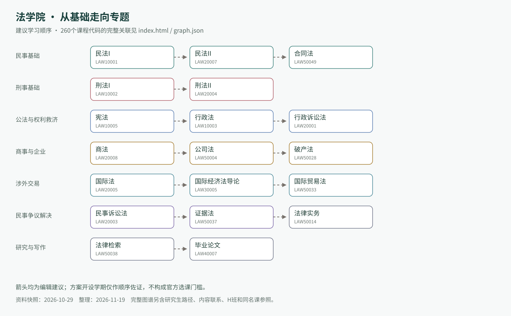

# 法学院课程关系图谱

基于本批2025秋／2026春官方课表的**260个课号、244个课名**，建立**74条建议先学关系、248条内容联系**，覆盖253个有连线的课程。另7个课程保留为待核节点。图谱整理日期为2026-11-19，资料快照仍是2026-10-29，未宣称已核对2026-11的最新培养要求。



## 打开图谱

下载本目录后，用浏览器打开 **[index.html](index.html)**。这是自包含文件，已嵌入图谱数据与脚本，可离线使用，不需要安装依赖或登录。GitHub会显示HTML源码，浏览交互图需要先下载打开。

- 按课程名称、代码或教师查找课程，点击后查看直接联系。
- 按知识主题、培养层次和关系类型筛选；普通与H班保留不同节点。
- “追溯建议先修”只沿建议先学的方向回溯，不把内容联系当成先修。
- 选择11条学习路径之一，或浏览全部课程；点击连线查看具体理由、编辑规则位置和方案学期佐证。
- 支持缩放和当前视图SVG导出；课程目录和右侧关系列表也提供文本入口。

图谱的主题分组为编辑标签，依据课程名归类，不是学校官方的专业方向划分。

## 怎样理解连线

| 类型 | 表示什么 | 证据与限制 |
| --- | --- | --- |
| 建议先学（虚线箭头） | 先掌握某些概念或技能可能有助于后课学习 | 基于法学知识结构的编辑判断，未获教师／大纲确认。74条中29条另有至少一个本科方案的开设学期顺序佐证；开设学期不能证明先修门槛。 |
| 内容联系（无向实线） | 可按主题、方法、实务问题或法域比较联系理解 | 248条中包括H班和同名课的检索参照，具体依据在每条的 `basis`、`reason`、`rule_pointer` 中；不保证两课实际内容重叠或可互认学分。 |
| 官方先修 | 必须由官方明确先修字段、课程大纲或制度支持 | 本批未确认，当前为0条。现有字段为空或缺失，不能解释成“无需先修”。 |

**先修关系的核查结果：**逐份检查8个本科培养方案快照中的相关字段，以及可见字符串中的先修表述，未找到非空的明确先修记录。详细位置见[source-audit.json](source-audit.json)。其中字段出现次数包含`planCourses`／`realPlanCourses`的重复结构，不等于不同课程数；内嵌图片未OCR。当前也没有各课完整大纲及研究生培养方案，因此所有课程的官方先修状态均为“未确认”。

保留课号作为节点ID，不合并同名的本科、研究生课程。H班与普通班只增加主题参照，不自动继承先修、学分和互认规则。培养方案按**课号精确匹配**记录成员关系，未匹配到的研究生课不借用本科方案作为其培养要求。

“无边”的7门课程包括通识课及尚缺大纲的宽泛专题。它们仍可检索和筛选；无边仅表示本图暂未建立可解释的联系，不表示课程没有联系。完整列表见[graph.json](graph.json)的`stats.unmapped_nodes`。

## 数据与溯源

| 文件 | 用途 |
| --- | --- |
| [graph.json](graph.json) | 完整课程节点、连线、学习路径、原始来源、统计及适用边界。 |
| [nodes.csv](nodes.csv) | 260个课程代码、名称、知识主题、层次、H班及待核状态。 |
| [relations.csv](relations.csv) | 322条有类型的关系，含方向、理由、证据类别、方案ID与编辑规则位置。 |
| [rules.json](rules.json) | 人工编写的学习路径、建议关系、具体内容联系与主题族；调整关系的首选入口。 |
| [source-audit.json](source-audit.json) | 8份官方方案字段核查、JSON指针及输入文件SHA-256。 |
| [overview.svg](overview.svg)、[overview.mmd](overview.mmd) | GitHub可查看的学习路径概览，以及可复用的Mermaid源文件。 |
| [build.py](build.py)、[graph-core.js](graph-core.js)、[viewer.html](viewer.html) | 本地构建、纯筛选逻辑与页面模板；生成`index.html`。 |

节点来源为[官方教学班](../official/sections.json)；方案对应来自[方案列课索引](../official/program-courses.csv)与[8份脱敏方案响应](../raw/official/programs/)，官方来源链接见[方案索引](../official/programs.json)。每条顺序佐证保留具体方案、两端原始`terms`及JSON指针，可回到原始响应核对。

机器读取时请使用`type`和`directed`，不要仅凭线的视觉方向。所有当前连线均为`is_enrollment_requirement: false`、`review_status: needs_syllabus_or_teacher_review`。`plan_order_support`只记录方向相符的共同方案顺序，不代表先修许可。`same_name_title_only`只表示同名检索参照。

示例：

```python
import json
from pathlib import Path
graph = json.loads(Path("graph.json").read_text(encoding="utf-8"))
course = "LAW20007"
suggested_before = [e for e in graph["edges"]
                    if e["type"] == "recommended_prerequisite"
                    and e["target"] == course]
```

## 更新与验证

在本目录运行：

```shell
python build.py
python test_graph.py
node test_graph.cjs
```

均只使用标准库，不会联网。`build.py`如果在既有方案中发现非空先修字段或相关文字，会停止，要求先人工解释证据，避免旧规则静默覆盖新增官方要求。更新本目录后，还应在上一级重建批次`manifest.json`的文件哈希，再运行上一级`validate.py`。

数据结构检查覆盖官方课号／层次、引用与原始JSON指针、顺序边无环、普通／H班边界、CSV一致性及内嵌数据；筛选逻辑检查方向回溯和不同层次等行为。当前环境的浏览器策略阻止打开本地文件，未完成真实浏览器中的视觉与点击验收；未将静态检查表述为浏览器测试。

来源文本和官方资料保留各自权利。学习顺序及主题解释为本次新增编辑判断，供继续核查与修订。
