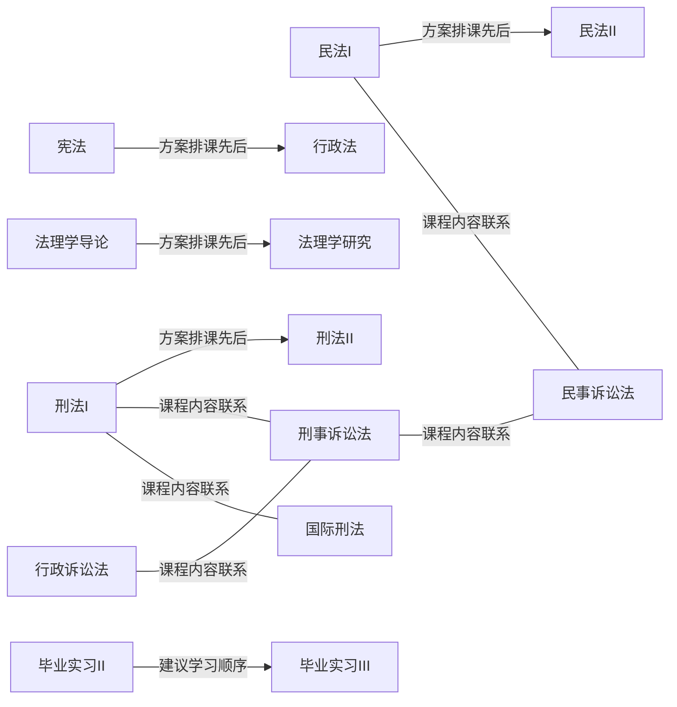

# 2023 法学专业“2+X”教学培养方案（普本）

法学院 · 法学 · 方案 67413 · 86 个不同课程或科研条目。

[官方 Word](../originals/plan-67413.docx) · [教务详情](https://fdjwgl.fudan.edu.cn/manager/bizType/2/major-program-search/info/67413?skipAuth=1) · [方案快照](../raw/plan-67413.json.gz) · [年级目录](../README.md)

## 课程关系图

图中展示部分关系。下表保留全部已建立的课程对，来源位置使用本方案 JSON Pointer。

## 先修与内容联系

| 类型 | 起点 | 终点 | 依据 | 原表定位 |
| --- | --- | --- | --- | --- |
| 建议学习顺序 | 民法I (LAW10001) | 民法II (LAW20007) | 同方案的课程题名具有连续分册或序号。  | `/courseModules/6/planCourses/0`、`/courseModules/6/planCourses/14` |
| 建议学习顺序 | 刑法I (LAW10002) | 刑法II (LAW20004) | 同方案的课程题名具有连续分册或序号。  | `/courseModules/6/planCourses/12`、`/courseModules/6/planCourses/10` |
| 建议学习顺序 | 法理学导论 (LAW10004) | 法理学研究 (LAW50016) | 法理学中的基本概念可支持进一步专题研究。  | `/courseModules/5/planCourses/8`、`/courseModules/9/planCourses/5` |
| 建议学习顺序 | 宪法 (LAW10005) | 行政法 (LAW10003) | 对国家机构与公权力结构的认识可帮助理解行政法律关系。  | `/courseModules/5/planCourses/9`、`/courseModules/6/planCourses/15` |
| 建议学习顺序 | 毕业实习II (LAW40004) | 毕业实习III (LAW40005) | 同方案的课程题名具有连续分册或序号。  | `/courseModules/6/planCourses/2`、`/courseModules/6/planCourses/3` |
| 方案排课先后 | 民法I (LAW10001) | 民法II (LAW20007) | 同方案该课程全部明确数字学期均早于后者。  | `/courseModules/6/planCourses/0`、`/courseModules/6/planCourses/14` |
| 方案排课先后 | 刑法I (LAW10002) | 刑法II (LAW20004) | 同方案该课程全部明确数字学期均早于后者。  | `/courseModules/6/planCourses/12`、`/courseModules/6/planCourses/10` |
| 方案排课先后 | 法理学导论 (LAW10004) | 法理学研究 (LAW50016) | 同方案该课程全部明确数字学期均早于后者。  | `/courseModules/5/planCourses/8`、`/courseModules/9/planCourses/5` |
| 方案排课先后 | 宪法 (LAW10005) | 行政法 (LAW10003) | 同方案该课程全部明确数字学期均早于后者。  | `/courseModules/5/planCourses/9`、`/courseModules/6/planCourses/15` |
| 课程内容联系 | 民法I (LAW10001) | 民事诉讼法 (LAW20003) | 民事权利义务与其程序救济可对照学习。  | `/courseModules/6/planCourses/0`、`/courseModules/6/planCourses/6` |
| 课程内容联系 | 民法I (LAW10001) | 民法II (LAW20007) | 本方案两门课程的题名均含“民法”，可据此对照这一主题。  | `/courseModules/6/planCourses/0`、`/courseModules/6/planCourses/14` |
| 课程内容联系 | 民法I (LAW10001) | 民法II（H） (LAW20007h) | 本方案两门课程的题名均含“民法”，可据此对照这一主题。  | `/courseModules/6/planCourses/0`、`/courseModules/13/planCourses/3` |
| 课程内容联系 | 刑法I (LAW10002) | 刑事诉讼法 (LAW20002) | 犯罪与刑责的实体规则和程序规则可相互参照。  | `/courseModules/6/planCourses/12`、`/courseModules/6/planCourses/5` |
| 课程内容联系 | 刑法I (LAW10002) | 刑法II (LAW20004) | 本方案两门课程的题名均含“刑法”，可据此对照这一主题。  | `/courseModules/6/planCourses/12`、`/courseModules/6/planCourses/10` |
| 课程内容联系 | 刑法I (LAW10002) | 刑法II（H） (LAW20004h) | 本方案两门课程的题名均含“刑法”，可据此对照这一主题。  | `/courseModules/6/planCourses/12`、`/courseModules/13/planCourses/2` |
| 课程内容联系 | 刑法I (LAW10002) | 国际刑法 (LAW50036) | 本方案两门课程的题名均含“刑法”，可据此对照这一主题。  | `/courseModules/6/planCourses/12`、`/courseModules/9/planCourses/17` |
| 课程内容联系 | 法理学导论 (LAW10004) | 宪法 (LAW10005) | 两课均涉及权利与公共权力的规范依据。  | `/courseModules/5/planCourses/8`、`/courseModules/5/planCourses/9` |
| 课程内容联系 | 行政诉讼法 (LAW20001) | 刑事诉讼法 (LAW20002) | 本方案两门课程的题名均含“诉讼”，可据此对照这一主题。  | `/courseModules/6/planCourses/4`、`/courseModules/6/planCourses/5` |
| 课程内容联系 | 刑事诉讼法 (LAW20002) | 刑事诉讼法（H） (LAW20002h) | 本方案两门课程的题名均含“诉讼”，可据此对照这一主题。  | `/courseModules/6/planCourses/5`、`/courseModules/13/planCourses/0` |
| 课程内容联系 | 刑事诉讼法 (LAW20002) | 民事诉讼法 (LAW20003) | 本方案两门课程的题名均含“诉讼”，可据此对照这一主题。  | `/courseModules/6/planCourses/5`、`/courseModules/6/planCourses/6` |
| 课程内容联系 | 刑事诉讼法 (LAW20002) | 民事诉讼法（H） (LAW20003h) | 本方案两门课程的题名均含“诉讼”，可据此对照这一主题。  | `/courseModules/6/planCourses/5`、`/courseModules/13/planCourses/1` |
| 课程内容联系 | 知识产权法 (LAW30004) | 知识产权法（H） (LAW30004h) | 本方案两门课程的题名均含“知识产权”，可据此对照这一主题。  | `/courseModules/6/planCourses/19`、`/courseModules/14/planCourses/3` |
| 课程内容联系 | 国际经济法导论 (LAW30005) | 国际经济合同 (LAW50034) | 本方案两门课程的题名均含“国际经济”，可据此对照这一主题。  | `/courseModules/6/planCourses/21`、`/courseModules/9/planCourses/15` |
| 课程内容联系 | 国际经济法导论（H） (LAW30005h) | 国际经济合同 (LAW50034) | 本方案两门课程的题名均含“国际经济”，可据此对照这一主题。  | `/courseModules/13/planCourses/5`、`/courseModules/9/planCourses/15` |
| 课程内容联系 | 金融法 (LAW50003) | 国际金融法 (LAW50032) | 本方案两门课程的题名均含“金融”，可据此对照这一主题。  | `/courseModules/11/planCourses/1`、`/courseModules/9/planCourses/13` |

本次未从可定位的明确表述中确认课程对课程预修。学期安排、系列分册与编辑建议均保留各自的依据。

## 按原方案模块阅读

同一模块展示原表中的课程归属。模块内课程之间的先后仍须逐项查阅。

- **比较法与国际法**　台港澳法、国际商事仲裁法、海商法、西方法律思想史、专业英语II（法律）、法理学研究、比较法、英美法、欧陆法、外国法律史、人权法、国际投资法、国际税法、国际金融法、国际贸易法、国际经济合同、国际商法、国际刑法等19项（原表模块 9）
- **部门法与法律实务**　税法、金融法、公司法、劳动法、证券法、票据法、刑事政策、犯罪学、物权法、侵权责任法、婚姻家庭法、保险法、市场规制法、破产法、医事法、证据法、法律检索、法律诊所教育等22项（原表模块 11）

## 课程表

同一课程在不同模块分别出现时，按原表逐行列出。季节字段保留原值。

| 课程 | 代码 | 学分 | 学期 | 模块 |
| --- | --- | ---: | --- | --- |
| 政治学原理 | POLI10007 | 3.0 | 第1学期 | 培养方案 / 专业培养课程 / 大类基础课程 |
| 经济学原理 | ECON20005 | 3.0 | 第2学期 | 培养方案 / 专业培养课程 / 大类基础课程 |
| 社会研究方法A | SOCI20002 | 3.0 | 第1学期 | 培养方案 / 专业培养课程 / 大类基础课程 |
| 国际关系导论 | POLI10008 | 3.0 | 第2学期 | 培养方案 / 专业培养课程 / 大类基础课程 |
| 心理学导论 | PSYC20001 | 3.0 | 第2学期 | 培养方案 / 专业培养课程 / 大类基础课程 |
| 管理学导论 | BA10004 | 3.0 | 第2学期 | 培养方案 / 专业培养课程 / 大类基础课程 |
| 当代中国政治制度 | POLI10009 | 3.0 | 第2学期 | 培养方案 / 专业培养课程 / 大类基础课程 |
| 社会学导论 | SOCI20001 | 3.0 | 第2学期 | 培养方案 / 专业培养课程 / 大类基础课程 |
| 法理学导论 | LAW10004 | 3.0 | 第1学期 | 培养方案 / 专业培养课程 / 大类基础课程 |
| 宪法 | LAW10005 | 3.0 | 第1学期 | 培养方案 / 专业培养课程 / 大类基础课程 |
| 经济法 | LAW20011 | 3.0 | 第4学期 | 培养方案 / 专业培养课程 / 大类基础课程 |
| 民法I | LAW10001 | 3.0 | 第2学期 | 培养方案 / 专业培养课程 / 专业核心教育课程 |
| 毕业实习 | LAW40002 | 4.0 | 第5学期、第6学期、第7学期、第8学期 | 培养方案 / 专业培养课程 / 专业核心教育课程 |
| 毕业实习II | LAW40004 | 2.0 | 第5学期、第6学期、第7学期、第8学期 | 培养方案 / 专业培养课程 / 专业核心教育课程 |
| 毕业实习III | LAW40005 | 2.0 | 第5学期、第6学期、第7学期、第8学期 | 培养方案 / 专业培养课程 / 专业核心教育课程 |
| 行政诉讼法 | LAW20001 | 2.0 | 第3学期 | 培养方案 / 专业培养课程 / 专业核心教育课程 |
| 刑事诉讼法 | LAW20002 | 3.0 | 第4学期 | 培养方案 / 专业培养课程 / 专业核心教育课程 |
| 民事诉讼法 | LAW20003 | 3.0 | 第5学期 | 培养方案 / 专业培养课程 / 专业核心教育课程 |
| 专业英语I(法律) | LAW30001 | 2.0 | 第5学期 | 培养方案 / 专业培养课程 / 专业核心教育课程 |
| 毕业论文 | LAW40007 | 4.0 | 第8学期 | 培养方案 / 专业培养课程 / 专业核心教育课程 |
| 自然资源和环境保护法 | LAW30003 | 2.0 | 第5学期 | 培养方案 / 专业培养课程 / 专业核心教育课程 |
| 刑法II | LAW20004 | 3.0 | 第3学期 | 培养方案 / 专业培养课程 / 专业核心教育课程 |
| 国际法 | LAW20005 | 3.0 | 第3学期 | 培养方案 / 专业培养课程 / 专业核心教育课程 |
| 刑法I | LAW10002 | 3.0 | 第2学期 | 培养方案 / 专业培养课程 / 专业核心教育课程 |
| 中国法律史 | LAW20006 | 3.0 | 第3学期 | 培养方案 / 专业培养课程 / 专业核心教育课程 |
| 民法II | LAW20007 | 3.0 | 第3学期 | 培养方案 / 专业培养课程 / 专业核心教育课程 |
| 行政法 | LAW10003 | 2.0 | 第2学期 | 培养方案 / 专业培养课程 / 专业核心教育课程 |
| 法律职业伦理 | LAW40003 | 2.0 | 第7学期 | 培养方案 / 专业培养课程 / 专业核心教育课程 |
| 法律实务 | LAW50014 | 2.0 | 第7学期 | 培养方案 / 专业培养课程 / 专业核心教育课程 |
| 商法 | LAW20008 | 2.0 | 第4学期 | 培养方案 / 专业培养课程 / 专业核心教育课程 |
| 知识产权法 | LAW30004 | 2.0 | 第4学期 | 培养方案 / 专业培养课程 / 专业核心教育课程 |
| 国际私法 | LAW20009 | 2.0 | 第4学期 | 培养方案 / 专业培养课程 / 专业核心教育课程 |
| 国际经济法导论 | LAW30005 | 2.0 | 第5学期 | 培养方案 / 专业培养课程 / 专业核心教育课程 |
| 习近平法治思想概论 | LAW20010 | 2.0 | 第3学期 | 培养方案 / 专业培养课程 / 专业核心教育课程 |
| 台港澳法 | LAW50008 | 2.0 | 第6学期 | 培养方案 / 专业进阶模块I / 比较法与国际法 |
| 国际商事仲裁法 | LAW50009 | 2.0 | 第6学期 | 培养方案 / 专业进阶模块I / 比较法与国际法 |
| 海商法 | LAW50010 | 2.0 | 第6学期 | 培养方案 / 专业进阶模块I / 比较法与国际法 |
| 西方法律思想史 | LAW50012 | 2.0 | 第7学期 | 培养方案 / 专业进阶模块I / 比较法与国际法 |
| 专业英语II（法律） | LAW50015 | 2.0 | 第6学期 | 培养方案 / 专业进阶模块I / 比较法与国际法 |
| 法理学研究 | LAW50016 | 2.0 | 第7学期 | 培养方案 / 专业进阶模块I / 比较法与国际法 |
| 比较法 | LAW50017 | 2.0 | 第6学期 | 培养方案 / 专业进阶模块I / 比较法与国际法 |
| 英美法 | LAW50018 | 2.0 | 第5学期 | 培养方案 / 专业进阶模块I / 比较法与国际法 |
| 欧陆法 | LAW50019 | 2.0 | 第5学期 | 培养方案 / 专业进阶模块I / 比较法与国际法 |
| 外国法律史 | LAW50020 | 2.0 | 第4学期 | 培养方案 / 专业进阶模块I / 比较法与国际法 |
| 人权法 | LAW50021 | 2.0 | 第5学期 | 培养方案 / 专业进阶模块I / 比较法与国际法 |
| 国际投资法 | LAW50030 | 2.0 | 第6学期 | 培养方案 / 专业进阶模块I / 比较法与国际法 |
| 国际税法 | LAW50031 | 2.0 | 第6学期 | 培养方案 / 专业进阶模块I / 比较法与国际法 |
| 国际金融法 | LAW50032 | 2.0 | 第5学期 | 培养方案 / 专业进阶模块I / 比较法与国际法 |
| 国际贸易法 | LAW50033 | 2.0 | 第5学期 | 培养方案 / 专业进阶模块I / 比较法与国际法 |
| 国际经济合同 | LAW50034 | 2.0 | 第6学期 | 培养方案 / 专业进阶模块I / 比较法与国际法 |
| 国际商法 | LAW50035 | 2.0 | 第6学期 | 培养方案 / 专业进阶模块I / 比较法与国际法 |
| 国际刑法 | LAW50036 | 2.0 | 第6学期 | 培养方案 / 专业进阶模块I / 比较法与国际法 |
| 专业英语III（法律） | LAW50042 | 2.0 | 第7学期 | 培养方案 / 专业进阶模块I / 比较法与国际法 |
| 税法 | LAW50002 | 2.0 | 第4学期 | 培养方案 / 专业进阶模块Ⅱ / 部门法与法律实务 |
| 金融法 | LAW50003 | 2.0 | 第4学期 | 培养方案 / 专业进阶模块Ⅱ / 部门法与法律实务 |
| 公司法 | LAW50004 | 2.0 | 第4学期 | 培养方案 / 专业进阶模块Ⅱ / 部门法与法律实务 |
| 劳动法 | LAW50005 | 2.0 | 第5学期 | 培养方案 / 专业进阶模块Ⅱ / 部门法与法律实务 |
| 证券法 | LAW50006 | 2.0 | 第5学期 | 培养方案 / 专业进阶模块Ⅱ / 部门法与法律实务 |
| 票据法 | LAW50007 | 2.0 | 第6学期 | 培养方案 / 专业进阶模块Ⅱ / 部门法与法律实务 |
| 刑事政策 | LAW50011 | 2.0 | 第4学期 | 培养方案 / 专业进阶模块Ⅱ / 部门法与法律实务 |
| 犯罪学 | LAW50022 | 2.0 | 第6学期 | 培养方案 / 专业进阶模块Ⅱ / 部门法与法律实务 |
| 物权法 | LAW50023 | 2.0 | 第4学期 | 培养方案 / 专业进阶模块Ⅱ / 部门法与法律实务 |
| 侵权责任法 | LAW50024 | 2.0 | 第5学期 | 培养方案 / 专业进阶模块Ⅱ / 部门法与法律实务 |
| 婚姻家庭法 | LAW50025 | 2.0 | 第5学期 | 培养方案 / 专业进阶模块Ⅱ / 部门法与法律实务 |
| 经济法总论 | LAWS130083 | 2.0 | 第3学期 | 培养方案 / 专业进阶模块Ⅱ / 部门法与法律实务 |
| 保险法 | LAW50026 | 2.0 | 第5学期 | 培养方案 / 专业进阶模块Ⅱ / 部门法与法律实务 |
| 市场规制法 | LAW50027 | 2.0 | 第6学期 | 培养方案 / 专业进阶模块Ⅱ / 部门法与法律实务 |
| 破产法 | LAW50028 | 2.0 | 第5学期 | 培养方案 / 专业进阶模块Ⅱ / 部门法与法律实务 |
| 医事法 | LAW50029 | 2.0 | 第6学期 | 培养方案 / 专业进阶模块Ⅱ / 部门法与法律实务 |
| 证据法 | LAW50037 | 2.0 | 第5学期 | 培养方案 / 专业进阶模块Ⅱ / 部门法与法律实务 |
| 法律检索 | LAW50038 | 2.0 | 第5学期 | 培养方案 / 专业进阶模块Ⅱ / 部门法与法律实务 |
| 法律诊所教育 | LAW50039 | 2.0 | 第5学期 | 培养方案 / 专业进阶模块Ⅱ / 部门法与法律实务 |
| 案例探讨 | LAW50040 | 2.0 | 第7学期 | 培养方案 / 专业进阶模块Ⅱ / 部门法与法律实务 |
| 法律谈判 | LAW50041 | 2.0 | 第5学期 | 培养方案 / 专业进阶模块Ⅱ / 部门法与法律实务 |
| 法律辩论 | LAWS130100 | 2.0 | 第6学期 | 培养方案 / 专业进阶模块Ⅱ / 部门法与法律实务 |
| 刑事诉讼法（H） | LAW20002h | 4.0 | 第4学期 | 培养方案 / 荣誉课程 / 六选四 |
| 民事诉讼法（H） | LAW20003h | 4.0 | 第5学期 | 培养方案 / 荣誉课程 / 六选四 |
| 刑法II（H） | LAW20004h | 4.0 | 第3学期 | 培养方案 / 荣誉课程 / 六选四 |
| 民法II（H） | LAW20007h | 4.0 | 第3学期 | 培养方案 / 荣誉课程 / 六选四 |
| 行政法（H） | LAW10003h | 4.0 | 第2学期 | 培养方案 / 荣誉课程 / 六选四 |
| 国际经济法导论（H） | LAW30005h | 4.0 | 第5学期 | 培养方案 / 荣誉课程 / 六选四 |
| 专业英语III(法律)（H） | LAWS130017h | 4.0 | 第7学期 | 培养方案 / 荣誉课程 / 其他 |
| 法律实务（H） | LAW50014h | 4.0 | 第7学期 | 培养方案 / 荣誉课程 / 其他 |
| 商法（H） | LAW20008h | 4.0 | 第4学期 | 培养方案 / 荣誉课程 / 其他 |
| 知识产权法（H） | LAW30004h | 4.0 | 第4学期 | 培养方案 / 荣誉课程 / 其他 |
| 国际私法（H） | LAW20009h | 4.0 | 第5学期 | 培养方案 / 荣誉课程 / 其他 |
