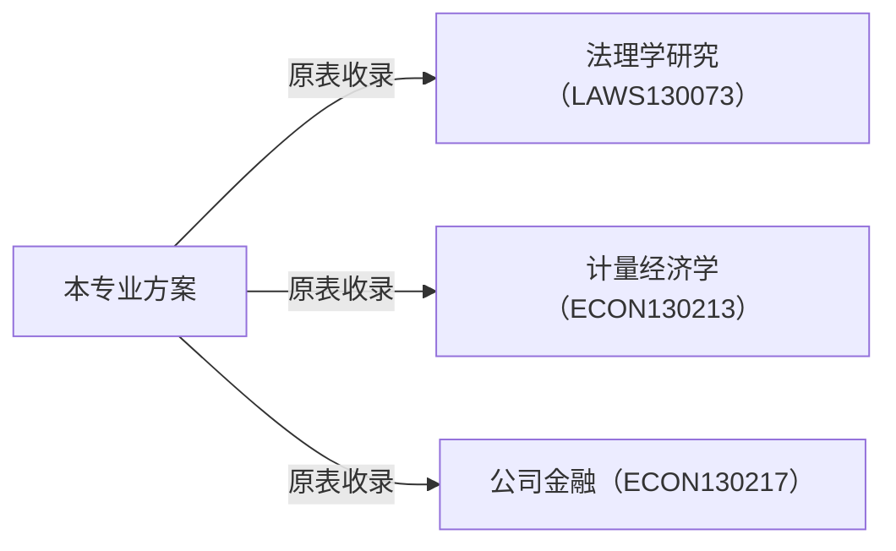

# 法学-经济学双学士学位项目“2+X”教学培养方案

2023 年度汇编，方案正文印刷页 333–336。本页附上原书 PDF 第 345–351 页，其中含本专业紧随正文的各版修读建议。逐行数据覆盖可可靠对应课号和名称的原表记录。[方案原页](original-pages.pdf) · [完整原版](https://jwc.fudan.edu.cn/_upload/article/files/83/6c/8a3c080c4f8991024f4b59ad4f1b/64d23c13-0465-4619-bd18-9e491594f850.pdf#page=345) · [逐行数据与来源](record.json)

## 课程导读

想了解法律与经济的课程安排，可以在原表中找到《法理学研究》（`LAWS130073`）、《计量经济学》（`ECON130213`）、《公司金融》（`ECON130217`）。 [原书 PDF 第 345 页](original-pages.pdf#page=1) · [原书 PDF 第 346 页](original-pages.pdf#page=2)

原表把 `LAWS130073` 列在第 7 学期，把 `ECON130213` 列在第 4 学期。图中箭头表示本节原表收录该课，图上各课之间没有先修连线。

| 课号 | 课程名称 | 开课学期原文 | PDF 页 |
|---|---|---|---|
| ECON130001 | 概率论与数理统计 | 3 | 345 |
| ECON130005 | 财政学 | 4 | 345 |
| ECON130009 | 资本论 | 6 | 347 |
| ECON130010 | 当代中国经济 | 5 | 345 |
| ECON130011 | 产业经济学 | 6 | 345 |
| ECON130019 | 国际经济学 | 4 | 345 |
| ECON130064 | 博弈论 | 4 | 345 |
| ECON130128 | 制度经济学 | 6 | 345 |
| ECON130131 | 外国经济思想史 | 5 | 345 |
| ECON130193 | 数量经济学 | 4 | 347 |
| ECON130212 | 经济史 | 3 | 345 |
| ECON130213 | 计量经济学 | 4 | 345 |
| ECON130217 | 公司金融 | 3 | 345 |
| ECON130266 | 中国政府与经济 | 7 | 347 |
| LAWS130032 | 证券法 | 5 | 347 |
| LAWS130033 | 票据法 | 6 | 347 |
| LAWS130073 | 法理学研究 | 7 | 346 |
| LAWS130074 | 比较法 | 6 | 346 |
| LAWS130075 | 英美法 | 5 | 346 |
| LAWS130076 | 欧陆法 | 5 | 346 |
| LAWS130084 | 保险法 | 5 | 347 |
| LAWS130086 | 破产法 | 5 | 347 |

可定位的课程对暂无明确先修记录，原课程表及备注见上方 PDF。
