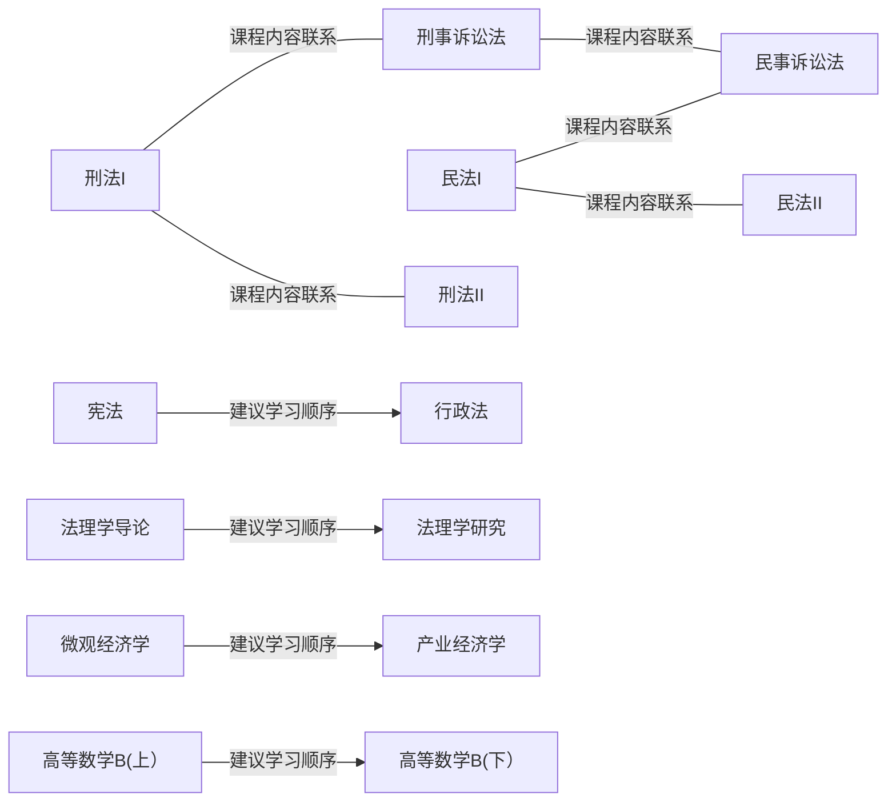

# 2024 法学-经济学(双学士学位项目)专业“2+X”教学培养方案

法学院 · 法学-经济学(双学士学位项目) · 方案 72913 · 97 个不同课程或科研条目。

[官方 Word](../originals/plan-72913.docx) · [教务详情](https://fdjwgl.fudan.edu.cn/manager/bizType/2/major-program-search/info/72913?skipAuth=1) · [方案快照](../raw/plan-72913.json.gz) · [年级目录](../README.md)

## 修读导读

- **建议先学**　《宪法》（`LAW10005`） → 《行政法》（`LAW10003`）。对国家机构与公权力结构的认识可帮助理解行政法律关系。

- **可以对照着读**　《刑法I》（`LAW10002`）与《刑事诉讼法》（`LAW20002`）。犯罪与刑责的实体规则和程序规则可相互参照。

- **查模块选课**　《习近平法治思想概论》（`LAW20010`）、《中国法律史》（`LAW20006`）列在“专业核心教育课程”中。原表见 `/courseModules/6`。

## 课程关系图

图中展示部分关系。下表保留全部已建立的课程对，来源位置使用本方案 JSON Pointer。

## 先修与内容联系

| 类型 | 起点 | 终点 | 依据 | 原表定位 |
| --- | --- | --- | --- | --- |
| 建议学习顺序 | 微观经济学 (ECON20003) | 产业经济学 (ECON30025) | 企业和市场结构是产业经济分析的基础。  | `/courseModules/5/planCourses/7`、`/courseModules/6/planCourses/7` |
| 建议学习顺序 | 民法I (LAW10001) | 民法II (LAW20007) | 同方案的课程题名具有连续分册或序号。  | `/courseModules/6/planCourses/16`、`/courseModules/6/planCourses/17` |
| 建议学习顺序 | 刑法I (LAW10002) | 刑法II (LAW20004) | 同方案的课程题名具有连续分册或序号。  | `/courseModules/6/planCourses/14`、`/courseModules/6/planCourses/15` |
| 建议学习顺序 | 法理学导论 (LAW10004) | 法理学研究 (LAW50016) | 法理学中的基本概念可支持进一步专题研究。  | `/courseModules/5/planCourses/1`、`/courseModules/8/planCourses/0` |
| 建议学习顺序 | 宪法 (LAW10005) | 行政法 (LAW10003) | 对国家机构与公权力结构的认识可帮助理解行政法律关系。  | `/courseModules/5/planCourses/2`、`/courseModules/6/planCourses/20` |
| 建议学习顺序 | 高等数学B(上） (MATH10004) | 高等数学B(下） (MATH10005) | 同方案的课程题名具有连续分册或序号。  | `/courseModules/5/planCourses/4`、`/courseModules/5/planCourses/5` |
| 课程内容联系 | 国际经济学 (ECON30029) | 国际经济法导论 (LAW30005) | 本方案两门课程的题名均含“国际经济”，可据此对照这一主题。  | `/courseModules/6/planCourses/4`、`/courseModules/6/planCourses/30` |
| 课程内容联系 | 国际经济学 (ECON30029) | 国际经济法导论（H） (LAW30005h) | 本方案两门课程的题名均含“国际经济”，可据此对照这一主题。  | `/courseModules/6/planCourses/4`、`/courseModules/12/planCourses/5` |
| 课程内容联系 | 国际经济学 (ECON30029) | 国际经济合同 (LAW50034) | 本方案两门课程的题名均含“国际经济”，可据此对照这一主题。  | `/courseModules/6/planCourses/4`、`/courseModules/8/planCourses/14` |
| 课程内容联系 | 公司金融 (ECON30122) | 金融法 (LAW50003) | 本方案两门课程的题名均含“金融”，可据此对照这一主题。  | `/courseModules/6/planCourses/2`、`/courseModules/8/planCourses/35` |
| 课程内容联系 | 民法I (LAW10001) | 民事诉讼法 (LAW20003) | 民事权利义务与其程序救济可对照学习。  | `/courseModules/6/planCourses/16`、`/courseModules/6/planCourses/19` |
| 课程内容联系 | 民法I (LAW10001) | 民法II (LAW20007) | 本方案两门课程的题名均含“民法”，可据此对照这一主题。  | `/courseModules/6/planCourses/16`、`/courseModules/6/planCourses/17` |
| 课程内容联系 | 民法I (LAW10001) | 民法II（H） (LAW20007h) | 本方案两门课程的题名均含“民法”，可据此对照这一主题。  | `/courseModules/6/planCourses/16`、`/courseModules/12/planCourses/2` |
| 课程内容联系 | 刑法I (LAW10002) | 刑事诉讼法 (LAW20002) | 犯罪与刑责的实体规则和程序规则可相互参照。  | `/courseModules/6/planCourses/14`、`/courseModules/6/planCourses/18` |
| 课程内容联系 | 刑法I (LAW10002) | 刑法II (LAW20004) | 本方案两门课程的题名均含“刑法”，可据此对照这一主题。  | `/courseModules/6/planCourses/14`、`/courseModules/6/planCourses/15` |
| 课程内容联系 | 刑法I (LAW10002) | 刑法II（H） (LAW20004h) | 本方案两门课程的题名均含“刑法”，可据此对照这一主题。  | `/courseModules/6/planCourses/14`、`/courseModules/12/planCourses/1` |
| 课程内容联系 | 刑法I (LAW10002) | 国际刑法 (LAW50036) | 本方案两门课程的题名均含“刑法”，可据此对照这一主题。  | `/courseModules/6/planCourses/14`、`/courseModules/8/planCourses/18` |
| 课程内容联系 | 法理学导论 (LAW10004) | 宪法 (LAW10005) | 两课均涉及权利与公共权力的规范依据。  | `/courseModules/5/planCourses/1`、`/courseModules/5/planCourses/2` |
| 课程内容联系 | 行政诉讼法 (LAW20001) | 刑事诉讼法 (LAW20002) | 本方案两门课程的题名均含“诉讼”，可据此对照这一主题。  | `/courseModules/6/planCourses/21`、`/courseModules/6/planCourses/18` |
| 课程内容联系 | 刑事诉讼法 (LAW20002) | 刑事诉讼法（H） (LAW20002h) | 本方案两门课程的题名均含“诉讼”，可据此对照这一主题。  | `/courseModules/6/planCourses/18`、`/courseModules/12/planCourses/3` |
| 课程内容联系 | 刑事诉讼法 (LAW20002) | 民事诉讼法 (LAW20003) | 本方案两门课程的题名均含“诉讼”，可据此对照这一主题。  | `/courseModules/6/planCourses/18`、`/courseModules/6/planCourses/19` |
| 课程内容联系 | 刑事诉讼法 (LAW20002) | 民事诉讼法（H） (LAW20003h) | 本方案两门课程的题名均含“诉讼”，可据此对照这一主题。  | `/courseModules/6/planCourses/18`、`/courseModules/12/planCourses/4` |
| 课程内容联系 | 知识产权法 (LAW30004) | 知识产权法（H） (LAW30004h) | 本方案两门课程的题名均含“知识产权”，可据此对照这一主题。  | `/courseModules/6/planCourses/27`、`/courseModules/13/planCourses/1` |
| 课程内容联系 | 知识产权法 (LAW30004) | 国际贸易的知识产权法 (LAW50046) | 本方案两门课程的题名均含“知识产权”，可据此对照这一主题。  | `/courseModules/6/planCourses/27`、`/courseModules/8/planCourses/44` |
| 课程内容联系 | 金融法 (LAW50003) | 国际金融法 (LAW50032) | 本方案两门课程的题名均含“金融”，可据此对照这一主题。  | `/courseModules/8/planCourses/35`、`/courseModules/8/planCourses/12` |
| 课程内容联系 | 国际贸易法 (LAW50033) | 国际贸易的知识产权法 (LAW50046) | 本方案两门课程的题名均含“国际贸易”，可据此对照这一主题。  | `/courseModules/8/planCourses/13`、`/courseModules/8/planCourses/44` |

本次未从可定位的明确表述中确认课程对课程预修。学期安排、系列分册与编辑建议均保留各自的依据。

## 按原方案模块阅读

同一模块展示原表中的课程归属。模块内课程之间的先后仍须逐项查阅。

- **法经荣誉课程项目-选修课程包**　资本论、数量经济学、中国政府与经济、税法、金融法、公司法、劳动法、证券法、票据法、台港澳法、国际商事仲裁法、海商法、刑事政策、西方法律思想史、专业英语II（法律）、法理学研究、比较法、英美法等45项（原表模块 9）
- **法经辅修-选修课程包**　资本论、数量经济学、中国政府与经济、税法、金融法、公司法、劳动法、证券法、票据法、台港澳法、国际商事仲裁法、海商法、刑事政策、西方法律思想史、专业英语II（法律）、法理学研究、比较法、英美法等45项（原表模块 10）
- **任选**　商法（H）、国际私法（H）、知识产权法（H）（原表模块 13）

## 课程表

同一课程在不同模块分别出现时，按原表逐行列出。季节字段保留原值。

| 课程 | 代码 | 学分 | 学期 | 模块 |
| --- | --- | ---: | --- | --- |
| 政治学原理 | POLI10007 | 3.0 | SPRING、AUTUMN | 培养方案 / 专业培养课程 / 大类基础课程 |
| 法理学导论 | LAW10004 | 3.0 | SPRING、AUTUMN | 培养方案 / 专业培养课程 / 大类基础课程 |
| 宪法 | LAW10005 | 3.0 | SPRING、AUTUMN | 培养方案 / 专业培养课程 / 大类基础课程 |
| 经济法 | LAW20011 | 3.0 | SPRING、AUTUMN | 培养方案 / 专业培养课程 / 大类基础课程 |
| 高等数学B(上） | MATH10004 | 5.0 | SPRING、AUTUMN | 培养方案 / 专业培养课程 / 大类基础课程 |
| 高等数学B(下） | MATH10005 | 5.0 | SPRING、AUTUMN | 培养方案 / 专业培养课程 / 大类基础课程 |
| 政治经济学 | ECON20006 | 3.0 | SPRING、AUTUMN | 培养方案 / 专业培养课程 / 大类基础课程 |
| 微观经济学 | ECON20003 | 3.0 | SPRING、AUTUMN | 培养方案 / 专业培养课程 / 大类基础课程 |
| 宏观经济学 | ECON20004 | 3.0 | SPRING、AUTUMN | 培养方案 / 专业培养课程 / 大类基础课程 |
| 会计学 | BA10003 | 3.0 | SPRING、AUTUMN | 培养方案 / 专业培养课程 / 大类基础课程 |
| 线性代数 | MATH10017 | 3.0 | SPRING、AUTUMN | 培养方案 / 专业培养课程 / 大类基础课程 |
| 概率论与数理统计 | ECON30016 | 3.0 | SPRING、AUTUMN | 培养方案 / 专业培养课程 / 专业核心教育课程 |
| 经济史 | ECON30120 | 3.0 | SPRING、AUTUMN | 培养方案 / 专业培养课程 / 专业核心教育课程 |
| 公司金融 | ECON30122 | 3.0 | SPRING、AUTUMN | 培养方案 / 专业培养课程 / 专业核心教育课程 |
| 计量经济学 | ECON30121 | 4.0 | SPRING、AUTUMN | 培养方案 / 专业培养课程 / 专业核心教育课程 |
| 国际经济学 | ECON30029 | 3.0 | SPRING、AUTUMN | 培养方案 / 专业培养课程 / 专业核心教育课程 |
| 财政学 | ECON30019 | 3.0 | SPRING、AUTUMN | 培养方案 / 专业培养课程 / 专业核心教育课程 |
| 当代中国经济 | ECON30024 | 3.0 | SPRING、AUTUMN | 培养方案 / 专业培养课程 / 专业核心教育课程 |
| 产业经济学 | ECON30025 | 3.0 | SPRING、AUTUMN | 培养方案 / 专业培养课程 / 专业核心教育课程 |
| 制度经济学 | ECON30074 | 3.0 | SPRING、AUTUMN | 培养方案 / 专业培养课程 / 专业核心教育课程 |
| 博弈论 | ECON30054 | 3.0 | SPRING、AUTUMN | 培养方案 / 专业培养课程 / 专业核心教育课程 |
| 外国经济思想史 | ECON30075 | 3.0 | SPRING、AUTUMN | 培养方案 / 专业培养课程 / 专业核心教育课程 |
| 资源环境经济学 | ECON30136 | 3.0 | SPRING、AUTUMN | 培养方案 / 专业培养课程 / 专业核心教育课程 |
| 习近平法治思想概论 | LAW20010 | 2.0 | SPRING、AUTUMN | 培养方案 / 专业培养课程 / 专业核心教育课程 |
| 中国法律史 | LAW20006 | 3.0 | SPRING、AUTUMN | 培养方案 / 专业培养课程 / 专业核心教育课程 |
| 刑法I | LAW10002 | 3.0 | SPRING、AUTUMN | 培养方案 / 专业培养课程 / 专业核心教育课程 |
| 刑法II | LAW20004 | 3.0 | SPRING、AUTUMN | 培养方案 / 专业培养课程 / 专业核心教育课程 |
| 民法I | LAW10001 | 3.0 | SPRING、AUTUMN | 培养方案 / 专业培养课程 / 专业核心教育课程 |
| 民法II | LAW20007 | 3.0 | SPRING、AUTUMN | 培养方案 / 专业培养课程 / 专业核心教育课程 |
| 刑事诉讼法 | LAW20002 | 3.0 | SPRING、AUTUMN | 培养方案 / 专业培养课程 / 专业核心教育课程 |
| 民事诉讼法 | LAW20003 | 3.0 | SPRING、AUTUMN | 培养方案 / 专业培养课程 / 专业核心教育课程 |
| 行政法 | LAW10003 | 2.0 | SPRING、AUTUMN | 培养方案 / 专业培养课程 / 专业核心教育课程 |
| 行政诉讼法 | LAW20001 | 2.0 | SPRING、AUTUMN | 培养方案 / 专业培养课程 / 专业核心教育课程 |
| 国际法 | LAW20005 | 3.0 | SPRING、AUTUMN | 培养方案 / 专业培养课程 / 专业核心教育课程 |
| 法律职业伦理 | LAW40003 | 2.0 | SPRING、AUTUMN | 培养方案 / 专业培养课程 / 专业核心教育课程 |
| 毕业实习 | LAW40002 | 4.0 | SPRING、AUTUMN | 培养方案 / 专业培养课程 / 专业核心教育课程 |
| 毕业论文 | LAW40007 | 4.0 | SPRING、AUTUMN | 培养方案 / 专业培养课程 / 专业核心教育课程 |
| 商法 | LAW20008 | 2.0 | SPRING、AUTUMN | 培养方案 / 专业培养课程 / 专业核心教育课程 |
| 知识产权法 | LAW30004 | 2.0 | SPRING、AUTUMN | 培养方案 / 专业培养课程 / 专业核心教育课程 |
| 自然资源和环境保护法 | LAW30003 | 2.0 | SPRING、AUTUMN | 培养方案 / 专业培养课程 / 专业核心教育课程 |
| 国际私法 | LAW20009 | 2.0 | SPRING、AUTUMN | 培养方案 / 专业培养课程 / 专业核心教育课程 |
| 国际经济法导论 | LAW30005 | 2.0 | SPRING、AUTUMN | 培养方案 / 专业培养课程 / 专业核心教育课程 |
| 专业英语I(法律) | LAW30001 | 2.0 | SPRING、AUTUMN | 培养方案 / 专业培养课程 / 专业核心教育课程 |
| 法理学研究 | LAW50016 | 2.0 | SPRING、AUTUMN | 培养方案 / 专业进阶模块 |
| 比较法 | LAW50017 | 2.0 | SPRING、AUTUMN | 培养方案 / 专业进阶模块 |
| 英美法 | LAW50018 | 2.0 | SPRING、AUTUMN | 培养方案 / 专业进阶模块 |
| 欧陆法 | LAW50019 | 2.0 | SPRING、AUTUMN | 培养方案 / 专业进阶模块 |
| 台港澳法 | LAW50008 | 2.0 | SPRING、AUTUMN | 培养方案 / 专业进阶模块 |
| 外国法律史 | LAW50020 | 2.0 | SPRING、AUTUMN | 培养方案 / 专业进阶模块 |
| 西方法律思想史 | LAW50012 | 2.0 | SPRING、AUTUMN | 培养方案 / 专业进阶模块 |
| 人权法 | LAW50021 | 2.0 | SPRING、AUTUMN | 培养方案 / 专业进阶模块 |
| 专业英语II（法律） | LAW50015 | 2.0 | SPRING、AUTUMN | 培养方案 / 专业进阶模块 |
| 专业英语III（法律） | LAW50042 | 2.0 | SPRING、AUTUMN | 培养方案 / 专业进阶模块 |
| 国际投资法 | LAW50030 | 2.0 | SPRING、AUTUMN | 培养方案 / 专业进阶模块 |
| 国际税法 | LAW50031 | 2.0 | SPRING、AUTUMN | 培养方案 / 专业进阶模块 |
| 国际金融法 | LAW50032 | 2.0 | SPRING、AUTUMN | 培养方案 / 专业进阶模块 |
| 国际贸易法 | LAW50033 | 2.0 | SPRING、AUTUMN | 培养方案 / 专业进阶模块 |
| 国际经济合同 | LAW50034 | 2.0 | SPRING、AUTUMN | 培养方案 / 专业进阶模块 |
| 国际商事仲裁法 | LAW50009 | 2.0 | SPRING、AUTUMN | 培养方案 / 专业进阶模块 |
| 国际商法 | LAW50035 | 2.0 | SPRING、AUTUMN | 培养方案 / 专业进阶模块 |
| 海商法 | LAW50010 | 2.0 | SPRING、AUTUMN | 培养方案 / 专业进阶模块 |
| 国际刑法 | LAW50036 | 2.0 | SPRING、AUTUMN | 培养方案 / 专业进阶模块 |
| 物权法 | LAW50023 | 2.0 | SPRING、AUTUMN | 培养方案 / 专业进阶模块 |
| 侵权责任法 | LAW50024 | 2.0 | SPRING、AUTUMN | 培养方案 / 专业进阶模块 |
| 婚姻家庭法 | LAW50025 | 2.0 | SPRING、AUTUMN | 培养方案 / 专业进阶模块 |
| 医事法 | LAW50029 | 2.0 | SPRING、AUTUMN | 培养方案 / 专业进阶模块 |
| 证据法 | LAW50037 | 2.0 | SPRING、AUTUMN | 培养方案 / 专业进阶模块 |
| 刑事政策 | LAW50011 | 2.0 | SPRING、AUTUMN | 培养方案 / 专业进阶模块 |
| 法律检索 | LAW50038 | 2.0 | SPRING、AUTUMN | 培养方案 / 专业进阶模块 |
| 法律谈判 | LAW50041 | 2.0 | SPRING、AUTUMN | 培养方案 / 专业进阶模块 |
| 犯罪学 | LAW50022 | 2.0 | SPRING、AUTUMN | 培养方案 / 专业进阶模块 |
| 数量经济学 | ECON30107 | 3.0 | SPRING、AUTUMN | 培养方案 / 专业进阶模块 |
| 资本论 | ECON30023 | 3.0 | SPRING、AUTUMN | 培养方案 / 专业进阶模块 |
| 中国政府与经济 | ECON30159 | 3.0 | SPRING、AUTUMN | 培养方案 / 专业进阶模块 |
| 证券法 | LAW50006 | 2.0 | SPRING、AUTUMN | 培养方案 / 专业进阶模块 |
| 票据法 | LAW50007 | 2.0 | SPRING、AUTUMN | 培养方案 / 专业进阶模块 |
| 保险法 | LAW50026 | 2.0 | SPRING、AUTUMN | 培养方案 / 专业进阶模块 |
| 破产法 | LAW50028 | 2.0 | SPRING、AUTUMN | 培养方案 / 专业进阶模块 |
| 金融法 | LAW50003 | 2.0 | SPRING、AUTUMN | 培养方案 / 专业进阶模块 |
| 劳动法 | LAW50005 | 2.0 | SPRING、AUTUMN | 培养方案 / 专业进阶模块 |
| 市场规制法 | LAW50027 | 2.0 | SPRING、AUTUMN | 培养方案 / 专业进阶模块 |
| 案例探讨 | LAW50040 | 2.0 | SPRING、AUTUMN | 培养方案 / 专业进阶模块 |
| 公司法 | LAW50004 | 2.0 | SPRING、AUTUMN | 培养方案 / 专业进阶模块 |
| 税法 | LAW50002 | 2.0 | SPRING、AUTUMN | 培养方案 / 专业进阶模块 |
| 法律与商业 | LAW50043 | 2.0 | SPRING、AUTUMN | 培养方案 / 专业进阶模块 |
| 法与经济学 | LAW50044 | 2.0 | SPRING、AUTUMN | 培养方案 / 专业进阶模块 |
| 贸易争端解决 | LAW50045 | 2.0 | SPRING、AUTUMN | 培养方案 / 专业进阶模块 |
| 国际贸易的知识产权法 | LAW50046 | 2.0 | SPRING、AUTUMN | 培养方案 / 专业进阶模块 |
| 法理学研究 | LAW50016 | 2.0 | SPRING、AUTUMN | 培养方案 / 法经荣誉课程项目-选修课程包 |
| 比较法 | LAW50017 | 2.0 | SPRING、AUTUMN | 培养方案 / 法经荣誉课程项目-选修课程包 |
| 英美法 | LAW50018 | 2.0 | SPRING、AUTUMN | 培养方案 / 法经荣誉课程项目-选修课程包 |
| 欧陆法 | LAW50019 | 2.0 | SPRING、AUTUMN | 培养方案 / 法经荣誉课程项目-选修课程包 |
| 台港澳法 | LAW50008 | 2.0 | SPRING、AUTUMN | 培养方案 / 法经荣誉课程项目-选修课程包 |
| 外国法律史 | LAW50020 | 2.0 | SPRING、AUTUMN | 培养方案 / 法经荣誉课程项目-选修课程包 |
| 西方法律思想史 | LAW50012 | 2.0 | SPRING、AUTUMN | 培养方案 / 法经荣誉课程项目-选修课程包 |
| 人权法 | LAW50021 | 2.0 | SPRING、AUTUMN | 培养方案 / 法经荣誉课程项目-选修课程包 |
| 专业英语II（法律） | LAW50015 | 2.0 | SPRING、AUTUMN | 培养方案 / 法经荣誉课程项目-选修课程包 |
| 专业英语III（法律） | LAW50042 | 2.0 | SPRING、AUTUMN | 培养方案 / 法经荣誉课程项目-选修课程包 |
| 国际投资法 | LAW50030 | 2.0 | SPRING、AUTUMN | 培养方案 / 法经荣誉课程项目-选修课程包 |
| 国际税法 | LAW50031 | 2.0 | SPRING、AUTUMN | 培养方案 / 法经荣誉课程项目-选修课程包 |
| 国际金融法 | LAW50032 | 2.0 | SPRING、AUTUMN | 培养方案 / 法经荣誉课程项目-选修课程包 |
| 国际贸易法 | LAW50033 | 2.0 | SPRING、AUTUMN | 培养方案 / 法经荣誉课程项目-选修课程包 |
| 国际经济合同 | LAW50034 | 2.0 | SPRING、AUTUMN | 培养方案 / 法经荣誉课程项目-选修课程包 |
| 国际商事仲裁法 | LAW50009 | 2.0 | SPRING、AUTUMN | 培养方案 / 法经荣誉课程项目-选修课程包 |
| 国际商法 | LAW50035 | 2.0 | SPRING、AUTUMN | 培养方案 / 法经荣誉课程项目-选修课程包 |
| 海商法 | LAW50010 | 2.0 | SPRING、AUTUMN | 培养方案 / 法经荣誉课程项目-选修课程包 |
| 国际刑法 | LAW50036 | 2.0 | SPRING、AUTUMN | 培养方案 / 法经荣誉课程项目-选修课程包 |
| 物权法 | LAW50023 | 2.0 | SPRING、AUTUMN | 培养方案 / 法经荣誉课程项目-选修课程包 |
| 侵权责任法 | LAW50024 | 2.0 | SPRING、AUTUMN | 培养方案 / 法经荣誉课程项目-选修课程包 |
| 婚姻家庭法 | LAW50025 | 2.0 | SPRING、AUTUMN | 培养方案 / 法经荣誉课程项目-选修课程包 |
| 医事法 | LAW50029 | 2.0 | SPRING、AUTUMN | 培养方案 / 法经荣誉课程项目-选修课程包 |
| 证据法 | LAW50037 | 2.0 | SPRING、AUTUMN | 培养方案 / 法经荣誉课程项目-选修课程包 |
| 刑事政策 | LAW50011 | 2.0 | SPRING、AUTUMN | 培养方案 / 法经荣誉课程项目-选修课程包 |
| 法律检索 | LAW50038 | 2.0 | SPRING、AUTUMN | 培养方案 / 法经荣誉课程项目-选修课程包 |
| 法律谈判 | LAW50041 | 2.0 | SPRING、AUTUMN | 培养方案 / 法经荣誉课程项目-选修课程包 |
| 犯罪学 | LAW50022 | 2.0 | SPRING、AUTUMN | 培养方案 / 法经荣誉课程项目-选修课程包 |
| 数量经济学 | ECON30107 | 3.0 | SPRING、AUTUMN | 培养方案 / 法经荣誉课程项目-选修课程包 |
| 资本论 | ECON30023 | 3.0 | SPRING、AUTUMN | 培养方案 / 法经荣誉课程项目-选修课程包 |
| 中国政府与经济 | ECON30159 | 3.0 | SPRING、AUTUMN | 培养方案 / 法经荣誉课程项目-选修课程包 |
| 证券法 | LAW50006 | 2.0 | SPRING、AUTUMN | 培养方案 / 法经荣誉课程项目-选修课程包 |
| 票据法 | LAW50007 | 2.0 | SPRING、AUTUMN | 培养方案 / 法经荣誉课程项目-选修课程包 |
| 保险法 | LAW50026 | 2.0 | SPRING、AUTUMN | 培养方案 / 法经荣誉课程项目-选修课程包 |
| 破产法 | LAW50028 | 2.0 | SPRING、AUTUMN | 培养方案 / 法经荣誉课程项目-选修课程包 |
| 金融法 | LAW50003 | 2.0 | SPRING、AUTUMN | 培养方案 / 法经荣誉课程项目-选修课程包 |
| 劳动法 | LAW50005 | 2.0 | SPRING、AUTUMN | 培养方案 / 法经荣誉课程项目-选修课程包 |
| 市场规制法 | LAW50027 | 2.0 | SPRING、AUTUMN | 培养方案 / 法经荣誉课程项目-选修课程包 |
| 案例探讨 | LAW50040 | 2.0 | SPRING、AUTUMN | 培养方案 / 法经荣誉课程项目-选修课程包 |
| 公司法 | LAW50004 | 2.0 | SPRING、AUTUMN | 培养方案 / 法经荣誉课程项目-选修课程包 |
| 税法 | LAW50002 | 2.0 | SPRING、AUTUMN | 培养方案 / 法经荣誉课程项目-选修课程包 |
| 法律与商业 | LAW50043 | 2.0 | SPRING、AUTUMN | 培养方案 / 法经荣誉课程项目-选修课程包 |
| 法与经济学 | LAW50044 | 2.0 | SPRING、AUTUMN | 培养方案 / 法经荣誉课程项目-选修课程包 |
| 贸易争端解决 | LAW50045 | 2.0 | SPRING、AUTUMN | 培养方案 / 法经荣誉课程项目-选修课程包 |
| 国际贸易的知识产权法 | LAW50046 | 2.0 | SPRING、AUTUMN | 培养方案 / 法经荣誉课程项目-选修课程包 |
| 法理学研究 | LAW50016 | 2.0 | SPRING、AUTUMN | 培养方案 / 法经辅修-选修课程包 |
| 比较法 | LAW50017 | 2.0 | SPRING、AUTUMN | 培养方案 / 法经辅修-选修课程包 |
| 英美法 | LAW50018 | 2.0 | SPRING、AUTUMN | 培养方案 / 法经辅修-选修课程包 |
| 欧陆法 | LAW50019 | 2.0 | SPRING、AUTUMN | 培养方案 / 法经辅修-选修课程包 |
| 台港澳法 | LAW50008 | 2.0 | SPRING、AUTUMN | 培养方案 / 法经辅修-选修课程包 |
| 外国法律史 | LAW50020 | 2.0 | SPRING、AUTUMN | 培养方案 / 法经辅修-选修课程包 |
| 西方法律思想史 | LAW50012 | 2.0 | SPRING、AUTUMN | 培养方案 / 法经辅修-选修课程包 |
| 人权法 | LAW50021 | 2.0 | SPRING、AUTUMN | 培养方案 / 法经辅修-选修课程包 |
| 专业英语II（法律） | LAW50015 | 2.0 | SPRING、AUTUMN | 培养方案 / 法经辅修-选修课程包 |
| 专业英语III（法律） | LAW50042 | 2.0 | SPRING、AUTUMN | 培养方案 / 法经辅修-选修课程包 |
| 国际投资法 | LAW50030 | 2.0 | SPRING、AUTUMN | 培养方案 / 法经辅修-选修课程包 |
| 国际税法 | LAW50031 | 2.0 | SPRING、AUTUMN | 培养方案 / 法经辅修-选修课程包 |
| 国际金融法 | LAW50032 | 2.0 | SPRING、AUTUMN | 培养方案 / 法经辅修-选修课程包 |
| 国际贸易法 | LAW50033 | 2.0 | SPRING、AUTUMN | 培养方案 / 法经辅修-选修课程包 |
| 国际经济合同 | LAW50034 | 2.0 | SPRING、AUTUMN | 培养方案 / 法经辅修-选修课程包 |
| 国际商事仲裁法 | LAW50009 | 2.0 | SPRING、AUTUMN | 培养方案 / 法经辅修-选修课程包 |
| 国际商法 | LAW50035 | 2.0 | SPRING、AUTUMN | 培养方案 / 法经辅修-选修课程包 |
| 海商法 | LAW50010 | 2.0 | SPRING、AUTUMN | 培养方案 / 法经辅修-选修课程包 |
| 国际刑法 | LAW50036 | 2.0 | SPRING、AUTUMN | 培养方案 / 法经辅修-选修课程包 |
| 物权法 | LAW50023 | 2.0 | SPRING、AUTUMN | 培养方案 / 法经辅修-选修课程包 |
| 侵权责任法 | LAW50024 | 2.0 | SPRING、AUTUMN | 培养方案 / 法经辅修-选修课程包 |
| 婚姻家庭法 | LAW50025 | 2.0 | SPRING、AUTUMN | 培养方案 / 法经辅修-选修课程包 |
| 医事法 | LAW50029 | 2.0 | SPRING、AUTUMN | 培养方案 / 法经辅修-选修课程包 |
| 证据法 | LAW50037 | 2.0 | SPRING、AUTUMN | 培养方案 / 法经辅修-选修课程包 |
| 刑事政策 | LAW50011 | 2.0 | SPRING、AUTUMN | 培养方案 / 法经辅修-选修课程包 |
| 法律检索 | LAW50038 | 2.0 | SPRING、AUTUMN | 培养方案 / 法经辅修-选修课程包 |
| 法律谈判 | LAW50041 | 2.0 | SPRING、AUTUMN | 培养方案 / 法经辅修-选修课程包 |
| 犯罪学 | LAW50022 | 2.0 | SPRING、AUTUMN | 培养方案 / 法经辅修-选修课程包 |
| 数量经济学 | ECON30107 | 3.0 | SPRING、AUTUMN | 培养方案 / 法经辅修-选修课程包 |
| 资本论 | ECON30023 | 3.0 | SPRING、AUTUMN | 培养方案 / 法经辅修-选修课程包 |
| 中国政府与经济 | ECON30159 | 3.0 | SPRING、AUTUMN | 培养方案 / 法经辅修-选修课程包 |
| 证券法 | LAW50006 | 2.0 | SPRING、AUTUMN | 培养方案 / 法经辅修-选修课程包 |
| 票据法 | LAW50007 | 2.0 | SPRING、AUTUMN | 培养方案 / 法经辅修-选修课程包 |
| 保险法 | LAW50026 | 2.0 | SPRING、AUTUMN | 培养方案 / 法经辅修-选修课程包 |
| 破产法 | LAW50028 | 2.0 | SPRING、AUTUMN | 培养方案 / 法经辅修-选修课程包 |
| 金融法 | LAW50003 | 2.0 | SPRING、AUTUMN | 培养方案 / 法经辅修-选修课程包 |
| 劳动法 | LAW50005 | 2.0 | SPRING、AUTUMN | 培养方案 / 法经辅修-选修课程包 |
| 市场规制法 | LAW50027 | 2.0 | SPRING、AUTUMN | 培养方案 / 法经辅修-选修课程包 |
| 案例探讨 | LAW50040 | 2.0 | SPRING、AUTUMN | 培养方案 / 法经辅修-选修课程包 |
| 公司法 | LAW50004 | 2.0 | SPRING、AUTUMN | 培养方案 / 法经辅修-选修课程包 |
| 税法 | LAW50002 | 2.0 | SPRING、AUTUMN | 培养方案 / 法经辅修-选修课程包 |
| 法律与商业 | LAW50043 | 2.0 | SPRING、AUTUMN | 培养方案 / 法经辅修-选修课程包 |
| 法与经济学 | LAW50044 | 2.0 | SPRING、AUTUMN | 培养方案 / 法经辅修-选修课程包 |
| 贸易争端解决 | LAW50045 | 2.0 | SPRING、AUTUMN | 培养方案 / 法经辅修-选修课程包 |
| 国际贸易的知识产权法 | LAW50046 | 2.0 | SPRING、AUTUMN | 培养方案 / 法经辅修-选修课程包 |
| 行政法（H） | LAW10003h | 4.0 | SPRING、AUTUMN | 培养方案 / 荣誉项目 / 6选4 |
| 刑法II（H） | LAW20004h | 4.0 | SPRING、AUTUMN | 培养方案 / 荣誉项目 / 6选4 |
| 民法II（H） | LAW20007h | 4.0 | SPRING、AUTUMN | 培养方案 / 荣誉项目 / 6选4 |
| 刑事诉讼法（H） | LAW20002h | 4.0 | SPRING、AUTUMN | 培养方案 / 荣誉项目 / 6选4 |
| 民事诉讼法（H） | LAW20003h | 4.0 | SPRING、AUTUMN | 培养方案 / 荣誉项目 / 6选4 |
| 国际经济法导论（H） | LAW30005h | 4.0 | SPRING、AUTUMN | 培养方案 / 荣誉项目 / 6选4 |
| 商法（H） | LAW20008h | 4.0 | SPRING、AUTUMN | 培养方案 / 荣誉项目 / 任选 |
| 知识产权法（H） | LAW30004h | 4.0 | SPRING、AUTUMN | 培养方案 / 荣誉项目 / 任选 |
| 国际私法（H） | LAW20009h | 4.0 | SPRING、AUTUMN | 培养方案 / 荣誉项目 / 任选 |
