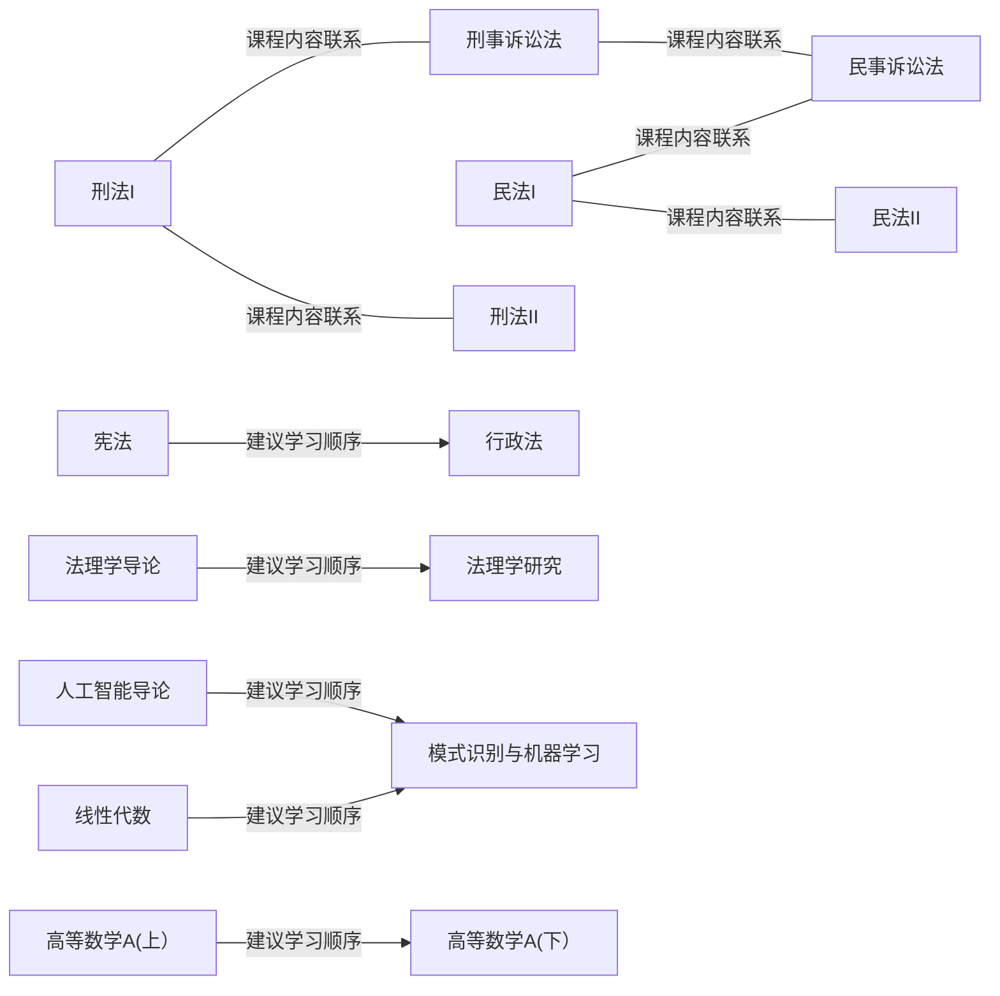

# 2024 法学-人工智能(双学士学位项目)专业“2+X”教学培养方案

法学院 · 法学-人工智能(双学士学位项目) · 方案 73024 · 109 个不同课程或科研条目。

[官方 Word](../originals/plan-73024.docx) · [教务详情](https://fdjwgl.fudan.edu.cn/manager/bizType/2/major-program-search/info/73024?skipAuth=1) · [方案快照](../raw/plan-73024.json.gz) · [年级目录](../README.md)

## 修读导读

- **建议先学**　《宪法》（`LAW10005`） → 《行政法》（`LAW10003`）。对国家机构与公权力结构的认识可帮助理解行政法律关系。

- **可以对照着读**　《刑法I》（`LAW10002`）与《刑事诉讼法》（`LAW20002`）。犯罪与刑责的实体规则和程序规则可相互参照。

- **查模块选课**　《人工智能与法学前沿》（`LAW50048`）、《习近平法治思想概论》（`LAW20010`）列在“专业核心教育课程”中。原表见 `/courseModules/6`。

## 课程关系图

图中展示部分关系。下表保留全部已建立的课程对，来源位置使用本方案 JSON Pointer。

## 先修与内容联系

| 类型 | 起点 | 终点 | 依据 | 原表定位 |
| --- | --- | --- | --- | --- |
| 建议学习顺序 | 人工智能导论 (AIE310005) | 模式识别与机器学习 (AIE410001) | 人工智能问题与模型类别可为学习模式识别作准备。  | `/courseModules/6/planCourses/4`、`/courseModules/6/planCourses/6` |
| 建议学习顺序 | 线性代数 (CS10003) | 模式识别与机器学习 (AIE410001) | 向量表示和矩阵运算支持理解分类、回归等模型。  | `/courseModules/5/planCourses/2`、`/courseModules/6/planCourses/6` |
| 建议学习顺序 | 民法I (LAW10001) | 民法II (LAW20007) | 同方案的课程题名具有连续分册或序号。  | `/courseModules/6/planCourses/16`、`/courseModules/6/planCourses/17` |
| 建议学习顺序 | 刑法I (LAW10002) | 刑法II (LAW20004) | 同方案的课程题名具有连续分册或序号。  | `/courseModules/6/planCourses/14`、`/courseModules/6/planCourses/15` |
| 建议学习顺序 | 法理学导论 (LAW10004) | 法理学研究 (LAW50016) | 法理学中的基本概念可支持进一步专题研究。  | `/courseModules/5/planCourses/4`、`/courseModules/9/planCourses/38` |
| 建议学习顺序 | 宪法 (LAW10005) | 行政法 (LAW10003) | 对国家机构与公权力结构的认识可帮助理解行政法律关系。  | `/courseModules/5/planCourses/5`、`/courseModules/6/planCourses/21` |
| 建议学习顺序 | 高等数学A(上） (MATH10015) | 高等数学A(下） (MATH10016) | 同方案的课程题名具有连续分册或序号。  | `/courseModules/5/planCourses/0`、`/courseModules/5/planCourses/1` |
| 课程内容联系 | 计算机系统基础 (AIE210006) | 计算机组成与体系结构 (CS30052) | 处理器、存储与系统执行模型具有共同内容。  | `/courseModules/6/planCourses/3`、`/courseModules/10/planCourses/1` |
| 课程内容联系 | 人工智能导论 (AIE310005) | 人工智能安全 (AIE831001) | 本方案两门课程的题名均含“人工智能”，可据此对照这一主题。  | `/courseModules/6/planCourses/4`、`/courseModules/6/planCourses/7` |
| 课程内容联系 | 人工智能的编程基础 (AIE310006) | 人工智能安全 (AIE831001) | 本方案两门课程的题名均含“人工智能”，可据此对照这一主题。  | `/courseModules/6/planCourses/0`、`/courseModules/6/planCourses/7` |
| 课程内容联系 | 人工智能的数学基础 (AIE310009) | 模式识别与机器学习 (AIE410001) | 数学表达与学习模型的统计、优化工具可对照。  | `/courseModules/6/planCourses/2`、`/courseModules/6/planCourses/6` |
| 课程内容联系 | 人工智能的数学基础 (AIE310009) | 人工智能安全 (AIE831001) | 本方案两门课程的题名均含“人工智能”，可据此对照这一主题。  | `/courseModules/6/planCourses/2`、`/courseModules/6/planCourses/7` |
| 课程内容联系 | 模式识别与机器学习 (AIE410001) | 机器学习系统 (CS30058) | 本方案两门课程的题名均含“机器学习”，可据此对照这一主题。  | `/courseModules/6/planCourses/6`、`/courseModules/10/planCourses/5` |
| 课程内容联系 | 人工智能安全 (AIE831001) | 人工智能与法学前沿 (LAW50048) | 本方案两门课程的题名均含“人工智能”，可据此对照这一主题。  | `/courseModules/6/planCourses/7`、`/courseModules/6/planCourses/29` |
| 课程内容联系 | 人工智能与知识产权法专题 (AIT531029) | 知识产权法（H） (LAW30004h) | 本方案两门课程的题名均含“知识产权”，可据此对照这一主题。  | `/courseModules/10/planCourses/8`、`/courseModules/14/planCourses/1` |
| 课程内容联系 | 民法I (LAW10001) | 民事诉讼法 (LAW20003) | 民事权利义务与其程序救济可对照学习。  | `/courseModules/6/planCourses/16`、`/courseModules/6/planCourses/20` |
| 课程内容联系 | 民法I (LAW10001) | 民法II (LAW20007) | 本方案两门课程的题名均含“民法”，可据此对照这一主题。  | `/courseModules/6/planCourses/16`、`/courseModules/6/planCourses/17` |
| 课程内容联系 | 民法I (LAW10001) | 民法II（H） (LAW20007h) | 本方案两门课程的题名均含“民法”，可据此对照这一主题。  | `/courseModules/6/planCourses/16`、`/courseModules/13/planCourses/2` |
| 课程内容联系 | 刑法I (LAW10002) | 刑事诉讼法 (LAW20002) | 犯罪与刑责的实体规则和程序规则可相互参照。  | `/courseModules/6/planCourses/14`、`/courseModules/6/planCourses/19` |
| 课程内容联系 | 刑法I (LAW10002) | 刑法II (LAW20004) | 本方案两门课程的题名均含“刑法”，可据此对照这一主题。  | `/courseModules/6/planCourses/14`、`/courseModules/6/planCourses/15` |
| 课程内容联系 | 刑法I (LAW10002) | 刑法II（H） (LAW20004h) | 本方案两门课程的题名均含“刑法”，可据此对照这一主题。  | `/courseModules/6/planCourses/14`、`/courseModules/13/planCourses/1` |
| 课程内容联系 | 刑法I (LAW10002) | 国际刑法 (LAW50036) | 本方案两门课程的题名均含“刑法”，可据此对照这一主题。  | `/courseModules/6/planCourses/14`、`/courseModules/9/planCourses/34` |
| 课程内容联系 | 法理学导论 (LAW10004) | 宪法 (LAW10005) | 两课均涉及权利与公共权力的规范依据。  | `/courseModules/5/planCourses/4`、`/courseModules/5/planCourses/5` |
| 课程内容联系 | 行政诉讼法 (LAW20001) | 刑事诉讼法 (LAW20002) | 本方案两门课程的题名均含“诉讼”，可据此对照这一主题。  | `/courseModules/6/planCourses/22`、`/courseModules/6/planCourses/19` |
| 课程内容联系 | 刑事诉讼法 (LAW20002) | 刑事诉讼法（H） (LAW20002h) | 本方案两门课程的题名均含“诉讼”，可据此对照这一主题。  | `/courseModules/6/planCourses/19`、`/courseModules/13/planCourses/3` |
| 课程内容联系 | 刑事诉讼法 (LAW20002) | 民事诉讼法 (LAW20003) | 本方案两门课程的题名均含“诉讼”，可据此对照这一主题。  | `/courseModules/6/planCourses/19`、`/courseModules/6/planCourses/20` |
| 课程内容联系 | 刑事诉讼法 (LAW20002) | 民事诉讼法（H） (LAW20003h) | 本方案两门课程的题名均含“诉讼”，可据此对照这一主题。  | `/courseModules/6/planCourses/19`、`/courseModules/13/planCourses/4` |
| 课程内容联系 | 知识产权法（H） (LAW30004h) | 国际贸易的知识产权法 (LAW50046) | 本方案两门课程的题名均含“知识产权”，可据此对照这一主题。  | `/courseModules/14/planCourses/1`、`/courseModules/9/planCourses/35` |
| 课程内容联系 | 国际经济法导论 (LAW30005) | 国际经济合同 (LAW50034) | 本方案两门课程的题名均含“国际经济”，可据此对照这一主题。  | `/courseModules/6/planCourses/26`、`/courseModules/9/planCourses/32` |
| 课程内容联系 | 国际经济法导论（H） (LAW30005h) | 国际经济合同 (LAW50034) | 本方案两门课程的题名均含“国际经济”，可据此对照这一主题。  | `/courseModules/13/planCourses/5`、`/courseModules/9/planCourses/32` |
| 课程内容联系 | 金融法 (LAW50003) | 国际金融法 (LAW50032) | 本方案两门课程的题名均含“金融”，可据此对照这一主题。  | `/courseModules/9/planCourses/1`、`/courseModules/9/planCourses/16` |
| 课程内容联系 | 金融法 (LAW50003) | 人工智能与金融科技法 (LAW50047) | 本方案两门课程的题名均含“金融”，可据此对照这一主题。  | `/courseModules/9/planCourses/1`、`/courseModules/10/planCourses/7` |
| 课程内容联系 | 国际贸易法 (LAW50033) | 国际贸易的知识产权法 (LAW50046) | 本方案两门课程的题名均含“国际贸易”，可据此对照这一主题。  | `/courseModules/9/planCourses/17`、`/courseModules/9/planCourses/35` |

本次未从可定位的明确表述中确认课程对课程预修。学期安排、系列分册与编辑建议均保留各自的依据。

## 按原方案模块阅读

同一模块展示原表中的课程归属。模块内课程之间的先后仍须逐项查阅。

- **法ai荣誉课程项目-选修课程包**　人工智能法律系统司法应用专题、人工智能与知识产权法专题、数据库引论、软件工程、计算机图形学A、计算机网络、集合与图论、计算机组成与体系结构、机器学习系统、税法、金融法、公司法、劳动法、证券法、票据法、国际商事仲裁法、海商法、刑事政策等53项（原表模块 11）
- **任选**　商法（H）、国际私法（H）、知识产权法（H）（原表模块 14）

## 课程表

同一课程在不同模块分别出现时，按原表逐行列出。季节字段保留原值。

| 课程 | 代码 | 学分 | 学期 | 模块 |
| --- | --- | ---: | --- | --- |
| 高等数学A(上） | MATH10015 | 5.0 | SPRING、AUTUMN | 培养方案 / 专业培养课程 / 大类基础课程 |
| 高等数学A(下） | MATH10016 | 5.0 | SPRING、AUTUMN | 培养方案 / 专业培养课程 / 大类基础课程 |
| 线性代数 | CS10003 | 3.0 | SPRING、AUTUMN | 培养方案 / 专业培养课程 / 大类基础课程 |
| 程序设计 | CS10004 | 4.0 | SPRING、AUTUMN | 培养方案 / 专业培养课程 / 大类基础课程 |
| 法理学导论 | LAW10004 | 3.0 | SPRING、AUTUMN | 培养方案 / 专业培养课程 / 大类基础课程 |
| 宪法 | LAW10005 | 3.0 | SPRING、AUTUMN | 培养方案 / 专业培养课程 / 大类基础课程 |
| 经济法 | LAW20011 | 3.0 | SPRING、AUTUMN | 培养方案 / 专业培养课程 / 大类基础课程 |
| 政治学原理 | POLI10007 | 3.0 | SPRING、AUTUMN | 培养方案 / 专业培养课程 / 大类基础课程 |
| 社会学导论 | SOCI20001 | 3.0 | SPRING、AUTUMN | 培养方案 / 专业培养课程 / 大类基础课程 |
| 经济学原理 | ECON20005 | 3.0 | SPRING、AUTUMN | 培养方案 / 专业培养课程 / 大类基础课程 |
| 社会研究方法A | SOCI20002 | 3.0 | SPRING、AUTUMN | 培养方案 / 专业培养课程 / 大类基础课程 |
| 国际关系导论 | POLI10008 | 3.0 | SPRING、AUTUMN | 培养方案 / 专业培养课程 / 大类基础课程 |
| 心理学导论 | PSYC20001 | 3.0 | SPRING、AUTUMN | 培养方案 / 专业培养课程 / 大类基础课程 |
| 管理学导论 | BA10004 | 3.0 | SPRING、AUTUMN | 培养方案 / 专业培养课程 / 大类基础课程 |
| 当代中国政治制度 | POLI10009 | 3.0 | SPRING、AUTUMN | 培养方案 / 专业培养课程 / 大类基础课程 |
| 人工智能的编程基础 | AIE310006 | 2.0 | SPRING、AUTUMN | 培养方案 / 专业培养课程 / 专业核心教育课程 |
| 数据结构 | AIE310007 | 4.0 | SPRING、AUTUMN | 培养方案 / 专业培养课程 / 专业核心教育课程 |
| 人工智能的数学基础 | AIE310009 | 3.0 | SPRING、AUTUMN | 培养方案 / 专业培养课程 / 专业核心教育课程 |
| 计算机系统基础 | AIE210006 | 3.0 | SPRING、AUTUMN | 培养方案 / 专业培养课程 / 专业核心教育课程 |
| 人工智能导论 | AIE310005 | 3.0 | SPRING、AUTUMN | 培养方案 / 专业培养课程 / 专业核心教育课程 |
| 人工智能的软件基础 | AIE310008 | 3.0 | SPRING、AUTUMN | 培养方案 / 专业培养课程 / 专业核心教育课程 |
| 模式识别与机器学习 | AIE410001 | 3.0 | SPRING、AUTUMN | 培养方案 / 专业培养课程 / 专业核心教育课程 |
| 人工智能安全 | AIE831001 | 3.0 | SPRING、AUTUMN | 培养方案 / 专业培养课程 / 专业核心教育课程 |
| 人工智能的伦理与治理 | PHIL50006 | 2.0 | SPRING、AUTUMN | 培养方案 / 专业培养课程 / 专业核心教育课程 |
| 自然语言处理与大语言模型 | AIE410002 | 3.0 | SPRING、AUTUMN | 培养方案 / 专业培养课程 / 专业核心教育课程 |
| 计算机视觉 | AIE310004 | 3.0 | SPRING、AUTUMN | 培养方案 / 专业培养课程 / 专业核心教育课程 |
| 人工智能前沿探索实践 | AIE531001 | 3.0 | SPRING、AUTUMN | 培养方案 / 专业培养课程 / 专业核心教育课程 |
| 习近平法治思想概论 | LAW20010 | 2.0 | SPRING、AUTUMN | 培养方案 / 专业培养课程 / 专业核心教育课程 |
| 中国法律史 | LAW20006 | 3.0 | SPRING、AUTUMN | 培养方案 / 专业培养课程 / 专业核心教育课程 |
| 刑法I | LAW10002 | 3.0 | SPRING、AUTUMN | 培养方案 / 专业培养课程 / 专业核心教育课程 |
| 刑法II | LAW20004 | 3.0 | SPRING、AUTUMN | 培养方案 / 专业培养课程 / 专业核心教育课程 |
| 民法I | LAW10001 | 3.0 | SPRING、AUTUMN | 培养方案 / 专业培养课程 / 专业核心教育课程 |
| 民法II | LAW20007 | 3.0 | SPRING、AUTUMN | 培养方案 / 专业培养课程 / 专业核心教育课程 |
| 商法 | LAW20008 | 2.0 | SPRING、AUTUMN | 培养方案 / 专业培养课程 / 专业核心教育课程 |
| 刑事诉讼法 | LAW20002 | 3.0 | SPRING、AUTUMN | 培养方案 / 专业培养课程 / 专业核心教育课程 |
| 民事诉讼法 | LAW20003 | 3.0 | SPRING、AUTUMN | 培养方案 / 专业培养课程 / 专业核心教育课程 |
| 行政法 | LAW10003 | 2.0 | SPRING、AUTUMN | 培养方案 / 专业培养课程 / 专业核心教育课程 |
| 行政诉讼法 | LAW20001 | 2.0 | SPRING、AUTUMN | 培养方案 / 专业培养课程 / 专业核心教育课程 |
| 自然资源和环境保护法 | LAW30003 | 2.0 | SPRING、AUTUMN | 培养方案 / 专业培养课程 / 专业核心教育课程 |
| 国际法 | LAW20005 | 3.0 | SPRING、AUTUMN | 培养方案 / 专业培养课程 / 专业核心教育课程 |
| 国际私法 | LAW20009 | 2.0 | SPRING、AUTUMN | 培养方案 / 专业培养课程 / 专业核心教育课程 |
| 国际经济法导论 | LAW30005 | 2.0 | SPRING、AUTUMN | 培养方案 / 专业培养课程 / 专业核心教育课程 |
| 法律职业伦理 | LAW40003 | 2.0 | SPRING、AUTUMN | 培养方案 / 专业培养课程 / 专业核心教育课程 |
| 专业英语I(法律) | LAW30001 | 2.0 | SPRING、AUTUMN | 培养方案 / 专业培养课程 / 专业核心教育课程 |
| 人工智能与法学前沿 | LAW50048 | 2.0 | SPRING、AUTUMN | 培养方案 / 专业培养课程 / 专业核心教育课程 |
| 毕业实习 | LAW40002 | 4.0 | SPRING、AUTUMN | 培养方案 / 专业培养课程 / 专业核心教育课程 |
| 毕业论文 | LAW40007 | 4.0 | SPRING、AUTUMN | 培养方案 / 专业培养课程 / 专业核心教育课程 |
| 税法 | LAW50002 | 2.0 | SPRING、AUTUMN | 培养方案 / 专业进阶课程 / 专业进阶模块I |
| 金融法 | LAW50003 | 2.0 | SPRING、AUTUMN | 培养方案 / 专业进阶课程 / 专业进阶模块I |
| 公司法 | LAW50004 | 2.0 | SPRING、AUTUMN | 培养方案 / 专业进阶课程 / 专业进阶模块I |
| 刑事政策 | LAW50011 | 2.0 | SPRING、AUTUMN | 培养方案 / 专业进阶课程 / 专业进阶模块I |
| 外国法律史 | LAW50020 | 2.0 | SPRING、AUTUMN | 培养方案 / 专业进阶课程 / 专业进阶模块I |
| 物权法 | LAW50023 | 2.0 | SPRING、AUTUMN | 培养方案 / 专业进阶课程 / 专业进阶模块I |
| 合同法 | LAW50049 | 2.0 | SPRING、AUTUMN | 培养方案 / 专业进阶课程 / 专业进阶模块I |
| 劳动法 | LAW50005 | 2.0 | SPRING、AUTUMN | 培养方案 / 专业进阶课程 / 专业进阶模块I |
| 证券法 | LAW50006 | 2.0 | SPRING、AUTUMN | 培养方案 / 专业进阶课程 / 专业进阶模块I |
| 英美法 | LAW50018 | 2.0 | SPRING、AUTUMN | 培养方案 / 专业进阶课程 / 专业进阶模块I |
| 欧陆法 | LAW50019 | 2.0 | SPRING、AUTUMN | 培养方案 / 专业进阶课程 / 专业进阶模块I |
| 人权法 | LAW50021 | 2.0 | SPRING、AUTUMN | 培养方案 / 专业进阶课程 / 专业进阶模块I |
| 侵权责任法 | LAW50024 | 2.0 | SPRING、AUTUMN | 培养方案 / 专业进阶课程 / 专业进阶模块I |
| 婚姻家庭法 | LAW50025 | 2.0 | SPRING、AUTUMN | 培养方案 / 专业进阶课程 / 专业进阶模块I |
| 保险法 | LAW50026 | 2.0 | SPRING、AUTUMN | 培养方案 / 专业进阶课程 / 专业进阶模块I |
| 破产法 | LAW50028 | 2.0 | SPRING、AUTUMN | 培养方案 / 专业进阶课程 / 专业进阶模块I |
| 国际金融法 | LAW50032 | 2.0 | SPRING、AUTUMN | 培养方案 / 专业进阶课程 / 专业进阶模块I |
| 国际贸易法 | LAW50033 | 2.0 | SPRING、AUTUMN | 培养方案 / 专业进阶课程 / 专业进阶模块I |
| 证据法 | LAW50037 | 2.0 | SPRING、AUTUMN | 培养方案 / 专业进阶课程 / 专业进阶模块I |
| 法律检索 | LAW50038 | 2.0 | SPRING、AUTUMN | 培养方案 / 专业进阶课程 / 专业进阶模块I |
| 法律谈判 | LAW50041 | 2.0 | SPRING、AUTUMN | 培养方案 / 专业进阶课程 / 专业进阶模块I |
| 法律与商业 | LAW50043 | 2.0 | SPRING、AUTUMN | 培养方案 / 专业进阶课程 / 专业进阶模块I |
| 票据法 | LAW50007 | 2.0 | SPRING、AUTUMN | 培养方案 / 专业进阶课程 / 专业进阶模块I |
| 国际商事仲裁法 | LAW50009 | 2.0 | SPRING、AUTUMN | 培养方案 / 专业进阶课程 / 专业进阶模块I |
| 海商法 | LAW50010 | 2.0 | SPRING、AUTUMN | 培养方案 / 专业进阶课程 / 专业进阶模块I |
| 专业英语II（法律） | LAW50015 | 2.0 | SPRING、AUTUMN | 培养方案 / 专业进阶课程 / 专业进阶模块I |
| 比较法 | LAW50017 | 2.0 | SPRING、AUTUMN | 培养方案 / 专业进阶课程 / 专业进阶模块I |
| 犯罪学 | LAW50022 | 2.0 | SPRING、AUTUMN | 培养方案 / 专业进阶课程 / 专业进阶模块I |
| 市场规制法 | LAW50027 | 2.0 | SPRING、AUTUMN | 培养方案 / 专业进阶课程 / 专业进阶模块I |
| 医事法 | LAW50029 | 2.0 | SPRING、AUTUMN | 培养方案 / 专业进阶课程 / 专业进阶模块I |
| 国际投资法 | LAW50030 | 2.0 | SPRING、AUTUMN | 培养方案 / 专业进阶课程 / 专业进阶模块I |
| 国际税法 | LAW50031 | 2.0 | SPRING、AUTUMN | 培养方案 / 专业进阶课程 / 专业进阶模块I |
| 国际经济合同 | LAW50034 | 2.0 | SPRING、AUTUMN | 培养方案 / 专业进阶课程 / 专业进阶模块I |
| 国际商法 | LAW50035 | 2.0 | SPRING、AUTUMN | 培养方案 / 专业进阶课程 / 专业进阶模块I |
| 国际刑法 | LAW50036 | 2.0 | SPRING、AUTUMN | 培养方案 / 专业进阶课程 / 专业进阶模块I |
| 国际贸易的知识产权法 | LAW50046 | 2.0 | SPRING、AUTUMN | 培养方案 / 专业进阶课程 / 专业进阶模块I |
| 西方法律思想史 | LAW50012 | 2.0 | SPRING、AUTUMN | 培养方案 / 专业进阶课程 / 专业进阶模块I |
| 法律实务 | LAW50014 | 2.0 | SPRING、AUTUMN | 培养方案 / 专业进阶课程 / 专业进阶模块I |
| 法理学研究 | LAW50016 | 2.0 | SPRING、AUTUMN | 培养方案 / 专业进阶课程 / 专业进阶模块I |
| 案例探讨 | LAW50040 | 2.0 | SPRING、AUTUMN | 培养方案 / 专业进阶课程 / 专业进阶模块I |
| 专业英语III（法律） | LAW50042 | 2.0 | SPRING、AUTUMN | 培养方案 / 专业进阶课程 / 专业进阶模块I |
| 法与经济学 | LAW50044 | 2.0 | SPRING、AUTUMN | 培养方案 / 专业进阶课程 / 专业进阶模块I |
| 集合与图论 | CS30043 | 3.0 | SPRING、AUTUMN | 培养方案 / 专业进阶课程 / 专业进阶模块II |
| 计算机组成与体系结构 | CS30052 | 4.0 | SPRING、AUTUMN | 培养方案 / 专业进阶课程 / 专业进阶模块II |
| 数据库引论 | CS20010 | 3.0 | SPRING、AUTUMN | 培养方案 / 专业进阶课程 / 专业进阶模块II |
| 计算机网络 | CS30036 | 3.0 | SPRING、AUTUMN | 培养方案 / 专业进阶课程 / 专业进阶模块II |
| 软件工程 | CS30018 | 3.0 | SPRING、AUTUMN | 培养方案 / 专业进阶课程 / 专业进阶模块II |
| 机器学习系统 | CS30058 | 3.0 | SPRING、AUTUMN | 培养方案 / 专业进阶课程 / 专业进阶模块II |
| 计算机图形学A | CS30019 | 3.0 | SPRING、AUTUMN | 培养方案 / 专业进阶课程 / 专业进阶模块II |
| 人工智能与金融科技法 | LAW50047 | 2.0 | SPRING、AUTUMN | 培养方案 / 专业进阶课程 / 专业进阶模块II |
| 人工智能与知识产权法专题 | AIT531029 | 2.0 | SPRING、AUTUMN | 培养方案 / 专业进阶课程 / 专业进阶模块II |
| 人工智能法律系统司法应用专题 | AIT310025 | 2.0 | SPRING、AUTUMN | 培养方案 / 专业进阶课程 / 专业进阶模块II |
| AI法律诊所 | LAW50050 | 2.0 | SPRING、AUTUMN | 培养方案 / 专业进阶课程 / 专业进阶模块II |
| 税法 | LAW50002 | 2.0 | SPRING、AUTUMN | 培养方案 / 法ai荣誉课程项目-选修课程包 |
| 金融法 | LAW50003 | 2.0 | SPRING、AUTUMN | 培养方案 / 法ai荣誉课程项目-选修课程包 |
| 公司法 | LAW50004 | 2.0 | SPRING、AUTUMN | 培养方案 / 法ai荣誉课程项目-选修课程包 |
| 刑事政策 | LAW50011 | 2.0 | SPRING、AUTUMN | 培养方案 / 法ai荣誉课程项目-选修课程包 |
| 外国法律史 | LAW50020 | 2.0 | SPRING、AUTUMN | 培养方案 / 法ai荣誉课程项目-选修课程包 |
| 物权法 | LAW50023 | 2.0 | SPRING、AUTUMN | 培养方案 / 法ai荣誉课程项目-选修课程包 |
| 合同法 | LAW50049 | 2.0 | SPRING、AUTUMN | 培养方案 / 法ai荣誉课程项目-选修课程包 |
| 劳动法 | LAW50005 | 2.0 | SPRING、AUTUMN | 培养方案 / 法ai荣誉课程项目-选修课程包 |
| 证券法 | LAW50006 | 2.0 | SPRING、AUTUMN | 培养方案 / 法ai荣誉课程项目-选修课程包 |
| 英美法 | LAW50018 | 2.0 | SPRING、AUTUMN | 培养方案 / 法ai荣誉课程项目-选修课程包 |
| 欧陆法 | LAW50019 | 2.0 | SPRING、AUTUMN | 培养方案 / 法ai荣誉课程项目-选修课程包 |
| 人权法 | LAW50021 | 2.0 | SPRING、AUTUMN | 培养方案 / 法ai荣誉课程项目-选修课程包 |
| 侵权责任法 | LAW50024 | 2.0 | SPRING、AUTUMN | 培养方案 / 法ai荣誉课程项目-选修课程包 |
| 婚姻家庭法 | LAW50025 | 2.0 | SPRING、AUTUMN | 培养方案 / 法ai荣誉课程项目-选修课程包 |
| 保险法 | LAW50026 | 2.0 | SPRING、AUTUMN | 培养方案 / 法ai荣誉课程项目-选修课程包 |
| 破产法 | LAW50028 | 2.0 | SPRING、AUTUMN | 培养方案 / 法ai荣誉课程项目-选修课程包 |
| 国际金融法 | LAW50032 | 2.0 | SPRING、AUTUMN | 培养方案 / 法ai荣誉课程项目-选修课程包 |
| 国际贸易法 | LAW50033 | 2.0 | SPRING、AUTUMN | 培养方案 / 法ai荣誉课程项目-选修课程包 |
| 证据法 | LAW50037 | 2.0 | SPRING、AUTUMN | 培养方案 / 法ai荣誉课程项目-选修课程包 |
| 法律检索 | LAW50038 | 2.0 | SPRING、AUTUMN | 培养方案 / 法ai荣誉课程项目-选修课程包 |
| 法律谈判 | LAW50041 | 2.0 | SPRING、AUTUMN | 培养方案 / 法ai荣誉课程项目-选修课程包 |
| 法律与商业 | LAW50043 | 2.0 | SPRING、AUTUMN | 培养方案 / 法ai荣誉课程项目-选修课程包 |
| 票据法 | LAW50007 | 2.0 | SPRING、AUTUMN | 培养方案 / 法ai荣誉课程项目-选修课程包 |
| 国际商事仲裁法 | LAW50009 | 2.0 | SPRING、AUTUMN | 培养方案 / 法ai荣誉课程项目-选修课程包 |
| 海商法 | LAW50010 | 2.0 | SPRING、AUTUMN | 培养方案 / 法ai荣誉课程项目-选修课程包 |
| 专业英语II（法律） | LAW50015 | 2.0 | SPRING、AUTUMN | 培养方案 / 法ai荣誉课程项目-选修课程包 |
| 比较法 | LAW50017 | 2.0 | SPRING、AUTUMN | 培养方案 / 法ai荣誉课程项目-选修课程包 |
| 犯罪学 | LAW50022 | 2.0 | SPRING、AUTUMN | 培养方案 / 法ai荣誉课程项目-选修课程包 |
| 市场规制法 | LAW50027 | 2.0 | SPRING、AUTUMN | 培养方案 / 法ai荣誉课程项目-选修课程包 |
| 医事法 | LAW50029 | 2.0 | SPRING、AUTUMN | 培养方案 / 法ai荣誉课程项目-选修课程包 |
| 国际投资法 | LAW50030 | 2.0 | SPRING、AUTUMN | 培养方案 / 法ai荣誉课程项目-选修课程包 |
| 国际税法 | LAW50031 | 2.0 | SPRING、AUTUMN | 培养方案 / 法ai荣誉课程项目-选修课程包 |
| 国际经济合同 | LAW50034 | 2.0 | SPRING、AUTUMN | 培养方案 / 法ai荣誉课程项目-选修课程包 |
| 国际商法 | LAW50035 | 2.0 | SPRING、AUTUMN | 培养方案 / 法ai荣誉课程项目-选修课程包 |
| 国际刑法 | LAW50036 | 2.0 | SPRING、AUTUMN | 培养方案 / 法ai荣誉课程项目-选修课程包 |
| 国际贸易的知识产权法 | LAW50046 | 2.0 | SPRING、AUTUMN | 培养方案 / 法ai荣誉课程项目-选修课程包 |
| 西方法律思想史 | LAW50012 | 2.0 | SPRING、AUTUMN | 培养方案 / 法ai荣誉课程项目-选修课程包 |
| 法律实务 | LAW50014 | 2.0 | SPRING、AUTUMN | 培养方案 / 法ai荣誉课程项目-选修课程包 |
| 法理学研究 | LAW50016 | 2.0 | SPRING、AUTUMN | 培养方案 / 法ai荣誉课程项目-选修课程包 |
| 案例探讨 | LAW50040 | 2.0 | SPRING、AUTUMN | 培养方案 / 法ai荣誉课程项目-选修课程包 |
| 专业英语III（法律） | LAW50042 | 2.0 | SPRING、AUTUMN | 培养方案 / 法ai荣誉课程项目-选修课程包 |
| 法与经济学 | LAW50044 | 2.0 | SPRING、AUTUMN | 培养方案 / 法ai荣誉课程项目-选修课程包 |
| 集合与图论 | CS30043 | 3.0 | SPRING、AUTUMN | 培养方案 / 法ai荣誉课程项目-选修课程包 |
| 计算机组成与体系结构 | CS30052 | 4.0 | SPRING、AUTUMN | 培养方案 / 法ai荣誉课程项目-选修课程包 |
| 数据库引论 | CS20010 | 3.0 | SPRING、AUTUMN | 培养方案 / 法ai荣誉课程项目-选修课程包 |
| 计算机网络 | CS30036 | 3.0 | SPRING、AUTUMN | 培养方案 / 法ai荣誉课程项目-选修课程包 |
| 软件工程 | CS30018 | 3.0 | SPRING、AUTUMN | 培养方案 / 法ai荣誉课程项目-选修课程包 |
| 机器学习系统 | CS30058 | 3.0 | SPRING、AUTUMN | 培养方案 / 法ai荣誉课程项目-选修课程包 |
| 计算机图形学A | CS30019 | 3.0 | SPRING、AUTUMN | 培养方案 / 法ai荣誉课程项目-选修课程包 |
| 人工智能与金融科技法 | LAW50047 | 2.0 | SPRING、AUTUMN | 培养方案 / 法ai荣誉课程项目-选修课程包 |
| 人工智能与知识产权法专题 | AIT531029 | 2.0 | SPRING、AUTUMN | 培养方案 / 法ai荣誉课程项目-选修课程包 |
| 人工智能法律系统司法应用专题 | AIT310025 | 2.0 | SPRING、AUTUMN | 培养方案 / 法ai荣誉课程项目-选修课程包 |
| AI法律诊所 | LAW50050 | 2.0 | SPRING、AUTUMN | 培养方案 / 法ai荣誉课程项目-选修课程包 |
| 行政法（H） | LAW10003h | 4.0 | SPRING、AUTUMN | 培养方案 / 荣誉项目 / 6选4 |
| 刑法II（H） | LAW20004h | 4.0 | SPRING、AUTUMN | 培养方案 / 荣誉项目 / 6选4 |
| 民法II（H） | LAW20007h | 4.0 | SPRING、AUTUMN | 培养方案 / 荣誉项目 / 6选4 |
| 刑事诉讼法（H） | LAW20002h | 4.0 | SPRING、AUTUMN | 培养方案 / 荣誉项目 / 6选4 |
| 民事诉讼法（H） | LAW20003h | 4.0 | SPRING、AUTUMN | 培养方案 / 荣誉项目 / 6选4 |
| 国际经济法导论（H） | LAW30005h | 4.0 | SPRING、AUTUMN | 培养方案 / 荣誉项目 / 6选4 |
| 商法（H） | LAW20008h | 4.0 | SPRING、AUTUMN | 培养方案 / 荣誉项目 / 任选 |
| 知识产权法（H） | LAW30004h | 4.0 | SPRING、AUTUMN | 培养方案 / 荣誉项目 / 任选 |
| 国际私法（H） | LAW20009h | 4.0 | SPRING、AUTUMN | 培养方案 / 荣誉项目 / 任选 |
