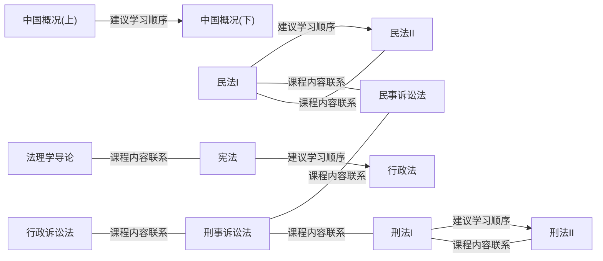

# 法学专业“2+X”修读建议（留学生适用）

2024 年汇编印刷页 384–385。原表记录 32 个可配对的课程代码。

[本节原页](plan-378.pdf#page=7) · [逐行数据](plan-378.json) · [院系目录](README.md)

## 课程关系图

图中展示最多 20 条关系。下表列出本节全部关系。建议学习顺序供规划课程使用，正式选课资格以教务规定为准。

| 课程 | 关联课程 | 关系 | 依据 |
| --- | --- | --- | --- |
| 中国概况(上)（ICES110012） | 中国概况(下)（ICES110013） | 建议学习顺序 | 同节课程题名标明连续分册或序号。 |
| 民法I（LAWS130002） | 民法II（LAWS130064） | 建议学习顺序 | 同节课程题名标明连续分册或序号。 |
| 刑法I（LAWS130062） | 刑法II（LAWS130050） | 建议学习顺序 | 同节课程题名标明连续分册或序号。 |
| 宪法（SOSC120015） | 行政法（LAWS130065） | 建议学习顺序 | 对国家机构与公权力结构的认识可帮助理解行政法律关系。 |
| 民法I（LAWS130002） | 民事诉讼法（LAWS130009） | 课程内容联系 | 民事权利义务与其程序救济可对照学习。 |
| 民法I（LAWS130002） | 民法II（LAWS130064） | 课程内容联系 | 本方案两门课程的题名均含“民法”，可据此对照这一主题。 |
| 行政诉讼法（LAWS130005） | 刑事诉讼法（LAWS130007） | 课程内容联系 | 本方案两门课程的题名均含“诉讼”，可据此对照这一主题。 |
| 刑事诉讼法（LAWS130007） | 民事诉讼法（LAWS130009） | 课程内容联系 | 本方案两门课程的题名均含“诉讼”，可据此对照这一主题。 |
| 刑事诉讼法（LAWS130007） | 刑法I（LAWS130062） | 课程内容联系 | 犯罪与刑责的实体规则和程序规则可相互参照。 |
| 刑法II（LAWS130050） | 刑法I（LAWS130062） | 课程内容联系 | 本方案两门课程的题名均含“刑法”，可据此对照这一主题。 |
| 法理学导论（SOSC120003） | 宪法（SOSC120015） | 课程内容联系 | 两课均涉及权利与公共权力的规范依据。 |

## 课程

| 课程代码 | 名称 | 开课学期原文 | 来源（PDF 页） |
| --- | --- | --- | --- |
| ICES110012 | 中国概况(上) |  | 398 |
| ICES110013 | 中国概况(下) |  | 398 |
| LAWS130002 | 民法I |  | 398 |
| LAWS130005 | 行政诉讼法 |  | 398 |
| LAWS130007 | 刑事诉讼法 |  | 398 |
| LAWS130009 | 民事诉讼法 |  | 398 |
| LAWS130020 | 毕业实习 |  | 398 |
| LAWS130021 | 毕业论文 |  | 399 |
| LAWS130026 | 自然资源和环境保护法 |  | 399 |
| LAWS130050 | 刑法II |  | 398 |
| LAWS130061 | 国际法 |  | 398 |
| LAWS130062 | 刑法I |  | 398 |
| LAWS130063 | 中国法律史 |  | 398 |
| LAWS130064 | 民法II |  | 398 |
| LAWS130065 | 行政法 |  | 398 |
| LAWS130066 | 法律职业伦理 |  | 398 |
| LAWS130068 | 商法 |  | 399 |
| LAWS130069 | 知识产权法 |  | 399 |
| LAWS130070 | 国际私法 |  | 399 |
| LAWS130071 | 国际经济法导论 |  | 399 |
| LAWS130105 | 习近平法治思想概论 |  | 398 |
| SOSC120001 | 政治学原理 |  | 398 |
| SOSC120002 | 社会学导论 |  | 398 |
| SOSC120003 | 法理学导论 |  | 398 |
| SOSC120007 | 经济学原理 |  | 398 |
| SOSC120009 | 社会研究方法A |  | 398 |
| SOSC120011 | 国际关系导论 |  | 398 |
| SOSC120013 | 心理学导论 |  | 398 |
| SOSC120014 | 管理学导论 |  | 398 |
| SOSC120015 | 宪法 |  | 398 |
| SOSC120016 | 经济法 |  | 398 |
| SOSC120019 | 当代中国政治制度 |  | 398 |
