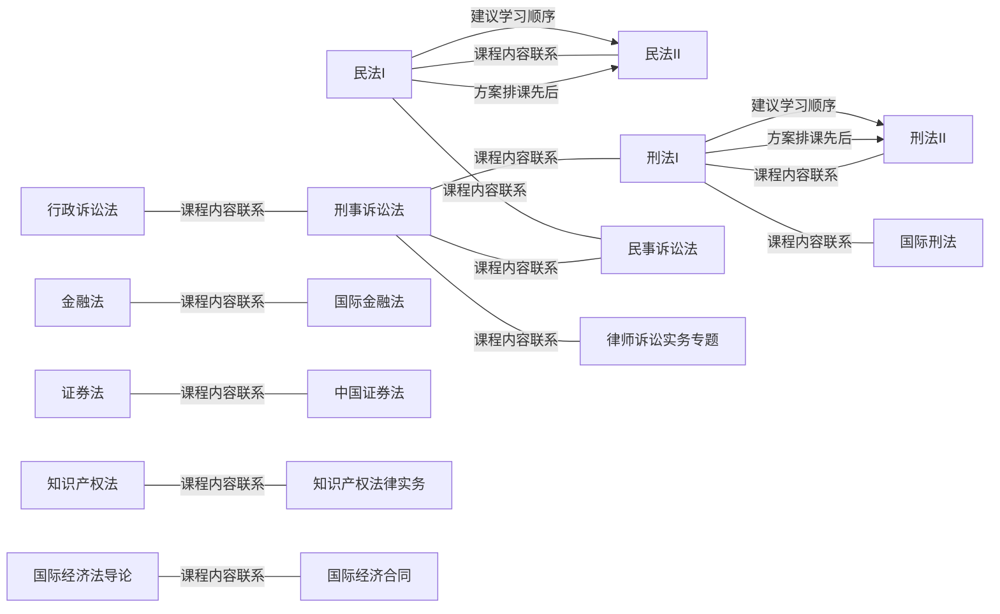

# 法学（涉外法治拔尖人才班）专业“2+X”教学培养方案

2024 年汇编印刷页 386–389。原表记录 73 个可配对的课程代码。

[本节原页](plan-386.pdf#page=1) · [逐行数据](plan-386.json) · [院系目录](README.md)

## 课程导读

想了解实体法与法律程序的课程安排，可以在原表中找到《民法I》（`LAWS130002`）、《刑法I》（`LAWS130062`）、《行政诉讼法》（`LAWS130005`）。 [原书 PDF 第 400 页](plan-386.pdf#page=1)

图中把《民法I》（`LAWS130002`）和《民事诉讼法》（`LAWS130009`）列作内容联系。民事权利义务与其程序救济可对照学习。 [原书 PDF 第 400 页](plan-386.pdf#page=1)

## 课程关系图

图中展示最多 20 条关系。下表列出本节全部关系。建议学习顺序供规划课程使用，正式选课资格以教务规定为准。

| 课程 | 关联课程 | 关系 | 依据 |
| --- | --- | --- | --- |
| 民法I（LAWS130002） | 民法II（LAWS130064） | 建议学习顺序 | 同节课程题名标明连续分册或序号。 |
| 刑法I（LAWS130062） | 刑法II（LAWS130050） | 建议学习顺序 | 同节课程题名标明连续分册或序号。 |
| 民法I（LAWS130002） | 民事诉讼法（LAWS130009） | 课程内容联系 | 民事权利义务与其程序救济可对照学习。 |
| 民法I（LAWS130002） | 民法II（LAWS130064） | 课程内容联系 | 本方案两门课程的题名均含“民法”，可据此对照这一主题。 |
| 行政诉讼法（LAWS130005） | 刑事诉讼法（LAWS130007） | 课程内容联系 | 本方案两门课程的题名均含“诉讼”，可据此对照这一主题。 |
| 刑事诉讼法（LAWS130007） | 民事诉讼法（LAWS130009） | 课程内容联系 | 本方案两门课程的题名均含“诉讼”，可据此对照这一主题。 |
| 刑事诉讼法（LAWS130007） | 刑法I（LAWS130062） | 课程内容联系 | 犯罪与刑责的实体规则和程序规则可相互参照。 |
| 刑事诉讼法（LAWS130007） | 律师诉讼实务专题（LAWS130122） | 课程内容联系 | 本方案两门课程的题名均含“诉讼”，可据此对照这一主题。 |
| 金融法（LAWS130024） | 国际金融法（LAWS130090） | 课程内容联系 | 本方案两门课程的题名均含“金融”，可据此对照这一主题。 |
| 证券法（LAWS130032） | 中国证券法（LAWS130117） | 课程内容联系 | 本方案两门课程的题名均含“证券”，可据此对照这一主题。 |
| 刑法II（LAWS130050） | 刑法I（LAWS130062） | 课程内容联系 | 本方案两门课程的题名均含“刑法”，可据此对照这一主题。 |
| 刑法I（LAWS130062） | 国际刑法（LAWS130094） | 课程内容联系 | 本方案两门课程的题名均含“刑法”，可据此对照这一主题。 |
| 知识产权法（LAWS130069） | 知识产权法律实务（LAWS130125） | 课程内容联系 | 本方案两门课程的题名均含“知识产权”，可据此对照这一主题。 |
| 国际经济法导论（LAWS130071） | 国际经济合同（LAWS130092） | 课程内容联系 | 本方案两门课程的题名均含“国际经济”，可据此对照这一主题。 |
| 民法I（LAWS130002） | 民法II（LAWS130064） | 方案排课先后 | 本节原表所列全部明确学期均早于后者。 |
| 刑法I（LAWS130062） | 刑法II（LAWS130050） | 方案排课先后 | 本节原表所列全部明确学期均早于后者。 |

## 课程

| 课程代码 | 名称 | 开课学期原文 | 来源（PDF 页） |
| --- | --- | --- | --- |
| LAWS130002 | 民法I | 2 | 400 |
| LAWS130005 | 行政诉讼法 | 3 | 400 |
| LAWS130007 | 刑事诉讼法 | 4 | 400 |
| LAWS130009 | 民事诉讼法 | 4 | 400 |
| LAWS130013 | 专业英语I(法律) | 5 | 401 |
| LAWS130020 | 毕业实习 | 5-8 | 401 |
| LAWS130021 | 毕业论文 | 8 | 401 |
| LAWS130023 | 税法 | 4 | 401 |
| LAWS130024 | 金融法 | 4 | 401 |
| LAWS130025 | 公司法 | 4 | 401 |
| LAWS130026 | 自然资源和环境保护法 | 5 | 401 |
| LAWS130028 | 劳动法 | 5 | 402 |
| LAWS130032 | 证券法 | 5 | 402 |
| LAWS130033 | 票据法 | 6 | 402 |
| LAWS130039 | 台港澳法 | 6 | 401 |
| LAWS130041 | 国际商事仲裁法 | 6 | 402 |
| LAWS130042 | 海商法 | 6 | 402 |
| LAWS130043 | 刑事政策 | 4 | 401 |
| LAWS130045 | 西方法律思想史 | 7 | 401 |
| LAWS130050 | 刑法II | 3 | 400 |
| LAWS130061 | 国际法 | 3 | 400 |
| LAWS130062 | 刑法I | 2 | 400 |
| LAWS130063 | 中国法律史 | 3 | 400 |
| LAWS130064 | 民法II | 3 | 400 |
| LAWS130065 | 行政法 | 2 | 400 |
| LAWS130066 | 法律职业伦理 | 7 | 401 |
| LAWS130067 | 法律实务 | 7 | 402 |
| LAWS130068 | 商法 | 4 | 401 |
| LAWS130069 | 知识产权法 | 4 | 401 |
| LAWS130070 | 国际私法 | 4 | 401 |
| LAWS130071 | 国际经济法导论 | 5 | 401 |
| LAWS130072 | 专业英语II(法律) | 6 | 403 |
| LAWS130073 | 法理学研究 | 7 | 401 |
| LAWS130074 | 比较法 | 6 | 401 |
| LAWS130075 | 英美法 | 5 | 401 |
| LAWS130076 | 欧陆法 | 5 | 401 |
| LAWS130077 | 外国法律史 | 4 | 401 |
| LAWS130078 | 人权法 | 5 | 401 |
| LAWS130079 | 犯罪学 | 6 | 402 |
| LAWS130080 | 物权法 | 4 | 401 |
| LAWS130081 | 侵权责任法 | 5 | 402 |
| LAWS130082 | 婚姻家庭法 | 5 | 402 |
| LAWS130084 | 保险法 | 5 | 402 |
| LAWS130085 | 市场规制法 | 6 | 402 |
| LAWS130086 | 破产法 | 5 | 402 |
| LAWS130087 | 医事法 | 6 | 402 |
| LAWS130088 | 国际投资法 | 6 | 402 |
| LAWS130089 | 国际税法 | 6 | 402 |
| LAWS130090 | 国际金融法 | 5 | 402 |
| LAWS130091 | 国际贸易法 | 5 | 402 |
| LAWS130092 | 国际经济合同 | 6 | 402 |
| LAWS130093 | 国际商法 | 6 | 402 |
| LAWS130094 | 国际刑法 | 6 | 402 |
| LAWS130095 | 证据法 | 5 | 402 |
| LAWS130096 | 法律检索 | 5 | 402 |
| LAWS130098 | 案例探讨 | 7 | 403 |
| LAWS130099 | 法律谈判 | 5 | 402 |
| LAWS130101 | 专业英语Ⅲ(法律) | 7 | 403 |
| LAWS130105 | 习近平法治思想概论 | 3 | 400 |
| LAWS130112 | 合同法 | 4 | 402 |
| LAWS130114 | 英美证据法 | 6 | 402 |
| LAWS130115 | 英美合同法 | 7 | 403 |
| LAWS130116 | 民商事审判方法 | 7 | 403 |
| LAWS130117 | 中国证券法 | 7 | 403 |
| LAWS130118 | 中国消费者法 | 6 | 403 |
| LAWS130119 | 中国商事纠纷解决制度 | 6或8 | 403 |
| LAWS130120 | 中国公司治理 | 6 | 403 |
| LAWS130121 | 气候变化的治理与法律 | 7 | 402 |
| LAWS130122 | 律师诉讼实务专题 | 7 | 403 |
| LAWS130123 | 类案裁判方法专题 | 6 | 402 |
| LAWS130124 | 检察业务专题 | 7 | 403 |
| LAWS130125 | 知识产权法律实务 | 6 | 402 |
| LAWS130126 | 交易律师实务 | 6 | 402 |
