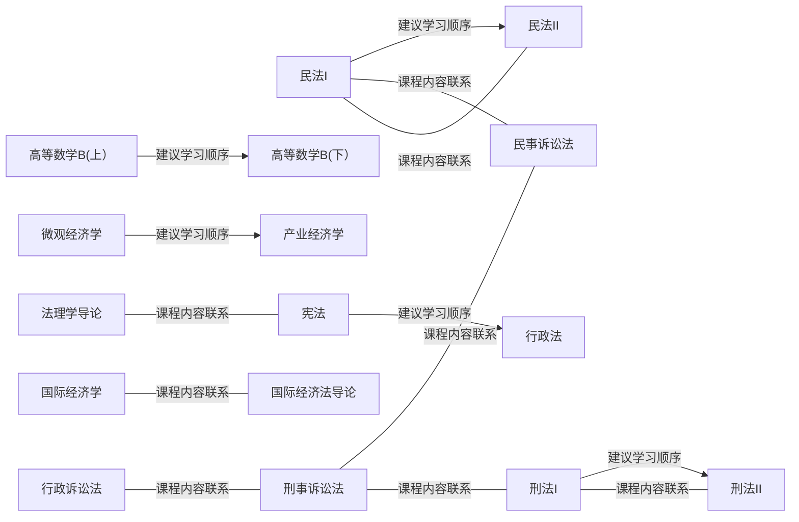

# 法学-经济学双学士学位项目“2+X”修读建议

2024 年汇编印刷页 396–397。原表记录 48 个可配对的课程代码。

[本节原页](plan-392.pdf#page=5) · [逐行数据](plan-392.json) · [院系目录](README.md)

## 课程导读

想了解法律与经济的课程安排，可以在原表中找到《法理学导论》（`SOSC120003`）、《计量经济学》（`ECON130213`）、《公司金融》（`ECON130217`）。 [原书 PDF 第 410 页](plan-392.pdf#page=5)

图谱建议先读《微观经济学》（`SOSC120004`）再读《产业经济学》（`ECON130011`）。企业和市场结构是产业经济分析的基础。 [原书 PDF 第 410 页](plan-392.pdf#page=5) · [原书 PDF 第 411 页](plan-392.pdf#page=6)

## 课程关系图

图中展示最多 20 条关系。下表列出本节全部关系。建议学习顺序供规划课程使用，正式选课资格以教务规定为准。

| 课程 | 关联课程 | 关系 | 依据 |
| --- | --- | --- | --- |
| 民法I（LAWS130002） | 民法II（LAWS130064） | 建议学习顺序 | 同节课程题名标明连续分册或序号。 |
| 刑法I（LAWS130062） | 刑法II（LAWS130050） | 建议学习顺序 | 同节课程题名标明连续分册或序号。 |
| 高等数学B(上）（MATH120003） | 高等数学B(下）（MATH120004） | 建议学习顺序 | 同节课程题名标明连续分册或序号。 |
| 微观经济学（SOSC120004） | 产业经济学（ECON130011） | 建议学习顺序 | 企业和市场结构是产业经济分析的基础。 |
| 宪法（SOSC120015） | 行政法（LAWS130065） | 建议学习顺序 | 对国家机构与公权力结构的认识可帮助理解行政法律关系。 |
| 国际经济学（ECON130019） | 国际经济法导论（LAWS130071） | 课程内容联系 | 本方案两门课程的题名均含“国际经济”，可据此对照这一主题。 |
| 民法I（LAWS130002） | 民事诉讼法（LAWS130009） | 课程内容联系 | 民事权利义务与其程序救济可对照学习。 |
| 民法I（LAWS130002） | 民法II（LAWS130064） | 课程内容联系 | 本方案两门课程的题名均含“民法”，可据此对照这一主题。 |
| 行政诉讼法（LAWS130005） | 刑事诉讼法（LAWS130007） | 课程内容联系 | 本方案两门课程的题名均含“诉讼”，可据此对照这一主题。 |
| 刑事诉讼法（LAWS130007） | 民事诉讼法（LAWS130009） | 课程内容联系 | 本方案两门课程的题名均含“诉讼”，可据此对照这一主题。 |
| 刑事诉讼法（LAWS130007） | 刑法I（LAWS130062） | 课程内容联系 | 犯罪与刑责的实体规则和程序规则可相互参照。 |
| 刑法II（LAWS130050） | 刑法I（LAWS130062） | 课程内容联系 | 本方案两门课程的题名均含“刑法”，可据此对照这一主题。 |
| 法理学导论（SOSC120003） | 宪法（SOSC120015） | 课程内容联系 | 两课均涉及权利与公共权力的规范依据。 |

## 课程

| 课程代码 | 名称 | 开课学期原文 | 来源（PDF 页） |
| --- | --- | --- | --- |
| ECON130001 | 概率论与数理统计 |  | 410 |
| ECON130005 | 财政学 |  | 410 |
| ECON130010 | 当代中国经济 |  | 411 |
| ECON130011 | 产业经济学 |  | 411 |
| ECON130019 | 国际经济学 |  | 410 |
| ECON130064 | 博弈论 |  | 411 |
| ECON130128 | 制度经济学 |  | 411 |
| ECON130131 | 外国经济思想史 |  | 411 |
| ECON130212 | 经济史 |  | 410 |
| ECON130213 | 计量经济学 |  | 410 |
| ECON130217 | 公司金融 |  | 410 |
| ECON130239 | 资源环境经济学 |  | 411 |
| LAWS130002 | 民法I |  | 411 |
| LAWS130005 | 行政诉讼法 |  | 411 |
| LAWS130007 | 刑事诉讼法 |  | 411 |
| LAWS130009 | 民事诉讼法 |  | 411 |
| LAWS130013 | 专业英语I(法律) |  | 411 |
| LAWS130020 | 毕业实习 |  | 411 |
| LAWS130021 | 毕业论文 |  | 411 |
| LAWS130026 | 自然资源和环境保护法 |  | 411 |
| LAWS130050 | 刑法II |  | 411 |
| LAWS130061 | 国际法 |  | 411 |
| LAWS130062 | 刑法I |  | 411 |
| LAWS130063 | 中国法律史 |  | 411 |
| LAWS130064 | 民法II |  | 411 |
| LAWS130065 | 行政法 |  | 411 |
| LAWS130066 | 法律职业伦理 |  | 411 |
| LAWS130068 | 商法 |  | 411 |
| LAWS130069 | 知识产权法 |  | 411 |
| LAWS130070 | 国际私法 |  | 411 |
| LAWS130071 | 国际经济法导论 |  | 411 |
| LAWS130105 | 习近平法治思想概论 |  | 411 |
| MATH120003 | 高等数学B(上） |  | 410 |
| MATH120004 | 高等数学B(下） |  | 410 |
| MATH120044 | 线性代数 |  | 410 |
| PTSS110082 | 毛泽东思想和中国特色社会主义理论体系概论 |  | 410 |
| PTSS110087 | 马克思主义基本原理 |  | 410 |
| PTSS110088 | 中国近现代史纲要 |  | 410 |
| PTSS110089 | 思想道德与法治 |  | 410 |
| PTSS110090 | 习近平新时代中国特色社会主义思想概论 |  | 410 |
| SOSC120001 | 政治学原理 |  | 410 |
| SOSC120003 | 法理学导论 |  | 410 |
| SOSC120004 | 微观经济学 |  | 410 |
| SOSC120005 | 宏观经济学 |  | 410 |
| SOSC120006 | 会计学 |  | 410 |
| SOSC120008 | 政治经济学 |  | 410 |
| SOSC120015 | 宪法 |  | 410 |
| SOSC120016 | 经济法 |  | 410 |
