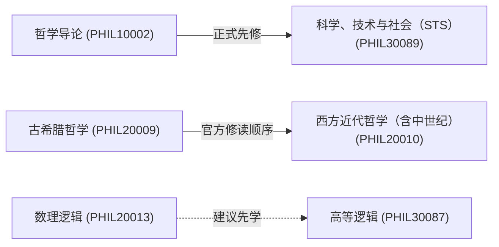

# 哲学学院 2023 级培养方案与课程图谱

共 13 份方案、2736 条方案课程记录、257 个课号。

[返回三年总览](../README.md) · [离线交互图谱](../index.html) · [方案索引](plans.json) · [方案课程记录](courses.json) · [图谱数据](graph.json) · [查证关系](relations.json)

## 官方方案原件

| 方案编号 | 培养方案 | 所属 | 原件与数据 |
| --- | --- | --- | --- |
| 67342 | 2023哲学专业(留学生适用) | 哲学学院 | [Word 原件](<originals/plan-67342.docx>) · [原始响应](<originals/plan-67342-detail.json>) · [教务详情](https://fdjwgl.fudan.edu.cn/manager/bizType/2/major-program-search/info/67342?skipAuth=1) |
| 67323 | 2023哲学专业 | 哲学学院 | [Word 原件](<originals/plan-67323.docx>) · [原始响应](<originals/plan-67323-detail.json>) · [教务详情](https://fdjwgl.fudan.edu.cn/manager/bizType/2/major-program-search/info/67323?skipAuth=1) |
| 67333 | 2023哲学(国学方向)专业 | 哲学学院 | [Word 原件](<originals/plan-67333.docx>) · [原始响应](<originals/plan-67333-detail.json>) · [教务详情](https://fdjwgl.fudan.edu.cn/manager/bizType/2/major-program-search/info/67333?skipAuth=1) |
| 67339 | 2023哲学(国学方向)专业(强基班学生适用) | 哲学学院 | [Word 原件](<originals/plan-67339.docx>) · [原始响应](<originals/plan-67339-detail.json>) · [教务详情](https://fdjwgl.fudan.edu.cn/manager/bizType/2/major-program-search/info/67339?skipAuth=1) |
| 67334 | 2023哲学(科学哲学与逻辑学方向)专业 | 哲学学院 | [Word 原件](<originals/plan-67334.docx>) · [原始响应](<originals/plan-67334-detail.json>) · [教务详情](https://fdjwgl.fudan.edu.cn/manager/bizType/2/major-program-search/info/67334?skipAuth=1) |
| 67340 | 2023哲学(科学哲学与逻辑学方向)专业(强基班学生适用) | 哲学学院 | [Word 原件](<originals/plan-67340.docx>) · [原始响应](<originals/plan-67340-detail.json>) · [教务详情](https://fdjwgl.fudan.edu.cn/manager/bizType/2/major-program-search/info/67340?skipAuth=1) |
| 67338 | 2023哲学专业(强基班学生适用） | 哲学学院 | [Word 原件](<originals/plan-67338.docx>) · [原始响应](<originals/plan-67338-detail.json>) · [教务详情](https://fdjwgl.fudan.edu.cn/manager/bizType/2/major-program-search/info/67338?skipAuth=1) |
| 67335 | 2023哲学(艺术哲学方向)专业 | 哲学学院 | [Word 原件](<originals/plan-67335.docx>) · [原始响应](<originals/plan-67335-detail.json>) · [教务详情](https://fdjwgl.fudan.edu.cn/manager/bizType/2/major-program-search/info/67335?skipAuth=1) |
| 105536 | 2023哲学(艺术哲学方向)专业（港澳台侨生适用） | 哲学学院 | [Word 原件](<originals/plan-105536.docx>) · [原始响应](<originals/plan-105536-detail.json>) · [教务详情](https://fdjwgl.fudan.edu.cn/manager/bizType/2/major-program-search/info/105536?skipAuth=1) |
| 67341 | 2023哲学(艺术哲学方向)专业(强基班学生适用) | 哲学学院 | [Word 原件](<originals/plan-67341.docx>) · [原始响应](<originals/plan-67341-detail.json>) · [教务详情](https://fdjwgl.fudan.edu.cn/manager/bizType/2/major-program-search/info/67341?skipAuth=1) |
| 147559 | 2023宗教学专业2+2@伯明翰联合培养 | 哲学学院 | [Word 原件](<originals/plan-147559.docx>) · [原始响应](<originals/plan-147559-detail.json>) · [教务详情](https://fdjwgl.fudan.edu.cn/manager/bizType/2/major-program-search/info/147559?skipAuth=1) |
| 67336 | 2023宗教学专业 | 哲学学院 | [Word 原件](<originals/plan-67336.docx>) · [原始响应](<originals/plan-67336-detail.json>) · [教务详情](https://fdjwgl.fudan.edu.cn/manager/bizType/2/major-program-search/info/67336?skipAuth=1) |
| 67343 | 2023宗教学专业(留学生适用) | 哲学学院 | [Word 原件](<originals/plan-67343.docx>) · [原始响应](<originals/plan-67343-detail.json>) · [教务详情](https://fdjwgl.fudan.edu.cn/manager/bizType/2/major-program-search/info/67343?skipAuth=1) |

[公开教学大纲检索与预修字段记录](<syllabus-evidence.json>)

[手册及覆盖缺口核查](<handbook-audit.json>)

复旦招生目录确认 2023 年有 PPE 专业选拔。2023 级教务公开目录及学院手册未查到可确认归属的独立 PPE 方案原件，已列入覆盖缺口。 [2023 年招生专业目录](https://ao.fudan.edu.cn/b0/af/c36330a503983/page.htm)

入学当年两学期教务页面共列出 215 个哲学学院教学班。已核对 161 份公开大纲的先修栏，其中 0 份填写了先修内容。

## 先修与修读规则

课程大纲中的先修字段、培养方案中的修读顺序和免修条款各有类型和适用范围。课号相同的边可因方案、课程版本或条件而分别保留。

### 正式先修（16 条）

| 课程 | 后续课或对应课程 | 规则与范围 | 来源 |
| --- | --- | --- | --- |
| 哲学导论（`PHIL10002`） | 科学、技术与社会（STS）（`PHIL30089`） | 课程简介的预修要求列有哲学导论，并另要求自然科学和科学思想史知识。 涉及方案 67334、67340。以该教学大纲或简介为依据。范围对应两个课程均在册的方案，特定方向大纲单独限定。 | [2023级学院手册印刷页 282 · 科学、技术与社会（STS）课程简介](https://philosophy.fudan.edu.cn/_upload/article/files/82/e0/fffa1188484786c6751f6f882235/c8d46080-bbae-4366-afd2-7515893daa80.pdf#page=283) |
| 马克思主义哲学史（`PHIL30099`） | 认识论（`PHIL30055`） | 教学基本要求列出马克思主义哲学史，并另列若干基础领域及课程名称。 涉及方案 67323、67338、67342。以该教学大纲或简介为依据。范围对应两个课程均在册的方案，特定方向大纲单独限定。 | [2023级学院手册印刷页 329 · 认识论课程大纲](https://philosophy.fudan.edu.cn/_upload/article/files/82/e0/fffa1188484786c6751f6f882235/c8d46080-bbae-4366-afd2-7515893daa80.pdf#page=330) |
| 古希腊哲学（`PHIL20009`） | 亚里士多德哲学（`PHIL30060`） | 教学基本要求列明须修过古希腊哲学。 涉及方案 105536、147559、67323、67333、67334、67335、67336、67338、67339、67340、67341、67342、67343。以该教学大纲或简介为依据。范围对应两个课程均在册的方案，特定方向大纲单独限定。 | [2023级学院手册印刷页 361 · 哲学B组 · 亚里士多德哲学课程大纲](https://philosophy.fudan.edu.cn/_upload/article/files/82/e0/fffa1188484786c6751f6f882235/c8d46080-bbae-4366-afd2-7515893daa80.pdf#page=362) |
| 古希腊哲学（`PHIL20009`） | 康德哲学（`PHIL30008`） | 这两处大纲的预修课程均列古希腊哲学。哲学B组另一份同名课程大纲另有说明。 涉及方案 67334、67335。以该教学大纲或简介为依据。范围对应两个课程均在册的方案，特定方向大纲单独限定。 | [2023级学院手册印刷页 502、586 · 科逻B组及艺术D组 · 康德哲学课程大纲](https://philosophy.fudan.edu.cn/_upload/article/files/82/e0/fffa1188484786c6751f6f882235/c8d46080-bbae-4366-afd2-7515893daa80.pdf#page=503) |
| 西方近代哲学（含中世纪）（`PHIL20010`） | 康德哲学（`PHIL30008`） | 这两处大纲的预修课程均列西方近代哲学。哲学B组另一份同名课程大纲另有说明。 涉及方案 67334、67335。以该教学大纲或简介为依据。范围对应两个课程均在册的方案，特定方向大纲单独限定。 | [2023级学院手册印刷页 502、586 · 科逻B组及艺术D组 · 康德哲学课程大纲](https://philosophy.fudan.edu.cn/_upload/article/files/82/e0/fffa1188484786c6751f6f882235/c8d46080-bbae-4366-afd2-7515893daa80.pdf#page=503) |
| 宗教学导论（`PHIL10004`） | 中国佛教史（`PHIL30082`） | 预修课程栏列有宗教学导论。 涉及方案 105536、147559、67323、67333、67334、67335、67336、67338、67339、67340、67341、67342、67343。以该教学大纲或简介为依据。范围对应两个课程均在册的方案，特定方向大纲单独限定。 | [2023级学院手册印刷页 638 · 中国佛教史课程大纲](https://philosophy.fudan.edu.cn/_upload/article/files/82/e0/fffa1188484786c6751f6f882235/c8d46080-bbae-4366-afd2-7515893daa80.pdf#page=639) |
| 佛教哲学（`PHIL30011`） | 中国佛教史（`PHIL30082`） | 预修课程栏列有佛教哲学。 涉及方案 105536、147559、67323、67333、67334、67335、67336、67338、67339、67340、67341、67342、67343。以该教学大纲或简介为依据。范围对应两个课程均在册的方案，特定方向大纲单独限定。 | [2023级学院手册印刷页 638 · 中国佛教史课程大纲](https://philosophy.fudan.edu.cn/_upload/article/files/82/e0/fffa1188484786c6751f6f882235/c8d46080-bbae-4366-afd2-7515893daa80.pdf#page=639) |
| 宗教学导论（`PHIL10004`） | 宗教哲学（`PHIL30006`） | 预修课程栏列有宗教学导论。教学基本要求另以领域和科目名称说明基础。 涉及方案 105536、147559、67323、67333、67334、67335、67336、67338、67339、67340、67341、67342、67343。以该教学大纲或简介为依据。范围对应两个课程均在册的方案，特定方向大纲单独限定。 | [2023级学院手册印刷页 647 · 宗教哲学课程大纲](https://philosophy.fudan.edu.cn/_upload/article/files/82/e0/fffa1188484786c6751f6f882235/c8d46080-bbae-4366-afd2-7515893daa80.pdf#page=648) |
| 藏语Ⅰ（`PHIL40009`） | 藏语Ⅱ（`PHIL40010`） | 预修课程栏列有藏语Ⅰ。 涉及方案 105536、147559、67323、67333、67334、67335、67336、67338、67339、67340、67341、67342、67343。以该教学大纲或简介为依据。范围对应两个课程均在册的方案，特定方向大纲单独限定。 | [2023级学院手册印刷页 664 · 藏语Ⅱ课程大纲](https://philosophy.fudan.edu.cn/_upload/article/files/82/e0/fffa1188484786c6751f6f882235/c8d46080-bbae-4366-afd2-7515893daa80.pdf#page=665) |
| 梵语Ⅱ（`PHIL40020`） | 梵语Ⅲ（`PHIL40021`） | 预修课程栏列有梵语Ⅱ。 涉及方案 105536、147559、67323、67333、67334、67335、67336、67338、67339、67340、67341、67342、67343。以该教学大纲或简介为依据。范围对应两个课程均在册的方案，特定方向大纲单独限定。 | [2023级学院手册印刷页 678 · 梵语Ⅲ课程大纲](https://philosophy.fudan.edu.cn/_upload/article/files/82/e0/fffa1188484786c6751f6f882235/c8d46080-bbae-4366-afd2-7515893daa80.pdf#page=679) |
| 梵语Ⅲ（`PHIL40021`） | 梵语Ⅳ（`PHIL40022`） | 预修课程栏列有梵语Ⅲ。 涉及方案 105536、147559、67323、67333、67334、67335、67336、67338、67339、67340、67341、67342、67343。以该教学大纲或简介为依据。范围对应两个课程均在册的方案，特定方向大纲单独限定。 | [2023级学院手册印刷页 681 · 梵语Ⅳ课程大纲](https://philosophy.fudan.edu.cn/_upload/article/files/82/e0/fffa1188484786c6751f6f882235/c8d46080-bbae-4366-afd2-7515893daa80.pdf#page=682) |
| 西方近代哲学（含中世纪）（`PHIL20010`） | 启蒙哲学（`PHIL50033`） | 预修课程栏列有西方近代哲学（含中世纪）。 涉及方案 105536、147559、67323、67333、67334、67335、67336、67338、67339、67340、67341、67342、67343。以该教学大纲或简介为依据。范围对应两个课程均在册的方案，特定方向大纲单独限定。 | [2023级学院手册印刷页 740 · 启蒙哲学课程大纲](https://philosophy.fudan.edu.cn/_upload/article/files/82/e0/fffa1188484786c6751f6f882235/c8d46080-bbae-4366-afd2-7515893daa80.pdf#page=741) |
| 数理逻辑（`PHIL20013`） | 可计算性理论进阶（`PHIL50039`） | 基本要求将数理逻辑列为修过的前置课程。 涉及方案 147559、67323、67334、67336、67338、67340、67342、67343。以该教学大纲或简介为依据。范围对应两个课程均在册的方案，特定方向大纲单独限定。 | [2023级学院手册印刷页 795 · 可计算性理论进阶课程简介](https://philosophy.fudan.edu.cn/_upload/article/files/82/e0/fffa1188484786c6751f6f882235/c8d46080-bbae-4366-afd2-7515893daa80.pdf#page=796) |
| 可计算性理论（`PHIL30107`） | 可计算性理论进阶（`PHIL50039`） | 基本要求将可计算性理论列为修过的前置课程。 涉及方案 105536、147559、67323、67333、67334、67335、67336、67338、67339、67340、67341、67342、67343。以该教学大纲或简介为依据。范围对应两个课程均在册的方案，特定方向大纲单独限定。 | [2023级学院手册印刷页 795 · 可计算性理论进阶课程简介](https://philosophy.fudan.edu.cn/_upload/article/files/82/e0/fffa1188484786c6751f6f882235/c8d46080-bbae-4366-afd2-7515893daa80.pdf#page=796) |
| 数理逻辑（`PHIL20013`） | 集合论进阶（`PHIL50040`） | 基本要求将数理逻辑列为修过的前置课程。 涉及方案 147559、67323、67334、67336、67338、67340、67342、67343。以该教学大纲或简介为依据。范围对应两个课程均在册的方案，特定方向大纲单独限定。 | [2023级学院手册印刷页 797 · 集合论进阶课程简介](https://philosophy.fudan.edu.cn/_upload/article/files/82/e0/fffa1188484786c6751f6f882235/c8d46080-bbae-4366-afd2-7515893daa80.pdf#page=798) |
| 集合论（`PHIL30106`） | 集合论进阶（`PHIL50040`） | 基本要求将集合论列为修过的前置课程。 涉及方案 105536、147559、67323、67333、67334、67335、67336、67338、67339、67340、67341、67342、67343。以该教学大纲或简介为依据。范围对应两个课程均在册的方案，特定方向大纲单独限定。 | [2023级学院手册印刷页 797 · 集合论进阶课程简介](https://philosophy.fudan.edu.cn/_upload/article/files/82/e0/fffa1188484786c6751f6f882235/c8d46080-bbae-4366-afd2-7515893daa80.pdf#page=798) |

### 官方先修领域（2 条）

| 课程 | 后续课或对应课程 | 规则与范围 | 来源 |
| --- | --- | --- | --- |
| 数理逻辑（`PHIL20013`） | 模态逻辑（`PHIL30085`） | 教学基本要求规定选课学生须修过一门数理逻辑，图中课程是本届相应科目。 涉及方案 147559、67323、67334、67336、67338、67340、67342、67343。以该教学大纲或简介为依据。范围对应两个课程均在册的方案，特定方向大纲单独限定。 | [2023级学院手册印刷页 478、898 · 模态逻辑课程简介](https://philosophy.fudan.edu.cn/_upload/article/files/82/e0/fffa1188484786c6751f6f882235/c8d46080-bbae-4366-afd2-7515893daa80.pdf#page=479) |
| 数理逻辑（`PHIL20013`） | 可计算性理论（`PHIL30107`） | 教学基本要求规定选课学生须修过一门数理逻辑，图中课程是本届相应科目。 涉及方案 147559、67323、67334、67336、67338、67340、67342、67343。以该教学大纲或简介为依据。范围对应两个课程均在册的方案，特定方向大纲单独限定。 | [2023级学院手册印刷页 892 · 可计算性理论课程简介](https://philosophy.fudan.edu.cn/_upload/article/files/82/e0/fffa1188484786c6751f6f882235/c8d46080-bbae-4366-afd2-7515893daa80.pdf#page=893) |

### 官方修读顺序（27 条）

| 课程 | 后续课或对应课程 | 规则与范围 | 来源 |
| --- | --- | --- | --- |
| 古希腊哲学（`PHIL20009`） | 西方近代哲学（含中世纪）（`PHIL20010`） | 课程图以箭头从古希腊哲学指向西方近代哲学（含中世纪）。 涉及方案 67323 | [2023级学院手册印刷页 15 · 哲学专业核心必修课](https://philosophy.fudan.edu.cn/_upload/article/files/82/e0/fffa1188484786c6751f6f882235/c8d46080-bbae-4366-afd2-7515893daa80.pdf#page=16) |
| 西方近代哲学（含中世纪）（`PHIL20010`） | 德国古典哲学（`PHIL20011`） | 课程图以箭头从西方近代哲学（含中世纪）指向德国古典哲学。 涉及方案 67323 | [2023级学院手册印刷页 15 · 哲学专业核心必修课](https://philosophy.fudan.edu.cn/_upload/article/files/82/e0/fffa1188484786c6751f6f882235/c8d46080-bbae-4366-afd2-7515893daa80.pdf#page=16) |
| 先秦哲学（`PHIL20014`） | 汉晋隋唐哲学（`PHIL20015`） | 课程图以箭头从先秦哲学指向汉晋隋唐哲学。 涉及方案 67323 | [2023级学院手册印刷页 15 · 哲学专业核心必修课](https://philosophy.fudan.edu.cn/_upload/article/files/82/e0/fffa1188484786c6751f6f882235/c8d46080-bbae-4366-afd2-7515893daa80.pdf#page=16) |
| 汉晋隋唐哲学（`PHIL20015`） | 宋元明清哲学（`PHIL20016`） | 课程图以箭头从汉晋隋唐哲学指向宋元明清哲学。 涉及方案 67323 | [2023级学院手册印刷页 15 · 哲学专业核心必修课](https://philosophy.fudan.edu.cn/_upload/article/files/82/e0/fffa1188484786c6751f6f882235/c8d46080-bbae-4366-afd2-7515893daa80.pdf#page=16) |
| 宋元明清哲学（`PHIL20016`） | 中国近现代哲学（`PHIL20017`） | 课程图以箭头从宋元明清哲学指向中国近现代哲学。 涉及方案 67323 | [2023级学院手册印刷页 15 · 哲学专业核心必修课](https://philosophy.fudan.edu.cn/_upload/article/files/82/e0/fffa1188484786c6751f6f882235/c8d46080-bbae-4366-afd2-7515893daa80.pdf#page=16) |
| 现代英美哲学（`PHIL30049`） | 现代欧陆哲学（`PHIL30050`） | 课程图以箭头从现代英美哲学指向现代欧陆哲学。 涉及方案 67323 | [2023级学院手册印刷页 15 · 哲学专业核心必修课](https://philosophy.fudan.edu.cn/_upload/article/files/82/e0/fffa1188484786c6751f6f882235/c8d46080-bbae-4366-afd2-7515893daa80.pdf#page=16) |
| 古希腊哲学（`PHIL20009`） | 西方近代哲学（含中世纪）（`PHIL20010`） | 课程图以箭头从古希腊哲学指向西方近代哲学（含中世纪）。 涉及方案 67333 | [2023级学院手册印刷页 18 · 哲学（国学方向）专业核心必修课](https://philosophy.fudan.edu.cn/_upload/article/files/82/e0/fffa1188484786c6751f6f882235/c8d46080-bbae-4366-afd2-7515893daa80.pdf#page=19) |
| 西方近代哲学（含中世纪）（`PHIL20010`） | 德国古典哲学（`PHIL20011`） | 课程图以箭头从西方近代哲学（含中世纪）指向德国古典哲学。 涉及方案 67333 | [2023级学院手册印刷页 18 · 哲学（国学方向）专业核心必修课](https://philosophy.fudan.edu.cn/_upload/article/files/82/e0/fffa1188484786c6751f6f882235/c8d46080-bbae-4366-afd2-7515893daa80.pdf#page=19) |
| 先秦哲学（`PHIL20014`） | 汉晋隋唐哲学（`PHIL20015`） | 课程图以箭头从先秦哲学指向汉晋隋唐哲学。 涉及方案 67333 | [2023级学院手册印刷页 18 · 哲学（国学方向）专业核心必修课](https://philosophy.fudan.edu.cn/_upload/article/files/82/e0/fffa1188484786c6751f6f882235/c8d46080-bbae-4366-afd2-7515893daa80.pdf#page=19) |
| 汉晋隋唐哲学（`PHIL20015`） | 宋元明清哲学（`PHIL20016`） | 课程图以箭头从汉晋隋唐哲学指向宋元明清哲学。 涉及方案 67333 | [2023级学院手册印刷页 18 · 哲学（国学方向）专业核心必修课](https://philosophy.fudan.edu.cn/_upload/article/files/82/e0/fffa1188484786c6751f6f882235/c8d46080-bbae-4366-afd2-7515893daa80.pdf#page=19) |
| 宋元明清哲学（`PHIL20016`） | 中国近现代哲学（`PHIL20017`） | 课程图以箭头从宋元明清哲学指向中国近现代哲学。 涉及方案 67333 | [2023级学院手册印刷页 18 · 哲学（国学方向）专业核心必修课](https://philosophy.fudan.edu.cn/_upload/article/files/82/e0/fffa1188484786c6751f6f882235/c8d46080-bbae-4366-afd2-7515893daa80.pdf#page=19) |
| 古希腊哲学（`PHIL20009`） | 西方近代哲学（含中世纪）（`PHIL20010`） | 课程图以箭头从古希腊哲学指向西方近代哲学（含中世纪）。 涉及方案 67334 | [2023级学院手册印刷页 21 · 哲学（科学哲学与逻辑学方向）专业核心必修课](https://philosophy.fudan.edu.cn/_upload/article/files/82/e0/fffa1188484786c6751f6f882235/c8d46080-bbae-4366-afd2-7515893daa80.pdf#page=22) |
| 西方近代哲学（含中世纪）（`PHIL20010`） | 德国古典哲学（`PHIL20011`） | 课程图以箭头从西方近代哲学（含中世纪）指向德国古典哲学。 涉及方案 67334 | [2023级学院手册印刷页 21 · 哲学（科学哲学与逻辑学方向）专业核心必修课](https://philosophy.fudan.edu.cn/_upload/article/files/82/e0/fffa1188484786c6751f6f882235/c8d46080-bbae-4366-afd2-7515893daa80.pdf#page=22) |
| 先秦哲学（`PHIL20014`） | 汉晋隋唐哲学（`PHIL20015`） | 课程图以箭头从先秦哲学指向汉晋隋唐哲学。 涉及方案 67334 | [2023级学院手册印刷页 21 · 哲学（科学哲学与逻辑学方向）专业核心必修课](https://philosophy.fudan.edu.cn/_upload/article/files/82/e0/fffa1188484786c6751f6f882235/c8d46080-bbae-4366-afd2-7515893daa80.pdf#page=22) |
| 汉晋隋唐哲学（`PHIL20015`） | 宋元明清哲学（`PHIL20016`） | 课程图以箭头从汉晋隋唐哲学指向宋元明清哲学。 涉及方案 67334 | [2023级学院手册印刷页 21 · 哲学（科学哲学与逻辑学方向）专业核心必修课](https://philosophy.fudan.edu.cn/_upload/article/files/82/e0/fffa1188484786c6751f6f882235/c8d46080-bbae-4366-afd2-7515893daa80.pdf#page=22) |
| 宋元明清哲学（`PHIL20016`） | 中国近现代哲学（`PHIL20017`） | 课程图以箭头从宋元明清哲学指向中国近现代哲学。 涉及方案 67334 | [2023级学院手册印刷页 21 · 哲学（科学哲学与逻辑学方向）专业核心必修课](https://philosophy.fudan.edu.cn/_upload/article/files/82/e0/fffa1188484786c6751f6f882235/c8d46080-bbae-4366-afd2-7515893daa80.pdf#page=22) |
| 古希腊哲学（`PHIL20009`） | 西方近代哲学（含中世纪）（`PHIL20010`） | 课程图以箭头从古希腊哲学指向西方近代哲学（含中世纪）。 涉及方案 67335 | [2023级学院手册印刷页 24 · 哲学（艺术哲学方向）专业核心必修课](https://philosophy.fudan.edu.cn/_upload/article/files/82/e0/fffa1188484786c6751f6f882235/c8d46080-bbae-4366-afd2-7515893daa80.pdf#page=25) |
| 西方近代哲学（含中世纪）（`PHIL20010`） | 德国古典哲学（`PHIL20011`） | 课程图以箭头从西方近代哲学（含中世纪）指向德国古典哲学。 涉及方案 67335 | [2023级学院手册印刷页 24 · 哲学（艺术哲学方向）专业核心必修课](https://philosophy.fudan.edu.cn/_upload/article/files/82/e0/fffa1188484786c6751f6f882235/c8d46080-bbae-4366-afd2-7515893daa80.pdf#page=25) |
| 先秦哲学（`PHIL20014`） | 汉晋隋唐哲学（`PHIL20015`） | 课程图以箭头从先秦哲学指向汉晋隋唐哲学。 涉及方案 67335 | [2023级学院手册印刷页 24 · 哲学（艺术哲学方向）专业核心必修课](https://philosophy.fudan.edu.cn/_upload/article/files/82/e0/fffa1188484786c6751f6f882235/c8d46080-bbae-4366-afd2-7515893daa80.pdf#page=25) |
| 汉晋隋唐哲学（`PHIL20015`） | 宋元明清哲学（`PHIL20016`） | 课程图以箭头从汉晋隋唐哲学指向宋元明清哲学。 涉及方案 67335 | [2023级学院手册印刷页 24 · 哲学（艺术哲学方向）专业核心必修课](https://philosophy.fudan.edu.cn/_upload/article/files/82/e0/fffa1188484786c6751f6f882235/c8d46080-bbae-4366-afd2-7515893daa80.pdf#page=25) |
| 西方艺术史（上）（`PHIL30136`） | 西方艺术史（下）（`PHIL30137`） | 课程图以箭头从西方艺术史（上）指向西方艺术史（下）。 涉及方案 67335 | [2023级学院手册印刷页 24 · 哲学（艺术哲学方向）专业核心必修课](https://philosophy.fudan.edu.cn/_upload/article/files/82/e0/fffa1188484786c6751f6f882235/c8d46080-bbae-4366-afd2-7515893daa80.pdf#page=25) |
| 中国艺术史（上）（`PHIL30138`） | 中国艺术史（下）（`PHIL30139`） | 课程图以箭头从中国艺术史（上）指向中国艺术史（下）。 涉及方案 67335 | [2023级学院手册印刷页 24 · 哲学（艺术哲学方向）专业核心必修课](https://philosophy.fudan.edu.cn/_upload/article/files/82/e0/fffa1188484786c6751f6f882235/c8d46080-bbae-4366-afd2-7515893daa80.pdf#page=25) |
| 古希腊哲学（`PHIL20009`） | 西方近代哲学（含中世纪）（`PHIL20010`） | 课程图以箭头从古希腊哲学指向西方近代哲学（含中世纪）。 涉及方案 67336 | [2023级学院手册印刷页 27 · 宗教学专业核心必修课](https://philosophy.fudan.edu.cn/_upload/article/files/82/e0/fffa1188484786c6751f6f882235/c8d46080-bbae-4366-afd2-7515893daa80.pdf#page=28) |
| 西方近代哲学（含中世纪）（`PHIL20010`） | 德国古典哲学（`PHIL20011`） | 课程图以箭头从西方近代哲学（含中世纪）指向德国古典哲学。 涉及方案 67336 | [2023级学院手册印刷页 27 · 宗教学专业核心必修课](https://philosophy.fudan.edu.cn/_upload/article/files/82/e0/fffa1188484786c6751f6f882235/c8d46080-bbae-4366-afd2-7515893daa80.pdf#page=28) |
| 先秦哲学（`PHIL20014`） | 汉晋隋唐哲学（`PHIL20015`） | 课程图以箭头从先秦哲学指向汉晋隋唐哲学。 涉及方案 67336 | [2023级学院手册印刷页 27 · 宗教学专业核心必修课](https://philosophy.fudan.edu.cn/_upload/article/files/82/e0/fffa1188484786c6751f6f882235/c8d46080-bbae-4366-afd2-7515893daa80.pdf#page=28) |
| 汉晋隋唐哲学（`PHIL20015`） | 宋元明清哲学（`PHIL20016`） | 课程图以箭头从汉晋隋唐哲学指向宋元明清哲学。 涉及方案 67336 | [2023级学院手册印刷页 27 · 宗教学专业核心必修课](https://philosophy.fudan.edu.cn/_upload/article/files/82/e0/fffa1188484786c6751f6f882235/c8d46080-bbae-4366-afd2-7515893daa80.pdf#page=28) |
| 宋元明清哲学（`PHIL20016`） | 中国近现代哲学（`PHIL20017`） | 课程图以箭头从宋元明清哲学指向中国近现代哲学。 涉及方案 67336 | [2023级学院手册印刷页 27 · 宗教学专业核心必修课](https://philosophy.fudan.edu.cn/_upload/article/files/82/e0/fffa1188484786c6751f6f882235/c8d46080-bbae-4366-afd2-7515893daa80.pdf#page=28) |

### 官方替代或免修（14 条）

| 课程 | 后续课或对应课程 | 规则与范围 | 来源 |
| --- | --- | --- | --- |
| 科学哲学（H）（`PHIL20004h`） | 科学哲学（`PHIL20004`） | 表列荣誉课程学分可认定为科学哲学2学分。 涉及方案 147559、67323、67334、67338、67340、67342 | [2023级学院手册印刷页 1036 · 哲学学院荣誉课程表 · 可替换课程](https://philosophy.fudan.edu.cn/_upload/article/files/82/e0/fffa1188484786c6751f6f882235/c8d46080-bbae-4366-afd2-7515893daa80.pdf#page=1037) |
| 古希腊哲学（H）（`PHIL20009h`） | 古希腊哲学（`PHIL20009`） | 表列荣誉课程学分可认定为古希腊哲学3学分。 涉及方案 105536、147559、67323、67333、67334、67335、67336、67338、67339、67340、67341、67342、67343 | [2023级学院手册印刷页 1036 · 哲学学院荣誉课程表 · 可替换课程](https://philosophy.fudan.edu.cn/_upload/article/files/82/e0/fffa1188484786c6751f6f882235/c8d46080-bbae-4366-afd2-7515893daa80.pdf#page=1037) |
| 西方近代哲学（含中世纪）（H）（`PHIL20010h`） | 西方近代哲学（含中世纪）（`PHIL20010`） | 表列荣誉课程学分可认定为西方近代哲学（含中世纪）3学分。 涉及方案 105536、147559、67323、67333、67334、67335、67336、67338、67339、67340、67341、67342、67343 | [2023级学院手册印刷页 1036 · 哲学学院荣誉课程表 · 可替换课程](https://philosophy.fudan.edu.cn/_upload/article/files/82/e0/fffa1188484786c6751f6f882235/c8d46080-bbae-4366-afd2-7515893daa80.pdf#page=1037) |
| 德国古典哲学（H）（`PHIL20011h`） | 德国古典哲学（`PHIL20011`） | 表列荣誉课程学分可认定为德国古典哲学3学分。 涉及方案 105536、147559、67323、67333、67334、67335、67336、67338、67339、67340、67341、67342、67343 | [2023级学院手册印刷页 1036 · 哲学学院荣誉课程表 · 可替换课程](https://philosophy.fudan.edu.cn/_upload/article/files/82/e0/fffa1188484786c6751f6f882235/c8d46080-bbae-4366-afd2-7515893daa80.pdf#page=1037) |
| 伦理学基础（H）（`PHIL20012h`） | 伦理学基础（`PHIL20012`） | 表列荣誉课程学分可认定为伦理学基础2学分。 涉及方案 147559、67323、67333、67334、67336、67338、67339、67340、67342、67343 | [2023级学院手册印刷页 1037 · 哲学学院荣誉课程表 · 可替换课程](https://philosophy.fudan.edu.cn/_upload/article/files/82/e0/fffa1188484786c6751f6f882235/c8d46080-bbae-4366-afd2-7515893daa80.pdf#page=1038) |
| 数理逻辑（H）（`PHIL20013h`） | 数理逻辑（`PHIL20013`） | 表列荣誉课程学分可认定为数理逻辑2学分。 涉及方案 147559、67323、67334、67336、67338、67340、67342、67343 | [2023级学院手册印刷页 1037 · 哲学学院荣誉课程表 · 可替换课程](https://philosophy.fudan.edu.cn/_upload/article/files/82/e0/fffa1188484786c6751f6f882235/c8d46080-bbae-4366-afd2-7515893daa80.pdf#page=1038) |
| 先秦哲学（H）（`PHIL20014h`） | 先秦哲学（`PHIL20014`） | 表列荣誉课程学分可认定为先秦哲学2学分。 涉及方案 105536、147559、67323、67333、67334、67335、67336、67338、67339、67340、67341、67342、67343 | [2023级学院手册印刷页 1037 · 哲学学院荣誉课程表 · 可替换课程](https://philosophy.fudan.edu.cn/_upload/article/files/82/e0/fffa1188484786c6751f6f882235/c8d46080-bbae-4366-afd2-7515893daa80.pdf#page=1038) |
| 宋元明清哲学（H）（`PHIL20016h`） | 宋元明清哲学（`PHIL20016`） | 表列荣誉课程学分可认定为宋元明清哲学2学分。 涉及方案 105536、147559、67323、67333、67334、67335、67336、67338、67339、67340、67341、67342、67343 | [2023级学院手册印刷页 1037 · 哲学学院荣誉课程表 · 可替换课程](https://philosophy.fudan.edu.cn/_upload/article/files/82/e0/fffa1188484786c6751f6f882235/c8d46080-bbae-4366-afd2-7515893daa80.pdf#page=1038) |
| 西方马克思主义哲学（H）（`PHIL30051h`） | 西方马克思主义哲学（`PHIL30051`） | 表列荣誉课程学分可认定为西方马克思主义哲学3学分。 涉及方案 105536、147559、67323、67335、67338、67341、67342 | [2023级学院手册印刷页 1037 · 哲学学院荣誉课程表 · 可替换课程](https://philosophy.fudan.edu.cn/_upload/article/files/82/e0/fffa1188484786c6751f6f882235/c8d46080-bbae-4366-afd2-7515893daa80.pdf#page=1038) |
| 美学与艺术哲学基础（H）（`PHIL30052h`） | 美学与艺术哲学基础（`PHIL30052`） | 表列荣誉课程学分可认定为美学与艺术哲学基础2学分。 涉及方案 105536、147559、67323、67335、67338、67341、67342 | [2023级学院手册印刷页 1037 · 哲学学院荣誉课程表 · 可替换课程](https://philosophy.fudan.edu.cn/_upload/article/files/82/e0/fffa1188484786c6751f6f882235/c8d46080-bbae-4366-afd2-7515893daa80.pdf#page=1038) |
| 形而上学（H）（`PHIL30053h`） | 形而上学（`PHIL30053`） | 表列荣誉课程学分可认定为形而上学2学分。 涉及方案 147559、67323、67333、67334、67338、67339、67340、67342 | [2023级学院手册印刷页 1038 · 哲学学院荣誉课程表 · 可替换课程](https://philosophy.fudan.edu.cn/_upload/article/files/82/e0/fffa1188484786c6751f6f882235/c8d46080-bbae-4366-afd2-7515893daa80.pdf#page=1039) |
| 马克思主义哲学史（H）（`PHIL30099h`） | 马克思主义哲学史（`PHIL30099`） | 表列荣誉课程学分可认定为马克思主义哲学史3学分。 涉及方案 147559、67323、67338、67342 | [2023级学院手册印刷页 1038 · 哲学学院荣誉课程表 · 可替换课程](https://philosophy.fudan.edu.cn/_upload/article/files/82/e0/fffa1188484786c6751f6f882235/c8d46080-bbae-4366-afd2-7515893daa80.pdf#page=1039) |
| 西方宗教研究（H）（`PHIL40040h`） | 亚伯拉罕宗教研究（`PHIL50031`） | 表列荣誉课程学分可认定为亚伯拉罕宗教研究2学分。 涉及方案 105536、147559、67323、67333、67334、67335、67336、67338、67339、67340、67341、67342、67343 | [2023级学院手册印刷页 1038 · 哲学学院荣誉课程表 · 可替换课程](https://philosophy.fudan.edu.cn/_upload/article/files/82/e0/fffa1188484786c6751f6f882235/c8d46080-bbae-4366-afd2-7515893daa80.pdf#page=1039) |
| 中国宗教研究（H）（`PHIL40041h`） | 儒教的理论与历史（`PHIL30020`） | 表列荣誉课程学分可认定为儒教的理论与历史2学分。 涉及方案 147559、67336、67343 | [2023级学院手册印刷页 1038 · 哲学学院荣誉课程表 · 可替换课程](https://philosophy.fudan.edu.cn/_upload/article/files/82/e0/fffa1188484786c6751f6f882235/c8d46080-bbae-4366-afd2-7515893daa80.pdf#page=1039) |

## 关系图示例

