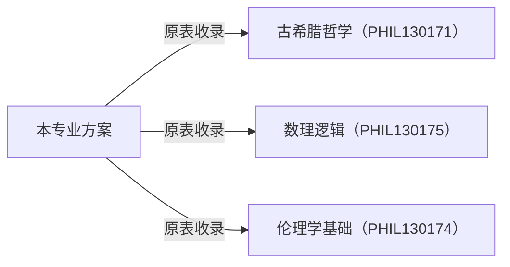

# 哲学专业“2+X”教学培养方案

2023 年度汇编，方案正文印刷页 140–144。本页附上原书 PDF 第 152–156 页，其中含本专业紧随正文的各版修读建议。逐行数据覆盖可可靠对应课号和名称的原表记录。[方案原页](original-pages.pdf) · [完整原版](https://jwc.fudan.edu.cn/_upload/article/files/83/6c/8a3c080c4f8991024f4b59ad4f1b/64d23c13-0465-4619-bd18-9e491594f850.pdf#page=152) · [逐行数据与来源](record.json)

## 课程导读

想了解哲学问题及其历史的课程安排，可以在原表中找到《古希腊哲学》（`PHIL130171`）、《数理逻辑》（`PHIL130175`）、《伦理学基础》（`PHIL130174`）。 [原书 PDF 第 152 页](original-pages.pdf#page=1)

原表把 `PHIL130171` 列在第 1 学期，把 `PHIL130174` 列在第 2 学期。图中箭头表示本节原表收录该课，图上各课之间没有先修连线。

| 课号 | 课程名称 | 开课学期原文 | PDF 页 |
|---|---|---|---|
| PHIL130001 | 马克思主义哲学导论 | 3 | 152 |
| PHIL130014 | 社会实践 | 7 | 153 |
| PHIL130015 | 学年论文 | 6 | 153 |
| PHIL130016 | 毕业论文 | 8 | 153 |
| PHIL130024 | 历史哲学 | 春, 秋 | 153 |
| PHIL130028 | 科学哲学 | 春, 秋 | 153 |
| PHIL130034 | 康德哲学 | 春, 秋 | 154 |
| PHIL130038 | 西方马克思学 | 春, 秋 | 153 |
| PHIL130061 | 价值哲学 | 春, 秋 | 153 |
| PHIL130084 | 新兴宗教概论 | 春, 秋 | 156 |
| PHIL130098 | 现代法国哲学 | 春, 秋 | 154 |
| PHIL130108 | 政治哲学 | 春, 秋 | 154 |
| PHIL130110 | 语言哲学 | 春, 秋 | 153 |
| PHIL130112 | 教育哲学 | 春, 秋 | 154 |
| PHIL130120 | 当代佛教的公共议题 | 春, 秋 | 156 |
| PHIL130151 | 环境伦理学 | 春, 秋 | 154 |
| PHIL130153 | 西方伦理学史 | 春, 秋 | 154 |
| PHIL130171 | 古希腊哲学 | 1 | 152 |
| PHIL130172 | 西方近代哲学（含中世纪） | 2 | 152 |
| PHIL130173 | 德国古典哲学 | 3 | 153 |
| PHIL130174 | 伦理学基础 | 2 | 152 |
| PHIL130175 | 数理逻辑 | 1 | 152 |
| PHIL130176 | 先秦哲学 | 1 | 152 |
| PHIL130177 | 汉晋隋唐哲学 | 2 | 152 |
| PHIL130178 | 宋元明清哲学 | 3 | 153 |
| PHIL130179 | 中国近现代哲学 | 4 | 153 |
| PHIL130180 | 哲学阅读和写作 | 4 | 153 |
| PHIL130181 | 现代英美哲学 | 4 | 153 |
| PHIL130182 | 现代欧陆哲学 | 5 | 153 |
| PHIL130183 | 西方马克思主义哲学 | 5 | 153 |
| PHIL130184 | 美学与艺术哲学基础 | 6 | 153 |
| PHIL130185 | 形而上学 | 春, 秋 | 153 |
| PHIL130186 | 知识论 | 春, 秋 | 153 |
| PHIL130187 | 认识论 | 春, 秋 | 153 |
| PHIL130190 | 西方马克思主义原著选读 | 春, 秋 | 153 |
| PHIL130191 | 社会批判理论 | 春, 秋 | 153 |
| PHIL130192 | 柏拉图哲学 | 春, 秋 | 154 |
| PHIL130193 | 亚里士多德哲学 | 春, 秋 | 154 |
| PHIL130194 | 笛卡尔哲学 | 春, 秋 | 154 |
| PHIL130195 | 休谟哲学 | 春, 秋 | 154 |
| PHIL130196 | 卢梭哲学 | 春, 秋 | 154 |
| PHIL130197 | 黑格尔哲学 | 春, 秋 | 154 |
| PHIL130198 | 中世纪哲学原著选读 | 春, 秋 | 154 |
| PHIL130199 | 分析哲学原著选读 | 春, 秋 | 154 |
| PHIL130200 | 现代欧陆哲学原著选读 | 春, 秋 | 154 |
| PHIL130201 | 现代德国哲学 | 春, 秋 | 154 |
| PHIL130203 | 维特根斯坦哲学 | 春, 秋 | 154 |
| PHIL130204 | 海德格尔哲学 | 春, 秋 | 154 |
| PHIL130205 | 古典实用主义哲学 | 春, 秋 | 154 |
| PHIL130206 | 社会科学哲学 | 春, 秋 | 154 |
| PHIL130207 | 社会理论 | 春, 秋 | 153 |
| PHIL130209 | 艺术哲学原著选读 | 春, 秋 | 154 |
| PHIL130210 | 美学原著选读 | 春, 秋 | 154 |
| PHIL130211 | 伦理学原著选读 | 春, 秋 | 154 |
| PHIL130212 | 《1844 手稿》研究 | 春, 秋 | 155 |
| PHIL130213 | 《资本论》及其手稿 | 春, 秋 | 155 |
| PHIL130214 | 激进哲学 | 春, 秋 | 153 |
| PHIL130215 | 近代认识论研究 | 春, 秋 | 155 |
| PHIL130216 | 德国古典美学专题研究 | 春, 秋 | 156 |
| PHIL130217 | 现代政治哲学研究 | 春, 秋 | 155 |
| PHIL130218 | 德国观念论 | 春, 秋 | 155 |
| PHIL130219 | 福柯研究 | 春, 秋 | 155 |
| PHIL130220 | 意识形态理论研究 | 春, 秋 | 155 |
| PHIL130221 | 应用伦理学专题 | 春, 秋 | 155 |
| PHIL130231 | 中国经学史专题研究 | 春, 秋 | 155 |
| PHIL130232 | 朱子学与阳明学研究 | 春, 秋 | 155 |
| PHIL130233 | 当代新儒家专题研究 | 春, 秋 | 155 |
| PHIL130234 | 中国传统政治哲学研究 | 春, 秋 | 155 |
| PHIL130235 | 中西比较哲学专题研究 | 春, 秋 | 155 |
| PHIL130236 | 海外中国哲学研究专题 | 春, 秋 | 155 |
| PHIL130237 | 东亚儒学探究 | 春, 秋 | 155 |
| PHIL130248 | 力迫法 | 春, 秋 | 155 |
| PHIL130249 | 意义理论研究 | 春, 秋 | 155 |
| PHIL130250 | 科学实在论研究 | 春, 秋 | 155 |
| PHIL130251 | 科学解释研究 | 春, 秋 | 155 |
| PHIL130252 | 科学实践哲学 | 春, 秋 | 155 |
| PHIL130268 | 亚伯拉罕宗教研究 | 春, 秋 | 156 |
| PHIL130269 | 明清基督教研究 | 春, 秋 | 156 |
| PHIL130271 | 马克思主义哲学史 | 4 | 153 |
| PHIL130272 | 启蒙哲学 | 春, 秋 | 155 |
| PHIL130273 | 中西艺术专题 | 春, 秋 | 156 |
| PHIL130274 | 哲学专业外语 | 春, 秋 | 156 |
| PHIL130275 | 国学专业外语 | 春, 秋 | 156 |
| PHIL130276 | 科逻专业外语 | 春, 秋 | 156 |
| PHIL130277 | 宗教学专业外语 | 春, 秋 | 156 |
| PHIL130278 | 哲学方法论导论 | 春, 秋 | 154 |
| PHIL130280 | 中国宗教的田野研究 | 春, 秋 | 156 |
| PHIL130302 | 思考与认知 | 春, 秋 | 155 |
| PHIL130303 | 国外马克思主义前沿 | 春, 秋 | 155 |
| PHIL130304 | 社会哲学与社会理论 | 春, 秋 | 153 |
| PHIL130305 | 古希腊哲学专题 | 春, 秋 | 155 |
| PHIL130307 | 模型论进阶 | 春, 秋 | 155 |
| PHIL130308 | 推理与论证 | 春, 秋 | 153 |
| PHIL130309 | 可计算性理论进阶 | 春, 秋 | 155 |
| PHIL130310 | 集合论进阶 | 春, 秋 | 155 |
| PHIL130313 | 神经伦理学 | 春, 秋 | 154 |
| PHIL130333 | 黑格尔美学思想 | 春, 秋 | 156 |
| PHIL130334 | 中国古典美学专题 | 春, 秋 | 156 |
| PHIL130335 | 艺术展览与艺术理论专题 | 春, 秋 | 156 |
| PHIL130336 | 生命伦理学专题 | 春, 秋 | 155 |

可定位的课程对暂无明确先修记录，原课程表及备注见上方 PDF。
