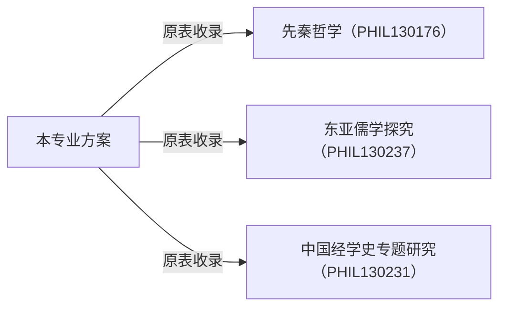

# 哲学（国学方向）专业“2+X”教学培养方案

2023 年度汇编，方案正文印刷页 154–158。本页附上原书 PDF 第 166–170 页，其中含本专业紧随正文的各版修读建议。逐行数据覆盖可可靠对应课号和名称的原表记录。[方案原页](original-pages.pdf) · [完整原版](https://jwc.fudan.edu.cn/_upload/article/files/83/6c/8a3c080c4f8991024f4b59ad4f1b/64d23c13-0465-4619-bd18-9e491594f850.pdf#page=166) · [逐行数据与来源](record.json)

## 课程导读

想了解国学与经学的课程安排，可以在原表中找到《先秦哲学》（`PHIL130176`）、《东亚儒学探究》（`PHIL130237`）、《中国经学史专题研究》（`PHIL130231`）。 [原书 PDF 第 166 页](original-pages.pdf#page=1) · [原书 PDF 第 169 页](original-pages.pdf#page=4)

其中 `PHIL130176` 的开课时间标为第 1 学期。图中箭头表示本节原表收录该课，图上各课之间没有先修连线。

| 课号 | 课程名称 | 开课学期原文 | PDF 页 |
|---|---|---|---|
| CHIN130016 | 《史记》精读 | 春, 秋 | 167 |
| CHIN130017 | 《文心雕龙》精读 | 春, 秋 | 167 |
| CHIN130018 | 《四库提要》精读 | 春, 秋 | 167 |
| CHIN130026 | 《说文解字》精读 | 春, 秋 | 167 |
| CHIN130056 | 《世说新语》精读 | 春, 秋 | 167 |
| HIST130128 | 《资治通鉴》讲读 | 春, 秋 | 167 |
| PHIL130001 | 马克思主义哲学导论 | 3 | 167 |
| PHIL130014 | 社会实践 | 7 | 167 |
| PHIL130015 | 学年论文 | 6 | 167 |
| PHIL130016 | 毕业论文 | 8 | 167 |
| PHIL130073 | 国学通论 | 4 | 167 |
| PHIL130074 | 小学基础 | 3 | 167 |
| PHIL130075 | 校雠目录学 | 春, 秋 | 167 |
| PHIL130076 | 《大学》与《中庸》 | 春, 秋 | 167 |
| PHIL130084 | 新兴宗教概论 | 春, 秋 | 169 |
| PHIL130103 | 中国哲学史料学 | 5 | 167 |
| PHIL130118 | 汉传佛教哲学 | 春, 秋 | 168 |
| PHIL130120 | 当代佛教的公共议题 | 春, 秋 | 169 |
| PHIL130124 | 《韩非子》 | 春, 秋 | 168 |
| PHIL130126 | 《诗经》 | 春, 秋 | 168 |
| PHIL130127 | 《尚书》 | 春, 秋 | 168 |
| PHIL130128 | 《礼记》 | 春, 秋 | 167 |
| PHIL130129 | 《周易》 | 春, 秋 | 167 |
| PHIL130130 | 《左传》 | 春, 秋 | 168 |
| PHIL130131 | 《公羊传》 | 春, 秋 | 168 |
| PHIL130133 | 《论语》 | 4 | 167 |
| PHIL130134 | 《老子》 | 5 | 167 |
| PHIL130135 | 《文选》 | 春, 秋 | 167 |
| PHIL130141 | 《荀子》 | 春, 秋 | 168 |
| PHIL130142 | 《孟子》 | 6 | 167 |
| PHIL130171 | 古希腊哲学 | 1 | 166 |
| PHIL130172 | 西方近代哲学（含中世纪） | 2 | 166 |
| PHIL130173 | 德国古典哲学 | 3 | 167 |
| PHIL130174 | 伦理学基础 | 2 | 166 |
| PHIL130176 | 先秦哲学 | 1 | 166 |
| PHIL130177 | 汉晋隋唐哲学 | 2 | 166 |
| PHIL130178 | 宋元明清哲学 | 3 | 167 |
| PHIL130179 | 中国近现代哲学 | 4 | 167 |
| PHIL130180 | 哲学阅读和写作 | 4 | 167 |
| PHIL130185 | 形而上学 | 春, 秋 | 167 |
| PHIL130212 | 《1844 手稿》研究 | 春, 秋 | 168 |
| PHIL130213 | 《资本论》及其手稿 | 春, 秋 | 168 |
| PHIL130215 | 近代认识论研究 | 春, 秋 | 168 |
| PHIL130216 | 德国古典美学专题研究 | 春, 秋 | 169 |
| PHIL130217 | 现代政治哲学研究 | 春, 秋 | 168 |
| PHIL130218 | 德国观念论 | 春, 秋 | 169 |
| PHIL130219 | 福柯研究 | 春, 秋 | 169 |
| PHIL130220 | 意识形态理论研究 | 春, 秋 | 169 |
| PHIL130221 | 应用伦理学专题 | 春, 秋 | 169 |
| PHIL130222 | 秦汉哲学专题研究 | 春, 秋 | 168 |
| PHIL130223 | 魏晋玄学专题研究 | 春, 秋 | 168 |
| PHIL130224 | 宋明理学专题研究 | 春, 秋 | 168 |
| PHIL130225 | 清代思想专题研究 | 春, 秋 | 168 |
| PHIL130227 | 中国佛教史 | 春, 秋 | 168 |
| PHIL130229 | 《庄子》 | 6 | 167 |
| PHIL130230 | 《近思录》 | 春, 秋 | 168 |
| PHIL130231 | 中国经学史专题研究 | 春, 秋 | 169 |
| PHIL130232 | 朱子学与阳明学研究 | 春, 秋 | 169 |
| PHIL130233 | 当代新儒家专题研究 | 春, 秋 | 169 |
| PHIL130234 | 中国传统政治哲学研究 | 春, 秋 | 169 |
| PHIL130235 | 中西比较哲学专题研究 | 春, 秋 | 169 |
| PHIL130236 | 海外中国哲学研究专题 | 春, 秋 | 169 |
| PHIL130237 | 东亚儒学探究 | 春, 秋 | 169 |
| PHIL130248 | 力迫法 | 春, 秋 | 169 |
| PHIL130249 | 意义理论研究 | 春, 秋 | 169 |
| PHIL130250 | 科学实在论研究 | 春, 秋 | 169 |
| PHIL130251 | 科学解释研究 | 春, 秋 | 169 |
| PHIL130252 | 科学实践哲学 | 春, 秋 | 169 |
| PHIL130268 | 亚伯拉罕宗教研究 | 春, 秋 | 169 |
| PHIL130269 | 明清基督教研究 | 春, 秋 | 169 |
| PHIL130272 | 启蒙哲学 | 春, 秋 | 169 |
| PHIL130273 | 中西艺术专题 | 春, 秋 | 169 |
| PHIL130274 | 哲学专业外语 | 春, 秋 | 170 |
| PHIL130275 | 国学专业外语 | 春, 秋 | 170 |
| PHIL130276 | 科逻专业外语 | 春, 秋 | 170 |
| PHIL130277 | 宗教学专业外语 | 春, 秋 | 170 |
| PHIL130280 | 中国宗教的田野研究 | 春, 秋 | 170 |
| PHIL130281 | 佛教经典选读一 | 春, 秋 | 168 |
| PHIL130282 | 佛教经典选读二 | 春, 秋 | 168 |
| PHIL130299 | 民间宗教与道教 | 春, 秋 | 168 |
| PHIL130302 | 思考与认知 | 春, 秋 | 169 |
| PHIL130303 | 国外马克思主义前沿 | 春, 秋 | 169 |
| PHIL130305 | 古希腊哲学专题 | 春, 秋 | 169 |
| PHIL130307 | 模型论进阶 | 春, 秋 | 169 |
| PHIL130308 | 推理与论证 | 春, 秋 | 167 |
| PHIL130309 | 可计算性理论进阶 | 春, 秋 | 169 |
| PHIL130310 | 集合论进阶 | 春, 秋 | 169 |
| PHIL130333 | 黑格尔美学思想 | 春, 秋 | 169 |
| PHIL130334 | 中国古典美学专题 | 春, 秋 | 169 |
| PHIL130335 | 艺术展览与艺术理论专题 | 春, 秋 | 169 |
| PHIL130336 | 生命伦理学专题 | 春, 秋 | 169 |

可定位的课程对暂无明确先修记录，原课程表及备注见上方 PDF。
