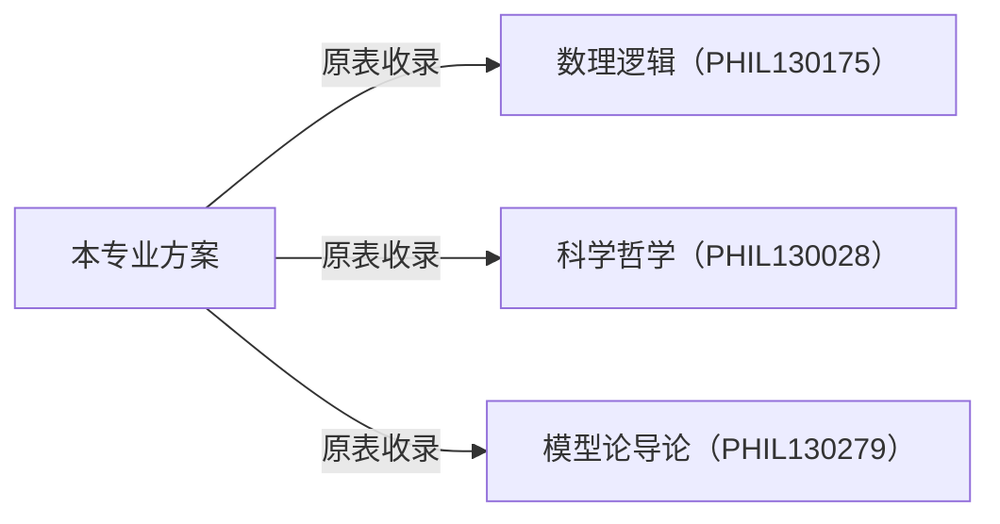

# 哲学（科学哲学与逻辑学方向）专业“2+X”教学培养方案（强基班适用）

2023 年度汇编，方案正文印刷页 171–175。本页附上原书 PDF 第 183–189 页，其中含本专业紧随正文的各版修读建议。逐行数据覆盖可可靠对应课号和名称的原表记录。[方案原页](original-pages.pdf) · [完整原版](https://jwc.fudan.edu.cn/_upload/article/files/83/6c/8a3c080c4f8991024f4b59ad4f1b/64d23c13-0465-4619-bd18-9e491594f850.pdf#page=183) · [逐行数据与来源](record.json)

## 课程导读

想了解科学哲学与逻辑的课程安排，可以在原表中找到《数理逻辑》（`PHIL130175`）、《科学哲学》（`PHIL130028`）、《模型论导论》（`PHIL130279`）。 [原书 PDF 第 184 页](original-pages.pdf#page=2) · [原书 PDF 第 185 页](original-pages.pdf#page=3)

原表把 `PHIL130175` 列在第 1 学期，把 `PHIL130028` 列在第 5 学期。图中箭头表示本节原表收录该课，图上各课之间没有先修连线。

| 课号 | 课程名称 | 开课学期原文 | PDF 页 |
|---|---|---|---|
| PHIL130001 | 马克思主义哲学导论 | 3 | 184 |
| PHIL130014 | 社会实践 | 7 | 184 |
| PHIL130015 | 学年论文 | 6 | 184 |
| PHIL130016 | 毕业论文 | 8 | 184 |
| PHIL130028 | 科学哲学 | 5 | 184 |
| PHIL130034 | 康德哲学 | 春, 秋 | 185 |
| PHIL130042 | 科学思想史 | 春, 秋 | 185 |
| PHIL130047 | 技术哲学 | 6 | 184 |
| PHIL130048 | 逻辑哲学 | 春, 秋 | 184 |
| PHIL130084 | 新兴宗教概论 | 春, 秋 | 187 |
| PHIL130101 | 心灵哲学 | 6 | 184 |
| PHIL130110 | 语言哲学 | 春, 秋 | 184 |
| PHIL130113 | 数学哲学 | 春, 秋 | 185 |
| PHIL130120 | 当代佛教的公共议题 | 春, 秋 | 187 |
| PHIL130158 | 人工智能哲学 | 春, 秋 | 184 |
| PHIL130170 | 证明论 | 春, 秋 | 185 |
| PHIL130171 | 古希腊哲学 | 1 | 184 |
| PHIL130172 | 西方近代哲学（含中世纪） | 2 | 184 |
| PHIL130173 | 德国古典哲学 | 3 | 184 |
| PHIL130174 | 伦理学基础 | 2 | 184 |
| PHIL130175 | 数理逻辑 | 1 | 184 |
| PHIL130176 | 先秦哲学 | 1 | 184 |
| PHIL130177 | 汉晋隋唐哲学 | 2 | 184 |
| PHIL130178 | 宋元明清哲学 | 3 | 184 |
| PHIL130179 | 中国近现代哲学 | 4 | 184 |
| PHIL130180 | 哲学阅读和写作 | 4 | 184 |
| PHIL130185 | 形而上学 | 4 | 184 |
| PHIL130186 | 知识论 | 4 | 184 |
| PHIL130199 | 分析哲学原著选读 | 春, 秋 | 185 |
| PHIL130203 | 维特根斯坦哲学 | 春, 秋 | 185 |
| PHIL130212 | 《1844 手稿》研究 | 春, 秋 | 186 |
| PHIL130213 | 《资本论》及其手稿 | 春, 秋 | 186 |
| PHIL130215 | 近代认识论研究 | 春, 秋 | 186 |
| PHIL130216 | 德国古典美学专题研究 | 春, 秋 | 186 |
| PHIL130217 | 现代政治哲学研究 | 春, 秋 | 186 |
| PHIL130218 | 德国观念论 | 春, 秋 | 186 |
| PHIL130219 | 福柯研究 | 春, 秋 | 186 |
| PHIL130220 | 意识形态理论研究 | 春, 秋 | 186 |
| PHIL130221 | 应用伦理学专题 | 春, 秋 | 186 |
| PHIL130231 | 中国经学史专题研究 | 春, 秋 | 186 |
| PHIL130232 | 朱子学与阳明学研究 | 春, 秋 | 186 |
| PHIL130233 | 当代新儒家专题研究 | 春, 秋 | 186 |
| PHIL130234 | 中国传统政治哲学研究 | 春, 秋 | 186 |
| PHIL130235 | 中西比较哲学专题研究 | 春, 秋 | 186 |
| PHIL130236 | 海外中国哲学研究专题 | 春, 秋 | 186 |
| PHIL130237 | 东亚儒学探究 | 春, 秋 | 186 |
| PHIL130238 | 模态逻辑 | 春, 秋 | 185 |
| PHIL130239 | 逻辑史 | 春, 秋 | 185 |
| PHIL130240 | 高等逻辑 | 春, 秋 | 185 |
| PHIL130244 | 弗雷格原著选读 | 春, 秋 | 185 |
| PHIL130245 | 科学、技术与社会（STS） | 春, 秋 | 184 |
| PHIL130246 | 科学方法论 | 春, 秋 | 185 |
| PHIL130247 | 生态哲学 | 春, 秋 | 185 |
| PHIL130248 | 力迫法 | 春, 秋 | 186 |
| PHIL130249 | 意义理论研究 | 春, 秋 | 186 |
| PHIL130250 | 科学实在论研究 | 春, 秋 | 186 |
| PHIL130251 | 科学解释研究 | 春, 秋 | 186 |
| PHIL130252 | 科学实践哲学 | 春, 秋 | 186 |
| PHIL130268 | 亚伯拉罕宗教研究 | 春, 秋 | 187 |
| PHIL130269 | 明清基督教研究 | 春, 秋 | 187 |
| PHIL130272 | 启蒙哲学 | 春, 秋 | 186 |
| PHIL130273 | 中西艺术专题 | 春, 秋 | 186 |
| PHIL130274 | 哲学专业外语 | 春, 秋 | 187 |
| PHIL130275 | 国学专业外语 | 春, 秋 | 187 |
| PHIL130276 | 科逻专业外语 | 春, 秋 | 187 |
| PHIL130277 | 宗教学专业外语 | 春, 秋 | 187 |
| PHIL130278 | 哲学方法论导论 | 春, 秋 | 185 |
| PHIL130279 | 模型论导论 | 春, 秋 | 185 |
| PHIL130280 | 中国宗教的田野研究 | 春, 秋 | 187 |
| PHIL130295 | 集合论 | 春, 秋 | 185 |
| PHIL130296 | 可计算性理论 | 春, 秋 | 185 |
| PHIL130302 | 思考与认知 | 春, 秋 | 186 |
| PHIL130303 | 国外马克思主义前沿 | 春, 秋 | 186 |
| PHIL130305 | 古希腊哲学专题 | 春, 秋 | 186 |
| PHIL130306 | 概率论 | 5 | 184 |
| PHIL130307 | 模型论进阶 | 春, 秋 | 186 |
| PHIL130308 | 推理与论证 | 春, 秋 | 184 |
| PHIL130309 | 可计算性理论进阶 | 春, 秋 | 186 |
| PHIL130310 | 集合论进阶 | 春, 秋 | 186 |
| PHIL130311 | 数学分析原理 | 春, 秋 | 185 |
| PHIL130312 | 心理学哲学 | 春, 秋 | 185 |
| PHIL130313 | 神经伦理学 | 春, 秋 | 185 |
| PHIL130314 | 非经典逻辑选讲 | 春, 秋 | 185 |
| PHIL130333 | 黑格尔美学思想 | 春, 秋 | 186 |
| PHIL130334 | 中国古典美学专题 | 春, 秋 | 186 |
| PHIL130335 | 艺术展览与艺术理论专题 | 春, 秋 | 186 |
| PHIL130336 | 生命伦理学专题 | 春, 秋 | 186 |
| PHIL130350 | 生物学哲学 | 春, 秋 | 185 |

可定位的课程对暂无明确先修记录，原课程表及备注见上方 PDF。
