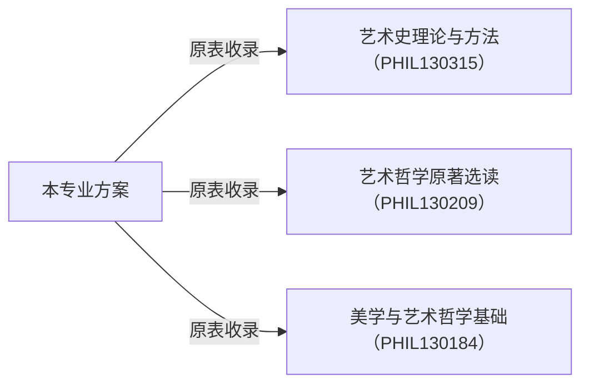

# 哲学（艺术哲学方向）专业“2+X”教学培养方案（强基班适用）

2023 年度汇编，方案正文印刷页 183–187。本页附上原书 PDF 第 195–201 页，其中含本专业紧随正文的各版修读建议。逐行数据覆盖可可靠对应课号和名称的原表记录。[方案原页](original-pages.pdf) · [完整原版](https://jwc.fudan.edu.cn/_upload/article/files/83/6c/8a3c080c4f8991024f4b59ad4f1b/64d23c13-0465-4619-bd18-9e491594f850.pdf#page=195) · [逐行数据与来源](record.json)

## 课程导读

想了解艺术哲学与美学的课程安排，可以在原表中找到《艺术史理论与方法》（`PHIL130315`）、《艺术哲学原著选读》（`PHIL130209`）、《美学与艺术哲学基础》（`PHIL130184`）。 [原书 PDF 第 196 页](original-pages.pdf#page=2)

原表把 `PHIL130315` 列在第 2 学期，把 `PHIL130184` 列在第 4 学期。图中箭头表示本节原表收录该课，图上各课之间没有先修连线。

| 课号 | 课程名称 | 开课学期原文 | PDF 页 |
|---|---|---|---|
| CHIN130017 | 《文心雕龙》精读 | 春秋 | 197 |
| PHIL130001 | 马克思主义哲学导论 | 3 | 196 |
| PHIL130014 | 社会实践 | 7 | 196 |
| PHIL130015 | 学年论文 | 6 | 196 |
| PHIL130016 | 毕业论文 | 8 | 196 |
| PHIL130034 | 康德哲学 | 春秋 | 197 |
| PHIL130036 | 基督教哲学 | 春秋 | 197 |
| PHIL130041 | 佛教哲学 | 春秋 | 197 |
| PHIL130084 | 新兴宗教概论 | 春, 秋 | 198 |
| PHIL130098 | 现代法国哲学 | 春秋 | 197 |
| PHIL130120 | 当代佛教的公共议题 | 春, 秋 | 198 |
| PHIL130158 | 人工智能哲学 | 春秋 | 197 |
| PHIL130171 | 古希腊哲学 | 1 | 196 |
| PHIL130172 | 西方近代哲学（含中世纪） | 2 | 196 |
| PHIL130173 | 德国古典哲学 | 3 | 196 |
| PHIL130176 | 先秦哲学 | 1 | 196 |
| PHIL130177 | 汉晋隋唐哲学 | 2 | 196 |
| PHIL130178 | 宋元明清哲学 | 3 | 196 |
| PHIL130182 | 现代欧陆哲学 | 5 | 196 |
| PHIL130183 | 西方马克思主义哲学 | 5 | 196 |
| PHIL130184 | 美学与艺术哲学基础 | 4 | 196 |
| PHIL130209 | 艺术哲学原著选读 | 春秋 | 196 |
| PHIL130210 | 美学原著选读 | 春秋 | 196 |
| PHIL130212 | 《1844 手稿》研究 | 春, 秋 | 197 |
| PHIL130213 | 《资本论》及其手稿 | 春, 秋 | 197 |
| PHIL130215 | 近代认识论研究 | 春, 秋 | 197 |
| PHIL130216 | 德国古典美学专题研究 | 春, 秋 | 198 |
| PHIL130217 | 现代政治哲学研究 | 春, 秋 | 197 |
| PHIL130218 | 德国观念论 | 春, 秋 | 197 |
| PHIL130219 | 福柯研究 | 春, 秋 | 198 |
| PHIL130220 | 意识形态理论研究 | 春, 秋 | 198 |
| PHIL130221 | 应用伦理学专题 | 春, 秋 | 198 |
| PHIL130231 | 中国经学史专题研究 | 春, 秋 | 198 |
| PHIL130232 | 朱子学与阳明学研究 | 春, 秋 | 198 |
| PHIL130233 | 当代新儒家专题研究 | 春, 秋 | 198 |
| PHIL130234 | 中国传统政治哲学研究 | 春, 秋 | 198 |
| PHIL130235 | 中西比较哲学专题研究 | 春, 秋 | 198 |
| PHIL130236 | 海外中国哲学研究专题 | 春, 秋 | 198 |
| PHIL130237 | 东亚儒学探究 | 春, 秋 | 198 |
| PHIL130248 | 力迫法 | 春, 秋 | 198 |
| PHIL130249 | 意义理论研究 | 春, 秋 | 198 |
| PHIL130250 | 科学实在论研究 | 春, 秋 | 198 |
| PHIL130251 | 科学解释研究 | 春, 秋 | 198 |
| PHIL130252 | 科学实践哲学 | 春, 秋 | 198 |
| PHIL130268 | 亚伯拉罕宗教研究 | 春, 秋 | 198 |
| PHIL130269 | 明清基督教研究 | 春, 秋 | 198 |
| PHIL130272 | 启蒙哲学 | 春, 秋 | 198 |
| PHIL130273 | 中西艺术专题 | 春, 秋 | 198 |
| PHIL130274 | 哲学专业外语 | 春, 秋 | 199 |
| PHIL130275 | 国学专业外语 | 春, 秋 | 199 |
| PHIL130276 | 科逻专业外语 | 春, 秋 | 199 |
| PHIL130277 | 宗教学专业外语 | 春, 秋 | 199 |
| PHIL130280 | 中国宗教的田野研究 | 春, 秋 | 198 |
| PHIL130302 | 思考与认知 | 春, 秋 | 198 |
| PHIL130303 | 国外马克思主义前沿 | 春, 秋 | 198 |
| PHIL130305 | 古希腊哲学专题 | 春, 秋 | 198 |
| PHIL130307 | 模型论进阶 | 春, 秋 | 198 |
| PHIL130309 | 可计算性理论进阶 | 春, 秋 | 198 |
| PHIL130310 | 集合论进阶 | 春, 秋 | 198 |
| PHIL130315 | 艺术史理论与方法 | 2 | 196 |
| PHIL130318 | 艺术批评写作 | 春秋 | 196 |
| PHIL130320 | 艺术与科技 | 春秋 | 196 |
| PHIL130325 | 音乐与哲学 | 春, 秋 | 197 |
| PHIL130326 | 摄影与哲学 | 春, 秋 | 197 |
| PHIL130327 | 建筑艺术导论 | 春, 秋 | 197 |
| PHIL130328 | 电影与哲学 | 春, 秋 | 197 |
| PHIL130329 | 艺术策展理论与实践 | 春秋 | 197 |
| PHIL130330 | 当代美术馆理论与实践 | 春秋 | 197 |
| PHIL130331 | 中国书法理论与实践 | 春秋 | 197 |
| PHIL130332 | 中国绘画与画论 | 春秋 | 197 |
| PHIL130333 | 黑格尔美学思想 | 春, 秋 | 198 |
| PHIL130334 | 中国古典美学专题 | 春, 秋 | 198 |
| PHIL130335 | 艺术展览与艺术理论专题 | 春, 秋 | 198 |
| PHIL130336 | 生命伦理学专题 | 春, 秋 | 198 |
| PHIL130337 | 图像与观念 | 春秋 | 196 |
| PHIL130338 | 西方艺术史（上） | 3 | 196 |
| PHIL130339 | 西方艺术史（下） | 4 | 196 |
| PHIL130340 | 中国艺术史（上） | 5 | 196 |
| PHIL130341 | 中国艺术史（下） | 6 | 196 |
| PHIL130342 | 中国近现代艺术 | 春秋 | 196 |
| PHIL130343 | 西方现当代艺术 | 春秋 | 196 |
| PHIL130344 | 视觉媒介研究 | 春秋 | 196 |
| PHIL130345 | 悲剧与哲学 | 春, 秋 | 197 |

可定位的课程对暂无明确先修记录，原课程表及备注见上方 PDF。
