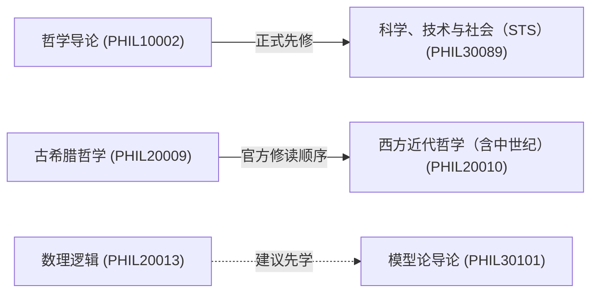

# 哲学学院 2024 级培养方案与课程图谱

共 17 份方案、3045 条方案课程记录、349 个课号。

[返回三年总览](../README.md) · [离线交互图谱](../index.html) · [方案索引](plans.json) · [方案课程记录](courses.json) · [图谱数据](graph.json) · [查证关系](relations.json)

## 官方方案原件

| 方案编号 | 培养方案 | 所属 | 原件与数据 |
| --- | --- | --- | --- |
| 72678 | 2024哲学专业 | 哲学学院 | [Word 原件](<word-originals/plan-72678.docx>) · [原始响应](<raw/plan-72678.json>) · [教务详情](https://fdjwgl.fudan.edu.cn/manager/bizType/2/major-program-search/info/72678?skipAuth=1) |
| 72830 | 2024哲学专业(港澳台学生适用) | 哲学学院 | [Word 原件](<word-originals/plan-72830.docx>) · [原始响应](<raw/plan-72830.json>) · [教务详情](https://fdjwgl.fudan.edu.cn/manager/bizType/2/major-program-search/info/72830?skipAuth=1) |
| 72829 | 2024哲学专业(留学生适用) | 哲学学院 | [Word 原件](<word-originals/plan-72829.docx>) · [原始响应](<raw/plan-72829.json>) · [教务详情](https://fdjwgl.fudan.edu.cn/manager/bizType/2/major-program-search/info/72829?skipAuth=1) |
| 72795 | 2024哲学(国学方向)专业 | 哲学学院 | [Word 原件](<word-originals/plan-72795.docx>) · [原始响应](<raw/plan-72795.json>) · [教务详情](https://fdjwgl.fudan.edu.cn/manager/bizType/2/major-program-search/info/72795?skipAuth=1) |
| 72794 | 2024哲学(国学方向)(强基计划)专业 | 哲学学院 | [Word 原件](<word-originals/plan-72794.docx>) · [原始响应](<raw/plan-72794.json>) · [教务详情](https://fdjwgl.fudan.edu.cn/manager/bizType/2/major-program-search/info/72794?skipAuth=1) |
| 72790 | 2024哲学(科学哲学与逻辑学方向)专业 | 哲学学院 | [Word 原件](<word-originals/plan-72790.docx>) · [原始响应](<raw/plan-72790.json>) · [教务详情](https://fdjwgl.fudan.edu.cn/manager/bizType/2/major-program-search/info/72790?skipAuth=1) |
| 72823 | 2024哲学(科学哲学与逻辑学方向)(强基计划)专业 | 哲学学院 | [Word 原件](<word-originals/plan-72823.docx>) · [原始响应](<raw/plan-72823.json>) · [教务详情](https://fdjwgl.fudan.edu.cn/manager/bizType/2/major-program-search/info/72823?skipAuth=1) |
| 72806 | 2024哲学(强基计划)专业 | 哲学学院 | [Word 原件](<word-originals/plan-72806.docx>) · [原始响应](<raw/plan-72806.json>) · [教务详情](https://fdjwgl.fudan.edu.cn/manager/bizType/2/major-program-search/info/72806?skipAuth=1) |
| 72988 | 2024哲学-人工智能双学士学位 | 哲学学院 | [Word 原件](<word-originals/plan-72988.docx>) · [原始响应](<raw/plan-72988.json>) · [教务详情](https://fdjwgl.fudan.edu.cn/manager/bizType/2/major-program-search/info/72988?skipAuth=1) |
| 72792 | 2024哲学(艺术哲学方向)专业 | 哲学学院 | [Word 原件](<word-originals/plan-72792.docx>) · [原始响应](<raw/plan-72792.json>) · [教务详情](https://fdjwgl.fudan.edu.cn/manager/bizType/2/major-program-search/info/72792?skipAuth=1) |
| 140423 | 2024哲学(艺术哲学方向)专业(港澳台侨生适用) | 哲学学院 | [Word 原件](<word-originals/plan-140423.docx>) · [原始响应](<raw/plan-140423.json>) · [教务详情](https://fdjwgl.fudan.edu.cn/manager/bizType/2/major-program-search/info/140423?skipAuth=1) |
| 72824 | 2024哲学(艺术哲学方向)(强基计划)专业 | 哲学学院 | [Word 原件](<word-originals/plan-72824.docx>) · [原始响应](<raw/plan-72824.json>) · [教务详情](https://fdjwgl.fudan.edu.cn/manager/bizType/2/major-program-search/info/72824?skipAuth=1) |
| 72989 | 2024 哲学(宗教学方向)专业本科培养方案(强基计划适用) | 哲学学院 | [Word 原件](<word-originals/plan-72989.docx>) · [原始响应](<raw/plan-72989.json>) · [教务详情](https://fdjwgl.fudan.edu.cn/manager/bizType/2/major-program-search/info/72989?skipAuth=1) |
| 72477 | 2024政治学、经济学与哲学专业培养方案 | 哲学学院 | [Word 原件](<word-originals/plan-72477.docx>) · [原始响应](<raw/plan-72477.json>) · [教务详情](https://fdjwgl.fudan.edu.cn/manager/bizType/2/major-program-search/info/72477?skipAuth=1) |
| 72831 | 2024宗教学专业 | 哲学学院 | [Word 原件](<word-originals/plan-72831.docx>) · [原始响应](<raw/plan-72831.json>) · [教务详情](https://fdjwgl.fudan.edu.cn/manager/bizType/2/major-program-search/info/72831?skipAuth=1) |
| 72793 | 2024宗教学专业（留学生） | 哲学学院 | [Word 原件](<word-originals/plan-72793.docx>) · [原始响应](<raw/plan-72793.json>) · [教务详情](https://fdjwgl.fudan.edu.cn/manager/bizType/2/major-program-search/info/72793?skipAuth=1) |
| 159182 | 2024 人工智能-哲学专业双学士学位项目“2+X”教学培养方案 | 计算与智能创新学院 | [Word 原件](<word-originals/plan-159182.docx>) · [原始响应](<raw/plan-159182.json>) · [教务详情](https://fdjwgl.fudan.edu.cn/manager/bizType/2/major-program-search/info/159182?skipAuth=1) |

[学院手册课程体系图索引](<handbook-figures.json>)

[公开教学大纲检索与预修字段记录](<syllabus-evidence.json>)

[对应年级的补充官方来源](<supplementary-sources.json>)

[荣誉课程建议学期](<honors-course-schedule.json>)

[原课名无法唯一匹配的预修说明](<unmapped-syllabus-requirements.json>)

科学哲学与逻辑学方向方案 72790 的教务课程表将知识论列在第 4 学期、形而上学列在第 5 学期。学院手册的课程体系图分别列在第 5 和第 6 学期。课程记录采用教务表的学期，图谱保留原图及页码。 [教务方案](https://fdjwgl.fudan.edu.cn/manager/bizType/2/major-program-search/info/72790?skipAuth=1) · [学院手册第 19 页](https://philosophy.fudan.edu.cn/_upload/article/files/42/b9/e394e2ee4cdb9e8d185ffc235b98/7183cf10-9d63-4630-8489-85a73b9cdfbe.pdf#page=19)

入学当年两学期教务页面共列出 236 个哲学学院教学班。已核对 160 份公开大纲的先修栏，其中 0 份填写了先修内容。

## 先修与修读规则

课程大纲中的先修字段、培养方案中的修读顺序和免修条款各有类型和适用范围。课号相同的边可因方案、课程版本或条件而分别保留。

### 正式先修（17 条）

| 课程 | 后续课或对应课程 | 规则与范围 | 来源 |
| --- | --- | --- | --- |
| 哲学导论（`PHIL10002`） | 科学、技术与社会（STS）（`PHIL30089`） | 教学大纲将哲学导论及一定的自然科学、科学思想史知识列为预修基础。 涉及方案 72477、72790、72823、72988 | [PDF 第 259 页（手册第 258 页），科学、技术与社会（STS）（PHIL130245）教学大纲](https://philosophy.fudan.edu.cn/_upload/article/files/42/b9/e394e2ee4cdb9e8d185ffc235b98/7183cf10-9d63-4630-8489-85a73b9cdfbe.pdf#page=259) |
| 宗教学导论（`PHIL10004`） | 中国佛教史（`PHIL30082`） | 中国佛教史大纲同时列宗教学导论、佛教哲学为预修课程。 涉及方案 72793、72831、72989 | [PDF 第 343 页（手册第 342 页），中国佛教史（PHIL130227）教学大纲](https://philosophy.fudan.edu.cn/_upload/article/files/42/b9/e394e2ee4cdb9e8d185ffc235b98/7183cf10-9d63-4630-8489-85a73b9cdfbe.pdf#page=343) |
| 佛教哲学（`PHIL30011`） | 中国佛教史（`PHIL30082`） | 中国佛教史大纲同时列宗教学导论、佛教哲学为预修课程。 涉及方案 72793、72831、72989 | [PDF 第 343 页（手册第 342 页），中国佛教史（PHIL130227）教学大纲](https://philosophy.fudan.edu.cn/_upload/article/files/42/b9/e394e2ee4cdb9e8d185ffc235b98/7183cf10-9d63-4630-8489-85a73b9cdfbe.pdf#page=343) |
| 宗教学导论（`PHIL10004`） | 宗教哲学（`PHIL30006`） | 宗教哲学大纲的预修课程栏只列宗教学导论，基本要求另写西方哲学史和宗教学概论。 涉及方案 140423、72678、72790、72792、72793、72794、72795、72806、72823、72824、72829、72830、72831、72989 | [PDF 第 377 页（手册第 376 页），宗教哲学（PHIL130021）教学大纲](https://philosophy.fudan.edu.cn/_upload/article/files/42/b9/e394e2ee4cdb9e8d185ffc235b98/7183cf10-9d63-4630-8489-85a73b9cdfbe.pdf#page=377) |
| 藏语Ⅰ（`PHIL40009`） | 藏语Ⅱ（`PHIL40010`） | 藏语 II 大纲明确列藏语 I 为预修。 涉及方案 140423、72678、72790、72792、72793、72794、72795、72806、72823、72824、72829、72830、72831、72989 | [PDF 第 389 页（手册第 388 页），藏语Ⅱ（PHIL130166）教学大纲](https://philosophy.fudan.edu.cn/_upload/article/files/42/b9/e394e2ee4cdb9e8d185ffc235b98/7183cf10-9d63-4630-8489-85a73b9cdfbe.pdf#page=389) |
| 梵语Ⅱ（`PHIL40020`） | 梵语Ⅲ（`PHIL40021`） | 梵语 III 大纲明确列梵语 II 为预修。 涉及方案 140423、72678、72790、72792、72793、72794、72795、72806、72823、72824、72829、72830、72831、72989 | [PDF 第 403 页（手册第 402 页），梵语Ⅲ（PHIL130285）教学大纲](https://philosophy.fudan.edu.cn/_upload/article/files/42/b9/e394e2ee4cdb9e8d185ffc235b98/7183cf10-9d63-4630-8489-85a73b9cdfbe.pdf#page=403) |
| 梵语Ⅲ（`PHIL40021`） | 梵语Ⅳ（`PHIL40022`） | 梵语 IV 大纲明确列梵语 III 为预修，梵语 III 大纲亦列 IV 为后续课程。 涉及方案 140423、72678、72790、72792、72793、72794、72795、72806、72823、72824、72829、72830、72831、72989 | [PDF 第 406 页（手册第 405 页），梵语Ⅳ（PHIL130286）教学大纲](https://philosophy.fudan.edu.cn/_upload/article/files/42/b9/e394e2ee4cdb9e8d185ffc235b98/7183cf10-9d63-4630-8489-85a73b9cdfbe.pdf#page=406) |
| 马克思主义哲学史（`PHIL30099`） | 认识论（`PHIL30055`） | 认识论大纲的基本要求列出马克思主义哲学史等多门预修基础。 涉及方案 140423、72678、72790、72792、72793、72794、72795、72806、72823、72824、72829、72830、72831、72988、72989 | [PDF 第 440 页（手册第 439 页），认识论（PHIL130187）教学大纲](https://philosophy.fudan.edu.cn/_upload/article/files/42/b9/e394e2ee4cdb9e8d185ffc235b98/7183cf10-9d63-4630-8489-85a73b9cdfbe.pdf#page=440) |
| 古希腊哲学（`PHIL20009`） | 亚里士多德哲学（`PHIL30060`） | 亚里士多德哲学大纲要求已经选修古希腊哲学及具备英文文献阅读能力。 涉及方案 140423、72678、72790、72792、72793、72794、72795、72806、72823、72824、72829、72830、72831、72988、72989 | [PDF 第 472 页（手册第 471 页），亚里士多德哲学（PHIL130193）教学大纲](https://philosophy.fudan.edu.cn/_upload/article/files/42/b9/e394e2ee4cdb9e8d185ffc235b98/7183cf10-9d63-4630-8489-85a73b9cdfbe.pdf#page=472) |
| 数理逻辑（`PHIL20013`） | 模态逻辑（`PHIL30085`） | 模态逻辑大纲要求修过一门数理逻辑。 涉及方案 140423、159182、72678、72790、72792、72793、72794、72795、72806、72823、72824、72829、72830、72831、72988、72989 | [PDF 第 583 页（手册第 582 页），模态逻辑（PHIL130238）教学大纲](https://philosophy.fudan.edu.cn/_upload/article/files/42/b9/e394e2ee4cdb9e8d185ffc235b98/7183cf10-9d63-4630-8489-85a73b9cdfbe.pdf#page=583) |
| 西方近代哲学（含中世纪）（`PHIL20010`） | 启蒙哲学（`PHIL50033`） | 启蒙哲学大纲把西方近代哲学（含中世纪）列为预修。 涉及方案 140423、72678、72790、72792、72793、72794、72795、72806、72823、72824、72829、72830、72831、72988、72989 | [PDF 第 697 页（手册第 696 页），启蒙哲学（PHIL130272）教学大纲](https://philosophy.fudan.edu.cn/_upload/article/files/42/b9/e394e2ee4cdb9e8d185ffc235b98/7183cf10-9d63-4630-8489-85a73b9cdfbe.pdf#page=697) |
| 集合论（`PHIL30106`） | 力迫法（`PHIL50026`） | 力迫法大纲同时列集合论与 Mathematical Logic I 为预修。现行方案仅列数理逻辑和荣誉课程，未核实其中哪门对应带 I 的课程。 涉及方案 140423、72678、72790、72792、72793、72794、72795、72806、72823、72824、72829、72830、72831、72989 | [PDF 第 733 页（手册第 732 页），力迫法（PHIL130248）教学大纲](https://philosophy.fudan.edu.cn/_upload/article/files/42/b9/e394e2ee4cdb9e8d185ffc235b98/7183cf10-9d63-4630-8489-85a73b9cdfbe.pdf#page=733) |
| 数理逻辑（`PHIL20013`） | 可计算性理论进阶（`PHIL50039`） | 可计算性理论进阶大纲要求修过数理逻辑与可计算性理论。 涉及方案 140423、72678、72790、72792、72793、72794、72795、72806、72823、72824、72829、72830、72831、72988、72989 | [PDF 第 753 页（手册第 752 页），可计算性理论进阶（PHIL130309）教学大纲](https://philosophy.fudan.edu.cn/_upload/article/files/42/b9/e394e2ee4cdb9e8d185ffc235b98/7183cf10-9d63-4630-8489-85a73b9cdfbe.pdf#page=753) |
| 可计算性理论（`PHIL30107`） | 可计算性理论进阶（`PHIL50039`） | 可计算性理论进阶大纲要求修过数理逻辑与可计算性理论。 涉及方案 140423、72678、72790、72792、72793、72794、72795、72806、72823、72824、72829、72830、72831、72988、72989 | [PDF 第 753 页（手册第 752 页），可计算性理论进阶（PHIL130309）教学大纲](https://philosophy.fudan.edu.cn/_upload/article/files/42/b9/e394e2ee4cdb9e8d185ffc235b98/7183cf10-9d63-4630-8489-85a73b9cdfbe.pdf#page=753) |
| 数理逻辑（`PHIL20013`） | 集合论进阶（`PHIL50040`） | 集合论进阶大纲要求修过数理逻辑与集合论。 涉及方案 140423、72678、72790、72792、72793、72794、72795、72806、72823、72824、72829、72830、72831、72989 | [PDF 第 755 页（手册第 754 页），集合论进阶（PHIL130310）教学大纲](https://philosophy.fudan.edu.cn/_upload/article/files/42/b9/e394e2ee4cdb9e8d185ffc235b98/7183cf10-9d63-4630-8489-85a73b9cdfbe.pdf#page=755) |
| 集合论（`PHIL30106`） | 集合论进阶（`PHIL50040`） | 集合论进阶大纲要求修过数理逻辑与集合论。 涉及方案 140423、72678、72790、72792、72793、72794、72795、72806、72823、72824、72829、72830、72831、72989 | [PDF 第 755 页（手册第 754 页），集合论进阶（PHIL130310）教学大纲](https://philosophy.fudan.edu.cn/_upload/article/files/42/b9/e394e2ee4cdb9e8d185ffc235b98/7183cf10-9d63-4630-8489-85a73b9cdfbe.pdf#page=755) |
| 数理逻辑（`PHIL20013`） | 可计算性理论（`PHIL30107`） | 可计算性理论大纲要求修过一门数理逻辑。 涉及方案 140423、159182、72678、72790、72792、72793、72794、72795、72806、72823、72824、72829、72830、72831、72988、72989 | [PDF 第 896 页（手册第 895 页），可计算性理论（PHIL130296）教学大纲](https://philosophy.fudan.edu.cn/_upload/article/files/42/b9/e394e2ee4cdb9e8d185ffc235b98/7183cf10-9d63-4630-8489-85a73b9cdfbe.pdf#page=896) |

### 官方修读顺序（44 条）

| 课程 | 后续课或对应课程 | 规则与范围 | 来源 |
| --- | --- | --- | --- |
| 古希腊哲学（`PHIL20009`） | 西方近代哲学（含中世纪）（`PHIL20010`） | 核心必修课程图以箭头标出由古希腊哲学进到西方近代哲学（含中世纪）。 涉及方案 72678 | [PDF 第 16 页（手册第 15 页），哲学专业核心必修课](https://philosophy.fudan.edu.cn/_upload/article/files/42/b9/e394e2ee4cdb9e8d185ffc235b98/7183cf10-9d63-4630-8489-85a73b9cdfbe.pdf#page=16) |
| 西方近代哲学（含中世纪）（`PHIL20010`） | 德国古典哲学（`PHIL20011`） | 核心必修课程图以箭头标出由西方近代哲学（含中世纪）进到德国古典哲学。 涉及方案 72678 | [PDF 第 16 页（手册第 15 页），哲学专业核心必修课](https://philosophy.fudan.edu.cn/_upload/article/files/42/b9/e394e2ee4cdb9e8d185ffc235b98/7183cf10-9d63-4630-8489-85a73b9cdfbe.pdf#page=16) |
| 先秦哲学（`PHIL20014`） | 汉晋隋唐哲学（`PHIL20015`） | 核心必修课程图以箭头标出由先秦哲学进到汉晋隋唐哲学。 涉及方案 72678 | [PDF 第 16 页（手册第 15 页），哲学专业核心必修课](https://philosophy.fudan.edu.cn/_upload/article/files/42/b9/e394e2ee4cdb9e8d185ffc235b98/7183cf10-9d63-4630-8489-85a73b9cdfbe.pdf#page=16) |
| 汉晋隋唐哲学（`PHIL20015`） | 宋元明清哲学（`PHIL20016`） | 核心必修课程图以箭头标出由汉晋隋唐哲学进到宋元明清哲学。 涉及方案 72678 | [PDF 第 16 页（手册第 15 页），哲学专业核心必修课](https://philosophy.fudan.edu.cn/_upload/article/files/42/b9/e394e2ee4cdb9e8d185ffc235b98/7183cf10-9d63-4630-8489-85a73b9cdfbe.pdf#page=16) |
| 宋元明清哲学（`PHIL20016`） | 中国近现代哲学（`PHIL20017`） | 核心必修课程图以箭头标出由宋元明清哲学进到中国近现代哲学。 涉及方案 72678 | [PDF 第 16 页（手册第 15 页），哲学专业核心必修课](https://philosophy.fudan.edu.cn/_upload/article/files/42/b9/e394e2ee4cdb9e8d185ffc235b98/7183cf10-9d63-4630-8489-85a73b9cdfbe.pdf#page=16) |
| 现代英美哲学（`PHIL30049`） | 现代欧陆哲学（`PHIL30050`） | 核心必修课程图以箭头标出由现代英美哲学进到现代欧陆哲学。 涉及方案 72678 | [PDF 第 16 页（手册第 15 页），哲学专业核心必修课](https://philosophy.fudan.edu.cn/_upload/article/files/42/b9/e394e2ee4cdb9e8d185ffc235b98/7183cf10-9d63-4630-8489-85a73b9cdfbe.pdf#page=16) |
| 古希腊哲学（`PHIL20009`） | 西方近代哲学（含中世纪）（`PHIL20010`） | 核心必修课程图以箭头标出由古希腊哲学进到西方近代哲学（含中世纪）。 涉及方案 72795 | [PDF 第 18 页（手册第 17 页），哲学（国学方向）专业核心必修课](https://philosophy.fudan.edu.cn/_upload/article/files/42/b9/e394e2ee4cdb9e8d185ffc235b98/7183cf10-9d63-4630-8489-85a73b9cdfbe.pdf#page=18) |
| 西方近代哲学（含中世纪）（`PHIL20010`） | 德国古典哲学（`PHIL20011`） | 核心必修课程图以箭头标出由西方近代哲学（含中世纪）进到德国古典哲学。 涉及方案 72795 | [PDF 第 18 页（手册第 17 页），哲学（国学方向）专业核心必修课](https://philosophy.fudan.edu.cn/_upload/article/files/42/b9/e394e2ee4cdb9e8d185ffc235b98/7183cf10-9d63-4630-8489-85a73b9cdfbe.pdf#page=18) |
| 先秦哲学（`PHIL20014`） | 汉晋隋唐哲学（`PHIL20015`） | 核心必修课程图以箭头标出由先秦哲学进到汉晋隋唐哲学。 涉及方案 72795 | [PDF 第 18 页（手册第 17 页），哲学（国学方向）专业核心必修课](https://philosophy.fudan.edu.cn/_upload/article/files/42/b9/e394e2ee4cdb9e8d185ffc235b98/7183cf10-9d63-4630-8489-85a73b9cdfbe.pdf#page=18) |
| 汉晋隋唐哲学（`PHIL20015`） | 宋元明清哲学（`PHIL20016`） | 核心必修课程图以箭头标出由汉晋隋唐哲学进到宋元明清哲学。 涉及方案 72795 | [PDF 第 18 页（手册第 17 页），哲学（国学方向）专业核心必修课](https://philosophy.fudan.edu.cn/_upload/article/files/42/b9/e394e2ee4cdb9e8d185ffc235b98/7183cf10-9d63-4630-8489-85a73b9cdfbe.pdf#page=18) |
| 宋元明清哲学（`PHIL20016`） | 中国近现代哲学（`PHIL20017`） | 核心必修课程图以箭头标出由宋元明清哲学进到中国近现代哲学。 涉及方案 72795 | [PDF 第 18 页（手册第 17 页），哲学（国学方向）专业核心必修课](https://philosophy.fudan.edu.cn/_upload/article/files/42/b9/e394e2ee4cdb9e8d185ffc235b98/7183cf10-9d63-4630-8489-85a73b9cdfbe.pdf#page=18) |
| 古希腊哲学（`PHIL20009`） | 西方近代哲学（含中世纪）（`PHIL20010`） | 核心必修课程图以箭头标出由古希腊哲学进到西方近代哲学（含中世纪）。 涉及方案 72790 | [PDF 第 19 页（手册第 18 页），哲学（科学哲学与逻辑学方向）专业核心必修课](https://philosophy.fudan.edu.cn/_upload/article/files/42/b9/e394e2ee4cdb9e8d185ffc235b98/7183cf10-9d63-4630-8489-85a73b9cdfbe.pdf#page=19) |
| 西方近代哲学（含中世纪）（`PHIL20010`） | 德国古典哲学（`PHIL20011`） | 核心必修课程图以箭头标出由西方近代哲学（含中世纪）进到德国古典哲学。 涉及方案 72790 | [PDF 第 19 页（手册第 18 页），哲学（科学哲学与逻辑学方向）专业核心必修课](https://philosophy.fudan.edu.cn/_upload/article/files/42/b9/e394e2ee4cdb9e8d185ffc235b98/7183cf10-9d63-4630-8489-85a73b9cdfbe.pdf#page=19) |
| 先秦哲学（`PHIL20014`） | 汉晋隋唐哲学（`PHIL20015`） | 核心必修课程图以箭头标出由先秦哲学进到汉晋隋唐哲学。 涉及方案 72790 | [PDF 第 19 页（手册第 18 页），哲学（科学哲学与逻辑学方向）专业核心必修课](https://philosophy.fudan.edu.cn/_upload/article/files/42/b9/e394e2ee4cdb9e8d185ffc235b98/7183cf10-9d63-4630-8489-85a73b9cdfbe.pdf#page=19) |
| 汉晋隋唐哲学（`PHIL20015`） | 宋元明清哲学（`PHIL20016`） | 核心必修课程图以箭头标出由汉晋隋唐哲学进到宋元明清哲学。 涉及方案 72790 | [PDF 第 19 页（手册第 18 页），哲学（科学哲学与逻辑学方向）专业核心必修课](https://philosophy.fudan.edu.cn/_upload/article/files/42/b9/e394e2ee4cdb9e8d185ffc235b98/7183cf10-9d63-4630-8489-85a73b9cdfbe.pdf#page=19) |
| 宋元明清哲学（`PHIL20016`） | 中国近现代哲学（`PHIL20017`） | 核心必修课程图以箭头标出由宋元明清哲学进到中国近现代哲学。 涉及方案 72790 | [PDF 第 19 页（手册第 18 页），哲学（科学哲学与逻辑学方向）专业核心必修课](https://philosophy.fudan.edu.cn/_upload/article/files/42/b9/e394e2ee4cdb9e8d185ffc235b98/7183cf10-9d63-4630-8489-85a73b9cdfbe.pdf#page=19) |
| 古希腊哲学（`PHIL20009`） | 西方近代哲学（含中世纪）（`PHIL20010`） | 核心必修课程图以箭头标出由古希腊哲学进到西方近代哲学（含中世纪）。 涉及方案 72792 | [PDF 第 20 页（手册第 19 页），哲学（艺术哲学方向）专业核心必修课](https://philosophy.fudan.edu.cn/_upload/article/files/42/b9/e394e2ee4cdb9e8d185ffc235b98/7183cf10-9d63-4630-8489-85a73b9cdfbe.pdf#page=20) |
| 西方近代哲学（含中世纪）（`PHIL20010`） | 德国古典哲学（`PHIL20011`） | 核心必修课程图以箭头标出由西方近代哲学（含中世纪）进到德国古典哲学。 涉及方案 72792 | [PDF 第 20 页（手册第 19 页），哲学（艺术哲学方向）专业核心必修课](https://philosophy.fudan.edu.cn/_upload/article/files/42/b9/e394e2ee4cdb9e8d185ffc235b98/7183cf10-9d63-4630-8489-85a73b9cdfbe.pdf#page=20) |
| 先秦哲学（`PHIL20014`） | 汉晋隋唐哲学（`PHIL20015`） | 核心必修课程图以箭头标出由先秦哲学进到汉晋隋唐哲学。 涉及方案 72792 | [PDF 第 20 页（手册第 19 页），哲学（艺术哲学方向）专业核心必修课](https://philosophy.fudan.edu.cn/_upload/article/files/42/b9/e394e2ee4cdb9e8d185ffc235b98/7183cf10-9d63-4630-8489-85a73b9cdfbe.pdf#page=20) |
| 汉晋隋唐哲学（`PHIL20015`） | 宋元明清哲学（`PHIL20016`） | 核心必修课程图以箭头标出由汉晋隋唐哲学进到宋元明清哲学。 涉及方案 72792 | [PDF 第 20 页（手册第 19 页），哲学（艺术哲学方向）专业核心必修课](https://philosophy.fudan.edu.cn/_upload/article/files/42/b9/e394e2ee4cdb9e8d185ffc235b98/7183cf10-9d63-4630-8489-85a73b9cdfbe.pdf#page=20) |
| 西方艺术史（上）（`PHIL30136`） | 西方艺术史（下）（`PHIL30137`） | 核心必修课程图以箭头标出由西方艺术史（上）进到西方艺术史（下）。 涉及方案 72792 | [PDF 第 20 页（手册第 19 页），哲学（艺术哲学方向）专业核心必修课](https://philosophy.fudan.edu.cn/_upload/article/files/42/b9/e394e2ee4cdb9e8d185ffc235b98/7183cf10-9d63-4630-8489-85a73b9cdfbe.pdf#page=20) |
| 中国艺术史（上）（`PHIL30138`） | 中国艺术史（下）（`PHIL30139`） | 核心必修课程图以箭头标出由中国艺术史（上）进到中国艺术史（下）。 涉及方案 72792 | [PDF 第 20 页（手册第 19 页），哲学（艺术哲学方向）专业核心必修课](https://philosophy.fudan.edu.cn/_upload/article/files/42/b9/e394e2ee4cdb9e8d185ffc235b98/7183cf10-9d63-4630-8489-85a73b9cdfbe.pdf#page=20) |
| 古希腊哲学（`PHIL20009`） | 西方近代哲学（含中世纪）（`PHIL20010`） | 核心必修课程图以箭头标出由古希腊哲学进到西方近代哲学（含中世纪）。 涉及方案 72831 | [PDF 第 22 页（手册第 21 页），宗教学专业核心必修课](https://philosophy.fudan.edu.cn/_upload/article/files/42/b9/e394e2ee4cdb9e8d185ffc235b98/7183cf10-9d63-4630-8489-85a73b9cdfbe.pdf#page=22) |
| 西方近代哲学（含中世纪）（`PHIL20010`） | 德国古典哲学（`PHIL20011`） | 核心必修课程图以箭头标出由西方近代哲学（含中世纪）进到德国古典哲学。 涉及方案 72831 | [PDF 第 22 页（手册第 21 页），宗教学专业核心必修课](https://philosophy.fudan.edu.cn/_upload/article/files/42/b9/e394e2ee4cdb9e8d185ffc235b98/7183cf10-9d63-4630-8489-85a73b9cdfbe.pdf#page=22) |
| 先秦哲学（`PHIL20014`） | 汉晋隋唐哲学（`PHIL20015`） | 核心必修课程图以箭头标出由先秦哲学进到汉晋隋唐哲学。 涉及方案 72831 | [PDF 第 22 页（手册第 21 页），宗教学专业核心必修课](https://philosophy.fudan.edu.cn/_upload/article/files/42/b9/e394e2ee4cdb9e8d185ffc235b98/7183cf10-9d63-4630-8489-85a73b9cdfbe.pdf#page=22) |
| 汉晋隋唐哲学（`PHIL20015`） | 宋元明清哲学（`PHIL20016`） | 核心必修课程图以箭头标出由汉晋隋唐哲学进到宋元明清哲学。 涉及方案 72831 | [PDF 第 22 页（手册第 21 页），宗教学专业核心必修课](https://philosophy.fudan.edu.cn/_upload/article/files/42/b9/e394e2ee4cdb9e8d185ffc235b98/7183cf10-9d63-4630-8489-85a73b9cdfbe.pdf#page=22) |
| 宋元明清哲学（`PHIL20016`） | 中国近现代哲学（`PHIL20017`） | 核心必修课程图以箭头标出由宋元明清哲学进到中国近现代哲学。 涉及方案 72831 | [PDF 第 22 页（手册第 21 页），宗教学专业核心必修课](https://philosophy.fudan.edu.cn/_upload/article/files/42/b9/e394e2ee4cdb9e8d185ffc235b98/7183cf10-9d63-4630-8489-85a73b9cdfbe.pdf#page=22) |
| 梵语Ⅰ（`PHIL40019`） | 梵语Ⅱ（`PHIL40020`） | 梵语 II 大纲说明本课承接梵语 I。 涉及方案 140423、72678、72790、72792、72793、72794、72795、72806、72823、72824、72829、72830、72831、72989 | [PDF 第 400 页（手册第 399 页），梵语Ⅱ（PHIL130284）教学大纲](https://philosophy.fudan.edu.cn/_upload/article/files/42/b9/e394e2ee4cdb9e8d185ffc235b98/7183cf10-9d63-4630-8489-85a73b9cdfbe.pdf#page=400) |
| 数理逻辑（`PHIL20013`） | 高等逻辑（`PHIL30087`） | 高等逻辑面向已修完数理逻辑的学生。 涉及方案 140423、72678、72790、72792、72793、72794、72795、72806、72823、72824、72829、72830、72831、72989 | [PDF 第 588 页（手册第 587 页），高等逻辑（PHIL130240）教学大纲](https://philosophy.fudan.edu.cn/_upload/article/files/42/b9/e394e2ee4cdb9e8d185ffc235b98/7183cf10-9d63-4630-8489-85a73b9cdfbe.pdf#page=588) |
| 逻辑学（`PHIL10003`） | 数理逻辑（`PHIL20013`） | 普通修读路线将逻辑学列在大一上学期、普通数理逻辑列在大一下学期。 涉及方案 72678 | [大类基础课程／人文类基础课程，逻辑学和数理逻辑修课安排说明（模块 1510283）](https://fdjwgl.fudan.edu.cn/manager/bizType/2/major-program-search/info/72678?skipAuth=1) |
| 逻辑学（`PHIL10003`） | 数理逻辑（`PHIL20013`） | 普通修读路线将逻辑学列在大一上学期、普通数理逻辑列在大一下学期。 涉及方案 72830 | [大类基础课程／人文类基础课程，逻辑学和数理逻辑修课安排说明（模块 1524999）](https://fdjwgl.fudan.edu.cn/manager/bizType/2/major-program-search/info/72830?skipAuth=1) |
| 逻辑学（`PHIL10003`） | 数理逻辑（`PHIL20013`） | 普通修读路线将逻辑学列在大一上学期、普通数理逻辑列在大一下学期。 涉及方案 72829 | [大类基础课程／人文类基础课程，逻辑学和数理逻辑修课安排说明（模块 1524921）](https://fdjwgl.fudan.edu.cn/manager/bizType/2/major-program-search/info/72829?skipAuth=1) |
| 逻辑学（`PHIL10003`） | 数理逻辑（`PHIL20013`） | 普通修读路线将逻辑学列在大一上学期、普通数理逻辑列在大一下学期。 涉及方案 72795 该条款引用的课号未全部单列在该方案课程表中。 | [大类基础课程／人文类基础课程，逻辑学和数理逻辑修课安排说明（模块 1522491）](https://fdjwgl.fudan.edu.cn/manager/bizType/2/major-program-search/info/72795?skipAuth=1) |
| 逻辑学（`PHIL10003`） | 数理逻辑（`PHIL20013`） | 普通修读路线将逻辑学列在大一上学期、普通数理逻辑列在大一下学期。 涉及方案 72794 该条款引用的课号未全部单列在该方案课程表中。 | [大类基础课程／人文类基础课程，逻辑学和数理逻辑修课安排说明（模块 1522408）](https://fdjwgl.fudan.edu.cn/manager/bizType/2/major-program-search/info/72794?skipAuth=1) |
| 逻辑学（`PHIL10003`） | 数理逻辑（`PHIL20013`） | 普通修读路线将逻辑学列在大一上学期、普通数理逻辑列在大一下学期。 涉及方案 72790 | [大类基础课程／人文类基础课程，逻辑学和数理逻辑修课安排说明（模块 1522111）](https://fdjwgl.fudan.edu.cn/manager/bizType/2/major-program-search/info/72790?skipAuth=1) |
| 逻辑学（`PHIL10003`） | 数理逻辑（`PHIL20013`） | 普通修读路线将逻辑学列在大一上学期、普通数理逻辑列在大一下学期。 涉及方案 72823 | [大类基础课程／人文类基础课程，逻辑学和数理逻辑修课安排说明（模块 1524720）](https://fdjwgl.fudan.edu.cn/manager/bizType/2/major-program-search/info/72823?skipAuth=1) |
| 逻辑学（`PHIL10003`） | 数理逻辑（`PHIL20013`） | 普通修读路线将逻辑学列在大一上学期、普通数理逻辑列在大一下学期。 涉及方案 72806 | [大类基础课程／人文类基础课程，逻辑学和数理逻辑修课安排说明（模块 1523298）](https://fdjwgl.fudan.edu.cn/manager/bizType/2/major-program-search/info/72806?skipAuth=1) |
| 逻辑学（`PHIL10003`） | 数理逻辑（`PHIL20013`） | 普通修读路线将逻辑学列在大一上学期、普通数理逻辑列在大一下学期。 涉及方案 72988 | [大类基础课程／人文类基础课程，逻辑学和数理逻辑修课安排说明（模块 1532048）](https://fdjwgl.fudan.edu.cn/manager/bizType/2/major-program-search/info/72988?skipAuth=1) |
| 逻辑学（`PHIL10003`） | 数理逻辑（`PHIL20013`） | 普通修读路线将逻辑学列在大一上学期、普通数理逻辑列在大一下学期。 涉及方案 72792 该条款引用的课号未全部单列在该方案课程表中。 | [大类基础课程／人文类基础课程，逻辑学和数理逻辑修课安排说明（模块 1522249）](https://fdjwgl.fudan.edu.cn/manager/bizType/2/major-program-search/info/72792?skipAuth=1) |
| 逻辑学（`PHIL10003`） | 数理逻辑（`PHIL20013`） | 普通修读路线将逻辑学列在大一上学期、普通数理逻辑列在大一下学期。 涉及方案 140423 该条款引用的课号未全部单列在该方案课程表中。 | [大类基础课程／人文类基础课程，逻辑学和数理逻辑修课安排说明（模块 5677001）](https://fdjwgl.fudan.edu.cn/manager/bizType/2/major-program-search/info/140423?skipAuth=1) |
| 逻辑学（`PHIL10003`） | 数理逻辑（`PHIL20013`） | 普通修读路线将逻辑学列在大一上学期、普通数理逻辑列在大一下学期。 涉及方案 72824 该条款引用的课号未全部单列在该方案课程表中。 | [大类基础课程／人文类基础课程，逻辑学和数理逻辑修课安排说明（模块 1524809）](https://fdjwgl.fudan.edu.cn/manager/bizType/2/major-program-search/info/72824?skipAuth=1) |
| 逻辑学（`PHIL10003`） | 数理逻辑（`PHIL20013`） | 普通修读路线将逻辑学列在大一上学期、普通数理逻辑列在大一下学期。 涉及方案 72989 | [大类基础课程／人文类基础课程，逻辑学和数理逻辑修课安排说明（模块 1532117）](https://fdjwgl.fudan.edu.cn/manager/bizType/2/major-program-search/info/72989?skipAuth=1) |
| 逻辑学（`PHIL10003`） | 数理逻辑（`PHIL20013`） | 普通修读路线将逻辑学列在大一上学期、普通数理逻辑列在大一下学期。 涉及方案 72831 | [大类基础课程／人文类基础课程，逻辑学和数理逻辑修课安排说明（模块 1525060）](https://fdjwgl.fudan.edu.cn/manager/bizType/2/major-program-search/info/72831?skipAuth=1) |
| 逻辑学（`PHIL10003`） | 数理逻辑（`PHIL20013`） | 普通修读路线将逻辑学列在大一上学期、普通数理逻辑列在大一下学期。 涉及方案 72793 | [大类基础课程／人文类基础课程，逻辑学和数理逻辑修课安排说明（模块 1522318）](https://fdjwgl.fudan.edu.cn/manager/bizType/2/major-program-search/info/72793?skipAuth=1) |

### 官方替代或免修（44 条）

| 课程 | 后续课或对应课程 | 规则与范围 | 来源 |
| --- | --- | --- | --- |
| 数理逻辑（H）（`PHIL20013h`） | 逻辑学（`PHIL10003`） | 选修 4 学分数理逻辑（H）的学生可免修逻辑学。 涉及方案 72678 该条款引用的课号未全部单列在该方案课程表中。 | [大类基础课程／人文类基础课程，逻辑学和数理逻辑修课安排说明（模块 1510283）](https://fdjwgl.fudan.edu.cn/manager/bizType/2/major-program-search/info/72678?skipAuth=1) |
| 数理逻辑（H）（`PHIL20013h`） | 数理逻辑（`PHIL20013`） | 选修 4 学分数理逻辑（H）的学生可免修数理逻辑。 涉及方案 72678 该条款引用的课号未全部单列在该方案课程表中。 | [大类基础课程／人文类基础课程，逻辑学和数理逻辑修课安排说明（模块 1510283）](https://fdjwgl.fudan.edu.cn/manager/bizType/2/major-program-search/info/72678?skipAuth=1) |
| 数理逻辑（H）（`PHIL20013h`） | 逻辑学（`PHIL10003`） | 选修 4 学分数理逻辑（H）的学生可免修逻辑学。 涉及方案 72830 该条款引用的课号未全部单列在该方案课程表中。 | [大类基础课程／人文类基础课程，逻辑学和数理逻辑修课安排说明（模块 1524999）](https://fdjwgl.fudan.edu.cn/manager/bizType/2/major-program-search/info/72830?skipAuth=1) |
| 数理逻辑（H）（`PHIL20013h`） | 数理逻辑（`PHIL20013`） | 选修 4 学分数理逻辑（H）的学生可免修数理逻辑。 涉及方案 72830 该条款引用的课号未全部单列在该方案课程表中。 | [大类基础课程／人文类基础课程，逻辑学和数理逻辑修课安排说明（模块 1524999）](https://fdjwgl.fudan.edu.cn/manager/bizType/2/major-program-search/info/72830?skipAuth=1) |
| 数理逻辑（H）（`PHIL20013h`） | 逻辑学（`PHIL10003`） | 选修 4 学分数理逻辑（H）的学生可免修逻辑学。 涉及方案 72829 该条款引用的课号未全部单列在该方案课程表中。 | [大类基础课程／人文类基础课程，逻辑学和数理逻辑修课安排说明（模块 1524921）](https://fdjwgl.fudan.edu.cn/manager/bizType/2/major-program-search/info/72829?skipAuth=1) |
| 数理逻辑（H）（`PHIL20013h`） | 数理逻辑（`PHIL20013`） | 选修 4 学分数理逻辑（H）的学生可免修数理逻辑。 涉及方案 72829 该条款引用的课号未全部单列在该方案课程表中。 | [大类基础课程／人文类基础课程，逻辑学和数理逻辑修课安排说明（模块 1524921）](https://fdjwgl.fudan.edu.cn/manager/bizType/2/major-program-search/info/72829?skipAuth=1) |
| 数理逻辑（H）（`PHIL20013h`） | 逻辑学（`PHIL10003`） | 选修 4 学分数理逻辑（H）的学生可免修逻辑学。 涉及方案 72795 该条款引用的课号未全部单列在该方案课程表中。 | [大类基础课程／人文类基础课程，逻辑学和数理逻辑修课安排说明（模块 1522491）](https://fdjwgl.fudan.edu.cn/manager/bizType/2/major-program-search/info/72795?skipAuth=1) |
| 数理逻辑（H）（`PHIL20013h`） | 数理逻辑（`PHIL20013`） | 选修 4 学分数理逻辑（H）的学生可免修数理逻辑。 涉及方案 72795 该条款引用的课号未全部单列在该方案课程表中。 | [大类基础课程／人文类基础课程，逻辑学和数理逻辑修课安排说明（模块 1522491）](https://fdjwgl.fudan.edu.cn/manager/bizType/2/major-program-search/info/72795?skipAuth=1) |
| 数理逻辑（H）（`PHIL20013h`） | 逻辑学（`PHIL10003`） | 选修 4 学分数理逻辑（H）的学生可免修逻辑学。 涉及方案 72794 | [大类基础课程／人文类基础课程，逻辑学和数理逻辑修课安排说明（模块 1522408）](https://fdjwgl.fudan.edu.cn/manager/bizType/2/major-program-search/info/72794?skipAuth=1) |
| 数理逻辑（H）（`PHIL20013h`） | 数理逻辑（`PHIL20013`） | 选修 4 学分数理逻辑（H）的学生可免修数理逻辑。 涉及方案 72794 该条款引用的课号未全部单列在该方案课程表中。 | [大类基础课程／人文类基础课程，逻辑学和数理逻辑修课安排说明（模块 1522408）](https://fdjwgl.fudan.edu.cn/manager/bizType/2/major-program-search/info/72794?skipAuth=1) |
| 数理逻辑（H）（`PHIL20013h`） | 逻辑学（`PHIL10003`） | 选修 4 学分数理逻辑（H）的学生可免修逻辑学。 涉及方案 72790 该条款引用的课号未全部单列在该方案课程表中。 | [大类基础课程／人文类基础课程，逻辑学和数理逻辑修课安排说明（模块 1522111）](https://fdjwgl.fudan.edu.cn/manager/bizType/2/major-program-search/info/72790?skipAuth=1) |
| 数理逻辑（H）（`PHIL20013h`） | 数理逻辑（`PHIL20013`） | 选修 4 学分数理逻辑（H）的学生可免修数理逻辑。 涉及方案 72790 该条款引用的课号未全部单列在该方案课程表中。 | [大类基础课程／人文类基础课程，逻辑学和数理逻辑修课安排说明（模块 1522111）](https://fdjwgl.fudan.edu.cn/manager/bizType/2/major-program-search/info/72790?skipAuth=1) |
| 数理逻辑（H）（`PHIL20013h`） | 逻辑学（`PHIL10003`） | 选修 4 学分数理逻辑（H）的学生可免修逻辑学。 涉及方案 72823 | [大类基础课程／人文类基础课程，逻辑学和数理逻辑修课安排说明（模块 1524720）](https://fdjwgl.fudan.edu.cn/manager/bizType/2/major-program-search/info/72823?skipAuth=1) |
| 数理逻辑（H）（`PHIL20013h`） | 数理逻辑（`PHIL20013`） | 选修 4 学分数理逻辑（H）的学生可免修数理逻辑。 涉及方案 72823 | [大类基础课程／人文类基础课程，逻辑学和数理逻辑修课安排说明（模块 1524720）](https://fdjwgl.fudan.edu.cn/manager/bizType/2/major-program-search/info/72823?skipAuth=1) |
| 数理逻辑（H）（`PHIL20013h`） | 逻辑学（`PHIL10003`） | 选修 4 学分数理逻辑（H）的学生可免修逻辑学。 涉及方案 72806 | [大类基础课程／人文类基础课程，逻辑学和数理逻辑修课安排说明（模块 1523298）](https://fdjwgl.fudan.edu.cn/manager/bizType/2/major-program-search/info/72806?skipAuth=1) |
| 数理逻辑（H）（`PHIL20013h`） | 数理逻辑（`PHIL20013`） | 选修 4 学分数理逻辑（H）的学生可免修数理逻辑。 涉及方案 72806 | [大类基础课程／人文类基础课程，逻辑学和数理逻辑修课安排说明（模块 1523298）](https://fdjwgl.fudan.edu.cn/manager/bizType/2/major-program-search/info/72806?skipAuth=1) |
| 数理逻辑（H）（`PHIL20013h`） | 逻辑学（`PHIL10003`） | 选修 4 学分数理逻辑（H）的学生可免修逻辑学。 涉及方案 72988 该条款引用的课号未全部单列在该方案课程表中。 | [大类基础课程／人文类基础课程，逻辑学和数理逻辑修课安排说明（模块 1532048）](https://fdjwgl.fudan.edu.cn/manager/bizType/2/major-program-search/info/72988?skipAuth=1) |
| 数理逻辑（H）（`PHIL20013h`） | 数理逻辑（`PHIL20013`） | 选修 4 学分数理逻辑（H）的学生可免修数理逻辑。 涉及方案 72988 该条款引用的课号未全部单列在该方案课程表中。 | [大类基础课程／人文类基础课程，逻辑学和数理逻辑修课安排说明（模块 1532048）](https://fdjwgl.fudan.edu.cn/manager/bizType/2/major-program-search/info/72988?skipAuth=1) |
| 数理逻辑（H）（`PHIL20013h`） | 逻辑学（`PHIL10003`） | 选修 4 学分数理逻辑（H）的学生可免修逻辑学。 涉及方案 72792 该条款引用的课号未全部单列在该方案课程表中。 | [大类基础课程／人文类基础课程，逻辑学和数理逻辑修课安排说明（模块 1522249）](https://fdjwgl.fudan.edu.cn/manager/bizType/2/major-program-search/info/72792?skipAuth=1) |
| 数理逻辑（H）（`PHIL20013h`） | 数理逻辑（`PHIL20013`） | 选修 4 学分数理逻辑（H）的学生可免修数理逻辑。 涉及方案 72792 该条款引用的课号未全部单列在该方案课程表中。 | [大类基础课程／人文类基础课程，逻辑学和数理逻辑修课安排说明（模块 1522249）](https://fdjwgl.fudan.edu.cn/manager/bizType/2/major-program-search/info/72792?skipAuth=1) |
| 数理逻辑（H）（`PHIL20013h`） | 逻辑学（`PHIL10003`） | 选修 4 学分数理逻辑（H）的学生可免修逻辑学。 涉及方案 140423 该条款引用的课号未全部单列在该方案课程表中。 | [大类基础课程／人文类基础课程，逻辑学和数理逻辑修课安排说明（模块 5677001）](https://fdjwgl.fudan.edu.cn/manager/bizType/2/major-program-search/info/140423?skipAuth=1) |
| 数理逻辑（H）（`PHIL20013h`） | 数理逻辑（`PHIL20013`） | 选修 4 学分数理逻辑（H）的学生可免修数理逻辑。 涉及方案 140423 该条款引用的课号未全部单列在该方案课程表中。 | [大类基础课程／人文类基础课程，逻辑学和数理逻辑修课安排说明（模块 5677001）](https://fdjwgl.fudan.edu.cn/manager/bizType/2/major-program-search/info/140423?skipAuth=1) |
| 数理逻辑（H）（`PHIL20013h`） | 逻辑学（`PHIL10003`） | 选修 4 学分数理逻辑（H）的学生可免修逻辑学。 涉及方案 72824 | [大类基础课程／人文类基础课程，逻辑学和数理逻辑修课安排说明（模块 1524809）](https://fdjwgl.fudan.edu.cn/manager/bizType/2/major-program-search/info/72824?skipAuth=1) |
| 数理逻辑（H）（`PHIL20013h`） | 数理逻辑（`PHIL20013`） | 选修 4 学分数理逻辑（H）的学生可免修数理逻辑。 涉及方案 72824 该条款引用的课号未全部单列在该方案课程表中。 | [大类基础课程／人文类基础课程，逻辑学和数理逻辑修课安排说明（模块 1524809）](https://fdjwgl.fudan.edu.cn/manager/bizType/2/major-program-search/info/72824?skipAuth=1) |
| 数理逻辑（H）（`PHIL20013h`） | 逻辑学（`PHIL10003`） | 选修 4 学分数理逻辑（H）的学生可免修逻辑学。 涉及方案 72989 | [大类基础课程／人文类基础课程，逻辑学和数理逻辑修课安排说明（模块 1532117）](https://fdjwgl.fudan.edu.cn/manager/bizType/2/major-program-search/info/72989?skipAuth=1) |
| 数理逻辑（H）（`PHIL20013h`） | 数理逻辑（`PHIL20013`） | 选修 4 学分数理逻辑（H）的学生可免修数理逻辑。 涉及方案 72989 | [大类基础课程／人文类基础课程，逻辑学和数理逻辑修课安排说明（模块 1532117）](https://fdjwgl.fudan.edu.cn/manager/bizType/2/major-program-search/info/72989?skipAuth=1) |
| 数理逻辑（H）（`PHIL20013h`） | 逻辑学（`PHIL10003`） | 选修 4 学分数理逻辑（H）的学生可免修逻辑学。 涉及方案 72831 | [大类基础课程／人文类基础课程，逻辑学和数理逻辑修课安排说明（模块 1525060）](https://fdjwgl.fudan.edu.cn/manager/bizType/2/major-program-search/info/72831?skipAuth=1) |
| 数理逻辑（H）（`PHIL20013h`） | 数理逻辑（`PHIL20013`） | 选修 4 学分数理逻辑（H）的学生可免修数理逻辑。 涉及方案 72831 | [大类基础课程／人文类基础课程，逻辑学和数理逻辑修课安排说明（模块 1525060）](https://fdjwgl.fudan.edu.cn/manager/bizType/2/major-program-search/info/72831?skipAuth=1) |
| 数理逻辑（H）（`PHIL20013h`） | 逻辑学（`PHIL10003`） | 选修 4 学分数理逻辑（H）的学生可免修逻辑学。 涉及方案 72793 该条款引用的课号未全部单列在该方案课程表中。 | [大类基础课程／人文类基础课程，逻辑学和数理逻辑修课安排说明（模块 1522318）](https://fdjwgl.fudan.edu.cn/manager/bizType/2/major-program-search/info/72793?skipAuth=1) |
| 数理逻辑（H）（`PHIL20013h`） | 数理逻辑（`PHIL20013`） | 选修 4 学分数理逻辑（H）的学生可免修数理逻辑。 涉及方案 72793 该条款引用的课号未全部单列在该方案课程表中。 | [大类基础课程／人文类基础课程，逻辑学和数理逻辑修课安排说明（模块 1522318）](https://fdjwgl.fudan.edu.cn/manager/bizType/2/major-program-search/info/72793?skipAuth=1) |
| 科学哲学（H）（`PHIL20004h`） | 科学哲学（`PHIL20004`） | 本科毕业资格审核中，科学哲学（H）可替换科学哲学 2 学分，余 2 学分列任意选修。 涉及方案 72678、72790、72806、72823、72829、72830、72988 | [PDF 第 1082 页（手册第 1081 页），哲学学院荣誉课程替换方案，可替换课程及相应学分](https://philosophy.fudan.edu.cn/_upload/article/files/42/b9/e394e2ee4cdb9e8d185ffc235b98/7183cf10-9d63-4630-8489-85a73b9cdfbe.pdf#page=1082) |
| 古希腊哲学（H）（`PHIL20009h`） | 古希腊哲学（`PHIL20009`） | 本科毕业资格审核中，古希腊哲学（H）可替换古希腊哲学 3 学分，余 1 学分列任意选修。 涉及方案 140423、72477、72678、72790、72792、72793、72794、72795、72806、72823、72824、72829、72830、72831、72988、72989 | [PDF 第 1082 页（手册第 1081 页），哲学学院荣誉课程替换方案，可替换课程及相应学分](https://philosophy.fudan.edu.cn/_upload/article/files/42/b9/e394e2ee4cdb9e8d185ffc235b98/7183cf10-9d63-4630-8489-85a73b9cdfbe.pdf#page=1082) |
| 西方近代哲学（含中世纪）（H）（`PHIL20010h`） | 西方近代哲学（含中世纪）（`PHIL20010`） | 本科毕业资格审核中，西方近代哲学（含中世纪）（H）可替换西方近代哲学（含中世纪） 3 学分，余 1 学分列任意选修。 涉及方案 140423、72477、72678、72790、72792、72793、72794、72795、72806、72823、72824、72829、72830、72831、72988、72989 | [PDF 第 1082 页（手册第 1081 页），哲学学院荣誉课程替换方案，可替换课程及相应学分](https://philosophy.fudan.edu.cn/_upload/article/files/42/b9/e394e2ee4cdb9e8d185ffc235b98/7183cf10-9d63-4630-8489-85a73b9cdfbe.pdf#page=1082) |
| 德国古典哲学（H）（`PHIL20011h`） | 德国古典哲学（`PHIL20011`） | 本科毕业资格审核中，德国古典哲学（H）可替换德国古典哲学 3 学分，余 1 学分列任意选修。 涉及方案 140423、72477、72678、72790、72792、72793、72794、72795、72806、72823、72824、72829、72830、72831、72988、72989 | [PDF 第 1082 页（手册第 1081 页），哲学学院荣誉课程替换方案，可替换课程及相应学分](https://philosophy.fudan.edu.cn/_upload/article/files/42/b9/e394e2ee4cdb9e8d185ffc235b98/7183cf10-9d63-4630-8489-85a73b9cdfbe.pdf#page=1082) |
| 规范伦理学（H）（`PHIL40028h`） | 规范伦理学（`PHIL40028`） | 本科毕业资格审核中，规范伦理学（H）可替换规范伦理学 2 学分，余 2 学分列任意选修。 涉及方案 140423、72678、72790、72792、72793、72794、72795、72806、72823、72824、72829、72830、72831、72988、72989 | [PDF 第 1082 页（手册第 1081 页），哲学学院荣誉课程替换方案，可替换课程及相应学分](https://philosophy.fudan.edu.cn/_upload/article/files/42/b9/e394e2ee4cdb9e8d185ffc235b98/7183cf10-9d63-4630-8489-85a73b9cdfbe.pdf#page=1082) |
| 数理逻辑（H）（`PHIL20013h`） | 数理逻辑（`PHIL20013`） | 本科毕业资格审核中，数理逻辑（H）可替换数理逻辑 2 学分，余 2 学分列任意选修。 涉及方案 72678、72790、72793、72806、72823、72829、72830、72831、72988、72989 | [PDF 第 1082 页（手册第 1081 页），哲学学院荣誉课程替换方案，可替换课程及相应学分](https://philosophy.fudan.edu.cn/_upload/article/files/42/b9/e394e2ee4cdb9e8d185ffc235b98/7183cf10-9d63-4630-8489-85a73b9cdfbe.pdf#page=1082) |
| 先秦哲学（H）（`PHIL20014h`） | 先秦哲学（`PHIL20014`） | 本科毕业资格审核中，先秦哲学（H）可替换先秦哲学 2 学分，余 2 学分列任意选修。 涉及方案 140423、72678、72790、72792、72793、72794、72795、72806、72823、72824、72829、72830、72831、72988、72989 | [PDF 第 1082 页（手册第 1081 页），哲学学院荣誉课程替换方案，可替换课程及相应学分](https://philosophy.fudan.edu.cn/_upload/article/files/42/b9/e394e2ee4cdb9e8d185ffc235b98/7183cf10-9d63-4630-8489-85a73b9cdfbe.pdf#page=1082) |
| 宋元明清哲学（H）（`PHIL20016h`） | 宋元明清哲学（`PHIL20016`） | 本科毕业资格审核中，宋元明清哲学（H）可替换宋元明清哲学 2 学分，余 2 学分列任意选修。 涉及方案 140423、72678、72790、72792、72793、72794、72795、72806、72823、72824、72829、72830、72831、72988、72989 | [PDF 第 1083 页（手册第 1082 页），哲学学院荣誉课程替换方案，可替换课程及相应学分](https://philosophy.fudan.edu.cn/_upload/article/files/42/b9/e394e2ee4cdb9e8d185ffc235b98/7183cf10-9d63-4630-8489-85a73b9cdfbe.pdf#page=1083) |
| 西方马克思主义哲学（H）（`PHIL30051h`） | 西方马克思主义哲学（`PHIL30051`） | 本科毕业资格审核中，西方马克思主义哲学（H）可替换西方马克思主义哲学 3 学分，余 1 学分列任意选修。 涉及方案 140423、72477、72678、72792、72806、72824、72829、72830、72988 | [PDF 第 1083 页（手册第 1082 页），哲学学院荣誉课程替换方案，可替换课程及相应学分](https://philosophy.fudan.edu.cn/_upload/article/files/42/b9/e394e2ee4cdb9e8d185ffc235b98/7183cf10-9d63-4630-8489-85a73b9cdfbe.pdf#page=1083) |
| 美学与艺术哲学基础（H）（`PHIL30052h`） | 美学与艺术哲学基础（`PHIL30052`） | 本科毕业资格审核中，美学与艺术哲学基础（H）可替换美学与艺术哲学基础 2 学分，余 2 学分列任意选修。 涉及方案 140423、72678、72792、72806、72824、72829、72830、72988 | [PDF 第 1083 页（手册第 1082 页），哲学学院荣誉课程替换方案，可替换课程及相应学分](https://philosophy.fudan.edu.cn/_upload/article/files/42/b9/e394e2ee4cdb9e8d185ffc235b98/7183cf10-9d63-4630-8489-85a73b9cdfbe.pdf#page=1083) |
| 知识论（H）（`PHIL30054h`） | 知识论（`PHIL30054`） | 本科毕业资格审核中，知识论（H）可替换知识论 2 学分，余 2 学分列任意选修。 涉及方案 72477、72678、72790、72806、72823、72829、72830、72988 | [PDF 第 1083 页（手册第 1082 页），哲学学院荣誉课程替换方案，可替换课程及相应学分](https://philosophy.fudan.edu.cn/_upload/article/files/42/b9/e394e2ee4cdb9e8d185ffc235b98/7183cf10-9d63-4630-8489-85a73b9cdfbe.pdf#page=1083) |
| 马克思主义哲学史（H）（`PHIL30099h`） | 马克思主义哲学史（`PHIL30099`） | 本科毕业资格审核中，马克思主义哲学史（H）可替换马克思主义哲学史 3 学分，余 1 学分列任意选修。 涉及方案 72477、72678、72806、72829、72830、72988 | [PDF 第 1083 页（手册第 1082 页），哲学学院荣誉课程替换方案，可替换课程及相应学分](https://philosophy.fudan.edu.cn/_upload/article/files/42/b9/e394e2ee4cdb9e8d185ffc235b98/7183cf10-9d63-4630-8489-85a73b9cdfbe.pdf#page=1083) |
| 西方宗教研究（H）（`PHIL40040h`） | 亚伯拉罕宗教研究（`PHIL50031`） | 本科毕业资格审核中，西方宗教研究（H）可替换亚伯拉罕宗教研究 2 学分，余 2 学分列任意选修。 涉及方案 140423、72678、72790、72792、72793、72794、72795、72806、72823、72824、72829、72830、72831、72989 | [PDF 第 1083 页（手册第 1082 页），哲学学院荣誉课程替换方案，可替换课程及相应学分](https://philosophy.fudan.edu.cn/_upload/article/files/42/b9/e394e2ee4cdb9e8d185ffc235b98/7183cf10-9d63-4630-8489-85a73b9cdfbe.pdf#page=1083) |
| 中国宗教研究（H）（`PHIL40041h`） | 儒教的理论与历史（`PHIL30020`） | 本科毕业资格审核中，中国宗教研究（H）可替换儒教的理论与历史 2 学分，余 2 学分列任意选修。 涉及方案 72793、72831、72989 | [PDF 第 1083 页（手册第 1082 页），哲学学院荣誉课程替换方案，可替换课程及相应学分](https://philosophy.fudan.edu.cn/_upload/article/files/42/b9/e394e2ee4cdb9e8d185ffc235b98/7183cf10-9d63-4630-8489-85a73b9cdfbe.pdf#page=1083) |

## 关系图示例

