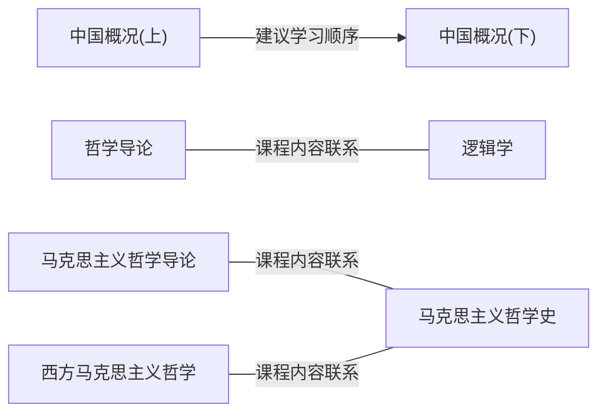

# 哲学专业“2+X”修读建议（留学生适用）

2024 年汇编印刷页 145–146。原表记录 26 个可配对的课程代码。

[本节原页](plan-137.pdf#page=9) · [逐行数据](plan-137.json) · [院系目录](README.md)

## 课程关系图

图中展示最多 20 条关系。下表列出本节全部关系。建议学习顺序供规划课程使用，正式选课资格以教务规定为准。

| 课程 | 关联课程 | 关系 | 依据 |
| --- | --- | --- | --- |
| 中国概况(上)（ICES110012） | 中国概况(下)（ICES110013） | 建议学习顺序 | 同节课程题名标明连续分册或序号。 |
| 哲学导论（PHIL120012） | 逻辑学（PHIL120013） | 课程内容联系 | 论证与概念分析是哲学讨论的共同方法。 |
| 马克思主义哲学导论（PHIL130001） | 马克思主义哲学史（PHIL130271） | 课程内容联系 | 本方案两门课程的题名均含“马克思主义”，可据此对照这一主题。 |
| 西方马克思主义哲学（PHIL130183） | 马克思主义哲学史（PHIL130271） | 课程内容联系 | 本方案两门课程的题名均含“马克思主义”，可据此对照这一主题。 |

## 课程

| 课程代码 | 名称 | 开课学期原文 | 来源（PDF 页） |
| --- | --- | --- | --- |
| CHIN120012 | 中国文学经典 |  | 159 |
| HIST120012 | 中国古代文明 |  | 159 |
| ICES110012 | 中国概况(上) |  | 159 |
| ICES110013 | 中国概况(下) |  | 159 |
| PHIL120012 | 哲学导论 |  | 159 |
| PHIL120013 | 逻辑学 |  | 159 |
| PHIL120015 | 宗教学导论 |  | 159 |
| PHIL130001 | 马克思主义哲学导论 |  | 159 |
| PHIL130014 | 社会实践 |  | 159 |
| PHIL130015 | 学年论文 |  | 159 |
| PHIL130016 | 毕业论文 |  | 159 |
| PHIL130171 | 古希腊哲学 |  | 159 |
| PHIL130172 | 西方近代哲学（含中世纪） |  | 159 |
| PHIL130173 | 德国古典哲学 |  | 159 |
| PHIL130174 | 伦理学基础 |  | 159 |
| PHIL130175 | 数理逻辑 |  | 159 |
| PHIL130176 | 先秦哲学 |  | 159 |
| PHIL130177 | 汉晋隋唐哲学 |  | 159 |
| PHIL130178 | 宋元明清哲学 |  | 159 |
| PHIL130179 | 中国近现代哲学 |  | 159 |
| PHIL130180 | 哲学阅读和写作 |  | 159 |
| PHIL130181 | 现代英美哲学 |  | 159 |
| PHIL130182 | 现代欧陆哲学 |  | 159 |
| PHIL130183 | 西方马克思主义哲学 |  | 159 |
| PHIL130184 | 美学与艺术哲学基础 |  | 159 |
| PHIL130271 | 马克思主义哲学史 |  | 159 |
