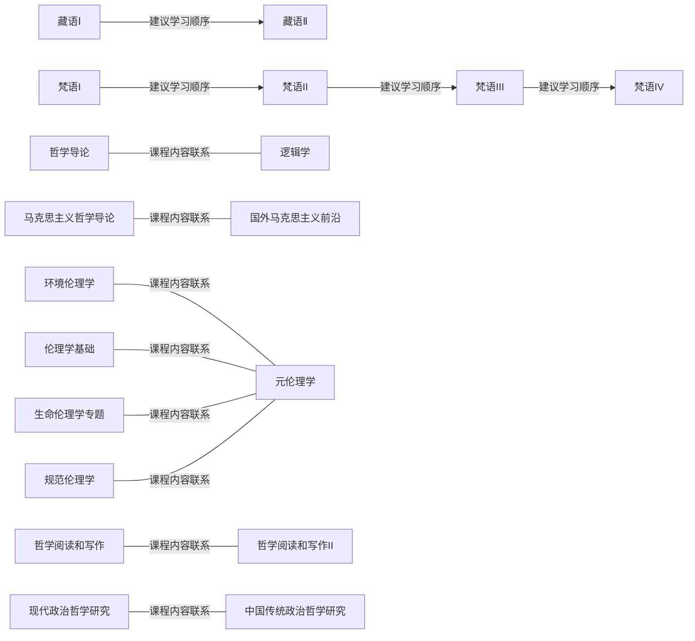

# 哲学（国学方向）专业“2+X”教学培养方案（强基班适用）

2024 年汇编印刷页 153–158。原表记录 110 个可配对的课程代码。

[本节原页](plan-153.pdf#page=1) · [逐行数据](plan-153.json) · [院系目录](README.md)

## 课程关系图

图中展示最多 20 条关系。下表列出本节全部关系。建议学习顺序供规划课程使用，正式选课资格以教务规定为准。

| 课程 | 关联课程 | 关系 | 依据 |
| --- | --- | --- | --- |
| 藏语Ⅰ（PHIL130165） | 藏语Ⅱ（PHIL130166） | 建议学习顺序 | 同节课程题名标明连续分册或序号。 |
| 梵语I（PHIL130283） | 梵语II（PHIL130284） | 建议学习顺序 | 同节课程题名标明连续分册或序号。 |
| 梵语II（PHIL130284） | 梵语III（PHIL130285） | 建议学习顺序 | 同节课程题名标明连续分册或序号。 |
| 梵语III（PHIL130285） | 梵语IV（PHIL130286） | 建议学习顺序 | 同节课程题名标明连续分册或序号。 |
| 哲学导论（PHIL120012） | 逻辑学（PHIL120013） | 课程内容联系 | 论证与概念分析是哲学讨论的共同方法。 |
| 马克思主义哲学导论（PHIL130001） | 国外马克思主义前沿（PHIL130303） | 课程内容联系 | 本方案两门课程的题名均含“马克思主义”，可据此对照这一主题。 |
| 环境伦理学（PHIL130151） | 元伦理学（PHIL130364） | 课程内容联系 | 本方案两门课程的题名均含“伦理学”，可据此对照这一主题。 |
| 伦理学基础（PHIL130174） | 元伦理学（PHIL130364） | 课程内容联系 | 本方案两门课程的题名均含“伦理学”，可据此对照这一主题。 |
| 哲学阅读和写作（PHIL130180） | 哲学阅读和写作II（PHIL130369） | 课程内容联系 | 本方案两门课程的题名均含“写作”，可据此对照这一主题。 |
| 现代政治哲学研究（PHIL130217） | 中国传统政治哲学研究（PHIL130234） | 课程内容联系 | 本方案两门课程的题名均含“政治哲学”，可据此对照这一主题。 |
| 生命伦理学专题（PHIL130336） | 元伦理学（PHIL130364） | 课程内容联系 | 本方案两门课程的题名均含“伦理学”，可据此对照这一主题。 |
| 规范伦理学（PHIL130361） | 元伦理学（PHIL130364） | 课程内容联系 | 本方案两门课程的题名均含“伦理学”，可据此对照这一主题。 |

## 课程

| 课程代码 | 名称 | 开课学期原文 | 来源（PDF 页） |
| --- | --- | --- | --- |
| CHIN120012 | 中国文学经典 | 1 | 167 |
| CHIN130017 | 《文心雕龙》精读 | 春,秋 | 169 |
| CHIN130018 | 《四库提要》精读 | 春,秋 | 169 |
| CHIN130026 | 《说文解字》精读 | 春,秋 | 169 |
| CHIN130056 | 《世说新语》精读 | 春,秋 | 169 |
| HIST120012 | 中国古代文明 | 2 | 168 |
| HIST130128 | 《资治通鉴》讲读 | 春,秋 | 169 |
| PHIL120012 | 哲学导论 | 1 | 168 |
| PHIL120013 | 逻辑学 | 1 | 168 |
| PHIL120015 | 宗教学导论 | 1 | 168 |
| PHIL130001 | 马克思主义哲学导论 | 3 | 168 |
| PHIL130014 | 社会实践 | 7 | 168 |
| PHIL130015 | 学年论文 | 6 | 168 |
| PHIL130016 | 毕业论文 | 8 | 168 |
| PHIL130073 | 国学通论 | 4 | 168 |
| PHIL130074 | 小学基础 | 3 | 168 |
| PHIL130075 | 校雠目录学 | 春,秋 | 169 |
| PHIL130076 | 《大学》与《中庸》 | 5 | 168 |
| PHIL130084 | 新兴宗教概论 | 春,秋 | 171 |
| PHIL130103 | 中国哲学史料学 | 5 | 168 |
| PHIL130118 | 汉传佛教哲学 | 春,秋 | 169 |
| PHIL130124 | 《韩非子》 | 春,秋 | 170 |
| PHIL130126 | 《诗经》 | 春,秋 | 170 |
| PHIL130127 | 《尚书》 | 春,秋 | 170 |
| PHIL130128 | 《礼记》 | 春,秋 | 169 |
| PHIL130129 | 《周易》 | 春,秋 | 169 |
| PHIL130130 | 《左传》 | 春,秋 | 170 |
| PHIL130131 | 《公羊传》 | 春,秋 | 170 |
| PHIL130133 | 《论语》 | 4 | 168 |
| PHIL130135 | 《文选》 | 春,秋 | 169 |
| PHIL130141 | 《荀子》 | 春,秋 | 169 |
| PHIL130142 | 《孟子》 | 6 | 168 |
| PHIL130151 | 环境伦理学 | 春,秋 | 170 |
| PHIL130165 | 藏语Ⅰ | 春,秋 | 171 |
| PHIL130166 | 藏语Ⅱ | 春,秋 | 171 |
| PHIL130167 | 巴利语Ⅰ | 春,秋 | 171 |
| PHIL130171 | 古希腊哲学 | 1 | 168 |
| PHIL130172 | 西方近代哲学（含中世纪） | 2 | 168 |
| PHIL130173 | 德国古典哲学 | 3 | 168 |
| PHIL130174 | 伦理学基础 | 2 | 168 |
| PHIL130176 | 先秦哲学 | 1 | 168 |
| PHIL130177 | 汉晋隋唐哲学 | 2 | 168 |
| PHIL130178 | 宋元明清哲学 | 3 | 168 |
| PHIL130179 | 中国近现代哲学 | 4 | 168 |
| PHIL130180 | 哲学阅读和写作 | 4 | 168 |
| PHIL130185 | 形而上学 | 春,秋 | 169 |
| PHIL130212 | 《1844手稿》研究 | 春,秋 | 170 |
| PHIL130213 | 《资本论》及其手稿 | 春,秋 | 170 |
| PHIL130215 | 近代认识论研究 | 春,秋 | 170 |
| PHIL130216 | 德国古典美学专题研究 | 春,秋 | 171 |
| PHIL130217 | 现代政治哲学研究 | 春,秋 | 170 |
| PHIL130218 | 德国观念论 | 春,秋 | 170 |
| PHIL130219 | 福柯研究 | 春,秋 | 170 |
| PHIL130220 | 意识形态理论研究 | 春,秋 | 170 |
| PHIL130222 | 秦汉哲学专题研究 | 春,秋 | 169 |
| PHIL130223 | 魏晋玄学专题研究 | 春,秋 | 169 |
| PHIL130224 | 宋明理学专题研究 | 春,秋 | 169 |
| PHIL130225 | 清代思想专题研究 | 春,秋 | 169 |
| PHIL130226 | 佛教经典选读 | 春,秋 | 169 |
| PHIL130230 | 《近思录》 | 春,秋 | 170 |
| PHIL130231 | 中国经学史专题研究 | 春,秋 | 170 |
| PHIL130232 | 朱子学与阳明学研究 | 春,秋 | 170 |
| PHIL130233 | 当代新儒家专题研究 | 春,秋 | 170 |
| PHIL130234 | 中国传统政治哲学研究 | 春,秋 | 170 |
| PHIL130235 | 中西比较哲学专题研究 | 春,秋 | 170 |
| PHIL130236 | 海外中国哲学研究专题 | 春,秋 | 170 |
| PHIL130237 | 东亚儒学探究 | 春,秋 | 170 |
| PHIL130248 | 力迫法 | 春,秋 | 171 |
| PHIL130249 | 意义理论研究 | 春,秋 | 171 |
| PHIL130250 | 科学实在论研究 | 春,秋 | 171 |
| PHIL130251 | 科学解释研究 | 春,秋 | 171 |
| PHIL130252 | 科学实践哲学 | 春,秋 | 171 |
| PHIL130257 | 拉丁语与罗马宗教 | 春,秋 | 172 |
| PHIL130260 | 高阶拉丁语 | 春,秋 | 172 |
| PHIL130262 | 印度哲学与宗教 | 春,秋 | 169 |
| PHIL130268 | 亚伯拉罕宗教研究 | 春,秋 | 171 |
| PHIL130269 | 明清基督教研究 | 春,秋 | 171 |
| PHIL130272 | 启蒙哲学 | 春,秋 | 170 |
| PHIL130273 | 中西艺术专题 | 春,秋 | 171 |
| PHIL130274 | 哲学专业外语 | 春,秋 | 172 |
| PHIL130275 | 国学专业外语 | 春,秋 | 172 |
| PHIL130276 | 科逻专业外语 | 春,秋 | 172 |
| PHIL130277 | 宗教学专业外语 | 春,秋 | 172 |
| PHIL130283 | 梵语I | 春,秋 | 172 |
| PHIL130284 | 梵语II | 春,秋 | 172 |
| PHIL130285 | 梵语III | 春,秋 | 172 |
| PHIL130286 | 梵语IV | 春,秋 | 172 |
| PHIL130302 | 思考与认知 | 春,秋 | 171 |
| PHIL130303 | 国外马克思主义前沿 | 春,秋 | 170 |
| PHIL130305 | 古希腊哲学专题 | 春,秋 | 170 |
| PHIL130307 | 模型论进阶 | 春,秋 | 171 |
| PHIL130309 | 可计算性理论进阶 | 春,秋 | 171 |
| PHIL130310 | 集合论进阶 | 春,秋 | 171 |
| PHIL130333 | 黑格尔美学思想 | 春,秋 | 171 |
| PHIL130334 | 中国古典美学专题 | 春,秋 | 171 |
| PHIL130335 | 艺术展览与艺术理论专题 | 春,秋 | 171 |
| PHIL130336 | 生命伦理学专题 | 春,秋 | 170 |
| PHIL130346 | 帝国秩序与帝国主义 | 春,秋 | 171 |
| PHIL130347 | 政治思想专题：经典与当代 | 春,秋 | 171 |
| PHIL130348 | 《资本论》与现代世界 | 春,秋 | 171 |
| PHIL130349 | 繁荣与贫困：历史视野下的经济发展 | 春,秋 | 171 |
| PHIL130354 | 印度哲学选读 | 春,秋 | 169 |
| PHIL130355 | 《老子》与《庄子》 | 5 | 168 |
| PHIL130359 | 科技伦理前沿 | 春,秋 | 171 |
| PHIL130360 | 当代西方艺术哲学 | 春,秋 | 171 |
| PHIL130361 | 规范伦理学 | 春,秋 | 171 |
| PHIL130362 | 中国心学传统：先秦至近现代 | 春,秋 | 170 |
| PHIL130363 | 佛教专题研究 | 春,秋 | 171 |
| PHIL130364 | 元伦理学 | 春,秋 | 171 |
| PHIL130369 | 哲学阅读和写作II | 春,秋 | 171 |
