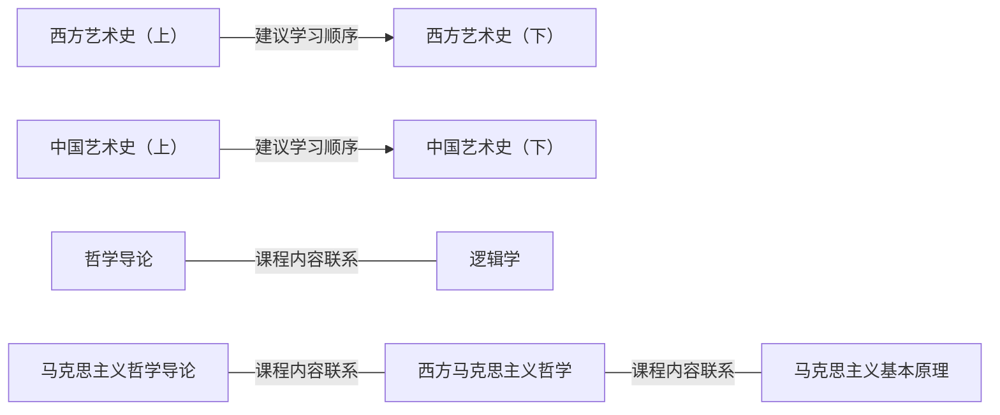

# 哲学（艺术哲学方向）专业“2+X”修读建议

2024 年汇编印刷页 187–188。原表记录 28 个可配对的课程代码。

[本节原页](plan-181.pdf#page=7) · [逐行数据](plan-181.json) · [院系目录](README.md)

## 课程导读

想了解艺术哲学与美学的课程安排，可以在原表中找到《艺术史理论与方法》（`PHIL130315`）、《美学与艺术哲学基础》（`PHIL130184`）、《西方艺术史（上）》（`PHIL130338`）。 [原书 PDF 第 201 页](plan-181.pdf#page=7) · [原书 PDF 第 202 页](plan-181.pdf#page=8)

《西方艺术史（上）》（`PHIL130338`）和《西方艺术史（下）》（`PHIL130339`）是同一系列，图中的箭头按题名标出的分册顺序排列。 [原书 PDF 第 202 页](plan-181.pdf#page=8)

## 课程关系图

图中展示最多 20 条关系。下表列出本节全部关系。建议学习顺序供规划课程使用，正式选课资格以教务规定为准。

| 课程 | 关联课程 | 关系 | 依据 |
| --- | --- | --- | --- |
| 西方艺术史（上）（PHIL130338） | 西方艺术史（下）（PHIL130339） | 建议学习顺序 | 同节课程题名标明连续分册或序号。 |
| 中国艺术史（上）（PHIL130340） | 中国艺术史（下）（PHIL130341） | 建议学习顺序 | 同节课程题名标明连续分册或序号。 |
| 哲学导论（PHIL120012） | 逻辑学（PHIL120013） | 课程内容联系 | 论证与概念分析是哲学讨论的共同方法。 |
| 马克思主义哲学导论（PHIL130001） | 西方马克思主义哲学（PHIL130183） | 课程内容联系 | 本方案两门课程的题名均含“马克思主义”，可据此对照这一主题。 |
| 西方马克思主义哲学（PHIL130183） | 马克思主义基本原理（PTSS110087） | 课程内容联系 | 本方案两门课程的题名均含“马克思主义”，可据此对照这一主题。 |

## 课程

| 课程代码 | 名称 | 开课学期原文 | 来源（PDF 页） |
| --- | --- | --- | --- |
| CHIN120012 | 中国文学经典 |  | 201 |
| HIST120012 | 中国古代文明 |  | 201 |
| PHIL120012 | 哲学导论 |  | 201 |
| PHIL120013 | 逻辑学 |  | 201 |
| PHIL120015 | 宗教学导论 |  | 201 |
| PHIL130001 | 马克思主义哲学导论 |  | 201 |
| PHIL130014 | 社会实践 |  | 202 |
| PHIL130015 | 学年论文 |  | 202 |
| PHIL130016 | 毕业论文 |  | 202 |
| PHIL130171 | 古希腊哲学 |  | 201 |
| PHIL130172 | 西方近代哲学（含中世纪） |  | 201 |
| PHIL130173 | 德国古典哲学 |  | 201 |
| PHIL130176 | 先秦哲学 |  | 201 |
| PHIL130177 | 汉晋隋唐哲学 |  | 201 |
| PHIL130178 | 宋元明清哲学 |  | 201 |
| PHIL130182 | 现代欧陆哲学 |  | 202 |
| PHIL130183 | 西方马克思主义哲学 |  | 202 |
| PHIL130184 | 美学与艺术哲学基础 |  | 202 |
| PHIL130315 | 艺术史理论与方法 |  | 201 |
| PHIL130338 | 西方艺术史（上） |  | 202 |
| PHIL130339 | 西方艺术史（下） |  | 202 |
| PHIL130340 | 中国艺术史（上） |  | 202 |
| PHIL130341 | 中国艺术史（下） |  | 202 |
| PTSS110082 | 毛泽东思想和中国特色社会主义理论体系概论 |  | 201 |
| PTSS110087 | 马克思主义基本原理 |  | 201 |
| PTSS110088 | 中国近现代史纲要 |  | 201 |
| PTSS110089 | 思想道德与法治 |  | 201 |
| PTSS110090 | 习近平新时代中国特色社会主义思想概论 |  | 201 |
