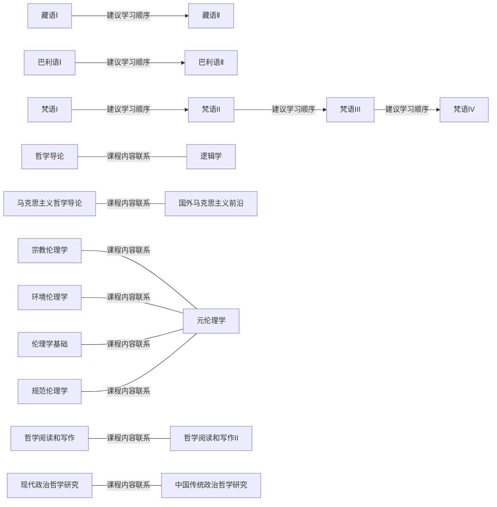

# 宗教学专业“2+X”教学培养方案（强基班适用）

2024 年汇编印刷页 195–200。原表记录 107 个可配对的课程代码。

[本节原页](plan-195.pdf#page=1) · [逐行数据](plan-195.json) · [院系目录](README.md)

## 课程关系图

图中展示最多 20 条关系。下表列出本节全部关系。建议学习顺序供规划课程使用，正式选课资格以教务规定为准。

| 课程 | 关联课程 | 关系 | 依据 |
| --- | --- | --- | --- |
| 藏语Ⅰ（PHIL130165） | 藏语Ⅱ（PHIL130166） | 建议学习顺序 | 同节课程题名标明连续分册或序号。 |
| 巴利语Ⅰ（PHIL130167） | 巴利语Ⅱ（PHIL130168） | 建议学习顺序 | 同节课程题名标明连续分册或序号。 |
| 梵语I（PHIL130283） | 梵语II（PHIL130284） | 建议学习顺序 | 同节课程题名标明连续分册或序号。 |
| 梵语II（PHIL130284） | 梵语III（PHIL130285） | 建议学习顺序 | 同节课程题名标明连续分册或序号。 |
| 梵语III（PHIL130285） | 梵语IV（PHIL130286） | 建议学习顺序 | 同节课程题名标明连续分册或序号。 |
| 哲学导论（PHIL120012） | 逻辑学（PHIL120013） | 课程内容联系 | 论证与概念分析是哲学讨论的共同方法。 |
| 马克思主义哲学导论（PHIL130001） | 国外马克思主义前沿（PHIL130303） | 课程内容联系 | 本方案两门课程的题名均含“马克思主义”，可据此对照这一主题。 |
| 宗教伦理学（PHIL130069） | 元伦理学（PHIL130364） | 课程内容联系 | 本方案两门课程的题名均含“伦理学”，可据此对照这一主题。 |
| 环境伦理学（PHIL130151） | 元伦理学（PHIL130364） | 课程内容联系 | 本方案两门课程的题名均含“伦理学”，可据此对照这一主题。 |
| 伦理学基础（PHIL130174） | 元伦理学（PHIL130364） | 课程内容联系 | 本方案两门课程的题名均含“伦理学”，可据此对照这一主题。 |
| 哲学阅读和写作（PHIL130180） | 哲学阅读和写作II（PHIL130369） | 课程内容联系 | 本方案两门课程的题名均含“写作”，可据此对照这一主题。 |
| 现代政治哲学研究（PHIL130217） | 中国传统政治哲学研究（PHIL130234） | 课程内容联系 | 本方案两门课程的题名均含“政治哲学”，可据此对照这一主题。 |
| 规范伦理学（PHIL130361） | 元伦理学（PHIL130364） | 课程内容联系 | 本方案两门课程的题名均含“伦理学”，可据此对照这一主题。 |

## 课程

| 课程代码 | 名称 | 开课学期原文 | 来源（PDF 页） |
| --- | --- | --- | --- |
| CHIN120012 | 中国文学经典 | 1 | 209 |
| HIST120012 | 中国古代文明 | 2 | 209 |
| PHIL120012 | 哲学导论 | 1 | 209 |
| PHIL120013 | 逻辑学 | 1 | 209 |
| PHIL120015 | 宗教学导论 | 1 | 209 |
| PHIL130001 | 马克思主义哲学导论 | 3 | 210 |
| PHIL130014 | 社会实践 | 7 | 210 |
| PHIL130015 | 学年论文 | 6 | 210 |
| PHIL130016 | 毕业论文 | 8 | 210 |
| PHIL130021 | 宗教哲学 | 春,秋 | 211 |
| PHIL130036 | 基督教哲学 | 5 | 210 |
| PHIL130041 | 佛教哲学 | 5 | 210 |
| PHIL130069 | 宗教伦理学 | 春,秋 | 211 |
| PHIL130077 | 宗教社会学 | 4 | 210 |
| PHIL130078 | 儒教的理论与历史 | 春,秋 | 210 |
| PHIL130084 | 新兴宗教概论 | 春,秋 | 212 |
| PHIL130118 | 汉传佛教哲学 | 春,秋 | 211 |
| PHIL130119 | 藏传佛教 | 春,秋 | 211 |
| PHIL130123 | 宗教对话的理论和现状 | 春,秋 | 211 |
| PHIL130144 | 比较宗教学 | 春,秋 | 210 |
| PHIL130148 | 宗教人类学 | 春,秋 | 210 |
| PHIL130151 | 环境伦理学 | 春,秋 | 212 |
| PHIL130165 | 藏语Ⅰ | 春,秋 | 211, 214 |
| PHIL130166 | 藏语Ⅱ | 春,秋 | 211, 214 |
| PHIL130167 | 巴利语Ⅰ | 春,秋 | 211, 214 |
| PHIL130168 | 巴利语Ⅱ | 春,秋 | 211 |
| PHIL130171 | 古希腊哲学 | 1 | 210 |
| PHIL130172 | 西方近代哲学（含中世纪） | 2 | 210 |
| PHIL130173 | 德国古典哲学 | 3 | 210 |
| PHIL130174 | 伦理学基础 | 2 | 210 |
| PHIL130175 | 数理逻辑 | 2 | 210 |
| PHIL130176 | 先秦哲学 | 1 | 210 |
| PHIL130177 | 汉晋隋唐哲学 | 2 | 210 |
| PHIL130178 | 宋元明清哲学 | 3 | 210 |
| PHIL130179 | 中国近现代哲学 | 4 | 210 |
| PHIL130180 | 哲学阅读和写作 | 4 | 210 |
| PHIL130212 | 《1844手稿》研究 | 春,秋 | 212 |
| PHIL130213 | 《资本论》及其手稿 | 春,秋 | 212 |
| PHIL130215 | 近代认识论研究 | 春,秋 | 212 |
| PHIL130216 | 德国古典美学专题研究 | 春,秋 | 213 |
| PHIL130217 | 现代政治哲学研究 | 春,秋 | 212 |
| PHIL130218 | 德国观念论 | 春,秋 | 212 |
| PHIL130219 | 福柯研究 | 春,秋 | 212 |
| PHIL130220 | 意识形态理论研究 | 春,秋 | 212 |
| PHIL130226 | 佛教经典选读 | 春,秋 | 211 |
| PHIL130227 | 中国佛教史 | 春,秋 | 210 |
| PHIL130231 | 中国经学史专题研究 | 春,秋 | 213 |
| PHIL130232 | 朱子学与阳明学研究 | 春,秋 | 213 |
| PHIL130233 | 当代新儒家专题研究 | 春,秋 | 213 |
| PHIL130234 | 中国传统政治哲学研究 | 春,秋 | 213 |
| PHIL130235 | 中西比较哲学专题研究 | 春,秋 | 213 |
| PHIL130236 | 海外中国哲学研究专题 | 春,秋 | 213 |
| PHIL130237 | 东亚儒学探究 | 春,秋 | 213 |
| PHIL130248 | 力迫法 | 春,秋 | 213 |
| PHIL130249 | 意义理论研究 | 春,秋 | 213 |
| PHIL130250 | 科学实在论研究 | 春,秋 | 213 |
| PHIL130251 | 科学解释研究 | 春,秋 | 213 |
| PHIL130252 | 科学实践哲学 | 春,秋 | 213 |
| PHIL130257 | 拉丁语与罗马宗教 | 春,秋 | 211, 214 |
| PHIL130260 | 高阶拉丁语 | 春,秋 | 211, 214 |
| PHIL130262 | 印度哲学与宗教 | 春,秋 | 211 |
| PHIL130263 | 当代天主教 | 春,秋 | 212 |
| PHIL130264 | 中国基督教 | 春,秋 | 212 |
| PHIL130266 | 《神圣与世俗》 | 春,秋 | 212 |
| PHIL130268 | 亚伯拉罕宗教研究 | 春,秋 | 212 |
| PHIL130269 | 明清基督教研究 | 春,秋 | 212 |
| PHIL130272 | 启蒙哲学 | 春,秋 | 212 |
| PHIL130273 | 中西艺术专题 | 春,秋 | 213 |
| PHIL130274 | 哲学专业外语 | 春,秋 | 214 |
| PHIL130275 | 国学专业外语 | 春,秋 | 214 |
| PHIL130276 | 科逻专业外语 | 春,秋 | 214 |
| PHIL130277 | 宗教学专业外语 | 春,秋 | 214 |
| PHIL130280 | 中国宗教的田野研究 | 春,秋 | 211 |
| PHIL130283 | 梵语I | 春,秋 | 211, 214 |
| PHIL130284 | 梵语II | 春,秋 | 211, 214 |
| PHIL130285 | 梵语III | 春,秋 | 212, 214 |
| PHIL130286 | 梵语IV | 春,秋 | 212, 214 |
| PHIL130299 | 民间宗教与道教 | 6 | 210 |
| PHIL130300 | 《古兰经》研究 | 春,秋 | 210 |
| PHIL130302 | 思考与认知 | 春,秋 | 213 |
| PHIL130303 | 国外马克思主义前沿 | 春,秋 | 212 |
| PHIL130305 | 古希腊哲学专题 | 春,秋 | 212 |
| PHIL130307 | 模型论进阶 | 春,秋 | 213 |
| PHIL130309 | 可计算性理论进阶 | 春,秋 | 213 |
| PHIL130310 | 集合论进阶 | 春,秋 | 213 |
| PHIL130333 | 黑格尔美学思想 | 春,秋 | 213 |
| PHIL130334 | 中国古典美学专题 | 春,秋 | 213 |
| PHIL130335 | 艺术展览与艺术理论专题 | 春,秋 | 213 |
| PHIL130336 | 生命伦理学专题 | 春,秋 | 212 |
| PHIL130346 | 帝国秩序与帝国主义 | 春,秋 | 213 |
| PHIL130347 | 政治思想专题：经典与当代 | 春,秋 | 213 |
| PHIL130348 | 《资本论》与现代世界 | 春,秋 | 213 |
| PHIL130349 | 繁荣与贫困：历史视野下的经济发展 | 春,秋 | 213 |
| PHIL130352 | 阿拉伯哲学 | 6 | 210 |
| PHIL130354 | 印度哲学选读 | 春,秋 | 212 |
| PHIL130356 | 中国佛教思想史 | 春,秋 | 210 |
| PHIL130359 | 科技伦理前沿 | 春,秋 | 212 |
| PHIL130360 | 当代西方艺术哲学 | 春,秋 | 213 |
| PHIL130361 | 规范伦理学 | 春,秋 | 212 |
| PHIL130362 | 中国心学传统：先秦至近现代 | 春,秋 | 213 |
| PHIL130363 | 佛教专题研究 | 春,秋 | 212 |
| PHIL130364 | 元伦理学 | 春,秋 | 213 |
| PHIL130365 | 犹太教历史、理论与实践 | 春,秋 | 212 |
| PHIL130366 | 圣经学概论 | 5 | 210 |
| PHIL130367 | 全球基督教史 | 春,秋 | 210 |
| PHIL130368 | 印度佛教思想史 | 春,秋 | 211 |
| PHIL130369 | 哲学阅读和写作II | 春,秋 | 213 |
