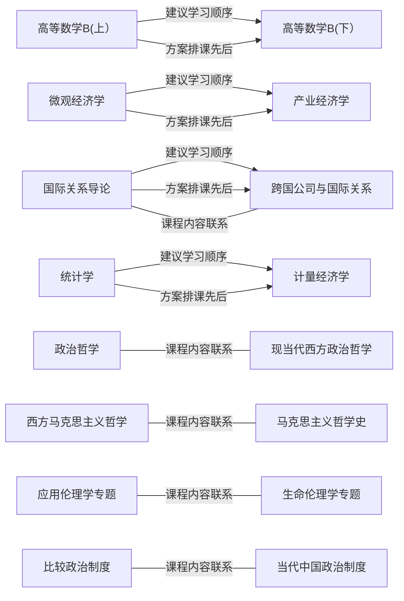

# 政治学、经济学与哲学“2+X”教学培养方案

2024 年汇编印刷页 205–208。原表记录 64 个可配对的课程代码。

[本节原页](plan-205.pdf#page=1) · [逐行数据](plan-205.json) · [院系目录](README.md)

## 课程关系图

图中展示最多 20 条关系。下表列出本节全部关系。建议学习顺序供规划课程使用，正式选课资格以教务规定为准。

| 课程 | 关联课程 | 关系 | 依据 |
| --- | --- | --- | --- |
| 高等数学B(上）（MATH120003） | 高等数学B(下）（MATH120004） | 建议学习顺序 | 同节课程题名标明连续分册或序号。 |
| 微观经济学（SOSC120004） | 产业经济学（ECON130011） | 建议学习顺序 | 企业和市场结构是产业经济分析的基础。 |
| 国际关系导论（SOSC120011） | 跨国公司与国际关系（POLI130145） | 建议学习顺序 | “国际关系导论”题名标明基础层次，前置阅读可帮助了解“跨国公司与国际关系”中的国际关系主题。 |
| 统计学（SOSC120017） | 计量经济学（ECON130213） | 建议学习顺序 | 统计推断为计量模型的估计与检验提供基础。 |
| 政治哲学（PHIL130108） | 现当代西方政治哲学（POLI130009） | 课程内容联系 | 本方案两门课程的题名均含“政治哲学”，可据此对照这一主题。 |
| 西方马克思主义哲学（PHIL130183） | 马克思主义哲学史（PHIL130271） | 课程内容联系 | 本方案两门课程的题名均含“马克思主义”，可据此对照这一主题。 |
| 应用伦理学专题（PHIL130221） | 生命伦理学专题（PHIL130336） | 课程内容联系 | 本方案两门课程的题名均含“伦理学”，可据此对照这一主题。 |
| 比较政治制度（POLI130005） | 当代中国政治制度（SOSC120019） | 课程内容联系 | 均涉及政治制度，可对照制度安排与研究对象。 |
| 跨国公司与国际关系（POLI130145） | 国际关系导论（SOSC120011） | 课程内容联系 | 本方案两门课程的题名均含“国际关系”，可据此对照这一主题。 |
| 高等数学B(上）（MATH120003） | 高等数学B(下）（MATH120004） | 方案排课先后 | 本节原表所列全部明确学期均早于后者。 |
| 微观经济学（SOSC120004） | 产业经济学（ECON130011） | 方案排课先后 | 本节原表所列全部明确学期均早于后者。 |
| 国际关系导论（SOSC120011） | 跨国公司与国际关系（POLI130145） | 方案排课先后 | 本节原表所列全部明确学期均早于后者。 |
| 统计学（SOSC120017） | 计量经济学（ECON130213） | 方案排课先后 | 本节原表所列全部明确学期均早于后者。 |

## 课程

| 课程代码 | 名称 | 开课学期原文 | 来源（PDF 页） |
| --- | --- | --- | --- |
| ECON130001 | 概率论与数理统计 | 5 | 221, 222 |
| ECON130005 | 财政学 | 4 | 221 |
| ECON130010 | 当代中国经济 | 7 | 220 |
| ECON130011 | 产业经济学 | 6 | 221, 222 |
| ECON130012 | 发展经济学 | 7 | 221 |
| ECON130019 | 国际经济学 | 4 | 220 |
| ECON130022 | 货币经济学 | 7 | 221 |
| ECON130064 | 博弈论 | 4 | 221 |
| ECON130128 | 制度经济学 | 6 | 221 |
| ECON130131 | 外国经济思想史 | 7 | 221 |
| ECON130193 | 数量经济学 | 8 | 222 |
| ECON130212 | 经济史 | 7 | 222 |
| ECON130213 | 计量经济学 | 8 | 221 |
| ECON130217 | 公司金融 | 7 | 220 |
| ECON130226 | 投资学 | 6 | 222 |
| ECON130266 | 中国政府与经济 | 7 | 221 |
| MATH120003 | 高等数学B(上） | 1 | 219 |
| MATH120004 | 高等数学B(下） | 2 | 219 |
| MATH120044 | 线性代数 | 2 | 219 |
| PHIL130014 | 社会实践 | 7 | 220 |
| PHIL130016 | 毕业论文 | 8 | 220 |
| PHIL130108 | 政治哲学 | 5 | 220 |
| PHIL130158 | 人工智能哲学 | 8 | 221 |
| PHIL130171 | 古希腊哲学 | 1 | 219 |
| PHIL130172 | 西方近代哲学（含中世纪） | 2 | 219 |
| PHIL130173 | 德国古典哲学 | 5 | 220 |
| PHIL130181 | 现代英美哲学 | 6 | 220 |
| PHIL130182 | 现代欧陆哲学 | 7 | 220 |
| PHIL130183 | 西方马克思主义哲学 | 5 | 221 |
| PHIL130186 | 知识论 | 4 | 221 |
| PHIL130206 | 社会科学哲学 | 7 | 221 |
| PHIL130221 | 应用伦理学专题 | 6 | 221 |
| PHIL130245 | 科学、技术与社会 （STS) | 3 | 220 |
| PHIL130271 | 马克思主义哲学史 | 4 | 220 |
| PHIL130280 | 中国宗教的田野研究 | 8 | 222 |
| PHIL130304 | 社会哲学与社会理论 | 6 | 220 |
| PHIL130336 | 生命伦理学专题 | 4 | 220 |
| PHIL130346 | 帝国秩序与帝国主义 | 4 | 220 |
| PHIL130347 | 政治思想专题：经典与当代 | 3 | 220 |
| PHIL130348 | 《资本论》与现代世界 | 6 | 220 |
| PHIL130349 | 繁荣与贫困：历史视野下的经济发展 | 5 | 220 |
| PHIL130351 | 从PPE看上海 | 5 | 221 |
| POLI130001 | 中国政治思想 | 7 | 221 |
| POLI130005 | 比较政治制度 | 3 | 220 |
| POLI130008 | 西方政治史 | 3 | 220 |
| POLI130009 | 现当代西方政治哲学 | 6 | 220 |
| POLI130010 | 发展政治学 | 6 | 221, 222 |
| POLI130011 | 当代西方政治学 | 8 | 221 |
| POLI130012 | 政府经济学 | 4 | 220 |
| POLI130015 | 中国社会政治分析 | 7 | 220 |
| POLI130062 | 比较政党制度 | 8 | 221, 222 |
| POLI130071 | 政治社会学 | 5 | 220 |
| POLI130081 | 选举政治学 | 5 | 220 |
| POLI130083 | 当代中国公共政策 | 8 | 222 |
| POLI130100 | 国家理论研究 | 6 | 220 |
| POLI130145 | 跨国公司与国际关系 | 7 | 222 |
| POLI130149 | 定性研究方法 | 6 | 221, 222 |
| SOSC120001 | 政治学原理 | 1 | 219 |
| SOSC120004 | 微观经济学 | 2 | 219 |
| SOSC120005 | 宏观经济学 | 3 | 220 |
| SOSC120008 | 政治经济学 | 1 | 219 |
| SOSC120011 | 国际关系导论 | 4 | 220 |
| SOSC120017 | 统计学 | 1 | 221 |
| SOSC120019 | 当代中国政治制度 | 2 | 219 |
