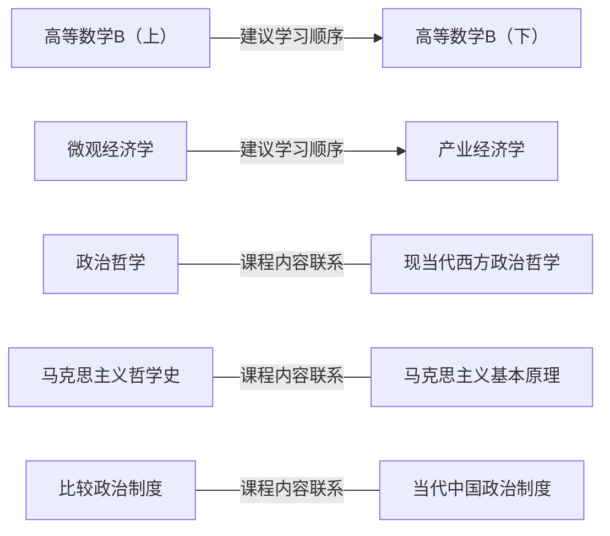

# 政治学、经济学与哲学专业“2+X”修读建议

2024 年汇编印刷页 209–211。原表记录 48 个可配对的课程代码。

[本节原页](plan-205.pdf#page=5) · [逐行数据](plan-205.json) · [院系目录](README.md)

## 课程导读

想了解政治、经济与哲学的课程安排，可以在原表中找到《比较政治制度》（`POLI130005`）、《国际经济学》（`ECON130019`）、《古希腊哲学》（`PHIL130171`）。 [原书 PDF 第 223 页](plan-205.pdf#page=5) · [原书 PDF 第 224 页](plan-205.pdf#page=6)

图中连接《政治哲学》（`PHIL130108`）和《现当代西方政治哲学》（`POLI130009`），两门课都从课程题名标出的“政治哲学”切入，可沿这一主题对照阅读。 [原书 PDF 第 223 页](plan-205.pdf#page=5) · [原书 PDF 第 224 页](plan-205.pdf#page=6)

## 课程关系图

图中展示最多 20 条关系。下表列出本节全部关系。建议学习顺序供规划课程使用，正式选课资格以教务规定为准。

| 课程 | 关联课程 | 关系 | 依据 |
| --- | --- | --- | --- |
| 高等数学B（上）（MATH120003） | 高等数学B（下）（MATH120004） | 建议学习顺序 | 同节课程题名标明连续分册或序号。 |
| 微观经济学（SOSC120004） | 产业经济学（ECON130011） | 建议学习顺序 | 企业和市场结构是产业经济分析的基础。 |
| 政治哲学（PHIL130108） | 现当代西方政治哲学（POLI130009） | 课程内容联系 | 本方案两门课程的题名均含“政治哲学”，可据此对照这一主题。 |
| 马克思主义哲学史（PHIL130271） | 马克思主义基本原理（PTSS110087） | 课程内容联系 | 本方案两门课程的题名均含“马克思主义”，可据此对照这一主题。 |
| 比较政治制度（POLI130005） | 当代中国政治制度（SOSC120019） | 课程内容联系 | 均涉及政治制度，可对照制度安排与研究对象。 |

## 课程

| 课程代码 | 名称 | 开课学期原文 | 来源（PDF 页） |
| --- | --- | --- | --- |
| ECON130005 | 财政学 |  | 224 |
| ECON130010 | 当代中国经济 |  | 224 |
| ECON130011 | 产业经济学 |  | 224 |
| ECON130012 | 发展经济学 |  | 224 |
| ECON130019 | 国际经济学 |  | 224 |
| ECON130064 | 博弈论 |  | 224 |
| ECON130128 | 制度经济学 |  | 224 |
| ECON130217 | 公司金融 |  | 224 |
| MATH120003 | 高等数学B（上） |  | 223 |
| MATH120004 | 高等数学B（下） |  | 223 |
| MATH120044 | 线性代数 |  | 223 |
| PHIL130014 | 社会实践 |  | 224 |
| PHIL130016 | 毕业论文 |  | 224 |
| PHIL130108 | 政治哲学 |  | 223 |
| PHIL130171 | 古希腊哲学 |  | 223 |
| PHIL130172 | 西方近代哲学（含中世纪） |  | 223 |
| PHIL130173 | 德国古典哲学 |  | 224 |
| PHIL130181 | 现代英美哲学 |  | 224 |
| PHIL130182 | 现代欧陆哲学 |  | 224 |
| PHIL130245 | 科学、技术与社会 （STS) |  | 224 |
| PHIL130271 | 马克思主义哲学史 |  | 224 |
| PHIL130304 | 社会哲学与社会理论 |  | 224 |
| PHIL130336 | 生命伦理学专题 |  | 224 |
| PHIL130346 | 帝国秩序与帝国主义 |  | 224 |
| PHIL130347 | 政治思想专题：经典与当代 |  | 224 |
| PHIL130348 | 《资本论》与现代世界 |  | 224 |
| PHIL130349 | 繁荣与贫困：历史视野下的经济发展 |  | 224 |
| PHIL130351 | 从PPE看上海 |  | 224 |
| POLI130005 | 比较政治制度 |  | 223 |
| POLI130008 | 西方政治史 |  | 224 |
| POLI130009 | 现当代西方政治哲学 |  | 224 |
| POLI130012 | 政府经济学 |  | 224 |
| POLI130015 | 中国社会政治分析 |  | 224 |
| POLI130071 | 政治社会学 |  | 224 |
| POLI130081 | 选举政治学 |  | 224 |
| POLI130100 | 国家理论研究 |  | 224 |
| PTSS110079 | 习近平新时代中国特色社会主义思想概论 |  | 223 |
| PTSS110082 | 毛泽东思想和中国特色社会主义理论体系概论 |  | 223 |
| PTSS110087 | 马克思主义基本原理 |  | 223 |
| PTSS110088 | 中国近现代史纲要 |  | 223 |
| PTSS110089 | 思想道德与法治 |  | 223 |
| SOSC120001 | 政治学原理 |  | 223 |
| SOSC120004 | 微观经济学 |  | 223 |
| SOSC120005 | 宏观经济学 |  | 223 |
| SOSC120008 | 政治经济学 |  | 223 |
| SOSC120011 | 国际关系导论 |  | 224 |
| SOSC120017 | 统计学 |  | 224 |
| SOSC120019 | 当代中国政治制度 |  | 223 |
