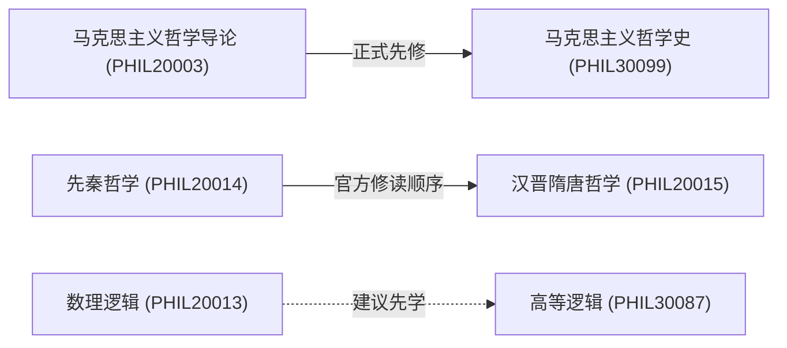

# 哲学学院 2025 级培养方案与课程图谱

共 18 份方案、3192 条方案课程记录、334 个课号。

[返回三年总览](../README.md) · [离线交互图谱](../index.html) · [方案索引](plans.json) · [方案课程记录](courses.json) · [图谱数据](graph.json) · [查证关系](relations.json)

## 官方方案原件

| 方案编号 | 培养方案 | 所属 | 原件与数据 |
| --- | --- | --- | --- |
| 97113 | 2025哲学专业本科培养方案(留学生适用) | 哲学学院 | [Word 原件](<word-originals/plan-97113.docx>) · [原始响应](<raw/plan-97113.json>) · [教务详情](https://fdjwgl.fudan.edu.cn/manager/bizType/2/major-program-search/info/97113?skipAuth=1) |
| 96695 | 2025哲学专业本科培养方案 | 哲学学院 | [Word 原件](<word-originals/plan-96695.docx>) · [原始响应](<raw/plan-96695.json>) · [教务详情](https://fdjwgl.fudan.edu.cn/manager/bizType/2/major-program-search/info/96695?skipAuth=1) |
| 97115 | 2025哲学专业本科培养方案(港澳台侨生适用) | 哲学学院 | [Word 原件](<word-originals/plan-97115.docx>) · [原始响应](<raw/plan-97115.json>) · [教务详情](https://fdjwgl.fudan.edu.cn/manager/bizType/2/major-program-search/info/97115?skipAuth=1) |
| 96745 | 2025哲学(国学方向)专业本科培养方案 | 哲学学院 | [Word 原件](<word-originals/plan-96745.docx>) · [原始响应](<raw/plan-96745.json>) · [教务详情](https://fdjwgl.fudan.edu.cn/manager/bizType/2/major-program-search/info/96745?skipAuth=1) |
| 97105 | 2025哲学(国学方向)专业本科培养方案(强基计划适用) | 哲学学院 | [Word 原件](<word-originals/plan-97105.docx>) · [原始响应](<raw/plan-97105.json>) · [教务详情](https://fdjwgl.fudan.edu.cn/manager/bizType/2/major-program-search/info/97105?skipAuth=1) |
| 96755 | 2025哲学(科学哲学与逻辑学方向)专业本科培养方案 | 哲学学院 | [Word 原件](<word-originals/plan-96755.docx>) · [原始响应](<raw/plan-96755.json>) · [教务详情](https://fdjwgl.fudan.edu.cn/manager/bizType/2/major-program-search/info/96755?skipAuth=1) |
| 97121 | 2025哲学(科学哲学与逻辑学方向)专业本科培养方案(强基计划适用) | 哲学学院 | [Word 原件](<word-originals/plan-97121.docx>) · [原始响应](<raw/plan-97121.json>) · [教务详情](https://fdjwgl.fudan.edu.cn/manager/bizType/2/major-program-search/info/97121?skipAuth=1) |
| 98720 | 2025哲学类本科培养方案（仅第一学年） | 哲学学院 | [Word 原件](<word-originals/plan-98720.docx>) · [原始响应](<raw/plan-98720.json>) · [教务详情](https://fdjwgl.fudan.edu.cn/manager/bizType/2/major-program-search/info/98720?skipAuth=1) |
| 98721 | 2025哲学类本科培养方案(强基计划适用)（仅第一学年） | 哲学学院 | [Word 原件](<word-originals/plan-98721.docx>) · [原始响应](<raw/plan-98721.json>) · [教务详情](https://fdjwgl.fudan.edu.cn/manager/bizType/2/major-program-search/info/98721?skipAuth=1) |
| 97116 | 2025哲学专业本科培养方案(强基计划适用) | 哲学学院 | [Word 原件](<word-originals/plan-97116.docx>) · [原始响应](<raw/plan-97116.json>) · [教务详情](https://fdjwgl.fudan.edu.cn/manager/bizType/2/major-program-search/info/97116?skipAuth=1) |
| 96906 | 2025哲学-人工智能双学士学位项目培养方案 | 哲学学院 | [Word 原件](<word-originals/plan-96906.docx>) · [原始响应](<raw/plan-96906.json>) · [教务详情](https://fdjwgl.fudan.edu.cn/manager/bizType/2/major-program-search/info/96906?skipAuth=1) |
| 96757 | 2025哲学(艺术哲学方向)专业本科培养方案 | 哲学学院 | [Word 原件](<word-originals/plan-96757.docx>) · [原始响应](<raw/plan-96757.json>) · [教务详情](https://fdjwgl.fudan.edu.cn/manager/bizType/2/major-program-search/info/96757?skipAuth=1) |
| 97122 | 2025哲学(艺术哲学方向)专业本科培养方案(强基计划适用) | 哲学学院 | [Word 原件](<word-originals/plan-97122.docx>) · [原始响应](<raw/plan-97122.json>) · [教务详情](https://fdjwgl.fudan.edu.cn/manager/bizType/2/major-program-search/info/97122?skipAuth=1) |
| 97126 | 2025哲学(宗教学方向)专业本科培养方案(强基计划适用) | 哲学学院 | [Word 原件](<word-originals/plan-97126.docx>) · [原始响应](<raw/plan-97126.json>) · [教务详情](https://fdjwgl.fudan.edu.cn/manager/bizType/2/major-program-search/info/97126?skipAuth=1) |
| 97148 | 2025政治学、经济学与哲学本科培养方案（2025级本科班适用） | 哲学学院 | [Word 原件](<word-originals/plan-97148.docx>) · [原始响应](<raw/plan-97148.json>) · [教务详情](https://fdjwgl.fudan.edu.cn/manager/bizType/2/major-program-search/info/97148?skipAuth=1) |
| 96787 | 2025宗教学专业本科培养方案 | 哲学学院 | [Word 原件](<word-originals/plan-96787.docx>) · [原始响应](<raw/plan-96787.json>) · [教务详情](https://fdjwgl.fudan.edu.cn/manager/bizType/2/major-program-search/info/96787?skipAuth=1) |
| 97125 | 2025宗教学专业本科培养方案(留学生适用) | 哲学学院 | [Word 原件](<word-originals/plan-97125.docx>) · [原始响应](<raw/plan-97125.json>) · [教务详情](https://fdjwgl.fudan.edu.cn/manager/bizType/2/major-program-search/info/97125?skipAuth=1) |
| 159365 | 2025 人工智能-哲学专业双学士学位项目本科培养方案 | 计算与智能创新学院 | [Word 原件](<word-originals/plan-159365.docx>) · [原始响应](<raw/plan-159365.json>) · [教务详情](https://fdjwgl.fudan.edu.cn/manager/bizType/2/major-program-search/info/159365?skipAuth=1) |

[Word 内嵌课程体系图索引](<source-figures.json>)

[公开教学大纲检索与预修字段记录](<syllabus-evidence.json>)

入学当年两学期教务页面共列出 384 个哲学学院教学班。已核对 316 份公开大纲的先修栏，其中 12 份填写了先修内容。

## 先修与修读规则

课程大纲中的先修字段、培养方案中的修读顺序和免修条款各有类型和适用范围。课号相同的边可因方案、课程版本或条件而分别保留。

### 正式先修（4 条）

| 课程 | 后续课或对应课程 | 规则与范围 | 来源 |
| --- | --- | --- | --- |
| 马克思主义哲学导论（`PHIL20003`） | 马克思主义哲学史（`PHIL30099`） | 该教学班公开大纲的「先修课程」栏列出马克思主义哲学导论（PHIL20003）。 2025-2026学年第2学期教学班 PHIL30099.01 · 大纲记载 | [大纲下方「先修课程」栏](https://fdjwgl.fudan.edu.cn/student/for-all/lesson-search/teachingSyllabusInfo/1027098) |
| 中国艺术史（上）（`PHIL30138`） | 中国艺术史（下）（`PHIL30139`） | 该教学班公开大纲的「先修课程」栏列出中国艺术史（上）（PHIL30138）。 2025-2026学年第2学期教学班 PHIL30139.01 · 大纲记载 | [大纲下方「先修课程」栏](https://fdjwgl.fudan.edu.cn/student/for-all/lesson-search/teachingSyllabusInfo/1027103) |
| 西方哲学史（下）（`PHIL20002`） | 近代认识论研究（`PHIL50012`） | 该教学班公开大纲的「先修课程」栏列出西方哲学史（下）（PHIL20002）。 2025-2026学年第2学期教学班 PHIL50012.01 · 大纲记载 同栏另列其他课程，大纲未说明是任选还是都须修读。 | [大纲下方「先修课程」栏](https://fdjwgl.fudan.edu.cn/student/for-all/lesson-search/teachingSyllabusInfo/1030630) |
| 集合论（`PHIL30106`） | 集合论进阶（`PHIL50040`） | 该教学班公开大纲的「先修课程」栏列出集合论（PHIL30106）。 2025-2026学年第2学期教学班 PHIL50040.01 · 大纲记载 | [大纲下方「先修课程」栏](https://fdjwgl.fudan.edu.cn/student/for-all/lesson-search/teachingSyllabusInfo/1029002) |

### 官方修读顺序（124 条）

| 课程 | 后续课或对应课程 | 规则与范围 | 来源 |
| --- | --- | --- | --- |
| 先秦哲学（`PHIL20014`） | 汉晋隋唐哲学（`PHIL20015`） | 学院手册课程体系图以箭头连接“先秦哲学”和“汉晋隋唐哲学”。 2025哲学专业本科培养方案 | [PDF第8页 · 哲学专业核心教育必修课程](https://philosophy.fudan.edu.cn/_upload/article/files/26/81/ea1fb6d4400985a480a8d79040e1/bfc8a278-4703-4faa-9955-dc17cf3439d6.pdf#page=8) · [Word 原件第七部分「课程体系与科研训练体系」 · word/media/document_image_rId7.png](https://fdjwgl.fudan.edu.cn/manager/ws/structured-document/load-images/67750c39-78fd-4264-877c-dd7b3d1ffce2) |
| 先秦哲学（`PHIL20014`） | 汉晋隋唐哲学（`PHIL20015`） | 该方案原件课程体系图以箭头连接“先秦哲学”和“汉晋隋唐哲学”。 2025哲学专业本科培养方案(留学生适用) | [Word 原件第七部分「课程体系与科研训练体系」 · word/media/document_image_rId7.png](https://fdjwgl.fudan.edu.cn/manager/ws/structured-document/load-images/67750c39-78fd-4264-877c-dd7b3d1ffce2) |
| 先秦哲学（`PHIL20014`） | 汉晋隋唐哲学（`PHIL20015`） | 该方案原件课程体系图以箭头连接“先秦哲学”和“汉晋隋唐哲学”。 2025哲学专业本科培养方案(港澳台侨生适用) | [Word 原件第七部分「课程体系与科研训练体系」 · word/media/document_image_rId7.png](https://fdjwgl.fudan.edu.cn/manager/ws/structured-document/load-images/67750c39-78fd-4264-877c-dd7b3d1ffce2) |
| 先秦哲学（`PHIL20014`） | 汉晋隋唐哲学（`PHIL20015`） | 该方案原件课程体系图以箭头连接“先秦哲学”和“汉晋隋唐哲学”。 2025哲学专业本科培养方案(强基计划适用) | [Word 原件第七部分「课程体系与科研训练体系」 · word/media/document_image_rId7.png](https://fdjwgl.fudan.edu.cn/manager/ws/structured-document/load-images/67750c39-78fd-4264-877c-dd7b3d1ffce2) |
| 先秦哲学（`PHIL20014`） | 汉晋隋唐哲学（`PHIL20015`） | 该方案原件课程体系图以箭头连接“先秦哲学”和“汉晋隋唐哲学”。 2025哲学类本科培养方案（仅第一学年） | [Word 原件第七部分「课程体系与科研训练体系」 · word/media/document_image_rId7.png](https://fdjwgl.fudan.edu.cn/manager/ws/structured-document/load-images/67750c39-78fd-4264-877c-dd7b3d1ffce2) |
| 先秦哲学（`PHIL20014`） | 汉晋隋唐哲学（`PHIL20015`） | 该方案原件课程体系图以箭头连接“先秦哲学”和“汉晋隋唐哲学”。 2025哲学类本科培养方案(强基计划适用)（仅第一学年） | [Word 原件第七部分「课程体系与科研训练体系」 · word/media/document_image_rId7.png](https://fdjwgl.fudan.edu.cn/manager/ws/structured-document/load-images/67750c39-78fd-4264-877c-dd7b3d1ffce2) |
| 汉晋隋唐哲学（`PHIL20015`） | 宋元明清哲学（`PHIL20016`） | 学院手册课程体系图以箭头连接“汉晋隋唐哲学”和“宋元明清哲学”。 2025哲学专业本科培养方案 | [PDF第8页 · 哲学专业核心教育必修课程](https://philosophy.fudan.edu.cn/_upload/article/files/26/81/ea1fb6d4400985a480a8d79040e1/bfc8a278-4703-4faa-9955-dc17cf3439d6.pdf#page=8) · [Word 原件第七部分「课程体系与科研训练体系」 · word/media/document_image_rId7.png](https://fdjwgl.fudan.edu.cn/manager/ws/structured-document/load-images/67750c39-78fd-4264-877c-dd7b3d1ffce2) |
| 汉晋隋唐哲学（`PHIL20015`） | 宋元明清哲学（`PHIL20016`） | 该方案原件课程体系图以箭头连接“汉晋隋唐哲学”和“宋元明清哲学”。 2025哲学专业本科培养方案(留学生适用) | [Word 原件第七部分「课程体系与科研训练体系」 · word/media/document_image_rId7.png](https://fdjwgl.fudan.edu.cn/manager/ws/structured-document/load-images/67750c39-78fd-4264-877c-dd7b3d1ffce2) |
| 汉晋隋唐哲学（`PHIL20015`） | 宋元明清哲学（`PHIL20016`） | 该方案原件课程体系图以箭头连接“汉晋隋唐哲学”和“宋元明清哲学”。 2025哲学专业本科培养方案(港澳台侨生适用) | [Word 原件第七部分「课程体系与科研训练体系」 · word/media/document_image_rId7.png](https://fdjwgl.fudan.edu.cn/manager/ws/structured-document/load-images/67750c39-78fd-4264-877c-dd7b3d1ffce2) |
| 汉晋隋唐哲学（`PHIL20015`） | 宋元明清哲学（`PHIL20016`） | 该方案原件课程体系图以箭头连接“汉晋隋唐哲学”和“宋元明清哲学”。 2025哲学专业本科培养方案(强基计划适用) | [Word 原件第七部分「课程体系与科研训练体系」 · word/media/document_image_rId7.png](https://fdjwgl.fudan.edu.cn/manager/ws/structured-document/load-images/67750c39-78fd-4264-877c-dd7b3d1ffce2) |
| 宋元明清哲学（`PHIL20016`） | 中国近现代哲学（`PHIL20017`） | 学院手册课程体系图以箭头连接“宋元明清哲学”和“中国近现代哲学”。 2025哲学专业本科培养方案 | [PDF第8页 · 哲学专业核心教育必修课程](https://philosophy.fudan.edu.cn/_upload/article/files/26/81/ea1fb6d4400985a480a8d79040e1/bfc8a278-4703-4faa-9955-dc17cf3439d6.pdf#page=8) · [Word 原件第七部分「课程体系与科研训练体系」 · word/media/document_image_rId7.png](https://fdjwgl.fudan.edu.cn/manager/ws/structured-document/load-images/67750c39-78fd-4264-877c-dd7b3d1ffce2) |
| 宋元明清哲学（`PHIL20016`） | 中国近现代哲学（`PHIL20017`） | 该方案原件课程体系图以箭头连接“宋元明清哲学”和“中国近现代哲学”。 2025哲学专业本科培养方案(留学生适用) | [Word 原件第七部分「课程体系与科研训练体系」 · word/media/document_image_rId7.png](https://fdjwgl.fudan.edu.cn/manager/ws/structured-document/load-images/67750c39-78fd-4264-877c-dd7b3d1ffce2) |
| 宋元明清哲学（`PHIL20016`） | 中国近现代哲学（`PHIL20017`） | 该方案原件课程体系图以箭头连接“宋元明清哲学”和“中国近现代哲学”。 2025哲学专业本科培养方案(港澳台侨生适用) | [Word 原件第七部分「课程体系与科研训练体系」 · word/media/document_image_rId7.png](https://fdjwgl.fudan.edu.cn/manager/ws/structured-document/load-images/67750c39-78fd-4264-877c-dd7b3d1ffce2) |
| 宋元明清哲学（`PHIL20016`） | 中国近现代哲学（`PHIL20017`） | 该方案原件课程体系图以箭头连接“宋元明清哲学”和“中国近现代哲学”。 2025哲学专业本科培养方案(强基计划适用) | [Word 原件第七部分「课程体系与科研训练体系」 · word/media/document_image_rId7.png](https://fdjwgl.fudan.edu.cn/manager/ws/structured-document/load-images/67750c39-78fd-4264-877c-dd7b3d1ffce2) |
| 西方哲学史（上）（`PHIL10001`） | 西方哲学史（下）（`PHIL20002`） | 学院手册课程体系图以箭头连接“西方哲学史（上）”和“西方哲学史（下）”。 2025哲学专业本科培养方案 | [PDF第8页 · 哲学专业核心教育必修课程](https://philosophy.fudan.edu.cn/_upload/article/files/26/81/ea1fb6d4400985a480a8d79040e1/bfc8a278-4703-4faa-9955-dc17cf3439d6.pdf#page=8) · [Word 原件第七部分「课程体系与科研训练体系」 · word/media/document_image_rId7.png](https://fdjwgl.fudan.edu.cn/manager/ws/structured-document/load-images/67750c39-78fd-4264-877c-dd7b3d1ffce2) |
| 西方哲学史（上）（`PHIL10001`） | 西方哲学史（下）（`PHIL20002`） | 该方案原件课程体系图以箭头连接“西方哲学史（上）”和“西方哲学史（下）”。 2025哲学专业本科培养方案(留学生适用) | [Word 原件第七部分「课程体系与科研训练体系」 · word/media/document_image_rId7.png](https://fdjwgl.fudan.edu.cn/manager/ws/structured-document/load-images/67750c39-78fd-4264-877c-dd7b3d1ffce2) |
| 西方哲学史（上）（`PHIL10001`） | 西方哲学史（下）（`PHIL20002`） | 该方案原件课程体系图以箭头连接“西方哲学史（上）”和“西方哲学史（下）”。 2025哲学专业本科培养方案(港澳台侨生适用) | [Word 原件第七部分「课程体系与科研训练体系」 · word/media/document_image_rId7.png](https://fdjwgl.fudan.edu.cn/manager/ws/structured-document/load-images/67750c39-78fd-4264-877c-dd7b3d1ffce2) |
| 西方哲学史（上）（`PHIL10001`） | 西方哲学史（下）（`PHIL20002`） | 该方案原件课程体系图以箭头连接“西方哲学史（上）”和“西方哲学史（下）”。 2025哲学专业本科培养方案(强基计划适用) | [Word 原件第七部分「课程体系与科研训练体系」 · word/media/document_image_rId7.png](https://fdjwgl.fudan.edu.cn/manager/ws/structured-document/load-images/67750c39-78fd-4264-877c-dd7b3d1ffce2) |
| 西方哲学史（下）（`PHIL20002`） | 现代英美哲学（`PHIL30049`） | 学院手册课程体系图以箭头连接“西方哲学史（下）”和“现代英美哲学”。 2025哲学专业本科培养方案 | [PDF第8页 · 哲学专业核心教育必修课程](https://philosophy.fudan.edu.cn/_upload/article/files/26/81/ea1fb6d4400985a480a8d79040e1/bfc8a278-4703-4faa-9955-dc17cf3439d6.pdf#page=8) · [Word 原件第七部分「课程体系与科研训练体系」 · word/media/document_image_rId7.png](https://fdjwgl.fudan.edu.cn/manager/ws/structured-document/load-images/67750c39-78fd-4264-877c-dd7b3d1ffce2) |
| 西方哲学史（下）（`PHIL20002`） | 现代英美哲学（`PHIL30049`） | 该方案原件课程体系图以箭头连接“西方哲学史（下）”和“现代英美哲学”。 2025哲学专业本科培养方案(留学生适用) | [Word 原件第七部分「课程体系与科研训练体系」 · word/media/document_image_rId7.png](https://fdjwgl.fudan.edu.cn/manager/ws/structured-document/load-images/67750c39-78fd-4264-877c-dd7b3d1ffce2) |
| 西方哲学史（下）（`PHIL20002`） | 现代英美哲学（`PHIL30049`） | 该方案原件课程体系图以箭头连接“西方哲学史（下）”和“现代英美哲学”。 2025哲学专业本科培养方案(港澳台侨生适用) | [Word 原件第七部分「课程体系与科研训练体系」 · word/media/document_image_rId7.png](https://fdjwgl.fudan.edu.cn/manager/ws/structured-document/load-images/67750c39-78fd-4264-877c-dd7b3d1ffce2) |
| 西方哲学史（下）（`PHIL20002`） | 现代英美哲学（`PHIL30049`） | 该方案原件课程体系图以箭头连接“西方哲学史（下）”和“现代英美哲学”。 2025哲学专业本科培养方案(强基计划适用) | [Word 原件第七部分「课程体系与科研训练体系」 · word/media/document_image_rId7.png](https://fdjwgl.fudan.edu.cn/manager/ws/structured-document/load-images/67750c39-78fd-4264-877c-dd7b3d1ffce2) |
| 现代英美哲学（`PHIL30049`） | 现代欧陆哲学（`PHIL30050`） | 学院手册课程体系图以箭头连接“现代英美哲学”和“现代欧陆哲学”。 2025哲学专业本科培养方案 | [PDF第8页 · 哲学专业核心教育必修课程](https://philosophy.fudan.edu.cn/_upload/article/files/26/81/ea1fb6d4400985a480a8d79040e1/bfc8a278-4703-4faa-9955-dc17cf3439d6.pdf#page=8) · [Word 原件第七部分「课程体系与科研训练体系」 · word/media/document_image_rId7.png](https://fdjwgl.fudan.edu.cn/manager/ws/structured-document/load-images/67750c39-78fd-4264-877c-dd7b3d1ffce2) |
| 现代英美哲学（`PHIL30049`） | 现代欧陆哲学（`PHIL30050`） | 该方案原件课程体系图以箭头连接“现代英美哲学”和“现代欧陆哲学”。 2025哲学专业本科培养方案(留学生适用) | [Word 原件第七部分「课程体系与科研训练体系」 · word/media/document_image_rId7.png](https://fdjwgl.fudan.edu.cn/manager/ws/structured-document/load-images/67750c39-78fd-4264-877c-dd7b3d1ffce2) |
| 现代英美哲学（`PHIL30049`） | 现代欧陆哲学（`PHIL30050`） | 该方案原件课程体系图以箭头连接“现代英美哲学”和“现代欧陆哲学”。 2025哲学专业本科培养方案(港澳台侨生适用) | [Word 原件第七部分「课程体系与科研训练体系」 · word/media/document_image_rId7.png](https://fdjwgl.fudan.edu.cn/manager/ws/structured-document/load-images/67750c39-78fd-4264-877c-dd7b3d1ffce2) |
| 现代英美哲学（`PHIL30049`） | 现代欧陆哲学（`PHIL30050`） | 该方案原件课程体系图以箭头连接“现代英美哲学”和“现代欧陆哲学”。 2025哲学专业本科培养方案(强基计划适用) | [Word 原件第七部分「课程体系与科研训练体系」 · word/media/document_image_rId7.png](https://fdjwgl.fudan.edu.cn/manager/ws/structured-document/load-images/67750c39-78fd-4264-877c-dd7b3d1ffce2) |
| 逻辑学（`PHIL10003`） | 数理逻辑（`PHIL20013`） | 学院手册课程体系图以箭头连接“逻辑学”和“数理逻辑”。 2025哲学专业本科培养方案 | [PDF第8页 · 哲学专业核心教育必修课程](https://philosophy.fudan.edu.cn/_upload/article/files/26/81/ea1fb6d4400985a480a8d79040e1/bfc8a278-4703-4faa-9955-dc17cf3439d6.pdf#page=8) · [Word 原件第七部分「课程体系与科研训练体系」 · word/media/document_image_rId7.png](https://fdjwgl.fudan.edu.cn/manager/ws/structured-document/load-images/67750c39-78fd-4264-877c-dd7b3d1ffce2) · [courseModules[6].commentText · 逻辑学和数理逻辑课程修读说明](https://fdjwgl.fudan.edu.cn/manager/bizType/2/major-program-search/info/96695?skipAuth=1) |
| 逻辑学（`PHIL10003`） | 数理逻辑（`PHIL20013`） | 该方案原件课程体系图以箭头连接“逻辑学”和“数理逻辑”。 2025哲学专业本科培养方案(留学生适用) | [Word 原件第七部分「课程体系与科研训练体系」 · word/media/document_image_rId7.png](https://fdjwgl.fudan.edu.cn/manager/ws/structured-document/load-images/67750c39-78fd-4264-877c-dd7b3d1ffce2) · [courseModules[6].commentText · 逻辑学和数理逻辑课程修读说明](https://fdjwgl.fudan.edu.cn/manager/bizType/2/major-program-search/info/97113?skipAuth=1) |
| 逻辑学（`PHIL10003`） | 数理逻辑（`PHIL20013`） | 该方案原件课程体系图以箭头连接“逻辑学”和“数理逻辑”。 2025哲学专业本科培养方案(港澳台侨生适用) | [Word 原件第七部分「课程体系与科研训练体系」 · word/media/document_image_rId7.png](https://fdjwgl.fudan.edu.cn/manager/ws/structured-document/load-images/67750c39-78fd-4264-877c-dd7b3d1ffce2) · [courseModules[6].commentText · 逻辑学和数理逻辑课程修读说明](https://fdjwgl.fudan.edu.cn/manager/bizType/2/major-program-search/info/97115?skipAuth=1) |
| 逻辑学（`PHIL10003`） | 数理逻辑（`PHIL20013`） | 该方案原件课程体系图以箭头连接“逻辑学”和“数理逻辑”。 2025哲学专业本科培养方案(强基计划适用) | [Word 原件第七部分「课程体系与科研训练体系」 · word/media/document_image_rId7.png](https://fdjwgl.fudan.edu.cn/manager/ws/structured-document/load-images/67750c39-78fd-4264-877c-dd7b3d1ffce2) · [courseModules[6].commentText · 逻辑学和数理逻辑课程修读说明](https://fdjwgl.fudan.edu.cn/manager/bizType/2/major-program-search/info/97116?skipAuth=1) |
| 逻辑学（`PHIL10003`） | 数理逻辑（`PHIL20013`） | 该方案原件课程体系图以箭头连接“逻辑学”和“数理逻辑”。 2025哲学类本科培养方案（仅第一学年） | [Word 原件第七部分「课程体系与科研训练体系」 · word/media/document_image_rId7.png](https://fdjwgl.fudan.edu.cn/manager/ws/structured-document/load-images/67750c39-78fd-4264-877c-dd7b3d1ffce2) · [courseModules[6].commentText · 逻辑学和数理逻辑课程修读说明](https://fdjwgl.fudan.edu.cn/manager/bizType/2/major-program-search/info/98720?skipAuth=1) |
| 逻辑学（`PHIL10003`） | 数理逻辑（`PHIL20013`） | 该方案原件课程体系图以箭头连接“逻辑学”和“数理逻辑”。 2025哲学类本科培养方案(强基计划适用)（仅第一学年） | [Word 原件第七部分「课程体系与科研训练体系」 · word/media/document_image_rId7.png](https://fdjwgl.fudan.edu.cn/manager/ws/structured-document/load-images/67750c39-78fd-4264-877c-dd7b3d1ffce2) · [courseModules[6].commentText · 逻辑学和数理逻辑课程修读说明](https://fdjwgl.fudan.edu.cn/manager/bizType/2/major-program-search/info/98721?skipAuth=1) |
| 马克思主义哲学导论（`PHIL20003`） | 马克思主义哲学史（`PHIL30099`） | 学院手册课程体系图以箭头连接“马克思主义哲学导论”和“马克思主义哲学史”。 2025哲学专业本科培养方案 | [PDF第8页 · 哲学专业核心教育必修课程](https://philosophy.fudan.edu.cn/_upload/article/files/26/81/ea1fb6d4400985a480a8d79040e1/bfc8a278-4703-4faa-9955-dc17cf3439d6.pdf#page=8) · [Word 原件第七部分「课程体系与科研训练体系」 · word/media/document_image_rId7.png](https://fdjwgl.fudan.edu.cn/manager/ws/structured-document/load-images/67750c39-78fd-4264-877c-dd7b3d1ffce2) |
| 马克思主义哲学导论（`PHIL20003`） | 马克思主义哲学史（`PHIL30099`） | 该方案原件课程体系图以箭头连接“马克思主义哲学导论”和“马克思主义哲学史”。 2025哲学专业本科培养方案(留学生适用) | [Word 原件第七部分「课程体系与科研训练体系」 · word/media/document_image_rId7.png](https://fdjwgl.fudan.edu.cn/manager/ws/structured-document/load-images/67750c39-78fd-4264-877c-dd7b3d1ffce2) |
| 马克思主义哲学导论（`PHIL20003`） | 马克思主义哲学史（`PHIL30099`） | 该方案原件课程体系图以箭头连接“马克思主义哲学导论”和“马克思主义哲学史”。 2025哲学专业本科培养方案(港澳台侨生适用) | [Word 原件第七部分「课程体系与科研训练体系」 · word/media/document_image_rId7.png](https://fdjwgl.fudan.edu.cn/manager/ws/structured-document/load-images/67750c39-78fd-4264-877c-dd7b3d1ffce2) |
| 马克思主义哲学导论（`PHIL20003`） | 马克思主义哲学史（`PHIL30099`） | 该方案原件课程体系图以箭头连接“马克思主义哲学导论”和“马克思主义哲学史”。 2025哲学专业本科培养方案(强基计划适用) | [Word 原件第七部分「课程体系与科研训练体系」 · word/media/document_image_rId7.png](https://fdjwgl.fudan.edu.cn/manager/ws/structured-document/load-images/67750c39-78fd-4264-877c-dd7b3d1ffce2) |
| 马克思主义哲学史（`PHIL30099`） | 西方马克思主义哲学（`PHIL30051`） | 学院手册课程体系图以箭头连接“马克思主义哲学史”和“西方马克思主义哲学”。 2025哲学专业本科培养方案 | [PDF第8页 · 哲学专业核心教育必修课程](https://philosophy.fudan.edu.cn/_upload/article/files/26/81/ea1fb6d4400985a480a8d79040e1/bfc8a278-4703-4faa-9955-dc17cf3439d6.pdf#page=8) · [Word 原件第七部分「课程体系与科研训练体系」 · word/media/document_image_rId7.png](https://fdjwgl.fudan.edu.cn/manager/ws/structured-document/load-images/67750c39-78fd-4264-877c-dd7b3d1ffce2) |
| 马克思主义哲学史（`PHIL30099`） | 西方马克思主义哲学（`PHIL30051`） | 该方案原件课程体系图以箭头连接“马克思主义哲学史”和“西方马克思主义哲学”。 2025哲学专业本科培养方案(留学生适用) | [Word 原件第七部分「课程体系与科研训练体系」 · word/media/document_image_rId7.png](https://fdjwgl.fudan.edu.cn/manager/ws/structured-document/load-images/67750c39-78fd-4264-877c-dd7b3d1ffce2) |
| 马克思主义哲学史（`PHIL30099`） | 西方马克思主义哲学（`PHIL30051`） | 该方案原件课程体系图以箭头连接“马克思主义哲学史”和“西方马克思主义哲学”。 2025哲学专业本科培养方案(港澳台侨生适用) | [Word 原件第七部分「课程体系与科研训练体系」 · word/media/document_image_rId7.png](https://fdjwgl.fudan.edu.cn/manager/ws/structured-document/load-images/67750c39-78fd-4264-877c-dd7b3d1ffce2) |
| 马克思主义哲学史（`PHIL30099`） | 西方马克思主义哲学（`PHIL30051`） | 该方案原件课程体系图以箭头连接“马克思主义哲学史”和“西方马克思主义哲学”。 2025哲学专业本科培养方案(强基计划适用) | [Word 原件第七部分「课程体系与科研训练体系」 · word/media/document_image_rId7.png](https://fdjwgl.fudan.edu.cn/manager/ws/structured-document/load-images/67750c39-78fd-4264-877c-dd7b3d1ffce2) |
| 先秦哲学（`PHIL20014`） | 汉晋隋唐哲学（`PHIL20015`） | 学院手册课程体系图以箭头连接“先秦哲学”和“汉晋隋唐哲学”。 2025哲学(国学方向)专业本科培养方案 | [PDF第8页 · 哲学（国学方向）专业核心教育必修课程](https://philosophy.fudan.edu.cn/_upload/article/files/26/81/ea1fb6d4400985a480a8d79040e1/bfc8a278-4703-4faa-9955-dc17cf3439d6.pdf#page=8) · [Word 原件第七部分「课程体系与科研训练体系」 · word/media/document_image_rId7.png](https://fdjwgl.fudan.edu.cn/manager/ws/structured-document/load-images/bbb21642-550a-4d85-8c1c-f7fc0aa21e08) |
| 先秦哲学（`PHIL20014`） | 汉晋隋唐哲学（`PHIL20015`） | 该方案原件课程体系图以箭头连接“先秦哲学”和“汉晋隋唐哲学”。 2025哲学(国学方向)专业本科培养方案(强基计划适用) | [Word 原件第七部分「课程体系与科研训练体系」 · word/media/document_image_rId7.png](https://fdjwgl.fudan.edu.cn/manager/ws/structured-document/load-images/bbb21642-550a-4d85-8c1c-f7fc0aa21e08) |
| 汉晋隋唐哲学（`PHIL20015`） | 宋元明清哲学（`PHIL20016`） | 学院手册课程体系图以箭头连接“汉晋隋唐哲学”和“宋元明清哲学”。 2025哲学(国学方向)专业本科培养方案 | [PDF第8页 · 哲学（国学方向）专业核心教育必修课程](https://philosophy.fudan.edu.cn/_upload/article/files/26/81/ea1fb6d4400985a480a8d79040e1/bfc8a278-4703-4faa-9955-dc17cf3439d6.pdf#page=8) · [Word 原件第七部分「课程体系与科研训练体系」 · word/media/document_image_rId7.png](https://fdjwgl.fudan.edu.cn/manager/ws/structured-document/load-images/bbb21642-550a-4d85-8c1c-f7fc0aa21e08) |
| 汉晋隋唐哲学（`PHIL20015`） | 宋元明清哲学（`PHIL20016`） | 该方案原件课程体系图以箭头连接“汉晋隋唐哲学”和“宋元明清哲学”。 2025哲学(国学方向)专业本科培养方案(强基计划适用) | [Word 原件第七部分「课程体系与科研训练体系」 · word/media/document_image_rId7.png](https://fdjwgl.fudan.edu.cn/manager/ws/structured-document/load-images/bbb21642-550a-4d85-8c1c-f7fc0aa21e08) |
| 宋元明清哲学（`PHIL20016`） | 中国近现代哲学（`PHIL20017`） | 学院手册课程体系图以箭头连接“宋元明清哲学”和“中国近现代哲学”。 2025哲学(国学方向)专业本科培养方案 | [PDF第8页 · 哲学（国学方向）专业核心教育必修课程](https://philosophy.fudan.edu.cn/_upload/article/files/26/81/ea1fb6d4400985a480a8d79040e1/bfc8a278-4703-4faa-9955-dc17cf3439d6.pdf#page=8) · [Word 原件第七部分「课程体系与科研训练体系」 · word/media/document_image_rId7.png](https://fdjwgl.fudan.edu.cn/manager/ws/structured-document/load-images/bbb21642-550a-4d85-8c1c-f7fc0aa21e08) |
| 宋元明清哲学（`PHIL20016`） | 中国近现代哲学（`PHIL20017`） | 该方案原件课程体系图以箭头连接“宋元明清哲学”和“中国近现代哲学”。 2025哲学(国学方向)专业本科培养方案(强基计划适用) | [Word 原件第七部分「课程体系与科研训练体系」 · word/media/document_image_rId7.png](https://fdjwgl.fudan.edu.cn/manager/ws/structured-document/load-images/bbb21642-550a-4d85-8c1c-f7fc0aa21e08) |
| 西方哲学史（上）（`PHIL10001`） | 西方哲学史（下）（`PHIL20002`） | 学院手册课程体系图以箭头连接“西方哲学史（上）”和“西方哲学史（下）”。 2025哲学(国学方向)专业本科培养方案 | [PDF第8页 · 哲学（国学方向）专业核心教育必修课程](https://philosophy.fudan.edu.cn/_upload/article/files/26/81/ea1fb6d4400985a480a8d79040e1/bfc8a278-4703-4faa-9955-dc17cf3439d6.pdf#page=8) · [Word 原件第七部分「课程体系与科研训练体系」 · word/media/document_image_rId7.png](https://fdjwgl.fudan.edu.cn/manager/ws/structured-document/load-images/bbb21642-550a-4d85-8c1c-f7fc0aa21e08) |
| 西方哲学史（上）（`PHIL10001`） | 西方哲学史（下）（`PHIL20002`） | 该方案原件课程体系图以箭头连接“西方哲学史（上）”和“西方哲学史（下）”。 2025哲学(国学方向)专业本科培养方案(强基计划适用) | [Word 原件第七部分「课程体系与科研训练体系」 · word/media/document_image_rId7.png](https://fdjwgl.fudan.edu.cn/manager/ws/structured-document/load-images/bbb21642-550a-4d85-8c1c-f7fc0aa21e08) |
| 先秦哲学（`PHIL20014`） | 汉晋隋唐哲学（`PHIL20015`） | 学院手册课程体系图以箭头连接“先秦哲学”和“汉晋隋唐哲学”。 2025哲学(科学哲学与逻辑学方向)专业本科培养方案 | [PDF第9页 · 哲学（科学哲学与逻辑学方向）专业核心教育必修课程](https://philosophy.fudan.edu.cn/_upload/article/files/26/81/ea1fb6d4400985a480a8d79040e1/bfc8a278-4703-4faa-9955-dc17cf3439d6.pdf#page=9) · [Word 原件第七部分「课程体系与科研训练体系」 · word/media/document_image_rId7.png](https://fdjwgl.fudan.edu.cn/manager/ws/structured-document/load-images/46183896-e5bc-46d1-9bcb-9f8c28933ac3) |
| 先秦哲学（`PHIL20014`） | 汉晋隋唐哲学（`PHIL20015`） | 该方案原件课程体系图以箭头连接“先秦哲学”和“汉晋隋唐哲学”。 2025哲学(科学哲学与逻辑学方向)专业本科培养方案(强基计划适用) | [Word 原件第七部分「课程体系与科研训练体系」 · word/media/document_image_rId7.png](https://fdjwgl.fudan.edu.cn/manager/ws/structured-document/load-images/46183896-e5bc-46d1-9bcb-9f8c28933ac3) |
| 汉晋隋唐哲学（`PHIL20015`） | 宋元明清哲学（`PHIL20016`） | 学院手册课程体系图以箭头连接“汉晋隋唐哲学”和“宋元明清哲学”。 2025哲学(科学哲学与逻辑学方向)专业本科培养方案 | [PDF第9页 · 哲学（科学哲学与逻辑学方向）专业核心教育必修课程](https://philosophy.fudan.edu.cn/_upload/article/files/26/81/ea1fb6d4400985a480a8d79040e1/bfc8a278-4703-4faa-9955-dc17cf3439d6.pdf#page=9) · [Word 原件第七部分「课程体系与科研训练体系」 · word/media/document_image_rId7.png](https://fdjwgl.fudan.edu.cn/manager/ws/structured-document/load-images/46183896-e5bc-46d1-9bcb-9f8c28933ac3) |
| 汉晋隋唐哲学（`PHIL20015`） | 宋元明清哲学（`PHIL20016`） | 该方案原件课程体系图以箭头连接“汉晋隋唐哲学”和“宋元明清哲学”。 2025哲学(科学哲学与逻辑学方向)专业本科培养方案(强基计划适用) | [Word 原件第七部分「课程体系与科研训练体系」 · word/media/document_image_rId7.png](https://fdjwgl.fudan.edu.cn/manager/ws/structured-document/load-images/46183896-e5bc-46d1-9bcb-9f8c28933ac3) |
| 宋元明清哲学（`PHIL20016`） | 中国近现代哲学（`PHIL20017`） | 学院手册课程体系图以箭头连接“宋元明清哲学”和“中国近现代哲学”。 2025哲学(科学哲学与逻辑学方向)专业本科培养方案 | [PDF第9页 · 哲学（科学哲学与逻辑学方向）专业核心教育必修课程](https://philosophy.fudan.edu.cn/_upload/article/files/26/81/ea1fb6d4400985a480a8d79040e1/bfc8a278-4703-4faa-9955-dc17cf3439d6.pdf#page=9) · [Word 原件第七部分「课程体系与科研训练体系」 · word/media/document_image_rId7.png](https://fdjwgl.fudan.edu.cn/manager/ws/structured-document/load-images/46183896-e5bc-46d1-9bcb-9f8c28933ac3) |
| 宋元明清哲学（`PHIL20016`） | 中国近现代哲学（`PHIL20017`） | 该方案原件课程体系图以箭头连接“宋元明清哲学”和“中国近现代哲学”。 2025哲学(科学哲学与逻辑学方向)专业本科培养方案(强基计划适用) | [Word 原件第七部分「课程体系与科研训练体系」 · word/media/document_image_rId7.png](https://fdjwgl.fudan.edu.cn/manager/ws/structured-document/load-images/46183896-e5bc-46d1-9bcb-9f8c28933ac3) |
| 西方哲学史（上）（`PHIL10001`） | 西方哲学史（下）（`PHIL20002`） | 学院手册课程体系图以箭头连接“西方哲学史（上）”和“西方哲学史（下）”。 2025哲学(科学哲学与逻辑学方向)专业本科培养方案 | [PDF第9页 · 哲学（科学哲学与逻辑学方向）专业核心教育必修课程](https://philosophy.fudan.edu.cn/_upload/article/files/26/81/ea1fb6d4400985a480a8d79040e1/bfc8a278-4703-4faa-9955-dc17cf3439d6.pdf#page=9) · [Word 原件第七部分「课程体系与科研训练体系」 · word/media/document_image_rId7.png](https://fdjwgl.fudan.edu.cn/manager/ws/structured-document/load-images/46183896-e5bc-46d1-9bcb-9f8c28933ac3) |
| 西方哲学史（上）（`PHIL10001`） | 西方哲学史（下）（`PHIL20002`） | 该方案原件课程体系图以箭头连接“西方哲学史（上）”和“西方哲学史（下）”。 2025哲学(科学哲学与逻辑学方向)专业本科培养方案(强基计划适用) | [Word 原件第七部分「课程体系与科研训练体系」 · word/media/document_image_rId7.png](https://fdjwgl.fudan.edu.cn/manager/ws/structured-document/load-images/46183896-e5bc-46d1-9bcb-9f8c28933ac3) |
| 逻辑学（`PHIL10003`） | 数理逻辑（`PHIL20013`） | 学院手册课程体系图以箭头连接“逻辑学”和“数理逻辑”。 2025哲学(科学哲学与逻辑学方向)专业本科培养方案 | [PDF第9页 · 哲学（科学哲学与逻辑学方向）专业核心教育必修课程](https://philosophy.fudan.edu.cn/_upload/article/files/26/81/ea1fb6d4400985a480a8d79040e1/bfc8a278-4703-4faa-9955-dc17cf3439d6.pdf#page=9) · [Word 原件第七部分「课程体系与科研训练体系」 · word/media/document_image_rId7.png](https://fdjwgl.fudan.edu.cn/manager/ws/structured-document/load-images/46183896-e5bc-46d1-9bcb-9f8c28933ac3) · [courseModules[6].commentText · 逻辑学和数理逻辑课程修读说明](https://fdjwgl.fudan.edu.cn/manager/bizType/2/major-program-search/info/96755?skipAuth=1) |
| 逻辑学（`PHIL10003`） | 数理逻辑（`PHIL20013`） | 该方案原件课程体系图以箭头连接“逻辑学”和“数理逻辑”。 2025哲学(科学哲学与逻辑学方向)专业本科培养方案(强基计划适用) | [Word 原件第七部分「课程体系与科研训练体系」 · word/media/document_image_rId7.png](https://fdjwgl.fudan.edu.cn/manager/ws/structured-document/load-images/46183896-e5bc-46d1-9bcb-9f8c28933ac3) · [courseModules[6].commentText · 逻辑学和数理逻辑课程修读说明](https://fdjwgl.fudan.edu.cn/manager/bizType/2/major-program-search/info/97121?skipAuth=1) |
| 先秦哲学（`PHIL20014`） | 汉晋隋唐哲学（`PHIL20015`） | 学院手册课程体系图以箭头连接“先秦哲学”和“汉晋隋唐哲学”。 2025哲学(艺术哲学方向)专业本科培养方案 | [PDF第9页 · 哲学（艺术哲学方向）专业核心教育必修课程](https://philosophy.fudan.edu.cn/_upload/article/files/26/81/ea1fb6d4400985a480a8d79040e1/bfc8a278-4703-4faa-9955-dc17cf3439d6.pdf#page=9) · [Word 原件第七部分「课程体系与科研训练体系」 · word/media/document_image_rId7.png](https://fdjwgl.fudan.edu.cn/manager/ws/structured-document/load-images/3d6906d4-b9c2-46f7-9cb8-9a9b5e8b35d8) |
| 先秦哲学（`PHIL20014`） | 汉晋隋唐哲学（`PHIL20015`） | 该方案原件课程体系图以箭头连接“先秦哲学”和“汉晋隋唐哲学”。 2025哲学(艺术哲学方向)专业本科培养方案(强基计划适用) | [Word 原件第七部分「课程体系与科研训练体系」 · word/media/document_image_rId7.png](https://fdjwgl.fudan.edu.cn/manager/ws/structured-document/load-images/3d6906d4-b9c2-46f7-9cb8-9a9b5e8b35d8) |
| 汉晋隋唐哲学（`PHIL20015`） | 宋元明清哲学（`PHIL20016`） | 学院手册课程体系图以箭头连接“汉晋隋唐哲学”和“宋元明清哲学”。 2025哲学(艺术哲学方向)专业本科培养方案 | [PDF第9页 · 哲学（艺术哲学方向）专业核心教育必修课程](https://philosophy.fudan.edu.cn/_upload/article/files/26/81/ea1fb6d4400985a480a8d79040e1/bfc8a278-4703-4faa-9955-dc17cf3439d6.pdf#page=9) · [Word 原件第七部分「课程体系与科研训练体系」 · word/media/document_image_rId7.png](https://fdjwgl.fudan.edu.cn/manager/ws/structured-document/load-images/3d6906d4-b9c2-46f7-9cb8-9a9b5e8b35d8) |
| 汉晋隋唐哲学（`PHIL20015`） | 宋元明清哲学（`PHIL20016`） | 该方案原件课程体系图以箭头连接“汉晋隋唐哲学”和“宋元明清哲学”。 2025哲学(艺术哲学方向)专业本科培养方案(强基计划适用) | [Word 原件第七部分「课程体系与科研训练体系」 · word/media/document_image_rId7.png](https://fdjwgl.fudan.edu.cn/manager/ws/structured-document/load-images/3d6906d4-b9c2-46f7-9cb8-9a9b5e8b35d8) |
| 西方哲学史（上）（`PHIL10001`） | 西方哲学史（下）（`PHIL20002`） | 学院手册课程体系图以箭头连接“西方哲学史（上）”和“西方哲学史（下）”。 2025哲学(艺术哲学方向)专业本科培养方案 | [PDF第9页 · 哲学（艺术哲学方向）专业核心教育必修课程](https://philosophy.fudan.edu.cn/_upload/article/files/26/81/ea1fb6d4400985a480a8d79040e1/bfc8a278-4703-4faa-9955-dc17cf3439d6.pdf#page=9) · [Word 原件第七部分「课程体系与科研训练体系」 · word/media/document_image_rId7.png](https://fdjwgl.fudan.edu.cn/manager/ws/structured-document/load-images/3d6906d4-b9c2-46f7-9cb8-9a9b5e8b35d8) |
| 西方哲学史（上）（`PHIL10001`） | 西方哲学史（下）（`PHIL20002`） | 该方案原件课程体系图以箭头连接“西方哲学史（上）”和“西方哲学史（下）”。 2025哲学(艺术哲学方向)专业本科培养方案(强基计划适用) | [Word 原件第七部分「课程体系与科研训练体系」 · word/media/document_image_rId7.png](https://fdjwgl.fudan.edu.cn/manager/ws/structured-document/load-images/3d6906d4-b9c2-46f7-9cb8-9a9b5e8b35d8) |
| 西方哲学史（下）（`PHIL20002`） | 现代欧陆哲学（`PHIL30050`） | 学院手册课程体系图以箭头连接“西方哲学史（下）”和“现代欧陆哲学”。 2025哲学(艺术哲学方向)专业本科培养方案 | [PDF第9页 · 哲学（艺术哲学方向）专业核心教育必修课程](https://philosophy.fudan.edu.cn/_upload/article/files/26/81/ea1fb6d4400985a480a8d79040e1/bfc8a278-4703-4faa-9955-dc17cf3439d6.pdf#page=9) · [Word 原件第七部分「课程体系与科研训练体系」 · word/media/document_image_rId7.png](https://fdjwgl.fudan.edu.cn/manager/ws/structured-document/load-images/3d6906d4-b9c2-46f7-9cb8-9a9b5e8b35d8) |
| 西方哲学史（下）（`PHIL20002`） | 现代欧陆哲学（`PHIL30050`） | 该方案原件课程体系图以箭头连接“西方哲学史（下）”和“现代欧陆哲学”。 2025哲学(艺术哲学方向)专业本科培养方案(强基计划适用) | [Word 原件第七部分「课程体系与科研训练体系」 · word/media/document_image_rId7.png](https://fdjwgl.fudan.edu.cn/manager/ws/structured-document/load-images/3d6906d4-b9c2-46f7-9cb8-9a9b5e8b35d8) |
| 艺术史理论与方法（`PHIL30117`） | 美学与艺术哲学基础（`PHIL30052`） | 学院手册课程体系图以箭头连接“艺术史理论与方法”和“美学与艺术哲学基础”。 2025哲学(艺术哲学方向)专业本科培养方案 | [PDF第9页 · 哲学（艺术哲学方向）专业核心教育必修课程](https://philosophy.fudan.edu.cn/_upload/article/files/26/81/ea1fb6d4400985a480a8d79040e1/bfc8a278-4703-4faa-9955-dc17cf3439d6.pdf#page=9) · [Word 原件第七部分「课程体系与科研训练体系」 · word/media/document_image_rId7.png](https://fdjwgl.fudan.edu.cn/manager/ws/structured-document/load-images/3d6906d4-b9c2-46f7-9cb8-9a9b5e8b35d8) |
| 艺术史理论与方法（`PHIL30117`） | 美学与艺术哲学基础（`PHIL30052`） | 该方案原件课程体系图以箭头连接“艺术史理论与方法”和“美学与艺术哲学基础”。 2025哲学(艺术哲学方向)专业本科培养方案(强基计划适用) | [Word 原件第七部分「课程体系与科研训练体系」 · word/media/document_image_rId7.png](https://fdjwgl.fudan.edu.cn/manager/ws/structured-document/load-images/3d6906d4-b9c2-46f7-9cb8-9a9b5e8b35d8) |
| 马克思主义哲学导论（`PHIL20003`） | 西方马克思主义哲学（`PHIL30051`） | 学院手册课程体系图以箭头连接“马克思主义哲学导论”和“西方马克思主义哲学”。 2025哲学(艺术哲学方向)专业本科培养方案 | [PDF第9页 · 哲学（艺术哲学方向）专业核心教育必修课程](https://philosophy.fudan.edu.cn/_upload/article/files/26/81/ea1fb6d4400985a480a8d79040e1/bfc8a278-4703-4faa-9955-dc17cf3439d6.pdf#page=9) · [Word 原件第七部分「课程体系与科研训练体系」 · word/media/document_image_rId7.png](https://fdjwgl.fudan.edu.cn/manager/ws/structured-document/load-images/3d6906d4-b9c2-46f7-9cb8-9a9b5e8b35d8) |
| 马克思主义哲学导论（`PHIL20003`） | 西方马克思主义哲学（`PHIL30051`） | 该方案原件课程体系图以箭头连接“马克思主义哲学导论”和“西方马克思主义哲学”。 2025哲学(艺术哲学方向)专业本科培养方案(强基计划适用) | [Word 原件第七部分「课程体系与科研训练体系」 · word/media/document_image_rId7.png](https://fdjwgl.fudan.edu.cn/manager/ws/structured-document/load-images/3d6906d4-b9c2-46f7-9cb8-9a9b5e8b35d8) |
| 西方艺术史（上）（`PHIL30136`） | 西方艺术史（下）（`PHIL30137`） | 学院手册课程体系图以箭头连接“西方艺术史（上）”和“西方艺术史（下）”。 2025哲学(艺术哲学方向)专业本科培养方案 | [PDF第9页 · 哲学（艺术哲学方向）专业核心教育必修课程](https://philosophy.fudan.edu.cn/_upload/article/files/26/81/ea1fb6d4400985a480a8d79040e1/bfc8a278-4703-4faa-9955-dc17cf3439d6.pdf#page=9) · [Word 原件第七部分「课程体系与科研训练体系」 · word/media/document_image_rId7.png](https://fdjwgl.fudan.edu.cn/manager/ws/structured-document/load-images/3d6906d4-b9c2-46f7-9cb8-9a9b5e8b35d8) |
| 西方艺术史（上）（`PHIL30136`） | 西方艺术史（下）（`PHIL30137`） | 该方案原件课程体系图以箭头连接“西方艺术史（上）”和“西方艺术史（下）”。 2025哲学(艺术哲学方向)专业本科培养方案(强基计划适用) | [Word 原件第七部分「课程体系与科研训练体系」 · word/media/document_image_rId7.png](https://fdjwgl.fudan.edu.cn/manager/ws/structured-document/load-images/3d6906d4-b9c2-46f7-9cb8-9a9b5e8b35d8) |
| 中国艺术史（上）（`PHIL30138`） | 中国艺术史（下）（`PHIL30139`） | 学院手册课程体系图以箭头连接“中国艺术史（上）”和“中国艺术史（下）”。 2025哲学(艺术哲学方向)专业本科培养方案 | [PDF第9页 · 哲学（艺术哲学方向）专业核心教育必修课程](https://philosophy.fudan.edu.cn/_upload/article/files/26/81/ea1fb6d4400985a480a8d79040e1/bfc8a278-4703-4faa-9955-dc17cf3439d6.pdf#page=9) · [Word 原件第七部分「课程体系与科研训练体系」 · word/media/document_image_rId7.png](https://fdjwgl.fudan.edu.cn/manager/ws/structured-document/load-images/3d6906d4-b9c2-46f7-9cb8-9a9b5e8b35d8) |
| 中国艺术史（上）（`PHIL30138`） | 中国艺术史（下）（`PHIL30139`） | 该方案原件课程体系图以箭头连接“中国艺术史（上）”和“中国艺术史（下）”。 2025哲学(艺术哲学方向)专业本科培养方案(强基计划适用) | [Word 原件第七部分「课程体系与科研训练体系」 · word/media/document_image_rId7.png](https://fdjwgl.fudan.edu.cn/manager/ws/structured-document/load-images/3d6906d4-b9c2-46f7-9cb8-9a9b5e8b35d8) |
| 先秦哲学（`PHIL20014`） | 汉晋隋唐哲学（`PHIL20015`） | 学院手册课程体系图以箭头连接“先秦哲学”和“汉晋隋唐哲学”。 2025宗教学专业本科培养方案 | [PDF第10页 · 宗教学专业核心教育必修课程](https://philosophy.fudan.edu.cn/_upload/article/files/26/81/ea1fb6d4400985a480a8d79040e1/bfc8a278-4703-4faa-9955-dc17cf3439d6.pdf#page=10) · [Word 原件第七部分「课程体系与科研训练体系」 · word/media/document_image_rId7.png](https://fdjwgl.fudan.edu.cn/manager/ws/structured-document/load-images/10979f24-9b07-42d0-a8a5-26aeb0e6720a) |
| 先秦哲学（`PHIL20014`） | 汉晋隋唐哲学（`PHIL20015`） | 该方案原件课程体系图以箭头连接“先秦哲学”和“汉晋隋唐哲学”。 2025宗教学专业本科培养方案(留学生适用) | [Word 原件第七部分「课程体系与科研训练体系」 · word/media/document_image_rId7.png](https://fdjwgl.fudan.edu.cn/manager/ws/structured-document/load-images/10979f24-9b07-42d0-a8a5-26aeb0e6720a) |
| 先秦哲学（`PHIL20014`） | 汉晋隋唐哲学（`PHIL20015`） | 该方案原件课程体系图以箭头连接“先秦哲学”和“汉晋隋唐哲学”。 2025哲学(宗教学方向)专业本科培养方案(强基计划适用) | [Word 原件第七部分「课程体系与科研训练体系」 · word/media/document_image_rId7.png](https://fdjwgl.fudan.edu.cn/manager/ws/structured-document/load-images/10979f24-9b07-42d0-a8a5-26aeb0e6720a) |
| 汉晋隋唐哲学（`PHIL20015`） | 宋元明清哲学（`PHIL20016`） | 学院手册课程体系图以箭头连接“汉晋隋唐哲学”和“宋元明清哲学”。 2025宗教学专业本科培养方案 | [PDF第10页 · 宗教学专业核心教育必修课程](https://philosophy.fudan.edu.cn/_upload/article/files/26/81/ea1fb6d4400985a480a8d79040e1/bfc8a278-4703-4faa-9955-dc17cf3439d6.pdf#page=10) · [Word 原件第七部分「课程体系与科研训练体系」 · word/media/document_image_rId7.png](https://fdjwgl.fudan.edu.cn/manager/ws/structured-document/load-images/10979f24-9b07-42d0-a8a5-26aeb0e6720a) |
| 汉晋隋唐哲学（`PHIL20015`） | 宋元明清哲学（`PHIL20016`） | 该方案原件课程体系图以箭头连接“汉晋隋唐哲学”和“宋元明清哲学”。 2025宗教学专业本科培养方案(留学生适用) | [Word 原件第七部分「课程体系与科研训练体系」 · word/media/document_image_rId7.png](https://fdjwgl.fudan.edu.cn/manager/ws/structured-document/load-images/10979f24-9b07-42d0-a8a5-26aeb0e6720a) |
| 汉晋隋唐哲学（`PHIL20015`） | 宋元明清哲学（`PHIL20016`） | 该方案原件课程体系图以箭头连接“汉晋隋唐哲学”和“宋元明清哲学”。 2025哲学(宗教学方向)专业本科培养方案(强基计划适用) | [Word 原件第七部分「课程体系与科研训练体系」 · word/media/document_image_rId7.png](https://fdjwgl.fudan.edu.cn/manager/ws/structured-document/load-images/10979f24-9b07-42d0-a8a5-26aeb0e6720a) |
| 宋元明清哲学（`PHIL20016`） | 中国近现代哲学（`PHIL20017`） | 学院手册课程体系图以箭头连接“宋元明清哲学”和“中国近现代哲学”。 2025宗教学专业本科培养方案 | [PDF第10页 · 宗教学专业核心教育必修课程](https://philosophy.fudan.edu.cn/_upload/article/files/26/81/ea1fb6d4400985a480a8d79040e1/bfc8a278-4703-4faa-9955-dc17cf3439d6.pdf#page=10) · [Word 原件第七部分「课程体系与科研训练体系」 · word/media/document_image_rId7.png](https://fdjwgl.fudan.edu.cn/manager/ws/structured-document/load-images/10979f24-9b07-42d0-a8a5-26aeb0e6720a) |
| 宋元明清哲学（`PHIL20016`） | 中国近现代哲学（`PHIL20017`） | 该方案原件课程体系图以箭头连接“宋元明清哲学”和“中国近现代哲学”。 2025宗教学专业本科培养方案(留学生适用) | [Word 原件第七部分「课程体系与科研训练体系」 · word/media/document_image_rId7.png](https://fdjwgl.fudan.edu.cn/manager/ws/structured-document/load-images/10979f24-9b07-42d0-a8a5-26aeb0e6720a) |
| 宋元明清哲学（`PHIL20016`） | 中国近现代哲学（`PHIL20017`） | 该方案原件课程体系图以箭头连接“宋元明清哲学”和“中国近现代哲学”。 2025哲学(宗教学方向)专业本科培养方案(强基计划适用) | [Word 原件第七部分「课程体系与科研训练体系」 · word/media/document_image_rId7.png](https://fdjwgl.fudan.edu.cn/manager/ws/structured-document/load-images/10979f24-9b07-42d0-a8a5-26aeb0e6720a) |
| 西方哲学史（上）（`PHIL10001`） | 西方哲学史（下）（`PHIL20002`） | 学院手册课程体系图以箭头连接“西方哲学史（上）”和“西方哲学史（下）”。 2025宗教学专业本科培养方案 | [PDF第10页 · 宗教学专业核心教育必修课程](https://philosophy.fudan.edu.cn/_upload/article/files/26/81/ea1fb6d4400985a480a8d79040e1/bfc8a278-4703-4faa-9955-dc17cf3439d6.pdf#page=10) · [Word 原件第七部分「课程体系与科研训练体系」 · word/media/document_image_rId7.png](https://fdjwgl.fudan.edu.cn/manager/ws/structured-document/load-images/10979f24-9b07-42d0-a8a5-26aeb0e6720a) |
| 西方哲学史（上）（`PHIL10001`） | 西方哲学史（下）（`PHIL20002`） | 该方案原件课程体系图以箭头连接“西方哲学史（上）”和“西方哲学史（下）”。 2025宗教学专业本科培养方案(留学生适用) | [Word 原件第七部分「课程体系与科研训练体系」 · word/media/document_image_rId7.png](https://fdjwgl.fudan.edu.cn/manager/ws/structured-document/load-images/10979f24-9b07-42d0-a8a5-26aeb0e6720a) |
| 西方哲学史（上）（`PHIL10001`） | 西方哲学史（下）（`PHIL20002`） | 该方案原件课程体系图以箭头连接“西方哲学史（上）”和“西方哲学史（下）”。 2025哲学(宗教学方向)专业本科培养方案(强基计划适用) | [Word 原件第七部分「课程体系与科研训练体系」 · word/media/document_image_rId7.png](https://fdjwgl.fudan.edu.cn/manager/ws/structured-document/load-images/10979f24-9b07-42d0-a8a5-26aeb0e6720a) |
| 逻辑学（`PHIL10003`） | 数理逻辑（`PHIL20013`） | 学院手册课程体系图以箭头连接“逻辑学”和“数理逻辑”。 2025宗教学专业本科培养方案 | [PDF第10页 · 宗教学专业核心教育必修课程](https://philosophy.fudan.edu.cn/_upload/article/files/26/81/ea1fb6d4400985a480a8d79040e1/bfc8a278-4703-4faa-9955-dc17cf3439d6.pdf#page=10) · [Word 原件第七部分「课程体系与科研训练体系」 · word/media/document_image_rId7.png](https://fdjwgl.fudan.edu.cn/manager/ws/structured-document/load-images/10979f24-9b07-42d0-a8a5-26aeb0e6720a) · [courseModules[6].commentText · 逻辑学和数理逻辑课程修读说明](https://fdjwgl.fudan.edu.cn/manager/bizType/2/major-program-search/info/96787?skipAuth=1) |
| 逻辑学（`PHIL10003`） | 数理逻辑（`PHIL20013`） | 该方案原件课程体系图以箭头连接“逻辑学”和“数理逻辑”。 2025宗教学专业本科培养方案(留学生适用) | [Word 原件第七部分「课程体系与科研训练体系」 · word/media/document_image_rId7.png](https://fdjwgl.fudan.edu.cn/manager/ws/structured-document/load-images/10979f24-9b07-42d0-a8a5-26aeb0e6720a) · [courseModules[6].commentText · 逻辑学和数理逻辑课程修读说明](https://fdjwgl.fudan.edu.cn/manager/bizType/2/major-program-search/info/97125?skipAuth=1) |
| 逻辑学（`PHIL10003`） | 数理逻辑（`PHIL20013`） | 该方案原件课程体系图以箭头连接“逻辑学”和“数理逻辑”。 2025哲学(宗教学方向)专业本科培养方案(强基计划适用) | [Word 原件第七部分「课程体系与科研训练体系」 · word/media/document_image_rId7.png](https://fdjwgl.fudan.edu.cn/manager/ws/structured-document/load-images/10979f24-9b07-42d0-a8a5-26aeb0e6720a) · [courseModules[6].commentText · 逻辑学和数理逻辑课程修读说明](https://fdjwgl.fudan.edu.cn/manager/bizType/2/major-program-search/info/97126?skipAuth=1) |
| 先秦哲学（`PHIL20014`） | 汉晋隋唐哲学（`PHIL20015`） | 学院手册课程体系图以箭头连接“先秦哲学”和“汉晋隋唐哲学”。 2025哲学-人工智能双学士学位项目培养方案 | [PDF第10页 · 哲学—人工智能双学士学位核心教育必修课程](https://philosophy.fudan.edu.cn/_upload/article/files/26/81/ea1fb6d4400985a480a8d79040e1/bfc8a278-4703-4faa-9955-dc17cf3439d6.pdf#page=10) · [Word 原件第七部分「课程体系与科研训练体系」 · word/media/document_image_rId8.png](https://fdjwgl.fudan.edu.cn/manager/ws/structured-document/load-images/0064a70f-2b64-4b2f-9e71-cd98e3207792) |
| 汉晋隋唐哲学（`PHIL20015`） | 宋元明清哲学（`PHIL20016`） | 学院手册课程体系图以箭头连接“汉晋隋唐哲学”和“宋元明清哲学”。 2025哲学-人工智能双学士学位项目培养方案 | [PDF第10页 · 哲学—人工智能双学士学位核心教育必修课程](https://philosophy.fudan.edu.cn/_upload/article/files/26/81/ea1fb6d4400985a480a8d79040e1/bfc8a278-4703-4faa-9955-dc17cf3439d6.pdf#page=10) · [Word 原件第七部分「课程体系与科研训练体系」 · word/media/document_image_rId8.png](https://fdjwgl.fudan.edu.cn/manager/ws/structured-document/load-images/0064a70f-2b64-4b2f-9e71-cd98e3207792) |
| 宋元明清哲学（`PHIL20016`） | 中国近现代哲学（`PHIL20017`） | 学院手册课程体系图以箭头连接“宋元明清哲学”和“中国近现代哲学”。 2025哲学-人工智能双学士学位项目培养方案 | [PDF第10页 · 哲学—人工智能双学士学位核心教育必修课程](https://philosophy.fudan.edu.cn/_upload/article/files/26/81/ea1fb6d4400985a480a8d79040e1/bfc8a278-4703-4faa-9955-dc17cf3439d6.pdf#page=10) · [Word 原件第七部分「课程体系与科研训练体系」 · word/media/document_image_rId8.png](https://fdjwgl.fudan.edu.cn/manager/ws/structured-document/load-images/0064a70f-2b64-4b2f-9e71-cd98e3207792) |
| 西方哲学史（上）（`PHIL10001`） | 西方哲学史（下）（`PHIL20002`） | 学院手册课程体系图以箭头连接“西方哲学史（上）”和“西方哲学史（下）”。 2025哲学-人工智能双学士学位项目培养方案 | [PDF第10页 · 哲学—人工智能双学士学位核心教育必修课程](https://philosophy.fudan.edu.cn/_upload/article/files/26/81/ea1fb6d4400985a480a8d79040e1/bfc8a278-4703-4faa-9955-dc17cf3439d6.pdf#page=10) · [Word 原件第七部分「课程体系与科研训练体系」 · word/media/document_image_rId8.png](https://fdjwgl.fudan.edu.cn/manager/ws/structured-document/load-images/0064a70f-2b64-4b2f-9e71-cd98e3207792) |
| 西方哲学史（下）（`PHIL20002`） | 现代英美哲学（`PHIL30049`） | 学院手册课程体系图以箭头连接“西方哲学史（下）”和“现代英美哲学”。 2025哲学-人工智能双学士学位项目培养方案 | [PDF第10页 · 哲学—人工智能双学士学位核心教育必修课程](https://philosophy.fudan.edu.cn/_upload/article/files/26/81/ea1fb6d4400985a480a8d79040e1/bfc8a278-4703-4faa-9955-dc17cf3439d6.pdf#page=10) · [Word 原件第七部分「课程体系与科研训练体系」 · word/media/document_image_rId8.png](https://fdjwgl.fudan.edu.cn/manager/ws/structured-document/load-images/0064a70f-2b64-4b2f-9e71-cd98e3207792) |
| 现代英美哲学（`PHIL30049`） | 现代欧陆哲学（`PHIL30050`） | 学院手册课程体系图以箭头连接“现代英美哲学”和“现代欧陆哲学”。 2025哲学-人工智能双学士学位项目培养方案 | [PDF第10页 · 哲学—人工智能双学士学位核心教育必修课程](https://philosophy.fudan.edu.cn/_upload/article/files/26/81/ea1fb6d4400985a480a8d79040e1/bfc8a278-4703-4faa-9955-dc17cf3439d6.pdf#page=10) · [Word 原件第七部分「课程体系与科研训练体系」 · word/media/document_image_rId8.png](https://fdjwgl.fudan.edu.cn/manager/ws/structured-document/load-images/0064a70f-2b64-4b2f-9e71-cd98e3207792) |
| 逻辑学（`PHIL10003`） | 数理逻辑（`PHIL20013`） | 学院手册课程体系图以箭头连接“逻辑学”和“数理逻辑”。 2025哲学-人工智能双学士学位项目培养方案 | [PDF第10页 · 哲学—人工智能双学士学位核心教育必修课程](https://philosophy.fudan.edu.cn/_upload/article/files/26/81/ea1fb6d4400985a480a8d79040e1/bfc8a278-4703-4faa-9955-dc17cf3439d6.pdf#page=10) · [Word 原件第七部分「课程体系与科研训练体系」 · word/media/document_image_rId8.png](https://fdjwgl.fudan.edu.cn/manager/ws/structured-document/load-images/0064a70f-2b64-4b2f-9e71-cd98e3207792) · [courseModules[6].commentText · 逻辑学和数理逻辑课程修读说明](https://fdjwgl.fudan.edu.cn/manager/bizType/2/major-program-search/info/96906?skipAuth=1) |
| 马克思主义哲学导论（`PHIL20003`） | 马克思主义哲学史（`PHIL30099`） | 学院手册课程体系图以箭头连接“马克思主义哲学导论”和“马克思主义哲学史”。 2025哲学-人工智能双学士学位项目培养方案 | [PDF第10页 · 哲学—人工智能双学士学位核心教育必修课程](https://philosophy.fudan.edu.cn/_upload/article/files/26/81/ea1fb6d4400985a480a8d79040e1/bfc8a278-4703-4faa-9955-dc17cf3439d6.pdf#page=10) · [Word 原件第七部分「课程体系与科研训练体系」 · word/media/document_image_rId8.png](https://fdjwgl.fudan.edu.cn/manager/ws/structured-document/load-images/0064a70f-2b64-4b2f-9e71-cd98e3207792) |
| 马克思主义哲学史（`PHIL30099`） | 西方马克思主义哲学（`PHIL30051`） | 学院手册课程体系图以箭头连接“马克思主义哲学史”和“西方马克思主义哲学”。 2025哲学-人工智能双学士学位项目培养方案 | [PDF第10页 · 哲学—人工智能双学士学位核心教育必修课程](https://philosophy.fudan.edu.cn/_upload/article/files/26/81/ea1fb6d4400985a480a8d79040e1/bfc8a278-4703-4faa-9955-dc17cf3439d6.pdf#page=10) · [Word 原件第七部分「课程体系与科研训练体系」 · word/media/document_image_rId8.png](https://fdjwgl.fudan.edu.cn/manager/ws/structured-document/load-images/0064a70f-2b64-4b2f-9e71-cd98e3207792) |
| 高等数学A(上）（`MATH10015`） | 高等数学A(下）（`MATH10016`） | 学院手册课程体系图以箭头连接“高等数学A(上）”和“高等数学A(下）”。 2025哲学-人工智能双学士学位项目培养方案 | [PDF第10页 · 哲学—人工智能双学士学位核心教育必修课程](https://philosophy.fudan.edu.cn/_upload/article/files/26/81/ea1fb6d4400985a480a8d79040e1/bfc8a278-4703-4faa-9955-dc17cf3439d6.pdf#page=10) · [Word 原件第七部分「课程体系与科研训练体系」 · word/media/document_image_rId8.png](https://fdjwgl.fudan.edu.cn/manager/ws/structured-document/load-images/0064a70f-2b64-4b2f-9e71-cd98e3207792) |
| 高等数学A(上）（`MATH10015`） | 高等数学A(下）（`MATH10016`） | 该方案原件课程体系图以箭头连接“高等数学A(上）”和“高等数学A(下）”。 2025 人工智能-哲学专业双学士学位项目本科培养方案 | [Word 原件第七部分「课程体系与科研训练体系」 · word/media/document_image_rId7.png](https://fdjwgl.fudan.edu.cn/manager/ws/structured-document/load-images/c080bd09-0fb6-4972-891b-d6c62f383a70) |
| 高等数学A(下）（`MATH10016`） | 概率论与数理统计（`STAT30001`） | 该方案原件课程体系图以箭头连接“高等数学A(下）”和“概率论与数理统计”。 2025 人工智能-哲学专业双学士学位项目本科培养方案 | [Word 原件第七部分「课程体系与科研训练体系」 · word/media/document_image_rId7.png](https://fdjwgl.fudan.edu.cn/manager/ws/structured-document/load-images/c080bd09-0fb6-4972-891b-d6c62f383a70) |
| 概率论与数理统计（`STAT30001`） | 最优化方法（`CS40005`） | 该方案原件课程体系图以箭头连接“概率论与数理统计”和“最优化方法”。 2025 人工智能-哲学专业双学士学位项目本科培养方案 | [Word 原件第七部分「课程体系与科研训练体系」 · word/media/document_image_rId7.png](https://fdjwgl.fudan.edu.cn/manager/ws/structured-document/load-images/c080bd09-0fb6-4972-891b-d6c62f383a70) |
| 最优化方法（`CS40005`） | 模式识别与机器学习（`CS30037`） | 该方案原件课程体系图以箭头连接“最优化方法”和“模式识别与机器学习”。 2025 人工智能-哲学专业双学士学位项目本科培养方案 | [Word 原件第七部分「课程体系与科研训练体系」 · word/media/document_image_rId7.png](https://fdjwgl.fudan.edu.cn/manager/ws/structured-document/load-images/c080bd09-0fb6-4972-891b-d6c62f383a70) |
| 模式识别与机器学习（`CS30037`） | 机器学习系统（`CS30058`） | 该方案原件课程体系图以箭头连接“模式识别与机器学习”和“机器学习系统”。 2025 人工智能-哲学专业双学士学位项目本科培养方案 | [Word 原件第七部分「课程体系与科研训练体系」 · word/media/document_image_rId7.png](https://fdjwgl.fudan.edu.cn/manager/ws/structured-document/load-images/c080bd09-0fb6-4972-891b-d6c62f383a70) |
| 线性代数（`CS10003`） | 概率论与数理统计（`STAT30001`） | 该方案原件课程体系图以箭头连接“线性代数”和“概率论与数理统计”。 2025 人工智能-哲学专业双学士学位项目本科培养方案 | [Word 原件第七部分「课程体系与科研训练体系」 · word/media/document_image_rId7.png](https://fdjwgl.fudan.edu.cn/manager/ws/structured-document/load-images/c080bd09-0fb6-4972-891b-d6c62f383a70) |
| 普通物理B（`PHYS10002`） | 信息论、控制论、系统论基础（`AIE631001`） | 该方案原件课程体系图以箭头连接“普通物理B”和“信息论、控制论、系统论基础”。 2025 人工智能-哲学专业双学士学位项目本科培养方案 | [Word 原件第七部分「课程体系与科研训练体系」 · word/media/document_image_rId7.png](https://fdjwgl.fudan.edu.cn/manager/ws/structured-document/load-images/c080bd09-0fb6-4972-891b-d6c62f383a70) |
| 程序设计（`CS10004`） | 人工智能的编程基础（`AIE310006`） | 该方案原件课程体系图以箭头连接“程序设计”和“人工智能的编程基础”。 2025 人工智能-哲学专业双学士学位项目本科培养方案 | [Word 原件第七部分「课程体系与科研训练体系」 · word/media/document_image_rId7.png](https://fdjwgl.fudan.edu.cn/manager/ws/structured-document/load-images/c080bd09-0fb6-4972-891b-d6c62f383a70) |
| 人工智能的编程基础（`AIE310006`） | 数据结构（`CS20009`） | 该方案原件课程体系图以箭头连接“人工智能的编程基础”和“数据结构”。 2025 人工智能-哲学专业双学士学位项目本科培养方案 | [Word 原件第七部分「课程体系与科研训练体系」 · word/media/document_image_rId7.png](https://fdjwgl.fudan.edu.cn/manager/ws/structured-document/load-images/c080bd09-0fb6-4972-891b-d6c62f383a70) |
| 集合与图论（`CS30043`） | 人工智能导论（`AIE310005`） | 该方案原件课程体系图以箭头连接“集合与图论”和“人工智能导论”。 2025 人工智能-哲学专业双学士学位项目本科培养方案 | [Word 原件第七部分「课程体系与科研训练体系」 · word/media/document_image_rId7.png](https://fdjwgl.fudan.edu.cn/manager/ws/structured-document/load-images/c080bd09-0fb6-4972-891b-d6c62f383a70) |
| 人工智能导论（`AIE310005`） | 模式识别与机器学习（`CS30037`） | 该方案原件课程体系图以箭头连接“人工智能导论”和“模式识别与机器学习”。 2025 人工智能-哲学专业双学士学位项目本科培养方案 | [Word 原件第七部分「课程体系与科研训练体系」 · word/media/document_image_rId7.png](https://fdjwgl.fudan.edu.cn/manager/ws/structured-document/load-images/c080bd09-0fb6-4972-891b-d6c62f383a70) |
| 人工智能导论（`AIE310005`） | 自然语言处理与大语言模型（`AIE410002`） | 该方案原件课程体系图以箭头连接“人工智能导论”和“自然语言处理与大语言模型”。 2025 人工智能-哲学专业双学士学位项目本科培养方案 | [Word 原件第七部分「课程体系与科研训练体系」 · word/media/document_image_rId7.png](https://fdjwgl.fudan.edu.cn/manager/ws/structured-document/load-images/c080bd09-0fb6-4972-891b-d6c62f383a70) |
| 自然语言处理与大语言模型（`AIE410002`） | 计算机图形学（`CS30006`） | 该方案原件课程体系图以箭头连接“自然语言处理与大语言模型”和“计算机图形学”。 2025 人工智能-哲学专业双学士学位项目本科培养方案 | [Word 原件第七部分「课程体系与科研训练体系」 · word/media/document_image_rId7.png](https://fdjwgl.fudan.edu.cn/manager/ws/structured-document/load-images/c080bd09-0fb6-4972-891b-d6c62f383a70) |
| 人工智能导论（`AIE310005`） | 计算机视觉（`CS30034`） | 该方案原件课程体系图以箭头连接“人工智能导论”和“计算机视觉”。 2025 人工智能-哲学专业双学士学位项目本科培养方案 | [Word 原件第七部分「课程体系与科研训练体系」 · word/media/document_image_rId7.png](https://fdjwgl.fudan.edu.cn/manager/ws/structured-document/load-images/c080bd09-0fb6-4972-891b-d6c62f383a70) |
| 计算机视觉（`CS30034`） | 计算机图形学（`CS30006`） | 该方案原件课程体系图以箭头连接“计算机视觉”和“计算机图形学”。 2025 人工智能-哲学专业双学士学位项目本科培养方案 | [Word 原件第七部分「课程体系与科研训练体系」 · word/media/document_image_rId7.png](https://fdjwgl.fudan.edu.cn/manager/ws/structured-document/load-images/c080bd09-0fb6-4972-891b-d6c62f383a70) |
| 人工智能导论（`AIE310005`） | 人工智能安全（`AIE831001`） | 该方案原件课程体系图以箭头连接“人工智能导论”和“人工智能安全”。 2025 人工智能-哲学专业双学士学位项目本科培养方案 | [Word 原件第七部分「课程体系与科研训练体系」 · word/media/document_image_rId7.png](https://fdjwgl.fudan.edu.cn/manager/ws/structured-document/load-images/c080bd09-0fb6-4972-891b-d6c62f383a70) |
| 数据库系统（`CS20001`） | 数据科学基础（`CS10001`） | 该方案原件课程体系图以箭头连接“数据库系统”和“数据科学基础”。 2025 人工智能-哲学专业双学士学位项目本科培养方案 | [Word 原件第七部分「课程体系与科研训练体系」 · word/media/document_image_rId7.png](https://fdjwgl.fudan.edu.cn/manager/ws/structured-document/load-images/c080bd09-0fb6-4972-891b-d6c62f383a70) |
| 数据科学基础（`CS10001`） | 社交网络挖掘（`CS50019`） | 该方案原件课程体系图以箭头连接“数据科学基础”和“社交网络挖掘”。 2025 人工智能-哲学专业双学士学位项目本科培养方案 | [Word 原件第七部分「课程体系与科研训练体系」 · word/media/document_image_rId7.png](https://fdjwgl.fudan.edu.cn/manager/ws/structured-document/load-images/c080bd09-0fb6-4972-891b-d6c62f383a70) |
| 计算机组成与体系结构（`CS30052`） | 操作系统（`CS30031`） | 该方案原件课程体系图以箭头连接“计算机组成与体系结构”和“操作系统”。 2025 人工智能-哲学专业双学士学位项目本科培养方案 | [Word 原件第七部分「课程体系与科研训练体系」 · word/media/document_image_rId7.png](https://fdjwgl.fudan.edu.cn/manager/ws/structured-document/load-images/c080bd09-0fb6-4972-891b-d6c62f383a70) |
| 课题组轮转（`CS20006`） | 复芏计划(FDUROP)（`102`） | 该方案原件课程体系图以箭头连接“课题组轮转”和“复芏计划(FDUROP)”。 2025 人工智能-哲学专业双学士学位项目本科培养方案 | [Word 原件第七部分「课程体系与科研训练体系」 · word/media/document_image_rId7.png](https://fdjwgl.fudan.edu.cn/manager/ws/structured-document/load-images/c080bd09-0fb6-4972-891b-d6c62f383a70) |
| 复芏计划(FDUROP)（`102`） | 毕业论文（`CS40009`） | 该方案原件课程体系图以箭头连接“复芏计划(FDUROP)”和“毕业论文”。 2025 人工智能-哲学专业双学士学位项目本科培养方案 | [Word 原件第七部分「课程体系与科研训练体系」 · word/media/document_image_rId7.png](https://fdjwgl.fudan.edu.cn/manager/ws/structured-document/load-images/c080bd09-0fb6-4972-891b-d6c62f383a70) |
| 逻辑学（`PHIL10003`） | 数理逻辑（`PHIL20013`） | 方案说明将普通修读路线的逻辑学安排在大一上、数理逻辑安排在大一下。 2025哲学(国学方向)专业本科培养方案 该方案课程表未单列 PHIL20013。 | [courseModules[6].commentText · 逻辑学和数理逻辑课程修读说明](https://fdjwgl.fudan.edu.cn/manager/bizType/2/major-program-search/info/96745?skipAuth=1) |
| 逻辑学（`PHIL10003`） | 数理逻辑（`PHIL20013`） | 方案说明将普通修读路线的逻辑学安排在大一上、数理逻辑安排在大一下。 2025哲学(国学方向)专业本科培养方案(强基计划适用) 该方案课程表未单列 PHIL20013。 | [courseModules[6].commentText · 逻辑学和数理逻辑课程修读说明](https://fdjwgl.fudan.edu.cn/manager/bizType/2/major-program-search/info/97105?skipAuth=1) |
| 逻辑学（`PHIL10003`） | 数理逻辑（`PHIL20013`） | 方案说明将普通修读路线的逻辑学安排在大一上、数理逻辑安排在大一下。 2025哲学(艺术哲学方向)专业本科培养方案 该方案课程表未单列 PHIL20013。 | [courseModules[6].commentText · 逻辑学和数理逻辑课程修读说明](https://fdjwgl.fudan.edu.cn/manager/bizType/2/major-program-search/info/96757?skipAuth=1) |
| 逻辑学（`PHIL10003`） | 数理逻辑（`PHIL20013`） | 方案说明将普通修读路线的逻辑学安排在大一上、数理逻辑安排在大一下。 2025哲学(艺术哲学方向)专业本科培养方案(强基计划适用) 该方案课程表未单列 PHIL20013。 | [courseModules[6].commentText · 逻辑学和数理逻辑课程修读说明](https://fdjwgl.fudan.edu.cn/manager/bizType/2/major-program-search/info/97122?skipAuth=1) |

### 官方替代或免修（32 条）

| 课程 | 后续课或对应课程 | 规则与范围 | 来源 |
| --- | --- | --- | --- |
| 数理逻辑（H）（`PHIL20013h`） | 逻辑学（`PHIL10003`） | 符合方案所述可选路线时，修读数理逻辑（H）可同时免修逻辑学和普通数理逻辑。 2025哲学专业本科培养方案(留学生适用) 该方案课程表未单列 PHIL20013h。 | [courseModules[6].commentText · 逻辑学和数理逻辑课程修读说明](https://fdjwgl.fudan.edu.cn/manager/bizType/2/major-program-search/info/97113?skipAuth=1) |
| 数理逻辑（H）（`PHIL20013h`） | 数理逻辑（`PHIL20013`） | 符合方案所述可选路线时，修读数理逻辑（H）可同时免修逻辑学和普通数理逻辑。 2025哲学专业本科培养方案(留学生适用) 该方案课程表未单列 PHIL20013h。 | [courseModules[6].commentText · 逻辑学和数理逻辑课程修读说明](https://fdjwgl.fudan.edu.cn/manager/bizType/2/major-program-search/info/97113?skipAuth=1) |
| 数理逻辑（H）（`PHIL20013h`） | 逻辑学（`PHIL10003`） | 符合方案所述可选路线时，修读数理逻辑（H）可同时免修逻辑学和普通数理逻辑。 2025哲学专业本科培养方案 该方案课程表未单列 PHIL20013h。 | [courseModules[6].commentText · 逻辑学和数理逻辑课程修读说明](https://fdjwgl.fudan.edu.cn/manager/bizType/2/major-program-search/info/96695?skipAuth=1) |
| 数理逻辑（H）（`PHIL20013h`） | 数理逻辑（`PHIL20013`） | 符合方案所述可选路线时，修读数理逻辑（H）可同时免修逻辑学和普通数理逻辑。 2025哲学专业本科培养方案 该方案课程表未单列 PHIL20013h。 | [courseModules[6].commentText · 逻辑学和数理逻辑课程修读说明](https://fdjwgl.fudan.edu.cn/manager/bizType/2/major-program-search/info/96695?skipAuth=1) |
| 数理逻辑（H）（`PHIL20013h`） | 逻辑学（`PHIL10003`） | 符合方案所述可选路线时，修读数理逻辑（H）可同时免修逻辑学和普通数理逻辑。 2025哲学专业本科培养方案(港澳台侨生适用) 该方案课程表未单列 PHIL20013h。 | [courseModules[6].commentText · 逻辑学和数理逻辑课程修读说明](https://fdjwgl.fudan.edu.cn/manager/bizType/2/major-program-search/info/97115?skipAuth=1) |
| 数理逻辑（H）（`PHIL20013h`） | 数理逻辑（`PHIL20013`） | 符合方案所述可选路线时，修读数理逻辑（H）可同时免修逻辑学和普通数理逻辑。 2025哲学专业本科培养方案(港澳台侨生适用) 该方案课程表未单列 PHIL20013h。 | [courseModules[6].commentText · 逻辑学和数理逻辑课程修读说明](https://fdjwgl.fudan.edu.cn/manager/bizType/2/major-program-search/info/97115?skipAuth=1) |
| 数理逻辑（H）（`PHIL20013h`） | 逻辑学（`PHIL10003`） | 符合方案所述可选路线时，修读数理逻辑（H）可同时免修逻辑学和普通数理逻辑。 2025哲学(国学方向)专业本科培养方案 该方案课程表未单列 PHIL20013h。 | [courseModules[6].commentText · 逻辑学和数理逻辑课程修读说明](https://fdjwgl.fudan.edu.cn/manager/bizType/2/major-program-search/info/96745?skipAuth=1) |
| 数理逻辑（H）（`PHIL20013h`） | 数理逻辑（`PHIL20013`） | 符合方案所述可选路线时，修读数理逻辑（H）可同时免修逻辑学和普通数理逻辑。 2025哲学(国学方向)专业本科培养方案 该方案课程表未单列 PHIL20013h、PHIL20013。 | [courseModules[6].commentText · 逻辑学和数理逻辑课程修读说明](https://fdjwgl.fudan.edu.cn/manager/bizType/2/major-program-search/info/96745?skipAuth=1) |
| 数理逻辑（H）（`PHIL20013h`） | 逻辑学（`PHIL10003`） | 符合方案所述可选路线时，修读数理逻辑（H）可同时免修逻辑学和普通数理逻辑。 2025哲学(国学方向)专业本科培养方案(强基计划适用) 该方案课程表未单列 PHIL20013h。 | [courseModules[6].commentText · 逻辑学和数理逻辑课程修读说明](https://fdjwgl.fudan.edu.cn/manager/bizType/2/major-program-search/info/97105?skipAuth=1) |
| 数理逻辑（H）（`PHIL20013h`） | 数理逻辑（`PHIL20013`） | 符合方案所述可选路线时，修读数理逻辑（H）可同时免修逻辑学和普通数理逻辑。 2025哲学(国学方向)专业本科培养方案(强基计划适用) 该方案课程表未单列 PHIL20013h、PHIL20013。 | [courseModules[6].commentText · 逻辑学和数理逻辑课程修读说明](https://fdjwgl.fudan.edu.cn/manager/bizType/2/major-program-search/info/97105?skipAuth=1) |
| 数理逻辑（H）（`PHIL20013h`） | 逻辑学（`PHIL10003`） | 符合方案所述可选路线时，修读数理逻辑（H）可同时免修逻辑学和普通数理逻辑。 2025哲学(科学哲学与逻辑学方向)专业本科培养方案 该方案课程表未单列 PHIL20013h。 | [courseModules[6].commentText · 逻辑学和数理逻辑课程修读说明](https://fdjwgl.fudan.edu.cn/manager/bizType/2/major-program-search/info/96755?skipAuth=1) |
| 数理逻辑（H）（`PHIL20013h`） | 数理逻辑（`PHIL20013`） | 符合方案所述可选路线时，修读数理逻辑（H）可同时免修逻辑学和普通数理逻辑。 2025哲学(科学哲学与逻辑学方向)专业本科培养方案 该方案课程表未单列 PHIL20013h。 | [courseModules[6].commentText · 逻辑学和数理逻辑课程修读说明](https://fdjwgl.fudan.edu.cn/manager/bizType/2/major-program-search/info/96755?skipAuth=1) |
| 数理逻辑（H）（`PHIL20013h`） | 逻辑学（`PHIL10003`） | 符合方案所述可选路线时，修读数理逻辑（H）可同时免修逻辑学和普通数理逻辑。 2025哲学(科学哲学与逻辑学方向)专业本科培养方案(强基计划适用) 该方案课程表未单列 PHIL20013h。 | [courseModules[6].commentText · 逻辑学和数理逻辑课程修读说明](https://fdjwgl.fudan.edu.cn/manager/bizType/2/major-program-search/info/97121?skipAuth=1) |
| 数理逻辑（H）（`PHIL20013h`） | 数理逻辑（`PHIL20013`） | 符合方案所述可选路线时，修读数理逻辑（H）可同时免修逻辑学和普通数理逻辑。 2025哲学(科学哲学与逻辑学方向)专业本科培养方案(强基计划适用) 该方案课程表未单列 PHIL20013h。 | [courseModules[6].commentText · 逻辑学和数理逻辑课程修读说明](https://fdjwgl.fudan.edu.cn/manager/bizType/2/major-program-search/info/97121?skipAuth=1) |
| 数理逻辑（H）（`PHIL20013h`） | 逻辑学（`PHIL10003`） | 符合方案所述可选路线时，修读数理逻辑（H）可同时免修逻辑学和普通数理逻辑。 2025哲学类本科培养方案（仅第一学年） 该方案课程表未单列 PHIL20013h。 | [courseModules[6].commentText · 逻辑学和数理逻辑课程修读说明](https://fdjwgl.fudan.edu.cn/manager/bizType/2/major-program-search/info/98720?skipAuth=1) |
| 数理逻辑（H）（`PHIL20013h`） | 数理逻辑（`PHIL20013`） | 符合方案所述可选路线时，修读数理逻辑（H）可同时免修逻辑学和普通数理逻辑。 2025哲学类本科培养方案（仅第一学年） 该方案课程表未单列 PHIL20013h。 | [courseModules[6].commentText · 逻辑学和数理逻辑课程修读说明](https://fdjwgl.fudan.edu.cn/manager/bizType/2/major-program-search/info/98720?skipAuth=1) |
| 数理逻辑（H）（`PHIL20013h`） | 逻辑学（`PHIL10003`） | 符合方案所述可选路线时，修读数理逻辑（H）可同时免修逻辑学和普通数理逻辑。 2025哲学类本科培养方案(强基计划适用)（仅第一学年） 该方案课程表未单列 PHIL20013h。 | [courseModules[6].commentText · 逻辑学和数理逻辑课程修读说明](https://fdjwgl.fudan.edu.cn/manager/bizType/2/major-program-search/info/98721?skipAuth=1) |
| 数理逻辑（H）（`PHIL20013h`） | 数理逻辑（`PHIL20013`） | 符合方案所述可选路线时，修读数理逻辑（H）可同时免修逻辑学和普通数理逻辑。 2025哲学类本科培养方案(强基计划适用)（仅第一学年） 该方案课程表未单列 PHIL20013h。 | [courseModules[6].commentText · 逻辑学和数理逻辑课程修读说明](https://fdjwgl.fudan.edu.cn/manager/bizType/2/major-program-search/info/98721?skipAuth=1) |
| 数理逻辑（H）（`PHIL20013h`） | 逻辑学（`PHIL10003`） | 符合方案所述可选路线时，修读数理逻辑（H）可同时免修逻辑学和普通数理逻辑。 2025哲学专业本科培养方案(强基计划适用) 该方案课程表未单列 PHIL20013h。 | [courseModules[6].commentText · 逻辑学和数理逻辑课程修读说明](https://fdjwgl.fudan.edu.cn/manager/bizType/2/major-program-search/info/97116?skipAuth=1) |
| 数理逻辑（H）（`PHIL20013h`） | 数理逻辑（`PHIL20013`） | 符合方案所述可选路线时，修读数理逻辑（H）可同时免修逻辑学和普通数理逻辑。 2025哲学专业本科培养方案(强基计划适用) 该方案课程表未单列 PHIL20013h。 | [courseModules[6].commentText · 逻辑学和数理逻辑课程修读说明](https://fdjwgl.fudan.edu.cn/manager/bizType/2/major-program-search/info/97116?skipAuth=1) |
| 数理逻辑（H）（`PHIL20013h`） | 逻辑学（`PHIL10003`） | 符合方案所述可选路线时，修读数理逻辑（H）可同时免修逻辑学和普通数理逻辑。 2025哲学-人工智能双学士学位项目培养方案 该方案课程表未单列 PHIL20013h。 | [courseModules[6].commentText · 逻辑学和数理逻辑课程修读说明](https://fdjwgl.fudan.edu.cn/manager/bizType/2/major-program-search/info/96906?skipAuth=1) |
| 数理逻辑（H）（`PHIL20013h`） | 数理逻辑（`PHIL20013`） | 符合方案所述可选路线时，修读数理逻辑（H）可同时免修逻辑学和普通数理逻辑。 2025哲学-人工智能双学士学位项目培养方案 该方案课程表未单列 PHIL20013h。 | [courseModules[6].commentText · 逻辑学和数理逻辑课程修读说明](https://fdjwgl.fudan.edu.cn/manager/bizType/2/major-program-search/info/96906?skipAuth=1) |
| 数理逻辑（H）（`PHIL20013h`） | 逻辑学（`PHIL10003`） | 符合方案所述可选路线时，修读数理逻辑（H）可同时免修逻辑学和普通数理逻辑。 2025哲学(艺术哲学方向)专业本科培养方案 该方案课程表未单列 PHIL20013h。 | [courseModules[6].commentText · 逻辑学和数理逻辑课程修读说明](https://fdjwgl.fudan.edu.cn/manager/bizType/2/major-program-search/info/96757?skipAuth=1) |
| 数理逻辑（H）（`PHIL20013h`） | 数理逻辑（`PHIL20013`） | 符合方案所述可选路线时，修读数理逻辑（H）可同时免修逻辑学和普通数理逻辑。 2025哲学(艺术哲学方向)专业本科培养方案 该方案课程表未单列 PHIL20013h、PHIL20013。 | [courseModules[6].commentText · 逻辑学和数理逻辑课程修读说明](https://fdjwgl.fudan.edu.cn/manager/bizType/2/major-program-search/info/96757?skipAuth=1) |
| 数理逻辑（H）（`PHIL20013h`） | 逻辑学（`PHIL10003`） | 符合方案所述可选路线时，修读数理逻辑（H）可同时免修逻辑学和普通数理逻辑。 2025哲学(艺术哲学方向)专业本科培养方案(强基计划适用) 该方案课程表未单列 PHIL20013h。 | [courseModules[6].commentText · 逻辑学和数理逻辑课程修读说明](https://fdjwgl.fudan.edu.cn/manager/bizType/2/major-program-search/info/97122?skipAuth=1) |
| 数理逻辑（H）（`PHIL20013h`） | 数理逻辑（`PHIL20013`） | 符合方案所述可选路线时，修读数理逻辑（H）可同时免修逻辑学和普通数理逻辑。 2025哲学(艺术哲学方向)专业本科培养方案(强基计划适用) 该方案课程表未单列 PHIL20013h、PHIL20013。 | [courseModules[6].commentText · 逻辑学和数理逻辑课程修读说明](https://fdjwgl.fudan.edu.cn/manager/bizType/2/major-program-search/info/97122?skipAuth=1) |
| 数理逻辑（H）（`PHIL20013h`） | 逻辑学（`PHIL10003`） | 符合方案所述可选路线时，修读数理逻辑（H）可同时免修逻辑学和普通数理逻辑。 2025哲学(宗教学方向)专业本科培养方案(强基计划适用) 该方案课程表未单列 PHIL20013h。 | [courseModules[6].commentText · 逻辑学和数理逻辑课程修读说明](https://fdjwgl.fudan.edu.cn/manager/bizType/2/major-program-search/info/97126?skipAuth=1) |
| 数理逻辑（H）（`PHIL20013h`） | 数理逻辑（`PHIL20013`） | 符合方案所述可选路线时，修读数理逻辑（H）可同时免修逻辑学和普通数理逻辑。 2025哲学(宗教学方向)专业本科培养方案(强基计划适用) 该方案课程表未单列 PHIL20013h。 | [courseModules[6].commentText · 逻辑学和数理逻辑课程修读说明](https://fdjwgl.fudan.edu.cn/manager/bizType/2/major-program-search/info/97126?skipAuth=1) |
| 数理逻辑（H）（`PHIL20013h`） | 逻辑学（`PHIL10003`） | 符合方案所述可选路线时，修读数理逻辑（H）可同时免修逻辑学和普通数理逻辑。 2025宗教学专业本科培养方案 该方案课程表未单列 PHIL20013h。 | [courseModules[6].commentText · 逻辑学和数理逻辑课程修读说明](https://fdjwgl.fudan.edu.cn/manager/bizType/2/major-program-search/info/96787?skipAuth=1) |
| 数理逻辑（H）（`PHIL20013h`） | 数理逻辑（`PHIL20013`） | 符合方案所述可选路线时，修读数理逻辑（H）可同时免修逻辑学和普通数理逻辑。 2025宗教学专业本科培养方案 该方案课程表未单列 PHIL20013h。 | [courseModules[6].commentText · 逻辑学和数理逻辑课程修读说明](https://fdjwgl.fudan.edu.cn/manager/bizType/2/major-program-search/info/96787?skipAuth=1) |
| 数理逻辑（H）（`PHIL20013h`） | 逻辑学（`PHIL10003`） | 符合方案所述可选路线时，修读数理逻辑（H）可同时免修逻辑学和普通数理逻辑。 2025宗教学专业本科培养方案(留学生适用) 该方案课程表未单列 PHIL20013h。 | [courseModules[6].commentText · 逻辑学和数理逻辑课程修读说明](https://fdjwgl.fudan.edu.cn/manager/bizType/2/major-program-search/info/97125?skipAuth=1) |
| 数理逻辑（H）（`PHIL20013h`） | 数理逻辑（`PHIL20013`） | 符合方案所述可选路线时，修读数理逻辑（H）可同时免修逻辑学和普通数理逻辑。 2025宗教学专业本科培养方案(留学生适用) 该方案课程表未单列 PHIL20013h。 | [courseModules[6].commentText · 逻辑学和数理逻辑课程修读说明](https://fdjwgl.fudan.edu.cn/manager/bizType/2/major-program-search/info/97125?skipAuth=1) |

另有 17 条原文规则的课程端点未在本年级方案中定位，保留在 `graph.json` 的 `pending_official_rules`。

## 关系图示例

