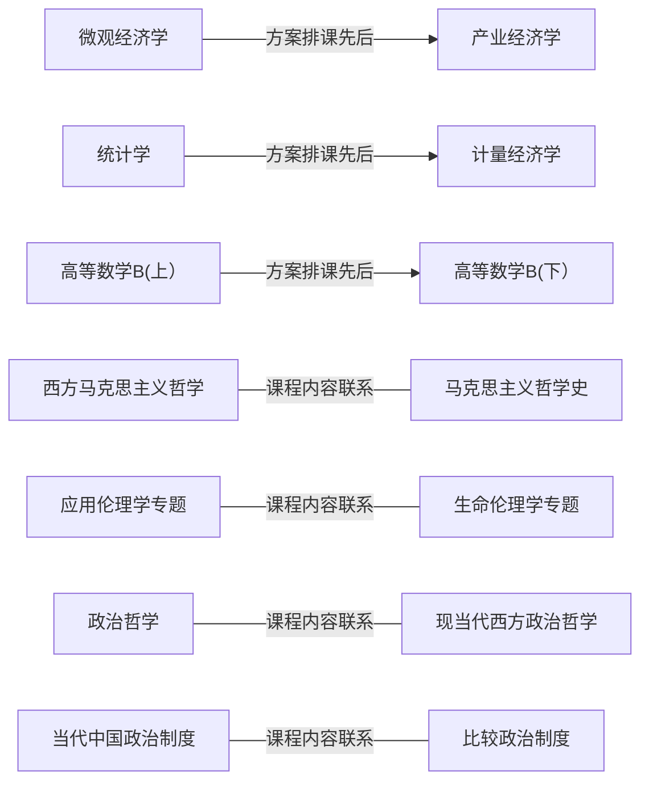

# 2024政治学、经济学与哲学专业培养方案

哲学学院 · 政治学、经济学与哲学 · 方案 72477 · 64 个不同课程或科研条目。

[官方 Word](https://github.com/pythonbug225/fudan-course-atlas/blob/research/schoolwide-cohorts-2023-2025/research/contributions/%E5%85%A8%E6%A0%A1%E5%9F%B9%E5%85%BB%E6%96%B9%E6%A1%882023-2025/%E5%B7%B2%E6%9C%89%E9%99%A2%E7%B3%BB%E8%A7%84%E8%8C%83%E6%95%B0%E6%8D%AE/%E5%93%B2%E5%AD%A6%E5%AD%A6%E9%99%A2/2024/originals/plan-72477.docx) · [教务详情](https://fdjwgl.fudan.edu.cn/manager/bizType/2/major-program-search/info/72477?skipAuth=1) · [方案快照](https://github.com/pythonbug225/fudan-course-atlas/blob/research/schoolwide-cohorts-2023-2025/research/contributions/%E5%85%A8%E6%A0%A1%E5%9F%B9%E5%85%BB%E6%96%B9%E6%A1%882023-2025/%E5%B7%B2%E6%9C%89%E9%99%A2%E7%B3%BB%E8%A7%84%E8%8C%83%E6%95%B0%E6%8D%AE/%E5%93%B2%E5%AD%A6%E5%AD%A6%E9%99%A2/2024/raw/plan-72477.json.gz) · [年级目录](https://github.com/pythonbug225/fudan-course-atlas/blob/research/schoolwide-cohorts-2023-2025/research/contributions/%E5%85%A8%E6%A0%A1%E5%9F%B9%E5%85%BB%E6%96%B9%E6%A1%882023-2025/%E5%B7%B2%E6%9C%89%E9%99%A2%E7%B3%BB%E8%A7%84%E8%8C%83%E6%95%B0%E6%8D%AE/%E5%93%B2%E5%AD%A6%E5%AD%A6%E9%99%A2/2024/README.md)

## 修读导读

- **建议先学**　《微观经济学》（`ECON20003`） → 《产业经济学》（`ECON30025`）。企业和市场结构是产业经济分析的基础。方案分别列在第2、6学期。

- **可以对照着读**　《西方马克思主义哲学》（`PHIL30051`）与《马克思主义哲学史》（`PHIL30099`）。两门课的题名都涉及马克思主义。遇到同一概念时，把它放回各自讨论的文本和历史问题中再比较。

- **查模块选课**　《古希腊哲学》（`PHIL20009`）、《西方近代哲学（含中世纪）》（`PHIL20010`）列在“专业必修课程”中。原表见 `/courseModules/8`。

## 课程关系图

图中展示部分关系。下表保留全部已建立的课程对，来源位置使用本方案 JSON Pointer。

## 先修与内容联系

| 类型 | 起点 | 终点 | 依据 | 原表定位 |
| --- | --- | --- | --- | --- |
| 建议学习顺序 | 微观经济学 (ECON20003) | 产业经济学 (ECON30025) | 企业和市场结构是产业经济分析的基础。  | `/courseModules/8/planCourses/4`、`/courseModules/9/planCourses/17` |
| 建议学习顺序 | 高等数学B(上） (MATH10004) | 高等数学B(下） (MATH10005) | 同方案的课程题名具有连续分册或序号。  | `/courseModules/6/planCourses/0`、`/courseModules/6/planCourses/1` |
| 建议学习顺序 | 统计学 (SOCI20003) | 计量经济学 (ECON30121) | 统计推断为计量模型的估计与检验提供基础。  | `/courseModules/9/planCourses/14`、`/courseModules/13/planCourses/7` |
| 方案排课先后 | 微观经济学 (ECON20003) | 产业经济学 (ECON30025) | 同方案该课程全部明确数字学期均早于后者。  | `/courseModules/8/planCourses/4`、`/courseModules/9/planCourses/17` |
| 方案排课先后 | 高等数学B(上） (MATH10004) | 高等数学B(下） (MATH10005) | 同方案该课程全部明确数字学期均早于后者。  | `/courseModules/6/planCourses/0`、`/courseModules/6/planCourses/1` |
| 方案排课先后 | 统计学 (SOCI20003) | 计量经济学 (ECON30121) | 同方案该课程全部明确数字学期均早于后者。  | `/courseModules/9/planCourses/14`、`/courseModules/13/planCourses/7` |
| 课程内容联系 | 政治哲学 (PHIL30024) | 现当代西方政治哲学 (POLI30024) | 本方案两门课程的题名均含“政治哲学”，可据此对照这一主题。  | `/courseModules/8/planCourses/7`、`/courseModules/9/planCourses/7` |
| 课程内容联系 | 西方马克思主义哲学 (PHIL30051) | 马克思主义哲学史 (PHIL30099) | 本方案两门课程的题名均含“马克思主义”，可据此对照这一主题。  | `/courseModules/13/planCourses/1`、`/courseModules/8/planCourses/10` |
| 课程内容联系 | 应用伦理学专题 (PHIL50018) | 生命伦理学专题 (PHIL50044) | 本方案两门课程的题名均含“伦理学”，可据此对照这一主题。  | `/courseModules/13/planCourses/2`、`/courseModules/9/planCourses/4` |
| 课程内容联系 | 当代中国政治制度 (POLI10009) | 比较政治制度 (POLI20022) | 均涉及政治制度，可对照制度安排与研究对象。  | `/courseModules/8/planCourses/5`、`/courseModules/8/planCourses/6` |

本次未从可定位的明确表述中确认课程对课程预修。学期安排、系列分册与编辑建议均保留各自的依据。

## 按原方案模块阅读

同一模块展示原表中的课程归属。模块内课程之间的先后仍须逐项查阅。

- **限定选修课**　财政学、产业经济学、发展经济学、博弈论、制度经济学、现代英美哲学、现代欧陆哲学、科学、技术与社会（STS）、社会哲学与社会理论、从PPE看上海、生命伦理学专题、国家理论研究、中国社会政治分析、政治社会学、西方政治史、现当代西方政治哲学、政府经济学、选举政治学等20项（原表模块 9）
- **进阶课程**　概率论与数理统计、计量经济学、中国政府与经济、西方马克思主义哲学、知识论、应用伦理学专题、发展政治学、比较政党制度、定性研究方法（原表模块 13）
- **进阶课程**　概率论与数理统计、产业经济学、数量经济学、中国宗教的田野研究、发展政治学、比较政党制度、定性研究方法（原表模块 15）
- **理论研究方向**　货币经济学、外国经济思想史、人工智能哲学、社会科学哲学、中国政治思想、当代西方政治学（原表模块 17）
- **实践应用方向**　经济史、投资学、当代中国公共政策（原表模块 18）

## 课程表

同一课程在不同模块分别出现时，按原表逐行列出。季节字段保留原值。

| 课程 | 代码 | 学分 | 学期 | 模块 |
| --- | --- | ---: | --- | --- |
| 高等数学B(上） | MATH10004 | 5.0 | 第1学期 | 培养方案 / 专业培养课程 / 大类基础课程 / 大类基础课程 |
| 高等数学B(下） | MATH10005 | 5.0 | 第2学期 | 培养方案 / 专业培养课程 / 大类基础课程 / 大类基础课程 |
| 线性代数 | MATH10017 | 3.0 | 第2学期 | 培养方案 / 专业培养课程 / 大类基础课程 / 大类基础课程 |
| 古希腊哲学 | PHIL20009 | 3.0 | 第1学期 | 培养方案 / 专业培养课程 / 专业核心教育课程 / 专业必修课程 |
| 政治学原理 | POLI10007 | 3.0 | 第1学期 | 培养方案 / 专业培养课程 / 专业核心教育课程 / 专业必修课程 |
| 政治经济学 | ECON20006 | 3.0 | 第1学期 | 培养方案 / 专业培养课程 / 专业核心教育课程 / 专业必修课程 |
| 西方近代哲学（含中世纪） | PHIL20010 | 3.0 | 第2学期 | 培养方案 / 专业培养课程 / 专业核心教育课程 / 专业必修课程 |
| 微观经济学 | ECON20003 | 3.0 | 第2学期 | 培养方案 / 专业培养课程 / 专业核心教育课程 / 专业必修课程 |
| 当代中国政治制度 | POLI10009 | 3.0 | 第2学期 | 培养方案 / 专业培养课程 / 专业核心教育课程 / 专业必修课程 |
| 比较政治制度 | POLI20022 | 3.0 | 第3学期 | 培养方案 / 专业培养课程 / 专业核心教育课程 / 专业必修课程 |
| 政治哲学 | PHIL30024 | 2.0 | 第5学期 | 培养方案 / 专业培养课程 / 专业核心教育课程 / 专业必修课程 |
| 宏观经济学 | ECON20004 | 3.0 | 第3学期 | 培养方案 / 专业培养课程 / 专业核心教育课程 / 专业必修课程 |
| 国际经济学 | ECON30029 | 3.0 | 第4学期 | 培养方案 / 专业培养课程 / 专业核心教育课程 / 专业必修课程 |
| 马克思主义哲学史 | PHIL30099 | 3.0 | 第4学期 | 培养方案 / 专业培养课程 / 专业核心教育课程 / 专业必修课程 |
| 国际关系导论 | POLI10008 | 3.0 | 第4学期 | 培养方案 / 专业培养课程 / 专业核心教育课程 / 专业必修课程 |
| 德国古典哲学 | PHIL20011 | 3.0 | 第5学期 | 培养方案 / 专业培养课程 / 专业核心教育课程 / 专业必修课程 |
| 当代中国经济 | ECON30024 | 3.0 | 第7学期 | 培养方案 / 专业培养课程 / 专业核心教育课程 / 专业必修课程 |
| 公司金融 | ECON30122 | 3.0 | 第7学期 | 培养方案 / 专业培养课程 / 专业核心教育课程 / 专业必修课程 |
| 社会实践 | PHIL30003 | 2.0 | 第7学期 | 培养方案 / 专业培养课程 / 专业核心教育课程 / 专业必修课程 |
| 毕业论文 | PHIL40008 | 4.0 | 第8学期 | 培养方案 / 专业培养课程 / 专业核心教育课程 / 专业必修课程 |
| 政治思想专题：经典与当代 | PHIL40024 | 4.0 | 第3学期 | 培养方案 / 专业培养课程 / 专业核心教育课程 / 专业必修课程 |
| 帝国秩序与帝国主义 | PHIL40023 | 4.0 | 第4学期 | 培养方案 / 专业培养课程 / 专业核心教育课程 / 专业必修课程 |
| 繁荣与贫困：历史视野下的经济发展 | PHIL40026 | 4.0 | 第5学期 | 培养方案 / 专业培养课程 / 专业核心教育课程 / 专业必修课程 |
| 《资本论》与现代世界 | PHIL40025 | 4.0 | 第6学期 | 培养方案 / 专业培养课程 / 专业核心教育课程 / 专业必修课程 |
| 社会哲学与社会理论 | PHIL30110 | 2.0 | 第6学期 | 培养方案 / 专业培养课程 / 专业核心教育课程 / 限定选修课 |
| 科学、技术与社会（STS） | PHIL30089 | 2.0 | 第3学期 | 培养方案 / 专业培养课程 / 专业核心教育课程 / 限定选修课 |
| 现代欧陆哲学 | PHIL30050 | 2.0 | 第7学期 | 培养方案 / 专业培养课程 / 专业核心教育课程 / 限定选修课 |
| 现代英美哲学 | PHIL30049 | 2.0 | 第6学期 | 培养方案 / 专业培养课程 / 专业核心教育课程 / 限定选修课 |
| 生命伦理学专题 | PHIL50044 | 2.0 | 第4学期 | 培养方案 / 专业培养课程 / 专业核心教育课程 / 限定选修课 |
| 从PPE看上海 | PHIL40027 | 3.0 | 第5学期 | 培养方案 / 专业培养课程 / 专业核心教育课程 / 限定选修课 |
| 西方政治史 | POLI30023 | 2.0 | 第3学期 | 培养方案 / 专业培养课程 / 专业核心教育课程 / 限定选修课 |
| 现当代西方政治哲学 | POLI30024 | 3.0 | 第6学期 | 培养方案 / 专业培养课程 / 专业核心教育课程 / 限定选修课 |
| 政府经济学 | POLI30025 | 3.0 | 第4学期 | 培养方案 / 专业培养课程 / 专业核心教育课程 / 限定选修课 |
| 政治社会学 | POLI20030 | 2.0 | 第5学期 | 培养方案 / 专业培养课程 / 专业核心教育课程 / 限定选修课 |
| 国家理论研究 | POLI130100 | 2.0 | 第6学期 | 培养方案 / 专业培养课程 / 专业核心教育课程 / 限定选修课 |
| 选举政治学 | POLI30038 | 2.0 | 第5学期 | 培养方案 / 专业培养课程 / 专业核心教育课程 / 限定选修课 |
| 中国社会政治分析 | POLI20025 | 3.0 | 第7学期 | 培养方案 / 专业培养课程 / 专业核心教育课程 / 限定选修课 |
| 国家发展动力 | POLI40032 | 3.0 | SPRING | 培养方案 / 专业培养课程 / 专业核心教育课程 / 限定选修课 |
| 统计学 | SOCI20003 | 3.0 | 第1学期 | 培养方案 / 专业培养课程 / 专业核心教育课程 / 限定选修课 |
| 制度经济学 | ECON30074 | 3.0 | 第6学期 | 培养方案 / 专业培养课程 / 专业核心教育课程 / 限定选修课 |
| 财政学 | ECON30019 | 3.0 | 第4学期 | 培养方案 / 专业培养课程 / 专业核心教育课程 / 限定选修课 |
| 产业经济学 | ECON30025 | 3.0 | 第6学期 | 培养方案 / 专业培养课程 / 专业核心教育课程 / 限定选修课 |
| 博弈论 | ECON30054 | 3.0 | 第4学期 | 培养方案 / 专业培养课程 / 专业核心教育课程 / 限定选修课 |
| 发展经济学 | ECON30026 | 3.0 | 第7学期 | 培养方案 / 专业培养课程 / 专业核心教育课程 / 限定选修课 |
| 知识论 | PHIL30054 | 2.0 | 第4学期 | 培养方案 / 专业进阶模块(理论研究方向） / 进阶课程 |
| 西方马克思主义哲学 | PHIL30051 | 3.0 | 第5学期 | 培养方案 / 专业进阶模块(理论研究方向） / 进阶课程 |
| 应用伦理学专题 | PHIL50018 | 2.0 | 第6学期 | 培养方案 / 专业进阶模块(理论研究方向） / 进阶课程 |
| 中国政府与经济 | ECON30159 | 3.0 | 第7学期 | 培养方案 / 专业进阶模块(理论研究方向） / 进阶课程 |
| 发展政治学 | POLI20024 | 2.0 | 第6学期 | 培养方案 / 专业进阶模块(理论研究方向） / 进阶课程 |
| 定性研究方法 | POLI30053 | 2.0 | 第6学期 | 培养方案 / 专业进阶模块(理论研究方向） / 进阶课程 |
| 比较政党制度 | POLI30034 | 2.0 | 第8学期 | 培养方案 / 专业进阶模块(理论研究方向） / 进阶课程 |
| 计量经济学 | ECON30121 | 4.0 | 第8学期 | 培养方案 / 专业进阶模块(理论研究方向） / 进阶课程 |
| 概率论与数理统计 | ECON30016 | 3.0 | 第5学期 | 培养方案 / 专业进阶模块(理论研究方向） / 进阶课程 |
| 发展政治学 | POLI20024 | 2.0 | 第6学期 | 培养方案 / 专业进阶模块(实践应用方向) / 进阶课程 |
| 定性研究方法 | POLI30053 | 2.0 | 第6学期 | 培养方案 / 专业进阶模块(实践应用方向) / 进阶课程 |
| 比较政党制度 | POLI30034 | 2.0 | 第8学期 | 培养方案 / 专业进阶模块(实践应用方向) / 进阶课程 |
| 概率论与数理统计 | ECON30016 | 3.0 | 第5学期 | 培养方案 / 专业进阶模块(实践应用方向) / 进阶课程 |
| 数量经济学 | ECON30107 | 3.0 | 第8学期 | 培养方案 / 专业进阶模块(实践应用方向) / 进阶课程 |
| 产业经济学 | ECON30025 | 3.0 | 第6学期 | 培养方案 / 专业进阶模块(实践应用方向) / 进阶课程 |
| 中国宗教的田野研究 | PHIL30102 | 3.0 | 第8学期 | 培养方案 / 专业进阶模块(实践应用方向) / 进阶课程 |
| 人工智能哲学 | PHIL30047 | 2.0 | 第8学期 | 培养方案 / 任意选修 / 理论研究方向 |
| 社会科学哲学 | PHIL30072 | 2.0 | 第7学期 | 培养方案 / 任意选修 / 理论研究方向 |
| 中国政治思想 | POLI20020 | 3.0 | 第7学期 | 培养方案 / 任意选修 / 理论研究方向 |
| 外国经济思想史 | ECON30075 | 3.0 | 第7学期 | 培养方案 / 任意选修 / 理论研究方向 |
| 货币经济学 | ECON30032 | 3.0 | 第7学期 | 培养方案 / 任意选修 / 理论研究方向 |
| 当代西方政治学 | POLI30002 | 3.0 | 第8学期 | 培养方案 / 任意选修 / 理论研究方向 |
| 投资学 | ECON30126 | 3.0 | 第6学期 | 培养方案 / 任意选修 / 实践应用方向 |
| 经济史 | ECON30120 | 3.0 | 第7学期 | 培养方案 / 任意选修 / 实践应用方向 |
| 当代中国公共政策 | MANA20011 | 2.0 | 第8学期 | 培养方案 / 任意选修 / 实践应用方向 |
