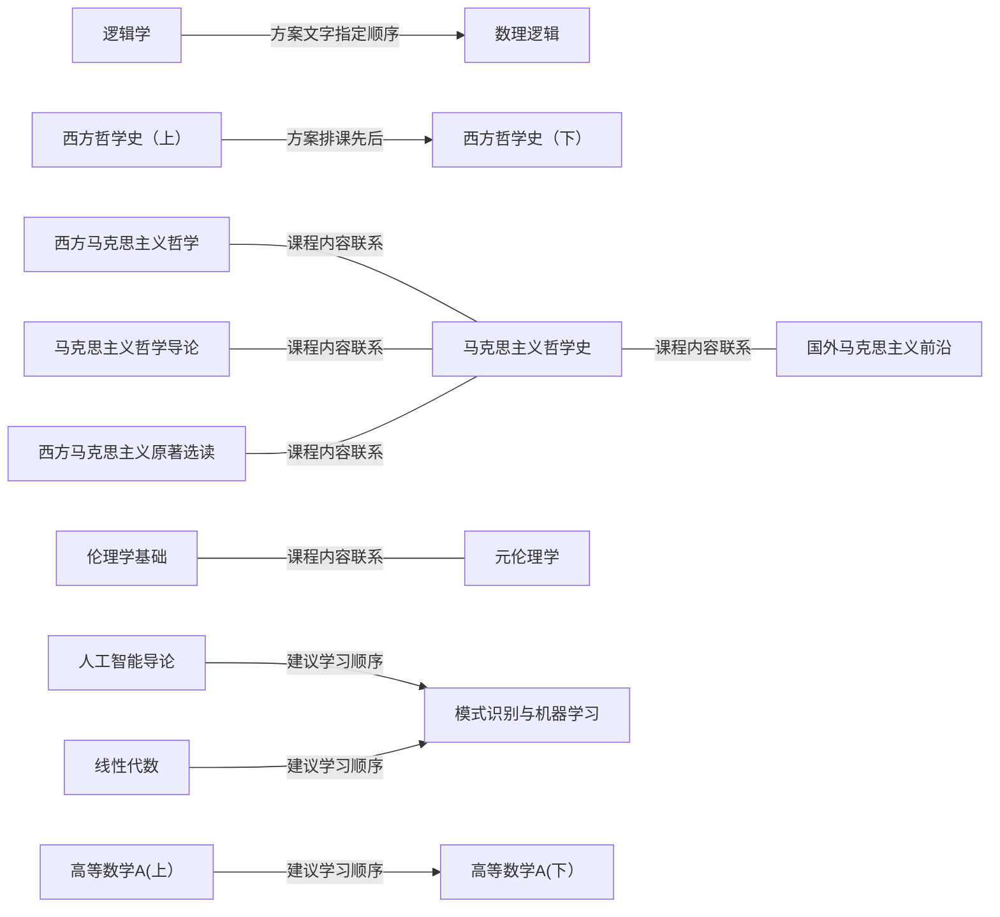

# 2025哲学-人工智能双学士学位项目培养方案

哲学学院 · 哲学-人工智能(双学士学位项目) · 方案 96906 · 111 个不同课程或科研条目。

[官方 Word](https://github.com/pythonbug225/fudan-course-atlas/blob/research/schoolwide-cohorts-2023-2025/research/contributions/%E5%85%A8%E6%A0%A1%E5%9F%B9%E5%85%BB%E6%96%B9%E6%A1%882023-2025/%E5%B7%B2%E6%9C%89%E9%99%A2%E7%B3%BB%E8%A7%84%E8%8C%83%E6%95%B0%E6%8D%AE/%E5%93%B2%E5%AD%A6%E5%AD%A6%E9%99%A2/2025/originals/plan-96906.docx) · [教务详情](https://fdjwgl.fudan.edu.cn/manager/bizType/2/major-program-search/info/96906?skipAuth=1) · [方案快照](https://github.com/pythonbug225/fudan-course-atlas/blob/research/schoolwide-cohorts-2023-2025/research/contributions/%E5%85%A8%E6%A0%A1%E5%9F%B9%E5%85%BB%E6%96%B9%E6%A1%882023-2025/%E5%B7%B2%E6%9C%89%E9%99%A2%E7%B3%BB%E8%A7%84%E8%8C%83%E6%95%B0%E6%8D%AE/%E5%93%B2%E5%AD%A6%E5%AD%A6%E9%99%A2/2025/raw/plan-96906.json.gz) · [年级目录](https://github.com/pythonbug225/fudan-course-atlas/blob/research/schoolwide-cohorts-2023-2025/research/contributions/%E5%85%A8%E6%A0%A1%E5%9F%B9%E5%85%BB%E6%96%B9%E6%A1%882023-2025/%E5%B7%B2%E6%9C%89%E9%99%A2%E7%B3%BB%E8%A7%84%E8%8C%83%E6%95%B0%E6%8D%AE/%E5%93%B2%E5%AD%A6%E5%AD%A6%E9%99%A2/2025/README.md)

## 修读导读

- **方案规定的两条路线**　常规路线在大一上学期修《逻辑学》（`PHIL10003`）（3学分），下学期修《数理逻辑》（`PHIL20013`）（2学分）。数学基础较好的同学也可在大一上学期选《数理逻辑（H）》（4学分荣誉课），选修该课可免修上述两门普通课。两条路线任选其一。原表见 `/courseModules/6/commentText`。

- **建议先学**　《西方哲学史（上）》（`PHIL10001`） → 《西方哲学史（下）》（`PHIL20002`）。题名列出连续册次或级别。按分册顺序建立时间线，读到后来的观点或事件时可回看它回应了什么问题。方案分别列在第2、3学期。

- **可以对照着读**　《哲学导论》（`PHIL10002`）与《逻辑学》（`PHIL10003`）。论证与概念分析是哲学讨论的共同方法。

- **查模块选课**　《先秦哲学》（`PHIL20014`）、《汉晋隋唐哲学》（`PHIL20015`）列在“必修课程”中。模块说明写明“哲学部分必修课程(44学分) 可根据实际情况弹性选择修读学期”。原表见 `/courseModules/9`。

## 课程关系图

图中展示部分关系。下表保留全部已建立的课程对，来源位置使用本方案 JSON Pointer。

## 先修与内容联系

| 类型 | 起点 | 终点 | 依据 | 原表定位 |
| --- | --- | --- | --- | --- |
| 方案文字指定顺序 | 逻辑学 (PHIL10003) | 数理逻辑 (PHIL20013) | 原表指定普通路线为大一上学期、下学期依次修读，并另列可选路线。 逻辑学和数理逻辑课程修读说明：（1）一般修读顺序：“逻辑学”（3学分）大一上学期必修，“数理逻辑”（2学分）大一下学期必修；（2）可选修读顺序： 鼓励数学基础较好的同学在大一上学期修读“数理逻辑（H）”（4学分荣誉课）。学生可自由选择以上两种修读方式之一，选修“数理逻辑（H）”（4学分荣誉课）可免修“逻辑学”（3学分）和“数理逻辑”（2学分普通课）。 | `/courseModules/6/planCourses/1`、`/courseModules/9/planCourses/0`、`/courseModules/6/commentText` |
| 建议学习顺序 | 人工智能导论 (AIE310005) | 模式识别与机器学习 (AIE410001) | 人工智能问题与模型类别可为学习模式识别作准备。  | `/courseModules/11/planCourses/1`、`/courseModules/11/planCourses/7` |
| 建议学习顺序 | 线性代数 (CS10003) | 模式识别与机器学习 (AIE410001) | 向量表示和矩阵运算支持理解分类、回归等模型。  | `/courseModules/7/planCourses/2`、`/courseModules/11/planCourses/7` |
| 建议学习顺序 | 高等数学A(上） (MATH10015) | 高等数学A(下） (MATH10016) | 同方案的课程题名具有连续分册或序号。  | `/courseModules/7/planCourses/0`、`/courseModules/7/planCourses/1` |
| 建议学习顺序 | 西方哲学史（上） (PHIL10001) | 西方哲学史（下） (PHIL20002) | 同方案的课程题名具有连续分册或序号。  | `/courseModules/9/planCourses/13`、`/courseModules/9/planCourses/14` |
| 方案排课先后 | 西方哲学史（上） (PHIL10001) | 西方哲学史（下） (PHIL20002) | 同方案该课程全部明确数字学期均早于后者。  | `/courseModules/9/planCourses/13`、`/courseModules/9/planCourses/14` |
| 课程内容联系 | 人工智能伦理 (AIB310001) | 人工智能导论 (AIE310005) | 本方案两门课程的题名均含“人工智能”，可据此对照这一主题。  | `/courseModules/11/planCourses/11`、`/courseModules/11/planCourses/1` |
| 课程内容联系 | 人工智能伦理 (AIB310001) | 人工智能的数学基础 (AIE310009) | 本方案两门课程的题名均含“人工智能”，可据此对照这一主题。  | `/courseModules/11/planCourses/11`、`/courseModules/11/planCourses/5` |
| 课程内容联系 | 人工智能伦理 (AIB310001) | 人工智能安全 (AIE831001) | 本方案两门课程的题名均含“人工智能”，可据此对照这一主题。  | `/courseModules/11/planCourses/11`、`/courseModules/11/planCourses/9` |
| 课程内容联系 | 人工智能伦理 (AIB310001) | 人工智能哲学 (PHIL30047) | 本方案两门课程的题名均含“人工智能”，可据此对照这一主题。  | `/courseModules/11/planCourses/11`、`/courseModules/17/planCourses/15` |
| 课程内容联系 | 计算机系统基础 (AIE210006) | 计算机组成与体系结构 (CS30052) | 处理器、存储与系统执行模型具有共同内容。  | `/courseModules/11/planCourses/0`、`/courseModules/17/planCourses/8` |
| 课程内容联系 | 人工智能的数学基础 (AIE310009) | 模式识别与机器学习 (AIE410001) | 数学表达与学习模型的统计、优化工具可对照。  | `/courseModules/11/planCourses/5`、`/courseModules/11/planCourses/7` |
| 课程内容联系 | 模式识别与机器学习 (AIE410001) | 机器学习系统 (CS30058) | 本方案两门课程的题名均含“机器学习”，可据此对照这一主题。  | `/courseModules/11/planCourses/7`、`/courseModules/17/planCourses/12` |
| 课程内容联系 | 哲学导论 (PHIL10002) | 逻辑学 (PHIL10003) | 论证与概念分析是哲学讨论的共同方法。  | `/courseModules/6/planCourses/0`、`/courseModules/6/planCourses/1` |
| 课程内容联系 | 马克思主义哲学导论 (PHIL20003) | 马克思主义哲学史 (PHIL30099) | 本方案两门课程的题名均含“马克思主义”，可据此对照这一主题。  | `/courseModules/9/planCourses/4`、`/courseModules/9/planCourses/9` |
| 课程内容联系 | 科学哲学 (PHIL20004) | 社会科学哲学 (PHIL30072) | 本方案两门课程的题名均含“科学哲学”，可据此对照这一主题。  | `/courseModules/10/planCourses/0`、`/courseModules/22/planCourses/3` |
| 课程内容联系 | 伦理学基础 (PHIL20012) | 元伦理学 (PHIL50048) | 本方案两门课程的题名均含“伦理学”，可据此对照这一主题。  | `/courseModules/9/planCourses/2`、`/courseModules/23/planCourses/14` |
| 课程内容联系 | 政治哲学 (PHIL30024) | 现代政治哲学研究 (PHIL50014) | 本方案两门课程的题名均含“政治哲学”，可据此对照这一主题。  | `/courseModules/22/planCourses/0`、`/courseModules/23/planCourses/4` |
| 课程内容联系 | 环境伦理学 (PHIL30045) | 元伦理学 (PHIL50048) | 本方案两门课程的题名均含“伦理学”，可据此对照这一主题。  | `/courseModules/23/planCourses/0`、`/courseModules/23/planCourses/14` |
| 课程内容联系 | 西方马克思主义哲学 (PHIL30051) | 马克思主义哲学史 (PHIL30099) | 本方案两门课程的题名均含“马克思主义”，可据此对照这一主题。  | `/courseModules/9/planCourses/11`、`/courseModules/9/planCourses/9` |
| 课程内容联系 | 西方马克思主义原著选读 (PHIL30057) | 马克思主义哲学史 (PHIL30099) | 本方案两门课程的题名均含“马克思主义”，可据此对照这一主题。  | `/courseModules/19/planCourses/4`、`/courseModules/9/planCourses/9` |
| 课程内容联系 | 马克思主义哲学史 (PHIL30099) | 国外马克思主义前沿 (PHIL50036) | 本方案两门课程的题名均含“马克思主义”，可据此对照这一主题。  | `/courseModules/9/planCourses/9`、`/courseModules/23/planCourses/9` |
| 课程内容联系 | 神经伦理学 (PHIL30115) | 元伦理学 (PHIL50048) | 本方案两门课程的题名均含“伦理学”，可据此对照这一主题。  | `/courseModules/22/planCourses/8`、`/courseModules/23/planCourses/14` |
| 课程内容联系 | 规范伦理学 (PHIL40028) | 元伦理学 (PHIL50048) | 本方案两门课程的题名均含“伦理学”，可据此对照这一主题。  | `/courseModules/23/planCourses/13`、`/courseModules/23/planCourses/14` |

本次未从可定位的明确表述中确认课程对课程预修。学期安排、系列分册与编辑建议均保留各自的依据。

## 按原方案模块阅读

同一模块展示原表中的课程归属。模块内课程之间的先后仍须逐项查阅。

- **人文类基础课程**　哲学导论、逻辑学、宗教学导论（原表模块 6）
- **限定选修课**　科学哲学、语言哲学、形而上学、知识论（原表模块 10）
- **哲学-人工智能交叉融合进阶课程(必修)**　智能哲学概论、概率论与数理统计（原表模块 16）
- **哲学-人工智能交叉融合进阶课程(选修)**　数据库引论、软件工程、计算机图形学A、计算机网络、集合与图论、计算机组成与体系结构、机器学习系统、人工智能哲学、模态逻辑、科学、技术与社会（STS）、模型论导论、可计算性理论、人工智能与当代哲学新走向、人工智能的逻辑基础、思考与认知、可计算性理论进阶（原表模块 17）

## 课程表

同一课程在不同模块分别出现时，按原表逐行列出。季节字段保留原值。

| 课程 | 代码 | 学分 | 学期 | 模块 |
| --- | --- | ---: | --- | --- |
| 哲学导论 | PHIL10002 | 3.0 | 第1学期 | 培养方案 / 专业培养课程 / 学科基础课程 / 人文类基础课程 |
| 逻辑学 | PHIL10003 | 3.0 | 第1学期 | 培养方案 / 专业培养课程 / 学科基础课程 / 人文类基础课程 |
| 宗教学导论 | PHIL10004 | 2.0 | 第2学期 | 培养方案 / 专业培养课程 / 学科基础课程 / 人文类基础课程 |
| 高等数学A(上） | MATH10015 | 5.0 | SPRING、AUTUMN | 培养方案 / 专业培养课程 / 学科基础课程 / B组 |
| 高等数学A(下） | MATH10016 | 5.0 | SPRING、AUTUMN | 培养方案 / 专业培养课程 / 学科基础课程 / B组 |
| 线性代数 | CS10003 | 3.0 | SPRING、AUTUMN | 培养方案 / 专业培养课程 / 学科基础课程 / B组 |
| 程序设计 | CS10004 | 4.0 | SPRING、AUTUMN | 培养方案 / 专业培养课程 / 学科基础课程 / B组 |
| 数理逻辑 | PHIL20013 | 2.0 | 第2学期 | 培养方案 / 专业培养课程 / 专业核心教育课程 / 必修课程 |
| 先秦哲学 | PHIL20014 | 2.0 | 第1学期 | 培养方案 / 专业培养课程 / 专业核心教育课程 / 必修课程 |
| 伦理学基础 | PHIL20012 | 2.0 | 第2学期 | 培养方案 / 专业培养课程 / 专业核心教育课程 / 必修课程 |
| 汉晋隋唐哲学 | PHIL20015 | 2.0 | 第2学期 | 培养方案 / 专业培养课程 / 专业核心教育课程 / 必修课程 |
| 马克思主义哲学导论 | PHIL20003 | 2.0 | 第3学期 | 培养方案 / 专业培养课程 / 专业核心教育课程 / 必修课程 |
| 宋元明清哲学 | PHIL20016 | 2.0 | 第3学期 | 培养方案 / 专业培养课程 / 专业核心教育课程 / 必修课程 |
| 中国近现代哲学 | PHIL20017 | 2.0 | 第4学期 | 培养方案 / 专业培养课程 / 专业核心教育课程 / 必修课程 |
| 哲学阅读和写作 | PHIL20018 | 2.0 | 第4学期 | 培养方案 / 专业培养课程 / 专业核心教育课程 / 必修课程 |
| 现代英美哲学 | PHIL30049 | 2.0 | 第4学期 | 培养方案 / 专业培养课程 / 专业核心教育课程 / 必修课程 |
| 马克思主义哲学史 | PHIL30099 | 3.0 | 第4学期 | 培养方案 / 专业培养课程 / 专业核心教育课程 / 必修课程 |
| 现代欧陆哲学 | PHIL30050 | 2.0 | 第5学期 | 培养方案 / 专业培养课程 / 专业核心教育课程 / 必修课程 |
| 西方马克思主义哲学 | PHIL30051 | 3.0 | 第5学期 | 培养方案 / 专业培养课程 / 专业核心教育课程 / 必修课程 |
| 美学与艺术哲学基础 | PHIL30052 | 2.0 | 第6学期 | 培养方案 / 专业培养课程 / 专业核心教育课程 / 必修课程 |
| 西方哲学史（上） | PHIL10001 | 3.0 | 第2学期 | 培养方案 / 专业培养课程 / 专业核心教育课程 / 必修课程 |
| 西方哲学史（下） | PHIL20002 | 4.0 | 第3学期 | 培养方案 / 专业培养课程 / 专业核心教育课程 / 必修课程 |
| 科学哲学 | PHIL20004 | 2.0 | SPRING、AUTUMN | 培养方案 / 专业培养课程 / 专业核心教育课程 / 限定选修课 |
| 语言哲学 | PHIL30025 | 2.0 | SPRING、AUTUMN | 培养方案 / 专业培养课程 / 专业核心教育课程 / 限定选修课 |
| 形而上学 | PHIL30053 | 2.0 | SPRING、AUTUMN | 培养方案 / 专业培养课程 / 专业核心教育课程 / 限定选修课 |
| 知识论 | PHIL30054 | 2.0 | SPRING、AUTUMN | 培养方案 / 专业培养课程 / 专业核心教育课程 / 限定选修课 |
| 计算机系统基础 | AIE210006 | 3.0 | SPRING、AUTUMN | 培养方案 / 专业培养课程 / 专业核心教育课程 / 专业必修课程 |
| 人工智能导论 | AIE310005 | 3.0 | SPRING、AUTUMN | 培养方案 / 专业培养课程 / 专业核心教育课程 / 专业必修课程 |
| 人工智能的编程基础 | AIE310006 | 2.0 | SPRING、AUTUMN | 培养方案 / 专业培养课程 / 专业核心教育课程 / 专业必修课程 |
| 数据结构 | AIE310007 | 4.0 | SPRING、AUTUMN | 培养方案 / 专业培养课程 / 专业核心教育课程 / 专业必修课程 |
| 人工智能的软件基础 | AIE310008 | 3.0 | SPRING、AUTUMN | 培养方案 / 专业培养课程 / 专业核心教育课程 / 专业必修课程 |
| 人工智能的数学基础 | AIE310009 | 3.0 | SPRING、AUTUMN | 培养方案 / 专业培养课程 / 专业核心教育课程 / 专业必修课程 |
| 计算机视觉 | AIE310004 | 3.0 | SPRING、AUTUMN | 培养方案 / 专业培养课程 / 专业核心教育课程 / 专业必修课程 |
| 模式识别与机器学习 | AIE410001 | 3.0 | SPRING、AUTUMN | 培养方案 / 专业培养课程 / 专业核心教育课程 / 专业必修课程 |
| 自然语言处理与大语言模型 | AIE410002 | 3.0 | SPRING、AUTUMN | 培养方案 / 专业培养课程 / 专业核心教育课程 / 专业必修课程 |
| 人工智能安全 | AIE831001 | 3.0 | SPRING、AUTUMN | 培养方案 / 专业培养课程 / 专业核心教育课程 / 专业必修课程 |
| 人工智能前沿探索实践 | AIE531001 | 3.0 | 第7学期 | 培养方案 / 专业培养课程 / 专业核心教育课程 / 专业必修课程 |
| 人工智能伦理 | AIB310001 | 2.0 | 第4学期 | 培养方案 / 专业培养课程 / 专业核心教育课程 / 专业必修课程 |
| 智能哲学概论 | AIS531003 | 3.0 | SPRING、AUTUMN | 培养方案 / 专业进阶 / 哲学-人工智能交叉融合进阶课程 / 哲学-人工智能交叉融合进阶课程(必修) |
| 概率论与数理统计 | ECON30016 | 3.0 | 第3学期 | 培养方案 / 专业进阶 / 哲学-人工智能交叉融合进阶课程 / 哲学-人工智能交叉融合进阶课程(必修) |
| 模态逻辑 | PHIL30085 | 2.0 | SPRING、AUTUMN | 培养方案 / 专业进阶 / 哲学-人工智能交叉融合进阶课程 / 哲学-人工智能交叉融合进阶课程(选修) |
| 科学、技术与社会（STS） | PHIL30089 | 2.0 | SPRING、AUTUMN | 培养方案 / 专业进阶 / 哲学-人工智能交叉融合进阶课程 / 哲学-人工智能交叉融合进阶课程(选修) |
| 模型论导论 | PHIL30101 | 2.0 | SPRING、AUTUMN | 培养方案 / 专业进阶 / 哲学-人工智能交叉融合进阶课程 / 哲学-人工智能交叉融合进阶课程(选修) |
| 可计算性理论 | PHIL30107 | 3.0 | SPRING、AUTUMN | 培养方案 / 专业进阶 / 哲学-人工智能交叉融合进阶课程 / 哲学-人工智能交叉融合进阶课程(选修) |
| 思考与认知 | PHIL50035 | 2.0 | SPRING、AUTUMN | 培养方案 / 专业进阶 / 哲学-人工智能交叉融合进阶课程 / 哲学-人工智能交叉融合进阶课程(选修) |
| 可计算性理论进阶 | PHIL50039 | 3.0 | SPRING、AUTUMN | 培养方案 / 专业进阶 / 哲学-人工智能交叉融合进阶课程 / 哲学-人工智能交叉融合进阶课程(选修) |
| 计算机图形学A | CS30019 | 3.0 | SPRING、AUTUMN | 培养方案 / 专业进阶 / 哲学-人工智能交叉融合进阶课程 / 哲学-人工智能交叉融合进阶课程(选修) |
| 集合与图论 | CS30043 | 3.0 | SPRING、AUTUMN | 培养方案 / 专业进阶 / 哲学-人工智能交叉融合进阶课程 / 哲学-人工智能交叉融合进阶课程(选修) |
| 计算机组成与体系结构 | CS30052 | 4.0 | SPRING、AUTUMN | 培养方案 / 专业进阶 / 哲学-人工智能交叉融合进阶课程 / 哲学-人工智能交叉融合进阶课程(选修) |
| 数据库引论 | CS20010 | 3.0 | SPRING、AUTUMN | 培养方案 / 专业进阶 / 哲学-人工智能交叉融合进阶课程 / 哲学-人工智能交叉融合进阶课程(选修) |
| 计算机网络 | CS30036 | 3.0 | SPRING、AUTUMN | 培养方案 / 专业进阶 / 哲学-人工智能交叉融合进阶课程 / 哲学-人工智能交叉融合进阶课程(选修) |
| 软件工程 | CS30018 | 3.0 | SPRING、AUTUMN | 培养方案 / 专业进阶 / 哲学-人工智能交叉融合进阶课程 / 哲学-人工智能交叉融合进阶课程(选修) |
| 机器学习系统 | CS30058 | 3.0 | SPRING、AUTUMN | 培养方案 / 专业进阶 / 哲学-人工智能交叉融合进阶课程 / 哲学-人工智能交叉融合进阶课程(选修) |
| 人工智能的逻辑基础 | PHIL30158 | 2.0 | SPRING、AUTUMN | 培养方案 / 专业进阶 / 哲学-人工智能交叉融合进阶课程 / 哲学-人工智能交叉融合进阶课程(选修) |
| 人工智能与当代哲学新走向 | PHIL30157 | 2.0 | SPRING、AUTUMN | 培养方案 / 专业进阶 / 哲学-人工智能交叉融合进阶课程 / 哲学-人工智能交叉融合进阶课程(选修) |
| 人工智能哲学 | PHIL30047 | 2.0 | SPRING、AUTUMN | 培养方案 / 专业进阶 / 哲学-人工智能交叉融合进阶课程 / 哲学-人工智能交叉融合进阶课程(选修) |
| 历史哲学 | PHIL30007 | 2.0 | SPRING、AUTUMN | 培养方案 / 专业进阶 / 哲学专业进阶 / A组 |
| 西方马克思学 | PHIL30010 | 2.0 | SPRING、AUTUMN | 培养方案 / 专业进阶 / 哲学专业进阶 / A组 |
| 价值哲学 | PHIL30014 | 2.0 | SPRING、AUTUMN | 培养方案 / 专业进阶 / 哲学专业进阶 / A组 |
| 认识论 | PHIL30055 | 2.0 | SPRING、AUTUMN | 培养方案 / 专业进阶 / 哲学专业进阶 / A组 |
| 西方马克思主义原著选读 | PHIL30057 | 2.0 | SPRING、AUTUMN | 培养方案 / 专业进阶 / 哲学专业进阶 / A组 |
| 社会批判理论 | PHIL30058 | 2.0 | SPRING、AUTUMN | 培养方案 / 专业进阶 / 哲学专业进阶 / A组 |
| 社会理论 | PHIL130207 | 2.0 | SPRING、AUTUMN | 培养方案 / 专业进阶 / 哲学专业进阶 / A组 |
| 激进哲学 | PHIL30076 | 2.0 | SPRING、AUTUMN | 培养方案 / 专业进阶 / 哲学专业进阶 / A组 |
| 社会哲学与社会理论 | PHIL30110 | 2.0 | SPRING、AUTUMN | 培养方案 / 专业进阶 / 哲学专业进阶 / A组 |
| 康德哲学 | PHIL30008 | 2.0 | SPRING、AUTUMN | 培养方案 / 专业进阶 / 哲学专业进阶 / B组 |
| 柏拉图哲学 | PHIL30059 | 2.0 | SPRING、AUTUMN | 培养方案 / 专业进阶 / 哲学专业进阶 / B组 |
| 亚里士多德哲学 | PHIL30060 | 2.0 | SPRING、AUTUMN | 培养方案 / 专业进阶 / 哲学专业进阶 / B组 |
| 笛卡尔哲学 | PHIL30061 | 2.0 | SPRING、AUTUMN | 培养方案 / 专业进阶 / 哲学专业进阶 / B组 |
| 休谟哲学 | PHIL30062 | 2.0 | SPRING、AUTUMN | 培养方案 / 专业进阶 / 哲学专业进阶 / B组 |
| 卢梭哲学 | PHIL30063 | 2.0 | SPRING、AUTUMN | 培养方案 / 专业进阶 / 哲学专业进阶 / B组 |
| 黑格尔哲学 | PHIL30064 | 2.0 | SPRING、AUTUMN | 培养方案 / 专业进阶 / 哲学专业进阶 / B组 |
| 中世纪哲学原著选读 | PHIL30065 | 2.0 | SPRING、AUTUMN | 培养方案 / 专业进阶 / 哲学专业进阶 / B组 |
| 现代法国哲学 | PHIL30021 | 2.0 | SPRING、AUTUMN | 培养方案 / 专业进阶 / 哲学专业进阶 / C组 |
| 分析哲学原著选读 | PHIL30066 | 2.0 | SPRING、AUTUMN | 培养方案 / 专业进阶 / 哲学专业进阶 / C组 |
| 现代欧陆哲学原著选读 | PHIL30067 | 2.0 | SPRING、AUTUMN | 培养方案 / 专业进阶 / 哲学专业进阶 / C组 |
| 现代德国哲学 | PHIL30068 | 2.0 | SPRING、AUTUMN | 培养方案 / 专业进阶 / 哲学专业进阶 / C组 |
| 维特根斯坦哲学 | PHIL30069 | 2.0 | SPRING、AUTUMN | 培养方案 / 专业进阶 / 哲学专业进阶 / C组 |
| 海德格尔哲学 | PHIL30070 | 2.0 | SPRING、AUTUMN | 培养方案 / 专业进阶 / 哲学专业进阶 / C组 |
| 古典实用主义哲学 | PHIL30071 | 2.0 | SPRING、AUTUMN | 培养方案 / 专业进阶 / 哲学专业进阶 / C组 |
| 哲学方法论导论 | PHIL30100 | 2.0 | SPRING、AUTUMN | 培养方案 / 专业进阶 / 哲学专业进阶 / C组 |
| 形式知识论 | PHIL50051 | 2.0 | SPRING、AUTUMN | 培养方案 / 专业进阶 / 哲学专业进阶 / C组 |
| 政治哲学 | PHIL30024 | 2.0 | SPRING、AUTUMN | 培养方案 / 专业进阶 / 哲学专业进阶 / D组 |
| 教育哲学 | PHIL30026 | 2.0 | SPRING、AUTUMN | 培养方案 / 专业进阶 / 哲学专业进阶 / D组 |
| 西方伦理学史 | PHIL30046 | 2.0 | SPRING、AUTUMN | 培养方案 / 专业进阶 / 哲学专业进阶 / D组 |
| 社会科学哲学 | PHIL30072 | 2.0 | SPRING、AUTUMN | 培养方案 / 专业进阶 / 哲学专业进阶 / D组 |
| 艺术哲学原著选读 | PHIL30073 | 2.0 | SPRING、AUTUMN | 培养方案 / 专业进阶 / 哲学专业进阶 / D组 |
| 美学原著选读 | PHIL30074 | 2.0 | SPRING、AUTUMN | 培养方案 / 专业进阶 / 哲学专业进阶 / D组 |
| 伦理学原著选读 | PHIL30075 | 2.0 | SPRING、AUTUMN | 培养方案 / 专业进阶 / 哲学专业进阶 / D组 |
| 应用伦理学专题 | PHIL50018 | 2.0 | SPRING、AUTUMN | 培养方案 / 专业进阶 / 哲学专业进阶 / D组 |
| 神经伦理学 | PHIL30115 | 2.0 | SPRING、AUTUMN | 培养方案 / 专业进阶 / 哲学专业进阶 / D组 |
| 知觉哲学 | PHIL50050 | 2.0 | SPRING、AUTUMN | 培养方案 / 专业进阶 / 哲学专业进阶 / D组 |
| 环境伦理学 | PHIL30045 | 2.0 | SPRING、AUTUMN | 培养方案 / 专业进阶 / 哲学专业进阶 / E组 |
| 《1844手稿》研究 | PHIL50010 | 2.0 | SPRING、AUTUMN | 培养方案 / 专业进阶 / 哲学专业进阶 / E组 |
| 《资本论》及其手稿 | PHIL50011 | 2.0 | SPRING、AUTUMN | 培养方案 / 专业进阶 / 哲学专业进阶 / E组 |
| 近代认识论研究 | PHIL50012 | 2.0 | SPRING、AUTUMN | 培养方案 / 专业进阶 / 哲学专业进阶 / E组 |
| 现代政治哲学研究 | PHIL50014 | 2.0 | SPRING、AUTUMN | 培养方案 / 专业进阶 / 哲学专业进阶 / E组 |
| 德国观念论 | PHIL50015 | 2.0 | SPRING、AUTUMN | 培养方案 / 专业进阶 / 哲学专业进阶 / E组 |
| 福柯研究 | PHIL50016 | 2.0 | SPRING、AUTUMN | 培养方案 / 专业进阶 / 哲学专业进阶 / E组 |
| 意识形态理论研究 | PHIL50017 | 2.0 | SPRING、AUTUMN | 培养方案 / 专业进阶 / 哲学专业进阶 / E组 |
| 启蒙哲学 | PHIL50033 | 2.0 | SPRING、AUTUMN | 培养方案 / 专业进阶 / 哲学专业进阶 / E组 |
| 国外马克思主义前沿 | PHIL50036 | 2.0 | SPRING、AUTUMN | 培养方案 / 专业进阶 / 哲学专业进阶 / E组 |
| 古希腊哲学专题 | PHIL50037 | 2.0 | SPRING、AUTUMN | 培养方案 / 专业进阶 / 哲学专业进阶 / E组 |
| 生命伦理学专题 | PHIL50044 | 2.0 | SPRING、AUTUMN | 培养方案 / 专业进阶 / 哲学专业进阶 / E组 |
| 科技伦理前沿 | PHIL50045 | 2.0 | SPRING、AUTUMN | 培养方案 / 专业进阶 / 哲学专业进阶 / E组 |
| 规范伦理学 | PHIL40028 | 2.0 | SPRING、AUTUMN | 培养方案 / 专业进阶 / 哲学专业进阶 / E组 |
| 元伦理学 | PHIL50048 | 2.0 | SPRING、AUTUMN | 培养方案 / 专业进阶 / 哲学专业进阶 / E组 |
| 复芏计划(FDUROP) | 102 | 0.0 |  | 融合创新能力 |
| 学年论文 | PHIL30004 | 1.0 | 第6学期 | 融合创新能力 |
| 社会实践 | PHIL30003 | 2.0 | 第7学期 | 融合创新能力 |
| 毕业论文 | PHIL40008 | 4.0 | 第8学期 | 融合创新能力 |
